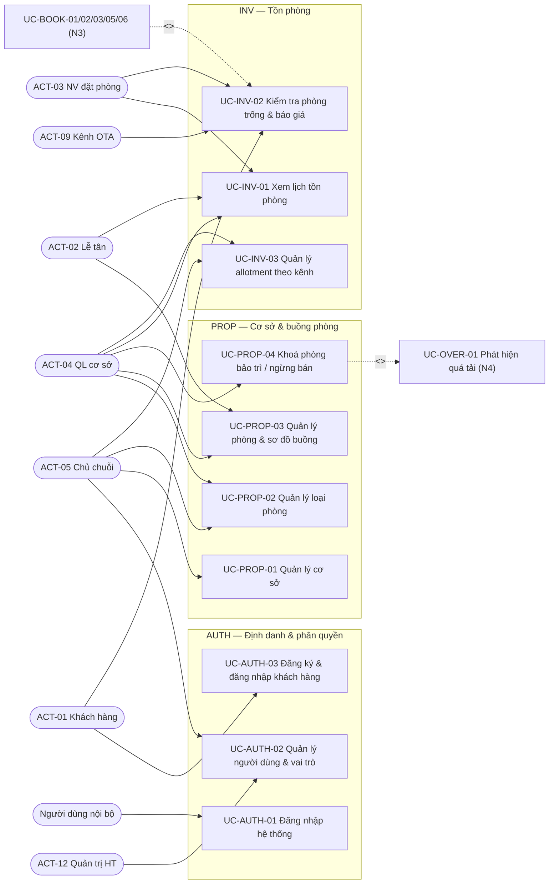
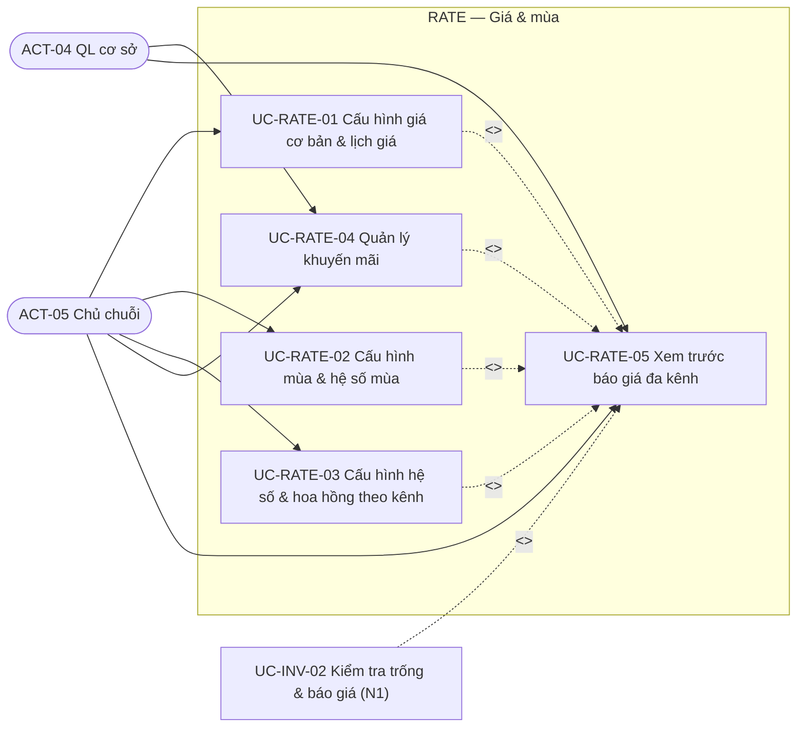
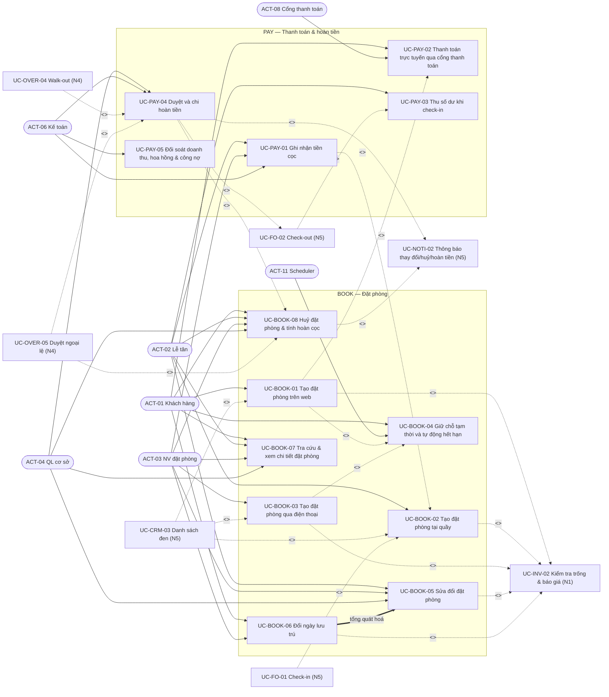
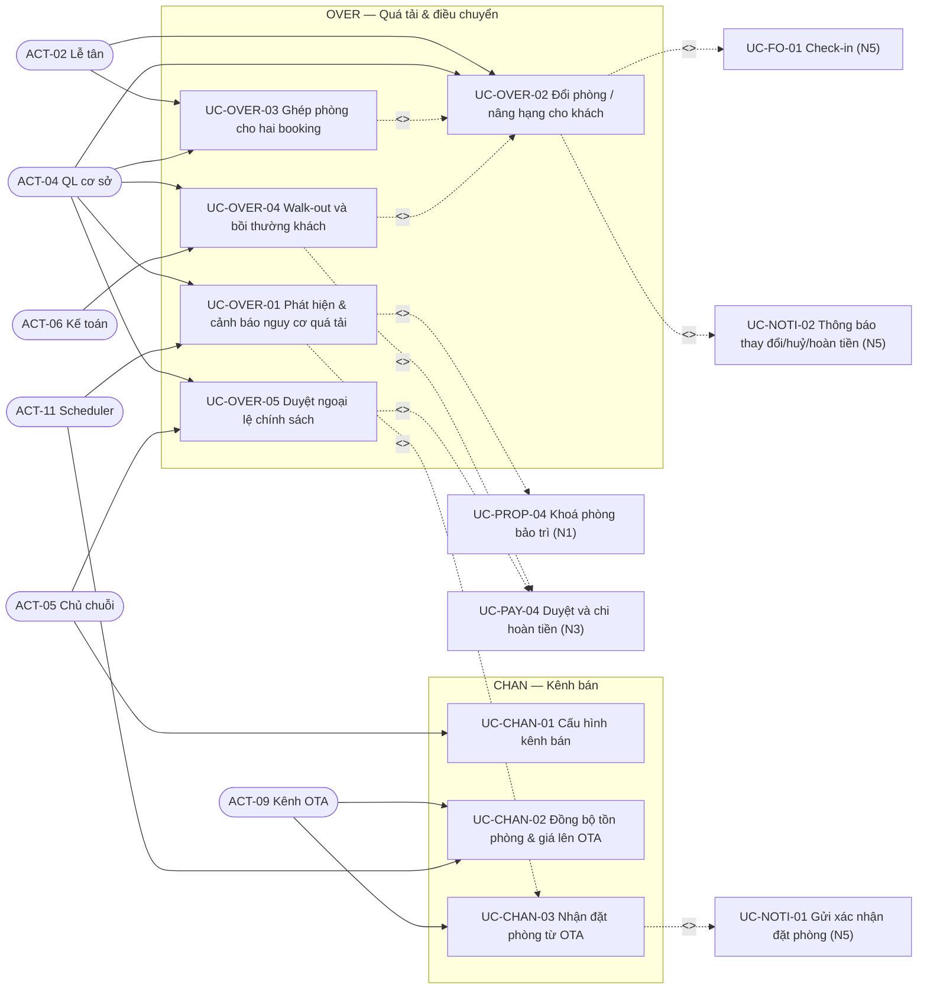
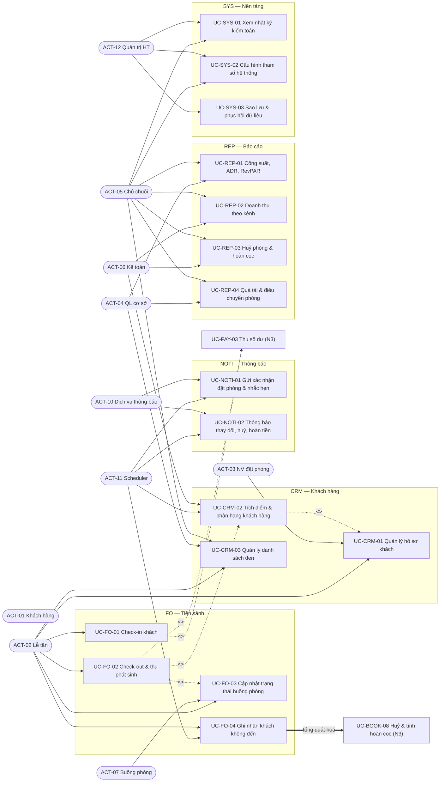
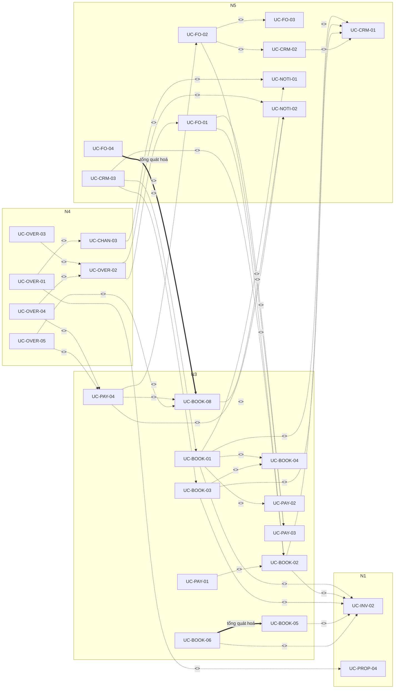

# 01 — Mô hình Use Case

> Trả lời bốn câu hỏi: **ai** dùng hệ thống, **được làm gì**, **theo trình tự nào**, **bị ràng buộc bởi quy tắc nào**.
> Nguồn chân lý mã UC/actor: [00 — Tổng quan](../00-tong-quan.md) §4 và §8. Nguồn chân lý con số nghiệp vụ: [02 — Quy tắc nghiệp vụ](../02-nghiep-vu/quy-tac-nghiep-vu.md) (136 quy tắc `BR-*`); mã lỗi `E_*` đầy đủ ở [04/api](../04-thiet-ke/api.md) §4.2.
> Tài liệu này không định nghĩa lại giá trị nghiệp vụ nào; mọi con số chỉ được tham chiếu qua mã.

## 1. Phạm vi & quy ước

| # | Quy ước | Nội dung |
|---|---------|----------|
| 1 | Phạm vi | 3 cơ sở (**CS-01** Đà Lạt 24 phòng · **CS-02** Vũng Tàu 18 · **CS-03** Phan Thiết 13) — tổng **55 phòng**, **7 kênh bán**; bài toán **BT-1/BT-2/BT-3** |
| 2 | Số use case | **52 UC** = 3 AUTH · 4 PROP · 3 INV · 5 RATE · 8 BOOK · 5 PAY · 3 CHAN · 5 OVER · 4 FO · 3 CRM · 2 NOTI · 4 REP · 3 SYS |
| 3 | Số actor | **12 actor** `ACT-01…ACT-12`; `ACT-08/09/10/11` là **actor phụ** (hệ thống ngoài hoặc dịch vụ lập lịch) |
| 4 | Mã quy tắc | Chỉ dùng mã `BR-<MOD>-<nn>` đã có trong [02/quy-tac-nghiep-vu](../02-nghiep-vu/quy-tac-nghiep-vu.md) §14; tài liệu này không phát sinh mã `BR-*` mới |
| 5 | Mã phi chức năng | Chỉ dùng mã `NFR-<NHÓM>-<nn>` (8 nhóm PERF, REL, SEC, USE, MAIN, COMP, OBS, LOC) đã có trong [01/yeu-cau-phi-chuc-nang](yeu-cau-phi-chuc-nang.md) |
| 6 | Ký hiệu sơ đồ | `-->` actor–UC (kết hợp) · `-.->|"<<include>>"|` bắt buộc · `-.->|"<<extend>>"|` có điều kiện · `==>|tổng quát hoá|` con → cha |
| 7 | Tần suất | "lượt/ngày" là **ước lượng khảo sát toàn chuỗi 3 cơ sở**, dùng để xếp hạng rủi ro — không phải cam kết SLA |
| 8 | Mức rủi ro | **Cao** = có đặc tả chi tiết ở §6 · **Trung** = nhiều nhánh nhưng đã có tiền lệ · **Thấp** = CRUD/tra cứu, ít nhánh |

### 1.1. Năm nhóm chức năng lớn (ánh xạ 13 module)

| Nhóm | Tên nhóm | Module | Số UC | Sơ đồ | Điểm hội tụ bắt buộc |
|------|----------|--------|-------|-------|----------------------|
| **N1** | Nền tảng, cơ sở & tồn phòng | `AUTH`, `PROP`, `INV` | 10 | §3.1 | `UC-INV-02` (mọi báo giá) |
| **N2** | Giá, mùa & gói giá | `RATE` | 5 | §3.2 | `UC-RATE-05` (xem trước) |
| **N3** | Đặt phòng & thanh toán | `BOOK`, `PAY` | 13 | §3.3 | `UC-INV-02`, `UC-PAY-04` |
| **N4** | Kênh bán & xử lý quá tải | `CHAN`, `OVER` | 8 | §3.4 | `UC-OVER-02` (bộ điều phối) |
| **N5** | Vận hành, khách hàng, thông báo, báo cáo & hệ thống | `FO`, `CRM`, `NOTI`, `REP`, `SYS` | 16 | §3.5 | `UC-NOTI-02`, `UC-FO-02` |

## 2. Actor

| Mã | Actor | Loại | Mục tiêu chính | Nhóm UC đảm nhận | `UserRole` |
|----|-------|------|----------------|------------------|-----------|
| ACT-01 | Khách hàng (Guest) | Người, **chính** | Tìm phòng, tự đặt, trả cọc, tự huỷ/đổi ngày, xem lịch sử | N2, N3, N4 (gián tiếp) | không dùng `UserRole` (định danh `Guest`) |
| ACT-02 | Lễ tân (Front Desk) | Người, **chính** | Check-in/out, nhận khách vãng lai, thu tiền, đổi phòng, ghi no-show | N1, N3, N4, N5 | `FRONT_DESK` |
| ACT-03 | Nhân viên đặt phòng | Người, **chính** | Nhận đặt qua điện thoại, giữ chỗ, nhập cọc | N1, N3, N5 | `RESERVATION_AGENT` |
| ACT-04 | Quản lý cơ sở | Người, **chính** | Duyệt ngoại lệ, xử lý quá tải, chốt giá cao điểm, xếp buồng | N1, N2, N3, N4, N5 | `MANAGER` |
| ACT-05 | Chủ chuỗi (Owner) | Người, **chính** | Cấu hình mùa/giá/kênh/chính sách huỷ, xem báo cáo toàn chuỗi | N1, N2, N4, N5 | `OWNER` |
| ACT-06 | Kế toán | Người, **chính** | Đối soát cọc, hoàn tiền, hoa hồng OTA, công nợ | N3, N5 | `ACCOUNTANT` |
| ACT-07 | Nhân viên buồng phòng | Người, **chính** | Nhận & cập nhật trạng thái dọn phòng trên Android | N5 | `HOUSEKEEPING` |
| ACT-08 | Cổng thanh toán (PSP) | Hệ thống ngoài, **phụ** | Tạo giao dịch, callback kết quả (VNPay / MoMo) | N3 | — |
| ACT-09 | Kênh OTA | Hệ thống ngoài, **phụ** | Đẩy đặt phòng vào, kéo tồn phòng & giá ra | N1, N3, N4 | — |
| ACT-10 | Dịch vụ thông báo | Hệ thống ngoài, **phụ** | Gửi email (Resend), SMS, Zalo OA | N5 | — |
| ACT-11 | Dịch vụ lập lịch (Scheduler) | Hệ thống nội bộ, **phụ** | Hết hạn hold, quét quá tải T−24h, no-show, đồng bộ kênh, tích điểm | N3, N4, N5 | tài khoản dịch vụ |
| ACT-12 | Quản trị hệ thống | Người, **chính** | Cấu hình tham số, phân quyền, sao lưu, xem nhật ký kiểm toán | N1, N5 | `OWNER`/quản trị nền tảng |

**Actor chính** khởi phát UC và nhận giá trị nghiệp vụ; **actor phụ** chỉ tham gia ở một bước (được gọi ra hoặc bị gọi tới) và không bao giờ đứng một mình.
Ba nhóm actor trong [00 §4](../00-tong-quan.md#4-actor) (người dùng nội bộ = `ACT-02…ACT-07, ACT-12`; dịch vụ ngoài = `ACT-08/09/10`; dịch vụ nội bộ = `ACT-11`) là **cách vẽ gọn**, không phải actor có mã mới; `UC-AUTH-01` phục vụ cả nhóm người dùng nội bộ nên được vẽ qua nút khái quát hoá ở §3.1.

## 3. Sơ đồ use case theo 5 nhóm chức năng

Quy ước: mỗi sơ đồ chỉ vẽ quan hệ **đi vào/đi ra nhóm đó**; bảng đầy đủ ở §5; `UC-*` ngoài nhóm được ghi rõ tên nhóm trong nhãn.

### 3.1. Nhóm N1 — Nền tảng, cơ sở & tồn phòng

`UC-INV-02` là **cổng vào duy nhất** cho mọi luồng cần tồn/báo giá; `UC-PROP-04` là mắt xích nối sang N4 vì khoá phòng có thể đè lên booking đang hoạt động.

### 3.2. Nhóm N2 — Giá, mùa & gói giá

`UC-RATE-05` và `UC-INV-02` dùng **cùng động cơ giá**, kết quả phải trùng khớp theo `BR-RATE-17`; cả 4 UC cấu hình include `UC-RATE-05` để thấy tác động trước khi lưu.

### 3.3. Nhóm N3 — Đặt phòng & thanh toán

Hai điểm hội tụ bắt buộc: `UC-INV-02` (mọi luồng tạo/sửa booking) và `UC-PAY-04` (mọi luồng phát sinh hoàn tiền: huỷ thường, walk-out, bất khả kháng, trả phòng sớm).

### 3.4. Nhóm N4 — Kênh bán & xử lý quá tải

`UC-OVER-02` là **bộ điều phối**: điều khiển thang bậc theo thứ tự bắt buộc — thực tế vận hành là **1 → 2 → 4** vì bậc 3 (cơ sở khác trong ≤ 15 km) không khả dụng khi ba cơ sở cách nhau 160–300 km; nó gọi `UC-OVER-03` khi hai booking đồng ý ghép và `UC-OVER-04` khi hết phương án. Mọi nhánh đều kết thúc bằng một `RoomMove` có `priceLocked = true`.

### 3.5. Nhóm N5 — Vận hành, khách hàng, thông báo, báo cáo & hệ thống

`ACT-11` là actor chính của 4 UC tự động (`UC-FO-04`, `UC-CRM-02`, `UC-NOTI-01`, `UC-NOTI-02`) — nhóm này **không có giao diện người dùng**, chạy theo lịch và được quan sát qua bảng điều khiển + metric.
`ACT-10` (email/SMS/Zalo OA) là actor phụ ở mọi UC gửi thông báo; `ACT-01` nhận giá trị gián tiếp qua `UC-NOTI-*`.

### 3.6. Sơ đồ quan hệ include / extend / tổng quát hoá (rút gọn)

## 4. Danh mục 52 use case

Mã và tên **giữ nguyên** như [00 §8](../00-tong-quan.md#8-danh-mục-use-case). Cột **BR chính** là ràng buộc không thể bỏ qua khi thực hiện UC; danh sách đầy đủ hơn ở §5 và ở từng đặc tả §6.

| Nhóm | Mã UC | Tên use case | Actor chính | Actor phụ | BR chính |
|------|-------|--------------|-------------|-----------|----------|
| AUTH | UC-AUTH-01 | Đăng nhập hệ thống | ACT-02…ACT-07, ACT-12 | — | BR-RBAC-01, BR-RBAC-02, BR-RBAC-05, BR-RBAC-06 |
| AUTH | UC-AUTH-02 | Quản lý người dùng & vai trò | ACT-05, ACT-12 | — | BR-RBAC-01, BR-RBAC-02, BR-RBAC-03 |
| AUTH | UC-AUTH-03 | Đăng ký & đăng nhập khách hàng | ACT-01 | ACT-10 | BR-CRM-01, BR-GEN-08, BR-SYS-04 |
| PROP | UC-PROP-01 | Quản lý cơ sở | ACT-05 | — | BR-PROP-01, BR-PROP-02, BR-INV-06 |
| PROP | UC-PROP-02 | Quản lý loại phòng | ACT-05, ACT-04 | — | BR-PROP-03, BR-PROP-04, BR-RATE-03, BR-RATE-04 |
| PROP | UC-PROP-03 | Quản lý phòng & sơ đồ buồng | ACT-04, ACT-02 | ACT-07 | BR-PROP-05, BR-PROP-06, BR-FO-07 |
| PROP | UC-PROP-04 | Khoá phòng bảo trì / ngừng bán | ACT-04 | — | BR-INV-06, BR-PROP-06, BR-GEN-07 |
| INV | UC-INV-01 | Xem lịch tồn phòng (grid theo ngày) | ACT-02, ACT-03, ACT-04 | — | BR-INV-01, BR-INV-07, BR-RBAC-02 |
| INV | UC-INV-02 | Kiểm tra phòng trống & báo giá | ACT-01, ACT-03, ACT-09 | — | BR-INV-01, BR-INV-02, BR-INV-07, BR-RATE-17 |
| INV | UC-INV-03 | Quản lý allotment theo kênh | ACT-05, ACT-04 | — | BR-INV-05, BR-CHAN-01, BR-CHAN-08 |
| RATE | UC-RATE-01 | Cấu hình giá cơ bản & lịch giá | ACT-05 | — | BR-RATE-02, BR-RATE-03, BR-RATE-04, BR-RATE-19, BR-RBAC-04 |
| RATE | UC-RATE-02 | Cấu hình mùa & hệ số mùa | ACT-05 | — | BR-RATE-05, BR-RATE-06 |
| RATE | UC-RATE-03 | Cấu hình hệ số & hoa hồng theo kênh | ACT-05 | — | BR-RATE-07, BR-RATE-09, BR-RATE-18, BR-CHAN-06 |
| RATE | UC-RATE-04 | Quản lý khuyến mãi | ACT-05, ACT-04 | — | BR-RATE-10, BR-RATE-11, BR-RATE-12, BR-RATE-13, BR-RATE-14 |
| RATE | UC-RATE-05 | Xem trước báo giá đa kênh | ACT-04, ACT-05 | — | BR-RATE-01, BR-RATE-08, BR-RATE-15, BR-RATE-17 |
| BOOK | UC-BOOK-01 | Tạo đặt phòng trên web | ACT-01 | ACT-08, ACT-10, ACT-11 | BR-BOOK-01, BR-BOOK-03, BR-BOOK-09, BR-BOOK-15, BR-BOOK-16, BR-RATE-16 |
| BOOK | UC-BOOK-02 | Tạo đặt phòng tại quầy (khách vãng lai) | ACT-02 | ACT-10 | BR-BOOK-01, BR-BOOK-04, BR-BOOK-09, BR-BOOK-10, BR-PAY-01 |
| BOOK | UC-BOOK-03 | Tạo đặt phòng qua điện thoại | ACT-03 | ACT-10, ACT-11 | BR-BOOK-01, BR-BOOK-07, BR-BOOK-09, BR-RATE-07 |
| BOOK | UC-BOOK-04 | Giữ chỗ tạm thời và tự động hết hạn | ACT-01, ACT-11 | ACT-10 | BR-BOOK-07, BR-BOOK-08, BR-INV-04, BR-SYS-02 |
| BOOK | UC-BOOK-05 | Sửa đổi đặt phòng | ACT-02, ACT-03, ACT-04 | — | BR-BOOK-10, BR-BOOK-13, BR-BOOK-14, BR-BOOK-17 |
| BOOK | UC-BOOK-06 | Đổi ngày lưu trú (reschedule) | ACT-01, ACT-03 | ACT-10 | BR-BOOK-12, BR-BOOK-13, BR-CANCEL-08 |
| BOOK | UC-BOOK-07 | Tra cứu & xem chi tiết đặt phòng | ACT-01, ACT-02, ACT-03, ACT-04 | — | BR-GEN-06, BR-RBAC-02, BR-BOOK-06 |
| BOOK | UC-BOOK-08 | Huỷ đặt phòng & tính hoàn cọc | ACT-01, ACT-02, ACT-03, ACT-04 | ACT-10, ACT-11 | BR-CANCEL-01…07, BR-CANCEL-19, BR-BOOK-11, BR-BOOK-14, BR-BOOK-17, BR-PAY-02 |
| PAY | UC-PAY-01 | Ghi nhận tiền cọc | ACT-02, ACT-03, ACT-06 | — | BR-PAY-01, BR-PAY-02, BR-PAY-06, BR-PAY-10 |
| PAY | UC-PAY-02 | Thanh toán trực tuyến qua cổng thanh toán | ACT-01, ACT-08 | ACT-11, ACT-10 | BR-PAY-03, BR-PAY-04, BR-PAY-05, BR-GEN-08 |
| PAY | UC-PAY-03 | Thu số dư khi check-in | ACT-02 | — | BR-PAY-02, BR-PAY-06, BR-FO-01 |
| PAY | UC-PAY-04 | Duyệt và chi hoàn tiền | ACT-04, ACT-06 | ACT-08, ACT-10 | BR-CANCEL-15, BR-CANCEL-16, BR-CANCEL-17, BR-CANCEL-18, BR-PAY-07…09 |
| PAY | UC-PAY-05 | Đối soát doanh thu, hoa hồng & công nợ | ACT-06 | — | BR-PAY-06, BR-PAY-10, BR-RATE-08, BR-RATE-09, BR-SYS-04 |
| CHAN | UC-CHAN-01 | Cấu hình kênh bán | ACT-05 | — | BR-CHAN-01, BR-CHAN-05, BR-RATE-07 |
| CHAN | UC-CHAN-02 | Đồng bộ tồn phòng & giá lên OTA | ACT-11 | ACT-09 | BR-CHAN-02, BR-CHAN-06, BR-CHAN-07 |
| CHAN | UC-CHAN-03 | Nhận đặt phòng từ OTA | ACT-09 | ACT-11, ACT-04, ACT-10 | BR-CHAN-03, BR-CHAN-04, BR-CHAN-08, BR-OVER-03 |
| OVER | UC-OVER-01 | Phát hiện & cảnh báo nguy cơ quá tải | ACT-11, ACT-04 | ACT-05, ACT-10 | BR-OVER-01…05, BR-OVER-16, BR-INV-01, BR-INV-06 |
| OVER | UC-OVER-02 | Đổi phòng / nâng hạng cho khách | ACT-02, ACT-04 | ACT-05, ACT-10 | BR-OVER-06…12 |
| OVER | UC-OVER-03 | Ghép phòng cho hai booking | ACT-02, ACT-04 | ACT-01, ACT-10 | BR-OVER-13, BR-OVER-14, BR-OVER-15 |
| OVER | UC-OVER-04 | Walk-out và bồi thường khách | ACT-04 | ACT-05, ACT-06, ACT-10 | BR-CANCEL-14, BR-OVER-06, BR-OVER-11 |
| OVER | UC-OVER-05 | Duyệt ngoại lệ chính sách (bất khả kháng, hoàn 100%) | ACT-04, ACT-05 | ACT-10 | BR-CANCEL-13, BR-CANCEL-15, BR-OVER-07 |
| FO | UC-FO-01 | Check-in khách | ACT-02 | ACT-07, ACT-11, ACT-10 | BR-FO-01, BR-FO-02, BR-FO-04, BR-PAY-02 |
| FO | UC-FO-02 | Check-out & thu phát sinh | ACT-02 | ACT-07, ACT-06 | BR-FO-03, BR-FO-05, BR-FO-06, BR-CANCEL-09 |
| FO | UC-FO-03 | Cập nhật trạng thái buồng phòng | ACT-07, ACT-02 | — | BR-FO-06, BR-FO-07 |
| FO | UC-FO-04 | Ghi nhận khách không đến (no-show) | ACT-02, ACT-11 | ACT-10 | BR-CANCEL-10, BR-BOOK-06, BR-CRM-06 |
| CRM | UC-CRM-01 | Quản lý hồ sơ khách | ACT-02, ACT-03 | — | BR-CRM-01, BR-CRM-05, BR-SYS-04 |
| CRM | UC-CRM-02 | Tích điểm & phân hạng khách hàng | ACT-11, ACT-06 | — | BR-CRM-02, BR-CRM-03, BR-CRM-06 |
| CRM | UC-CRM-03 | Quản lý danh sách đen | ACT-04, ACT-05 | — | BR-CRM-04, BR-BOOK-15 |
| NOTI | UC-NOTI-01 | Gửi xác nhận đặt phòng & nhắc hẹn | ACT-11 | ACT-10 | BR-SYS-06, BR-GEN-07 |
| NOTI | UC-NOTI-02 | Thông báo thay đổi, huỷ, hoàn tiền | ACT-11 | ACT-10 | BR-SYS-06, BR-OVER-10, BR-CANCEL-12 |
| REP | UC-REP-01 | Báo cáo công suất, ADR, RevPAR | ACT-05, ACT-04 | — | BR-REP-01, BR-RATE-08, BR-INV-01 |
| REP | UC-REP-02 | Báo cáo doanh thu theo kênh | ACT-05, ACT-06 | — | BR-REP-01, BR-RATE-08, BR-PAY-10 |
| REP | UC-REP-03 | Báo cáo huỷ phòng & hoàn cọc | ACT-05, ACT-06 | — | BR-REP-01, BR-CANCEL-04, BR-CANCEL-05, BR-CANCEL-13, BR-PAY-07 |
| REP | UC-REP-04 | Báo cáo quá tải & điều chuyển phòng | ACT-04, ACT-05 | — | BR-REP-01, BR-OVER-04, BR-OVER-06, BR-OVER-15, BR-CANCEL-14 |
| SYS | UC-SYS-01 | Xem nhật ký kiểm toán | ACT-05, ACT-12 | — | BR-SYS-01, BR-SYS-05, BR-GEN-07 |
| SYS | UC-SYS-02 | Cấu hình tham số hệ thống | ACT-12, ACT-05 | — | BR-SYS-02, BR-CANCEL-11 |
| SYS | UC-SYS-03 | Sao lưu & phục hồi dữ liệu | ACT-12 | — | BR-SYS-03, BR-SYS-04 |

**Kiểm tra phủ:** 52/52 UC có ≥ 1 mã BR thật và ≥ 1 actor chính; 12 UC rủi ro **Cao** đều có đặc tả ở §6; danh sách UC theo actor ở §7; ước lượng độ phức tạp ở §8.

## 5. Quan hệ giữa các use case

| # | Nguyên tắc | Lý do |
|---|-----------|-------|
| 1 | `<<include>>` cho hành vi **bắt buộc về nghiệp vụ** (kiểm tra tồn, tính hoàn cọc, thông báo bắt buộc, thu tiền bắt buộc) | Bỏ bước đó là vi phạm bất biến nghiệp vụ |
| 2 | `<<extend>>` cho hành vi **có điều kiện** (danh sách đen, bất khả kháng, ghép phòng, walk-out, thu tiền tại quầy) | Luồng chính vẫn thành công khi điều kiện không xảy ra |
| 3 | Không tạo UC cha "ảo" cho 3 UC tạo booking theo kênh | Danh mục 00 §8 không có mã đó; hành vi dùng chung đã factor hoá qua include `UC-INV-02`, `UC-BOOK-04`, `UC-CRM-01` |

### 5.1. Quan hệ `<<include>>`

| # | UC nguồn | Include | Căn cứ | Hệ quả nếu bỏ bước |
|---|----------|---------|--------|--------------------|
| I-01 | UC-BOOK-01, UC-BOOK-02, UC-BOOK-03 | UC-INV-02 | BR-INV-02, BR-INV-07 | Bán quá phòng vì kiểm tra tồn ngoài transaction |
| I-02 | UC-BOOK-05, UC-BOOK-06 | UC-INV-02 | BR-INV-07, BR-BOOK-12 | Kỳ mới không được kiểm tra từng đêm |
| I-03 | UC-BOOK-01, UC-BOOK-03 | UC-BOOK-04 | BR-BOOK-07 | Phòng bị khoá vô hạn vì không có đồng hồ hết hạn |
| I-04 | UC-BOOK-01 | UC-PAY-02 | BR-BOOK-09, BR-PAY-03 | Booking không bao giờ đạt `paidAmount ≥ depositAmount` |
| I-05 | UC-BOOK-01, UC-CHAN-03 | UC-NOTI-01 | BR-SYS-06 | Khách không nhận xác nhận kèm mã đặt phòng |
| I-06 | UC-BOOK-01, UC-BOOK-02, UC-BOOK-03 | UC-CRM-01 | BR-CRM-01 | Khách bị nhân bản do khác định dạng số điện thoại |
| I-07 | UC-BOOK-08 | UC-NOTI-02 | BR-SYS-06 | Khách không biết số tiền hoàn và mốc thời gian |
| I-08 | UC-PAY-04 | UC-NOTI-02 | BR-CANCEL-12, BR-CANCEL-16 | Khách không được thông báo đã chi hoàn |
| I-09 | UC-OVER-02 | UC-NOTI-02 | BR-OVER-10 | Vi phạm hạn thông báo 15 phút |
| I-10 | UC-OVER-04, UC-OVER-05 | UC-PAY-04 | BR-CANCEL-13, BR-CANCEL-14 | Hoàn 100% không qua phê duyệt, thất thoát tiền |
| I-11 | UC-FO-01, UC-FO-02 | UC-PAY-03 | BR-FO-01, BR-FO-05, BR-PAY-02 | Giao phòng / in hoá đơn khi còn nợ |
| I-12 | UC-FO-02 | UC-FO-03 | BR-FO-06 | Không sinh `HousekeepingTask`, phòng bẩn được bán tiếp |
| I-13 | UC-FO-02 | UC-CRM-02 | BR-CRM-03 | Khách không được tích điểm sau khi hoàn tất lưu trú |
| I-14 | UC-CRM-02 | UC-CRM-01 | BR-CRM-01, BR-CRM-02 | Điểm/hạng gắn sai hồ sơ khách |
| I-15 | UC-RATE-01, UC-RATE-02, UC-RATE-03, UC-RATE-04 | UC-RATE-05 | BR-RATE-15, BR-RATE-17 | Người cấu hình không thấy tác động giá trước khi lưu |
| I-16 | UC-INV-02 | UC-RATE-05 | BR-RATE-01, BR-RATE-17 | Giá trả cho khách lệch với giá xem trước |

### 5.2. Quan hệ `<<extend>>`

| # | UC mở rộng | Extend | Điểm mở rộng & điều kiện | Căn cứ |
|---|-----------|--------|--------------------------|--------|
| E-01 | UC-PAY-01 | UC-BOOK-02 | "thu tiền tại quầy": khách trả cọc/trả đủ ngay khi tạo booking | BR-PAY-01, BR-PAY-06 |
| E-02 | UC-FO-01 | UC-BOOK-02 | "nhận phòng ngay": khách vãng lai vào phòng sau khi tạo booking | BR-FO-01, BR-FO-04 |
| E-03 | UC-CRM-03 | UC-BOOK-01, UC-BOOK-02, UC-BOOK-03 | "khách nằm trong danh sách đen": chặn tạo booking, chỉ `MANAGER`+ override có lý do | BR-BOOK-15, BR-CRM-04 |
| E-04 | UC-PAY-04 | UC-BOOK-08 | "phát sinh hoàn tiền": `refundAmount > 0` sau khi áp bậc | BR-CANCEL-16 |
| E-05 | UC-PAY-04 | UC-FO-02 | "trả phòng sớm": hoàn trên `min(paidAmount, tổng giá các đêm chưa ở theo PriceSnapshot)`, ngưỡng lấy từ `CancellationPolicy.earlyCheckoutFreeHours`/`earlyCheckoutRefundPct`, lý do ghi `EARLY_CHECKOUT` | BR-CANCEL-09 |
| E-06 | UC-OVER-05 | UC-BOOK-08 | "bất khả kháng": thiên tai/dịch bệnh/lỗi hệ thống → hoàn 100% | BR-CANCEL-13 |
| E-07 | UC-OVER-01 | UC-CHAN-03 | "booking OTA vượt tồn": ghi nhận `CONFIRMED` + `oversold = true` + mở hồ sơ quá tải | BR-CHAN-03, BR-OVER-03 |
| E-08 | UC-OVER-01 | UC-PROP-04 | "khoá phòng chồng lên booking đang hoạt động": chỉ `MANAGER`+ có lý do | BR-INV-06 |
| E-09 | UC-OVER-02 | UC-FO-01 | "phòng dự kiến không sẵn sàng khi check-in": phòng `MAINTENANCE` hoặc chưa dọn xong | BR-PROP-06, BR-FO-07 |
| E-10 | UC-OVER-03 | UC-OVER-02 | "bậc 1–2 không thực hiện được và hai khách đồng ý ghép phòng" | BR-OVER-13 |
| E-11 | UC-OVER-04 | UC-OVER-02 | "không còn phương án bậc 1–2 (bậc 3 không khả dụng) hoặc khách từ chối phương án điều chuyển"; walk-out ghi `RoomMove.walkOutDocNo` + `guestSignatureRef`/`staffSignatureRef` | BR-CANCEL-14, thang bậc `BR-OVER-06` |

### 5.3. Quan hệ tổng quát hoá

| # | UC con | UC cha | Lý do chuyên biệt hoá | Căn cứ |
|---|--------|--------|-----------------------|--------|
| G-01 | UC-BOOK-06 Đổi ngày lưu trú | UC-BOOK-05 Sửa đổi đặt phòng | Đổi ngày là một dạng sửa đổi nhưng có luật riêng (1 lần miễn phí khi ≥ 168h, phí 10% cho `NONREF`, chênh lệch giá) | BR-BOOK-12 |
| G-02 | UC-FO-04 Ghi nhận no-show | UC-BOOK-08 Huỷ đặt phòng & tính hoàn cọc | No-show dùng **cùng** động cơ chính sách huỷ (áp bậc cuối) nhưng khác actor khởi phát và thời điểm | BR-CANCEL-10 |

`UC-OVER-04` (walk-out) **không** là UC con của `UC-BOOK-08`: nó không chỉ chấm dứt booking mà còn phát sinh bồi thường và hỗ trợ tìm chỗ ở thay thế, nên được mô hình hoá bằng `<<extend>>` E-11 + include `UC-PAY-04` (I-10).

## 6. Đặc tả chi tiết 12 UC rủi ro cao

12 UC dưới đây được chọn vì **tập trung cả ba bài toán BT-1/BT-2/BT-3** và là nơi sai sót gây thiệt hại tiền hoặc trải nghiệm: `UC-BOOK-01`, `UC-BOOK-02`, `UC-BOOK-04`, `UC-BOOK-06`, `UC-BOOK-08`, `UC-PAY-02`, `UC-PAY-04`, `UC-CHAN-03`, `UC-OVER-01`, `UC-OVER-02`, `UC-OVER-03`, `UC-FO-01`. Mã `E_*` chỉ dùng những mã đã chốt ở [04/api](../04-thiet-ke/api.md); các vi phạm chưa có mã riêng được mô tả bằng điều kiện nghiệp vụ.

### 6.1. UC-BOOK-01 — Tạo đặt phòng trên web

**Actor.** Chính: ACT-01 (khách web) · Phụ: ACT-08 (qua UC-PAY-02), ACT-10, ACT-11 (qua UC-BOOK-04) · **Tần suất.** ≈35 lượt/ngày toàn chuỗi, cao điểm lễ ×2–3.
**Mục tiêu.** Khách tự tạo booking, thấy giá **từng đêm**, và booking chỉ chuyển `CONFIRMED` khi đã trả đủ cọc.
**Tiền điều kiện.** Khách có phiên đăng nhập (UC-AUTH-03); kỳ lưu trú còn tồn khả dụng cho **mọi** đêm; khách không nằm trong danh sách đen.
**Hậu điều kiện.** Thành công: `Booking` ở `HELD` → `PENDING_PAYMENT`/`CONFIRMED`, `RoomAssignment` đang hoạt động cho mọi đêm, `PriceSnapshot` + `BookingStatusHistory` + `AuditLog` + `OutboxEvent`. Thất bại: không có `Booking`; hold (nếu đã tạo) được giải phóng.
**Luồng chính.**
1. Khách chọn cơ sở, ngày nhận/trả, số người lớn và trẻ em.
2. Hệ thống gọi UC-INV-02: kiểm tra tồn **theo từng đêm** (tồn chung = phòng `ACTIVE` − `RoomBlock` − `RoomAssignment` − hold chưa sinh assignment; tồn kênh = `min(tồn chung, allotment − used)`), chọn `ChannelPropertySetting` theo `effectiveFrom` lớn nhất ≤ **ngày của từng đêm** và báo giá theo thứ tự hệ số cố định.
3. Hệ thống hiển thị loại phòng khả dụng kèm giá từng đêm, tổng tạm tính, tiền cọc và chính sách huỷ của từng gói giá.
4. Khách chọn loại phòng + gói giá; hệ thống kiểm tra số đêm so với `minNights`/`maxNights`, sức chứa tối đa và phụ thu trẻ em.
5. Khách nhập thông tin liên hệ; hệ thống định danh khách theo số điện thoại chuẩn hoá, kiểm tra danh sách đen và chống đặt trùng.
6. Khách nhập mã khuyến mãi (tuỳ chọn); hệ thống áp theo thứ tự tất định (`AMOUNT` trước, `PERCENT` sau, cùng loại theo `code` tăng dần), cắt trần 30% tổng tạm tính; nếu kết quả chạm sàn giá thì **bỏ mã, giữ giá gốc, vẫn cho xác nhận**, ghi cảnh báo `E_RATE_BELOW_FLOOR` vào `PriceQuote.warnings[]` (nhánh chặn HTTP 422 chỉ áp ở màn hình cấu hình khuyến mãi của quản lý).
7. Khách xác nhận → hệ thống tạo `Hold` (`holdExpiresAt` theo `channel.holdMinutes`), booking `HELD` (include UC-BOOK-04) và **lưu `PriceSnapshot` (`seq`, `kind = ORIGINAL`, `engineVersion`) ngay khi booking rời `DRAFT`** để phục vụ tính phụ thu đêm đầu về sau.
8. Hệ thống kiểm tra báo giá còn hiệu lực 15 phút; quá hạn thì tính lại và trình giá mới trước khi thu tiền.
9. Khách trả cọc trực tuyến (include UC-PAY-02) → `Payment` loại `DEPOSIT` mang `Idempotency-Key`.
10. Khi `paidAmount ≥ depositAmount` → `CONFIRMED`; bổ sung/khẳng định `PriceSnapshot` của booking, ghi lịch sử trạng thái + `AuditLog` + `OutboxEvent`, xếp hàng UC-NOTI-01 và hiển thị mã đặt phòng.
**Luồng thay thế.** A1 (b.5) khách chưa có tài khoản → UC-AUTH-03 đăng ký nhanh rồi quay lại b.5. A2 (b.6) mã khuyến mãi hết hạn/hết lượt → từ chối áp, tiếp tục b.8 với giá gốc; nếu áp mã làm tổng chạm sàn → bỏ mã và trả cảnh báo `E_RATE_BELOW_FLOOR`. A3 (b.8) giá đã đổi → khách chấp nhận giá mới thì đi tiếp b.9, từ chối thì huỷ hold và kết thúc. A4 (b.9) khách chọn trả sau → booking `PENDING_PAYMENT`, hold tiếp tục chạy tới hạn.
**Luồng ngoại lệ.** E1 thiếu trường bắt buộc → `E_BOOK_MISSING_FIELD`; số khách vượt sức chứa → `E_BOOK_OVER_CAPACITY`. E2 hết phòng ở tầng nghiệp vụ (một đêm không còn phòng) → `E_INV_NO_AVAILABILITY` (HTTP 409) kèm danh sách đêm thiếu; tranh chấp đồng thời ở tầng CSDL → ràng buộc loại trừ trả `23P01`, tầng ứng dụng chuyển thành `E_INV_ROOM_TAKEN` (HTTP 409), cấm nuốt lỗi rồi báo thành công. E3 hold hết hạn trước khi trả cọc → booking `EXPIRED`, phòng trở lại tồn khả dụng, khách phải đặt lại. E4 khách trong danh sách đen → chặn, chỉ `MANAGER`+ override có lý do (UC-CRM-03 extend). E5 nghi trùng trong 24 giờ → trả về booking cũ kèm cờ `duplicateSuspected`, không tạo mới.
**BR áp dụng.** BR-BOOK-01/02/03/04/05/07/08/09/10/15/16, BR-INV-01/02/03/07, BR-RATE-01/10/11/12/13/14/15/16/17, BR-GEN-01/03/06/08, BR-CRM-01, BR-CHAN-06, BR-SYS-06.
**NFR liên quan.** NFR-PERF-01, NFR-PERF-03, NFR-REL-01, NFR-REL-02, NFR-REL-06, NFR-SEC-02, NFR-USE-05, NFR-COMP-01, NFR-COMP-03, NFR-LOC-03 ([chi tiết](yeu-cau-phi-chuc-nang.md)).

### 6.2. UC-BOOK-02 — Tạo đặt phòng tại quầy (khách vãng lai)

**Actor.** Chính: ACT-02 (lễ tân) · Phụ: ACT-10, ACT-11 (hết hạn), ACT-08 nếu khách quét QR · **Tần suất.** 8–12 lượt/ngày toàn chuỗi (2–5 lượt/cơ sở), cao điểm ≈20 lượt/ngày.
**Mục tiêu.** Ghi nhận booking walk-in và cấp phòng trong **≤ 3 phút** (tiêu chí thành công #5 của [00 §12](../00-tong-quan.md#12-tiêu-chí-thành-công-của-dự-án)), giá theo hệ số kênh `WALKIN`.
**Tiền điều kiện.** Lễ tân đã đăng nhập với `propertyScope` đúng cơ sở; còn tồn khả dụng; ngày nhận phòng là hôm nay.
**Hậu điều kiện.** Thành công: `Booking` `CONFIRMED` (đủ cọc **hoặc** `MANAGER`+ cho ghi nợ có lý do), `RoomAssignment`, `PriceSnapshot`, `AuditLog`, phiếu xác nhận, thông báo xếp hàng. Thất bại: không có `Booking`; nếu tiền đã thu thì `Payment` được đảo bằng bút toán `REFUND` (không sửa/xoá bản ghi gốc).
**Luồng chính.**
1. Lễ tân tra khách theo số điện thoại; hệ thống hiển thị hồ sơ và hạng khách nếu đã có.
2. Lễ tân mở màn tạo booking, chọn cơ sở trong phạm vi được phép.
3. Nhập ngày nhận/trả, số người; hệ thống gọi UC-INV-02 kiểm tra tồn từng đêm.
4. Chọn loại phòng; hệ thống báo giá theo kênh quầy (cao hơn kênh trực tiếp), tiền cọc và chính sách huỷ.
5. Lễ tân xác nhận số khách, giấy tờ tuỳ thân và thông tin liên hệ; hệ thống lưu vào hồ sơ khách.
6. Lễ tân thu tiền: cọc theo gói giá, hoặc toàn bộ, hoặc một phần (UC-PAY-01 extend).
7. Khi đủ cọc **hoặc** có duyệt ghi nợ của `MANAGER`+ → booking `CONFIRMED`; ngược lại giữ `PENDING_PAYMENT`.
8. Hệ thống lưu `PriceSnapshot`, ghi `BookingStatusHistory` + `AuditLog` + `OutboxEvent`, cấp `RoomAssignment` cho mọi đêm.
9. Nếu phòng sạch và khách muốn vào ngay → chuyển sang UC-FO-01 (extend).
10. In/gửi phiếu xác nhận, xếp hàng thông báo và kết thúc.
**Luồng thay thế.** A1 (b.1) khách chưa có hồ sơ → UC-CRM-01 tạo hồ sơ tối thiểu theo số điện thoại chuẩn hoá. A2 (b.6) khách trả một phần → ghi `balanceDue`, phần còn lại bắt buộc thu trước khi giao phòng. A3 (b.4) kỳ lưu trú ≥ 14 đêm → gợi ý gói `LONGSTAY14`. A4 (b.9) khách đến sớm → áp quy tắc check-in sớm (UC-FO-01).
**Luồng ngoại lệ.** E1 hết phòng hôm nay → đề xuất phương án điều chuyển (UC-OVER-02) hoặc từ chối lịch sự. E2 khách trong danh sách đen → chặn, chỉ `MANAGER`+ override có lý do (UC-CRM-03 extend). E3 trùng booking trong 24 giờ → trả booking cũ kèm cờ nghi trùng. E4 vượt sức chứa → `E_BOOK_OVER_CAPACITY`; thiếu trường → `E_BOOK_MISSING_FIELD`. E5 thu tiền xong nhưng không tạo được booking → hoàn ngay bằng bút toán `REFUND`, ghi `AuditLog`.
**BR áp dụng.** BR-BOOK-01/02/03/04/05/09/10/16, BR-RATE-03/04/07/16, BR-PAY-01/02/06, BR-RBAC-02/03, BR-CRM-01/04, BR-GEN-06/07/08.
**NFR liên quan.** NFR-USE-05, NFR-PERF-02, NFR-REL-05, NFR-REL-06, NFR-SEC-01, NFR-SEC-05, NFR-MAIN-05, NFR-LOC-03/04 ([chi tiết](yeu-cau-phi-chuc-nang.md)).

### 6.3. UC-BOOK-04 — Giữ chỗ tạm thời và tự động hết hạn

**Actor.** Chính: ACT-11 (job hết hạn) và ACT-01 (người khởi tạo hold qua UC-BOOK-01) · Phụ: ACT-10 · **Tần suất.** ≈20 lượt tạo hold/ngày; job quét 2.880 lượt/ngày (mỗi 30 giây).
**Mục tiêu.** Giữ phòng cho khách trong thời hạn của kênh và **tự trả phòng về tồn khả dụng** khi hết hạn, chống giữ chỗ ảo.
**Tiền điều kiện.** Có yêu cầu giữ chỗ từ UC-BOOK-01/03; kênh có `holdMinutes > 0`; kỳ lưu trú còn tồn cho mọi đêm.
**Hậu điều kiện.** Thành công (tạo hold): `Hold` + booking `HELD` + `RoomAssignment` giữ chỗ. Thất bại/hết hạn: `Hold.releasedAt` được đặt, `RoomAssignment` giải phóng, booking `EXPIRED` trong **cùng transaction**.
**Luồng chính.**
1. Hệ thống mở transaction và khoá bi quan theo `(roomTypeId, date)` cho mọi đêm của kỳ lưu trú.
2. Kiểm tra tồn từng đêm; nếu mọi đêm còn phòng thì giữ chỗ.
3. Tạo `Hold` với `expiresAt = thời điểm tạo + channel.holdMinutes` và chuyển booking sang `HELD`.
4. Ghi `BookingStatusHistory` + `AuditLog`; trả đồng hồ đếm ngược cho giao diện.
5. Job của ACT-11 chạy mỗi 30 giây (khoá `job.hold.releaseIntervalSeconds`), tìm `Hold` ở `ACTIVE` có `expiresAt ≤ hiện tại`; song song đó job đối chiếu mỗi 900 giây (khoá `job.holdReconcile.intervalSeconds`) so `Hold` với `Booking.holdExpiresAt` để phát hiện lệch trạng thái.
6. Trong một transaction: `Hold.status` → `EXPIRED` kèm `releasedAt`, chuyển booking `HELD` → `EXPIRED`, giải phóng toàn bộ `RoomAssignment`.
7. Phát biến cố `HoldExpired` qua outbox và đồng bộ lại tồn/giá lên kênh đang mở bán.
8. Ghi `AuditLog`; nếu đã có liên hệ thì xếp hàng thông báo cho khách; phòng trở lại tồn khả dụng trong ≤ 60 giây.
**Luồng thay thế.** A1 kênh có `holdMinutes = 0` → bỏ qua trạng thái `HELD`, booking đi thẳng `PENDING_PAYMENT`/`CONFIRMED`. A2 khách thanh toán trước hạn → hold chuyển thành assignment đang hoạt động và booking sang `PENDING_PAYMENT`/`CONFIRMED`. A3 hold của kênh OTA → do OTA giữ chỗ, hệ thống chỉ ghi nhận theo webhook.
**Luồng ngoại lệ.** E1 hai yêu cầu giữ cùng phòng/đêm đồng thời → ràng buộc loại trừ ở CSDL trả `23P01`, tầng ứng dụng chuyển thành `E_INV_ROOM_TAKEN` (kịch bản 200 yêu cầu đồng thời: đúng 1 thành công, phần còn lại nhận 409). E2 job chậm hoặc lỗi → chạy lại idempotent, cảnh báo vận hành khi vượt cam kết 60 giây. E3 booking đã `CANCELLED`/đã thanh toán khi job chạy → bỏ qua, không đổi trạng thái.
**BR áp dụng.** BR-BOOK-07/08, BR-INV-02/03/04/07, BR-PAY-05, BR-CHAN-02/06, BR-GEN-07, BR-SYS-02/06.
**NFR liên quan.** NFR-REL-01, NFR-REL-02, NFR-REL-05, NFR-PERF-01, NFR-SEC-04, NFR-OBS-02/04 ([chi tiết](yeu-cau-phi-chuc-nang.md)).

### 6.4. UC-BOOK-06 — Đổi ngày lưu trú (reschedule)

**Actor.** Chính: ACT-01, ACT-03 · Phụ: ACT-10, ACT-02/ACT-04 khi thao tác hộ · **Tần suất.** 2–4 lượt/ngày, tăng gấp đôi khi có bão/lễ.
**Mục tiêu.** Cho phép dời ngày **một lần miễn phí** theo gói giá, tính đúng chênh lệch giá và **không** phát sinh hoàn tiền.
**Tiền điều kiện.** Booking ở `HELD`/`PENDING_PAYMENT`/`CONFIRMED` (không `CHECKED_IN`); chưa từng đổi ngày; gói giá cho phép hoặc khách chấp nhận phí.
**Hậu điều kiện.** Thành công: kỳ lưu trú mới được gán phòng, **trạng thái booking giữ nguyên**, `PriceSnapshot` cũ vẫn được giữ để đối chiếu, `AuditLog` ghi thay đổi, chênh lệch (nếu tăng) đã thu. Thất bại: booking giữ nguyên kỳ cũ, không thay đổi gán phòng, không phát sinh `RefundRequest`.
**Luồng chính.**
1. Người dùng mở booking (UC-BOOK-07) và chọn "đổi ngày", nhập kỳ lưu trú mới.
2. Hệ thống kiểm tra điều kiện: trạng thái cho phép, `Booking.rescheduleCount` (chưa từng đổi ngày), số giờ còn lại tới giờ nhận phòng (14:00 giờ VN) và gói giá.
3. Hệ thống gọi UC-INV-02 kiểm tra tồn cho kỳ mới theo từng đêm.
4. Tính giá kỳ mới theo thứ tự hệ số bắt buộc và chênh lệch so với giá đã chốt.
5. Trình cho người dùng: phí đổi (nếu gói giá quy định), chênh lệch **phải thu thêm**, chính sách huỷ áp cho kỳ mới.
6. Người dùng xác nhận; hệ thống giải phóng `RoomAssignment` cũ và tạo mới cho kỳ mới trong **một transaction**.
7. Nếu chênh lệch > 0 hoặc có phí đổi → ghi `Payment` loại `RESCHEDULE_FEE` (UC-PAY-01/02/03); nếu chênh lệch < 0 → **không hoàn**.
8. Tăng `rescheduleCount`, **giữ nguyên trạng thái** booking, **lưu thêm `PriceSnapshot` mới cho kỳ mới (`kind = RESCHEDULE`) và giữ bản cũ** để đối chiếu; ghi `AuditLog` mô tả kỳ cũ → kỳ mới và `OutboxEvent` đồng bộ kênh.
9. Thông báo xác nhận đổi ngày (UC-NOTI-02); không tạo `RefundRequest`.
**Luồng thay thế.** A1 `rescheduleCount ≥ 1` (đổi lần thứ hai) → hệ thống chặn, đề nghị huỷ theo UC-BOOK-08 rồi tạo booking mới. A2 gói `NONREF` → thu phí 10% giá trị booking trước khi áp dụng. A3 kỳ mới dài hơn → áp hệ số độ dài kỳ lưu trú và kiểm tra lại `minNights`. A4 chỉ dời một đêm → vẫn tính lại toàn bộ kỳ, không tính riêng lẻ.
**Luồng ngoại lệ.** E1 kỳ mới không đủ tồn → từ chối, giữ nguyên booking hiện tại (transaction rollback). E2 booking `CHECKED_IN` → từ chối, hướng dẫn check-out rồi tạo booking mới. E3 còn dưới 168 giờ → không miễn phí; xử lý như huỷ + đặt mới. E4 thu chênh lệch thất bại → hoàn nguyên kỳ cũ, giữ nguyên gán phòng ban đầu.
**BR áp dụng.** BR-BOOK-03/12/13, BR-CANCEL-08, BR-INV-02/03/07, BR-RATE-01/16/17, BR-PAY-02, BR-CHAN-06, BR-GEN-07.
**NFR liên quan.** NFR-REL-05/06, NFR-PERF-04, NFR-COMP-03, NFR-COMP-05, NFR-LOC-02/03 ([chi tiết](yeu-cau-phi-chuc-nang.md)).

### 6.5. UC-BOOK-08 — Huỷ đặt phòng & tính hoàn cọc

**Actor.** Chính: ACT-01, ACT-02, ACT-03, ACT-04 · Phụ: ACT-10, ACT-11 (no-show dùng cùng động cơ) · **Tần suất.** 8–15 lượt/ngày (tỷ lệ huỷ ước 12–18% tổng booking).
**Mục tiêu.** Chấm dứt booking, giải phóng phòng **ngay trong cùng transaction**, và xác định số hoàn theo bậc mốc thời gian của gói giá — tính trên **số tiền đã thực trả**.
**Tiền điều kiện.** Booking ở `DRAFT`/`HELD`/`PENDING_PAYMENT`/`CONFIRMED`; biết gói giá, chính sách huỷ gắn với gói giá, `paidAmount` và giờ nhận phòng danh nghĩa.
**Hậu điều kiện.** Thành công: booking `CANCELLED` kèm `cancelReason`, mọi `RoomAssignment` được giải phóng, `RefundRequest` (`PENDING`) nếu số hoàn > 0, `Payment` loại `PENALTY` ở `PENDING` nếu bậc yêu cầu phụ thu, `AuditLog` + `OutboxEvent` + thông báo. Thất bại: booking giữ nguyên trạng thái, không giải phóng phòng, không tạo yêu cầu hoàn.
**Luồng chính.**
1. Người dùng chọn huỷ booking và nhập lý do; hệ thống kiểm tra quyền theo vai trò và phạm vi cơ sở.
2. Xác định trạng thái hiện tại: `DRAFT`/`HELD` **chưa phát sinh thanh toán** → xoá cứng kèm `AuditLog` có `beforeJson` đầy đủ ghi **trước khi** xoá; đã phát sinh thanh toán → đi tiếp luồng huỷ; đã `CANCELLED` → kết thúc idempotent.
3. Lấy `CancellationPolicy` theo gói giá của booking.
4. Tính số giờ còn lại tới thời điểm nhận phòng danh nghĩa (14:00 giờ Việt Nam).
5. Chọn bậc có `offsetHours` lớn nhất mà số giờ còn lại đạt tới; bậc cuối (`offsetHours = −1`) là **bậc bắt tất**, áp cho mọi trường hợp còn dưới 24 giờ **kể cả giá trị âm** (ví dụ no-show lúc 23:59) → xác định `refundPercent` và `chargeFirstNight`.
6. Tính số hoàn trên **`paidAmount`** (không phải `totalAmount`), làm tròn **xuống** bội số 1.000 VND.
7. Nếu bậc yêu cầu phụ thu đêm đầu → tính `penaltyAmount = max(0, giá đêm đầu − paidAmount)` và tạo `Payment` loại `PENALTY` ở `PENDING` (ghi công nợ, không tự thu). Booking đã `CANCELLED` **không** ghi công nợ cho phần `totalAmount − paidAmount`; `balanceDue = penaltyAmount`.
8. Trong một transaction: chuyển `CANCELLED` + `cancelReason`, giải phóng toàn bộ `RoomAssignment`, ghi `BookingStatusHistory` + `AuditLog`.
9. Nếu số hoàn > 0 → tạo `RefundRequest` ở `PENDING` và chuyển sang UC-PAY-04 (extend E-04).
10. Phát `OutboxEvent` đồng bộ tồn/giá lên kênh, xếp hàng UC-NOTI-02, và trả cho người dùng bảng tính: bậc áp dụng, số giờ trước nhận phòng, tỷ lệ hoàn, số tiền hoàn, phụ thu, thời hạn chi.
**Luồng thay thế.** A1 huỷ do bất khả kháng → UC-OVER-05 (extend E-06): hoàn 100%, miễn phụ thu và phí xử lý, bắt buộc lý do ≥ 20 ký tự và lưu minh chứng vào `RefundRequest.evidenceRefs[]`. A2 huỷ do khách sạn/walk-out → UC-OVER-04: hoàn 100% + bồi thường một đêm đầu. A3 booking từ OTA → áp chính sách của OTA, ghi `cancelReason = OTA_CANCELLATION` và lưu mã chính sách kênh vào `Booking.channelPolicyCode` để đối soát. A4 khách trả phòng sớm → áp quy tắc trả phòng sớm (cơ sở tính `min(paidAmount, tổng giá các đêm chưa ở)`, ngưỡng ở `CancellationPolicy.earlyCheckoutFreeHours`/`earlyCheckoutRefundPct`, lý do `EARLY_CHECKOUT`) và đi tiếp UC-PAY-04 (extend E-05). A5 **huỷ một phần** (booking `roomCount > 1`): chỉ huỷ một số `BookingRoom`, `refundBase` phân bổ theo **tỷ lệ giá của các phòng bị huỷ trên `totalAmount`** rồi mới áp công thức hoàn, các phòng còn lại giữ nguyên giá và `RoomAssignment`, `totalAmount` giảm, lưu thêm một `PriceSnapshot` điều chỉnh (`kind = PARTIAL_CANCEL`) và giữ bản gốc; huỷ hết phòng mới chuyển `CANCELLED` toàn phần.
**Luồng ngoại lệ.** E1 gói `NONREF` → tỷ lệ hoàn 0% ở mọi mốc, hệ thống vẫn ghi nhận huỷ nhưng không tạo `RefundRequest`. E2 booking đang `CHECKED_IN` → không cho huỷ; hướng dẫn check-out sớm rồi lập yêu cầu hoàn riêng. E3 tổng hoàn lũy kế vượt `paidAmount` → chặn ở tầng nghiệp vụ và tầng thanh toán. E4 lỗi giữa chừng → rollback toàn bộ, booking không đổi. E5 gửi lại cùng `Idempotency-Key` → trả đúng kết quả cũ, không tạo hai yêu cầu hoàn.
**BR áp dụng.** BR-BOOK-11/13/14/17, BR-CANCEL-01/02/03/04/05/06/07/09/10/13/14/16/17/19, BR-PAY-02/07/09, BR-CHAN-04/06, BR-GEN-04/05/07/08, BR-SYS-06.
**NFR liên quan.** NFR-REL-05/06, NFR-PERF-04, NFR-COMP-03, NFR-COMP-05, NFR-OBS-04, NFR-LOC-02/03 ([chi tiết](yeu-cau-phi-chuc-nang.md)).

### 6.6. UC-PAY-02 — Thanh toán trực tuyến qua cổng thanh toán

**Actor.** Chính: ACT-01, ACT-08 (PSP) · Phụ: ACT-11 (job quá hạn 15 phút), ACT-10 · **Tần suất.** 25–40 giao dịch/ngày (mỗi giao dịch 1 request + 1 callback).
**Mục tiêu.** Thu cọc/số dư qua VNPay hoặc MoMo, ghi nhận thanh toán **idempotent**, không lưu dữ liệu thẻ.
**Tiền điều kiện.** Booking ở `HELD`/`PENDING_PAYMENT`; số tiền cần thu > 0; hold chưa hết hạn; adapter của cổng đang hoạt động.
**Hậu điều kiện.** Thành công: `Payment` `SUCCEEDED` kèm `providerTxnId`, `paidAmount` tăng, booking `CONFIRMED` khi đủ cọc, `AuditLog` + `OutboxEvent` + biên nhận. Thất bại: `Payment` `FAILED`, `paidAmount` không đổi, hold giữ tới hạn hoặc được giải phóng.
**Luồng chính.**
1. Người dùng chọn phương thức thanh toán trực tuyến (VNPay/MoMo).
2. Hệ thống tạo `Payment` ở `PENDING` với `Idempotency-Key` và số tiền = tiền cọc hoặc số dư còn lại.
3. Hệ thống gọi `PaymentGatewayAdapter` tạo giao dịch; **chỉ** gửi mã đơn, số tiền và URL callback.
4. Cổng trả về URL/QR; hệ thống chuyển người dùng sang trang thanh toán của cổng.
5. Khách hoàn tất thanh toán trên cổng.
6. Cổng gọi webhook `/api/v1/integrations/psp/{provider}/callback`.
7. Hệ thống xác thực chữ ký, tra `Payment` theo `idempotencyKey`; nếu đã `SUCCEEDED` thì trả 200 và **không** tạo bản ghi mới.
8. Ghi `Payment` `SUCCEEDED` + `providerTxnId` + `paidAt`; cộng `paidAmount` trong một transaction.
9. Nếu `paidAmount ≥ depositAmount` → booking `CONFIRMED`; ghi `BookingStatusHistory` + `AuditLog` + `OutboxEvent`.
10. Xếp hàng thông báo xác nhận/biên nhận (UC-NOTI-01) và hiển thị kết quả cho khách.
**Luồng thay thế.** A1 khách trả tiền mặt/chuyển khoản → UC-PAY-01 (không qua cổng). A2 khách chỉ trả cọc → booking ở `PENDING_PAYMENT`, `balanceDue` theo công thức `totalAmount − paidAmount + penaltyAmount`. A3 callback tới trước khi khách quay lại web → khách xem trạng thái qua UC-BOOK-07. A4 thu số dư tại quầy → UC-PAY-03.
**Luồng ngoại lệ.** E1 chữ ký không hợp lệ → từ chối, ghi log bảo mật, `Payment` giữ `PENDING`. E2 callback trùng khoá idempotency → trả kết quả cũ, phân loại `E_PAY_CALLBACK_DUPLICATE`, **không** tạo `Payment` mới và không cộng tiền hai lần. E3 quá 15 phút không có callback → `Payment` `FAILED` và giải phóng hold tương ứng. E4 số tiền callback lệch số tiền yêu cầu → đánh dấu bất thường, chuyển ACT-06 đối soát (UC-PAY-05), **không** cộng `paidAmount`. E5 cổng không phản hồi → circuit breaker, thử lại có giới hạn, cảnh báo vận hành; khách được gợi ý phương thức khác.
**BR áp dụng.** BR-PAY-01/02/03/04/05, BR-BOOK-09, BR-GEN-08, BR-CHAN-06, BR-SYS-06.
**NFR liên quan.** NFR-SEC-02, NFR-SEC-03, NFR-SEC-05, NFR-SEC-06, NFR-REL-06, NFR-PERF-02, NFR-USE-02, NFR-COMP-03, NFR-OBS-01/02 ([chi tiết](yeu-cau-phi-chuc-nang.md)).

### 6.7. UC-PAY-04 — Duyệt và chi hoàn tiền

**Actor.** Chính: ACT-04 (duyệt), ACT-06 (chi) · Phụ: ACT-05 (ngoại lệ/vượt ngưỡng), ACT-08 (hoàn về ví/thẻ), ACT-10 · **Tần suất.** 5–10 yêu cầu/ngày; khoảng 5% số yêu cầu vượt 5.000.000 VND.
**Mục tiêu.** Kiểm soát chặt việc chi tiền ra: phê duyệt hai cấp, chi **về phương thức gốc**, ghi bút toán đảo thay vì sửa bản ghi thanh toán gốc.
**Tiền điều kiện.** Tồn tại `RefundRequest` ở `PENDING`; có `Payment` gốc `SUCCEEDED`; tổng hoàn lũy kế + số yêu cầu không vượt `paidAmount`.
**Hậu điều kiện.** Thành công: `RefundRequest` `APPROVED` → `PAID`, sinh `Payment` loại `REFUND` ở `SUCCEEDED`, `refundedAmount` tăng, `AuditLog` + thông báo. Thất bại: `REJECTED` (kèm lý do) hoặc `CANCELLED`, không sinh `Payment` `REFUND`, số dư không đổi.
**Luồng chính.**
1. ACT-04/ACT-06 mở danh sách `RefundRequest` ở `PENDING` trong phạm vi cơ sở được phép.
2. Hệ thống hiển thị: booking, `paidAmount`, số giờ trước nhận phòng, bậc đã áp, tỷ lệ hoàn, số tiền yêu cầu, phương thức gốc, cờ bất khả kháng, người tạo.
3. Người duyệt kiểm tra quy tắc hai cấp **trên `netRefund = refundAmount − refundFee`**: `netRefund > 5.000.000 VND` thì người duyệt phải **khác** người tạo và từ `MANAGER` trở lên; **mọi** mức tiền đều cấm tự duyệt yêu cầu do chính mình tạo.
4. Nhập `approvedAmount` (có thể thấp hơn yêu cầu, phải kèm lý do) và `refundFee` khi cấu hình phí lớn hơn 0; `RefundRequest.reason` phải là một giá trị của enum `CancelReason`, không nhận chuỗi tự do.
5. Hệ thống tính `netRefund = refundAmount − refundFee` và kiểm tra tổng hoàn lũy kế không vượt `paidAmount`.
6. Xác nhận duyệt → `APPROVED` kèm `approvedBy`, `decidedAt` và bản ghi `AuditLog`.
7. Xác định phương thức chi: hoàn về phương thức gốc; nếu gốc là tiền mặt thì chuyển khoản kèm ghi chú số tài khoản.
8. Thực hiện chi qua cổng thanh toán (ví/thẻ) hoặc chuyển khoản thủ công có chứng từ.
9. Ghi `Payment` loại `REFUND` ở `SUCCEEDED`; chuyển `RefundRequest` sang `PAID` + `paidAt`.
10. Theo dõi tuổi yêu cầu theo cam kết 3 ngày làm việc, tối đa 7 ngày kể từ khi duyệt; vượt hạn → cảnh báo.
11. Phát `OutboxEvent`, xếp hàng UC-NOTI-02 thông báo đã hoàn tiền và đưa số liệu vào UC-REP-03.
**Luồng thay thế.** A1 duyệt một phần → `approvedAmount < requestedAmount`, phần chênh không chi nhưng phải ghi lý do. A2 từ chối → `REJECTED` + lý do, khách được thông báo và có thể lập yêu cầu mới nếu có căn cứ. A3 phí xử lý > 0 → trừ vào tiền hoàn (`netRefund`), **không** thu thêm khách. A4 người tạo rút yêu cầu hoặc booking được khôi phục → `PENDING` chuyển `CANCELLED` (chỉ người tạo hoặc `MANAGER`+, bắt buộc ghi lý do). A5 hoàn cho booking OTA đã thu tiền hộ → ghi công nợ với kênh và chi theo sao kê đối soát.
**Luồng ngoại lệ.** E1 người duyệt trùng người tạo → chặn ở mọi mức tiền. E2 yêu cầu đã `APPROVED` hoặc `PAID` → **không** được chuyển sang `CANCELLED`. E3 tổng hoàn vượt `paidAmount` → từ chối. E4 cổng hoàn tiền lỗi → giữ `APPROVED`, thử lại, cảnh báo vận hành, không đánh dấu `PAID`. E5 ca bất khả kháng thiếu lý do ≥ 20 ký tự → từ chối tạo/duyệt.
**BR áp dụng.** BR-CANCEL-05/11/12/13/15/16/17/18/19, BR-PAY-07/08/09/10, BR-RBAC-03, BR-GEN-07/08.
**NFR liên quan.** NFR-SEC-01, NFR-SEC-04, NFR-COMP-03, NFR-COMP-05, NFR-PERF-02, NFR-REL-06, NFR-OBS-04, NFR-LOC-03 ([chi tiết](yeu-cau-phi-chuc-nang.md)).

### 6.8. UC-CHAN-03 — Nhận đặt phòng từ OTA

**Actor.** Chính: ACT-09 (kênh OTA) · Phụ: ACT-11 (chạy lại/đồng bộ), ACT-04 (xử lý quá tải), ACT-10 · **Tần suất.** 20–40 booking/ngày từ 3 OTA (≈40–50% tổng booking).
**Mục tiêu.** Nhận booking kênh ngoài qua webhook, chuyển đổi dữ liệu kênh về mô hình nội bộ, **không bao giờ mất booking** và biến mọi ca vượt tồn thành hồ sơ quá tải có người chịu trách nhiệm.
**Tiền điều kiện.** Kênh OTA đang mở bán; adapter của kênh đã đăng ký; webhook có chữ ký hợp lệ và payload đủ trường bắt buộc.
**Hậu điều kiện.** Thành công: `Booking` `CONFIRMED` với `Payment` phương thức `OTA_COLLECT`, `ChannelAllotment.used` tăng, `PriceSnapshot` + `AuditLog` + `OutboxEvent`; nếu hết phòng vật lý thì `oversold = true` + `OverbookingCase` ở `OPEN`. Thất bại: không tạo bản ghi, trả mã lỗi cho OTA để gửi lại, ghi log.
**Luồng chính.**
1. OTA gửi webhook `POST /api/v1/integrations/ota/{channel}/bookings` với payload đặt phòng.
2. `ChannelAdapter` của kênh chuyển payload sang DTO nội bộ (anti-corruption layer), tra `ChannelMapping` để ánh xạ mã phòng của OTA ↔ `roomTypeId`, chuẩn hoá thời gian về UTC và số điện thoại về dạng `+84…`.
3. Hệ thống xác thực chữ ký/khoá và kiểm tra tính idempotent theo mã đặt phòng của OTA.
4. Kiểm tra `ChannelAllotment` còn lại của `(channelId, roomTypeId, date)`; vượt phần đã phân bổ → từ chối.
5. Kiểm tra tồn khả dụng **từng đêm** trong transaction có khoá bi quan.
6. Ghi nhận booking ở `CONFIRMED` kèm `Payment` phương thức `OTA_COLLECT` **kể cả khi tồn khả dụng bằng 0** (miễn trừ tường minh của `BR-CHAN-03` đối với hạn mức bán vượt); nếu không còn phòng vật lý → đặt `oversold = true`. Hạn mức `overbookLimitPct` chỉ điều tiết quyết định bán vượt do **hệ thống chủ động**; vượt trần đó trả `E_OVER_LIMIT_EXCEEDED`.
7. Còn phòng vật lý → tạo `RoomAssignment` cho mọi đêm và tăng `ChannelAllotment.used`.
8. Lưu `PriceSnapshot` theo giá đã bán trên kênh; ghi `BookingStatusHistory` + `AuditLog` + `OutboxEvent`.
9. Nếu `oversold = true` → mở `OverbookingCase` ở `OPEN` và kích hoạt UC-OVER-01 (extend E-07).
10. Trả 200 kèm mã booking nội bộ cho OTA; xếp hàng UC-NOTI-01; hoa hồng chờ đối soát ở UC-PAY-05.
**Luồng thay thế.** A1 OTA báo huỷ → UC-BOOK-08 theo chính sách của OTA, ghi `cancelReason = OTA_CANCELLATION` và `Booking.channelPolicyCode`. A2 OTA báo sửa đổi → UC-BOOK-05. A3 webhook trùng mã đặt OTA → trả về booking đã có, không tạo mới. A4 khách chưa có trong CRM → tạo hồ sơ tối thiểu theo số điện thoại; đã có → gắn `guestId` và cập nhật tên/hạng.
**Luồng ngoại lệ.** E1 chữ ký sai/không xác thực → trả 401, không tạo bản ghi, ghi log bảo mật. E2 payload thiếu trường bắt buộc → `E_BOOK_MISSING_FIELD`, OTA gửi lại. E3 vượt allotment còn lại → từ chối và ghi cảnh báo để đối chiếu với kênh. E4 kênh lỗi 3 lần liên tiếp → trả `E_CHAN_SYNC_FAILED`, đặt `Channel.syncStatus = DEGRADED` kèm `consecutiveSyncFailures`, `lastSyncAt`, `lastSyncError` và cảnh báo `MANAGER`. E5 webhook đến trùng do timeout phía OTA → idempotent theo khoá, không nhân đôi doanh thu.
**BR áp dụng.** BR-CHAN-01/02/03/04/06/07/08, BR-OVER-01/02/03, BR-BOOK-01/09/16, BR-INV-01/02/07, BR-RATE-08, BR-CRM-01, BR-GEN-02/07/08.
**NFR liên quan.** NFR-PERF-05, NFR-REL-01, NFR-REL-06, NFR-SEC-03, NFR-SEC-05, NFR-USE-02, NFR-OBS-03/04, NFR-LOC-02/04 ([chi tiết](yeu-cau-phi-chuc-nang.md)).

### 6.9. UC-OVER-01 — Phát hiện & cảnh báo nguy cơ quá tải

**Actor.** Chính: ACT-11 (job quét), ACT-04 · Phụ: ACT-05 (khi leo thang), ACT-10 · **Tần suất.** job 24 lượt/ngày; 2–4 ca quá tải/tháng, cao điểm 1–2 ca/tuần.
**Mục tiêu.** Phát hiện **trước T−24h** mọi tình huống nhu cầu vượt cung trên 30 ngày tới, lượng hoá mức thiếu và đề xuất thứ tự khách phải điều chuyển.
**Tiền điều kiện.** Có dữ liệu `RoomAssignment`/`Hold`/booking `oversold` trong 30 ngày tới; dữ liệu buồng phòng (`Room`, `RoomBlock`) đầy đủ cho cơ sở được quét.
**Hậu điều kiện.** Thành công (có ca thiếu): `OverbookingCase` ở `OPEN` với `shortageCount` đúng, danh sách khách theo thứ tự ưu tiên, cảnh báo trên bảng điều khiển. Không có ca thiếu: job kết thúc không tạo bản ghi nào.
**Luồng chính.**
1. Job chạy mỗi giờ, quét phạm vi 30 ngày tới trên cả 3 cơ sở.
2. Với mỗi bộ ba (cơ sở, ngày, loại phòng): đếm **nhu cầu** = `RoomAssignment` đang hoạt động + hold chưa hết hạn + booking OTA `oversold` chưa gán phòng.
3. Đếm **cung** = số phòng `ACTIVE` của loại phòng đó trừ các `RoomBlock` đang hiệu lực.
4. Tính `shortageCount = max(0, nhu cầu − cung)`; bằng 0 thì bỏ qua để không sinh bản ghi nhiễu.
5. Gộp trùng theo khoá `(cơ sở, ngày, loại phòng)`; nếu đã có hồ sơ chưa `RESOLVED` thì cập nhật `shortageCount` thay vì tạo mới.
6. Tạo/cập nhật `OverbookingCase` ở `OPEN` kèm `detectedAt`; ghi `AuditLog`.
7. Khi quản lý đã chọn được phương án → hồ sơ chuyển `PROPOSED`; khi xử lý xong → `RESOLVED` kèm `resolvedAt`/`resolvedBy`.
8. Xếp danh sách khách bị ảnh hưởng theo `keepScore` tăng dần → `createdAt` giảm dần → `Booking.seq` tăng dần và hiển thị kèm phương án theo thang 4 bậc.
9. Với hồ sơ chưa `RESOLVED` khi còn ≤ 24 giờ tới ngày thiếu phòng → chuyển `ESCALATED`, cảnh báo `OWNER`, phát metric vận hành.
10. Hồ sơ còn `OPEN`/`PROPOSED`/`ESCALATED` khi **ngày thiếu phòng đã trôi qua** → giữ `ESCALATED`, ghi `delayReason`, xử lý như sự cố tại chỗ (điều chuyển theo thang hoặc walk-out), ghi nhận người xử lý và lý do trễ cho báo cáo UC-REP-04; hồ sơ quá hạn **không** được tự động đóng.
**Luồng thay thế.** A1 thiếu phòng do `RoomBlock` mới chồng lên booking đang hoạt động → chỉ `MANAGER`+ có lý do được phép khoá; hệ thống mở hồ sơ cho các booking bị ảnh hưởng. A2 khách `HELD`/`WALKIN` chưa đóng tiền → không bao giờ được ưu tiên hơn booking đã cọc; ca thiếu có thể tự biến mất khi hold hết hạn. A3 ca quá tải tự hết trước T−24h do khách huỷ/no-show → hồ sơ chuyển `RESOLVED` với chi phí bằng 0.
**Luồng ngoại lệ.** E1 job lỗi giữa chừng → chạy lại idempotent, không tạo hồ sơ trùng. E2 dữ liệu tồn thiếu/không nhất quán → bỏ qua bộ ba đó, phát cảnh báo kỹ thuật, **không** tạo hồ sơ sai. E3 hồ sơ `ESCALATED` quá 24 giờ chưa xử lý → nhắc lại hằng ngày cho `OWNER` và hiện trên bảng điều khiển.
**BR áp dụng.** BR-OVER-01/02/03/04/05/11/12/16, BR-INV-01/06, BR-CHAN-03, BR-PROP-06.
**NFR liên quan.** NFR-PERF-04, NFR-REL-06, NFR-OBS-02/04, NFR-USE-01, NFR-MAIN-05 ([chi tiết](yeu-cau-phi-chuc-nang.md)).

### 6.10. UC-OVER-02 — Đổi phòng / nâng hạng cho khách

**Actor.** Chính: ACT-02 (bậc 1–2), ACT-04 · Phụ: ACT-05 (ngoại lệ), ACT-10, ACT-06 (chi phí) · **Tần suất.** 2–4 lượt/tuần; 1–2 lượt/ngày trong kỳ lễ.
**Mục tiêu.** Đưa khách vào một phòng thay thế **theo đúng thang bậc** (thực tế 1 → 2 → 4), giữ nguyên giá đã chốt, thông báo trong 15 phút, và không để phát sinh chi phí ngoài hạn mức được duyệt.
**Tiền điều kiện.** Có `OverbookingCase` chưa `RESOLVED` hoặc phòng hỏng/bảo trì; booking chưa `CHECKED_IN` (trừ bất khả kháng); tồn tại ít nhất một phòng ứng viên cho một bậc nào đó.
**Hậu điều kiện.** Thành công: `RoomMove` hoàn tất với `priceLocked = true`, `moveType` đúng bậc, assignment cũ giải phóng, assignment mới có hiệu lực, `shortageCount` giảm, thông báo đã gửi, `AuditLog` ghi. Thất bại: phòng giữ nguyên, hồ sơ quá tải vẫn mở, hệ thống cho phép thử bậc tiếp theo.
**Luồng chính.**
1. ACT-02/ACT-04 mở ca quá tải (UC-OVER-01) hoặc chọn booking cần đổi phòng vì lý do vận hành.
2. Hệ thống hiển thị khách bị ảnh hưởng theo thứ tự `keepScore` tăng dần → `createdAt` giảm dần → `Booking.seq` tăng dần kèm phương án đề xuất.
3. Người dùng chọn booking và phương án, tuân thủ thứ tự bậc bắt buộc (1 → 2 → 4 trong cấu hình hiện tại), dừng ở bậc đầu tiên thực hiện được.
4. Bậc 1 `SAME_TYPE_SAME_PROPERTY`: tìm phòng cùng loại, cùng cơ sở, còn trống cho mọi đêm; giữ nguyên giá, không phụ thu.
5. Bậc 2 `UPGRADE_SAME_PROPERTY`: tìm hạng cao hơn với **sức chứa ≥ số khách**; miễn phí nâng hạng, giữ giá gốc.
6. Bậc 3 `SAME_TYPE_CROSS_PROPERTY`/`UPGRADE_CROSS_PROPERTY`: chỉ dùng khi tồn tại cơ sở khác trong bán kính ≤ 15 km. **Trong cấu hình hiện tại bậc 3 không khả dụng** (ba cơ sở cách nhau 160–300 km), nên thang vận hành thực tế là **1 → 2 → 4**; nếu tương lai có cơ sở mới trong bán kính đó thì áp lại bậc này, kèm hỗ trợ đưa đón ≤ 500.000 VND.
7. Nếu chọn phương án bậc 3 → lấy **đồng ý của khách** (xác nhận trên hệ thống hoặc email) và duyệt `MANAGER`+.
8. Hệ thống áp `priceLocked = true` cho toàn bộ kỳ lưu trú; không thu chênh lệch dù nâng hạng.
9. Trong một transaction: tạo `RoomMove` (`PROPOSED` → `APPROVED` khi duyệt → `EXECUTED`), giải phóng `RoomAssignment` cũ, tạo assignment mới; cập nhật hồ sơ quá tải sang `PROPOSED`.
10. Ghi `compensationAmount`/`transportCost` (bồi thường ghi nhận bằng `Payment` loại `COMPENSATION` khi chi) và chờ `MANAGER`+ duyệt trước khi chi.
11. Khi `shortageCount` về 0 → hồ sơ chuyển `RESOLVED`; phát `OutboxEvent` đồng bộ tồn/giá lên kênh.
12. Gửi thông báo cho khách trong 15 phút và ghi `AuditLog`; trả bảng so sánh phòng cũ/mới cùng giá giữ nguyên.
**Luồng thay thế.** A1 khách đang `CHECKED_IN` → chỉ điều chuyển khi bất khả kháng (hỏng phòng, lý do an toàn) và `MANAGER`+ duyệt. A2 hai booking đồng ý ghép phòng → UC-OVER-03 (extend E-10). A3 không còn phương án bậc 1–2 (bậc 3 không khả dụng) hoặc khách từ chối phương án → UC-OVER-04 walk-out (extend E-11). A4 đổi phòng theo yêu cầu khách (không do quá tải) → cùng luồng nhưng không phát sinh bồi thường.
**Luồng ngoại lệ.** E1 phòng đích bị chiếm giữa chừng → ràng buộc loại trừ ở CSDL trả `23P01`, chuyển thành `E_INV_ROOM_TAKEN`, hệ thống chọn phòng khác. E2 phòng nâng hạng không đủ sức chứa → không đề xuất phương án đó. E3 chi phí thực tế vượt mức hỗ trợ đưa đón → phần vượt phải được `MANAGER`+ duyệt tường minh trước khi chi. E4 thông báo gửi lỗi → thử lại tối đa 3 lần, `RoomMove` vẫn có hiệu lực và vẫn phải ghi nhận.
**BR áp dụng.** BR-OVER-06/07/08/09/10/11/12, BR-INV-03, BR-PROP-04/06, BR-CANCEL-14, BR-CHAN-06, BR-GEN-07, BR-SYS-06.
**NFR liên quan.** NFR-PERF-02, NFR-REL-05/06, NFR-SEC-04, NFR-USE-05, NFR-COMP-05, NFR-OBS-04, NFR-LOC-04 ([chi tiết](yeu-cau-phi-chuc-nang.md)).

### 6.11. UC-OVER-03 — Ghép phòng cho hai booking

**Actor.** Chính: ACT-02, ACT-04 · Phụ: ACT-01 (đồng thuận của hai khách), ACT-11, ACT-10 · **Tần suất.** 1–3 lượt/tuần (4 phòng Dorm × 6 giường, tức 24 giường bán).
**Mục tiêu.** Ghép hai booking độc lập vào cùng một đơn vị bán (chung phòng Dorm hoặc hai phòng thông nhau) với **đồng thuận của cả hai bên** và chiết khấu theo quy định.
**Tiền điều kiện.** Hai booking còn hiệu lực và chưa check-out; phòng đích cho phép chia sẻ (Dorm) hoặc hai phòng có `connectingRoomId` trỏ vào nhau; tổng số người sau ghép không vượt sức chứa.
**Hậu điều kiện.** Thành công: `RoomMerge` có hiệu lực với `consentPrimary = consentSecondary = true`, `discountPct` theo loại ghép, cả hai booking giữ `priceLocked`, chiết khấu ghi nhận là chi phí xử lý quá tải, `AuditLog` + thông báo. Thất bại: không tạo `RoomMerge`, gán phòng giữ nguyên, trả lỗi tương ứng.
**Luồng chính.**
1. Người dùng mở ca thiếu phòng (UC-OVER-01) hoặc yêu cầu ghép theo nhu cầu gia đình/nhóm.
2. Hệ thống lọc ứng viên: hai booking còn hiệu lực; phòng đích là Dorm cho phép chia sẻ, hoặc hai phòng thông nhau.
3. Kiểm tra tổng số người so với sức chứa đơn vị bán sau ghép và kiểm tra **cùng giới tính** bằng `Guest.gender` của khách đứng tên mỗi booking (`UNSPECIFIED` coi như khác giới).
4. Tính giá đề xuất: giảm 20% cho mỗi bên khi ghép chung phòng Dorm; giảm 10% trên tổng hai phòng khi ghép phòng thông nhau.
5. Trình phương án cho hai khách, nêu rõ quyền lợi (chiết khấu) và ảnh hưởng (chia sẻ không gian, dữ liệu cá nhân của bên kia).
6. Ghi nhận đồng thuận **cả hai bên** trên hệ thống (`consentPrimary` và `consentSecondary` = true); thiếu một bên → từ chối `E_OVER_NO_CONSENT`.
7. Nếu **khác giới tính** → phải hội đủ cả hai điều kiện: đồng thuận của hai khách **và** `MANAGER`+ duyệt kèm lý do; thiếu duyệt → từ chối `E_OVER_MERGE_GENDER` (khác với thiếu đồng thuận → `E_OVER_NO_CONSENT`).
8. Trong một transaction: tạo `RoomMerge` (trạng thái `PENDING_CONSENT` → `ACTIVE` khi đủ đồng thuận và duyệt) kèm `discountAmount` tính từ `discountPct`, gán phòng/giường, giữ `priceLocked` cho cả hai booking; chiết khấu ghi nhận riêng là chi phí xử lý quá tải, không làm giảm doanh thu ghi nhận của phần phòng đã bán.
9. Cập nhật `OverbookingCase`: giảm `shortageCount` theo số phòng được giải phóng; về 0 thì `RESOLVED`.
10. Ghi `AuditLog`, phát `OutboxEvent`, thông báo cho cả hai khách và lưu bằng chứng đồng thuận để tra cứu sau.
**Luồng thay thế.** A1 ghép để giải quyết quá tải → chọn ứng viên theo thứ tự `keepScore`; booking chưa đóng tiền không bao giờ được ưu tiên hơn booking đã cọc. A2 ghép hai phòng thông nhau cho gia đình (không do quá tải) → cùng luồng, chiết khấu 10%. A3 một bên rút đồng thuận trước giờ nhận phòng → `RoomMerge` bị huỷ, hoàn tác gán phòng, quay lại thang điều chuyển. A4 tách một booking nhiều phòng sang phòng khác do quá tải/hỏng phòng → dùng `SPLIT_ROOMS`, vẫn giữ giá gốc.
**Luồng ngoại lệ.** E1 thiếu đồng thuận một bên → `E_OVER_NO_CONSENT`. E2 khác giới tính nhưng chưa có duyệt `MANAGER`+ → `E_OVER_MERGE_GENDER`. E3 tổng số người vượt sức chứa → từ chối (cùng mã lỗi với vượt sức chứa khi tạo booking). E4 chỗ đích đã bị chiếm → ràng buộc loại trừ ở CSDL trả `23P01`, chuyển thành `E_INV_ROOM_TAKEN`, chọn chỗ khác. E5 một booking chuyển `CANCELLED`/`CHECKED_IN` giữa chừng → rollback toàn bộ thao tác.
**BR áp dụng.** BR-OVER-08/10/11/13/14/15, BR-BOOK-04, BR-PROP-04, BR-INV-03, BR-GEN-07, BR-SYS-06.
**NFR liên quan.** NFR-PERF-02, NFR-REL-05, NFR-SEC-04/05, NFR-COMP-01, NFR-USE-05, NFR-LOC-01 ([chi tiết](yeu-cau-phi-chuc-nang.md)).
> Ghi chú thiết kế: đơn vị bán của phòng Dorm là **giường** (`bedNo` 1–6), của các loại phòng khác là **cả phòng** (`bedNo = 0`). Bất biến chống trùng vì vậy được ép trên bộ ba `(room_id, bed_no, valid_range)` theo `BR-INV-03`, cho phép hai booking ghép chung một phòng Dorm trên hai giường khác nhau mà vẫn không thể gán trùng đơn vị bán.

### 6.12. UC-FO-01 — Check-in khách

**Actor.** Chính: ACT-02 · Phụ: ACT-07 (trạng thái buồng), ACT-11 (no-show), ACT-08 khi khách trả số dư trực tuyến, ACT-10 · **Tần suất.** 25–40 lượt/ngày toàn chuỗi; cao điểm ≈60 lượt/ngày.
**Mục tiêu.** Giao đúng phòng cho đúng khách, **chỉ khi đã hết nợ** (hoặc có duyệt ghi nợ), phòng ở trạng thái sạch và hợp lệ về ngày.
**Tiền điều kiện.** Booking `CONFIRMED`; ngày Việt Nam hiện tại trùng ngày nhận phòng; `penaltyAmount + balanceDue = 0`, hoặc ghi nợ được `MANAGER`+ cho phép **khi nợ ≤ 5.000.000 VND đồng thời ≤ 50% `totalAmount`** (vượt cả hai ngưỡng phải `OWNER` duyệt), kèm lý do + hạn thu trong `AuditLog`; phòng đích không ở trạng thái `MAINTENANCE`/`INACTIVE`.
**Hậu điều kiện.** Thành công: booking `CHECKED_IN`, `RoomAssignment` đang hoạt động cho mọi đêm, `BookingStatusHistory` + `AuditLog`, phát sinh (nếu có) được ghi nhận, khách nhận phiếu xác nhận. Thất bại: booking giữ `CONFIRMED`, không giao phòng; nếu đã quá 23:59 ngày nhận phòng thì phải xử lý no-show trước.
**Luồng chính.**
1. Lễ tân mở danh sách khách đến trong ngày của **đúng cơ sở** thuộc phạm vi được phép.
2. Hệ thống hiển thị mã booking, gói giá, số đêm, phòng dự kiến, `paidAmount`, `balanceDue`, `penaltyAmount` và ghi chú khách.
3. Kiểm tra điều kiện check-in: trạng thái `CONFIRMED`, ngày nhận phòng đúng hôm nay, tổng còn phải thu bằng 0.
4. Nếu còn phải thu → thu qua UC-PAY-03 (include) hoặc UC-PAY-02; nếu ghi nợ thì kiểm tra ngưỡng (≤ 5.000.000 VND **và** ≤ 50% `totalAmount` → `MANAGER`+ duyệt; vượt cả hai → `OWNER` duyệt) và ghi `AuditLog` kèm lý do + hạn thu.
5. Đối chiếu giấy tờ tuỳ thân, cập nhật hồ sơ khách và xin đồng ý xử lý dữ liệu cá nhân.
6. Xác nhận phòng vật lý: phòng dự kiến phải đã dọn xong; nếu chưa → chọn phòng khác cùng hạng hoặc chuyển UC-OVER-02 (extend E-09).
7. Chuyển booking sang `CHECKED_IN`; **giữ nguyên** `RoomAssignment` đang hoạt động cho mọi đêm.
8. Ghi `BookingStatusHistory` + `AuditLog`.
9. Ghi nhận phát sinh ban đầu (nếu có) để thu khi check-out, hoặc thu ngay tại quầy.
10. In/gửi phiếu xác nhận check-in và xếp hàng thông báo; đánh dấu khách "đã tới nơi" để tính `keepScore` khi cần xếp điều chuyển.
**Luồng thay thế.** A1 check-in sớm: 08:00–12:00 miễn phí nếu phòng sẵn sàng; 12:00–14:00 thu 30% giá đêm đầu; trước 08:00 phải đặt thêm một đêm. A2 đoàn nhiều phòng → check-in từng booking, hiển thị hoá đơn gộp. A3 khách đã được điều chuyển phòng trước đó → check-in vào phòng mới với giá gốc đã khoá. A4 khách đã trả trước toàn bộ → bỏ qua bước thu tiền, chỉ đối chiếu giấy tờ.
**Luồng ngoại lệ.** E1 booking `CANCELLED`/`EXPIRED`/`NO_SHOW` → không cho check-in, gợi ý tạo booking mới. E2 quá 23:59 ngày nhận phòng → từ chối check-in, phải xử lý no-show trước. E3 phòng dự kiến ở `MAINTENANCE`/`INACTIVE` → không giao phòng, chuyển sang điều chuyển phòng. E4 phòng chưa dọn xong → không gán cho khách khác cùng ngày. E5 phát hiện khách trong danh sách đen tại quầy → leo thang `MANAGER`.
**BR áp dụng.** BR-FO-01/02/04/06/07, BR-PAY-02/06, BR-INV-03, BR-PROP-06, BR-RBAC-02/03/05, BR-CRM-01/04, BR-OVER-08/11, BR-GEN-07, BR-SYS-06.
**NFR liên quan.** NFR-USE-05, NFR-PERF-02, NFR-SEC-01/05, NFR-USE-03, NFR-COMP-01, NFR-LOC-01/04 ([chi tiết](yeu-cau-phi-chuc-nang.md)).

## 7. Use case theo actor

| Actor | Vai trò trong UC | Danh sách mã UC |
|-------|------------------|-----------------|
| ACT-01 Khách hàng | chính | UC-AUTH-03, UC-INV-02, UC-BOOK-01, UC-BOOK-04, UC-BOOK-06, UC-BOOK-07, UC-BOOK-08, UC-PAY-02; **phụ**: UC-OVER-03 (đồng thuận ghép phòng) |
| ACT-02 Lễ tân | chính | UC-PROP-03, UC-INV-01, UC-BOOK-02, UC-BOOK-05, UC-BOOK-07, UC-BOOK-08, UC-PAY-01, UC-PAY-03, UC-OVER-02, UC-OVER-03, UC-FO-01, UC-FO-02, UC-FO-03, UC-FO-04, UC-CRM-01 |
| ACT-03 Nhân viên đặt phòng | chính | UC-INV-01, UC-INV-02, UC-BOOK-03, UC-BOOK-05, UC-BOOK-06, UC-BOOK-07, UC-BOOK-08, UC-PAY-01, UC-CRM-01 |
| ACT-04 Quản lý cơ sở | chính | UC-PROP-02, UC-PROP-03, UC-PROP-04, UC-INV-01, UC-INV-03, UC-RATE-04, UC-RATE-05, UC-BOOK-05, UC-BOOK-07, UC-BOOK-08, UC-PAY-04, UC-OVER-01, UC-OVER-02, UC-OVER-03, UC-OVER-04, UC-OVER-05, UC-CRM-03, UC-REP-01, UC-REP-04 |
| ACT-05 Chủ chuỗi | chính | UC-AUTH-02, UC-PROP-01, UC-PROP-02, UC-INV-03, UC-RATE-01, UC-RATE-02, UC-RATE-03, UC-RATE-04, UC-RATE-05, UC-OVER-05, UC-CRM-03, UC-REP-01, UC-REP-02, UC-REP-03, UC-REP-04, UC-SYS-01, UC-SYS-02 |
| ACT-06 Kế toán | chính | UC-PAY-01, UC-PAY-04, UC-PAY-05, UC-CRM-02, UC-REP-02, UC-REP-03 |
| ACT-07 Nhân viên buồng phòng | chính | UC-FO-03; **phụ**: UC-PROP-03, UC-FO-01, UC-FO-02 |
| ACT-08 Cổng thanh toán | **phụ** | UC-PAY-02 (tạo giao dịch + callback), UC-PAY-04 (chi hoàn về ví/thẻ) |
| ACT-09 Kênh OTA | chính | UC-CHAN-03; **phụ**: UC-INV-02 (truy vấn tồn/giá), UC-CHAN-02 (nhận đẩy tồn/giá) |
| ACT-10 Dịch vụ thông báo | **phụ** | UC-NOTI-01, UC-NOTI-02 và mọi UC có bước thông báo: UC-AUTH-03, UC-BOOK-01, UC-BOOK-02, UC-BOOK-03, UC-BOOK-08, UC-PAY-04, UC-OVER-02, UC-OVER-03, UC-OVER-04, UC-FO-01, UC-FO-02, UC-FO-04 |
| ACT-11 Dịch vụ lập lịch | chính | UC-BOOK-04, UC-CHAN-02, UC-OVER-01, UC-FO-04, UC-CRM-02, UC-NOTI-01, UC-NOTI-02; **phụ**: UC-CHAN-03, UC-PAY-02 (quá hạn 15 phút), UC-BOOK-03 (hold 24h) |
| ACT-12 Quản trị hệ thống | chính | UC-AUTH-02, UC-SYS-01, UC-SYS-02, UC-SYS-03 |
| (người dùng nội bộ — không mã hoá) | chính | UC-AUTH-01 (dùng chung cho ACT-02…ACT-07 và ACT-12) |

**Kiểm tra phủ:** 52/52 UC xuất hiện ít nhất một lần ở trên với tư cách actor chính; `UC-AUTH-01` có actor chính là nhóm người dùng nội bộ (không có mã `ACT-*` riêng theo [00 §4](../00-tong-quan.md#4-actor)).

## 8. Ước lượng độ phức tạp

Số bước là **luồng chính**; cột "Thay thế/Ngoại lệ" là số nhánh rẽ. Với 12 UC rủi ro cao, số liệu khớp đúng đặc tả ở §6. Tên UC xem bảng danh mục §4.

| Mã UC | Bước | Thay thế/Ngoại lệ | Mức rủi ro | Mã UC | Bước | Thay thế/Ngoại lệ | Mức rủi ro |
|-------|------|-------------------|------------|-------|------|-------------------|------------|
| UC-AUTH-01 | 6 | 2/2 | Thấp | UC-AUTH-02 | 8 | 3/2 | Trung |
| UC-AUTH-03 | 7 | 3/3 | Trung | UC-PROP-01 | 6 | 2/2 | Thấp |
| UC-PROP-02 | 7 | 2/2 | Trung | UC-PROP-03 | 8 | 3/3 | Trung |
| UC-PROP-04 | 6 | 2/3 | Trung | UC-INV-01 | 5 | 1/2 | Thấp |
| UC-INV-02 | 7 | 3/3 | Trung | UC-INV-03 | 6 | 2/2 | Trung |
| UC-RATE-01 | 6 | 2/2 | Thấp | UC-RATE-02 | 6 | 2/2 | Thấp |
| UC-RATE-03 | 5 | 2/2 | Thấp | UC-RATE-04 | 6 | 2/3 | Thấp |
| UC-RATE-05 | 7 | 3/3 | Trung | **UC-BOOK-01** | **10** | **4/5** | **Cao** |
| **UC-BOOK-02** | **10** | **4/5** | **Cao** | UC-BOOK-03 | 9 | 3/3 | Trung |
| **UC-BOOK-04** | **8** | **3/3** | **Cao** | UC-BOOK-05 | 8 | 3/3 | Trung |
| **UC-BOOK-06** | **9** | **4/4** | **Cao** | UC-BOOK-07 | 4 | 1/2 | Thấp |
| **UC-BOOK-08** | **10** | **5/5** | **Cao** | UC-PAY-01 | 7 | 3/3 | Trung |
| **UC-PAY-02** | **10** | **4/5** | **Cao** | UC-PAY-03 | 6 | 2/3 | Trung |
| **UC-PAY-04** | **11** | **5/5** | **Cao** | UC-PAY-05 | 7 | 2/3 | Thấp |
| UC-CHAN-01 | 6 | 2/2 | Thấp | UC-CHAN-02 | 7 | 3/3 | Trung |
| **UC-CHAN-03** | **10** | **4/5** | **Cao** | **UC-OVER-01** | **10** | **3/3** | **Cao** |
| **UC-OVER-02** | **12** | **4/4** | **Cao** | **UC-OVER-03** | **10** | **4/5** | **Cao** |
| UC-OVER-04 | 9 | 3/3 | Trung | UC-OVER-05 | 8 | 3/3 | Trung |
| **UC-FO-01** | **10** | **4/5** | **Cao** | UC-FO-02 | 9 | 4/4 | Trung |
| UC-FO-03 | 4 | 1/2 | Thấp | UC-FO-04 | 6 | 2/3 | Trung |
| UC-CRM-01 | 6 | 2/3 | Thấp | UC-CRM-02 | 6 | 2/2 | Thấp |
| UC-CRM-03 | 5 | 2/2 | Thấp | UC-NOTI-01 | 5 | 2/2 | Thấp |
| UC-NOTI-02 | 5 | 2/2 | Thấp | UC-REP-01 | 6 | 2/2 | Thấp |
| UC-REP-02 | 5 | 2/2 | Thấp | UC-REP-03 | 5 | 2/2 | Thấp |
| UC-REP-04 | 5 | 2/2 | Thấp | UC-SYS-01 | 4 | 1/1 | Thấp |
| UC-SYS-02 | 6 | 2/2 | Thấp | UC-SYS-03 | 6 | 2/3 | Thấp |

Tổng hợp: **12 Cao · 17 Trung · 23 Thấp**. Ba UC phức tạp nhất về số bước: `UC-OVER-02` (12), `UC-PAY-04` (11), và nhóm 10 bước gồm `UC-BOOK-01/02/08`, `UC-PAY-02`, `UC-CHAN-03`, `UC-OVER-01/03`, `UC-FO-01`. Ba UC nhiều nhánh rẽ nhất: `UC-PAY-04`, `UC-BOOK-08` (5/5), rồi `UC-BOOK-01/02`, `UC-PAY-02`, `UC-CHAN-03`, `UC-OVER-03`, `UC-FO-01` (4/5).

## 9. Đề xuất bổ sung

Các mục dưới đây **không** phải mã mới dùng trong tài liệu này; chúng là quan sát cần chủ trì xương sống quyết định hoặc bổ sung vào [02/quy-tac-nghiep-vu](../02-nghiep-vu/quy-tac-nghiep-vu.md) / [00 §7](../00-tong-quan.md#7-từ-điển-thực-thể-nguồn-chân-lý-về-định-danh):

| # | Vấn đề | Mã liên quan | Đề xuất |
|---|--------|--------------|---------|
| 1 | Chống đặt trùng chỉ áp trong **cùng kênh** (`cùng kênh + cùng SĐT + cùng loại phòng + cùng ngày nhận phòng`), nên OTA và WEB có thể cùng tạo hai booking cho một khách | BR-BOOK-16 | Mở rộng khoá chống trùng sang **xuyên kênh** khi trùng số điện thoại chuẩn hoá + loại phòng + ngày nhận phòng |
| 2 | Chưa có BR quy định việc **khách chủ động thu hồi hold** (và/hoặc gia hạn hold) trong thời gian giữ chỗ — kênh WEB 20 phút, PHONE 24 giờ | BR-BOOK-07, BR-INV-04 | Bổ sung quy tắc cho hành vi thu hồi/gia hạn hold kèm điều kiện còn tồn và ảnh hưởng tới `Hold.status` |
| 3 | Thang điều chuyển có bậc 3 (`SAME_TYPE_CROSS_PROPERTY`) nhưng cấu hình hiện tại khiến bậc này **không khả dụng** (ba cơ sở cách nhau 160–300 km); nếu không nói rõ, người đọc dễ tưởng đây là bước bình thường | thang bậc ở BR-OVER §9.2, BR-OVER-07 | Ghi chú ngay trong BR rằng bậc 3 chỉ áp khi có cơ sở trong ≤ 15 km; tài liệu này đã ghi chú ở §3.4, §5.2 và §6.10 |

Đã **giải quyết ở xương sống**, không còn là mâu thuẫn: (a) bất biến tồn phòng nay tính theo **đơn vị bán** — `RoomAssignment.bedNo` (`0` = cả phòng, `1..bedCount` = giường Dorm) với ràng buộc loại trừ trên `(room_id, bed_no, valid_range)`, nhờ đó `MERGE_SHARE` (BR-OVER-13) và cách bán Dorm theo giường (BR-PROP-04) cùng tồn tại mà không vi phạm BR-INV-03; (b) `PriceSnapshot` nay được lưu **ngay khi booking rời `DRAFT`** và đổi ngày lưu thêm snapshot mới, nên phụ thu đêm đầu (BR-CANCEL-06) luôn có `firstNightPrice` đúng kỳ; (c) tồn phòng tách **hai tầng** (tồn chung và tồn kênh) nên `allotment` không bị trừ hai lần.

## 10. Tham chiếu

| Tài liệu | Dùng cho nội dung gì trong tài liệu này |
|----------|----------------------------------------|
| [00 — Tổng quan](../00-tong-quan.md) | Bối cảnh, phạm vi, **actor §4**, từ điển thực thể §7, enum §7.8, **danh mục 52 UC §8** |
| [01 — Yêu cầu chức năng](yeu-cau-chuc-nang.md) | `FR-*` theo module, mức ưu tiên MoSCoW, tiêu chí chấp nhận |
| [01 — Yêu cầu phi chức năng](yeu-cau-phi-chuc-nang.md) | 40 mã `NFR-<NHÓM>-<nn>` trong 8 nhóm, trích ở từng đặc tả §6 |
| [02 — Quy tắc nghiệp vụ](../02-nghiep-vu/quy-tac-nghiep-vu.md) | 136 quy tắc `BR-*` gồm cả `BR-REP-01` (định nghĩa chỉ số báo cáo) — nguồn chân lý; §14 là bảng tra nhanh |
| [02 — Chính sách huỷ & hoàn cọc](../02-nghiep-vu/chinh-sach-huy-hoan-coc.md) | Thang mốc thời gian, bảng quyết định của BT-1 |
| [02 — Động giá](../02-nghiep-vu/dong-gia.md) | Công thức giá, thứ tự ưu tiên, ví dụ tính của BT-2 |
| [02 — Quá tải, ghép & đổi phòng](../02-nghiep-vu/qua-tai-ghep-doi-phong.md) | Cơ chế chống bán quá, thang xử lý, quy trình walk-out của BT-3 |
| [03 — Mô hình miền](../03-phan-tich/mo-hinh-mien.md) | Lớp/đối tượng thực hiện từng luồng UC ở §6 |
| [03 — Mô hình động](../03-phan-tich/mo-hinh-dong.md) | Máy trạng thái `BookingStatus` và activity/sequence mức phân tích |
| [04 — API](../04-thiet-ke/api.md) | Mã lỗi `E_*` dùng ở §6 và điểm cuối webhook OTA/PSP |
| [04 — Sequence Diagram](../04-thiet-ke/sequence-diagram.md) | Tuần tự chi tiết cho các UC rủi ro cao |
| [05 — Lộ trình](../05-ke-hoach/lo-trinh.md) | Mốc M2 (52 UC + 12 đặc tả), WBS mục 2.1–2.2 |
| [05 — Kế hoạch Sprint](../05-ke-hoach/ke-hoach-sprint.md) | Ánh xạ UC → user story theo sprint |
| [06 — Ma trận truy vết](../06-truy-vet/ma-tran-truy-vet.md) | `BR → UC → API → Entity → Test`; 100% BR phải có ít nhất một UC (NFR-MAIN-03) |