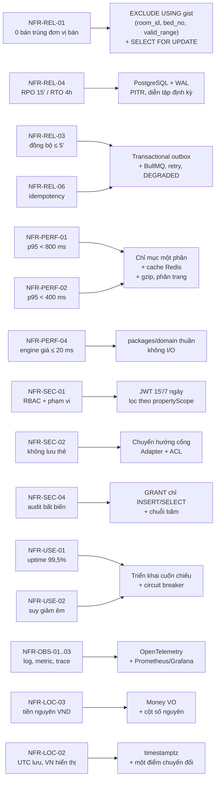

# 01 — Yêu cầu phi chức năng

> Đặc tả chất lượng hệ thống: 40 yêu cầu phi chức năng, 8 nhóm `PERF` `REL` `SEC` `USE` `MAIN` `COMP` `OBS` `LOC`.
> Mọi ngưỡng số ở đây là **chỉ tiêu kỹ thuật** của hệ thống đặt phòng Pine Hill (3 cơ sở, 55 phòng, 7 kênh bán).
> Giá trị nghiệp vụ (hệ số giá, bậc huỷ, hạn mức bán vượt, hạng khách…) **không định nghĩa lại ở đây** — chỉ tham chiếu mã BR ở [02/quy tắc nghiệp vụ](../02-nghiep-vu/quy-tac-nghiep-vu.md).

---

## 1. Cách đọc tài liệu

Mỗi NFR có 5 cột: **mã · phát biểu đo lường được · chỉ số đích · cách kiểm chứng · rủi ro nếu không đạt**.

| Quy ước | Nội dung |
|---|---|
| Cấu trúc mã | `NFR-<NHÓM>-<nn>`; nhóm gồm PERF, REL, SEC, USE, MAIN, COMP, OBS, LOC |
| Môi trường đo | Staging cấu hình bằng production: 1 API node (2 vCPU/4 GB, Node 22), PostgreSQL 16 (2 vCPU/4 GB), Redis 7, web tĩnh qua CDN |
| Dữ liệu đo | 3 cơ sở, 55 phòng `ACTIVE`, 5 loại phòng, lịch giá 365 ngày, 5.000 booking lịch sử, 7 kênh |
| Tải chuẩn | 200 người dùng đồng thời (VU): ramp 60 s, giữ tải 10 phút, phân bố 60 % đọc / 30 % ghi / 10 % báo cáo |
| Định nghĩa p95/p99 | Phân vị 95/99 của phân bố độ trễ trên **toàn bộ** yêu cầu trong cửa sổ đo; cửa sổ SLO mặc định 30 ngày trượt |
| Đơn vị tiền | Đồng Việt Nam (VND), luôn là số nguyên (BR-GEN-01) |
| Đơn vị thời gian | Giây (s), mili-giây (ms); mốc thời gian lưu UTC, hiển thị giờ VN (BR-GEN-02) |
| Nguyên tắc | Mỗi chỉ tiêu phải **đo được tự động** bằng một lệnh, một truy vấn SQL, hoặc một công cụ nêu rõ trong cột "Cách kiểm chứng". Không có chỉ tiêu nào chỉ kiểm chứng bằng đọc mã |

| Nhóm | Mục | Phạm vi |
|---|---|---|
| PERF | §2 | Độ trễ, thông lượng, kích thước phản hồi, khả năng chịu tải |
| REL | §3 | Chống bán trùng, giải phóng hold, đồng bộ kênh, sao lưu – phục hồi, nguyên tử, idempotency |
| SEC | §4 | Xác thực – phân quyền, dữ liệu thẻ, mã hoá, nhật ký kiểm toán, chống lạm dụng, chuỗi cung ứng |
| USE | §5 | Uptime, suy giảm êm, nền tảng Android, trình duyệt, khả dụng thao tác |
| MAIN | §6 | Tính thuần của miền, chất lượng mã, kiểm thử, hợp đồng API, cấu hình hoá |
| COMP | §7 | Nghị định 13/2023/NĐ-CP, thời hạn lưu trữ, toàn vẹn tài chính, xuất dữ liệu, đối soát kênh |
| OBS | §8 | Log, metric, cảnh báo, truy vết, metric nghiệp vụ |
| LOC | §9 | Ngôn ngữ, múi giờ, tiền tệ, chuẩn hoá dữ liệu Việt Nam |

---

## 2. NFR-PERF — Hiệu năng & khả năng đáp ứng

Nguồn ràng buộc: [BT-2](../00-tong-quan.md) (tính giá theo từng đêm), BR-RATE-17 (cùng đầu vào phải cho cùng kết quả trên mọi giao diện), BR-INV-07 (kiểm tra tồn theo từng đêm), BR-CHAN-02 (đồng bộ kênh 5 phút), BR-OVER-05 (job quét quá tải mỗi giờ), `OccupancySnapshot` cập nhật mỗi 5 phút.

| Mã | Phát biểu đo lường được | Chỉ số đích | Cách kiểm chứng | Rủi ro nếu không đạt |
|---|---|---|---|---|
| NFR-PERF-01 | Ở 200 người dùng đồng thời, mọi truy vấn tồn phòng — lịch tồn phòng theo ngày (UC-INV-01) và kiểm tra trống kèm báo giá (UC-INV-02) — cho khoảng dài nhất 365 đêm phải trả kết quả trong p95 < 800 ms, p99 < 1.500 ms và tỉ lệ lỗi < 0,1 %; tồn trả về đúng định nghĩa hai tầng của BR-INV-01 — tồn chung = phòng `ACTIVE` − `RoomBlock` − `RoomAssignment` hoạt động − hold chưa sinh assignment, tồn theo kênh = `min(tồn chung, allotment − used)`, và `allotment` **không** bị trừ vào tồn chung (kênh trực tiếp không có hạn mức riêng, BR-CHAN-01) | p95 < 800 ms · p99 < 1.500 ms · lỗi < 0,1 % với 200 VU | `k6 run tests/load/availability.js` (200 VU, ramp 60 s, giữ 10 phút, kịch bản 365 đêm) với ngưỡng `http_req_duration{scenario:availability}: p(95)<800`, `p(99)<1500`, `http_req_failed<0.001`; đối chiếu kết quả trả về với `AvailabilityCalculator` chạy cục bộ | Lễ tân chờ lâu khi tra phòng, khách rời trang tìm phòng; OTA timeout khi kéo tồn và tự đóng phòng, làm mất phần tồn dành cho kênh trực tiếp (BR-CHAN-01) |
| NFR-PERF-02 | Ở 200 người dùng đồng thời, mọi điểm cuối REST còn lại (tạo/sửa/huỷ booking, thanh toán, check-in/check-out, báo cáo nhỏ) đạt p95 < 400 ms, p99 < 1.000 ms; riêng thao tác ghi có tranh chấp khoá (`SELECT … FOR UPDATE`) đạt p95 < 900 ms | p95 < 400 ms · p99 < 1.000 ms (ghi tranh chấp p95 < 900 ms) · lỗi 5xx < 0,1 % | `k6 run tests/load/api-mix.js` (tỉ lệ 60 % đọc / 30 % ghi / 10 % báo cáo) với ngưỡng `p(95)<400`; đối chiếu chỉ số độ trễ phía máy chủ thu bởi OpenTelemetry theo từng route (NFR-OBS-03) | Thời gian phục vụ khách tại quầy tăng, trượt mục tiêu "check-in khách vãng lai ≤ 3 phút" (NFR-USE-05); nhân viên quay lại dùng Excel như hiện trạng |
| NFR-PERF-03 | Hệ thống chịu được hồ sơ tải chuẩn (200 VU/10 phút) liên tục mà không suy giảm SLO, và chịu được cú tăng 3× (600 VU trong 5 phút) ở chế độ suy giảm: không sập, lỗi 5xx < 1 %, hàng đợi outbox không phình quá 10.000 sự kiện và tự xả hết trong ≤ 10 phút sau khi tải giảm | Lỗi < 0,1 % ở tải chuẩn · 5xx < 1 % ở 600 VU · độ trễ hàng đợi xả ≤ 10 phút | `k6 run tests/load/spike.js` (0 → 600 VU trong 30 s, giữ 5 phút) với ngưỡng `http_req_failed<0.01`; theo dõi chỉ số độ sâu hàng đợi và `outbox_lag_seconds` trên dashboard | Cao điểm lễ, Tết làm sập hệ thống đúng lúc doanh thu cao nhất; khôi phục thủ công mất nhiều giờ |
| NFR-PERF-04 | Động cơ giá và chính sách huỷ chạy thuần trong tiến trình: `PricingEngine` tính giá 14 đêm ≤ 20 ms (p99), `CancellationPolicyEngine` xác định bậc huỷ ≤ 5 ms (p99); hệ số công suất (bước 4 của BR-RATE-01) lấy từ `OccupancySnapshot` cập nhật theo `job.occupancy.snapshotIntervalSeconds` = 300, snapshot cũ hơn 5 phút dùng hệ số 1,00, ngưỡng công suất đọc từ `pricing.occupancyMidPct` = 80 và `pricing.occupancyHighPct` = 95, dòng tổng hợp cấp cơ sở là dòng có `OccupancySnapshot.roomTypeId` rỗng với `physicalRooms` = số phòng `ACTIVE` đã trừ `RoomBlock` (BR-SYS-02, BR-RATE §4.3); báo cáo REP trên 90 ngày × 3 cơ sở × 7 kênh đạt p95 < 3 s và **mọi** chỉ số lấy đúng định nghĩa duy nhất của BR-REP-01 — `ADR` = doanh thu thuần ÷ phòng-đêm đã bán, `RevPAR` = doanh thu thuần ÷ phòng khả dụng, công suất = phòng-đêm đã bán ÷ phòng khả dụng, tỷ lệ huỷ = booking `CANCELLED` ÷ tổng booking tạo trong kỳ, chi phí xử lý quá tải theo BR-OVER-15, với phòng DOR đếm theo **đơn vị bán** (giường); bảng điều khiển back-office có TTI < 2,5 s trên mạng 4G | Engine giá p99 ≤ 20 ms/14 đêm · engine huỷ p99 ≤ 5 ms · báo cáo p95 < 3 s · TTI < 2,5 s · độ trễ ảnh hưởng của snapshot sau khi đổi công suất ≤ 5 phút · 100 % `PriceSnapshot` có `engineVersion`/`seq`/`kind` · 0 báo cáo tự định nghĩa lại chỉ số | `pnpm vitest bench packages/domain`; `k6 run tests/load/reports.js`; `npx lighthouse --preset=desktop --only-categories=performance` trên trang bảng điều khiển; test tích hợp: đẩy công suất cơ sở vượt ngưỡng, sau ≤ 5 phút gọi lại báo giá và kiểm tra hệ số đã đổi; truy vấn `SELECT count(*) FROM price_snapshots WHERE engine_version IS NULL OR seq IS NULL OR kind IS NULL` bằng 0 và báo giá lại cùng đầu vào bằng chính `engineVersion` đó phải ra đúng kết quả đã lưu (BR-RATE-16, BR-RATE-17); truy vấn đếm booking đã rời `DRAFT` (`HELD`/`PENDING_PAYMENT`/`CONFIRMED`/`CANCELLED`) mà không có `PriceSnapshot` bằng 0 — snapshot phải được lưu ngay khi rời `DRAFT` (BR-RATE-16); đối chiếu 5 chỉ số của UC-REP-01..04 với một truy vấn SQL độc lập tính theo đúng BR-REP-01 (lệch ≤ 1 %), trong đó phần DOR đếm theo giường | Báo giá chậm ở quầy và trên web khách; ban giám đốc không xem được báo cáo doanh thu theo kênh (mục tiêu 00 §12 #6) |
| NFR-PERF-05 | Webhook OTA tiếp nhận và phản hồi trong p95 ≤ 300 ms (trả `202` rồi xử lý ở nền qua outbox), chịu 20 webhook/s liên tục 5 phút không mất sự kiện; phản hồi lịch tồn phòng 30 ngày × 55 phòng ≤ 200 KB sau nén gzip | Webhook p95 ≤ 300 ms · 20 sự kiện/s · 0 sự kiện mất · payload ≤ 200 KB (gzip) | `k6 run tests/load/webhook-ota.js`; `curl -s -o /dev/null -w '%{size_download}' -H 'Accept-Encoding: gzip' /api/v1/inventory/grid?days=30`; đối chiếu số sự kiện nhận với số bản ghi trong bảng outbox | OTA coi hệ thống là không ổn định và hạ ưu tiên hiển thị; web khách tải chậm trên 4G; sự kiện OTA bị mất gây lệch tồn |

---

## 3. NFR-REL — Độ tin cậy & toàn vẹn dữ liệu

Nguồn ràng buộc: BR-INV-02, BR-INV-03, BR-INV-04, BR-BOOK-08, BR-BOOK-11, BR-BOOK-16, BR-GEN-06, BR-GEN-07, BR-GEN-08, BR-PAY-03, BR-PAY-05, BR-CHAN-02, BR-CHAN-06, BR-CHAN-07, BR-SYS-03.

| Mã | Phát biểu đo lường được | Chỉ số đích | Cách kiểm chứng | Rủi ro nếu không đạt |
|---|---|---|---|---|
| NFR-REL-01 | **Không có bán trùng đơn vị bán.** Khi 200 yêu cầu giữ chỗ đồng thời nhắm cùng `(roomTypeId, một đêm)` trên kênh `WEB` (kênh có `overbookAllowed = false` — bảng kênh ở BR §4.5, nên điều kiện (a) của BR-OVER-02 không thoả), đúng 1 yêu cầu thành công và 199 yêu cầu còn lại bị từ chối bằng `E_INV_NO_AVAILABILITY` (HTTP 409, BR-INV-07); bất biến tính theo **đơn vị bán** — `bedNo = 0` là "cả phòng", `1..bedCount` là giường cụ thể của DOR (BR-PROP-04) — nên với mọi bộ ba `(roomId, bedNo, đêm)` số `RoomAssignment` đang hoạt động không bao giờ vượt 1, kể cả khi nhiều kênh gửi cùng mili-giây và kể cả khi có ghép phòng `MERGE_SHARE` (BR-INV-02, BR-INV-03). Bán vượt do hệ thống **chủ động** chỉ được phép theo BR-OVER-02 và vượt trần thì phải trả `E_OVER_LIMIT_EXCEEDED`; booking do kênh ngoài đẩy vào luôn được ghi nhận `CONFIRMED` kèm `oversold = true` và mở `OverbookingCase` (miễn trừ tường minh ở BR-CHAN-03, BR-OVER-03) — đây là ngoại lệ **có chủ đích**, nhưng tuyệt đối không được gán trùng đơn vị bán | 0 vụ trùng · đúng 1 yêu cầu thắng trên 200 · bất biến đúng sau 10.000 giao dịch tranh chấp · 100 % booking `oversold` có `OverbookingCase` | `k6 run tests/load/oversell-race.js` (200 VU, cùng `checkIn`/`checkOut`, phát đồng loạt) + test tích hợp Testcontainers bắn 200 transaction song song; truy vấn bất biến `SELECT count(*) FROM (SELECT room_id, bed_no, valid_range FROM room_assignments WHERE released_at IS NULL GROUP BY room_id, bed_no, valid_range HAVING count(*) > 1) x` phải bằng 0; tồn tại ràng buộc loại trừ ba cột: `SELECT count(*) FROM pg_constraint WHERE contype = 'x' AND conrelid = 'room_assignments'::regclass` bằng 1 và định nghĩa ràng buộc phải chứa `room_id`, `bed_no`, `valid_range` (`pg_get_constraintdef`); test khẳng định **không** dùng khoá đơn sinh kiểu `COALESCE(bed_no::text, room_id)` hay `sell_unit_id` — gán phòng hợp lệ ở hai phòng khác nhau cùng `bedNo` phải thành công; truy vấn đếm booking `oversold = true` thiếu `OverbookingCase` bằng 0; mọi phản hồi từ chối phải là `E_INV_NO_AVAILABILITY` (BR-INV-07) hoặc `E_INV_ROOM_TAKEN` khi ràng buộc CSDL từ chối với mã `23P01` (BR-INV-03) — test khẳng định **0** phản hồi `2xx` cho yêu cầu không được gán đơn vị bán và **0** lỗi `5xx` rò mã `23P01` ra ngoài | Bán quá phòng tiếp diễn như hiện trạng (2–4 vụ/tháng cao điểm), phải điều chuyển khách phút chót, mất uy tín trên OTA; khoá sinh sai kiểu `bed_no` sẽ chặn oan các gán phòng hợp lệ ở phòng khác |
| NFR-REL-02 | **Giải phóng hold đúng hạn.** Mọi hold quá `Booking.holdExpiresAt` được giải phóng trong ≤ 60 s: booking chuyển `EXPIRED`, toàn bộ `RoomAssignment` của booking được nhả (`releasedAt` được đặt) và phòng trở lại tồn khả dụng trong cùng transaction (BR-INV-04, BR-BOOK-08); job giải phóng hold chạy theo `job.hold.releaseIntervalSeconds` = 30 và job đối chiếu Redis ↔ CSDL chạy theo `job.holdReconcile.intervalSeconds` = 900 để phát hiện hold treo (BR-SYS-02). Áp dụng cả nhánh giao dịch quá 15 phút không callback (BR-PAY-05) | Độ trễ giải phóng p99 ≤ 60 s · p95 ≤ 45 s · 0 hold "treo" quá 5 phút · 0 bản ghi `Hold` ở Redis lệch trạng thái với `Booking` | Truy vấn nguồn chân lý (CSDL, không dùng Redis): `SELECT percentile_cont(0.99) WITHIN GROUP (ORDER BY EXTRACT(EPOCH FROM (ra.released_at - b.hold_expires_at))) FROM bookings b JOIN booking_rooms br ON br.booking_id = b.id JOIN room_assignments ra ON ra.booking_room_id = br.id WHERE b.hold_expires_at IS NOT NULL AND ra.released_at IS NOT NULL AND b.hold_expires_at > now() - interval '7 days'`; job đối chiếu Redis ↔ CSDL đếm số `Hold` có `status = ACTIVE` nhưng đã quá hạn (phải bằng 0); test tích hợp dùng đồng hồ giả (hold 20 phút của kênh `WEB`), đo từ `holdExpiresAt` tới lúc tồn khả dụng tăng; cảnh báo khi p99 > 45 s | Phòng bị giữ ảo, tồn khả dụng hiển thị sai, mất doanh thu và tạo cảm giác "hết phòng" giả trên mọi kênh |
| NFR-REL-03 | **Đồng bộ kênh ≤ 5 phút.** Mọi thay đổi tồn phòng hoặc giá tạo `OutboxEvent` trong cùng transaction và được gửi tới mọi kênh đang mở bán với p99 ≤ 5 phút, 100 % ≤ 10 phút; job quét định kỳ theo `job.channelSync.intervalSeconds` = 300 làm lưới an toàn, ánh xạ loại phòng ↔ mã phòng OTA theo `ChannelMapping` (BR-CHAN-02, BR-CHAN-06, BR-CHAN-08, BR-SYS-02). Ba lần thất bại liên tiếp phải trả `E_CHAN_SYNC_FAILED`, phát cảnh báo cho `MANAGER` và đánh dấu suy giảm qua `Channel.syncStatus = DEGRADED` cùng `consecutiveSyncFailures`, `lastSyncAt`, `lastSyncError` (BR-CHAN-07, `ChannelSyncStatus`) | p99 ≤ 5 phút · 100 % ≤ 10 phút · 0 sự kiện mất · cảnh báo `DEGRADED` sau 3 lần lỗi | Truy vấn `SELECT percentile_cont(0.99) WITHIN GROUP (ORDER BY EXTRACT(EPOCH FROM (processed_at - created_at))) FROM outbox_events WHERE processed_at IS NOT NULL`; kịch bản giả lập lỗi 3 lần liên tiếp bằng proxy chặn cổng adapter rồi kiểm tra cảnh báo và trạng thái kênh | Hiện trạng độ trễ 15–60 phút khiến ba sổ phòng lệch nhau — nguyên nhân gốc của bán quá phòng |
| NFR-REL-04 | **Sao lưu – phục hồi.** Sao lưu liên tục bằng WAL + sao lưu toàn phần hằng ngày, phục hồi điểm bất kỳ (PITR) bảo đảm mất mát dữ liệu tối đa 15 phút (RPO ≤ 15 phút) và thời gian phục vụ lại tối đa 4 giờ (RTO ≤ 4 giờ) tính từ lúc phát hiện sự cố; diễn tập phục hồi mỗi học kỳ có biên bản (BR-SYS-03) | RPO ≤ 15 phút · RTO ≤ 4 giờ · 0 lần lưu WAL thất bại · diễn tập ≥ 1 lần/học kỳ | `pgbackrest check --stanza=pinehill`; `SELECT failed_count FROM pg_stat_archiver` bằng 0; diễn tập `pgbackrest --stanza=pinehill --type=time --target='<T-15m>' --target-action=promote`, đo thời gian tới khi `/api/v1/health` trả `200` và ghi biên bản thời gian thực tế | Mất dữ liệu booking/thanh toán không khôi phục được — vi phạm nghĩa vụ lưu trữ 10 năm (BR-SYS-04) và mất khả năng đối soát |
| NFR-REL-05 | **Nguyên tử và không có trạng thái nửa vời.** Mọi nghiệp vụ ghi ảnh hưởng `Booking`, `Payment`, `RefundRequest`, `RoomMove`, `SystemSetting` tạo `AuditLog` trong cùng transaction (BR-GEN-07); booking + `BookingRoom` + `RoomAssignment` + `OutboxEvent` là một đơn vị không chia cắt (BR-BOOK-10, BR-BOOK-11, BR-CHAN-06); xoá cứng booking `DRAFT`/`HELD` vẫn phải ghi `AuditLog` với `beforeJson` đầy đủ **trước khi** xoá — nghĩa vụ ghi vết của BR-GEN-07 không được miễn trừ (BR-BOOK-17); huỷ kết nối giữa chừng để lại **0** thay đổi | 0 bản ghi mồ côi · 0 giao dịch "nửa vời" · 0 booking không có audit tương ứng · 100 % lần xoá cứng có `AuditLog` `beforeJson` | Test Testcontainers gọi `SELECT pg_terminate_backend(...)` giữa transaction rồi kiểm tra số bản ghi trước/sau; truy vấn mồ côi: booking ở `HELD`/`PENDING_PAYMENT`/`CONFIRMED` mà không có `BookingRoom`, `RoomAssignment` cho mỗi đêm (BR-BOOK-10) hay không có `AuditLog` phải bằng 0; truy vấn `SELECT count(*) FROM audit_logs WHERE entity_type = 'Booking' AND action = 'DELETE' AND before_json IS NULL` bằng 0 và test tích hợp xoá cứng một booking `DRAFT` lẫn một booking `HELD` chưa phát sinh thanh toán: cả hai phải sinh bản ghi `audit_logs` với `beforeJson` đầy đủ trước khi bản ghi biến mất (BR-BOOK-17) | Sổ sách lệch giữa booking, phòng và kế toán; tranh chấp không có bằng chứng; nhật ký kiểm toán mất giá trị |
| NFR-REL-06 | **Idempotency và chống trùng.** Gửi lại 10 lần cùng `Idempotency-Key` (BR-GEN-08) hoặc cùng callback PSP (BR-PAY-03) chỉ tạo 1 bản ghi và không cộng dồn `paidAmount` — callback trùng trả `E_PAY_CALLBACK_DUPLICATE` kèm kết quả cũ, **không** tạo `Payment` mới; phát hiện đặt trùng theo BR-BOOK-16 trong 24 giờ trả booking đã có kèm cờ `duplicateSuspected`; mã booking `PH-<YYMMDD>-<5 ký tự>` vẫn duy nhất khi 200 yêu cầu tạo cùng mili-giây (BR-GEN-06) | 10 lần gửi → 1 bản ghi · 0 mã booking trùng trên 200 yêu cầu đồng thời · 0 lần cộng dồn tiền | Vòng lặp shell gửi 10 lần cùng khoá rồi `SELECT count(*) FROM payments WHERE idempotency_key = 'k1'` bằng 1; `k6 run tests/load/booking-code-collision.js` (200 VU cùng thời điểm) rồi `SELECT count(*) - count(DISTINCT code) FROM bookings` bằng 0 | Thu tiền hai lần của một khách, tạo hai booking cho cùng một đặt phòng; đối soát cuối ngày không khớp (BR-PAY-10) |

---

## 4. NFR-SEC — Bảo mật & riêng tư

Nguồn ràng buộc: BR-PAY-04 (không lưu dữ liệu thẻ), BR-RBAC-01..06, BR-SYS-01, BR-SYS-04, BR-SYS-05, BR-GEN-07, BR-CANCEL-13, BR-CANCEL-15, BR-OVER-07, ADR-009, ADR-010.

| Mã | Phát biểu đo lường được | Chỉ số đích | Cách kiểm chứng | Rủi ro nếu không đạt |
|---|---|---|---|---|
| NFR-SEC-01 | **Xác thực và phân quyền phủ 100 %.** Mọi điểm cuối (trừ kiểm tra sức khoẻ, đăng nhập và webhook có chữ ký) yêu cầu JWT; access token 15 phút, refresh 7 ngày (ADR-010); mọi truy vấn dữ liệu lọc theo `propertyScope` trừ `OWNER` (BR-RBAC-02); ma trận vai trò BR-RBAC-03 được kiểm thử tự động; phiên web quản trị hết hạn sau 15 phút không hoạt động và thao tác tài chính trên Android yêu cầu nhập lại PIN 6 số (BR-RBAC-05) | 100 % điểm cuối được bảo vệ · 100 % ô của ma trận vai trò có ca kiểm thử · 0 truy vấn vượt phạm vi cơ sở | Bộ test Supertest sinh từ OpenAPI: mỗi điểm cuối × mỗi vai trò (`OWNER`, `MANAGER`, `FRONT_DESK`, `RESERVATION_AGENT`, `ACCOUNTANT`, `HOUSEKEEPING`) phải trả `401`/`403` đúng mong đợi; kiểm thử cách ly dữ liệu: `FRONT_DESK` của CS-02 không đọc được booking của CS-01; quét ZAP baseline không có cảnh báo mức cao trên luồng đăng nhập | Nhân viên cơ sở này xem/sửa được dữ liệu cơ sở khác; rò rỉ hồ sơ khách và doanh thu giữa các cơ sở |
| NFR-SEC-02 | **Không lưu dữ liệu thẻ.** Luồng thanh toán chuyển hướng sang cổng VNPay/MoMo; hệ thống chỉ lưu `providerTxnId`, `amount`, `status`; 0 trường, 0 cột, 0 dòng log chứa số thẻ, ngày hết hạn hoặc CVV (BR-PAY-04) | 0 cột/trường dữ liệu thẻ · 0 chuỗi 13–19 chữ số trong log · phạm vi PCI DSS SAQ-A | `rg -n -i -e card_?number -e cvv -e cvc -e expiry -e pan apps packages infra` không khớp trong mã nghiệp vụ; `SELECT column_name FROM information_schema.columns WHERE table_schema = 'public' AND (column_name ILIKE '%card%' OR column_name ILIKE '%cvv%')` rỗng; quét log 7 ngày bằng bộ nhận dạng chuỗi số thẻ theo thuật toán Luhn; rà soát SAQ-A mỗi quý | Rò rỉ dữ liệu thẻ gây thiệt hại trực tiếp cho khách và trách nhiệm pháp lý; mất quyền dùng cổng thanh toán |
| NFR-SEC-03 | **Mã hoá và bảo vệ dữ liệu.** Bắt buộc TLS 1.2+ cho mọi kết nối ra vào kèm HSTS; dữ liệu nhạy cảm mã hoá khi lưu bằng AES-256; `passwordHash` dùng Argon2id (100 % bản ghi); dữ liệu cá nhân (`Guest.idNumber`, `phone`, `email`) được che trong log và dấu vết (`****` + 4 ký tự cuối); 0 bí mật trong kho mã | TLS 1.2+ cho 100 % điểm cuối · 0 cột mật khẩu ngoài Argon2id · 0 PII trong log · 0 secret trong repo | `testssl.sh --protocols <host>` và `nmap --script ssl-enum-ciphers` chỉ thấy TLS 1.2/1.3; `SELECT count(*) FROM users WHERE password_hash NOT LIKE '$argon2id$%'` bằng 0; bộ test đơn vị che PII đạt 100 % mẫu; `gitleaks detect --no-git --redact` không phát hiện gì | Nghe lén phiên đăng nhập; lộ số CCCD/số điện thoại khách; bí mật bị đẩy lên kho mã |
| NFR-SEC-04 | **Nhật ký kiểm toán bất biến.** Bảng `audit_logs` chỉ ghi thêm (append-only): vai trò ứng dụng chỉ có `INSERT` và `SELECT`, `UPDATE`/`DELETE` bị thu hồi ở tầng CSDL (BR-SYS-01); mỗi bản ghi đủ 10 thành phần ai – làm gì – trên đối tượng nào – giá trị trước/sau – lý do – IP – thời điểm (BR-SYS-05); các bản ghi liên kết bằng chuỗi băm phát hiện được sửa đổi; lưu 5 năm (BR-SYS-04) | 0 quyền `UPDATE`/`DELETE` trên `audit_logs` · 100 % bản ghi đủ trường bắt buộc · chuỗi băm hợp lệ 100 % · lưu 5 năm | `psql -c "UPDATE audit_logs SET action = 'x' WHERE id = '<uuid>'"` phải trả `ERROR: permission denied for table audit_logs`; `psql -c "\dp audit_logs"` không có `UPDATE`/`DELETE` cho vai trò ứng dụng; `node scripts/verify-audit-chain.ts --since 7d` xác nhận chuỗi băm liên tục; truy vấn đếm bản ghi thiếu trường bắt buộc bằng 0 | Nhật ký bị sửa để che sai phạm; không chứng minh được ai đã duyệt hoàn tiền hay walk-out (BR-CANCEL-15, BR-OVER-06) |
| NFR-SEC-05 | **Chống lạm dụng và replay.** Giới hạn tần suất theo IP và tài khoản: đăng nhập ≤ 10 lần/phút/IP, thao tác ghi ≤ 60 yêu cầu/phút/tài khoản, vượt ngưỡng trả `429` kèm `Retry-After`; 5 lần đăng nhập sai liên tiếp khoá tài khoản 15 phút (BR-RBAC-06) — trạng thái lưu ở `User.failedLoginCount` và `User.lockedUntil`; mọi webhook OTA/PSP phải có chữ ký hợp lệ, lệch thời gian ≤ 5 phút và chống gửi lại theo khoá sự kiện | 100 % luồng vượt ngưỡng nhận `429` · khoá tài khoản sau đúng 5 lần sai · 0 webhook không chữ ký được xử lý | `k6 run tests/load/rate-limit.js` bắn 100 yêu cầu/10 s và kiểm tra tỉ lệ `429`; test Supertest gửi 5 lần sai rồi lần thứ 6 (kỳ vọng bị khoá) và kiểm tra bảng lưu trạng thái khoá của người dùng; test replay cùng `providerTxnId` với timestamp cũ (kỳ vọng `401`) | Bị dò mật khẩu hàng loạt; kẻ tấn công gửi lại callback thanh toán giả để đánh dấu đã trả tiền |
| NFR-SEC-06 | **Quản lý bí mật và chuỗi cung ứng.** 0 bí mật trong kho mã; bí mật chỉ qua biến môi trường hoặc kho bí mật của nền tảng; mỗi yêu cầu kéo mã chạy SAST và quét phụ thuộc; 0 lỗ hổng mức nghiêm trọng (CVSS ≥ 7,0) tồn quá 7 ngày; ảnh nền Docker được cập nhật bản vá trong ≤ 30 ngày | 0 secret · 0 lỗ hổng CVSS ≥ 7,0 quá 7 ngày · 0 cảnh báo SAST mức cao | Việc CI `security` chạy `gitleaks detect`, `codeql analyze`, `trivy fs --severity HIGH,CRITICAL`, `pnpm audit --audit-level=high`; kết quả hợp nhất trong tab Security của kho mã; báo cáo tuổi lỗ hổng hằng tuần | Thư viện lỗi thời bị khai thác; bí mật lộ qua lịch sử commit |

---

## 5. NFR-USE — Khả dụng & trải nghiệm sử dụng

Nguồn ràng buộc: tiêu chí thành công 00 §12 (#5, #6), phạm vi nền tảng 00 §3.1 (#14), BR-RBAC-05 (Android cho lễ tân), BR-SYS-06 (gửi lại thông báo tối đa 3 lần), ADR-005, ADR-006, ADR-012.

| Mã | Phát biểu đo lường được | Chỉ số đích | Cách kiểm chứng | Rủi ro nếu không đạt |
|---|---|---|---|---|
| NFR-USE-01 | **Uptime ≥ 99,5 %/tháng** cho API `/api/v1/health` và web khách, đo mỗi 60 s từ 2 điểm độc lập, cửa sổ 30 ngày trượt; ngân sách lỗi tương ứng 3 giờ 36 phút/tháng; sự cố mức P1 phản hồi ≤ 15 phút và khắc phục ≤ 4 giờ (khớp RTO ở NFR-REL-04); tối đa 1 cửa sổ bảo trì kế hoạch/tháng, ≤ 30 phút, thông báo trước 48 giờ | Uptime ≥ 99,5 % · P1 phản hồi ≤ 15 phút · khắc phục ≤ 4 giờ · ≤ 1 bảo trì kế hoạch/tháng | Hai trình giám sát ngoài (UptimeRobot/BetterStack) gọi `GET /api/v1/health` mỗi 60 s và trang khách mỗi 5 phút; báo cáo uptime tự động hằng tháng; nhật ký sự cố có mốc phát hiện – phản hồi – khắc phục | Khách và OTA đánh giá hệ thống không ổn định; doanh thu trực tiếp rơi vào kênh OTA có hoa hồng cao |
| NFR-USE-02 | **Suy giảm êm khi phụ thuộc ngoài lỗi.** OTA hoặc PSP lỗi/timeout không làm hỏng luồng nội bộ: circuit breaker ngắt sau 5 lỗi liên tiếp và thử lại nửa mở sau 60 s; tạo booking tại quầy, check-in/check-out, thu tiền mặt luôn hoạt động; thông báo lỗi nằm trong hàng đợi bền và tự gửi lại tối đa 3 lần cách nhau 5 phút (BR-SYS-06). Mất Redis không gây bán trùng vì ràng buộc CSDL vẫn giữ (NFR-REL-01) | 100 % thao tác nội bộ thành công khi OTA/PSP chết 10 phút · 0 bán trùng khi mất Redis · 0 thông báo mất hẳn | Test hỗn loạn bằng proxy (toxiproxy) chặn cổng PSP và OTA trong 10 phút rồi đo tỉ lệ thành công các thao tác nội bộ; dừng container Redis rồi chạy lại kịch bản tranh chấp của NFR-REL-01; đọc số liệu trạng thái circuit breaker | Một OTA lỗi làm tê liệt toàn bộ hệ thống đúng cao điểm; mất cả kênh trực tiếp lẫn kênh OTA |
| NFR-USE-03 | **Nền tảng Android và mạng yếu.** Ứng dụng chạy trên Android 9 (API 28) trở lên, màn hình 5"–10", cài qua EAS/APK; ở mạng 3G (1 Mbps, RTT 400 ms) màn hình chính tải ≤ 5 s và thao tác buồng phòng (UC-FO-03) ≤ 3 s; thao tác ghi khi mất mạng vào hàng đợi cục bộ và tự đồng bộ trong ≤ 60 s sau khi có mạng trở lại với 0 thao tác bị mất | API 28+ · tải ≤ 5 s ở 3G · đồng bộ ≤ 60 s · 0 thao tác mất | `aapt dump badging app-release.apk` xác nhận `sdkVersion` ≥ 28; chạy Maestro trên ma trận API 28/31/34 và 2 kích thước màn hình; mô phỏng mạng bằng `tc qdisc add dev wlan0 root netem delay 400ms rate 1mbit`; test tắt mạng 5 phút, thực hiện 10 thao tác, bật mạng và đối chiếu số bản ghi | Nhân viên buồng phòng và lễ tân không dùng được ứng dụng trong thang máy/khu vực sóng yếu; quay lại quy trình giấy |
| NFR-USE-04 | **Tương thích trình duyệt.** Web khách và back-office chạy đủ trên Chrome và Safari 2 phiên bản gần nhất (máy tính và iOS), thêm Edge 2 phiên bản gần nhất; hiển thị đúng từ 360 px tới 1920 px, không cuộn ngang ở 360 px; không dùng API chỉ có trên một nhân trình duyệt ở luồng bắt buộc | 100 % ca kiểm thử giao diện xanh trên 6 cấu hình · 0 lỗi cuộn ngang ở 360 px | Playwright chạy ma trận 6 cấu hình (2 phiên bản × Chrome/Safari/Edge, cập nhật mỗi quý) trên `tests/e2e/smoke.spec.ts`; kiểm tra kích thước 360/768/1440 px cho 5 màn hình trọng yếu bằng ảnh so sánh | Khách dùng Safari không đặt được phòng; lễ tân dùng máy tính bảng không thao tác được |
| NFR-USE-05 | **Khả dụng thao tác.** Lễ tân xử lý một khách vãng lai trong ≤ 3 phút với ≤ 5 bước bắt buộc (tiêu chí 00 §12 #5); check-out có phát sinh ≤ 4 phút; web khách đặt phòng ≤ 4 bước; web khách đạt WCAG 2.1 AA: 0 lỗi mức serious/critical theo axe, tương phản ≥ 4,5:1, dùng được chỉ bằng bàn phím, thông báo lỗi chỉ rõ trường sai và cách sửa | ≤ 3 phút/lượt walk-in trên 20 lượt · ≤ 5 bước · 0 lỗi axe mức serious/critical | Đo 20 lượt thật trên bản dựng thử có bấm giờ (00 §12 #5); `npx playwright test tests/a11y` với `@axe-core/playwright`, ngưỡng 0 lỗi serious/critical trên 6 màn hình | Lễ tân chậm hơn hiện trạng nên không dùng hệ thống; khách lớn tuổi hoặc dùng trình đọc màn hình không đặt được phòng |

---

## 6. NFR-MAIN — Bảo trì & tiến hoá

Nguồn ràng buộc: ADR-001, ADR-002, ADR-007 (miền thuần), ADR-008 (OpenAPI), ADR-011 (kiểm thử), BR-CANCEL-01 (dữ liệu hoá chính sách huỷ), BR-SYS-02 (tham số đọc từ `SystemSetting`), tiêu chí 00 §12 #7 (100 % BR có ca kiểm thử).

| Mã | Phát biểu đo lường được | Chỉ số đích | Cách kiểm chứng | Rủi ro nếu không đạt |
|---|---|---|---|---|
| NFR-MAIN-01 | **Miền thuần, kiểm thử được.** `packages/domain` không import Prisma, Nest, HTTP, `Date.now()` hay `Math.random()`; độ phủ **nhánh** ≥ 90 % cho `PricingEngine`, `CancellationPolicyEngine`, `AvailabilityCalculator`, `OverbookingPlanner`; bất biến then chốt được kiểm thử bằng dữ liệu sinh (thứ tự hệ số BR-RATE-01, bậc huỷ theo bảng BR-CANCEL-01, giữ giá gốc BR-OVER-08, bất biến 1 phòng/1 đêm BR-INV-03) | 0 vi phạm import I/O · nhánh ≥ 90 % (4 lớp lõi) · ≥ 10.000 ca sinh cho mỗi bất biến | ESLint `no-restricted-imports` + `no-restricted-globals` áp cho `packages/domain` (0 lỗi); `pnpm vitest run --coverage` với ngưỡng `branches: 90` cho 4 lớp lõi; bộ test fast-check chạy ≥ 10.000 ca cho mỗi bất biến | Sửa một quy tắc giá hoặc bậc huỷ làm vỡ chỗ khác mà không ai biết; hai giao diện báo hai giá khác nhau (BR-RATE-17) |
| NFR-MAIN-02 | **Chất lượng mã.** TypeScript `strict: true` với 0 lỗi kiểu; ESLint 0 lỗi và 0 cảnh báo; độ phức tạp vòng ≤ 10 mỗi hàm, ≤ 50 dòng mỗi hàm, ≤ 400 dòng mỗi tệp; 0 kiểu `any` ngầm; đặt tên đúng từ điển thực thể (00 §7) | 0 lỗi type · 0 lỗi/cảnh báo lint · 0 hàm vượt ngưỡng phức tạp/dòng | CI chạy `pnpm typecheck` và `pnpm lint --max-warnings=0` với quy tắc `complexity`, `max-lines`, `max-lines-per-function`, `no-explicit-any`; danh sách ngoại lệ phải rỗng trên nhánh chính | Chi phí đọc hiểu và sửa lỗi tăng theo thời gian; sinh viên bàn giao không tiếp tục phát triển được |
| NFR-MAIN-03 | **Vòng kiểm thử nhanh và đầy đủ.** Bộ `pnpm test` (đơn vị + tích hợp) chạy xong trong < 10 phút trên CI 4 vCPU; e2e Playwright < 20 phút; 100 % trong 136 quy tắc BR có ít nhất một ca kiểm thử trong ma trận truy vết; 0 ca bị bỏ qua (`skip`/`only`) trên nhánh chính | < 10 phút · e2e < 20 phút · 100 % BR có ca kiểm thử · 0 test bỏ qua | Đo thời lượng GitHub Actions; `node scripts/check-br-coverage.ts` đối chiếu danh sách 136 BR với mã `TC-*` của [06/ma trận truy vết](../06-truy-vet/ma-tran-truy-vet.md); `rg -n -e '\.skip\(' -e '\.only\(' apps packages` rỗng trên `main` | Không đủ tự tin để sửa mã; lỗi nghiệp vụ lọt ra bản phát hành; không đáp ứng tiêu chí 00 §12 #7 |
| NFR-MAIN-04 | **Hợp đồng API ổn định.** Mọi thay đổi phá vỡ hợp đồng phải phát hành phiên bản mới (`/api/v2`) hoặc giữ tương thích ngược, có giai đoạn deprecation ≥ 1 sprint; tài liệu OpenAPI 3.1 sinh từ schema khớp 100 % route thực tế; mỗi điểm cuối trả mã lỗi theo dạng `E_<MOD>_<TÊN>`, danh mục đầy đủ 45 mã do [04/api §4.2](../04-thiet-ke/api.md) định nghĩa; cùng một mã lỗi có thể có hai ngữ cảnh khác nhau và phải được mô tả đủ cả hai — ví dụ `E_RATE_BELOW_FLOOR` là **HTTP 422 chặn** khi quản lý áp khuyến mãi trên màn hình cấu hình, nhưng chỉ là **cảnh báo không chặn** trong báo giá trực tuyến (bỏ mã khuyến mãi, giữ giá gốc, vẫn cho xác nhận, ghi vào `PriceQuote.warnings[]`) theo BR-RATE-12 | 0 lệch hợp đồng giữa mã và OpenAPI · 0 thay đổi phá vỡ không tăng phiên bản · 100 % điểm cuối có mã lỗi chuẩn · 100 % mã lỗi có ngữ cảnh HTTP và kiểu chặn/cảnh báo được ghi rõ | `pnpm openapi:check` sinh tài liệu rồi diff (0 khác biệt); `spectral lint openapi.json`; `openapi-diff` giữa nhánh chính và PR báo `0 breaking`; test Supertest phủ 100 % route đã công bố; test hai ngữ cảnh của `E_RATE_BELOW_FLOOR`: gọi API áp khuyến mãi ở chế độ cấu hình kỳ vọng `422`, gọi báo giá kỳ vọng `2xx` kèm cảnh báo và không có khuyến mãi trong kết quả | Ứng dụng Android đã phát hành hỏng khi API đổi; OTA mô phỏng lệch hợp đồng, không trình diễn được tích hợp |
| NFR-MAIN-05 | **Cấu hình hoá nghiệp vụ.** Hệ số mùa, cuối tuần, công suất, LOS, kênh, mức cọc, bậc huỷ, ngưỡng trả phòng sớm, phí hoàn tiền, hạn mức bán vượt, ngưỡng nợ check-in và thời điểm no-show đọc từ `Season`, `Channel`, `ChannelPropertySetting` (hoa hồng và hệ số ghi đè theo cặp kênh–cơ sở, chọn theo **ngày của từng đêm**: dòng có `effectiveFrom` lớn nhất ≤ ngày đêm đó thắng — BR-RATE-18), `RatePlan` (kèm `fixedNightlyPrice`), `RateCalendar` (dòng `OVERRIDE`/`RATE_PLAN`/`SEASON`/`BASE` chọn theo `priority` giảm dần rồi `channelCode`), `CancellationPolicy` (kèm `earlyCheckoutFreeHours`/`earlyCheckoutRefundPct` cho BR-CANCEL-09), `SystemSetting` — 0 hằng số nghiệp vụ viết cứng trong mã (BR-CANCEL-01, BR-RATE-02, BR-SYS-02); gói dài ngày PHẢI có giá riêng, nếu không hệ thống phải cảnh báo trên màn hình cấu hình (BR-RATE-19); đổi cấu hình có hiệu lực ≤ 60 s không cần triển khai lại và phải ghi `AuditLog` | 0 hằng số nghiệp vụ trong mã nguồn · hiệu lực ≤ 60 s · 100 % thay đổi cấu hình có `AuditLog` · 100 % ca `LONGSTAY14` không có giá riêng sinh cảnh báo | `rg -n -e '1\.20' -e '2\.20' -e '0\.85' -e '168' -e '336' -e '500000' apps packages --type ts` chỉ được khớp trong tệp seed/test; test tích hợp sửa `SystemSetting` rồi gọi lại API trong 60 s và kiểm tra kết quả mới cùng bản ghi `audit_logs` tương ứng; test cấu hình gói `LONGSTAY14` không khai `fixedNightlyPrice` và không có dòng `RateCalendar` nguồn `RATE_PLAN`: hệ thống phải cảnh báo cùng giá với `FLEX7` và khi đó mức ưu đãi dài ngày < 5 % (BR-RATE-19); test ngưỡng trả phòng sớm lấy từ `CancellationPolicy` — đổi `earlyCheckoutRefundPct` rồi gọi lại `CancellationPolicyEngine` phải ra kết quả mới mà không cần sửa mã | Chủ chuỗi muốn đổi giá cao điểm phải chờ đội kỹ thuật triển khai lại; quy tắc nghiệp vụ nằm rải rác gây lệch giữa các kênh |

---

## 7. NFR-COMP — Tuân thủ & nghĩa vụ lưu trữ

Nguồn ràng buộc: BR-SYS-04, BR-SYS-01, BR-SYS-05, BR-CRM-05, BR-PAY-04, BR-PAY-07, BR-PAY-09, BR-PAY-10, BR-CANCEL-13, BR-CANCEL-15..17, BR-CHAN-04, BR-OVER-06, phạm vi 00 §3.2 (#4 kế toán – thuế ngoài biên).

| Mã | Phát biểu đo lường được | Chỉ số đích | Cách kiểm chứng | Rủi ro nếu không đạt |
|---|---|---|---|---|
| NFR-COMP-01 | **Tuân thủ Nghị định 13/2023/NĐ-CP về dữ liệu cá nhân.** Thu thập dữ liệu cá nhân chỉ khi có sự đồng ý tường minh (ô chọn mặc định tắt, ghi nhận vào `Guest.consentMarketing` kèm mốc `Guest.consentAt` và phiên bản điều khoản `Guest.consentVersion`); bốn quyền của chủ thể dữ liệu — truy cập, chỉnh sửa, xoá/ẩn danh, rút đồng ý — được xử lý trong ≤ 72 giờ kể từ khi tiếp nhận; thông báo vi phạm dữ liệu tới cơ quan có thẩm quyền trong ≤ 72 giờ; hồ sơ xử lý yêu cầu lưu ≥ 24 tháng | 100 % yêu cầu chủ thể dữ liệu xử lý ≤ 72 giờ · 0 bản ghi thu thập không có cờ đồng ý · thông báo vi phạm ≤ 72 giờ | Test Supertest gửi yêu cầu truy cập/xoá/ẩn danh và kiểm tra trạng thái cùng mốc thời gian xử lý; truy vấn `SELECT count(*) FROM guests WHERE consent_marketing IS NULL AND created_at > '<mốc>'` bằng 0; kiểm tra `audit_logs` có bản ghi cho mỗi lần truy cập dữ liệu cá nhân | Bị xử phạt hành chính về dữ liệu cá nhân; khách khiếu nại và mất niềm tin |
| NFR-COMP-02 | **Thời hạn lưu trữ và ẩn danh hoá.** Booking và thanh toán lưu **10 năm**, `AuditLog` lưu **5 năm** (BR-SYS-04); hồ sơ khách **không** xoá cứng, chỉ ẩn danh hoá khi khách yêu cầu, giữ lại bản ghi đặt phòng vì nghĩa vụ kế toán (BR-CRM-05); dữ liệu hết hạn chuyển kho lạnh, không xoá trước hạn; xoá cứng chỉ áp cho booking `DRAFT`/`HELD` chưa phát sinh thanh toán và **vẫn** phải ghi `AuditLog` với `beforeJson` đầy đủ trước khi xoá (BR-BOOK-17) | 0 bản ghi bị xoá trước hạn · 100 % yêu cầu ẩn danh giữ nguyên booking liên quan · 0 quyền `DELETE` trên bảng nghiệp vụ | Kiểm tra phân quyền CSDL: vai trò ứng dụng không có `DELETE` trên `bookings`, `payments`, `audit_logs` (`\dp`); test ẩn danh hoá: sau khi xử lý, `Guest.fullName`/`phone`/`email` đã che nhưng `bookings` còn nguyên; job vòng đời dữ liệu chạy hằng tháng báo cáo dung lượng theo năm | Không chứng minh được doanh thu khi cơ quan thuế hoặc chủ đầu tư yêu cầu; xoá nhầm dữ liệu kế toán |
| NFR-COMP-03 | **Toàn vẹn tài chính.** Không sửa và không xoá `Payment` gốc; mọi điều chỉnh bằng bút toán đảo loại `REFUND` (BR-PAY-09); tổng hoàn lũy kế của một booking ≤ `paidAmount` (BR-PAY-07, BR-CANCEL-17); mọi ngưỡng phê duyệt và số liệu báo cáo so trên **`netRefund` = `refundAmount` − `refundFee`** (BR-CANCEL-05), nên yêu cầu `netRefund > 5.000.000 VND` phải do người khác người tạo duyệt và từ `MANAGER` trở lên (BR-CANCEL-15); huỷ một phần booking nhiều phòng phân bổ `refundBase` theo tỷ lệ giá của các `BookingRoom` bị huỷ trên `totalAmount` rồi mới áp bậc hoàn, giữ nguyên giá và `RoomAssignment` của các phòng còn lại, lưu thêm `PriceSnapshot` điều chỉnh và **giữ** bản gốc (BR-CANCEL-19, BR-RATE-16); yêu cầu hoàn ở `PENDING` chỉ được chuyển `CANCELLED` bởi người tạo hoặc `MANAGER`+ kèm lý do, và **không** huỷ được khi đã `APPROVED`/`PAID` (BR-CANCEL-18); hoàn tiền chỉ được chi khi `RefundRequest` ở `APPROVED` (BR-CANCEL-16); đối soát cuối ngày, chênh lệch > 50.000 VND phải báo `MANAGER` (BR-PAY-10); báo cáo doanh thu hiển thị cả gộp và thuần (BR-RATE-08) | 0 lần sửa/xoá `Payment` · 0 booking hoàn vượt `paidAmount` · 100 % ca > 5.000.000 VND có hai cấp duyệt · 0 phiên đối soát lệch bỏ sót | Ràng buộc CSDL (thu hồi `UPDATE`/`DELETE`) + test cố sửa `payments` kỳ vọng bị từ chối; truy vấn `SELECT count(*) FROM (SELECT booking_id, sum(amount) s FROM payments WHERE type = 'REFUND' GROUP BY booking_id) r JOIN bookings b ON b.id = r.booking_id WHERE r.s > b.paid_amount` bằng 0; test hai cấp: người tạo tự duyệt phải bị từ chối với mọi mức tiền, và ca `netRefund` = 5.100.000 VND (sau khi trừ `refundFee`) phải bắt buộc hai cấp trong khi ca `refundAmount` > 5.000.000 nhưng `netRefund` ≤ 5.000.000 thì không; test huỷ một phần booking 3 phòng: chỉ các `RoomAssignment` của phòng bị huỷ được nhả, `totalAmount` giảm, tồn tại snapshot `kind = ORIGINAL` và `kind = PARTIAL_CANCEL` với `seq` tăng dần, bản `ORIGINAL` không đổi (BR-CANCEL-19, BR-RATE-16) | Thất thoát tiền, không đối soát được với cổng thanh toán; sai phạm nội bộ không truy được |
| NFR-COMP-04 | **Xuất dữ liệu kế toán – thuế.** Hệ thống không phát hành hoá đơn điện tử (ngoài phạm vi 00 §3.2 #4) nhưng phải xuất được dữ liệu theo kỳ dưới dạng CSV/XLSX gồm doanh thu gộp, hoa hồng, hoàn tiền, phụ thu và **chi phí xử lý quá tải** — mọi chỉ số tính theo định nghĩa duy nhất của BR-REP-01 (kèm BR-OVER-15: Σ `RoomMerge.discountAmount` của `RoomMerge` đã `ACTIVE` + Σ bồi thường walk-out + Σ chi phí đưa đón của `RoomMove` ở `status = EXECUTED`); tệp mã hoá UTF-8, tiền là số nguyên VND, chạy được với ≥ 100.000 dòng trong ≤ 60 s; mỗi lần xuất ghi `AuditLog` (ai, kỳ, phạm vi) | ≥ 100.000 dòng ≤ 60 s · 0 tệp sai định dạng · 100 % lần xuất có `AuditLog` | Test tích hợp nạp 100.000 giao dịch rồi đo thời gian xuất; kiểm tra mẫu tệp bằng `libreoffice --headless --convert-to csv` và diff cột; truy vấn `audit_logs` cho hành vi xuất tệp theo kỳ | Kế toán phải nhập tay lại số liệu, dễ sai và không đối chiếu được với hệ thống |
| NFR-COMP-05 | **Đối soát kênh và ngoại lệ chính sách.** Booking OTA bị huỷ theo chính sách của kênh: ghi `cancelReason = OTA_CANCELLATION` (phân biệt với huỷ do khách trên kênh trực tiếp), lưu mã chính sách kênh ở `Booking.channelPolicyCode` và không áp BR-CANCEL (BR-CHAN-04); ca bất khả kháng lưu lý do ≥ 20 ký tự, minh chứng ở `RefundRequest.evidenceRefs[]`, vào báo cáo riêng (BR-CANCEL-13); mọi `RoomMove` có bồi thường hoặc đưa đón ghi `compensationAmount`/`transportCost`, ở trạng thái `EXECUTED` sau khi được `MANAGER`+ duyệt trước khi chi (BR-OVER-06, `RoomMove.status`); thang điều chuyển vận hành thực tế là **1 → 2 → 4** vì ba cơ sở cách nhau 160–300 km nên bậc 3 (cơ sở khác trong ≤ 15 km) hiện không khả dụng — điều chuyển sang cơ sở khác phải có đồng ý bằng văn bản (BR-OVER-07); ghép phòng `MERGE_SHARE` chỉ có hiệu lực khi `consentPrimary` và `consentSecondary` đều `true` (BR-OVER-13) và khác giới chưa được `MANAGER`+ duyệt phải bị từ chối bằng `E_OVER_MERGE_GENDER` (khác `E_OVER_NO_CONSENT` khi thiếu đồng thuận), hồ sơ đồng thuận lưu vết phục vụ đối soát (BR-OVER-14); lý do của `RefundRequest` lưu theo enum `CancelReason`, không phải chuỗi tự do; hồ sơ walk-out lưu `RoomMove.walkOutDocNo` cùng chữ ký khách và nhân viên (`guestSignatureRef`, `staffSignatureRef`) làm bằng chứng bồi thường | 100 % huỷ OTA lưu mã chính sách · 100 % ca bất khả kháng có lý do ≥ 20 ký tự · 0 khoản chi bồi thường chưa duyệt | Test tích hợp mô phỏng webhook huỷ của từng kênh OTA và kiểm tra **không** sinh `RefundRequest` theo BR-CANCEL nhưng có `channelPolicyCode`; truy vấn đếm `RoomMove` loại `WALK_OUT`, `SPLIT_ROOMS` và mọi `RoomMove` có `compensationAmount > 0` hoặc `transportCost > 0` mà thiếu `approvedBy` bằng 0; đếm `RoomMove` đã `EXECUTED` mà chưa có thông báo cho khách trong 15 phút (BR-OVER-10) bằng 0; kiểm tra độ dài lý do bất khả kháng | Tranh chấp hoa hồng và hoàn tiền với OTA không có căn cứ; chi bồi thường sai thẩm quyền; mô tả sai thang điều chuyển khiến nhân viên chờ một phương án không tồn tại |

---

## 8. NFR-OBS — Khả năng quan sát

Nguồn ràng buộc: BR-CHAN-05, BR-CHAN-07, BR-OVER-04, BR-PAY-10, BR-SYS-05, ADR-012 (CI/CD), ADR-013 (tài liệu hoá).

| Mã | Phát biểu đo lường được | Chỉ số đích | Cách kiểm chứng | Rủi ro nếu không đạt |
|---|---|---|---|---|
| NFR-OBS-01 | **Log có cấu trúc và tương quan được.** Mỗi sự kiện là một dòng JSON gồm `timestamp` ISO-8601 UTC, `level`, `service`, `env`, `version`, `traceId`, `requestId` và `actorId`/`entityType`/`entityId` khi có; 100 % yêu cầu HTTP có `requestId` xuyên suốt các tầng; 0 dữ liệu cá nhân và 0 token trong log (đã che theo NFR-SEC-03); log ghi ra stdout, lưu nóng 30 ngày | 100 % dòng log có `traceId` và `requestId` · 0 PII · lưu nóng 30 ngày | `jq -e 'has("traceId") and has("requestId")'` trên mẫu 1.000 dòng log; script regex dò PII trên log 7 ngày (kỳ vọng 0 khớp); test tương quan: tạo 1 booking rồi truy vết toàn bộ log theo `requestId` | Sự cố không truy được nguyên nhân, thời gian khắc phục kéo dài quá 4 giờ (RTO ở NFR-REL-04) |
| NFR-OBS-02 | **Metric và cảnh báo theo SLO.** Thu đủ bốn tín hiệu vàng (độ trễ, lưu lượng, tỉ lệ lỗi, độ bão hoà) cho mỗi dịch vụ; có bảng điều khiển SLO cho 6 chỉ tiêu (NFR-PERF-01, NFR-PERF-02, NFR-REL-01, NFR-REL-02, NFR-REL-03, NFR-USE-01) trên cửa sổ 30 ngày; cảnh báo theo ngân sách lỗi đa cửa sổ (tỉ lệ đốt 14,4× trong 1 giờ và 6× trong 6 giờ) gửi tới người trực; phát hiện sự cố trong ≤ 5 phút; 0 cảnh báo trùng lặp (gộp theo nhãn) | 6 bảng SLO · phát hiện ≤ 5 phút · 0 cảnh báo trùng · 100 % cảnh báo có đường dẫn tới bảng điều khiển | `promtool test rules ops/prometheus/rules/*.yml`; diễn tập đốt lỗi (kịch bản k6 trả lỗi 100 %) và đo thời gian từ lúc bắt đầu tới lúc cảnh báo bắn ra ≤ 5 phút | Sự cố được phát hiện bởi khách chứ không bởi hệ thống; ngân sách lỗi bị đốt hết trước khi ai biết |
| NFR-OBS-03 | **Truy vết phân tán.** OpenTelemetry phủ API, webhook OTA/PSP và job nền: `traceparent` theo chuẩn W3C xuyên API → lớp ca sử dụng → CSDL/Redis → outbox; lấy mẫu ≥ 10 % lưu lượng, **100 %** yêu cầu lỗi và 100 % giao dịch thanh toán; trace lưu 7 ngày, span chậm > 1 s lưu 30 ngày; mỗi span gắn `bookingId`/`propertyId` khi áp dụng và không gắn dữ liệu cá nhân | ≥ 10 % mẫu · 100 % lỗi và thanh toán được lấy mẫu · trace lưu 7 ngày (30 ngày cho span chậm) | Mở một trace hoàn chỉnh cho luồng tạo booking + callback PSP trên Grafana Tempo (hoặc Jaeger) và xác nhận đủ span các tầng; đối chiếu tỉ lệ lấy mẫu báo bởi collector với cấu hình | Chỉ biết "chậm" mà không biết chậm ở tầng nào; tối ưu mù, không đạt NFR-PERF-01/02 |
| NFR-OBS-04 | **Metric nghiệp vụ và cảnh báo vận hành.** Số liệu theo giờ, tách theo cơ sở/kênh/hạng phòng: booking tạo – huỷ – no-show, hoàn tiền, hold hết hạn, `OverbookingCase`, `RoomMove`, độ trễ đồng bộ kênh, doanh thu gộp/thuần. Cảnh báo bắt buộc: tồn khả dụng còn ≤ `channel.lowInventoryThreshold` (mặc định 2) phòng → đã khoá kênh OTA (BR-CHAN-05) và hiện trên bảng điều khiển; kênh `DEGRADED` báo `MANAGER` trong ≤ 5 phút (BR-CHAN-07); job quét theo `job.overbooking.scanIntervalMinutes` = 60 và `OverbookingCase` chưa `RESOLVED` khi còn ≤ 24 giờ tới giờ nhận phòng → chuyển `ESCALATED` và leo thang `OWNER` (BR-OVER-04, `OverbookingCaseStatus`); case còn `OPEN`/`PROPOSED`/`ESCALATED` khi ngày thiếu phòng đã trôi qua PHẢI chuyển `ESCALATED`, xử lý như sự cố tại chỗ và **không** được tự động đóng, giữ `detectedAt`/`resolvedAt`/người xử lý/`OverbookingCase.delayReason` cho báo cáo UC-REP-04 (BR-OVER-16) — với 0 ca bị bỏ sót (BR-SYS-02); chi phí xử lý quá tải tổng hợp theo BR-OVER-15 = Σ `RoomMerge.discountAmount` của `RoomMerge` đã `ACTIVE` + Σ bồi thường walk-out + Σ chi phí đưa đón của `RoomMove` ở `status = EXECUTED` | 0 ca quá tải bị bỏ sót trước T−24h · cảnh báo kênh `DEGRADED` ≤ 5 phút · lệch metric so với SQL ≤ 1 % | Seed 3 tình huống (tồn ≤ 2, kênh lỗi 3 lần, quá tải sát hạn) và đo thời gian cảnh báo; đối chiếu số metric với truy vấn SQL trên cùng khoảng thời gian, sai số cho phép ≤ 1 % | Quá tải bị phát hiện muộn sau T−24h, buộc walk-out và bồi thường; bán tiếp trên kênh OTA dù đã hết tồn |

---

## 9. NFR-LOC — Nội địa hoá & quy ước Việt Nam

Nguồn ràng buộc: BR-GEN-01..05, BR-RATE-06, BR-CRM-01, BR-SYS-06, `Money`/`PhoneNumber` (00 §7.7), enum canonical (00 §7.8).

| Mã | Phát biểu đo lường được | Chỉ số đích | Cách kiểm chứng | Rủi ro nếu không đạt |
|---|---|---|---|---|
| NFR-LOC-01 | **Tiếng Việt có dấu là mặc định.** Giao diện web khách, back-office và ứng dụng Android hiển thị tiếng Việt có dấu, mã hoá UTF-8; 100 % chuỗi hiển thị đi qua tệp danh mục i18n (`vi-VN` là ngôn ngữ mặc định) — 0 chuỗi tiếng Việt viết cứng trong thành phần giao diện; thông báo dùng mẫu trong `Notification.template`; ngày giờ và số định dạng theo `vi-VN` | 0 chuỗi viết cứng ngoài danh mục · `Intl.NumberFormat('vi-VN').format(1100000)` = `1.100.000` · 100 % màn hình hiển thị đúng dấu tiếng Việt | `rg -n '[àáảãạăâđêôơư]' apps/web apps/mobile -g '!**/locales/**' -g '!**/messages/**'` rỗng; `node -e "console.log(new Intl.NumberFormat('vi-VN').format(1100000))"`; ảnh so sánh Playwright trên 6 màn hình trọng yếu | Chuỗi hiển thị sai dấu, không thêm được ngôn ngữ khác sau này; nội dung lộn xộn giữa các màn hình |
| NFR-LOC-02 | **Múi giờ.** Mọi mốc thời gian lưu ở UTC trong CSDL (kiểu `timestamptz`) và chỉ chuyển sang giờ VN `Asia/Ho_Chi_Minh` khi hiển thị hoặc khi so mốc nghiệp vụ (BR-GEN-02, BR-GEN-05); mọi mốc hiển thị theo `dd/MM/yyyy HH:mm` kèm nhãn giờ VN; giờ nhận/trả phòng danh nghĩa 14:00/12:00 giờ VN (BR-GEN-04); cuối tuần là Thứ Sáu và Thứ Bảy theo giờ VN (BR-RATE-06); 0 cột `timestamp without time zone` trong schema `public` | 0 cột không có múi giờ · 100 % hiển thị theo giờ VN · bậc huỷ tính đúng ở mốc biên | `SELECT count(*) FROM information_schema.columns WHERE table_schema = 'public' AND data_type = 'timestamp without time zone'` bằng 0; test biên: huỷ lúc 23:30 giờ VN ngày trước ngày nhận phòng phải rơi đúng bậc của BR-CANCEL-01; test so mốc tháng 3 và tháng 11 xác nhận không có giờ mùa (UTC+7 cố định) | Áp sai bậc hoàn cọc do lệch múi giờ; nhân viên ca đêm thấy sai ngày nghiệp vụ |
| NFR-LOC-03 | **Tiền là số nguyên VND.** Mọi giá trị tiền là số nguyên VND, không dùng `float`/`double`/`numeric` thập phân ở bất kỳ tầng nào (BR-GEN-01); làm tròn **lên** bội 1.000 VND cho giá bán và tiền cọc, làm tròn **xuống** cho tiền hoàn (BR-GEN-03, BR-CANCEL-05); hiển thị theo `vi-VN` kèm ký hiệu đồng, ví dụ `1.100.000 ₫`; mọi phép tính tiền đi qua `Money`/`PriceQuoteBuilder` | 0 cột kiểu số thực cho tiền · 100 % giá bán và cọc chia hết cho 1.000 · 100 % tiền hoàn chia hết cho 1.000 | `SELECT count(*) FROM information_schema.columns WHERE table_schema = 'public' AND data_type IN ('double precision','real','numeric')` bằng 0 (đặc biệt với `bookings`, `payments`, `refund_requests`, `rate_calendar`); test đơn vị `Money` cho làm tròn hai chiều và tràn số (dùng `bigint`); test sinh dữ liệu khẳng định kết quả luôn chia hết cho 1.000 với giá bán, cọc và tiền hoàn | Sai lệch tiền do sai số dấu phẩy động — đúng loại lỗi BR-GEN-01 cấm; tranh chấp với khách và với OTA |
| NFR-LOC-04 | **Chuẩn hoá dữ liệu Việt Nam.** Số điện thoại được chuẩn hoá về dạng `+84…` và là khoá nhận diện khách (BR-CRM-01); tuần bắt đầu **Thứ Hai** trong mọi lịch và báo cáo, ngày theo chuẩn ISO-8601 khi trao đổi máy – máy; cuối tuần tính Thứ Sáu – Thứ Bảy (BR-RATE-06); mẫu tin SMS tiếng Việt ≤ 70 ký tự có dấu (mã hoá UCS-2) hoặc tự tách phần và ghi số phần vào `Notification`; giấy tờ tuỳ thân (`Guest.idNumber`) lưu dạng chuỗi, không ràng buộc cứng để nhận cả hộ chiếu nước ngoài | 100 % số điện thoại chuẩn hoá về `+84…` · 0 mẫu SMS vượt 70 ký tự (không tách) · tuần bắt đầu Thứ Hai trong 100 % báo cáo | Test sinh dữ liệu `PhoneNumber` với 1.000 mẫu Việt Nam (`09…`, `+84…`, `84…`, có/không khoảng trắng) — kết quả luôn là `+84…`; script đo độ dài 100 % mẫu SMS trong `Notification.template`; test báo cáo REP tuần bắt đầu Thứ Hai; kiểm tra không dùng mặc định Chủ nhật của thư viện ngày tháng | Trùng hồ sơ khách do số điện thoại viết khác nhau; báo cáo tuần lệch một ngày; SMS bị tách âm thầm làm tăng chi phí và sai nội dung |

---

## 10. Ma trận chỉ tiêu bắt buộc

Mọi chỉ tiêu bắt buộc của đồ án đều có đúng một mã NFR định nghĩa và một cách kiểm chứng cụ thể:

| # | Chỉ tiêu bắt buộc | Mã NFR | Ngưỡng | Kiểm chứng chính |
|---|---|---|---|---|
| 1 | p95 tra cứu tồn phòng | NFR-PERF-01 | < 800 ms ở 200 VU | k6 `tests/load/availability.js`, ngưỡng `p(95)<800` |
| 2 | p95 API khác | NFR-PERF-02 | < 400 ms ở 200 VU | k6 `tests/load/api-mix.js` + độ trễ phía máy chủ theo route |
| 3 | 0 bán trùng dưới tải đồng thời | NFR-REL-01 | 0 vụ trên 200 yêu cầu đồng thời | k6 race + Testcontainers + truy vấn bất biến trên `room_assignments` |
| 4 | Độ trễ giải phóng hold | NFR-REL-02 | p99 ≤ 60 s | truy vấn `percentile_cont(0.99)` trên `holds` + test đồng hồ giả |
| 5 | Độ trễ đồng bộ kênh | NFR-REL-03 | p99 ≤ 5 phút, 100 % ≤ 10 phút | truy vấn trên `outbox_events` + test lỗi 3 lần liên tiếp |
| 6 | Uptime | NFR-USE-01 | ≥ 99,5 %/tháng (ngân sách 3 giờ 36 phút) | 2 trình giám sát ngoài, gọi `/api/v1/health` mỗi 60 s |
| 7 | RPO và RTO | NFR-REL-04 | RPO ≤ 15 phút · RTO ≤ 4 giờ | `pgbackrest check`, `pg_stat_archiver.failed_count = 0`, diễn tập phục hồi có biên bản |
| 8 | Nhật ký kiểm toán bất biến | NFR-SEC-04 | 0 quyền `UPDATE`/`DELETE`, chuỗi băm hợp lệ | `UPDATE audit_logs …` phải bị từ chối; `psql \dp audit_logs`; `scripts/verify-audit-chain.ts` |
| 9 | Không lưu dữ liệu thẻ | NFR-SEC-02 | 0 cột/trường/chuỗi số thẻ | truy vấn `information_schema.columns` + quét log theo Luhn + rà soát SAQ-A |
| 10 | Tiền là số nguyên VND | NFR-LOC-03 | 0 cột số thực cho tiền | truy vấn `information_schema.columns` + test `Money` |
| 11 | Thời gian lưu UTC, hiển thị giờ VN | NFR-LOC-02 | 0 cột `timestamp without time zone` | truy vấn `information_schema.columns` + test mốc biên huỷ phòng |
| 12 | Tuân thủ Nghị định 13/2023/NĐ-CP | NFR-COMP-01 | xử lý yêu cầu chủ thể dữ liệu ≤ 72 giờ | test DSAR + truy vấn cờ đồng ý + `audit_logs` |
| 13 | Hỗ trợ Android 9+ | NFR-USE-03 | API 28+ | `aapt dump badging` + Maestro trên ma trận API 28/31/34 |
| 14 | Chrome/Safari 2 phiên bản gần nhất | NFR-USE-04 | 6 cấu hình xanh | Playwright ma trận trình duyệt + kiểm tra 360 px |

---

## 11. Kiến trúc quyết định bởi NFR

Các NFR dưới đây **buộc** một lựa chọn kiến trúc cụ thể; lựa chọn ngược lại sẽ vi phạm chỉ tiêu chứ không chỉ làm chậm hệ thống.

| NFR | Quyết định kiến trúc bắt buộc | Hệ quả / nguồn |
|---|---|---|
| NFR-REL-01 (0 bán trùng) | Ràng buộc loại trừ PostgreSQL ba cột `EXCLUDE USING gist (room_id WITH =, bed_no WITH =, valid_range WITH &&) WHERE (released_at IS NULL)` với tiện ích `btree_gist`; `RoomAssignment.bedNo` NOT NULL mặc định `0` (`0` = cả phòng, `1..bedCount` = giường của DOR) — **cấm** khoá đơn sinh kiểu `COALESCE(bed_no::text, room_id)` hay `sell_unit_id` vì số giường lặp ở mọi phòng sẽ chặn oan gán phòng hợp lệ; kiểm tra tồn và giữ chỗ trong **một** transaction có `SELECT … FOR UPDATE` theo `(roomTypeId, date)`; Redis chỉ hỗ trợ tốc độ, không phải nơi bảo đảm bất biến | BR-INV-02, BR-INV-03, ADR-003, ADR-004; đánh đổi: ghi chậm hơn do khoá, nhưng đúng là điều kiện tiên quyết |
| NFR-REL-04 (RPO/RTO) | PostgreSQL 16 + lưu WAL liên tục và PITR (pgBackRest), sao lưu toàn phần hằng ngày, bản sao ở vùng khác; có runbook phục hồi và diễn tập mỗi học kỳ | BR-SYS-03, ADR-003; đánh đổi: chi phí lưu trữ, dung lượng, thời gian diễn tập |
| NFR-REL-03 và NFR-REL-05 (đồng bộ, nguyên tử) | Mẫu **transactional outbox** (`OutboxEvent`) ghi trong cùng transaction với dữ liệu nghiệp vụ, tiêu thụ bởi BullMQ trên Redis với retry có kiểm soát và trạng thái `DEGRADED` cho kênh; mẫu Repository + Unit of Work ở tầng ứng dụng | BR-CHAN-06, BR-CHAN-07, ADR-004; đánh đổi: thêm bảng và job, phải xử lý trùng lặp (NFR-REL-06) |
| NFR-REL-06 (idempotency) | Bắt buộc `Idempotency-Key` trên mọi thao tác ghi, khoá duy nhất ở CSDL, lưu kết quả cũ để trả lại trong 24 giờ; callback PSP và webhook OTA chống gửi lại theo khoá sự kiện | BR-GEN-08, BR-PAY-03, ADR-008; đánh đổi: cần bảng lưu kết quả và chính sách dọn dẹp |
| NFR-PERF-01, NFR-PERF-02, NFR-PERF-05 | Chỉ mục chuyên dụng cho lịch tồn phòng và tra cứu booking (chỉ mục một phần theo `released_at IS NULL`, chỉ mục tổ hợp theo `(room_type_id, start_date)`), nén gzip, phân trang bắt buộc, cache Redis cho lịch giá và tồn phòng có thời gian sống ngắn kèm vô hiệu hoá theo outbox | ADR-003, ADR-004; đánh đổi: cache đặt ra bài toán nhất quán, phải vô hiệu hoá theo sự kiện chứ không theo thời gian |
| NFR-PERF-04 (động cơ giá thuần) | `packages/domain` thuần tuý, không I/O, nhận thời gian và định danh qua tham số; `PricingEngine` + `PricingRuleChain` + các `PricingModifier` chạy trong bộ nhớ, không truy vấn CSDL theo từng đêm | BR-RATE-01, BR-RATE-17, ADR-007; đánh đổi: phải nạp trước ngữ cảnh (mùa, kênh, công suất) vào một đối tượng bất biến |
| NFR-PERF-04 và NFR-COMP-03 (báo cáo tách khỏi luồng ghi) | Bảng tổng hợp/khối dữ liệu chỉ đọc cho báo cáo (REP) hoặc khung nhìn vật hoá, sao lưu đọc; bút toán đảo thay cho sửa/xoá `Payment` | BR-PAY-09, ADR-003; đánh đổi: dữ liệu báo cáo trễ trong giới hạn chấp nhận được (≤ 5 phút) |
| NFR-SEC-01 | JWT access 15 phút + refresh 7 ngày, RBAC theo sáu vai trò và `propertyScope` cưỡng chế ở tầng truy vấn (không chỉ ở giao diện); phiên web quản trị hết hạn sớm, thao tác tài chính trên Android yêu cầu PIN | BR-RBAC-01..05, ADR-010; đánh đổi: ma trận quyền phải kiểm thử tự động, nếu không sẽ vỡ khi thêm điểm cuối |
| NFR-SEC-02 (không lưu dữ liệu thẻ) | Thanh toán theo mô hình chuyển hướng/đối tác: hệ thống chỉ giữ `providerTxnId`, `amount`, `status`; `PaymentGatewayAdapter` đóng vai trò chống tham nhũng với VNPay/MoMo | BR-PAY-04, ADR-009; đánh đổi: phụ thuộc giao diện cổng, phải giữ hợp đồng adapter ổn định |
| NFR-SEC-04 (nhật ký bất biến) | Bảng `audit_logs` chỉ ghi thêm, thu hồi `UPDATE`/`DELETE` ở tầng CSDL cho vai trò ứng dụng, chuỗi băm liên kết; `AuditService` là điểm ghi duy nhất, luôn nằm trong transaction nghiệp vụ | BR-SYS-01, BR-SYS-05, BR-GEN-07; đánh đổi: dung lượng tăng, cần chính sách lưu trữ nguội sau 5 năm |
| NFR-USE-01 và NFR-USE-02 (khả dụng, suy giảm êm) | Nhiều phiên bản API chạy song song, kiểm tra sức khoẻ và triển khai cuốn chiếu không gián đoạn; circuit breaker cho mọi phụ thuộc ngoài; hàng đợi thông báo bền; lưu lượng OTA tách khỏi lưu lượng khách | ADR-012, BR-SYS-06; đánh đổi: chi phí hạ tầng và phức tạp vận hành tăng |
| NFR-USE-03 | Expo (React Native) phát hành Android với `minSdkVersion 28`, hàng đợi cục bộ cho thao tác ghi khi mất mạng; dùng lại `packages/domain` nên giá và chính sách huỷ khớp với API | ADR-006, ADR-007, BR-RATE-17; đánh đổi: phải thiết kế luồng đồng bộ và xử lý xung đột |
| NFR-USE-04 và NFR-USE-05 | Next.js 15 App Router với Tailwind + shadcn/ui, thành phần truy cập được, dùng ma trận Playwright cho 6 cấu hình trình duyệt và axe cho WCAG 2.1 AA | ADR-005; đánh đổi: thêm thời gian CI cho e2e đa trình duyệt |
| NFR-MAIN-01, NFR-MAIN-04 | Monorepo với `packages/domain` thuần và `packages/contracts` (zod) sinh OpenAPI 3.1; quy tắc lint cấm I/O trong miền | ADR-007, ADR-008; đánh đổi: thêm bước sinh tài liệu trong CI |
| NFR-MAIN-03 và NFR-MAIN-05 | Vitest + fast-check cho miền, Testcontainers + Supertest cho tích hợp, Playwright cho web, Maestro cho Android (ADR-011); mọi tham số nghiệp vụ ở `SystemSetting`/bảng cấu hình, đọc lại có thời gian sống ngắn | ADR-011, BR-SYS-02; đánh đổi: thời gian chạy bộ kiểm thử và nhu cầu hạ tầng CI mạnh hơn |
| NFR-OBS-01..04 | Log JSON ra stdout, OpenTelemetry xuyên các tầng, Prometheus + Grafana cho metric và cảnh báo theo SLO, Tempo/Jaeger cho truy vết; cảnh báo nghiệp vụ dựng trên cùng hạ tầng metric | ADR-012; đánh đổi: chi phí lưu log/trace và công sức dựng bảng điều khiển |
| NFR-LOC-01..04 | Danh mục i18n với `vi-VN` mặc định, `Intl` cho định dạng số/ngày/tiền, `Money` và `PhoneNumber` là giá trị miền bất biến, một điểm chuyển đổi UTC ↔ giờ VN ở biên hiển thị | BR-GEN-01..05, BR-CRM-01, ADR-001; đánh đổi: mọi chỗ hiển thị phải đi qua bộ định dạng dùng chung |

---

## 12. Chi phí & đánh đổi

Mỗi NFR đều có giá phải trả. Bảng dưới nêu loại chi phí chính: **Độ phức tạp** (thêm khái niệm, luồng, mã phải bảo trì), **Tiền** (hạ tầng, dịch vụ, lưu trữ), **Thời gian** (công sức xây và công sức chạy mỗi lần kiểm chứng).

| NFR | Giá phải trả | Loại |
|---|---|---|
| NFR-PERF-01 | Chỉ mục riêng cho lịch phòng, cache có vô hiệu hoá theo sự kiện, phân trang bắt buộc; phải duy trì kịch bản k6 và môi trường đo | Độ phức tạp, Tiền |
| NFR-PERF-02 | Đo độ trễ theo từng route, tối ưu truy vấn N+1, giới hạn kích thước phản hồi; chi phí node API dư thừa cho cao điểm | Độ phức tạp, Tiền |
| NFR-PERF-03 | Kịch bản tăng tải 3×, hàng đợi phải xả được, cần hạ tầng co giãn; một buổi diễn tập tải mỗi sprint | Tiền, Thời gian |
| NFR-PERF-04 | Phải nạp trước ngữ cảnh giá thành đối tượng bất biến; báo cáo phải tách khỏi luồng ghi (khối tổng hợp/khung nhìn vật hoá) | Độ phức tạp, Thời gian |
| NFR-PERF-05 | Webhook phải trả sớm rồi xử lý nền — thêm hàng đợi và cơ chế theo dõi sự kiện mất; đóng gói nén và giới hạn trường trả về | Độ phức tạp |
| NFR-REL-01 | Khoá bi quan làm giảm thông lượng ghi ở cao điểm; phải viết migration SQL thủ công cho ràng buộc loại trừ (Prisma không hỗ trợ sẵn); bộ test tranh chấp chạy chậm | Độ phức tạp, Thời gian |
| NFR-REL-02 | Phải có job quét tần suất cao và theo dõi độ trễ giải phóng; chịu thêm tải nền liên tục từ job | Tiền, Độ phức tạp |
| NFR-REL-03 | Thêm bảng outbox, worker, chính sách retry và trạng thái `DEGRADED`; phải xử lý trùng lặp ở phía kênh | Độ phức tạp |
| NFR-REL-04 | Lưu trữ WAL và bản sao vùng khác tốn tiền; diễn tập phục hồi mỗi học kỳ tốn vài giờ của cả nhóm | Tiền, Thời gian |
| NFR-REL-05 | Unit of Work và ranh giới transaction rõ ràng; khó tối ưu độ trễ khi một nghiệp vụ chạm nhiều bảng | Độ phức tạp |
| NFR-REL-06 | Cần bảng lưu khoá idempotency, chính sách dọn dẹp sau 24 giờ, và xử lý ca "gửi lại trong khi đang xử lý" | Độ phức tạp |
| NFR-SEC-01 | Ma trận điểm cuối × vai trò phải sinh và kiểm thử tự động; mỗi điểm cuối mới đều phải cập nhật ma trận | Thời gian, Độ phức tạp |
| NFR-SEC-02 | Phụ thuộc hoàn toàn vào cổng thanh toán; luồng thanh toán khó kiểm thử tự động hơn, cần sandbox và mô phỏng callback | Độ phức tạp, Thời gian |
| NFR-SEC-03 | Quản lý chứng chỉ, luân chuyển khoá, che dữ liệu cá nhân ở mọi điểm ghi log; nguy cơ che nhầm làm khó gỡ lỗi | Độ phức tạp |
| NFR-SEC-04 | Dung lượng nhật ký tăng nhanh, cần chính sách lưu trữ nguội; chuỗi băm phải kiểm tra định kỳ | Tiền, Độ phức tạp |
| NFR-SEC-05 | Giới hạn tần suất có thể chặn nhầm lễ tân thao tác nhanh tại quầy; cần danh sách loại trừ theo vai trò | Độ phức tạp, Thời gian |
| NFR-SEC-06 | Mỗi PR phải qua ba bước quét bảo mật, làm CI chậm hơn; phải xử lý lỗ hổng phụ thuộc theo hạn | Thời gian, Tiền |
| NFR-USE-01 | Cần 2 trình giám sát ngoài và quy trình trực sự cố; ngân sách lỗi buộc hoãn phát hành khi bị đốt hết | Tiền, Thời gian |
| NFR-USE-02 | Circuit breaker, hàng đợi bền và chế độ suy giảm phải viết và kiểm thử; kiểm thử hỗn loạn tốn công dựng | Độ phức tạp, Thời gian |
| NFR-USE-03 | Hàng đợi cục bộ và đồng bộ lại đòi hỏi xử lý xung đột; ma trận thiết bị thật/emulator tốn thời gian chạy | Độ phức tạp, Thời gian |
| NFR-USE-04 | 6 cấu hình trình duyệt trong CI làm thời gian e2e tăng nhiều lần; phải cập nhật phiên bản mỗi quý | Tiền, Thời gian |
| NFR-USE-05 | Mỗi thay đổi giao diện phải qua kiểm tra truy cập được và đo thời gian thao tác thật; cần buổi đo với người dùng | Thời gian |
| NFR-MAIN-01 | Ngưỡng phủ nhánh 90 % buộc viết test cho cả nhánh lỗi; property test chạy lâu hơn test thường | Thời gian |
| NFR-MAIN-02 | Ngưỡng phức tạp và độ dài buộc tách hàm, có thể làm mã phân tán hơn; phải sửa nợ kỹ thuật định kỳ | Thời gian, Độ phức tạp |
| NFR-MAIN-03 | Bộ test đầy đủ tốn hạ tầng CI và công bảo trì; test tích hợp bằng container chạy chậm | Tiền, Thời gian |
| NFR-MAIN-04 | Sinh OpenAPI tự động và kiểm tra thay đổi phá vỡ thêm một bước CI; mọi thay đổi đều phải nghĩ tới tương thích ngược | Thời gian |
| NFR-MAIN-05 | Dữ liệu hoá toàn bộ tham số nghiệp vụ làm tầng cấu hình phức tạp và cần giao diện quản trị đầy đủ | Độ phức tạp, Thời gian |
| NFR-COMP-01 | Cần luồng thu thập đồng ý, quy trình xử lý yêu cầu chủ thể dữ liệu và hồ sơ lưu vết; thêm một quy trình vận hành ngoài phần mềm | Độ phức tạp, Thời gian |
| NFR-COMP-02 | Job vòng đời dữ liệu, kho lạnh và phân quyền CSDL chặt hơn; không thể xoá dữ liệu rác bằng tay | Độ phức tạp, Tiền |
| NFR-COMP-03 | Bút toán đảo thay cho sửa dữ liệu làm báo cáo phức tạp hơn; ràng buộc CSDL có thể gây lỗi khó hiểu cho người phát triển | Độ phức tạp |
| NFR-COMP-04 | Bộ xuất dữ liệu lớn cần xử lý theo luồng và kiểm thử với khối lượng lớn; định dạng tệp phải được chốt với kế toán | Tiền, Thời gian |
| NFR-COMP-05 | Phải lưu thêm mã chính sách kênh, minh chứng và luồng phê duyệt; nhân viên phải học quy trình mới | Độ phức tạp, Thời gian |
| NFR-OBS-01 | Chuẩn hoá log toàn hệ thống và truyền `requestId` xuyên các tầng; nguy cơ ghi quá nhiều log làm tăng chi phí | Tiền, Độ phức tạp |
| NFR-OBS-02 | Dựng 6 bảng SLO, luật cảnh báo và quy trình trực; cảnh báo kém hiệu quả gây mệt mỏi báo động | Tiền, Thời gian |
| NFR-OBS-03 | Thu thập và lưu trace tốn dung lượng; phải cấu hình lấy mẫu để không làm chậm API | Tiền, Độ phức tạp |
| NFR-OBS-04 | Phải dựng thêm metric nghiệp vụ và đối chiếu định kỳ với SQL để tránh sai số | Thời gian |
| NFR-LOC-01 | Mọi chuỗi phải đưa vào danh mục i18n, viết theo khoá thay vì câu; đọc mã khó hơn khi nhiều khoá | Độ phức tạp, Thời gian |
| NFR-LOC-02 | Mọi chỗ hiển thị phải đi qua bộ định dạng giờ VN; dễ sót ở thông báo và tệp xuất | Độ phức tạp |
| NFR-LOC-03 | Không được dùng phép chia thập phân khi tính tiền; mọi phép tính phải qua `Money`, mã dài dòng hơn | Độ phức tạp |
| NFR-LOC-04 | Chuẩn hoá dữ liệu đầu vào và bộ dữ liệu kiểm thử Việt Nam; phải tự viết đo độ dài SMS theo mã hoá UCS-2 | Thời gian |

---

## 13. Cổng kiểm chứng trong CI/CD

| Giai đoạn | Cổng bắt buộc | NFR liên quan | Công cụ |
|---|---|---|---|
| Mỗi yêu cầu kéo mã | Kiểu, lint, ngưỡng phức tạp, quét bí mật và phụ thuộc, hợp đồng OpenAPI không phá vỡ, test đơn vị thuộc miền | NFR-MAIN-01, NFR-MAIN-02, NFR-MAIN-04, NFR-SEC-06 | GitHub Actions, `pnpm typecheck`, `eslint --max-warnings=0`, `gitleaks`, `trivy`, `codeql`, `openapi-diff`, Vitest |
| Mỗi yêu cầu kéo mã (tích hợp) | Test tích hợp có CSDL thật, bất biến `(roomId, đêm)`, idempotency, nguyên tử, ma trận vai trò | NFR-REL-01, NFR-REL-05, NFR-REL-06, NFR-SEC-01, NFR-MAIN-03 | Testcontainers + Supertest |
| Mỗi yêu cầu kéo mã (giao diện) | e2e trên 6 cấu hình trình duyệt, kiểm tra truy cập được, 360 px | NFR-USE-04, NFR-USE-05 | Playwright + axe |
| Hằng đêm | Tải chuẩn 200 VU, kịch bản tranh chấp 200 yêu cầu, tăng tải 3×, đo độ trễ giải phóng hold và đồng bộ kênh | NFR-PERF-01..03, NFR-REL-01..03 | k6, Prometheus, Grafana |
| Hằng tuần | Truy vấn bất biến dữ liệu (mồ côi, hoàn vượt `paidAmount`, cột kiểu số thực, cột thời gian thiếu múi giờ, xoá cứng không có `AuditLog`), kiểm tra chuỗi băm nhật ký, đối chiếu metric với SQL, rà `OverbookingCase` quá hạn chưa `ESCALATED` | NFR-REL-05, NFR-SEC-04, NFR-LOC-02, NFR-LOC-03, NFR-COMP-02, NFR-COMP-03, NFR-OBS-04 (`BR-BOOK-17`, `BR-OVER-16`) | `psql`, script `scripts/check-invariants.sql`, `scripts/verify-audit-chain.ts` |
| Mỗi tháng | Báo cáo uptime và ngân sách lỗi, rà soát tuổi lỗ hổng bảo mật, đo lại thời gian thao tác walk-in | NFR-USE-01, NFR-USE-05, NFR-SEC-06 | Trình giám sát ngoài, báo cáo tự động, bấm giờ 20 lượt |
| Mỗi học kỳ | Diễn tập PITR và đo RTO, diễn tập hỗn loạn cho phụ thuộc ngoài, rà soát PCI SAQ-A, cập nhật phiên bản trình duyệt và thiết bị Android | NFR-REL-04, NFR-USE-02, NFR-SEC-02, NFR-USE-03, NFR-USE-04, NFR-COMP-01 | Runbook phục hồi, toxiproxy, biên bản có chữ ký |
| Trước mỗi phát hành | 100 % BR có ca kiểm thử, 0 test bỏ qua, kiểm tra cuối cùng các chỉ tiêu trong §10 | NFR-MAIN-03, mục §10 | `scripts/check-br-coverage.ts`, `rg -n -e '\.skip\(' -e '\.only\('` |

---

## Đề xuất bổ sung

Các điểm dưới đây **chưa có trong tài liệu xương sống** và cần chủ đầu tư hoặc người sở hữu tài liệu chốt. Chúng được tách riêng để không lẫn với định danh đã có.

| # | Đề xuất | Lý do | Nơi cần sửa |
|---|---|---|---|
| 1 | Ghi nhận các định danh **chỉ dùng cho lớp quan sát**: `inventory_hold_release_lag_seconds`, `outbox_lag_seconds`, `circuit_breaker_state`; tên cảnh báo `slo.availability.burnrate`, `channel.degraded`, `overbooking.case_overdue` | Cần tên cụ thể để kiểm chứng NFR-OBS-02/04; đây là định danh hạ tầng, không phải định danh nghiệp vụ, nên không dùng trong CSDL hay mã miền | [00 §7](../00-tong-quan.md), [04/kien-truc](../04-thiet-ke/kien-truc.md) |

> Định dạng mã `NFR-<NHÓM>-<nn>` với 8 nhóm; danh mục đầy đủ 45 mã `E_*` do [04/api §4.2](../04-thiet-ke/api.md) định nghĩa; bảng stack 00 §9 nay đã có **k6** (kiểm thử tải) và dòng **Quan sát** (OpenTelemetry + Prometheus + Grafana); các trường `User.failedLoginCount`/`lockedUntil`, `Guest.consentAt`/`consentVersion`/`gender`, `Booking.duplicateSuspected`/`rescheduleCount`/`channelPolicyCode`/`seq`, `RefundRequest.evidenceRefs[]`, `Hold.status`, `OccupancySnapshot`, `PriceSnapshot.seq`/`kind`/`engineVersion`, `RateCalendar.priority`, `Channel.syncStatus` với `consecutiveSyncFailures`/`lastSyncAt`/`lastSyncError`, `ChannelPropertySetting`, `ChannelMapping`, `IdempotencyKey`, `PriceQuote.id`/`warnings[]`, `CancellationPolicy.earlyCheckoutFreeHours`/`earlyCheckoutRefundPct`, enum `ChannelSyncStatus`, `RoomMove.status`, `RoomMerge.status`, `CancelReason.OTA_CANCELLATION`/`EARLY_CHECKOUT`, quy tắc `BR-BOOK-17`, `BR-OVER-16`, `BR-RATE-19`, `BR-CANCEL-19`, `BR-REP-01`, `netRefund` (BR-CANCEL-05), `RoomMove.walkOutDocNo`/`guestSignatureRef`/`staffSignatureRef`, `PaymentType.COMPENSATION`/`RESCHEDULE_FEE`, và danh mục khoá `SystemSetting` kể cả `job.holdReconcile.intervalSeconds` = 900 **đã được chốt ở xương sống**; tài liệu này bám đúng các định danh đó.

---

## Tham chiếu

- [00 — Tổng quan dự án](../00-tong-quan.md) — bối cảnh, actor, quy ước mã, từ điển thực thể, enum, danh mục 52 use case, 13 module, quyết định công nghệ
- [Quy tắc nghiệp vụ (nguồn chân lý BR)](../02-nghiep-vu/quy-tac-nghiep-vu.md) — 136 quy tắc, giá trị nghiệp vụ
- [Chính sách huỷ & hoàn cọc](../02-nghiep-vu/chinh-sach-huy-hoan-coc.md) — bậc mốc thời gian, bảng quyết định
- [Động giá](../02-nghiep-vu/dong-gia.md) — thứ tự hệ số, ví dụ tính giá
- [Quá tải – ghép & đổi phòng](../02-nghiep-vu/qua-tai-ghep-doi-phong.md) — thang điều chuyển, ghép phòng, walk-out
- [Yêu cầu chức năng](yeu-cau-chuc-nang.md) — FR theo module
- [Mô hình Use Case](mo-hinh-use-case.md) — sơ đồ và đặc tả use case
- [Mô hình miền](../03-phan-tich/mo-hinh-mien.md) · [Mô hình động](../03-phan-tich/mo-hinh-dong.md)
- [Kiến trúc](../04-thiet-ke/kien-truc.md) · [Thiết kế lớp](../04-thiet-ke/thiet-ke-lop.md) · [Sequence Diagram](../04-thiet-ke/sequence-diagram.md)
- [Cơ sở dữ liệu](../04-thiet-ke/csdl.md) — ràng buộc loại trừ, chỉ mục, phân quyền bảng
- [API](../04-thiet-ke/api.md) — mã lỗi, idempotency, webhook
- [Thiết kế màn hình](../04-thiet-ke/thiet-ke-man-hinh.md) — luồng web và Android
- [Kế hoạch kiểm thử](../05-ke-hoach/ke-hoach-kiem-thu.md) — chiến lược test, kịch bản tải
- [Quy tắc kỹ thuật](../05-ke-hoach/quy-tac-ky-thuat.md) — chuẩn mã, DoD
- [Quản lý rủi ro](../05-ke-hoach/quan-ly-rui-ro.md) — sổ rủi ro
- [Lộ trình](../05-ke-hoach/lo-trinh.md) · [Kế hoạch Sprint](../05-ke-hoach/ke-hoach-sprint.md)
- [Ma trận truy vết](../06-truy-vet/ma-tran-truy-vet.md) — BR → UC → API → Entity → Test
