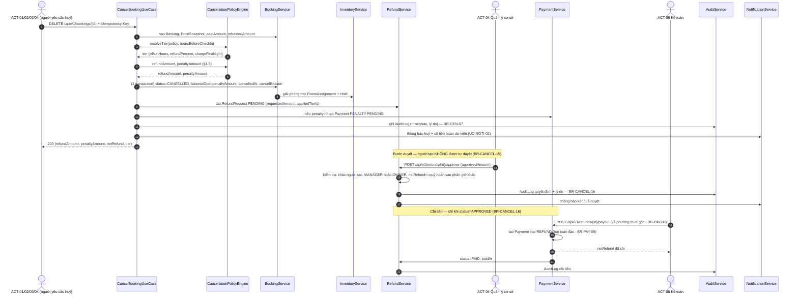
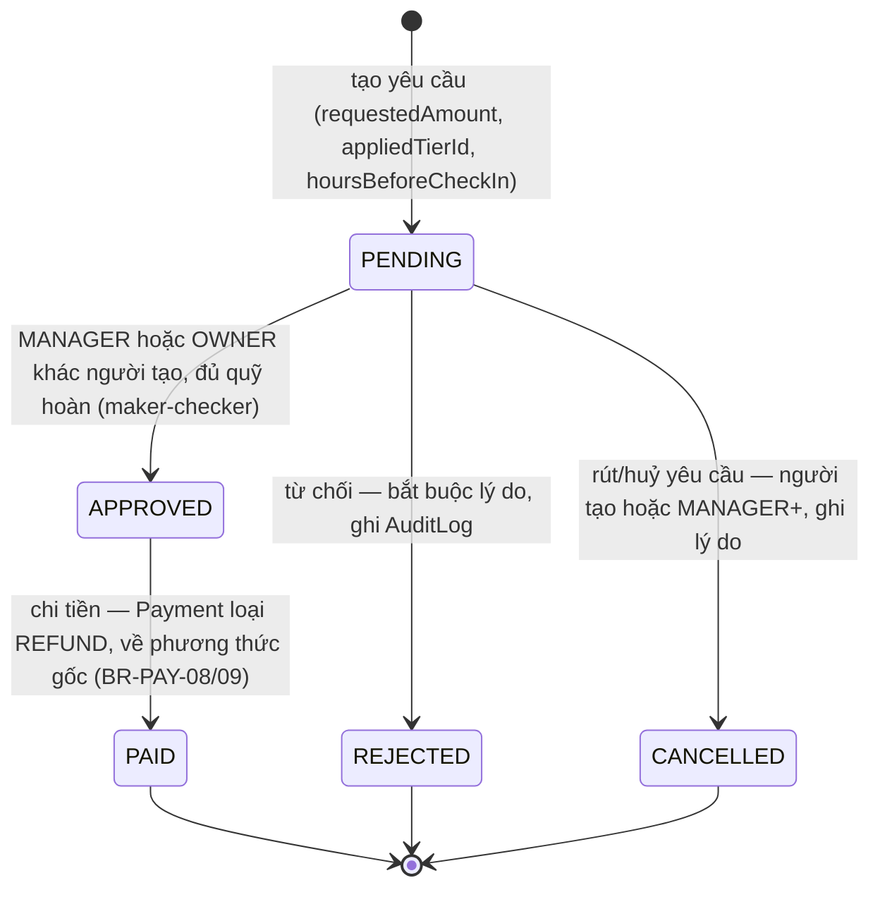

# 02 — Chính sách huỷ & hoàn cọc

> Chuyên đề mở rộng cho **BR-CANCEL-01…19**, **BR-PAY-07…09**, **BR-BOOK-12** (bài toán **BT-1**), phục vụ **UC-BOOK-08**, **UC-PAY-04**, **UC-OVER-05**, **UC-FO-04**, **UC-BOOK-06**.
> **Không định nghĩa lại con số nghiệp vụ.** Thang mốc, tỷ lệ cọc, hệ số giá, sàn/trần đều là dữ liệu của [quy-tac-nghiep-vu.md](quy-tac-nghiep-vu.md) §6–§7; tài liệu này đặc tả **cấu trúc dữ liệu chính sách, giải thuật chọn bậc, thứ tự tính tiền, bảng quyết định, ví dụ số tự kiểm tra được, ma trận biên, ngoại lệ, quy trình và bất biến kiểm thử**. Giá trị mặc định cho câu hỏi mở liên quan: [00 §11](../00-tong-quan.md#11-câu-hỏi-mở-cần-chủ-đầu-tư-xác-nhận) — Q-01 (cọc), Q-02 (phí hoàn), Q-08 (giờ nhận phòng), Q-09 (hạn chi tiền), Q-11 (trả phòng sớm), Q-12 (đổi ngày).
> Dải mã ca kiểm thử của tài liệu này: **TC-CANCEL-01…55** (§6 = 01…34, §8 = 35…43, §11 = 44…49, §9 = 50…55).

---

## 1. Phạm vi & truy vết quy tắc

| Mã BR | Nội dung đặc tả trong tài liệu | Mục | Ca kiểm thử | Use case liên quan |
|-------|-------------------------------|-----|-------------|--------------------|
| BR-CANCEL-01 | Thang mốc dữ liệu hoá, chọn bậc | §2, §3, §4 | TC-CANCEL-01…34 | UC-BOOK-08 |
| BR-CANCEL-02 | Tỷ lệ cọc theo gói, làm tròn lên | §3, §7.2 | TC-CANCEL-01, TC-CANCEL-16 | UC-PAY-01 |
| BR-CANCEL-03 | Cơ sở tính `hoursBeforeCheckIn` | §4.2 | TC-CANCEL-35…43 | UC-BOOK-08 |
| BR-CANCEL-04 | Cơ sở tính hoàn = `paidAmount` | §5 | TC-CANCEL-05, TC-CANCEL-14 | UC-PAY-04 |
| BR-CANCEL-05 | Công thức `refundAmount`, làm tròn xuống | §4.3, §7 | TC-CANCEL-03, TC-CANCEL-18 | UC-PAY-04 |
| BR-CANCEL-06 | Phụ thu đêm đầu theo `firstNightPrice` | §4.3, §7.4 | TC-CANCEL-11…14 | UC-PAY-04 |
| BR-CANCEL-07 | `NONREF` không bao giờ hoàn | §3, §6 | TC-CANCEL-23…26 | UC-BOOK-08 |
| BR-CANCEL-08 | Đổi ngày không tạo `RefundRequest` | §9.4 | TC-CANCEL-53 | UC-BOOK-06 |
| BR-CANCEL-09 | Trả phòng sớm | §9.3 | TC-CANCEL-52 | UC-FO-02 |
| BR-CANCEL-10 | No-show, áp bậc cuối | §4.2, §7.5 | TC-CANCEL-15, TC-CANCEL-34 | UC-FO-04 |
| BR-CANCEL-11 | Phí xử lý hoàn tiền | §4.3, §5 | TC-CANCEL-44…49 | UC-PAY-04 |
| BR-CANCEL-12 | Hạn chi tiền 3–7 ngày | §10.2 | TC-CANCEL-52 | UC-PAY-04 |
| BR-CANCEL-13 | Bất khả kháng, hoàn 100% | §9.1 | TC-CANCEL-50 | UC-OVER-05 |
| BR-CANCEL-14 | Walk-out, hoàn 100% + bồi thường | §9.2 | TC-CANCEL-51 | UC-OVER-04 |
| BR-CANCEL-15 | Phê duyệt hai cấp, ngưỡng `netRefund` 5.000.000 | §10.2, §4.3 | TC-CANCEL-52 | UC-PAY-04 |
| BR-CANCEL-16 | Chỉ chi sau `APPROVED` | §10.2 | TC-CANCEL-52 | UC-PAY-04 |
| BR-CANCEL-17 | Trần hoàn luỹ kế | §5, §11 (P1) | TC-CANCEL-44 | UC-PAY-04 |
| BR-CANCEL-18 | Rút/huỷ yêu cầu hoàn ở `PENDING` | §10.2 | TC-CANCEL-52 | UC-PAY-04 |
| BR-CANCEL-19 | Huỷ một phần booking nhiều phòng | §9.5 | TC-CANCEL-54 | UC-BOOK-08 |
| BR-PAY-07 | Trần hoàn luỹ kế ≤ `paidAmount` | §5, §11 (P1) | TC-CANCEL-44 | UC-PAY-04 |
| BR-PAY-08 | Hoàn về phương thức gốc | §5, §10.2 | TC-CANCEL-52 | UC-PAY-04 |
| BR-PAY-09 | Hoàn ghi bằng `Payment` loại `REFUND` | §10.2 | TC-CANCEL-52 | UC-PAY-04 |
| BR-BOOK-12 | Đổi ngày 1 lần miễn phí ≥ 168h; `NONREF` phí 10% | §9.4 | TC-CANCEL-53 | UC-BOOK-06 |
| BR-RATE-19 | `LONGSTAY14` phải có mức giá riêng (giả định của booking mẫu BK-B) | §3.3 | TC-CANCEL-27…34 | UC-RATE-01 |

**Trong phạm vi:** 4 gói giá `FLEX7`/`SAVER3`/`NONREF`/`LONGSTAY14`, kênh bán trực tiếp (không áp chính sách OTA — BR-CHAN-04, xem §9.6).
**Ngoài phạm vi:** chính sách huỷ riêng của từng OTA; đối soát hoa hồng (BR-PAY-10, [UC-PAY-05](../00-tong-quan.md#8-danh-mục-use-case)).

---

## 2. Cấu trúc dữ liệu chính sách huỷ

Dùng đúng định danh thực thể của [00 §7.5](../00-tong-quan.md#75-thanh-toán-pay--chính-sách-huỷ): `CancellationPolicy(id, code, name, isDefault, earlyCheckoutFreeHours, earlyCheckoutRefundPct, status)` · `CancellationTier(id, policyId, offsetHours, refundPercent, chargeFirstNight, label, sortOrder)`; `RatePlan.cancellationPolicyId` trỏ tới chính sách tương ứng. Ngưỡng trả phòng sớm (`earlyCheckoutFreeHours`/`earlyCheckoutRefundPct`) nằm ở **policy**, không suy ra từ `CancellationTier` — vì bậc ≥ 72h của `SAVER3` là 100% chứ không phải 50%, nếu suy ra thì `CancellationPolicyEngine` buộc phải hard-code (vi phạm BR-CANCEL-01 và BR-SYS-02). Cấu hình qua UC-RATE-06; lúc tính hoàn dùng bản policy trong PriceSnapshot.policySnapshotJson của booking.

| `CancellationPolicy.code` | Gắn với `RatePlan` | Số bậc | Bậc cuối (bậc bắt tất) | Cọc | Trả phòng sớm (`earlyCheckoutFreeHours`/`earlyCheckoutRefundPct`) | Cơ sở pháp lý |
|---------------------------|--------------------|--------|------------------------|-----|------------------------------------------------------------------|----------------|
| `CP-FLEX7` | `FLEX7` | 4 | 0% + phụ thu đêm đầu | 30% | 72h / 50% | BR-CANCEL-01/02/09 |
| `CP-SAVER3` | `SAVER3` | 3 | 0% + phụ thu đêm đầu | 50% | 72h / 50% | BR-CANCEL-01/02/09 |
| `CP-NONREF` | `NONREF` | 1 | 0%, không phụ thu | 100% | `null` / 0% | BR-CANCEL-01/07/09 |
| `CP-LONGSTAY14` | `LONGSTAY14` | 3 | 0% + phụ thu đêm đầu | 30% | 168h / 50% | BR-CANCEL-01/02/09 |

**Bất biến dữ liệu** — kiểm tra khi lưu `CancellationPolicy` (màn cấu hình của `OWNER`, BR-SYS-02); vi phạm → từ chối lưu:

| # | Bất biến | Vì sao cần |
|---|----------|------------|
| I1 | `offsetHours` **giảm dần nghiêm ngặt** theo `sortOrder` | Đảm bảo có đúng một bậc khớp cho mỗi giá trị giờ |
| I2 | `refundPercent` **không tăng** khi `sortOrder` tăng | Đảm bảo tính đơn điệu "huỷ muộn hơn không bao giờ hoàn nhiều hơn" (§11 P2) |
| I3 | Bậc cuối có `offsetHours = -1` và là **bậc bắt tất**: mọi giá trị không đạt mốc không âm nào của gói (FLEX7/SAVER3 <24h, LONGSTAY14 <168h, NONREF mọi mốc), **kể cả giá trị âm**, đều rơi vào bậc này | BR-CANCEL-01 (điều khoản làm rõ): nếu không, no-show lúc 23:59 (≈ −9,98h) không khớp bậc nào |
| I4 | `refundPercent ∈ [0, 100]`, là số nguyên; `chargeFirstNight ∈ {true, false}` | VO `CancellationTier` ([00 §7.7](../00-tong-quan.md#77-giá-trị-miền-value-object--bất-biến-so-sánh-theo-giá-trị)) |
| I5 | `chargeFirstNight = true` ⟹ `refundPercent = 0` | Tránh vừa hoàn tiền vừa phụ thu đêm đầu trên cùng một đêm |
| I6 | `earlyCheckoutRefundPct ∈ [0, 100]`; `earlyCheckoutFreeHours` phải là số nguyên dương hoặc `null` (khi `null` thì `earlyCheckoutRefundPct = 0`) | BR-CANCEL-09: `NONREF` không có ngưỡng nào và hoàn 0% |

---

## 3. Thang mốc đầy đủ 11 bậc (nguồn: BR-CANCEL-01) kèm giá trị số của booking mẫu

Cột số dùng ba booking mẫu, dẫn xuất đêm-đêm ở §3.3: **BK-A** (`FLEX7`/`SAVER3` — DLX 3 đêm, `losDiscountEnabled = true` → 0,95, `totalAmount` 3.021.000, `firstNightPrice` 1.066.000, cọc đủ 907.000 / 1.511.000), **BK-N** (`NONREF` — DLX 3 đêm, `losDiscountEnabled = false`, `totalAmount` 3.179.000, `firstNightPrice` 1.122.000, cọc 100% = 3.179.000) và **BK-B** (`LONGSTAY14` — DLX 14 đêm, `losDiscountEnabled = true` → 0,85, `totalAmount` 19.374.000, `firstNightPrice` 1.309.000, cọc 30% = 5.813.000).

| Gói giá | Cọc | Bậc (`sortOrder`) | `offsetHours` | Hoàn | Phụ thu đêm đầu | Nhãn hiển thị | Booking mẫu | Số đã trả | `refundAmount` | `penaltyAmount` |
|---------|-----|-------------------|---------------|------|-----------------|---------------|-------------|-----------|----------------|-----------------|
| `FLEX7` | 30% | 1 | 168 | **100%** | Không | Huỷ trước ≥ 7 ngày: hoàn toàn bộ tiền đã trả | BK-A | 907.000 | 907.000 | 0 |
| `FLEX7` | 30% | 2 | 72 | **50%** | Không | Huỷ trước 3–7 ngày: hoàn 50% | BK-A | 907.000 | 453.000 | 0 |
| `FLEX7` | 30% | 3 | 24 | **0%** | Không | Huỷ trước 1–3 ngày: không hoàn cọc | BK-A | 907.000 | 0 | 0 |
| `FLEX7` | 30% | 4 | -1 | **0%** | **Có** | Huỷ dưới 24 giờ: mất cọc + phụ thu 1 đêm | BK-A | 907.000 | 0 | 159.000 |
| `SAVER3` | 50% | 1 | 72 | **100%** | Không | Huỷ trước ≥ 3 ngày: hoàn toàn bộ | BK-A | 1.511.000 | 1.511.000 | 0 |
| `SAVER3` | 50% | 2 | 24 | **50%** | Không | Huỷ trước 1–3 ngày: hoàn 50% | BK-A | 1.511.000 | 755.000 | 0 |
| `SAVER3` | 50% | 3 | -1 | **0%** | **Có** | Huỷ dưới 24 giờ: mất cọc + phụ thu 1 đêm | BK-A | 1.511.000 | 0 | 0 |
| `NONREF` | 100% | 1 | -1 | **0%** | Không | Không hoàn tiền ở mọi mốc | BK-N | 3.179.000 | 0 | 0 |
| `LONGSTAY14` | 30% | 1 | 336 | **100%** | Không | Huỷ trước ≥ 14 ngày: hoàn toàn bộ | BK-B | 5.813.000 | 5.813.000 | 0 |
| `LONGSTAY14` | 30% | 2 | 168 | **50%** | Không | Huỷ trước 7–14 ngày: hoàn 50% | BK-B | 5.813.000 | 2.906.000 | 0 |
| `LONGSTAY14` | 30% | 3 | -1 | **0%** | **Có** | Huỷ dưới 7 ngày: không hoàn, phụ thu 1 đêm | BK-B | 5.813.000 | 0 | 0 |

### 3.1. Diễn giải khoảng (bắt buộc để bậc cuối phủ hết mọi giá trị giờ)

| Gói giá | Khoảng `hoursBeforeCheckIn` → bậc được chọn | | | |
|---------|--------------------------------------------|---|---|---|
| `FLEX7` | `[168, +∞)` → 168 (100%) | `[72, 168)` → 72 (50%) | `[24, 72)` → 24 (0%) | `(-∞, 24)` → -1 (0% + phụ thu) |
| `SAVER3` | `[72, +∞)` → 72 (100%) | `[24, 72)` → 24 (50%) | `(-∞, 24)` → -1 (0% + phụ thu) | |
| `NONREF` | `(-∞, +∞)` → -1 (0%, không phụ thu) | | | |
| `LONGSTAY14` | `[336, +∞)` → 336 (100%) | `[168, 336)` → 168 (50%) | `(-∞, 168)` → -1 (0% + phụ thu) | |

### 3.2. Quy ước ghi mốc dùng trong tài liệu

`168h00` = 168,0000 (đúng 7 ngày trước 14:00 ngày nhận phòng) · `167h59` = 167,9833 (sớm hơn mốc 1 phút) · `23h59` = 23,9833 (sớm hơn mốc 24h đúng 1 phút) · `-9,9833h` = **no-show**: dấu tự động lúc 23:59 ngày nhận phòng, tức muộn hơn 14:00 là 9h59m (BR-CANCEL-10).

### 3.3. Dẫn xuất giá đêm của ba booking mẫu

BK-A (`FLEX7`/`SAVER3`, `losDiscountEnabled = true`) — DLX, `checkIn` **Thứ Sáu 11/12/2026 14:00 giờ VN**, `checkOut` Thứ Hai 14/12/2026, kênh `WEB`, mùa `SE-LOW` (0,85, có phụ thu cuối tuần), công suất cơ sở giả định < 80% (1,00), LOS 3 đêm (0,95), `discountAmount = 0`:

| Đêm | Thứ | Chuỗi hệ số (BR-RATE-01) | Trước kẹp | Kẹp sàn/trần DLX | Làm tròn LÊN |
|-----|-----|--------------------------|-----------|-------------------|--------------|
| 11/12/2026 | T6 | 1.100.000 × 0,85 × **1,20** × 1,00 × 0,95 × 1,00 | 1.065.900 | 1.065.900 | **1.066.000** |
| 12/12/2026 | T7 | 1.100.000 × 0,85 × **1,20** × 1,00 × 0,95 × 1,00 | 1.065.900 | 1.065.900 | **1.066.000** |
| 13/12/2026 | CN | 1.100.000 × 0,85 × 1,00 × 1,00 × 0,95 × 1,00 | 888.250 | 888.250 | **889.000** |

`subtotal` = 1.066.000 + 1.066.000 + 889.000 = **3.021.000**; `discount` = 0; `totalAmount` = 3.021.000. `firstNightPrice` = **1.066.000**. Cọc: `FLEX7` 30% = 906.300 → **907.000**; `SAVER3` 50% = 1.510.500 → **1.511.000** (BR-CANCEL-02, làm tròn lên theo BR-GEN-03).

BK-N (`NONREF`, `losDiscountEnabled = false`) — cùng ngày, kênh `WEB` và mùa `SE-LOW` với BK-A, bỏ bước 4 (LOS): đêm T6/T7 = 1.100.000 × 0,85 × 1,20 × 1,00 × 1,00 = 1.122.000 → **1.122.000**; đêm CN = 1.100.000 × 0,85 × 1,00 × 1,00 × 1,00 = 935.000 → **935.000**. `totalAmount` = 2 × 1.122.000 + 935.000 = **3.179.000**; `firstNightPrice` = 1.122.000; cọc 100% = **3.179.000**.

BK-B (`LONGSTAY14`, `losDiscountEnabled = true`) — DLX, `checkIn` **Thứ Ba 01/06/2027 14:00 giờ VN**, `checkOut` 15/06/2027 (14 đêm), kênh `WEB`, mùa `SE-SUM` (1,40, có phụ thu cuối tuần), công suất < 80% (1,00), LOS ≥ 14 đêm (0,85): mỗi đêm T6/T7 = 1.100.000 × 1,40 × 1,20 × 1,00 × 0,85 = 1.570.800 → **1.571.000** (4 đêm); mỗi đêm còn lại = 1.100.000 × 1,40 × 1,00 × 0,85 = 1.309.000 → **1.309.000** (10 đêm). `totalAmount` = 4 × 1.571.000 + 10 × 1.309.000 = **19.374.000**; `firstNightPrice` = 1.309.000; cọc 30% = 5.812.200 → **5.813.000**. BK-B giả định `LONGSTAY14` có mức giá riêng (dòng `RateCalendar` nguồn `RATE_PLAN` hoặc `RatePlan.fixedNightlyPrice`) theo **BR-RATE-19**; nếu không cấu hình, gói cho cùng mức giá với `FLEX7` và màn hình cấu hình PHẢI cảnh báo.

---

## 4. Hàm xác định bậc & hàm tiền

### 4.1. `resolveTier(policy, hoursBeforeCheckIn)`

```text
HÀM resolveTier(policy: CancellationPolicy, hoursBeforeCheckIn: number): CancellationTier
  # Tiền kiểm (I1..I5 của §2 đã được ép khi lưu chính sách)
  NẾU policy.tiers RỖNG → lỗi E_CANCEL_POLICY_MISSING            # BR-CANCEL-01
  tiers ← policy.tiers SẮP XẾP GIẢM DẦN theo offsetHours         # = tăng dần theo sortOrder

  # Bậc có offsetHours LỚN NHẤT mà hoursBeforeCheckIn ≥ offsetHours
  VỚI MỖI t TRONG tiers:
      NẾU hoursBeforeCheckIn ≥ t.offsetHours THÌ TRẢ VỀ t
  HẾT VỚI

  # Không bậc nào khớp ⇔ hoursBeforeCheckIn < offsetHours của bậc cuối
  # (mọi trường hợp no-show: giờ âm sâu hơn -1) → bậc bắt tất
  TRẢ VỀ tiers[ĐỘ DÀI tiers - 1]                                # sortOrder lớn nhất
KẾT THÚC HÀM
```

Độ phức tạp `O(số bậc)` (≤ 4); hàm **thuần**, không đọc đồng hồ hệ thống — thời điểm huỷ truyền vào qua tham số (điều kiện để kiểm thử bất biến, [NFR-MAIN-01](../01-yeu-cau/yeu-cau-phi-chuc-nang.md)).

| # | Quy tắc chọn bậc | Căn cứ |
|---|------------------|--------|
| R1 | So sánh bằng **số nguyên phút**: `minutesBeforeCheckIn = floor((checkInDateTime − cancelledAt) / 60_000)`; so với `offsetHours × 60`. Không so bằng số thực | Loại sai số dấu phẩy động tại đúng mốc (168h00 ≠ 167h59) |
| R2 | `checkInDateTime` = ngày `checkIn` lúc `Property.checkInTime` (mặc định 14:00 giờ VN), không dùng ngày hay giờ tạo booking | BR-GEN-04, BR-CANCEL-03 |
| R3 | Điều kiện là **`≥`**: đúng mốc 168h00 rơi vào bậc cao hơn | BR-CANCEL-01 |
| R4 | Bậc cuối (`offsetHours = -1`) là **bậc bắt tất** cho mọi giá trị không đạt mốc không âm nào của gói (FLEX7/SAVER3 <24h, LONGSTAY14 <168h, NONREF mọi mốc), **kể cả giá trị âm** | BR-CANCEL-01, I3 |
| R5 | No-show dùng **cùng bậc bắt tất** như huỷ dưới ngưỡng cuối; khác biệt chỉ ở `cancelReason = NO_SHOW` và việc hệ thống tự kích hoạt | BR-CANCEL-10 |
| R6 | Tại mọi mốc, bậc chọn **không phụ thuộc kênh bán** | BR-CANCEL-01 |

### 4.2. Xử lý `hoursBeforeCheckIn` âm

| Tình huống | `hoursBeforeCheckIn` | Bậc | Hành vi |
|------------|----------------------|-----|---------|
| Huỷ sát giờ nhưng trước 14:00 ngày nhận phòng | `(-1, 0)` | Bậc bắt tất | Hoàn 0%; phụ thu đêm đầu nếu bậc quy định |
| Huỷ sau 14:00 nhưng booking chưa `CHECKED_IN` | `(-∞, -1]` | Bậc bắt tất (**không bậc nào khớp**) | Hoàn 0%; phụ thu đêm đầu; `cancelReason = GUEST_REQUEST` |
| No-show: job lúc 23:59 ngày nhận phòng | `≈ -9,9833` | Bậc bắt tất | BR-CANCEL-10: chuyển `NO_SHOW`, hoàn 0%, phụ thu đêm đầu nếu bậc quy định |
| Booking đã `CHECKED_IN` | — | — | **Không** đi qua hàm này: không huỷ được; phải check-out rồi trả phòng sớm (BR-BOOK-13, BR-CANCEL-09) |

### 4.3. Hàm tiền

```text
roundUp1000(x)      = ceil(x / 1000) × 1000        # giá bán, tiền cọc            (BR-GEN-03)
roundDown1000(x)    = floor(x / 1000) × 1000       # mọi khoản hoàn               (BR-GEN-03)

refundBase          = tiền phòng thực thu được phân bổ cho phần huỷ, chưa xử lý trước đó # BR-CANCEL-04/19
refundAmount        = roundDown1000(refundBase × tier.refundPercent / 100)   # BR-CANCEL-05
penaltyAmount       = tier.chargeFirstNight ? max(0, firstNightPrice − paidAmount) : 0   # BR-CANCEL-06
refundableRemaining = tiền thu đủ điều kiện − đã hoàn SUCCEEDED − đang giữ PENDING/APPROVED khác # khóa booking + Payment gốc
NẾU netRefund dự kiến > refundableRemaining → xung đột đối soát, không tự cắt nghĩa vụ hoàn
refundFee           = SystemSetting("refund.feeAmount", 0)              # BR-CANCEL-11 (Q-02), khoá của BR-SYS-02
netRefund           = max(0, (approvedAmount ?? requestedAmount) − refundFee) # requestedAmount = refundAmount dự kiến
```

`firstNightPrice` = giá đêm đầu trong `PriceSnapshot` bất biến của booking (BR-RATE-16). Mọi giá trị tiền là **số nguyên VND** ([NFR-LOC-03](../01-yeu-cau/yeu-cau-phi-chuc-nang.md), BR-GEN-01). Phí bị chặn ở tiền gộp được hoàn; phần phí dư không thành công nợ. Các ví dụ một phòng/không hoàn trước đó dùng refundBase = paidAmount.

---

## 5. Thứ tự tính khi huỷ (bắt buộc, mỗi bước có kiểm thử)

| Bước | Việc | Nguồn |
|------|------|-------|
| 1 | Kiểm tra quyền và trạng thái booking thuộc `{CONFIRMED, PENDING_PAYMENT, HELD}`; chưa xác nhận áp BR-BOOK-18 (hoàn đủ, không phạt); ngược lại → `E_CANCEL_INVALID_STATE` | BR-RBAC-03, BR-BOOK-14 |
| 2 | Tính `minutesBeforeCheckIn` (số nguyên phút) từ `checkInDateTime` danh nghĩa | BR-CANCEL-03, R1 |
| 3 | `resolveTier` → `{offsetHours, refundPercent, chargeFirstNight}` | BR-CANCEL-01 |
| 4 | Áp ngoại lệ nếu có: bất khả kháng (§9.1) hoặc walk-out (§9.2) **ghi đè** bậc | BR-CANCEL-13/14 |
| 5 | refundBase theo phân bổ phạm vi huỷ (một phòng, chưa hoàn trước đó: paidAmount) | BR-CANCEL-04 |
| 6 | `refundAmount` (làm tròn **xuống** 1.000đ) | BR-CANCEL-05, BR-GEN-03 |
| 7 | `penaltyAmount` (dùng `firstNightPrice` từ `PriceSnapshot`; snapshot được lưu **ngay khi booking rời `DRAFT`**, nên `HELD`/`PENDING_PAYMENT`/`CONFIRMED` đều có) | BR-CANCEL-06, BR-RATE-16 |
| 8 | Khóa tiền gốc và booking, kiểm tiền đã chi + phần giữ các yêu cầu khác; xung đột thì dừng, không tự giảm nghĩa vụ hoàn | BR-CANCEL-17, BR-PAY-07 |
| 9 | `refundFee`; `netRefund = max(0, (approvedAmount ?? requestedAmount) − refundFee)` — ngưỡng phê duyệt hai cấp và báo cáo đều so trên `netRefund` | BR-CANCEL-11, BR-CANCEL-05, BR-CANCEL-15 |
| 10 | Một transaction: `Booking.status → CANCELLED` (hoặc `NO_SHOW`), `cancelledAt`, `cancelReason`, `balanceDue = penaltyAmount` (booking đã huỷ **không** tạo công nợ cho phần `totalAmount − paidAmount`), giải phóng mọi `RoomAssignment`, `Hold.status = RELEASED` | BR-BOOK-11, BR-PAY-02, BR-BOOK-08 |
| 11 | Cùng transaction: tạo `RefundRequest` (PENDING, `appliedTierId`, `refundPercent`, `hoursBeforeCheckIn`, `requestedAmount = refundAmount`, `isForceMajeure`), `Payment` loại `PENALTY` trạng thái `PENDING` nếu `penaltyAmount > 0`, `AuditLog`, `OutboxEvent` | BR-CANCEL-06/16, BR-GEN-07, BR-CHAN-06 |
| 12 | Gửi `Notification` xác nhận huỷ + số tiền hoàn dự kiến | BR-SYS-06, UC-NOTI-02 |
| 13 | **Không chi tiền ở bước này**: chi chỉ khi `RefundRequest.status = APPROVED` | BR-CANCEL-16 |

Không có `if/else` theo tên gói giá ở bất kỳ bước nào — bậc là **dữ liệu** (BR-CANCEL-01). Phần `totalAmount − paidAmount` chưa từng thu của booking `CANCELLED`/`NO_SHOW`/`EXPIRED` **không** tạo công nợ; `balanceDue` chỉ còn `penaltyAmount` (BR-PAY-02).

---

## 6. Bảng quyết định (ma trận quyết định hoàn cọc)

Cơ sở: cột "Booking" là BK-A/BK-N/BK-B ở §3.3. `refundFee = 0` (Q-02) nên `netRefund = refundAmount`. Mọi số VND là số nguyên đã làm tròn theo BR-GEN-03. Bậc ghi bằng `offsetHours` của bậc được chọn; `hoursBeforeCheckIn` ghi theo §3.2.

| # | Ca kiểm thử | Gói giá | Booking | `hoursBeforeCheckIn` | `paidAmount` | Bậc | `refundPercent` | `chargeFirstNight` | `refundAmount` | `penaltyAmount` |
|---|-------------|---------|---------|----------------------|--------------|-----|-----------------|--------------------|----------------|-----------------|
| DT-01 | TC-CANCEL-01 | `FLEX7` | BK-A | 200 | 907.000 | 168 | 100% | Không | 907.000 | 0 |
| DT-02 | TC-CANCEL-02 | `FLEX7` | BK-A | **168h00** | 907.000 | 168 | 100% | Không | 907.000 | 0 |
| DT-03 | TC-CANCEL-03 | `FLEX7` | BK-A | **167h59** | 907.000 | 72 | 50% | Không | 453.000 | 0 |
| DT-04 | TC-CANCEL-04 | `FLEX7` | BK-A | 100 | 907.000 | 72 | 50% | Không | 453.000 | 0 |
| DT-05 | TC-CANCEL-05 | `FLEX7` | BK-A | 100 | 0 | 72 | 50% | Không | 0 | 0 |
| DT-06 | TC-CANCEL-06 | `FLEX7` | BK-A | 100 | 500.000 | 72 | 50% | Không | 250.000 | 0 |
| DT-07 | TC-CANCEL-07 | `FLEX7` | BK-A | **72h00** | 907.000 | 72 | 50% | Không | 453.000 | 0 |
| DT-08 | TC-CANCEL-08 | `FLEX7` | BK-A | **71h59** | 907.000 | 24 | 0% | Không | 0 | 0 |
| DT-09 | TC-CANCEL-09 | `FLEX7` | BK-A | 48 | 907.000 | 24 | 0% | Không | 0 | 0 |
| DT-10 | TC-CANCEL-10 | `FLEX7` | BK-A | **24h00** | 907.000 | 24 | 0% | Không | 0 | 0 |
| DT-11 | TC-CANCEL-11 | `FLEX7` | BK-A | **23h59** | 907.000 | -1 | 0% | **Có** | 0 | 159.000 |
| DT-12 | TC-CANCEL-12 | `FLEX7` | BK-A | 10 | 907.000 | -1 | 0% | **Có** | 0 | 159.000 |
| DT-13 | TC-CANCEL-13 | `FLEX7` | BK-A | 10 | 3.021.000 | -1 | 0% | **Có** | 0 | 0 |
| DT-14 | TC-CANCEL-14 | `FLEX7` | BK-A | 10 (CONFIRMED được miễn cọc) | 0 | -1 | 0% | **Có** | 0 | 1.066.000 |
| DT-15 | TC-CANCEL-15 | `FLEX7` | BK-A | **-9,9833 (no-show)** | 907.000 | -1 | 0% | **Có** | 0 | 159.000 |
| DT-16 | TC-CANCEL-16 | `SAVER3` | BK-A | 200 | 1.511.000 | 72 | 100% | Không | 1.511.000 | 0 |
| DT-17 | TC-CANCEL-17 | `SAVER3` | BK-A | **72h00** | 1.511.000 | 72 | 100% | Không | 1.511.000 | 0 |
| DT-18 | TC-CANCEL-18 | `SAVER3` | BK-A | **71h59** | 1.511.000 | 24 | 50% | Không | 755.000 | 0 |
| DT-19 | TC-CANCEL-19 | `SAVER3` | BK-A | **24h00** | 1.511.000 | 24 | 50% | Không | 755.000 | 0 |
| DT-20 | TC-CANCEL-20 | `SAVER3` | BK-A | **23h59** | 1.511.000 | -1 | 0% | **Có** | 0 | 0 |
| DT-21 | TC-CANCEL-21 | `SAVER3` | BK-A | 10 (CONFIRMED được miễn cọc) | 0 | -1 | 0% | **Có** | 0 | 1.066.000 |
| DT-22 | TC-CANCEL-22 | `SAVER3` | BK-A | 10 | 500.000 | -1 | 0% | **Có** | 0 | 566.000 |
| DT-23 | TC-CANCEL-23 | `NONREF` | BK-N | 2000 | 3.179.000 | -1 | 0% | Không | 0 | 0 |
| DT-24 | TC-CANCEL-24 | `NONREF` | BK-N | **23h59** | 3.179.000 | -1 | 0% | Không | 0 | 0 |
| DT-25 | TC-CANCEL-25 | `NONREF` | BK-N | 10 | 0 | -1 | 0% | Không | 0 | 0 |
| DT-26 | TC-CANCEL-26 | `NONREF` | BK-N | 10 | 1.000.000 | -1 | 0% | Không | 0 | 0 |
| DT-27 | TC-CANCEL-27 | `LONGSTAY14` | BK-B | 400 | 5.813.000 | 336 | 100% | Không | 5.813.000 | 0 |
| DT-28 | TC-CANCEL-28 | `LONGSTAY14` | BK-B | **336h00** | 5.813.000 | 336 | 100% | Không | 5.813.000 | 0 |
| DT-29 | TC-CANCEL-29 | `LONGSTAY14` | BK-B | **335h59** | 5.813.000 | 168 | 50% | Không | 2.906.000 | 0 |
| DT-30 | TC-CANCEL-30 | `LONGSTAY14` | BK-B | **168h00** | 5.813.000 | 168 | 50% | Không | 2.906.000 | 0 |
| DT-31 | TC-CANCEL-31 | `LONGSTAY14` | BK-B | **167h59** | 5.813.000 | -1 | 0% | **Có** | 0 | 0 |
| DT-32 | TC-CANCEL-32 | `LONGSTAY14` | BK-B | 10 | 5.813.000 | -1 | 0% | **Có** | 0 | 0 |
| DT-33 | TC-CANCEL-33 | `LONGSTAY14` | BK-B | 10 (CONFIRMED được miễn cọc) | 0 | -1 | 0% | **Có** | 0 | 1.309.000 |
| DT-34 | TC-CANCEL-34 | `LONGSTAY14` | BK-B | **-9,9833 (no-show)** | 5.813.000 | -1 | 0% | **Có** | 0 | 0 |

Các ca paidAmount = 0 mà phát sinh phạt giả định booking đã CONFIRMED theo ngoại lệ miễn cọc; booking còn HELD/PENDING_PAYMENT không chịu phạt (BR-BOOK-18).

Năm quan sát kiểm chứng được trực tiếp trên 34 hàng (đối chiếu bằng mắt, không cần chạy mã):

- **O1** — Hoàn **không bao giờ** vượt `paidAmount`: DT-14 (paid 0 → hoàn 0), DT-13, DT-27.
- **O2** — Bậc càng muộn, hoàn **không tăng**: DT-01 → DT-03 → DT-08 → DT-12 (907.000 → 453.000 → 0 → 0).
- **O3** — Phụ thu đêm đầu = `max(0, firstNightPrice − paidAmount)`: đã trả ≥ giá đêm đầu thì phụ thu = 0 — DT-12 (159.000) so với DT-13 (0); DT-22 (566.000) so với DT-20 (0).
- **O4** — `NONREF` hoàn 0 ở mọi mốc và **không** có phụ thu: DT-23…26.
- **O5** — Kết quả không phụ thuộc kênh bán: cùng gói, cùng mốc ⇒ cùng kết quả (§11 P6).

---

## 7. Năm ca ví dụ tính tay (booking BK-A, gói `FLEX7`)

### 7.1. Dữ liệu vào (đã dẫn xuất ở §3.3)

| Đại lượng | Giá trị | Nguồn |
|-----------|---------|-------|
| Giá mỗi đêm (T6, T7, CN) | 1.066.000 / 1.066.000 / 889.000 | §3.3 |
| `subtotal` / `discountAmount` / `totalAmount` | 3.021.000 / 0 / **3.021.000** | BR-RATE-01 |
| `depositPercent` / `depositAmount` (30%, làm tròn lên) | 30% / 906.300 → **907.000** | BR-CANCEL-02, BR-PAY-01 |
| `paidAmount` (khách đã đóng đủ cọc) | **907.000** | BR-BOOK-09 |
| `firstNightPrice` (`PriceSnapshot`) | **1.066.000** | BR-RATE-16, BR-CANCEL-06 |
| `checkInDateTime` | 11/12/2026 14:00 giờ VN | BR-GEN-04 |
| `refundFee` | 0 | BR-CANCEL-11 (Q-02) |

### 7.2. Tính chung cho cả 5 ca

1. `refundBase = paidAmount = 907.000` (BR-CANCEL-04).
2. `refundableRemaining = 907.000 − 0 = 907.000` (chưa có lần hoàn nào).
3. `refundFee = 0` → `netRefund = refundAmount`.

### 7.3. Ca 1 — huỷ tại **200h** trước nhận phòng

| Bước | Phép tính | Kết quả |
|------|-----------|---------|
| Chọn bậc | 200 ≥ 168 → bậc `offsetHours = 168` | 100%, không phụ thu |
| Tiền hoàn | `floor(907.000 × 100 / 100 / 1000) × 1000` | **907.000** |
| Phụ thu | `chargeFirstNight = false` | **0** |
| Số còn phải thu / tiền chi ra | `balanceDue = penaltyAmount = 0` (booking chuyển `CANCELLED`); `netRefund = 907.000 − 0` | **0** / **907.000** |
| Kiểm tra | `paidAmount − refund + penalty = 907.000 − 907.000 + 0` = 0 → khách không mất gì | ✓ |

### 7.4. Ca 2 — huỷ tại **100h**

| Bước | Phép tính | Kết quả |
|------|-----------|---------|
| Chọn bậc | 72 ≤ 100 < 168 → bậc `offsetHours = 72` | 50%, không phụ thu |
| Tiền hoàn | `floor(907.000 × 50 / 100 / 1000) × 1000 = floor(453,5) × 1000` | **453.000** |
| Phụ thu | không | **0** |
| Số còn phải thu / tiền chi ra | `balanceDue = penaltyAmount = 0`; `netRefund = 453.000 − 0` | **0** / **453.000** |
| Kiểm tra | khách mất `907.000 − 453.000` = **454.000** (phần cọc không hoàn) | ✓ |

### 7.5. Ca 3 — huỷ tại **48h**

| Bước | Phép tính | Kết quả |
|------|-----------|---------|
| Chọn bậc | 24 ≤ 48 < 72 → bậc `offsetHours = 24` | 0%, không phụ thu |
| Tiền hoàn | `floor(907.000 × 0 / 100 / 1000) × 1000` | **0** |
| Phụ thu | `chargeFirstNight = false` | **0** |
| Số còn phải thu / tiền chi ra | `balanceDue = penaltyAmount = 0`; `netRefund = 0` | **0** / **0** |
| Kiểm tra | khách mất `907.000 − 0` = **907.000** (mất cọc) | ✓ |

### 7.6. Ca 4 — huỷ tại **10h**

| Bước | Phép tính | Kết quả |
|------|-----------|---------|
| Chọn bậc | 10 < 24 → bậc `offsetHours = -1` | 0%, **có** phụ thu |
| Tiền hoàn | `floor(907.000 × 0 / 100 / 1000) × 1000` | **0** |
| Phụ thu | `max(0, 1.066.000 − 907.000) = 159.000` → `Payment` loại `PENALTY`, trạng thái `PENDING` (ghi công nợ) | **159.000** |
| Số còn phải thu / tiền chi ra | `balanceDue = penaltyAmount` = 159.000; `netRefund = 0` | **159.000** / **0** |
| Kiểm tra | `paidAmount + penaltyAmount = 907.000 + 159.000 = 1.066.000 = firstNightPrice` → khách trả đúng 1 đêm đầu (bất biến P5, §11) | ✓ |

### 7.7. Ca 5 — no-show (không đến)

| Bước | Phép tính | Kết quả |
|------|-----------|---------|
| Thời điểm kích hoạt | job lúc **23:59 ngày 11/12/2026**, booking còn `CONFIRMED` và chưa check-in | BR-CANCEL-10 |
| `hoursBeforeCheckIn` | `14:00 − 23:59 = -9,9833h` | âm |
| Chọn bậc | không bậc nào khớp (`-9,9833 < -1`) → **bậc bắt tất** `offsetHours = -1` (§4.1) | 0%, **có** phụ thu |
| Tiền hoàn | `floor(907.000 × 0 / 100 / 1000) × 1000` | **0** |
| Phụ thu | `max(0, 1.066.000 − 907.000)` | **159.000** |
| Trạng thái / còn phải thu / chi ra | `Booking.status = NO_SHOW`, `cancelReason = NO_SHOW`; `balanceDue = penaltyAmount`; `netRefund = 0` | BR-CANCEL-10 → **159.000** / **0** |
| Kiểm tra | trùng kết quả Ca 4 (cùng bậc) — đúng thiết kế R5 | ✓ |

### 7.8. Tổng hợp 5 ca

| Ca | `hoursBeforeCheckIn` | Bậc | `refundPercent` | `refundAmount` | `penaltyAmount` | Khách mất (`paid − hoàn + phụ thu`) | Phần giá trị không thu (`total − paid`) |
|----|----------------------|-----|-----------------|----------------|-----------------|--------------------------------------|------------------------------------------|
| 1 | 200h | 168 | 100% | 907.000 | 0 | **0** | 2.114.000 |
| 2 | 100h | 72 | 50% | 453.000 | 0 | **454.000** | 2.114.000 |
| 3 | 48h | 24 | 0% | 0 | 0 | **907.000** | 2.114.000 |
| 4 | 10h | -1 | 0% | 0 | 159.000 | **1.066.000** | 2.114.000 |
| 5 | -9,9833h (no-show) | -1 | 0% | 0 | 159.000 | **1.066.000** | 2.114.000 |

Kiểm tra tổng: cột "khách mất" = `907.000 − refundAmount + penaltyAmount`; phần `totalAmount − paidAmount = 2.114.000` không được thu trong mọi ca vì booking đã `CANCELLED`/`NO_SHOW` (§5).

---

## 8. Ma trận biên

Chín mốc dưới đây là **đúng mốc và sát mốc 1 phút**; mỗi ô ghi `offsetHours`/`refundPercent` (+ phụ thu nếu có).

| Mốc | `FLEX7` | `SAVER3` | `NONREF` | `LONGSTAY14` | Ca kiểm thử |
|-----|---------|----------|----------|--------------|-------------|
| **168h00** | 168 / 100% | 72 / 100% | -1 / 0% | 168 / 50% | TC-CANCEL-35 |
| **167h59** | 72 / 50% | 72 / 100% | -1 / 0% | 168 / 50% | TC-CANCEL-36 |
| **72h00** | 72 / 50% | 72 / 100% | -1 / 0% | 168 / 50% | TC-CANCEL-37 |
| **71h59** | 24 / 0% | 24 / 50% | -1 / 0% | 168 / 50% | TC-CANCEL-38 |
| **24h00** | 24 / 0% | 24 / 50% | -1 / 0% | 168 / 50% | TC-CANCEL-39 |
| **23h59** | -1 / 0% + phụ thu | -1 / 0% + phụ thu | -1 / 0% | -1 / 0% + phụ thu | TC-CANCEL-40 |
| **336h00** | 168 / 100% | 72 / 100% | -1 / 0% | 336 / 100% | TC-CANCEL-41 |
| **0h00** | -1 / 0% + phụ thu | -1 / 0% + phụ thu | -1 / 0% | -1 / 0% + phụ thu | TC-CANCEL-42 |
| **giờ âm** (`-9,9833`) | -1 / 0% + phụ thu | -1 / 0% + phụ thu | -1 / 0% | -1 / 0% + phụ thu | TC-CANCEL-43 |

**Cách kiểm thử đúng tại biên:** so sánh bằng **số nguyên phút** (R1) — `167h59` ↔ 10.079 phút < 10.080 phút; `168h00` ↔ đúng 10.080 phút. Tại `0h00` và mọi giá trị âm, bậc bắt tất phải trả về `sortOrder` lớn nhất — đây là điểm dễ sai nhất nếu cài đặt theo công thức trước khi BR-CANCEL-01 được làm rõ.

---

## 9. Ngoại lệ chính sách

| # | Ngoại lệ | Mã BR | Điều kiện | Hành vi | Thẩm quyền | Ca kiểm thử |
|---|----------|-------|-----------|---------|------------|-------------|
| 9.1 | Bất khả kháng | BR-CANCEL-13, UC-OVER-05 | Thiên tai, dịch bệnh, cơ sở đóng cửa, lỗi hệ thống | Hoàn **100% `paidAmount`**, miễn phụ thu, miễn `refundFee` | `MANAGER`+ tạo, lý do ≥ 20 ký tự, minh chứng tuỳ chọn | TC-CANCEL-50 |
| 9.2 | Walk-out do khách sạn | BR-CANCEL-14, BR-OVER-06, UC-OVER-04 | Hết phương án điều chuyển khả dụng (thang **1 → 2 → 4**; bậc 3 không khả dụng vì 3 cơ sở cách 160–300 km), hoặc khách từ chối phương án | Hoàn **100% `paidAmount`** + bồi thường **1 × giá đêm đầu** + hỗ trợ tìm chỗ | `MANAGER`+ | TC-CANCEL-51 |
| 9.3 | Trả phòng sớm | BR-CANCEL-09 | Đang ở, muốn rời trước `checkOut` | Hoàn 50% × `min(paidAmount, giá các đêm chưa ở)`; `NONREF` → 0% | `MANAGER`+ xác nhận, ghi lý do `EARLY_CHECKOUT` | TC-CANCEL-52 |
| 9.4 | Đổi ngày | BR-BOOK-12, BR-CANCEL-08, UC-BOOK-06 | Muốn dời kỳ lưu trú | **Không** tạo `RefundRequest`; lần đầu miễn phí khi ≥ 168h (`FLEX7`, `SAVER3`, `LONGSTAY14`); `NONREF` phí 10% giá trị booking | Khách sở hữu / FRONT_DESK / RESERVATION_AGENT / MANAGER theo UC | TC-CANCEL-53 |
| 9.5 | No-show | BR-CANCEL-10, UC-FO-04 | 23:59 ngày nhận phòng, còn `CONFIRMED`, chưa check-in | Bậc bắt tất + phụ thu đêm đầu nếu bậc quy định | tự động (ACT-11) hoặc `FRONT_DESK` | TC-CANCEL-15, TC-CANCEL-34 |
| 9.6 | Huỷ do OTA | BR-CHAN-04 | OTA báo huỷ | Áp chính sách **của kênh**, không áp bảng §3; ghi `cancelReason = OTA_CANCELLATION` và `Booking.channelPolicyCode` để đối soát | tự động | TC-CANCEL-55 |
| 9.7 | Huỷ một phần nhiều phòng | BR-CANCEL-19 | `roomCount > 1`, huỷ một số `BookingRoom` | `refundBase` phân bổ theo phân bổ tiền phòng bất biến BR-CANCEL-19 rồi mới áp BR-CANCEL-05; phòng còn lại giữ giá + `RoomAssignment`; `totalAmount` giảm, lưu thêm `PriceSnapshot` điều chỉnh và giữ bản gốc | Khách sở hữu / FRONT_DESK / RESERVATION_AGENT / MANAGER theo UC | TC-CANCEL-54 |
| 9.8 | Booking chưa xác nhận | BR-BOOK-18, BR-PAY-11 | HELD/PENDING_PAYMENT hết holdExpiresAt hoặc khách rút giữ chỗ | Không phạt; hoàn toàn bộ tiền đã thu chưa hoàn; net > 0 mới lập yêu cầu. Timeout PSP riêng không làm hết hạn hold; tiền muộn không tái xác nhận | tự động | Nhánh nghiệm thu UC §6.14 |

### 9.1. Bất khả kháng — chi tiết

Bậc **không** lấy từ bảng: `RefundRequest.appliedTierId = null`, `refundPercent = 100`, `isForceMajeure = true`, `reason = FORCE_MAJEURE` (enum `CancelReason`), `evidenceRefs[]` đính kèm (tuỳ chọn), **diễn giải văn bản ≥ 20 ký tự** ghi ở RefundRequest.reasonText và AuditLog.reason (BR-GEN-07), `refundFee = 0`, `penaltyAmount = 0`.
Ví dụ: BK-B (`LONGSTAY14`, `paidAmount` 5.813.000) huỷ tại 100h — bình thường là bậc bắt tất (hoàn 0) → bất khả kháng → `refundAmount = 5.813.000`. Vì `netRefund` 5.813.000 > 5.000.000 nên vẫn phải **hai cấp** (BR-CANCEL-15). Mọi ca bất khả kháng phải vào báo cáo riêng, định nghĩa chỉ số theo **BR-REP-01** (`tỷ lệ huỷ`, doanh thu/hoàn cọc) — tài liệu này không định nghĩa lại chỉ số (BR-CANCEL-13, UC-REP-03).

### 9.2. Walk-out — chi tiết

Hai khoản chi **tách biệt**, không được cộng gộp vào một `RefundRequest`:

| Khoản | Giá trị (BK-A, đã đóng đủ cọc) | Nơi ghi | Ràng buộc |
|-------|-------------------------------|---------|-----------|
| Hoàn tiền khách đã trả | 907.000 | `RefundRequest` (`refundPercent = 100`) + `Payment` loại `REFUND` | BR-CANCEL-14, BR-PAY-09 |
| Bồi thường 1 đêm đầu | 1.066.000 | `RoomMove.compensationAmount` | BR-OVER-06, `MANAGER`+ duyệt trước khi chi |
| **Tổng chi** | **1.973.000** | — | Bồi thường là chi phí đền bù, **không** chịu trần hoàn luỹ kế BR-PAY-07 (§13 mục 5) |

### 9.3. Trả phòng sớm — chi tiết (BR-CANCEL-09)

Cơ sở tính = **`min(paidAmount, tổng giá các đêm chưa ở theo PriceSnapshot)`**; hệ số hoàn lấy từ **`CancellationPolicy.earlyCheckoutRefundPct`** và ngưỡng báo trước từ **`earlyCheckoutFreeHours`** (không suy ra từ bậc): `FLEX7` 72h/50% · `SAVER3` 72h/50% · `LONGSTAY14` 168h/50% · `NONREF` `null`/0%. Báo muộn hơn ngưỡng hoặc không báo → 0%. Lý do ghi nhận `EARLY_CHECKOUT`. Ví dụ BK-A, khách ở 1 đêm (11/12) rồi trả phòng sớm, 2 đêm chưa ở = 1.066.000 + 889.000 = **1.955.000**: Mốc báo trước = thời điểm trả phòng sớm đề nghị trừ thời điểm nhận thông báo; lưu cả hai trong bằng chứng yêu cầu. Đêm chưa ở bắt đầu từ ngày trả sớm được chấp nhận, dùng snapshot sau khuyến mãi. Khách đã vào phòng đi UC-FO-02, giữ CHECKED_IN tới checkout; chốt nghĩa vụ/nợ và khoản phải hoàn riêng, không chuyển CANCELLED.

| Biến thể | Báo trước | Cơ sở `min(paidAmount, đêm chưa ở)` | Hoàn 50% (làm tròn **xuống**) |
|----------|-----------|-------------------------------------|--------------------------------|
| Đã đóng đủ `totalAmount` 3.021.000 | ≥ 72h | min(3.021.000, 1.955.000) = 1.955.000 | 977.500 → **977.000** |
| Mới đóng cọc 907.000 | ≥ 72h | min(907.000, 1.955.000) = 907.000 | 453.500 → **453.000** |
| Mới đóng cọc 907.000 | < 72h hoặc không báo | — | **0** |
| `NONREF` mọi mức đã trả | mọi mốc | — | **0** |
| `LONGSTAY14` | ≥ 168h | min(paidAmount, đêm chưa ở) | 50% cơ sở đó |

Điểm cần chú ý: `min` đặt ở **cơ sở** (không phải ở kết quả) — khách mới đóng cọc 907.000 chỉ nhận 50% × 907.000 = 453.000, không phải toàn bộ cọc.

### 9.4. Đổi ngày — chi tiết (BR-BOOK-12, Q-12)

| Tình huống | Kết quả | Ghi chú |
|------------|---------|---------|
| Lần đầu, còn ≥ 168h, gói `FLEX7`/`SAVER3`/`LONGSTAY14` | Miễn phí; **không** tạo `RefundRequest` (BR-CANCEL-08); **giữ nguyên trạng thái**; giữ bản `PriceSnapshot.kind = ORIGINAL` và lưu thêm bản `kind = RESCHEDULE` (`seq` tăng), ghi `AuditLog` | Chênh lệch giá tính theo giá mới, total mới = max(total cũ, giá kỳ mới), chênh tăng vào balanceDue (BR-BOOK-12, BR-RATE-16) |
| Lần đầu, còn ≥ 168h, gói `NONREF` | Phí 10% × 3.179.000 = 317.900 → làm tròn **lên** **318.000** | BR-CANCEL-07, BR-BOOK-12; `Payment` loại `RESCHEDULE_FEE` |
| Lần đầu, còn < 168h | Không miễn phí → xử lý như huỷ + đặt mới (áp bảng §3) | Tính lại toàn bộ theo bậc tại thời điểm đó |
| Lần thứ hai trở đi | Luôn tính như huỷ + đặt mới | Đếm bằng `Booking.rescheduleCount`; tạo `RefundRequest` theo §5 |
| Chênh lệch giá | Giá mới cao hơn → thu thêm vào `balanceDue`; thấp hơn → không hạ total đã cam kết; không hoàn; giữ cọc/policy đã chốt theo BR-BOOK-12 | BR-BOOK-12 |
| Booking `CHECKED_IN` | Không đổi ngày được; phải check-out rồi tạo booking mới | BR-BOOK-13 |

### 9.5. Huỷ một phần nhiều phòng (BR-CANCEL-19)

Áp dụng BR-CANCEL-19: chọn BookingRoom ACTIVE, chỉ huỷ các đơn vị được chọn, không tách booking con và không dùng SPLIT_ROOMS. Đọc phân bổ tiền theo snapshot lúc thu; lần huỷ sau chỉ sử dụng phần còn lại chưa xử lý, không phân bổ lại tổng paidAmount trên total đã giảm.

```text
refundBaseCancelled = tổng tiền phòng đã phân bổ cho BookingRoom bị huỷ, chưa xử lý lần trước # BR-CANCEL-19
refundAmount        = roundDown1000(refundBaseCancelled × tier.refundPercent / 100)   # BR-CANCEL-05
```

Các phòng còn lại **giữ nguyên giá và `RoomAssignment`**; `totalAmount` giảm; hệ thống lưu thêm một `PriceSnapshot` điều chỉnh (`kind = PARTIAL_CANCEL`, `seq` tăng) và **giữ bản gốc** (`kind = ORIGINAL`) — BR-RATE-16. `penaltyAmount` (nếu bậc quy định) tính trên `firstNightPrice` của phần bị huỷ. Huỷ **hết** phòng → booking chuyển `CANCELLED` toàn phần theo §5. Phân bổ tiền nguyên VND theo BR-CANCEL-19, tổng phần phân bổ bằng tiền đã thu; làm tròn hoàn xuống 1.000 chỉ khi tính nghĩa vụ hoàn. Tiền giữ do huỷ không trả nợ phòng còn ở.

---

## 10. Quy trình nghiệp vụ

### 10.1. Luồng huỷ → tính hoàn → duyệt hai cấp → chi tiền



Hạn chi tiền: `approvedAt → paidAt` trong **3 ngày làm việc**, tối đa **7 ngày** (BR-CANCEL-12, Q-09); quá 7 ngày → cảnh báo cho `MANAGER`/`ACCOUNTANT` ([NFR-OBS-04](../01-yeu-cau/yeu-cau-phi-chuc-nang.md)).

### 10.2. Vòng đời `RefundRequest`



| Chuyển | Bảo vệ (guard) | Actor | Tác dụng phụ bắt buộc | BR |
|--------|----------------|-------|------------------------|-----|
| → `PENDING` | Sự kiện huỷ/huỷ một phần/check-out sớm/tiền thu muộn hợp lệ; netRefund > 0; idempotent theo `Idempotency-Key` | ACT-01/02/03/04 | `AuditLog`, `OutboxEvent`, `Notification` | BR-GEN-07/08, BR-CANCEL-16 |
| `PENDING` → `APPROVED` | MANAGER hoặc OWNER có phạm vi, khác requestedBy; 0 ≤ approvedAmount ≤ requestedAmount; netRefund đủ quỹ theo BR-CANCEL-17. Hai cấp nghĩa là lập + duyệt ở mọi mức tiền | ACT-04, ACT-05 | AuditLog, approvedBy, decidedAt, khóa tiền gốc | BR-CANCEL-15/16, BR-RBAC-03 |
| `PENDING` → `REJECTED` | Lý do bắt buộc | ACT-04, ACT-05 | `AuditLog`, thông báo khách | BR-CANCEL-16 |
| `PENDING` → `CANCELLED` | Khách rút yêu cầu ; không khôi phục booking; chỉ **người tạo** hoặc `MANAGER`+; **không** được huỷ khi đã `APPROVED`/`PAID`; ghi lý do bắt buộc | ACT-01/02/03/04, ACT-04/05 | `AuditLog` kèm lý do | BR-CANCEL-18 |
| `APPROVED` → `PAID` | Gateway/chuyển khoản có chứng từ thành công; `Payment` loại `REFUND`; **không** sửa/xoá `Payment` gốc | ACT-06 | `Payment` REFUND, `PaidAt`, tăng `Booking.refundedAmount`, `AuditLog` | BR-PAY-09, BR-CANCEL-16 |

Bất biến xuyên trạng thái: tổng REFUND SUCCEEDED + phần tiền đang giữ cho PENDING/APPROVED không vượt tiền gốc đủ điều kiện, kiểm theo từng Payment và booking; tiền COMPENSATION tách riêng. Chi timeout giữ APPROVED + lần chi PENDING, tra PSP trước retry cùng khóa. Không tăng refundedAmount trước bằng chứng chi thành công.

---

## 11. Kiểm thử thuộc tính (property-based, Vitest + fast-check)

Sinh dữ liệu: `policy` từ tập 4 chính sách hợp lệ **và** các chính sách sinh ngẫu nhiên thoả I1–I6; `hoursBeforeCheckIn` ∈ `[-2000, 2000]` (gồm cả số âm và các giá trị sát mốc ±1 phút); `paidAmount` ∈ `[0, 200.000.000]` bội 1.000; `firstNightPrice` ∈ `[150.000, 4.200.000]`; `refundedAmount ≤ paidAmount`.

| # | Bất biến (phát biểu kiểm thử được) | Nguồn | Ca kiểm thử |
|---|-----------------------------------|-------|-------------|
| P1 | **Hoàn không bao giờ vượt số đã trả**: `refundAmount ≤ paidAmount − refundedAmount` với mọi đầu vào; và tổng các lần hoàn luỹ kế của một booking ≤ `paidAmount` | BR-CANCEL-17, BR-PAY-07 | TC-CANCEL-44 |
| P2 | **Huỷ muộn hơn không bao giờ hoàn nhiều hơn**: nếu `h1 ≤ h2` thì `refundAmount(h1) ≤ refundAmount(h2)` với mọi cặp giờ trên cùng gói và cùng `paidAmount` | BR-CANCEL-01 (cần I1, I2) | TC-CANCEL-45 |
| P3 | **Kết quả là bội của 1.000 và không âm**: `refundAmount mod 1.000 = 0`, `refundAmount ≥ 0`, `penaltyAmount ≥ 0`, `netRefund ≥ 0` | BR-GEN-03, BR-CANCEL-05/06 | TC-CANCEL-46 |
| P4 | **Chưa trả thì không hoàn**: `paidAmount = 0` ⟹ `refundAmount = 0` với mọi gói, mọi mốc, mọi loại huỷ | BR-CANCEL-04 | TC-CANCEL-47 |
| P5 | **Đủ một đêm đầu**: khi `chargeFirstNight = true` thì `paidAmount + penaltyAmount ≥ firstNightPrice`, và `refundPercent = 0`; khi `chargeFirstNight = false` thì `penaltyAmount = 0` | BR-CANCEL-06, I5 | TC-CANCEL-48 |
| P6 | **Hàm thuần & dữ liệu hoá**: hai lần gọi cùng đầu vào cho cùng kết quả; kết quả chỉ phụ thuộc `(tiers, hoursBeforeCheckIn, paidAmount, firstNightPrice)` — không phụ thuộc tên gói, kênh bán hay thời điểm gọi; đổi `offsetHours` của một bậc thì kết quả tại mọi mốc phải theo bậc mới | BR-CANCEL-01, BR-RATE-17 (tương tự), [NFR-MAIN-01](../01-yeu-cau/yeu-cau-phi-chuc-nang.md) | TC-CANCEL-49 |

**Ghi chú kiểm thử:** P2 và P6 chỉ đúng khi chính sách thoả I1–I2; do đó bộ kiểm thử phải bao gồm ca **chính sách sai** để chứng minh hệ thống từ chối lưu (§2). P1 phải được kiểm chứng ở cả ba tầng: `packages/domain` (hàm thuần), API (nhiều yêu cầu huỷ liên tiếp cùng `Idempotency-Key`) và CSDL (ràng buộc tổng hoàn ≤ `paid_amount`).

---

## 12. Truy vết nghiệp vụ → lớp thiết kế → ca kiểm thử

| Mã BR | Lớp đảm nhiệm | Thực thể / trường | Ca kiểm thử |
|-------|---------------|-------------------|-------------|
| BR-CANCEL-01, 02 | `CancellationPolicyEngine`, `RatePlanFactory` | `CancellationPolicy`, `CancellationTier`, `RatePlan.depositPercent` | TC-CANCEL-01…34 |
| BR-CANCEL-03, 10 | `CancellationPolicyEngine`, `FrontOfficeService` | `RefundRequest.hoursBeforeCheckIn`, `Booking.cancelReason` | TC-CANCEL-15, 35…43 |
| BR-CANCEL-04, 05 | `CancellationPolicyEngine`, `Money` | `RefundRequest.refundPercent`, `requestedAmount` | TC-CANCEL-44…47 |
| BR-CANCEL-06 | `CancellationPolicyEngine`, `RefundService` | `Booking.penaltyAmount`, `Payment.type = PENALTY` | TC-CANCEL-48 |
| BR-CANCEL-09 | `FrontOfficeService`, `RefundService` | `PriceSnapshot.payloadJson`, `Booking.refundedAmount` | TC-CANCEL-52 |
| BR-CANCEL-11 | `RefundService`, `SystemSetting` | `RefundRequest.refundFee` | TC-CANCEL-44…49 |
| BR-CANCEL-12 | `RefundService`, `NotificationService` | `RefundRequest.decidedAt`, `paidAt` | TC-CANCEL-52 |
| BR-CANCEL-13 | `CancelBookingUseCase`, `ApproveRefundUseCase` | `RefundRequest.isForceMajeure`, `reason` | TC-CANCEL-50 |
| BR-CANCEL-14 | `OverbookingRelocationSaga`, `RefundService` | `RoomMove.compensationAmount`, `MoveType.WALK_OUT` | TC-CANCEL-51 |
| BR-CANCEL-15, 16, 18 | `ApproveRefundUseCase`, `RequestRefundUseCase`, `AuditService` | `RefundRequest.approvedBy`, `status` | TC-CANCEL-52 |
| BR-CANCEL-17, BR-PAY-07 | `RefundService`, `BookingService` | `Booking.refundedAmount` | TC-CANCEL-44 |
| BR-PAY-08, 09 | `PaymentService`, `PaymentGatewayAdapter` | `Payment.method`, `Payment.type = REFUND` | TC-CANCEL-52 |
| BR-BOOK-11, 14 | `BookingService`, `InventoryService` | `RoomAssignment.releasedAt`, `BookingStatusHistory` | TC-CANCEL-01…34 |
| BR-BOOK-12 | `CancelBookingUseCase`, `RateService` | `Booking.checkIn/checkOut`, `PriceSnapshot` | TC-CANCEL-53 |
| BR-CHAN-04 | `ChannelSyncService`, `ChannelAdapter` | `Booking.channelPolicyCode`, `cancelReason = OTA_CANCELLATION` | TC-CANCEL-55 |
| BR-REP-01 | `ReportingService` | chỉ số `tỷ lệ huỷ`, hoàn cọc (không định nghĩa lại trong tài liệu này) | TC-CANCEL-50, TC-CANCEL-52 |

Biến cố miền phát ra: `BookingCancelled` (bước 10 §5), `PaymentSucceeded` (khi thu phụ thu), `RoomMoveExecuted` (walk-out §9.2) — phân phối qua Outbox + Observer (BR-CHAN-06).

---

## Đề xuất bổ sung

Xương sống đã hấp thụ các phát hiện của tài liệu này: **BR-CANCEL-19** (huỷ một phần), điều khoản **bậc bắt tất** của BR-CANCEL-01, **`netRefund`** của BR-CANCEL-05, **`balanceDue = penaltyAmount`** của BR-PAY-02, **BR-RATE-16** (lưu `PriceSnapshot` ngay khi booking rời `DRAFT`), các enum `EARLY_CHECKOUT`/`COMPENSATION`/`RESCHEDULE_FEE`, và `BR-CANCEL-18` (rút/huỷ `RefundRequest` ở `PENDING`, phản ánh ở §10.2). Còn lại các mục sau:

| # | Loại | Đề xuất | Vì sao cần | Liên quan |
|---|------|---------|------------|-----------|
| 1 | Lỗi API | `E_CANCEL_INVALID_STATE`, `E_CANCEL_POLICY_MISSING`, `E_CANCEL_REFUND_EXCEEDS_PAID`, `E_CANCEL_SELF_APPROVAL`, `E_CANCEL_FORCE_MAJEURE_REASON` | Mã lỗi cho các nhánh từ chối ở §4.1, §5, §10.2 (quy ước `E_<MOD>_<TÊN>`; 00 §6 trỏ [04/api](../04-thiet-ke/api.md) §4.2 là nơi định nghĩa đầy đủ 45 mã) | §1, §5, §10.2 |
| 2 | API | `DELETE /api/v1/bookings/{id}` · `GET /api/v1/bookings/{id}/cancellation-quote` · `POST /api/v1/refunds` · `POST /api/v1/refunds/{id}/approve` · `POST /api/v1/refunds/{id}/reject` · `POST /api/v1/refunds/{id}/payout` · `POST /api/v1/bookings/{id}/reschedule` | Hợp đồng REST cho luồng §10.1 | §10.1 |
| 3 | Cấu hình | `SystemSetting` khoá `cancel.forceMajeure.minReasonLength` = 20 (phí hoàn dùng khoá `refund.feeAmount` đã có ở BR-SYS-02) | BR-CANCEL-13 nêu ngưỡng 20 ký tự nhưng chưa có khoá cấu hình | §4.3, §9.1 |
| 4 | Xung đột cần chốt | `RefundRequest.reason` ràng buộc theo enum `CancelReason` (00 §7.5) nhưng BR-CANCEL-13 yêu cầu **lý do văn bản ≥ 20 ký tự** → đề xuất: diễn giải ghi ở `AuditLog.reason` (đã bắt buộc bởi BR-GEN-07), `RefundRequest.reason` giữ enum | Không thể thoả cả hai yêu cầu trên cùng một trường | §9.1, §10.2 |
| 5 | Cần làm rõ | Bồi thường walk-out (`RoomMove.compensationAmount`) **không** nằm trong trần hoàn luỹ kế BR-PAY-07 — là chi phí đền bù, không phải hoàn tiền lưu trú | BR-PAY-07 chỉ nói về hoàn tiền; BR-CANCEL-14 không nói quan hệ với trần, dễ tính trùng khi vừa hoàn 100% vừa bồi thường | §9.2 |

---

## Tham chiếu

- Nguồn chân lý nghiệp vụ: [02/quy-tac-nghiep-vu.md](quy-tac-nghiep-vu.md) — §1 BR-GEN, §4 BR-RATE, §5 BR-BOOK, §6 BR-CANCEL, §7 BR-PAY.
- Bối cảnh, actor, enum, từ điển thực thể, danh mục 53 use case, 13 module: [00/00-tong-quan.md](../00-tong-quan.md).
- Chuyên đề liên quan: [Động giá](dong-gia.md) · [Quá tải – ghép & đổi phòng](qua-tai-ghep-doi-phong.md).
- Phân tích: [03/Mô hình miền](../03-phan-tich/mo-hinh-mien.md) · [03/Mô hình động](../03-phan-tich/mo-hinh-dong.md).
- Thiết kế: [04/Thiết kế lớp](../04-thiet-ke/thiet-ke-lop.md) · [04/Sequence Diagram](../04-thiet-ke/sequence-diagram.md) · [04/CSDL](../04-thiet-ke/csdl.md) · [04/API](../04-thiet-ke/api.md) · [04/Thiết kế màn hình](../04-thiet-ke/thiet-ke-man-hinh.md).
- Yêu cầu: [Yêu cầu chức năng](../01-yeu-cau/yeu-cau-chuc-nang.md) · [Yêu cầu phi chức năng](../01-yeu-cau/yeu-cau-phi-chuc-nang.md) · [Mô hình Use Case](../01-yeu-cau/mo-hinh-use-case.md).
- Kế hoạch & kiểm thử: [Kế hoạch kiểm thử](../05-ke-hoach/ke-hoach-kiem-thu.md) · [Kế hoạch Sprint](../05-ke-hoach/ke-hoach-sprint.md).
- Truy vết BR → UC → API → Entity → Test: [06/Ma trận truy vết](../06-truy-vet/ma-tran-truy-vet.md).
