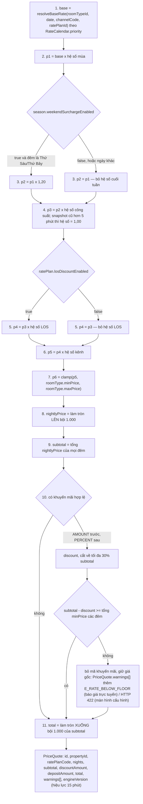
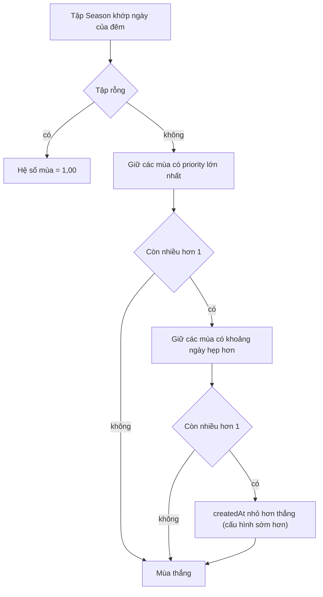

# 02 — Động giá

> Chuyên đề mở rộng cho **BR-RATE-01..19** (bài toán BT-2). Tài liệu này **không định nghĩa lại** giá trị nghiệp vụ: mọi hệ số, sàn/trần, hoa hồng đều đọc từ [02/quy tắc nghiệp vụ](quy-tac-nghiep-vu.md) §4 và chỉ tham chiếu mã BR.
> Phạm vi: cách `PricingEngine` biến một `(roomTypeId, checkIn, checkOut, kênh, gói giá)` thành `PriceQuote` tất định, kiểm chứng được bằng số học.

---

## 1. Mục đích & truy vết

| Câu hỏi nghiệp vụ | Trả lời ở mục | Quy tắc | Use case |
|---|---|---|---|
| Giá một đêm được dựng từ những thành phần nào, theo thứ tự nào? | §2 | BR-RATE-01, BR-RATE-02, BR-RATE-03 | UC-RATE-05 |
| Giá cơ bản lấy ở đâu khi có nhiều dòng lịch giá cùng khớp? | §2.3 | BR-RATE-02 | UC-RATE-01 |
| Mùa nào áp cho một đêm khi nhiều mùa cùng khớp? | §4 | BR-RATE-05, BR-RATE-06 | UC-RATE-02 |
| Cùng một loại phòng bán ở 7 kênh chênh nhau bao nhiêu? | §3, §7 | BR-RATE-07..09, BR-RATE-18 | UC-RATE-03, UC-RATE-05 |
| Hệ số công suất lấy ở đâu, snapshot trễ thì sao? | §6 | BR-RATE-01 bước 4, BR §4.3 | UC-INV-01 |
| Khuyến mãi bị cắt trần 30% và bị chặn bởi sàn giá xử lý thế nào? | §5 ca 6, §8 | BR-RATE-10..14 | UC-RATE-04 |
| Gói dài ngày `LONGSTAY14` được bảo đảm rẻ hơn `FLEX7` bằng cách nào? | §5 ca 4 | BR-RATE-19 | UC-RATE-01, UC-RATE-04 |
| Vì sao bốn frontend và API phải ra cùng một giá? | §9 | BR-RATE-15..17 | UC-RATE-05 |

Giới hạn thời gian phản hồi của động cơ giá: **NFR-PERF-04** (≤ 20 ms cho 14 đêm). Yêu cầu miền thuần: **NFR-MAIN-01** (`packages/domain`, 0 I/O). Tiền VND số nguyên: **NFR-LOC-03**.

Báo giá chỉ có nghĩa khi kỳ lưu trú còn khả dụng: hết phòng trả `E_INV_NO_AVAILABILITY` (BR-INV-07); nếu ràng buộc loại trừ ở CSDL từ chối gán phòng, tầng ứng dụng PHẢI bắt `23P01` và trả `E_INV_ROOM_TAKEN` (BR-INV-03), cả hai đều HTTP 409.

Ngoài phạm vi tài liệu này: `BR-BOOK-17` (xoá cứng booking `DRAFT`/`HELD` vẫn phải ghi `AuditLog` với `beforeJson` đầy đủ **trước khi** xoá), `BR-OVER-16` (`OverbookingCase` còn `OPEN`/`PROPOSED`/`ESCALATED` khi ngày thiếu phòng đã trôi qua PHẢI chuyển `ESCALATED`, không tự đóng) và `BR-CANCEL-19` (huỷ một phần booking nhiều phòng, phân bổ `refundBase` theo tỷ lệ giá các phòng bị huỷ) — các quy tắc này thuộc [02/quy tắc nghiệp vụ](quy-tac-nghiep-vu.md) §5/§6/§9, [02/quá tải, ghép & đổi phòng](qua-tai-ghep-doi-phong.md) và [02/chính sách huỷ & hoàn cọc](chinh-sach-huy-hoan-coc.md), không tác động tới pipeline giá.

---

## 2. Pipeline giá (11 bước, thứ tự cố định BR-RATE-01)

### 2.1. Sơ đồ

Các bước 1–8 chạy **lặp cho từng đêm** của kỳ lưu trú; bước 9–11 chạy **một lần** trên toàn kỳ.

`PriceSnapshot` PHẢI được ghi **ngay khi booking rời `DRAFT`** (`HELD` / `PENDING_PAYMENT` / `CONFIRMED`), không chỉ lúc xác nhận — nếu không, BR-CANCEL-06 không có `firstNightPrice` cho booking `HELD`/`EXPIRED`. Mỗi lần đổi ngày hoặc huỷ một phần PHẢI lưu thêm một `PriceSnapshot` mới với `kind` tương ứng (`ORIGINAL` / `RESCHEDULE` / `PARTIAL_CANCEL`) và `seq` tăng dần, **giữ nguyên** các bản cũ; giá đã chốt không đổi vì cấu hình giá sau đó (BR-RATE-16). Luồng trạng thái chi tiết ở [03/mô hình động](../03-phan-tich/mo-hinh-dong.md).

### 2.2. Bảng từng bước

| # | Đầu vào | Phép tính | Nguồn dữ liệu | Quy tắc | Ví dụ (STD, SE-SUM 1,40, đêm Thứ Sáu, công suất 92%, kỳ 5 đêm → LOS 0,95, kênh WEB) |
|---|---|---|---|---|---|
| 1 | Loại phòng + ngày + kênh + gói giá | Chọn dòng `RateCalendar` có `priority` cao nhất khớp khoá gồm ratePlanId khi nguồn RATE_PLAN; không dòng nào khớp → `RoomType.basePrice` | `RateCalendar` (`priority`, `source`, `channelCode`), `RatePlan.fixedNightlyPrice`, `RoomType.basePrice` | BR-RATE-02, BR-RATE-03 | `650.000` (dòng `BASE` / giá mặc định) |
| 2 | base, mùa của đêm | `p1 = base × multiplier` | `Season` đã chọn theo §4 | BR-RATE-05 | `650.000 × 1,40 = 910.000` |
| 3 | p1, thứ trong tuần (giờ VN), cờ phụ thu cuối tuần của mùa | `p2 = p1 × 1,20` nếu là **Thứ Sáu/Thứ Bảy** **và** mùa cho phép; ngược lại `p2 = p1` | `Season.weekendSurchargeEnabled`, `SystemSetting` `pricing.weekendMultiplier`, BR-GEN-05 | BR-RATE-06 | Thứ Sáu: `910.000 × 1,20 = 1.092.000` |
| 4 | p2, công suất cơ sở trong đêm | `p3 = p2 × hệ số công suất`; snapshot cũ hơn 5 phút → hệ số `1,00` | `OccupancySnapshot` của `(propertyId, date)`; ngưỡng `pricing.occupancyMidPct` / `pricing.occupancyHighPct` | BR-RATE-01 bước 4, BR §4.3, §6 | `1.092.000 × 1,15 = 1.255.800` |
| 5 | p3, số đêm cả kỳ, cờ LOS của gói giá | `p4 = p3 × hệ số LOS` nếu `losDiscountEnabled`; ngược lại `p4 = p3` | `Booking.nights` (số đêm **toàn kỳ**), `RatePlan.losDiscountEnabled` | BR-RATE-01 bước 5, BR §4.4 | `1.255.800 × 0,95 = 1.193.010` |
| 6 | p4, kênh bán | `p5 = p4 × hệ số kênh` | `Channel.multiplier` | BR-RATE-07 | `1.193.010 × 1,00 = 1.193.010` |
| 7 | p5, sàn/trần của loại phòng | `p6 = clamp(p5, minPrice, maxPrice)` | `RoomType.minPrice`, `RoomType.maxPrice` | BR-RATE-04 | `1.193.010` (không chạm) |
| 8 | p6 | `nightlyPrice = ceil1000(p6)` | — | BR-GEN-03 | `1.194.000` |
| 9 | Mọi `nightlyPrice` của kỳ lưu trú | `subtotal = Σ nightlyPrice` | `StayPeriod` nửa mở, từng đêm riêng biệt | BR-INV-07, BR-RATE-01 bước 9 | 1 đêm minh hoạ: `1.194.000`; kỳ 5 đêm tính đủ 5 dòng rồi mới cộng |
| 10 | subtotal, khuyến mãi đang hiệu lực | `discount` một lần trên tổng, cắt tại `pricing.maxDiscountPct`; nếu chạm sàn thì bỏ mã và **hai ngữ cảnh khác nhau**: màn hình cấu hình trả lỗi chặn `E_RATE_BELOW_FLOOR` (HTTP 422), báo giá trực tuyến chỉ thêm cảnh báo vào `PriceQuote.warnings[]` và vẫn cho xác nhận | `Promotion` (`PERCENT`/`AMOUNT`, `stackable`, `maxUses`) | BR-RATE-10..14 | không có → `0` |
| 11 | subtotal, discount | `total = floor1000(subtotal − discount)` | — | BR-RATE-01 bước 11, BR-GEN-03 | `total` |

### 2.3. Thứ tự ưu tiên của `RateCalendar` (BR-RATE-02)

| `source` | `priority` | Ý nghĩa | Thắng khi nào |
|---|---|---|---|
| `OVERRIDE` | **100** | Ghi đè tường minh theo ngày (lễ, sự kiện, giá thoả thuận) | Cao nhất |
| `RATE_PLAN` | **90** | Giá base của đúng ratePlanId; không dùng cho gói khác | Không có `OVERRIDE` khớp |
| `SEASON` | **50** | Lịch giá theo mùa | Không có hai mức trên |
| `BASE` | **10** | Giá nền theo ngày của loại phòng | Không có ba mức trên |

Bất biến bắt buộc: dòng ghi đè **không miễn** bước 2–7 — nó chỉ thay `base`, vẫn đi qua mùa/cuối tuần/công suất/LOS/kênh và **vẫn chịu kẹp sàn–trần**. Không dòng nào khớp → `RoomType.basePrice`.

Khi nhiều dòng cùng `priority`, thứ tự phá hoà PHẢI theo đúng ba bậc sau, dừng ở bậc đầu tiên phân biệt được: **(1)** dòng **có khai `channelCode`** thắng dòng để trống (khớp mọi kênh) — ví dụ dòng `OVERRIDE` cho `(STD, 20/12, WEB)` thắng dòng `OVERRIDE` cho `(STD, 20/12)`; **(2)** `createdAt` **nhỏ hơn** thắng; **(3)** `id` tăng dần thắng (chỉ còn khi hai dòng tạo cùng một thời điểm).

**Ràng buộc bắt buộc:**

| # | Ràng buộc | Quy tắc |
|---|---|---|
| R1 | Cấm mọi thứ tự khác; cấm áp khuyến mãi trước khi làm tròn từng đêm | BR-RATE-01 |
| R2 | Hệ số LOS tính theo **số đêm toàn kỳ**, áp cho **mọi** đêm, và chỉ khi gói giá bật `losDiscountEnabled` | BR §4.4 |
| R3 | Làm tròn **lên** ở cấp đêm, làm tròn **xuống** ở cấp tổng: hai chiều khác nhau, không được gộp | BR-GEN-03, BR-RATE-01 |
| R4 | Khuyến mãi áp **một lần trên tổng tạm tính**; thứ tự `AMOUNT` trước, `PERCENT` sau, cùng loại thì `code` tăng dần | BR-RATE-10, BR-RATE-13 |
| R5 | `PriceQuote` hiệu lực 15 phút; quá hạn tính lại | BR-RATE-15 |
| R6 | Kẹp sàn là **hành vi bảo vệ có chủ đích**, không phải lỗi cấu hình: sàn ≈ 60% giá cơ bản | BR-RATE-04 |
| R7 | Mọi kênh có hoa hồng > 0 PHẢI có hệ số ≥ `1/(1 − commissionPct/100)` theo giá trị đã phân giải cho `(kênh, cơ sở)`; `AGENCY` được miễn | BR-RATE-07 |
| R8 | `LONGSTAY14` PHẢI có giá riêng (`RatePlan.fixedNightlyPrice` hoặc dòng `RateCalendar` nguồn `RATE_PLAN`); nếu giá ra bằng `FLEX7`, hệ thống PHẢI cảnh báo ở màn hình cấu hình — mức ưu đãi gợi ý tối thiểu **5%** | BR-RATE-19 |

---

## 3. Ma trận mùa × kênh

### 3.1. Hệ số tích (mùa × kênh)

Đêm mẫu: ngày thường, công suất < 80%, kỳ 1 đêm (không LOS), không khuyến mãi — tức chỉ bước 2 và bước 6 hoạt động. `SE-LOW` nay kéo dài 01/10 – **29/12**.

| Mùa (hệ số) | WEB 1,00 | PHONE 1,00 | WALKIN 1,10 | AGENCY 0,95 | OTA_BOOKING 1,25 | OTA_AGODA 1,22 | OTA_AIRBNB 1,19 |
|---|---|---|---|---|---|---|---|
| SE-NY (2,20) | 2,2000 | 2,2000 | 2,4200 | 2,0900 | 2,7500 | 2,6840 | 2,6180 |
| SE-TET (2,00) | 2,0000 | 2,0000 | 2,2000 | 1,9000 | 2,5000 | 2,4400 | 2,3800 |
| SE-REUN (1,80) | 1,8000 | 1,8000 | 1,9800 | 1,7100 | 2,2500 | 2,1960 | 2,1420 |
| SE-NAT (1,70) | 1,7000 | 1,7000 | 1,8700 | 1,6150 | 2,1250 | 2,0740 | 2,0230 |
| SE-SUM (1,40) | 1,4000 | 1,4000 | 1,5400 | 1,3300 | 1,7500 | 1,7080 | 1,6660 |
| SE-SHO (0,90) | 0,9000 | 0,9000 | 0,9900 | 0,8550 | 1,1250 | 1,0980 | 1,0710 |
| SE-LOW (0,85) | 0,8500 | 0,8500 | 0,9350 | 0,8075 | 1,0625 | 1,0370 | 1,0115 |

### 3.2. Giá bán ra cuối cho STD (base 650.000, sàn 400.000, trần 1.800.000)

Cùng đêm mẫu như §3.1, `nightlyPrice = ceil1000(clamp(650.000 × hệ số tích))`.

| Mùa | WEB | PHONE | WALKIN | AGENCY | OTA_BOOKING | OTA_AGODA | OTA_AIRBNB |
|---|---|---|---|---|---|---|---|
| SE-NY | 1.430.000 | 1.430.000 | 1.573.000 | 1.359.000 | 1.788.000 | 1.745.000 | 1.702.000 |
| SE-TET | 1.300.000 | 1.300.000 | 1.430.000 | 1.235.000 | 1.625.000 | 1.586.000 | 1.547.000 |
| SE-REUN | 1.170.000 | 1.170.000 | 1.287.000 | 1.112.000 | 1.463.000 | 1.428.000 | 1.393.000 |
| SE-NAT | 1.105.000 | 1.105.000 | 1.216.000 | 1.050.000 | 1.382.000 | 1.349.000 | 1.315.000 |
| SE-SUM | 910.000 | 910.000 | 1.001.000 | 865.000 | 1.138.000 | 1.111.000 | 1.083.000 |
| SE-SHO | 585.000 | 585.000 | 644.000 | 556.000 | 732.000 | 714.000 | 697.000 |
| SE-LOW | 553.000 | 553.000 | 608.000 | 525.000 | 691.000 | 675.000 | 658.000 |

Nhận xét định lượng:

| Quan sát | Số liệu | Hệ quả |
|---|---|---|
| Biên độ giữa mùa rẻ nhất và đắt nhất trên cùng kênh WEB | SE-LOW 553.000 → SE-NY 1.430.000, tỉ lệ **2,59×** | Chênh 877.000 VND/đêm cho cùng một loại phòng |
| Biên độ giữa kênh rẻ nhất và đắt nhất trong cùng mùa SE-SUM | AGENCY 865.000 → OTA_BOOKING 1.138.000, tỉ lệ **1,32×** | Bán sai kênh trong mùa hè mất 273.000 VND/đêm trên STD |
| Đêm SE-NY cột OTA_BOOKING ở 1.788.000 — **chỉ cách trần 12.000 (0,7%)** | Thêm hệ số công suất 1,15 là chạm trần: `1.787.500 × 1,15 = 2.055.625 → 1.800.000` | Trần chặn phần tăng của mọi kênh đúng vào lúc cầu cao nhất — xem §7.3 |
| Sàn không chạm ở bất kỳ ô nào của bảng này | Ô thấp nhất là 525.000, cao hơn sàn STD 400.000 tới 31% | Sàn chỉ hoạt động ở các tổ hợp có nguồn `base` thấp hơn giá cơ bản (§5 ca 5) |

---

## 4. Quy tắc giải quyết xung đột mùa

### 4.1. Quy tắc (BR §4.2)

Áp **đúng một** mùa cho mỗi đêm. Thứ tự quyết định, dừng ở tiêu chí đầu tiên phân biệt được:

| Bậc | Tiêu chí | Lý do nghiệp vụ |
|---|---|---|
| 1 | `priority` lớn nhất | Lễ lớn phải đè mùa nền |
| 2 | Khoảng ngày hẹp hơn thắng | Mùa cấu hình riêng cho một cơ sở/dịp hẹp phải đè mùa toàn chuỗi dài |
| 3 | `createdAt` nhỏ hơn thắng | Dòng cấu hình sớm hơn là dòng chủ chuỗi đã có ý định dùng; `id` là UUID nên không phản ánh ý định |
| — | Không mùa nào khớp | Hệ số = `1,00` |

**BR-RATE-05:** `Season` **được phép** chồng lấn (mùa toàn chuỗi và mùa riêng theo cơ sở; mùa cấu hình lại theo từng năm). Khi hai mùa chồng lấn **cùng `priority`**, hệ thống PHẢI cảnh báo trên màn hình cấu hình **và ghi `AuditLog`**, để không phụ thuộc vào thứ tự tạo bản ghi.

### 4.2. Chồng lấn trong bảng mùa mặc định

| Cặp mùa | Quan hệ theo khoảng ngày mặc định | Có chồng lấn? | Mùa thắng khi chồng |
|---|---|---|---|
| SE-NAT (31/08–03/09) và SE-SHO (16/08–30/09) | SE-NAT **nằm trong** SE-SHO | **Có** | SE-NAT (priority 80 > 30) |
| SE-LOW (01/10–29/12) và SE-NY (30/12–02/01) | **Kề nhau** (29/12 và 30/12), không còn khoảng trống | Không | — |
| SE-SUM (01/06–15/08) và SE-REUN (28/04–03/05) | Rời nhau (SE-SUM bắt đầu sau khi SE-REUN kết thúc) | Không | — |
| SE-SHO (16/08–30/09) và SE-SUM (01/06–15/08) | Kề nhau (15/08 và 16/08) | Không | — |
| SE-SHO (16/08–30/09) và SE-LOW (01/10–29/12) | Kề nhau (30/09 và 01/10) | Không | — |
| Mọi cặp còn lại | Rời nhau | Không | — |

Hệ quả bắt buộc: đêm 31/08 phải áp SE-NAT (1,70) chứ không phải SE-SHO (0,90) — trên STD kênh WEB, giá đúng là `650.000 × 1,70 = 1.105.000` và giá sai là `585.000`, chênh **520.000 VND (+88,9%)** cho cùng một đêm.

Toàn chuỗi từ 01/10 đến 29/12 nằm trong SE-LOW (hệ số 0,85) và từ 30/12 chuyển sang SE-NY (hệ số 2,20): không còn đêm nào rơi vào trạng thái "không mùa nào khớp" trong hai tháng cuối năm.

### 4.3. Ba ca chồng lấn

**Ca A — SE-SUM chồng SE-REUN (mùa hè cấu hình mở rộng).**
Cấu hình: SE-REUN 28/04–03/05 `priority` 80, hệ số 1,80, `weekendSurchargeEnabled = false`; SE-SUM của năm đó được mở rộng thành 25/04–31/08 `priority` 50, hệ số 1,40, `weekendSurchargeEnabled = true`.

| Đêm | Mùa khớp | Bậc quyết định | Mùa thắng | Hệ số | Giá STD kênh WEB |
|---|---|---|---|---|---|
| 01/05/2026 (Thứ Sáu) | SE-REUN, SE-SUM | priority 80 > 50 | SE-REUN | 1,80 (cuối tuần bị bỏ) | `ceil1000(650.000 × 1,80) = 1.170.000` |
| 20/05/2026 (Thứ Tư) | SE-SUM | chỉ một mùa khớp | SE-SUM | 1,40 | `ceil1000(650.000 × 1,40) = 910.000` |

Nếu động cơ chọn sai SE-SUM cho đêm 01/05, giá ra `650.000 × 1,40 × 1,20 = 1.092.000` — sai lệch 78.000 VND/đêm trên STD.

**Ca B — SE-NY chồng SE-LOW (cơ sở kéo dài mùa thấp điểm qua 30/12).**
Cấu hình: CS-02 Vũng Tàu khai `Season` SE-LOW riêng cho cơ sở mình với khoảng 01/10–31/12 `priority` 20, hệ số 0,85; SE-NY toàn chuỗi 30/12–02/01 `priority` 90, hệ số 2,20, `weekendSurchargeEnabled = false`.

| Đêm | Mùa khớp | Bậc quyết định | Mùa thắng | Hệ số | Giá STD kênh WEB (CS-02) |
|---|---|---|---|---|---|
| 29/12/2026 (Thứ Ba) | SE-LOW của CS-02 | chỉ một mùa khớp | SE-LOW | 0,85 | 553.000 |
| 30/12/2026 (Thứ Tư) | SE-LOW của CS-02, SE-NY | priority 90 > 20 | SE-NY | 2,20 | 1.430.000 |
| 31/12/2026 (Thứ Năm) | SE-LOW của CS-02, SE-NY | priority 90 > 20 | SE-NY | 2,20 | 1.430.000 |

`subtotal` 3 đêm = `553.000 + 1.430.000 + 1.430.000 = 3.413.000`. Nếu động cơ để SE-LOW thắng cả ba đêm thì kết quả là `1.659.000`, thất thoát 1.754.000 VND (hơn gấp đôi).

**Ca C — mùa cấu hình riêng theo cơ sở chồng mùa toàn chuỗi.**
Cấu hình: SE-SUM toàn chuỗi 01/06–15/08 (76 ngày) `priority` 50; CS-01 Đà Lạt có dòng SE-SUM riêng 01/07–31/07 (31 ngày) `priority` 50.

| Đêm | Mùa khớp | Bậc quyết định | Mùa thắng | Hệ số |
|---|---|---|---|---|
| 15/07/2026 (Thứ Tư), cơ sở CS-01 | SE-SUM chuỗi, SE-SUM CS-01 | priority bằng nhau (50 = 50) → khoảng hẹp hơn thắng (31 ngày < 76 ngày) | SE-SUM của CS-01 | 1,40 (cùng hệ số, nhưng `seasonId` khác) |
| 15/07/2026, cơ sở CS-02 | SE-SUM chuỗi | chỉ một mùa khớp | SE-SUM chuỗi | 1,40 |

Hai hệ quả bắt buộc:

| # | Hệ quả | Căn cứ |
|---|---|---|
| 1 | Ca C là **trường hợp cảnh báo**: hai mùa chồng lấn cùng `priority` 50 → màn hình cấu hình PHẢI cảnh báo, dù kết quả vẫn xác định được bằng bậc 2 | BR-RATE-05 |
| 2 | Khi chủ chuỗi sửa `multiplier` của dòng CS-01 (ví dụ nâng lên 1,55 cho cao điểm hè Đà Lạt), **chỉ 31 đêm của CS-01** đổi giá; CS-02 và CS-03 vẫn 1,40 — đây là giá trị thực tế của bậc 2 | BR §4.2 |

Bậc 3 (`createdAt` nhỏ hơn thắng) chỉ phát sinh khi hai dòng có **cùng** `priority` **và** cùng độ dài khoảng chồng lấn — ví dụ một dòng SE-TET toàn chuỗi và một dòng SE-TET cấu hình cho CS-02 với đúng 7 ngày như nhau; khi đó `seasonId` của dòng cấu hình sớm hơn được ghi vào `PriceSnapshot`.

---

## 5. Sáu ca ví dụ tính tay

Ký hiệu cột: mỗi ô hệ số ghi `hệ số → giá trị sau khi nhân`. Kết quả cuối cùng của mỗi ca phải đúng **tuyệt đối** theo bảng.

Nhóm mã ca kiểm thử (do [05/kế hoạch kiểm thử](../05-ke-hoach/ke-hoach-kiem-thu.md) cấp): **`TC-RATE-01`** phủ ca 1–3 (đêm ngày thường, kỳ vắt qua hai mùa, cuối tuần kết hợp công suất và kênh `WALKIN`); **`TC-RATE-02`** phủ ca 4–6 (giá dài ngày và ưu đãi `LONGSTAY14`, kẹp sàn, trần khuyến mãi và thứ tự áp mã).

### Ca 1 — 2 đêm ngày thường, kênh WEB · `TC-RATE-01`

Đầu vào: CS-02 Vũng Tàu · `SUP` base 850.000, sàn 520.000, trần 2.400.000 · 17/11/2026 (Thứ Ba) → 19/11/2026 (Thứ Năm), 2 đêm · `FLEX7` · kênh `WEB` · mùa SE-LOW 0,85 · công suất 71% (< 80%) · kỳ 2 đêm nên không có hệ số LOS · không khuyến mãi.

| Đêm | base | × mùa | × cuối tuần | × công suất | × LOS | × kênh | Sau kẹp | Giá bán |
|---|---|---|---|---|---|---|---|---|
| 17/11/2026 (T3) | 850.000 | 0,85 → 722.500 | 1,00 → 722.500 | 1,00 → 722.500 | 1,00 → 722.500 | 1,00 → 722.500 | 722.500 | **723.000** |
| 18/11/2026 (T4) | 850.000 | 0,85 → 722.500 | 1,00 → 722.500 | 1,00 → 722.500 | 1,00 → 722.500 | 1,00 → 722.500 | 722.500 | **723.000** |

`subtotal = 1.446.000` · `discount = 0` · `total = floor1000(1.446.000) = 1.446.000`.
Cọc `FLEX7` 30% (BR-CANCEL-02): `ceil1000(1.446.000 × 0,30) = ceil1000(433.800) = 434.000`.

### Ca 2 — 3 đêm vắt qua 30/4, kênh OTA_BOOKING · `TC-RATE-01`

Đầu vào: CS-01 Đà Lạt · `DLX` base 1.100.000, sàn 680.000, trần 3.000.000 · 30/04/2026 (Thứ Năm) → 03/05/2026 (Chủ Nhật), 3 đêm · `FLEX7` · kênh `OTA_BOOKING` · mùa SE-REUN 1,80 **có `weekendSurchargeEnabled = false`** · công suất 82% → 1,15 · LOS 3 đêm → 0,95 · không khuyến mãi.

| Đêm | base | × mùa | × cuối tuần | × công suất | × LOS | × kênh | Sau kẹp | Giá bán |
|---|---|---|---|---|---|---|---|---|
| 30/04/2026 (T5) | 1.100.000 | 1,80 → 1.980.000 | 1,00 → 1.980.000 | 1,15 → 2.277.000 | 0,95 → 2.163.150 | 1,25 → 2.703.937,50 | 2.703.937,50 | **2.704.000** |
| 01/05/2026 (T6) | 1.100.000 | 1,80 → 1.980.000 | 1,00 → 1.980.000 | 1,15 → 2.277.000 | 0,95 → 2.163.150 | 1,25 → 2.703.937,50 | 2.703.937,50 | **2.704.000** |
| 02/05/2026 (T7) | 1.100.000 | 1,80 → 1.980.000 | 1,00 → 1.980.000 | 1,15 → 2.277.000 | 0,95 → 2.163.150 | 1,25 → 2.703.937,50 | 2.703.937,50 | **2.704.000** |

`subtotal = 3 × 2.704.000 = 8.112.000` · `total = 8.112.000`.
Doanh thu thuần BR-RATE-08/18: `8.112.000 × (1 − 0,18) = 6.651.840 VND`; hoa hồng trả OTA `1.460.160 VND`.

Cảnh báo hồi quy: 01/05 là **Thứ Sáu** và 02/05 là **Thứ Bảy**, nhưng mùa SE-REUN tắt phụ thu cuối tuần. Nếu bỏ sót cờ này, mỗi đêm ra `ceil1000(1.100.000 × 1,80 × 1,20 × 1,15 × 0,95 × 1,25) = 3.245.000 → kẹp trần 3.000.000`, và `subtotal` sai thành 8.704.000 (+592.000).

### Ca 3 — 5 đêm cuối tuần, công suất 92%, kênh WALKIN · `TC-RATE-01`

Đầu vào: CS-03 Phan Thiết · `FAM` base 1.600.000, sàn 980.000, trần 4.200.000 · 08/07/2026 (Thứ Tư) → 13/07/2026 (Thứ Hai), 5 đêm · `FLEX7` · kênh `WALKIN` · mùa SE-SUM 1,40 (bật cuối tuần) · công suất 92% → 1,15 · LOS 5 đêm → 0,95 · không khuyến mãi.

| Đêm | base | × mùa | × cuối tuần | × công suất | × LOS | × kênh | Sau kẹp | Giá bán |
|---|---|---|---|---|---|---|---|---|
| 08/07/2026 (T4) | 1.600.000 | 1,40 → 2.240.000 | 1,00 → 2.240.000 | 1,15 → 2.576.000 | 0,95 → 2.447.200 | 1,10 → 2.691.920 | 2.691.920 | **2.692.000** |
| 09/07/2026 (T5) | 1.600.000 | 1,40 → 2.240.000 | 1,00 → 2.240.000 | 1,15 → 2.576.000 | 0,95 → 2.447.200 | 1,10 → 2.691.920 | 2.691.920 | **2.692.000** |
| 10/07/2026 (T6) | 1.600.000 | 1,40 → 2.240.000 | 1,20 → 2.688.000 | 1,15 → 3.091.200 | 0,95 → 2.936.640 | 1,10 → 3.230.304 | 3.230.304 | **3.231.000** |
| 11/07/2026 (T7) | 1.600.000 | 1,40 → 2.240.000 | 1,20 → 2.688.000 | 1,15 → 3.091.200 | 0,95 → 2.936.640 | 1,10 → 3.230.304 | 3.230.304 | **3.231.000** |
| 12/07/2026 (CN) | 1.600.000 | 1,40 → 2.240.000 | 1,00 → 2.240.000 | 1,15 → 2.576.000 | 0,95 → 2.447.200 | 1,10 → 2.691.920 | 2.691.920 | **2.692.000** |

`subtotal = 3 × 2.692.000 + 2 × 3.231.000 = 8.076.000 + 6.462.000 = 14.538.000` · `total = 14.538.000`.
Ghi chú: Chủ Nhật tính như ngày thường (BR-RATE-06); kênh `WALKIN` có `holdMinutes = 0` nên booking bỏ qua trạng thái `HELD` (BR-BOOK-07).

### Ca 4 — 14 đêm mùa thấp điểm, kênh AGENCY · `TC-RATE-02`

Đầu vào: CS-02 Vũng Tàu · `DOR` base 250.000/giường, sàn 150.000, trần 700.000 · 05/10/2026 (Thứ Hai) → 19/10/2026 (Thứ Hai), 14 đêm · `FLEX7` (`minNights` 1, `losDiscountEnabled = true`) · kênh `AGENCY` · mùa SE-LOW 0,85 (bật cuối tuần) · công suất 78% → 1,00 · LOS ≥ 14 đêm → 0,85 · không khuyến mãi.

| Đêm | base | × mùa | × cuối tuần | × công suất | × LOS | × kênh | Sau kẹp | Giá bán |
|---|---|---|---|---|---|---|---|---|
| 05/10 (T2) | 250.000 | 0,85 → 212.500 | 1,00 → 212.500 | 1,00 → 212.500 | 0,85 → 180.625 | 0,95 → 171.593,75 | 171.593,75 | **172.000** |
| 06/10 (T3) | 250.000 | 0,85 → 212.500 | 1,00 → 212.500 | 1,00 → 212.500 | 0,85 → 180.625 | 0,95 → 171.593,75 | 171.593,75 | **172.000** |
| 07/10 (T4) | 250.000 | 0,85 → 212.500 | 1,00 → 212.500 | 1,00 → 212.500 | 0,85 → 180.625 | 0,95 → 171.593,75 | 171.593,75 | **172.000** |
| 08/10 (T5) | 250.000 | 0,85 → 212.500 | 1,00 → 212.500 | 1,00 → 212.500 | 0,85 → 180.625 | 0,95 → 171.593,75 | 171.593,75 | **172.000** |
| 09/10 (T6) | 250.000 | 0,85 → 212.500 | 1,20 → 255.000 | 1,00 → 255.000 | 0,85 → 216.750 | 0,95 → 205.912,50 | 205.912,50 | **206.000** |
| 10/10 (T7) | 250.000 | 0,85 → 212.500 | 1,20 → 255.000 | 1,00 → 255.000 | 0,85 → 216.750 | 0,95 → 205.912,50 | 205.912,50 | **206.000** |
| 11/10 (CN) | 250.000 | 0,85 → 212.500 | 1,00 → 212.500 | 1,00 → 212.500 | 0,85 → 180.625 | 0,95 → 171.593,75 | 171.593,75 | **172.000** |
| 12/10 (T2) | 250.000 | 0,85 → 212.500 | 1,00 → 212.500 | 1,00 → 212.500 | 0,85 → 180.625 | 0,95 → 171.593,75 | 171.593,75 | **172.000** |
| 13/10 (T3) | 250.000 | 0,85 → 212.500 | 1,00 → 212.500 | 1,00 → 212.500 | 0,85 → 180.625 | 0,95 → 171.593,75 | 171.593,75 | **172.000** |
| 14/10 (T4) | 250.000 | 0,85 → 212.500 | 1,00 → 212.500 | 1,00 → 212.500 | 0,85 → 180.625 | 0,95 → 171.593,75 | 171.593,75 | **172.000** |
| 15/10 (T5) | 250.000 | 0,85 → 212.500 | 1,00 → 212.500 | 1,00 → 212.500 | 0,85 → 180.625 | 0,95 → 171.593,75 | 171.593,75 | **172.000** |
| 16/10 (T6) | 250.000 | 0,85 → 212.500 | 1,20 → 255.000 | 1,00 → 255.000 | 0,85 → 216.750 | 0,95 → 205.912,50 | 205.912,50 | **206.000** |
| 17/10 (T7) | 250.000 | 0,85 → 212.500 | 1,20 → 255.000 | 1,00 → 255.000 | 0,85 → 216.750 | 0,95 → 205.912,50 | 205.912,50 | **206.000** |
| 18/10 (CN) | 250.000 | 0,85 → 212.500 | 1,00 → 212.500 | 1,00 → 212.500 | 0,85 → 180.625 | 0,95 → 171.593,75 | 171.593,75 | **172.000** |

`subtotal = 10 × 172.000 + 4 × 206.000 = 1.720.000 + 824.000 = 2.544.000` · `total = 2.544.000`.
Doanh thu thuần (hoa hồng `AGENCY` 10%): `2.544.000 × 0,90 = 2.289.600 VND`.

So sánh bắt buộc với `LONGSTAY14` — gói này nay cũng bật `losDiscountEnabled = true`, cọc 30% và `rescheduleAllowed = true` như `FLEX7`, nên **cùng kỳ 14 đêm cho đúng cùng kết quả**: 10 đêm ngày thường × 172.000 + 4 đêm cuối tuần × 206.000 = `2.544.000`, y hệt `FLEX7`. Đây chính là tình huống **BR-RATE-19** ngăn: gói dài ngày PHẢI có giá riêng (`RatePlan.fixedNightlyPrice` hoặc dòng `RateCalendar` nguồn `RATE_PLAN`); nếu không, hệ thống cảnh báo ở màn hình cấu hình. Mức ưu đãi gợi ý tối thiểu 5% ⇒ với kỳ này `total` của `LONGSTAY14` phải **≤ 2.416.800** (`2.544.000 × 0,95`).

Vì hai gói dùng chung chuỗi hệ số của ca này, yêu cầu 5% quy về giá `RATE_PLAN` của DOR theo `base × 0,686375` (đêm thường) và `base × 0,82365` (đêm cuối tuần): `base = 250.000` (chưa có giá riêng, dùng chung `RoomType.basePrice`) cho `2.544.000` — **không đạt**, BR-RATE-19 buộc cảnh báo; `base = 237.000` cho `2.414.000` — đạt; `base = 237.500` cho `2.424.000` — **không đạt** (vượt ngưỡng 2.416.800).

Kiểm chứng chiều ngược lại: nếu chủ chuỗi hiểu nhầm và đặt `RatePlan.fixedNightlyPrice` của DOR bằng `163.000` (95% của **giá bán cuối** 172.000, chứ không phải 95% của `base` 250.000), đêm ngày thường ra `163.000 × 0,686375 = 111.879,125` và đêm cuối tuần ra `134.254,95` — **cả hai đều chạm sàn 150.000**, làm mức ưu đãi 5% mong muốn biến mất (giá bị sàn kéo lên 150.000/đêm). Đây là lý do giá `LONGSTAY14` phải được đặt bằng dòng `RateCalendar` nguồn `RATE_PLAN` theo từng mùa, không dùng một giá cố định duy nhất cho cả năm.

### Ca 5 — Kẹp sàn giá có chủ đích (nguồn `OVERRIDE` giá thấp) · `TC-RATE-02`

Đầu vào: CS-03 Phan Thiết · `STD`, sàn 400.000, trần 1.800.000 · 12/10/2026 (Thứ Hai) → 15/10/2026 (Thứ Năm), 3 đêm ngày thường · `RateCalendar` có dòng `source = OVERRIDE`, `priority` 100 cho `(STD, các ngày trên)` với `price = 450.000` · `FLEX7` · kênh `AGENCY` · mùa SE-LOW 0,85 · công suất 78% → 1,00 · LOS 3 đêm → 0,95.

| Đêm | base (`OVERRIDE`) | × mùa | × cuối tuần | × công suất | × LOS | × kênh | p5 trước kẹp | Sau kẹp | Giá bán |
|---|---|---|---|---|---|---|---|---|---|
| 12/10/2026 (T2) | 450.000 | 0,85 → 382.500 | 1,00 → 382.500 | 1,00 → 382.500 | 0,95 → 363.375 | 0,95 → 345.206,25 | 345.206,25 | **400.000** (chạm sàn) | **400.000** |
| 13/10/2026 (T3) | 450.000 | 0,85 → 382.500 | 1,00 → 382.500 | 1,00 → 382.500 | 0,95 → 363.375 | 0,95 → 345.206,25 | 345.206,25 | **400.000** (chạm sàn) | **400.000** |
| 14/10/2026 (T4) | 450.000 | 0,85 → 382.500 | 1,00 → 382.500 | 1,00 → 382.500 | 0,95 → 363.375 | 0,95 → 345.206,25 | 345.206,25 | **400.000** (chạm sàn) | **400.000** |

`subtotal = 3 × 400.000 = 1.200.000` · `total = 1.200.000`.

| Đối chiếu | Số học | Chênh so với kết quả đúng |
|---|---|---|
| Không có sàn (kẹp bị vô hiệu) | `ceil1000(345.206,25) = 346.000/đêm` → `1.038.000` | −162.000 (−13,5%): bán dưới sàn **54.000 VND/đêm** |
| Kẹp **sai vị trí** (kẹp `p4` rồi mới nhân hệ số kênh) | `clamp(363.375) = 400.000 × 0,95 = 380.000/đêm` → `1.140.000` | −60.000 (−5%) |

Ca này chứng minh hai điều: (a) dòng `OVERRIDE` **không miễn** bước 2–7 (BR-RATE-02); (b) sàn 400.000 đang **bảo vệ biên lợi nhuận** đúng như chủ đích của BR-RATE-04 — không có sàn thì kênh AGENCY bán STD ở 346.000 VND/đêm, dưới cả tỉ lệ 60% giá cơ bản.

### Ca 6 — Xếp chồng khuyến mãi 20% + 15% vượt trần, bị cắt về 30% · `TC-RATE-02`

Đầu vào: CS-01 Đà Lạt · `STD` base 650.000 · 15/06/2026 (Thứ Hai) → 18/06/2026 (Thứ Năm), 3 đêm · `FLEX7` · kênh `WEB` · mùa SE-SUM 1,40 · công suất ≥ 95% → 1,25 · LOS 3 đêm → 0,95 · hai khuyến mãi `PERCENT` giá trị 20% và 15%, cả hai `stackable = true`.

| Đêm | base | × mùa | × cuối tuần | × công suất | × LOS | × kênh | Sau kẹp | Giá bán |
|---|---|---|---|---|---|---|---|---|
| 15/06/2026 (T2) | 650.000 | 1,40 → 910.000 | 1,00 → 910.000 | 1,25 → 1.137.500 | 0,95 → 1.080.625 | 1,00 → 1.080.625 | 1.080.625 | **1.081.000** |
| 16/06/2026 (T3) | 650.000 | 1,40 → 910.000 | 1,00 → 910.000 | 1,25 → 1.137.500 | 0,95 → 1.080.625 | 1,00 → 1.080.625 | 1.080.625 | **1.081.000** |
| 17/06/2026 (T4) | 650.000 | 1,40 → 910.000 | 1,00 → 910.000 | 1,25 → 1.137.500 | 0,95 → 1.080.625 | 1,00 → 1.080.625 | 1.080.625 | **1.081.000** |

| Bước | Số học | Quy tắc | Kết quả |
|---|---|---|---|
| `subtotal` | `3 × 1.081.000` | BR-RATE-01 bước 9 | `3.243.000` |
| Tổng mức giảm yêu cầu | `20% + 15% = 35%` | BR-RATE-13 (2 mã, cùng `stackable = true`) | 35% |
| Cắt về trần | `min(35%, 30%)` → ghi cảnh báo | BR-RATE-11 | 30% |
| `discount` | `3.243.000 × 30% = 972.900` | BR-RATE-10, BR-RATE-11 | `972.900` |
| Kiểm tra sàn | `Σ minPrice = 3 × 400.000 = 1.200.000`; `3.243.000 − 972.900 = 2.270.100 ≥ 1.200.000` | BR-RATE-12 | Đạt |
| `total` | `floor1000(2.270.100)` | BR-RATE-01 bước 11, BR-GEN-03 | **`2.270.000`** |

Cọc `FLEX7` 30%: `ceil1000(2.270.000 × 0,30) = 681.000`.
Kiểm tra tính bền của phép làm tròn: nếu hệ thống làm tròn **lên** `discount` thành `973.000` trước khi trừ thì `2.270.000`, vẫn cùng kết quả — động cơ không được dựa vào sự trùng hợp này, `Money` phải giữ giá trị chính xác và chỉ làm tròn tại bước 8 và bước 11.

**Biến thể chứng minh thứ tự `AMOUNT` trước `PERCENT` không thể đảo** (BR-RATE-13), cùng `subtotal = 3.243.000`, cùng hai mã có `stackable = true`:

| Thứ tự áp | Số học mức giảm | Tổng giảm | Trần 30% | `total` |
|---|---|---|---|---|
| **Đúng** — `AMOUNT` 300.000 rồi `PERCENT` 20% | `300.000 + (3.243.000 − 300.000) × 20% = 300.000 + 588.600` | `888.600` | Không vượt | **`2.354.000`** |
| Sai — `PERCENT` 20% rồi `AMOUNT` 300.000 | `3.243.000 × 20% + 300.000 = 648.600 + 300.000` | `948.600` | Không vượt | `2.294.000` |

Chênh 60.000 VND chỉ vì thứ tự — đây là lý do BR-RATE-13 phải cố định thứ tự bằng văn bản.

---

## 6. Hệ số công suất & `OccupancySnapshot`

### 6.1. Ngưỡng (BR-RATE-01 bước 4)

| Công suất cơ sở trong đêm | Hệ số | Khoá cấu hình | Số học trên STD mùa SE-SUM |
|---|---|---|---|
| < 80% | 1,00 | `pricing.occupancyMidPct` = 80 | `650.000 × 1,40 = 910.000` |
| 80% – 94,99% | 1,15 | `pricing.occupancyHighPct` = 95 | `910.000 × 1,15 = 1.046.500` |
| ≥ 95% | 1,25 | | `910.000 × 1,25 = 1.137.500` |
| Snapshot cũ hơn **5 phút** | **1,00** | `job.occupancy.snapshotIntervalSeconds` = 300 | Bỏ toàn bộ phụ thu công suất |

### 6.2. Cách lấy, tần suất, hệ quả khi trễ

| Khía cạnh | Quy định |
|---|---|
| Thực thể | `OccupancySnapshot`: `id`, `propertyId`, `roomTypeId`, `date`, `physicalRooms`, `soldRooms`, `occupancyPct`, `capturedAt` (00 §7.2) |
| Phạm vi tính | Theo `(propertyId, date)` — công suất của **cơ sở**, không theo loại phòng, không theo kênh (BR §4.3). Dòng `roomTypeId` **rỗng** là dòng tổng hợp cấp cơ sở và là dòng duy nhất mà bước 4 đọc |
| Tử số (`soldRooms`) | Tổng demand thương mại BR-INV-01 theo đơn vị bán; gồm hold HELD/PENDING_PAYMENT còn hạn và oversold chưa gán, đếm một lần theo BookingRoom |
| Mẫu số (`physicalRooms`) | Tên legacy nhưng giá trị là supply theo đơn vị bán BR-INV-01; DOR là giường ở cả tử và mẫu, block trùng loại một lần |
| Phòng bị `RoomBlock` | Giảm supply; booking đã cam kết vẫn ở demand cho tới xử lý. Không xoá nhu cầu của khách chỉ vì phòng bị block |
| Tần suất cập nhật | Mỗi **5 phút** (300 giây) |
| Nguồn tính lại | Booking/BookingRoom/Room/RoomBlock/assignment từ CSDL; Hold Redis chỉ cache, không là nguồn chân lý |
| Đọc khi báo giá | Chốt tập snapshot **từng đêm** tại một quotedAt; lưu ID và capturedAt của từng dòng vào PriceSnapshot. Cùng quote không đọc lại sau khi đã chốt |
| Bất biến | Hệ số công suất áp ở bước 4, **trước** hệ số LOS và hệ số kênh (BR-RATE-01) |

| Tình huống | Kịch bản | Hệ quả | Đối sách |
|---|---|---|---|
| Snapshot trễ (> 5 phút) trong lúc cầu cao | Công suất thực 96%, snapshot cuối cùng đã 6 phút tuổi | Hệ số về `1,00` thay vì `1,25` → mất tới **20%** giá bán trên mọi đêm của kỳ; nếu công suất thực ở mức 85% thì mất 13% so với `1,15` | Làm mới snapshot ngay khi có booking/huỷ (sự kiện domain, ngoài nhịp 5 phút); hệ thống PHẢI phát cảnh báo vận hành khi snapshot trễ **liên tục quá 15 phút** (BR-RATE-01 bước 4) |
| Snapshot trễ trong lúc cầu thấp | Công suất thực 60%, snapshot 6 phút tuổi | Cũng về `1,00` — trùng với hệ số đúng, không thiệt hại | Không cần xử lý |
| `capturedAt` trong tương lai | Lệch đồng hồ giữa các tiến trình | Không xác định được snapshot có hợp lệ hay không | Chốt thời gian theo UTC từ một nguồn (BR-GEN-02); coi `capturedAt > quotedAt` là không hợp lệ → hệ số `1,00` |
| Nhảy bậc giữa hai bậc | 79,99% → 80,00% | Giá một đêm nhảy 15% (`1,00 → 1,15`) | Chấp nhận theo BR §4.3; hiển thị hệ số và % công suất trên màn hình UC-RATE-05 để lễ tân giải thích được |
| Đọc snapshot theo từng đêm | Công suất ngày A và B khác nhau nên hệ số có thể khác | Đây là đúng nghiệp vụ; chỉ đọc lại cùng đêm giữa một lần tính mới gây bất định | Chốt tập snapshot tại quotedAt |

Bất đối xứng có chủ đích: quy tắc "trễ thì dùng 1,00" khiến hệ thống **chỉ có thể bán thiếu phụ thu**, không bao giờ báo giá cao hơn công suất thực — đánh đổi để giữ uy tín giá niêm yết.

---

## 7. Doanh thu kênh & nguyên tắc cân bằng giá

### 7.1. Ngưỡng sàn hệ số kênh (BR-RATE-07)

Hoa hồng và hệ số kênh PHẢI được phân giải theo cặp **(kênh, cơ sở)** qua `ChannelPropertySetting` (`commissionPct`, `multiplierOverride`, `effectiveFrom`), BR-RATE-18; `Channel.commissionPct` / `Channel.multiplier` chỉ là **mặc định toàn chuỗi**. Mốc so sánh `effectiveFrom` là **ngày của từng đêm** (không theo `quotedAt`): dòng có `effectiveFrom` lớn nhất mà ≤ ngày đêm đó thắng; `settingId` đã dùng PHẢI được ghi vào `PriceSnapshot`. Bảng dưới đây dùng giá trị mặc định toàn chuỗi.

| Kênh | Hoa hồng | Ngưỡng `1/(1 − hoa hồng)` | Hệ số đang cấu hình | Đạt ngưỡng? | Tỉ lệ thuần OTA / WEB |
|---|---|---|---|---|---|
| `OTA_BOOKING` | 18% | 1,2195 | **1,25** | Đạt (+0,0305) | `1,25 × 0,82 = 1,0250` |
| `OTA_AGODA` | 17% | 1,2048 | **1,22** | Đạt (+0,0152) | `1,22 × 0,83 = 1,0126` |
| `OTA_AIRBNB` | 15% | 1,1765 | **1,19** | Đạt (+0,0135) | `1,19 × 0,85 = 1,0115` |
| `AGENCY` | 10% | *được miễn* | 0,95 | — | `0,95 × 0,90 = 0,8550` (chiết khấu hợp đồng theo BR-RATE-07) |
| `WEB` / `PHONE` / `WALKIN` | 0% | 1,0000 | 1,00 / 1,00 / 1,10 | Đạt | 1,0000 / 1,0000 / 1,1000 |

BR-RATE-09 nay phủ cả kênh trực tiếp: hệ số của `WEB`/`PHONE`/`WALKIN` nhỏ hơn `1,00` PHẢI sinh cảnh báo trên màn hình cấu hình giá và trên báo cáo doanh thu kênh. `AGENCY` tiếp tục nằm **ngoài** phạm vi quy tắc này (giá hợp đồng theo cam kết sản lượng, BR-RATE-07).

### 7.2. Cùng một đêm mẫu, 7 kênh · `TC-RATE-23`

Đêm mẫu: STD, SE-SUM 1,40, ngày thường, công suất < 80%, 1 đêm, không LOS, không khuyến mãi. Giá gốc `WEB = 910.000`.

| Kênh | Hệ số | Giá niêm yết (sau bước 7) | Hoa hồng | Doanh thu thuần | Chênh so với WEB |
|---|---|---|---|---|---|
| `WEB` | 1,00 | 910.000 | 0% | 910.000 | 0 |
| `PHONE` | 1,00 | 910.000 | 0% | 910.000 | 0 |
| `WALKIN` | 1,10 | 1.001.000 | 0% | 1.001.000 | **+91.000** |
| `AGENCY` | 0,95 | 865.000 | 10% | 778.500 | −131.500 *(ngoài phạm vi BR-RATE-09)* |
| `OTA_BOOKING` | 1,25 | 1.138.000 | 18% | 933.160 | **+23.160** |
| `OTA_AGODA` | 1,22 | 1.111.000 | 17% | 922.130 | **+12.130** |
| `OTA_AIRBNB` | 1,19 | 1.083.000 | 15% | 920.550 | **+10.550** |

`Doanh thu thuần = totalAmount × (1 − commissionPct/100)` (BR-RATE-08, BR-RATE-18). Kết luận: với hệ số 1,25/1,22/1,19, **cả 3 kênh OTA đều đạt nguyên tắc cân bằng giá** ở đêm mẫu — cảnh báo BR-RATE-09 không phát sinh. Doanh thu thuần ở đây là tử số của `ADR` và `RevPAR`; **định nghĩa các chỉ số báo cáo (`ADR`, `RevPAR`, công suất, tỷ lệ huỷ, chi phí xử lý quá tải) chỉ có một nguồn: BR-REP-01** — tài liệu này không định nghĩa lại, chỉ bảo đảm giá trị `doanh thu thuần` đưa vào đúng như BR-RATE-08 quy định.

### 7.3. Ngoại lệ bắt buộc: chạm trần làm thuần OTA thấp hơn WEB

BR-RATE-09 so trên **giá niêm yết sau bước 7**. Khi trần chặn bước 7, phần chênh mà kênh OTA lẽ ra được hưởng biến mất — ngưỡng sàn hệ số ở §7.1 không còn cứu được. Ca STD, SE-TET 2,00, công suất ≥ 95%, kỳ 1 đêm:

| Kênh | p5 trước kẹp | Giá niêm yết (sau bước 7) | Hoa hồng | Doanh thu thuần | Chênh so với WEB | Cảnh báo BR-RATE-09 |
|---|---|---|---|---|---|---|
| `WEB` | `650.000 × 2,00 × 1,25 = 1.625.000` | 1.625.000 | 0% | 1.625.000 | 0 | — |
| `OTA_BOOKING` | `1.625.000 × 1,25 = 2.031.250` | **1.800.000** (kẹp trần, mất 231.250) | 18% | 1.476.000 | **−149.000 (−9,17%)** | **Có** |
| `OTA_AGODA` | `1.625.000 × 1,22 = 1.982.500` | **1.800.000** (mất 182.500) | 17% | 1.494.000 | **−131.000 (−8,06%)** | **Có** |
| `OTA_AIRBNB` | `1.625.000 × 1,19 = 1.933.750` | **1.800.000** (mất 133.750) | 15% | 1.530.000 | **−95.000 (−5,85%)** | **Có** |

Ràng buộc bắt buộc: khi cảnh báo phát sinh, màn hình cấu hình giá và báo cáo doanh thu kênh (UC-REP-02) PHẢI hiển thị giá niêm yết **sau kẹp** kèm dòng "chạm trần" — nếu so trên `p5` thì báo cáo báo "an toàn" trong khi thực tế đang lỗ 149.000 VND/đêm.

---

## 8. Kiểm thử — 4 ca biên

Tập dữ liệu và kết quả mong đợi dưới đây là nội dung của các ca kiểm thử; mã `TC-RATE-*` do [05/kế hoạch kiểm thử](../05-ke-hoach/ke-hoach-kiem-thu.md) cấp và đã gắn ở cột đầu mỗi dòng.

| # | Ca biên (mã TC) | Đầu vào | Kết quả mong đợi | Nếu cài đặt sai | Quy tắc |
|---|---|---|---|---|---|
| E1 | **Đêm Thứ Sáu là ngày lễ** · `TC-RATE-05` | STD, kênh `WEB`, 01/01/2027 (Thứ Sáu), 1 đêm, mùa SE-NY 2,20 `weekendSurchargeEnabled = false`, công suất < 80% | `650.000 × 2,20 × 1,00 = 1.430.000` → **1.430.000** (cuối tuần bị bỏ; 02/01/2027 là Thứ Bảy cũng bị bỏ) | Áp cuối tuần: `1.430.000 × 1,20 = 1.716.000`, sai 286.000/đêm | BR-RATE-06 |
| E2 | **Kỳ lưu trú bắc qua 2 mùa** · `TC-RATE-08` | STD, `WEB`, 29/09/2026 (T3) → 02/10/2026 (T6), 3 đêm, LOS 3 → 0,95, công suất < 80% | 29–30/09 thuộc SE-SHO 0,90: `ceil1000(650.000 × 0,90 × 0,95) = 556.000`; 01/10 thuộc SE-LOW 0,85: `ceil1000(650.000 × 0,85 × 0,95) = 525.000`; `subtotal = 2 × 556.000 + 525.000 = 1.637.000` | Dùng một mùa cho cả kỳ: `3 × 556.000 = 1.668.000` hoặc `3 × 525.000 = 1.575.000` | BR-RATE-01 bước 2, BR-INV-07 |
| E3 | **Mùa tắt phụ thu cuối tuần rơi vào Thứ Bảy** · `TC-RATE-06` | STD, `WEB`, 02/05/2026 (Thứ Bảy), 1 đêm, mùa SE-REUN 1,80 `weekendSurchargeEnabled = false` | `650.000 × 1,80 × 1,00 = 1.170.000` → **1.170.000** | Áp cuối tuần: `1.170.000 × 1,20 = 1.404.000`, sai 234.000/đêm | BR-RATE-06 |
| E4 | **Khuyến mãi đẩy giá xuống dưới sàn** · `TC-RATE-16` | DOR, kênh `AGENCY`, 12/10/2026 (T2) → 15/10/2026 (T5), 3 đêm ngày thường, SE-LOW 0,85, LOS 3 → 0,95, công suất < 80%, khuyến mãi `PERCENT` 30% | `subtotal = 3 × 192.000 = 576.000`; `discount = 172.800`; `576.000 − 172.800 = 403.200 < 450.000` (= `3 × 150.000`) → **bỏ mã, giữ giá gốc `576.000`**. Hai ngữ cảnh: **màn hình cấu hình** trả lỗi chặn `E_RATE_BELOW_FLOOR` (HTTP 422), **báo giá trực tuyến** chỉ thêm `E_RATE_BELOW_FLOOR` vào `PriceQuote.warnings[]` và vẫn cho xác nhận | Chặn hẳn thao tác xác nhận trong luồng trực tuyến, hoặc âm thầm hạ giá xuống 403.000 (bán dưới sàn 47.000 VND) | BR-RATE-12 |

Ghi chú kiểm thử cho E4: mức giảm lớn nhất còn hợp lệ của booking này là `576.000 − 450.000 = 126.000 VND`, tương đương **21,88%** — hệ thống phải từ chối cả khuyến mãi 25% lẫn 30%. Bổ sung ngoài bảng:

| Ca phụ (mã TC) | Đầu vào | Kết quả mong đợi | Quy tắc |
|---|---|---|---|
| Kẹp **trần** · `TC-RATE-24` | STD, `OTA_BOOKING`, SE-TET 2,00, công suất ≥ 95%, 1 đêm | `p5 = 2.031.250 → 1.800.000`; doanh thu thuần `1.476.000 < 1.625.000` của `WEB` ⇒ **cảnh báo BR-RATE-09** | BR-RATE-04, BR-RATE-09 |
| Kẹp **sàn** · `TC-RATE-11` | STD, nguồn `OVERRIDE` 450.000, `AGENCY`, SE-LOW, LOS 3 → 0,95 (§5 ca 5) | `p5 = 345.206,25 → 400.000`; `total = 1.200.000` | BR-RATE-04, BR-RATE-02 |
| Snapshot công suất trễ · `TC-RATE-07` | Công suất thực 96%, `capturedAt` cách `quotedAt` 6 phút | Hệ số công suất = **1,00** (không dùng giá trị 1,25 trong snapshot) | BR-RATE-01 bước 4, §6 |

---

## 9. Tính tất định

UC-RATE-06 kiểm toàn bộ gói/policy trước lưu. Quote ràng buộc principal, kênh, ngày, số đơn vị, khách và childAges, gói, khuyến mãi; quote không giữ tồn. Kiểm hạn trước tạo hold, sau hold snapshot đã chốt không đổi do cấu hình hoặc quote hết hạn. Chính sách huỷ đọc policySnapshotJson theo BR-RATE-20.

### 9.1. Phát biểu

**BR-RATE-17:** cùng bộ đầu vào `(roomTypeId, propertyId, channelCode, ratePlanId, checkIn, checkOut, adults, children, promoCode, thời điểm)` phải cho cùng một kết quả trên customer web, customer Android, operations web, operations Android và API. Bộ đầu vào này là **toàn bộ** những gì `PricingEngine` được phép đọc ngoài cấu hình giá đã chốt; mọi thứ khác phải truyền vào qua tham số.

Bằng chứng kiểm chứng được: §5 ca 1–6 tái lập được bằng tay; kết quả trong bảng là giá trị duy nhất đúng và bốn frontend cùng API phải trả cùng `total`. Với E1–E3, kết quả phụ thuộc yếu tố thời gian (thứ trong tuần) → phải xác định theo `Asia/Ho_Chi_Minh`, không theo múi giờ tiến trình. Mọi `PriceQuote`/`PriceSnapshot` PHẢI mang `engineVersion` (00 §7.2) để phân biệt lệch do nghiệp vụ với lệch do phiên bản động cơ.

### 9.2. Nguồn gây bất định phải loại trừ

| # | Nguồn bất định | Biểu hiện cụ thể | Cách loại trừ | Quy tắc |
|---|---|---|---|---|
| 1 | Đọc đồng hồ trong miền | `Date.now()` để lấy thứ trong tuần hoặc kiểm tra tuổi `OccupancySnapshot` | Thời gian truyền vào qua tham số `quotedAt` (lấy từ cổng ra `Clock`, [04/kiến trúc](../04-thiet-ke/kien-truc.md)); `packages/domain` không có I/O | NFR-MAIN-01, 00 §10 |
| 2 | Số thực dấu phẩy động | `650.000 × 2,20 × 1,10` (dòng SE-NY, cột WALKIN của §3.2) trên kiểu `number` cho `1.573.000,0000000002`; `Math.ceil(x/1000)*1000` ra **1.574.000**, sai 1.000 VND | `Money` số nguyên; hệ số biểu diễn dạng phần nghìn (850, 1190, 1250) và chia có làm tròn tường minh | BR-GEN-01, NFR-LOC-03 |
| 3 | Thứ tự tra nguồn giá cơ bản | Đổi thứ tự `OVERRIDE`/`RATE_PLAN`/`SEASON`/`BASE` → base khác | Cài đặt đúng `priority` giảm dần 100/90/50/10, có ca kiểm thử cho từng tầng và cho trường hợp dòng khai `channelCode` | BR-RATE-02 |
| 4 | Múi giờ khi xác định thứ trong tuần | `Date.getDay()` phụ thuộc `TZ` của tiến trình; 01/01/2027 là Thứ Sáu ở VN nhưng vẫn là Thứ Năm ở UTC | Chuyển sang giờ VN trước khi xét thứ; tuần bắt đầu Thứ Hai, cuối tuần T6/T7 | BR-GEN-05, NFR-LOC-02/04 |
| 5 | Đọc lại cùng đêm giữa một lần tính | Snapshot thay khi đang tính tạo kết quả không tái lập | Chốt tập snapshot từng đêm tại quotedAt; lưu ID/capturedAt từng dòng | BR-RATE-16, BR-RATE-01 |
| 6 | Thứ tự áp nhiều khuyến mãi xếp chồng | `AMOUNT` 300.000 + `PERCENT` 20% cho `2.354.000`, đảo thứ tự cho `2.294.000` — chênh 60.000 (§5 ca 6) | Áp `AMOUNT` trước, `PERCENT` sau, cùng loại theo `code` tăng dần | BR-RATE-13 |
| 7 | Bộ đếm `usedCount`/`maxUses` | Hai request đồng thời cùng đọc `usedCount` còn 1 → cả hai đều được áp | Kiểm tra và tăng `usedCount` trong cùng transaction; BR-RATE-14 từ chối tại thời điểm xác nhận | BR-RATE-14 |
| 8 | Tie-break mùa | Hai dòng cấu hình trùng `priority` và trùng độ dài khoảng → phụ thuộc thứ tự tạo bản ghi | Ghi `seasonId` đã chọn vào `PriceSnapshot`; cài đúng bậc 3 của BR §4.2 (`createdAt` nhỏ hơn thắng, không dùng `id` UUID) | BR §4.2 |
| 9 | Truy vấn không `ORDER BY` | Danh sách mùa/khuyến mãi/dòng lịch giá trả về thứ tự khác nhau giữa các lần chạy | `ORDER BY priority DESC, độ dài khoảng ASC, createdAt ASC` cho mùa; `priority DESC, channelCode NULLS LAST, createdAt ASC, id ASC` cho `RateCalendar` | BR §4.2, BR-RATE-02, BR-RATE-17 |
| 10 | Thứ tự cộng tổng | Cộng `nightlyPrice` theo thứ tự ngẫu nhiên | Cộng theo thứ tự ngày tăng dần; bước 11 làm tròn trên tổng đã cố định | BR-RATE-01 bước 9–11 |
| 11 | Cấu hình giá đổi giữa chừng | Sửa hệ số mùa sau khi báo giá → giá khác giữa hai bản ghi cùng đầu vào | `PriceQuote` hiệu lực 15 phút; khi xác nhận ghi `PriceSnapshot` bất biến | BR-RATE-15, BR-RATE-16 |
| 12 | Định dạng số theo ngôn ngữ | `Number("1.100.000")` trả `NaN` còn `parseFloat("1.100.000")` trả `1.1` — giá rơi từ 1.100.000 xuống 1,1 VND nếu ai đó parse chuỗi hiển thị | Truyền số qua hợp đồng API dạng số nguyên VND; định dạng chỉ ở tầng trình bày | BR-GEN-01, NFR-LOC-03 |
| 13 | Hằng số nghiệp vụ viết cứng trong mã | Sửa `pricing.weekendMultiplier` (1,20) hoặc `pricing.maxDiscountPct` (30) trong `SystemSetting` mà động cơ vẫn dùng giá trị cũ | Đọc mọi hệ số/ngưỡng từ `SystemSetting` (BR-SYS-02), không hard-code | NFR-MAIN-05, BR-SYS-02 |
| 14 | Đổi phiên bản động cơ giữa hai lần báo giá | Triển khai bản sửa lỗi làm một `PriceQuote` cũ và một `PriceQuote` mới lệch nhau dù cùng đầu vào | Ghi `engineVersion` vào `PriceQuote` và `PriceSnapshot`; khi đối chiếu giá phải so cả `engineVersion` trước khi kết luận lệch nghiệp vụ | BR-RATE-16, BR-RATE-17 |
| 15 | Tie-break `RateCalendar` | Hai dòng cùng `priority`, cùng `channelCode`, cùng `createdAt` (nạp theo lô) → phụ thuộc `id` | Cài đủ ba bậc phá hoà của BR-RATE-02 và ghi `rateCalendarId` đã chọn vào `PriceSnapshot` | BR-RATE-02 |
| 16 | Cấu hình kênh theo cơ sở có `effectiveFrom` | Nhiều dòng `ChannelPropertySetting` cho cùng `(channelId, propertyId)`: dòng nào áp cho một đêm cụ thể? | Phân giải theo **ngày của từng đêm**: dòng có `effectiveFrom` lớn nhất ≤ ngày đêm đó thắng (không theo `quotedAt`); ghi `settingId` vào `PriceSnapshot` | BR-RATE-18 |

### 9.3. Bất biến kiểm thử được của động cơ giá

| Bất biến | Phát biểu | Cách kiểm | Mã TC |
|---|---|---|---|
| I1 | `ceil1000(p6) ≥ p6` và `nightlyPrice` là bội số 1.000 | Kiểm trên mọi đêm của 6 ca §5 | `TC-RATE-12` |
| I2 | `total = floor1000(subtotal − discount)` là bội số 1.000 và `total ≤ subtotal` | Ca 6 | `TC-RATE-12` |
| I3 | `p6 ≥ minPrice` với mọi đêm sau bước 7 | Ca 5 (`345.206,25 → 400.000`) | `TC-RATE-12` |
| I4 | Hệ số kênh phải áp **trước** bước 7: kẹp trước rồi mới nhân kênh là sai | Ca 5: kết quả đúng `3 × 400.000 = 1.200.000`; nếu kẹp tại `p4 = 363.375` rồi mới `× 0,95` thì `380.000/đêm → 1.140.000`, lệch 60.000 | `TC-RATE-12` |
| I5 | Làm tròn lên phải làm **theo từng đêm** (bước 8), không dồn về cuối chuỗi | Ca 4: 10 đêm × 172.000 + 4 đêm × 206.000 = `2.544.000`. Nếu cộng `p5` trước rồi mới làm tròn một lần: `2.539.587,50 → 2.540.000`, lệch 4.000 | `TC-RATE-12` |
| I6 | `subtotal − discount ≥ Σ minPrice`, nếu vi phạm thì bỏ mã và giữ giá gốc | E4 | `TC-RATE-22` |
| I7 | Mọi kênh có hoa hồng > 0 và **không chạm trần** có `giá niêm yết × (1 − hoa hồng) ≥ giá niêm yết WEB`; nếu chạm trần thì hệ thống phải cảnh báo | §7.2, §7.3 | `TC-RATE-22` |
| I8 | Cùng đầu vào, 5 lần gọi trên API + 4 frontend ⇒ 1 giá trị | BR-RATE-17 | `TC-RATE-22` |

---

## Đề xuất bổ sung

Hiện **không còn đề xuất nào đang mở** cho phạm vi động giá: toàn bộ phát hiện của tài liệu này đã được vá ở xương sống trong đợt rà soát cuối.

- Bậc phá hoà `RateCalendar` → **đã vá** ở BR-RATE-02 (`channelCode` cụ thể > để trống → `createdAt` nhỏ hơn → `id` tăng dần).
- Enum `RateSource` thiếu giá trị → **đã vá** ở 00 §7.2/§7.8 (`RATE_PLAN`).
- `OccupancySnapshot` thiếu định nghĩa tử số/mẫu số và nghĩa trường → **đã vá** ở 00 §7.2 + BR §4.3 (dòng `roomTypeId` rỗng = cấp cơ sở; `physicalRooms` đã trừ `RoomBlock`).
- `LONGSTAY14` không có mức ưu đãi dài ngày → **đã vá** ở BR-RATE-19 (giá riêng bắt buộc, cảnh báo, ưu đãi gợi ý ≥ 5%).
- Ngưỡng kênh trực tiếp bị bỏ trống → **đã vá** ở BR-RATE-09 (hệ số `WEB`/`PHONE`/`WALKIN` < 1,00 → cảnh báo; `AGENCY` vẫn ngoài phạm vi).
- BR-RATE-05 thiếu nghĩa vụ ghi vết; thiếu ngưỡng cảnh báo snapshot trễ → **đã vá** (cảnh báo **và** `AuditLog`; cảnh báo khi snapshot trễ liên tục quá 15 phút).
- Thứ tự áp khuyến mãi chưa tất định → **đã vá** ở BR-RATE-13.

Mọi bổ sung mới (nếu phát sinh) PHẢI ghi vào danh sách trên, **không** tự thêm mã mới vào xương sống.

---

## Tham chiếu

- [00 — Tổng quan dự án](../00-tong-quan.md) — từ điển thực thể (`RateCalendar`, `Season`, `Channel`, `OccupancySnapshot`), enum, danh mục 53 use case, quyết định công nghệ
- [02 — Quy tắc nghiệp vụ](quy-tac-nghiep-vu.md) — **nguồn chân lý** của 139 quy tắc BR (trong đó `BR-RATE-01..20`) và mọi hệ số dùng trong tài liệu này
- [02 — Chính sách huỷ & hoàn cọc](chinh-sach-huy-hoan-coc.md) — cọc theo gói giá, thang mốc thời gian (BR-CANCEL-02, BR-CANCEL-05)
- [02 — Quá tải, ghép & đổi phòng](qua-tai-ghep-doi-phong.md) — giá gốc được giữ khi điều chuyển (BR-OVER-08)
- [01 — Yêu cầu chức năng](../01-yeu-cau/yeu-cau-chuc-nang.md) — FR-RATE-*
- [01 — Yêu cầu phi chức năng](../01-yeu-cau/yeu-cau-phi-chuc-nang.md) — NFR-PERF-04, NFR-MAIN-01, NFR-MAIN-05, NFR-LOC-02/03/04
- [01 — Mô hình Use Case](../01-yeu-cau/mo-hinh-use-case.md) — UC-RATE-01..05, UC-INV-02, UC-REP-02
- [03 — Mô hình miền](../03-phan-tich/mo-hinh-mien.md) — `PricingEngine`, `Money`, `StayPeriod`, `PriceQuote`
- [03 — Mô hình động](../03-phan-tich/mo-hinh-dong.md) — luồng báo giá và chốt giá
- [04 — Thiết kế lớp](../04-thiet-ke/thiet-ke-lop.md) — `PricingRuleChain`, `PricingModifier`, `PriceQuoteBuilder`
- [04 — Cơ sở dữ liệu](../04-thiet-ke/csdl.md) — `rate_calendars`, `seasons`, `channels`, `promotions`, `occupancy_snapshots`, `price_snapshots`
- [04 — API](../04-thiet-ke/api.md) — `QuotePriceUseCase`, `Idempotency-Key`; §4.2 là **nguồn chân lý** của toàn bộ 54 mã `E_*` (tài liệu này chỉ dùng `E_RATE_BELOW_FLOOR`, `E_INV_NO_AVAILABILITY`, `E_INV_ROOM_TAKEN`)
- [05 — Kế hoạch kiểm thử](../05-ke-hoach/ke-hoach-kiem-thu.md) — mã `TC-*` cho các ca ở §8
- [06 — Ma trận truy vết](../06-truy-vet/ma-tran-truy-vet.md) — BR-RATE → UC → API → Entity → Test
