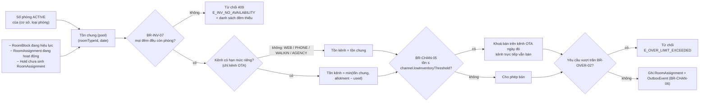
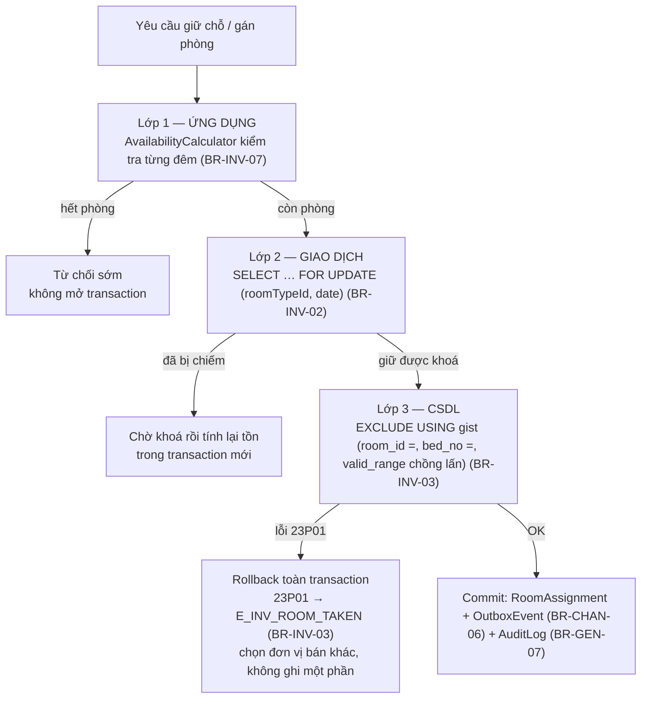
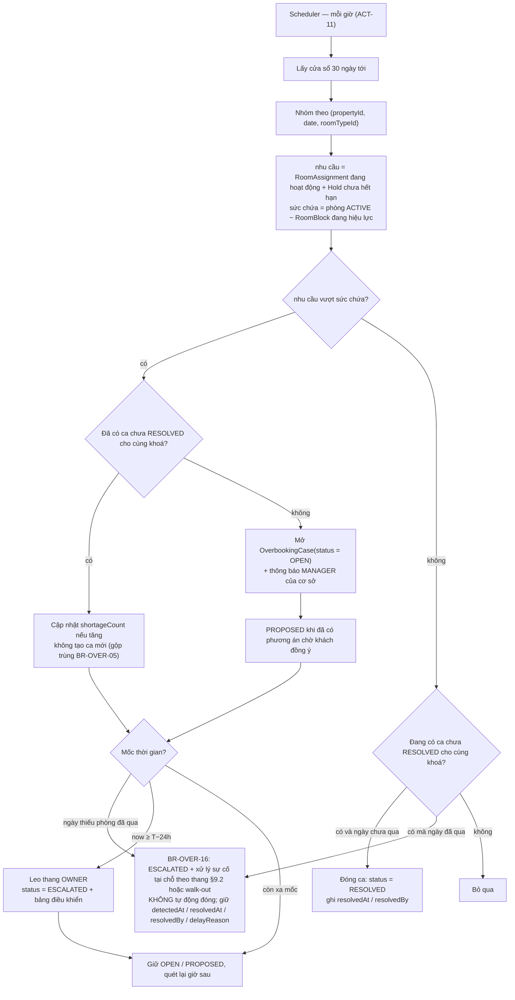

# 02 — Quá tải, ghép & đổi phòng

> Chuyên đề mở rộng cho **BT-3** — chống bán quá, bán vượt có kiểm soát, điều chuyển, ghép phòng và walk-out.
> Mọi con số nghiệp vụ **không định nghĩa lại** ở đây; tài liệu chỉ **tham chiếu mã BR** ở [quy tắc nghiệp vụ](quy-tac-nghiep-vu.md) (nguồn chân lý) và dùng định danh ở [00 §7](../00-tong-quan.md#7-từ-điển-thực-thể-nguồn-chân-lý-về-định-danh).

## 1. Phạm vi & truy vết

| Hạng mục | Nội dung |
|---|---|
| Bài toán | BT-3 — Ghép và đổi phòng khi quá tải |
| Quy tắc bao phủ | `BR-INV-01`..`BR-INV-07`, `BR-CHAN-01`..`BR-CHAN-08`, `BR-OVER-01`..`BR-OVER-16` |
| Quy tắc liên đới | `BR-PROP-01`..`BR-PROP-06`, `BR-RATE-01`/`03`/`04`/`16`/`19`, `BR-BOOK-08`/`10`/`11`/`17`, `BR-CANCEL-14`, `BR-FO-06`/`07`, `BR-RBAC-03`, `BR-GEN-03`, `BR-SYS-01`, `BR-REP-01` |
| Use case | `UC-INV-01`..`UC-INV-03`, `UC-CHAN-02`, `UC-CHAN-03`, `UC-OVER-01`..`UC-OVER-05`, `UC-FO-01`, `UC-REP-03`, `UC-REP-04` |
| Module | `INV`, `CHAN`, `OVER`, `PROP`, `BOOK`, `PAY`, `FO`, `CRM`, `NOTI`, `SYS` |
| Lớp miền & dịch vụ | Miền thuần: `AvailabilityCalculator`, `OverbookingPlanner`, `StayPeriod`, `DateRange`, `Money` · Dịch vụ: `InventoryService`, `OverbookingService`, `ChannelSyncService`, `FrontOfficeService`, `GuestService`, `NotificationService`, `AuditService`, `ReportingService` |
| Use case lớp điều phối | `ResolveOverbookingUseCase`, `CheckInUseCase`, `RequestRefundUseCase`, `ApproveRefundUseCase`, `CancelBookingUseCase` |
| Mẫu thiết kế | State (`BookingState`), Chain of Responsibility, Adapter + ACL, Observer + Outbox, Repository + Unit of Work, Process Manager/Saga (`OverbookingRelocationSaga`), Value Object |
| NFR chi phối | [NFR-REL-01, NFR-REL-02, NFR-REL-05, NFR-PERF-01, NFR-OBS-04](../01-yeu-cau/yeu-cau-phi-chuc-nang.md) (toàn văn ở tài liệu NFR; mã không có heading riêng) |

## 2. Bản đồ tồn phòng (`BR-INV-01`)

### 2.1. Công thức hai tầng và các cổng chặn



`BR-INV-01` tính **hai tầng, không trừ dồn**:

```
tồn chung (pool)  = ACTIVE − RoomBlock − RoomAssignment − hold chưa sinh RoomAssignment
tồn của một kênh  = min(tồn chung, ChannelAllotment.allotment − ChannelAllotment.used)
```

Hai tính chất bắt buộc, kiểm thử được:

| Tính chất | Nội dung | Hệ quả |
|---|---|---|
| Theo từng đêm (`BR-INV-07`) | Một kỳ lưu trú chỉ khả dụng khi **mọi** đêm khả dụng | Hàm kiểm tra nhận `StayPeriod`, trả về tập đêm thiếu; không được thoả hiệp ở tầng gọi |
| Hai tầng (`BR-INV-01`, `BR-CHAN-08`) | Tầng 1 (tồn chung) **không** phụ thuộc kênh; tầng 2 mới là hạn mức bán của kênh | Kết quả tầng 1 cache dùng chung được; **không** cache kết quả tầng 2 cho mọi kênh |
| Chống đếm trùng (`BR-INV-01`) | Hold đã sinh `RoomAssignment` chỉ đếm **một lần**; `allotment` là hạn mức bán, **không** phải phần tồn bị giữ khỏi kênh khác | Hai tầng là hai phép tính khác bản chất, không cộng dồn |

### 2.2. Ví dụ số — CS-01, ngày 30/04/2026 (trạng thái nền)

Phân bổ theo **ma trận canonical** `BR-PROP-03` (CS-01 = 8/6/5/3/2 = 24 phòng; tổng đơn vị bán của CS-01 = 34 vì DOR tính theo giường):

| Loại | ACTIVE | RoomBlock<br/>(`MAINTENANCE`) | Assign đang hoạt động | Trống vật lý |
|---|---|---|---|---|
| STD | 8 | 1 | 7 | 0 |
| SUP | 6 | 0 | 5 | 1 |
| DLX | 5 | 0 | 4 | 1 |
| FAM | 3 | 0 | 2 | 1 |
| DOR (2 phòng = 12 giường) | 2 | 0 | 6 giường (1 phòng kín) | 6 giường (1 phòng nguyên) |
| **Σ** | **24** | **1** | **19** | **4** |

Kiểm tra số học: `7 + 5 + 4 + 2 + 1 = 19` ✔, `24 − 1 − 19 = 4` ✔, `Σ cột` khớp `BR-PROP-02` ✔. DOR được quy về **phòng** khi cộng tổng; đơn vị bán thật của DOR là **giường** (`bedNo = 1..6`).

| Hold (`Hold.status = ACTIVE`) | Booking ở trạng thái `HELD` | Loại phòng | Kênh | Hết hạn sau |
|---|---|---|---|---|
| H1 | BK-0002 | DLX | `WEB` | 12 phút |
| H2 | BK-0003 | FAM | `OTA_AGODA` | 4 phút |

Công suất CS-01 ngày 30/04 theo định nghĩa `BR-RATE` §4.3: tử số = 19 phòng có `RoomAssignment` hoạt động + 2 hold còn hiệu lực = **21**; mẫu số = 24 phòng `ACTIVE` − 1 phòng bị `RoomBlock` = **23** (phòng bị block không vào cả tử số lẫn mẫu số) → `occupancyPct = 21/23 = 91,3%` (dòng tổng hợp cấp cơ sở của `OccupancySnapshot`: `roomTypeId` rỗng, `physicalRooms` = 23), rơi vào dải 80–94,99% (`pricing.occupancyMidPct` = 80, `pricing.occupancyHighPct` = 95 — `BR-SYS-02`) → **hệ số công suất 1,15** cho mọi đêm của ngày đó (không ảnh hưởng tồn phòng; ví dụ giá ở §8.3 nằm ở cơ sở khác và giả định công suất dưới 80%).

### 2.3. Tồn khả dụng cho từng kênh (cùng ngày, cùng cơ sở)

**Tầng 1 — tồn chung** (`ACTIVE − RoomBlock − RoomAssignment − hold chưa sinh assignment`):

| Loại | ACTIVE | Số hạng bị trừ | Tồn chung | Ghi chú |
|---|---|---|---|---|
| STD | 8 | 1 block + 7 assign | **0** | loại phát sinh quá tải ở §2.5 |
| SUP | 6 | 0 block + 5 assign | **1** | chỗ đệm cho bậc 2 ở §10.1 |
| DLX | 5 | 4 assign + 1 hold H1 | **0** | H1 chưa sinh `RoomAssignment` nên trừ ở tầng này |
| FAM | 3 | 2 assign + 1 hold H2 | **0** | H2 chưa sinh `RoomAssignment` |
| DOR | 12 giường | 6 giường assign | **6 giường** (1 phòng nguyên) | bán theo giường |
| **Σ** | **24 phòng** | — | **2 đơn vị bán** | 1 phòng SUP + 1 phòng DOR |

Hai hold H1/H2 bị trừ ở tầng tồn chung cho **mọi** kênh — `BR-INV-01` không còn phân biệt "hold của kênh khác", vì hold chưa sinh `RoomAssignment` thì chưa thuộc về ai.

**Tầng 2 — tồn của kênh** = `min(tồn chung, allotment − used)`, chỉ áp cho kênh có hạn mức:

| Kênh | Hạn mức riêng (`BR-CHAN-01`) | Tồn chung STD | Tồn kênh STD | Tồn chung SUP | Allotment SUP còn lại | Tồn kênh SUP | Bán được? |
|---|---|---|---|---|---|---|---|
| `WEB` | Không | 0 | 0 | 1 | — | **1** | Có |
| `PHONE` | Không | 0 | 0 | 1 | — | **1** | Có |
| `WALKIN` | Không | 0 | 0 | 1 | — | **1** | Có |
| `AGENCY` | Không | 0 | 0 | 1 | — | **1** | Có |
| `OTA_BOOKING` | Có | 0 | 0 | 1 | 3 | **1** | **Không** (`BR-CHAN-05`) |
| `OTA_AGODA` | Có | 0 | 0 | 1 | 3 | **1** | **Không** (`BR-CHAN-05`) |
| `OTA_AIRBNB` | Có | 0 | 0 | 1 | 4 | **1** | **Không** (`BR-CHAN-05`) |

Vì **mọi loại phòng** trong ngày đều có tồn ≤ 2 (STD 0 · SUP 1 · DLX 0 · FAM 0 · DOR 1 phòng = 6 giường) — ngưỡng `channel.lowInventoryThreshold` (`BR-SYS-02`) — `BR-CHAN-05` khoá cả 3 kênh OTA cho ngày 30/04, kênh trực tiếp vẫn bán. Đây là điểm khác biệt quan trọng: **tồn khả dụng theo công thức ≠ số bán được**. DOR cho thấy `BR-CHAN-05` phụ thuộc **đơn vị bán**: theo giường còn 6 > 2 nên về lý thuyết không khoá, nhưng cả 3 kênh OTA đã bị khoá vì các loại phòng khác trong cùng ngày.

### 2.4. Allotment & hệ quả phát tồn sai (CS-01, STD và SUP, 30/04/2026)

`BR-CHAN-01`: hạn mức mặc định của **mỗi kênh OTA** = 80% số phòng vật lý của loại phòng. Ví dụ dùng làm tròn **xuống** (STD: 8 × 0,80 = 6,4 → 6; SUP: 6 × 0,80 = 4,8 → 4) — BR chưa định nghĩa quy tắc làm tròn, xem §11.2 điểm 2.

| Kênh OTA | Loại | `allotment` | `used` | Còn lại |
|---|---|---|---|---|
| `OTA_BOOKING` | STD | 6 | 2 | 4 |
| `OTA_AGODA` | STD | 6 | 1 | 5 |
| `OTA_AIRBNB` | STD | 6 | 0 | 6 |
| `OTA_BOOKING` | SUP | 4 | 1 | 3 |
| `OTA_AGODA` | SUP | 4 | 1 | 3 |
| `OTA_AIRBNB` | SUP | 4 | 0 | 4 |

Phân bố 7 phòng STD đã bán: `WEB` 3 · `PHONE` 1 · `OTA_BOOKING` 2 · `OTA_AGODA` 1 (kênh trực tiếp không có hạn mức riêng, cùng chia sẻ tồn chung — `BR-CHAN-01`).

Hệ quả bắt buộc: `allotment` còn lại 4–6 phòng STD nhưng **tồn chung STD = 0**, nên tồn kênh = 0 và không bán được gì. Nếu `ChannelSyncService` phát **allotment thô** lên OTA, OTA sẽ thấy 6 phòng không tồn tại — đây là nguyên nhân trực tiếp của bán quá; giá trị PHẢI phát là `min(allotment − used, tồn chung)` (`BR-CHAN-02`, `BR-CHAN-06`, `BR-CHAN-08`). Đồng bộ thất bại 3 lần liên tiếp → `E_CHAN_SYNC_FAILED`, `Channel.syncStatus = DEGRADED`, cảnh báo `MANAGER` (`BR-CHAN-07`).

### 2.5. Diễn biến dẫn tới quá tải

| Bước | Sự kiện | Tác động lên STD | Nhu cầu / sức chứa |
|---|---|---|---|
| 0 | Trạng thái nền §2.2 | 8 ACTIVE, 1 block, 7 assign | 7 / 7 |
| 1 | H1 (DLX) và H2 (FAM) được xác nhận thành booking (`CONFIRMED`) | không đổi | 7 / 7 |
| 2 | OTA đẩy tiếp 2 booking STD đã thu tiền (`OTA_COLLECT`) | `BR-CHAN-03` xác nhận tự động dù tồn = 0; `oversold = true` | **9 / 7** |

Kết quả: `shortageCount = 9 − 7 = 2` → mở `OverbookingCase(CS-01, 2026-04-30, STD, shortage = 2)` (`BR-OVER-03`). Trạng thái toàn cơ sở sau bước 2: ACTIVE 24 · Block 1 · Assign 23 (STD 9 · SUP 5 · DLX 5 · FAM 3 · DOR 1 phòng) · trống ròng `24 − 1 − 23 = 0`, phân bổ theo loại: STD **−2** · SUP **+1** · DLX 0 · FAM 0 · DOR **+1** (`−2 + 1 + 0 + 0 + 1 = 0`). Chỗ trống ở SUP và 1 phòng DOR nguyên là hai chỗ đệm để xử lý — xem §10.1.

### 2.6. Đối chiếu `BR-INV` → hệ quả thiết kế

| Mã | Nội dung chốt | Hệ quả bắt buộc |
|---|---|---|
| `BR-INV-01` | Tồn tính **hai tầng**: tồn chung (không phụ thuộc kênh) và tồn kênh = `min(tồn chung, allotment − used)` | `AvailabilityCalculator` tách hai hàm: `pool(roomTypeId, date)` và `channelAvailability(..., channelCode)`; cấm cộng dồn hai tầng |
| `BR-INV-02` | Kiểm tra tồn + giữ chỗ trong **một** transaction, khoá bi quan | `InventoryService.hold()` mở transaction, `SELECT … FOR UPDATE` theo `(roomTypeId, date)`; cấm mẫu "đọc rồi ghi" |
| `BR-INV-03` | Bất biến `(đơn vị bán, đêm) ≤ 1` `RoomAssignment`: đơn vị bán = `bedNo = 0` (cả phòng) hoặc `1..bedCount` (giường DOR) | Ràng buộc loại trừ ba cột ở CSDL — xem §3; lỗi `23P01` PHẢI ánh xạ thành `E_INV_ROOM_TAKEN` (409), cấm nuốt lỗi |
| `BR-INV-04` | Hold hết hạn giải phóng ≤ 60 giây | Job phát biến cố `HoldExpired` chạy theo `job.hold.releaseIntervalSeconds` = 30 (`BR-SYS-02`), phát qua outbox; chỉ tiêu [NFR-REL-02](../01-yeu-cau/yeu-cau-phi-chuc-nang.md) |
| `BR-INV-05` | `allotment ≤` số phòng `ACTIVE` của loại | Kiểm tra khi tạo/sửa allotment **và** khi `RoomBlock` làm giảm quỹ |
| `BR-INV-06` | `RoomBlock` chồng lấn assignment phải bị từ chối, trừ `MANAGER`+ có lý do | `FrontOfficeService`/`InventoryService` kiểm tra chồng lấn trước khi ghi block; khi override → mở `OverbookingCase` cho mọi booking bị ảnh hưởng |
| `BR-INV-07` | Xét từng đêm riêng biệt | `StayPeriod` → `DateRange` nửa mở `[start, end)`; số đêm = hiệu ngày, không tính ngày trả phòng; thiếu bất kỳ đêm nào → `E_INV_NO_AVAILABILITY` (409) kèm danh sách đêm thiếu |

## 3. Cơ chế chống bán quá 3 lớp



| Lớp | Cơ chế | Mã BR | Phạm vi chặn | Hành vi khi vi phạm | Chi phí |
|---|---|---|---|---|---|
| 1 — Ứng dụng | Đọc tồn khả dụng và kiểm tra từng đêm trước khi mở giao dịch | `BR-INV-07`, `BR-INV-01` | Sai sót nghiệp vụ thông thường; giảm tải cho CSDL | Trả `E_INV_NO_AVAILABILITY` (HTTP 409) kèm danh sách đêm thiếu | Rẻ nhất, ~1 truy vấn; **không** chống được race |
| 2 — Giao dịch | `SELECT … FOR UPDATE` trên `(roomTypeId, date)` trong một transaction | `BR-INV-02` | Hai yêu cầu đồng thời cùng loại phòng/ngày | Giao dịch sau chờ rồi tính lại tồn; hết phòng thì từ chối | Khoá ngắn theo `(loại phòng, ngày)`; phải khoá theo thứ tự tăng dần `(roomTypeId, date)` để tránh deadlock |
| 3 — CSDL | Ràng buộc loại trừ `EXCLUDE USING gist (room_id WITH =, bed_no WITH =, valid_range WITH &&) WHERE (released_at IS NULL)`; `bed_no = 0` = cả phòng, `1..bedCount` = giường DOR (**cấm** dùng khoá đơn `COALESCE(bed_no, room_id)` — số giường lặp ở mọi phòng sẽ chặn oan) | `BR-INV-03` | **Mọi** đường ghi: dịch vụ ứng dụng, webhook OTA, job nền, script backfill, sửa tay | CSDL trả lỗi `23P01 exclusion_violation` → rollback, không có dữ liệu sai nào tồn tại | Chỉ mục GiST (`btree_gist`) — chấp nhận được ở quy mô 55 phòng |

**Lớp nào là chốt cuối: lớp 3 (ràng buộc loại trừ ở CSDL).** Bốn lý do:

1. Lớp 2 chỉ đúng khi **mọi** đường ghi đều khoá cùng một khoá và cùng thứ tự. Ràng buộc CSDL đúng với mọi đường ghi, kể cả đường ghi không đi qua `InventoryService` (webhook OTA, job đồng bộ, thao tác vận hành khẩn cấp).
2. Bất biến `(roomId, đêm) ≤ 1` là bất biến **dữ liệu**, không phải bất biến của luồng nghiệp vụ; nơi cưỡng chế đúng là CSDL.
3. Cơ chế fail-closed: lớp 3 từ chối giao dịch chứ không tạo trạng thái sai "rồi sửa sau". Lớp 1 và 2 chỉ là tối ưu trải nghiệm và giảm tranh chấp.
4. Lớp 3 bảo vệ cả trường hợp mất đồng bộ giữa hai tiến trình hoặc chạy nhiều bản sao ứng dụng (web, Android, worker, scheduler).

Hệ quả vận hành: lớp 3 là **đường phản hồi**, không phải đường nghiệp vụ. Mã ứng dụng PHẢI map `23P01` thành một kết cục có nghĩa (chọn đơn vị bán khác, hoặc `E_INV_ROOM_TAKEN` theo BR-INV-03), KHÔNG ĐƯỢC để lỗi thô lên giao diện, và KHÔNG ĐƯỢC nuốt lỗi rồi commit phần còn lại.

**Lớp 4 (phát hiện, không phòng ngừa):** job quét quá tải §5 và `OverbookingCase` là lưới an toàn cho các nguồn vượt quỹ hợp lệ — chủ yếu là booking OTA mà `BR-CHAN-03` buộc phải xác nhận. Lớp này không chặn được gì; nó chỉ bảo đảm phát hiện ≤ 1 giờ ([NFR-OBS-04](../01-yeu-cau/yeu-cau-phi-chuc-nang.md) — cảnh báo vận hành `OverbookingCase` quá T−24h).

## 4. Bán vượt có kiểm soát (`BR-OVER-01`..`BR-OVER-03`)

### 4.1. Bảng quyết định: khi nào được phép oversell

Xét theo thứ tự; gặp điều kiện **không** đạt đầu tiên thì từ chối.

| # | Điều kiện | Mã BR | Nguồn kiểm tra | Ví dụ CS-01 | Kết luận |
|---|---|---|---|---|---|
| 1 | Cơ sở bật hạn mức và hạn mức ≤ 5% | `BR-OVER-01`, `BR-OVER-02(b)`, `(d)` | `Property.overbookLimitPct`, kiểm tra lúc cấu hình (`OWNER`) | 5, và 5 ≤ 5 | Đạt |
| 3 | Kênh cho phép (`overbookAllowed = true`) | `BR-OVER-02(a)` | `Channel.overbookAllowed` | `OTA_BOOKING` = true | Đạt |
| 4 | Số phòng đã vượt trong ngày < trần | `BR-OVER-02(c)` | Đếm booking `oversold = true` trong `(cơ sở, ngày)` | 0 < 2 | Đạt |
| 5 | Kênh là OTA (không áp cho `WEB`/`PHONE`/`WALKIN`/`AGENCY`) | `BR-OVER-02(a)` | `overbookAllowed = false` | `WEB` | **Từ chối** |
| 6 | Khách không trong danh sách đen | `BR-BOOK-15` | `Guest.blacklisted` | — | Đạt |
| 7 | Ghi cờ và mở ca xử lý | `BR-OVER-03` | `Booking.oversold = true` + `OverbookingCase` | — | Bắt buộc |

Khi từ chối vì hết trần bán vượt: trả **`E_OVER_LIMIT_EXCEEDED`** (`BR-OVER-02`). Khi từ chối vì hết tồn nói chung: `E_INV_NO_AVAILABILITY` (409); `E_BOOK_OVER_CAPACITY` để dành cho `BR-BOOK-04` (số khách vượt sức chứa). Ghi chú bắt buộc: điều kiện 3–4 chỉ kiểm soát **chiều ra** (ta chủ động bán vượt). Booking OTA **đẩy vào** nằm ngoài phạm vi hạn mức — `BR-CHAN-03` đã ghi miễn trừ tường minh: vẫn PHẢI nhận `CONFIRMED` + `oversold = true` + mở `OverbookingCase`; `overbookLimitPct` không áp cho đường vào này. Xem §5 để thấy hệ quả lên job quét.

### 4.2. Công thức trần và ví dụ 3 cơ sở

```
trần phòng vượt (cơ sở, ngày)  =  ceil(số phòng ACTIVE × overbookLimitPct / 100), tối thiểu 1 khi overbookLimitPct > 0
trần toàn chuỗi                =  tổng trần theo từng cơ sở   (KHÔNG ceil trên tổng 55 phòng)
ràng buộc đầu vào              =  overbookLimitPct ≤ 5        (BR-OVER-02(b), (d))
```

| Cơ sở | Phòng ACTIVE | `overbookLimitPct` = 5% | `ACTIVE × pct / 100` | `ceil` → trần phòng vượt | Tỷ lệ thực tế nếu dùng hết trần |
|---|---|---|---|---|---|
| CS-01 Đà Lạt | 24 | 5 | 1,20 | **2** | 2/24 = 8,33% |
| CS-02 Vũng Tàu | 18 | 5 | 0,90 | **1** | 1/18 = 5,56% |
| CS-03 Phan Thiết | 13 | 5 | 0,65 | **1** | 1/13 = 7,69% |
| **Toàn chuỗi** | **55** | 5 | 2,75 | `ceil` ở mức chuỗi = 3, nhưng **trần áp dụng = tổng trần theo cơ sở = 2 + 1 + 1 = 4** | 4/55 = 7,27% |

Hai kết luận rút ra trực tiếp từ bảng:

- Ở cơ sở nhỏ, `ceil` đẩy tỷ lệ thực tế vượt 5% (CS-01: 8,33%). Đây là hệ quả **đã được chấp nhận** trong `BR-OVER-02`: mức tối thiểu 1 phòng khi `overbookLimitPct > 0` để hạn mức còn dùng được.
- Trần chốt **theo từng cơ sở** rồi cộng; `ceil` trên tổng 55 phòng cho 3 thay vì 4 — sai.

### 4.3. Áp trần trong mã

| Bước | Xử lý | Mã BR |
|---|---|---|
| 1 | Trong transaction giữ chỗ, sau khi xác định hết phòng vật lý, đếm `oversold` hiện có của `(propertyId, checkIn)` | `BR-OVER-02(c)` |
| 2 | So với `ceil(ACTIVE × pct / 100)` của **chính cơ sở** đó | `BR-OVER-02(c)` |
| 3 | Nếu còn dư trần → cho phép, ghi `oversold = true` **và** mở `OverbookingCase` trong **cùng transaction** (không chờ job §5) | `BR-OVER-03` |
| 4 | Nếu hết trần → `E_OVER_LIMIT_EXCEEDED` | `BR-OVER-02` |
| 5 | Ghi `AuditLog` + `OutboxEvent` (đồng bộ tồn/giá lên kênh) | `BR-GEN-07`, `BR-CHAN-06` |

## 5. Luồng phát hiện quá tải (`BR-OVER-04`, `BR-OVER-05`, `BR-OVER-16`)



| Quy tắc | Điều kiện | Hành vi bắt buộc | Chống hồi quy |
|---|---|---|---|
| `BR-OVER-05` | Chu kỳ chạy (**`job.overbooking.scanIntervalMinutes`** = 60, `BR-SYS-02`) | Mỗi giờ, cửa sổ 30 ngày, **gộp trùng theo `(propertyId, date, roomTypeId)`** | Chạy job 2 lần liên tiếp không tạo ca thứ hai |
| `BR-OVER-03` | Booking tạo khi hết phòng vật lý | `oversold = true` + mở ca **ngay**, không chờ job | Ca tồn tại trước cả khi job chạy |
| `BR-OVER-04` | `now ≥ T−24h` mà ca chưa `RESOLVED` | Một ca mỗi đêm → **leo thang `OWNER`** + hiện trên bảng điều khiển | Không có ca nào quá T−24h mà vẫn ở trạng thái thường |
| `BR-INV-06` | `RoomBlock` override chồng assignment | Mở ca cho các booking bị ảnh hưởng | Block gây thiếu phòng luôn sinh ca |
| `BR-OVER-16` | Ngày thiếu phòng đã trôi qua mà ca còn `OPEN`/`PROPOSED`/`ESCALATED` | Chuyển `ESCALATED` và xử như **sự cố tại chỗ**: khách đã tới vẫn điều chuyển theo §6, hết phương án thì walk-out (§9); giữ `detectedAt`/`resolvedAt`/`resolvedBy`/`delayReason` | Ca quá hạn **không** bao giờ tự chuyển `RESOLVED`; job chỉ đóng ca khi còn thời gian trước ngày thiếu phòng |

Nguồn **giảm nhu cầu** hợp lệ là booking OTA bị chính sách OTA huỷ (`BR-CHAN-04`: `cancelReason = OTA_CANCELLATION`, không tạo `RefundRequest`) — lần quét sau `shortageCount` giảm và ca được đóng đúng đường; không được dùng đường huỷ OTA để "xoá" ca quá hạn.

Chú ý phạm vi `T−24h`: mốc là **thời điểm nhận phòng danh nghĩa của đêm** (`BR-GEN-04`, 14:00 giờ VN), không phải 00:00 của ngày. Một ca cho đêm 30/04 phải `RESOLVED` trước 14:00 ngày 29/04. Sau mốc đó, `BR-OVER-16` tiếp quản: ca quá hạn là **lỗi vận hành** đưa vào `UC-REP-04`, không phải ca được phép biến mất.

Vòng đời `OverbookingCase` dùng enum canonical `OverbookingCaseStatus` (00 §7.8): `OPEN` (vừa phát hiện) → `PROPOSED` (đã có phương án điều chuyển, đang chờ khách đồng ý — cần cho `BR-OVER-07` và `BR-OVER-13`) → `RESOLVED` (khách đã được xếp chỗ, ghi `resolvedAt`/`resolvedBy`) hoặc `ESCALATED` (quá T−24h, hoặc quá ngày thiếu phòng theo `BR-OVER-16`). Ca `RESOLVED` không được mở lại: nếu quota lại âm, job mở **ca mới** theo đúng khoá `(propertyId, date, roomTypeId)`.

## 6. Thang điều chuyển 4 bậc — vận hành thực tế 1 → 2 → 4 (`BR-OVER-05` §9.2, `BR-OVER-06`..`BR-OVER-10`)

Áp **theo thứ tự**, dừng ở bậc đầu tiên thực hiện được:

| Bậc | `MoveType` | Điều kiện vào | Kiểm tra tự động | Chi phí & bồi thường | Người duyệt (`BR-RBAC-03`) | Trường dữ liệu |
|---|---|---|---|---|---|---|
| 1 | `SAME_TYPE_SAME_PROPERTY` | Còn đơn vị bán trống cùng loại, cùng cơ sở | `AvailabilityCalculator` theo từng đêm của kỳ lưu trú | Không phụ thu, giữ giá gốc | `FRONT_DESK` (`UC-OVER-02`) | `fromRoomId`, `toRoomId`, `compensationAmount = 0`, `transportCost = 0` |
| 2 | `UPGRADE_SAME_PROPERTY` | Còn phòng **hạng cao hơn** và `capacityAdults × roomCount ≥` số khách, cùng cơ sở | So `basePrice` của loại đích > loại gốc **và** kiểm tra sức chứa | Miễn phí nâng hạng, giữ giá gốc, không thu chênh lệch | `FRONT_DESK` | `compensationAmount = 0` |
| 3 | `SAME_TYPE_CROSS_PROPERTY` / `UPGRADE_CROSS_PROPERTY` | Còn phòng ở cơ sở khác **cùng thành phố/khu vực, bán kính ≤ 15 km** — **hiện KHÔNG khả dụng** (3 cơ sở cách nhau 160–300 km) | Khoảng cách cơ sở + tồn của loại đích | Giữ giá gốc + hỗ trợ đưa đón **≤ 500.000 VND** (`overbooking.transportSupportCap`) | `MANAGER` (khác thành phố) + **đồng ý bằng văn bản** của khách (`BR-OVER-07`) | `fromPropertyId`, `toPropertyId`, `transportCost ≤ 500000` |
| 4 | `WALK_OUT` | Không còn phương án nào | Đã thử và ghi nhận thất bại của bậc 1–3 | Hoàn **100%** `paidAmount` + bồi thường **1 × giá đêm đầu** theo giá gốc + hỗ trợ tìm chỗ ở thay thế | `MANAGER` (`UC-OVER-04`) | `compensationAmount`, `transportCost` |

Bất biến chung cho cả 4 bậc:

| Bất biến | Mã BR | Cách cưỡng chế |
|---|---|---|
| `priceLocked = true` — khách giữ nguyên đơn giá đã chốt cho **toàn bộ** kỳ lưu trú | `BR-OVER-08`, `BR-RATE-16` | `RoomMove.priceLocked = true`; giá lấy từ `PriceSnapshot`, không tính lại |
| Mọi ca điều chuyển tạo bản ghi + `AuditLog` + thông báo khách trong **15 phút** | `BR-OVER-10`, `BR-GEN-07`, `BR-SYS-01` | `AuditLog` append-only; `Notification` ghi trạng thái từng lần gửi (`BR-SYS-06`) |
| Chi phí bồi thường/đưa đón phải được duyệt **trước khi chi**; khách `CHECKED_IN` không được điều chuyển, trừ bất khả kháng và phải `MANAGER`+ | `BR-OVER-06`, `BR-OVER-09` | `RoomMove.approvedBy` bắt buộc khi `compensationAmount + transportCost > 0`; chặn ở `ResolveOverbookingUseCase` (xem §10.2) |

Ba ghi chú vận hành:

- Bậc 3 **không khả dụng**: ba cơ sở cách nhau khoảng 160 km (Đà Lạt–Phan Thiết), 170 km (Vũng Tàu–Phan Thiết) và 300 km (Đà Lạt–Vũng Tàu) theo đường bộ, đều ≫ 15 km. **Thang vận hành thực tế là 1 → 2 → 4.** Đường đi vòng cho ca đặc biệt là `BR-OVER-07` (khách đồng ý bằng văn bản + `MANAGER`+ duyệt) — **không** tính là một bậc của thang, và mức hỗ trợ đưa đón khi đó do `MANAGER`+ quyết theo chi phí thực tế. §10.1 là ca như vậy.
- `RoomMove` ghi cả `keepScore` để quản lý kiểm tra được vì sao chọn khách đó (§7); vòng đời `RoomMove.status`: `PROPOSED` → `APPROVED` → `EXECUTED`, nhánh từ chối là `REJECTED`/`CANCELLED`.
- `MERGE_SHARE` / `MERGE_CONNECTING` / `SPLIT_ROOMS` **không** thuộc thang này: chúng là phương án *bổ sung* trước khi tới bậc 4, xem §8. `SPLIT_ROOMS` áp `BR-OVER-08` (giữ giá gốc).

## 7. Thuật toán xếp hạng `keepScore` (`BR-OVER-11`, `BR-OVER-12`)

### 7.1. Thành phần và công thức

```
keepScore = điểm hạng khách + điểm thanh toán + min(số đêm, 14) × 2
          + điểm khách quay lại + điểm đã tới nơi
```

| Thành phần | Điểm | Nguồn |
|---|---|---|
| Hạng khách | PLATINUM 100 · GOLD 80 · SILVER 50 · MEMBER 20 · GUEST 0 | `Guest.loyaltyTier` |
| Thanh toán | đã trả ≥ 100% tổng tiền: 20 · đã trả ≥ tiền cọc: 10 · chưa trả gì: 0 | `Booking.paidAmount` vs `totalAmount`/`depositAmount` |
| Số đêm | `min(nights, 14) × 2` → tối đa 28 | `Booking.nights` |
| Khách quay lại | ≥ 3 lần lưu trú trong 12 tháng: 15, ngược lại 0 | `Guest.totalStays` |
| Đã tới nơi | đã check-in, hoặc còn ≤ 6 giờ tới giờ nhận phòng: 10 | `Booking.status`, `BR-GEN-04` |

Thứ tự điều chuyển (`BR-OVER-11`), **ai điểm thấp bị điều chuyển trước**:

```
1. keepScore         TĂNG DẦN
2. createdAt         GIẢM DẦN   (booking mới hơn bị đổi trước)
3. Booking.seq       TĂNG DẦN   (số thứ tự tăng đơn điệu toàn hệ thống)
```

Thứ tự này **tất định**: `(keepScore, createdAt, seq)` là khoá sắp xếp toàn phần vì `seq` tăng đơn điệu và duy nhất (`BR-OVER-11` cấm dùng `id` vì `id` là UUID không có thứ tự). Không có hai phần tử nào bằng nhau ở cả 3 khoá.

### 7.2. Tám ca ví dụ (khác hạng, khác trạng thái thanh toán)

| Ca | Hạng (điểm) | Thanh toán (điểm) | Số đêm (điểm) | Quay lại | Đã tới nơi | `keepScore` | `createdAt` (UTC) | `Booking.seq` |
|---|---|---|---|---|---|---|---|---|
| K-A | PLATINUM (100) | đủ 100% (20) | 5 (10) | 15 | 10 | **155** | 2026-03-01T03:00:00Z | 77 |
| K-B | GOLD (80) | đủ cọc (10) | 14 (28) | 15 | 10 | **143** | 2026-03-11T08:15:00Z | 84 |
| K-C | SILVER (50) | đủ 100% (20) | 7 (14) | 15 | 10 | **109** | 2026-03-20T11:40:00Z | 95 |
| K-D | SILVER (50) | chưa trả (0) | 10 (20) | 15 | 10 | **95** | 2026-03-25T06:05:00Z | 91 |
| K-E | GUEST (0) | đủ 100% (20) | 14 (28) | 0 | 10 | **58** | 2026-04-05T09:30:00Z | 99 |
| K-F | MEMBER (20) | đủ cọc (10) | 6 (12) | 15 | 0 | **57** | 2026-04-10T02:30:00Z | 88 |
| K-G | MEMBER (20) | chưa trả (0) | 11 (22) | 15 | 0 | **57** | 2026-04-18T07:00:00Z | 105 |
| K-H | MEMBER (20) | đủ cọc (10) | 1 (2) | 15 | 10 | **57** | 2026-04-18T07:00:00Z | 106 |

Kiểm tra ba ca hoà điểm (K-F, K-G, K-H) đều bằng 57 nhưng **khác cấu trúc điểm** — chứng minh khoá phá hoà là bắt buộc, không phải trang trí. `seq` tăng theo thứ tự tạo booking và không tái sử dụng, khác `id` UUID. Khách quay lại không thể ở hạng `GUEST` (`BR-CRM-02`: `MEMBER` từ 1 lần lưu trú), nên K-E không có 15 điểm quay lại là dữ liệu hợp lệ.

### 7.3. Kết quả sắp thứ tự đầy đủ

| Hạng | Ca | `keepScore` | `createdAt` (UTC) | `Booking.seq` | Khoá quyết định |
|---|---|---|---|---|---|
| 1 | K-G | 57 | 2026-04-18T07:00:00Z | 105 | Hoà điểm → tạo mới hơn nhóm 57 → `seq` nhỏ hơn K-H |
| 2 | K-H | 57 | 2026-04-18T07:00:00Z | 106 | Cùng `createdAt` với K-G → `seq` tăng dần |
| 3 | K-F | 57 | 2026-04-10T02:30:00Z | 88 | Hoà điểm nhưng `createdAt` cũ hơn → xếp sau K-G/K-H |
| 4 | K-E | 58 | 2026-04-05T09:30:00Z | 99 | Điểm cao hơn nhóm 57 |
| 5 | K-D | 95 | 2026-03-25T06:05:00Z | 91 | |
| 6 | K-C | 109 | 2026-03-20T11:40:00Z | 95 | |
| 7 | K-B | 143 | 2026-03-11T08:15:00Z | 84 | |
| 8 | K-A | 155 | 2026-03-01T03:00:00Z | 77 | Điểm cao nhất → giữ phòng lâu nhất |

Đọc kết quả: nếu thiếu **2 chỗ**, hai khách bị điều chuyển là **K-G** và **K-H**; K-F chỉ đứng sau vì booking cũ hơn. Đây chính là tình huống §10.1 dùng lại.

### 7.4. Kiểm tra `BR-OVER-12` trước khi sắp

`BR-OVER-12` là ràng buộc **ưu tiên**, không phải thành phần điểm: booking `WALKIN` chưa đóng tiền và booking `HELD` không bao giờ được ưu tiên hơn booking đã cọc.

| Kiểm tra | Kết quả |
|---|---|
| K-G là `WALKIN` chưa đóng tiền | K-G bị đẩy lên **đầu** danh sách điều chuyển, trước cả nhóm hoà 57 |
| Một booking `HELD` có `keepScore` 155 | Vẫn xếp sau **mọi** booking đã cọc, kể cả booking điểm 57 |

Cách cưỡng chế: một khoá sắp xếp bổ sung **trước** `keepScore` — nhóm vi phạm `BR-OVER-12` (0) luôn đứng trước nhóm còn lại (1); trong mỗi nhóm sắp theo `keepScore` ↑ → `createdAt` ↓ → `Booking.seq` ↑. `BR-OVER-12` mâu thuẫn một phần với mô tả "thuần lexicographic" của `BR-OVER-11` — xem §11.2 điểm 1.

## 8. Ghép phòng (`BR-OVER-13`..`BR-OVER-15`)

### 8.1. Ba biến thể

| Biến thể | Nghĩa nghiệp vụ | Điều kiện bắt buộc | Đồng thuận | Chiết khấu |
|---|---|---|---|---|
| `MERGE_SHARE` | Ghép hai booking độc lập vào **cùng một phòng** (Dorm/nhiều giường) | Tổng số người ≤ sức chứa; cùng giới tính (so `Guest.gender`; `UNSPECIFIED` coi như khác giới) hoặc cùng nhóm đi cùng nhau; khoảng ngày trùng nhau | **Cả hai** bên: `consentPrimary = true` **và** `consentSecondary = true` (`BR-OVER-13`) | **20%** cho mỗi bên |
| `MERGE_CONNECTING` | Ghép hai phòng **thông nhau** thành một đơn vị bán cho gia đình/nhóm | Hai phòng phải có `connectingRoomId` **trỏ vào nhau** (kiểm tra hai chiều) | Không bắt buộc (cùng một booking, cùng một khách) | **10%** trên tổng hai phòng |
| `SPLIT_ROOMS` | Tách một booking nhiều phòng sang phòng khác do quá tải/hỏng phòng | Phòng đích phải còn trống **mọi đêm** của kỳ lưu trú (`BR-INV-07`) | Khách được thông báo, không cần đồng ý (điều chuyển bắt buộc) | Không — giữ giá gốc, `priceLocked = true` (`BR-OVER-08`) |

Phân biệt với **huỷ một phần** (`BR-CANCEL-19`, booking `roomCount > 1`): huỷ một phần làm `totalAmount` **giảm** và hoàn theo tỷ lệ giá của các phòng bị huỷ trên `totalAmount`; `SPLIT_ROOMS` chỉ **đổi đơn vị bán**, giữ nguyên giá và doanh thu ghi nhận.

### 8.2. Quy tắc giới tính và quy trình xin đồng thuận

| Bước | Nội dung | Mã BR |
|---|---|---|
| 1 | **Đề xuất:** `FrontOfficeService` liệt kê cặp ghép hợp lệ (cùng loại, cùng khoảng ngày, cùng giới tính, còn đủ chỗ) | `BR-OVER-13` |
| 2 | **Thông báo hai bên** (loại phòng, ngày, mức chiết khấu; **không** tiết lộ danh tính bên kia) rồi **thu đồng ý** trên ứng dụng/web hoặc email; lễ tân ghi nhận thay khi khách đồng ý tại quầy (`UC-OVER-03`) | `BR-SYS-06`, `BR-OVER-13` |
| 4 | **Ghi nhận:** tạo `RoomMerge(status = PENDING_CONSENT)` với `consentPrimary`/`consentSecondary`; thiếu một bên → `E_OVER_NO_CONSENT`; đủ hai bên → `APPROVED` → `ACTIVE` | `BR-OVER-13` |
| 5 | **Hiệu lực:** gán cả hai booking về cùng phòng, mỗi booking giữ **giường riêng**; tính lại giá với chiết khấu; gửi thông báo xác nhận | `BR-OVER-13`, `BR-OVER-15` |

Giới tính: **mặc định KHÔNG ghép khác giới tính**, đối chiếu `Guest.gender` (`MALE`/`FEMALE`/`OTHER`/`UNSPECIFIED`); `UNSPECIFIED` bị coi là khác giới. Ngoại lệ (`BR-OVER-14`) chỉ khi hội đủ **cả hai**: (a) cả hai khách đồng ý bằng văn bản trên hệ thống (`consentPrimary` và `consentSecondary` = true) và (b) `MANAGER`+ duyệt kèm lý do; thiếu đồng thuận → `E_OVER_NO_CONSENT`; đủ đồng thuận nhưng khác giới và chưa được duyệt → `E_OVER_MERGE_GENDER`.

Ảnh hưởng doanh thu: ghép phòng **không** làm thay đổi tổng doanh thu ghi nhận của phần phòng đã bán; phần giảm do chiết khấu ghi vào `RoomMerge.discountAmount` và được hạch toán **riêng như chi phí xử lý quá tải** (`BR-OVER-15`).

### 8.3. Ví dụ số

**`MERGE_SHARE` — hai khách lẻ cùng giới tại CS-03, Dorm DOR1, 3 đêm 30/04 → 03/05/2026, kênh `WEB`, gói `FLEX7` (LOS bật nên áp 0,95).**

Hai ví dụ dưới đây dùng `FLEX7` — gói có `losDiscountEnabled = true` nên áp hệ số LOS; `LONGSTAY14` đi theo giá riêng của gói (`BR-RATE-19`), không dùng hệ số LOS. Đơn giá giường/đêm theo `BR-RATE-01` (cơ sở `SE-REUN` hệ số 1,80; đêm 01/05 là **Thứ Sáu** và 02/05 là **Thứ Bảy** nên ×1,20; LOS 3 đêm ×0,95; công suất CS-03 < 80% nên ×1,00; kênh `WEB` ×1,00):

| Đêm | base | ×mùa | ×cuối tuần | ×LOS (0,95) | ×kênh (1,00) → trước kẹp | sau làm tròn lên 1.000 |
|---|---|---|---|---|---|---|
| 30/04 (Thứ Năm) | 250.000 | ×1,80 = 450.000 | ×1,00 = 450.000 | ×0,95 = 427.500 | 427.500 | **428.000** |
| 01/05 (Thứ Sáu) | 250.000 | ×1,80 = 450.000 | ×1,20 = 540.000 | ×0,95 = 513.000 | 513.000 | **513.000** |
| 02/05 (Thứ Bảy) | 250.000 | ×1,80 = 450.000 | ×1,20 = 540.000 | ×0,95 = 513.000 | 513.000 | **513.000** |

| Booking | Nội dung | Tạm tính | Chiết khấu 20% | Tổng sau làm tròn xuống 1.000 |
|---|---|---|---|---|
| BK-0011 (khách C, 1 giường × 3 đêm) | 428.000 + 513.000 + 513.000 | **1.454.000** | −290.800 | **1.163.000** |
| BK-0012 (khách D, 1 giường × 3 đêm) | 428.000 + 513.000 + 513.000 | **1.454.000** | −290.800 | **1.163.000** |

Kiểm tra ràng buộc giá: chiết khấu 20% ≤ trần 30% (`BR-RATE-11`) ✔; tổng sau giảm 1.163.000 ≥ tổng giá sàn các đêm 3 × 150.000 = 450.000 nên không vi phạm `BR-RATE-12` ✔; tổng giảm giá ghi riêng vào `RoomMerge.discountAmount` = 2 × 290.800 = **581.600 VND** (`BR-OVER-15`).

**`MERGE_CONNECTING` — CS-02, hai phòng SUP thông nhau CS02-201 ↔ CS02-202, 4 người lớn, 2 đêm 30/04 → 02/05/2026, kênh `WEB`, gói `FLEX7` (2 đêm nên chưa đủ ngưỡng LOS).**

| Đêm | Giá/đêm mỗi phòng | ×2 phòng |
|---|---|---|
| 30/04 | 850.000 × 1,80 = 1.530.000 | 3.060.000 |
| 01/05 (Thứ Sáu) | 1.530.000 × 1,20 = 1.836.000 | 3.672.000 |
| **Tạm tính** | | **6.732.000** |
| Chiết khấu 10% | | −673.200 |
| **Tổng (làm tròn xuống 1.000)** | | **6.058.000** |

So sánh tham chiếu: một phòng FAM (4 khách) cùng 2 đêm có tạm tính 2.880.000 + 3.456.000 = **6.336.000** — phương án ghép thông nhau rẻ hơn 278.000 VND và dùng được khi FAM đã hết. Sức chứa kiểm tra: SUP 2 khách × 2 phòng = 4 ≥ 4 khách ✔.

**`SPLIT_ROOMS` — CS-01, booking 3 phòng DLX, phòng CS01-301 hỏng.**

| Nội dung | Trước | Sau |
|---|---|---|
| `RoomAssignment` | 3 phòng (301, 302, 303) | 301 → **305**; 302, 303 giữ nguyên |
| Đơn giá | theo `PriceSnapshot` | **không đổi** (`priceLocked = true`, `BR-OVER-08`) |
| `MoveType` | — | `SPLIT_ROOMS` (bậc 1 tương đương: cùng loại, cùng cơ sở) |
| Chi phí | — | `compensationAmount = 0`, `transportCost = 0` |
| Phòng 301 | đang bán | `RoomBlock(reason = MAINTENANCE)` cho các đêm còn lại → không tính vào tồn (`BR-INV-01`) |

## 9. Walk-out (`BR-OVER-05` bậc 4, `BR-OVER-06`, `BR-CANCEL-14`)

### 9.1. Quy trình 5 bước

| Bước | Nội dung | Mã BR | Bản ghi tạo ra |
|---|---|---|---|
| 1 | Xác nhận và ghi nhận **đã thử** bậc 1, 2, 3 (thiếu phòng cùng loại, không còn hạng cao hơn cùng cơ sở, không còn cơ sở khác khả dụng) | `BR-OVER-05` | `RoomMove` nháp + kiểm tra tồn theo từng bậc |
| 2 | `MANAGER`+ phê duyệt; khách đồng ý **bằng văn bản** nếu phương án cuối là sang cơ sở khác thành phố | `BR-OVER-06`, `BR-OVER-07`, `BR-RBAC-03` | `RoomMove.approvedBy` |
| 3 | Lập **biên bản walk-out** (bảng trường §9.2), khách ký xác nhận | `BR-OVER-10` | Biên bản (bản in/số hoá) |
| 4 | `RefundRequest` hoàn **100%** `paidAmount` (`refundPercent = 100`, `cancelReason = HOTEL_RELOCATION`) → `netRefund = refundAmount − refundFee` (`BR-CANCEL-05`); bồi thường 1 đêm đầu chi bằng `Payment` loại `COMPENSATION`; hỗ trợ tìm chỗ ở thay thế (nếu cơ sở tự nguyện hỗ trợ đưa đón thì chi phí phải `MANAGER`+ duyệt — `BR-OVER-06`; trần `overbooking.transportSupportCap` = 500.000 chỉ áp cho bậc 3; ở bậc 4 khoản hỗ trợ do `MANAGER`+ quyết theo chi phí thực tế) | `BR-CANCEL-14`, `BR-CANCEL-15`, `BR-PAY-02`, `BR-PAY-07`..`BR-PAY-09` | `RefundRequest`, `Payment` loại `REFUND` và loại `COMPENSATION`, `RoomMove.compensationAmount`, `RoomMove.transportCost` |
| 5 | Giải phóng `RoomAssignment` trong cùng transaction với đổi trạng thái; hỗ trợ tìm chỗ ở thay thế; ghi `AuditLog`; đóng `OverbookingCase` | `BR-BOOK-11`, `BR-OVER-04`, `BR-SYS-01` | `BookingStatusHistory`, `AuditLog`, `OverbookingCase.status = RESOLVED` |

### 9.2. Mẫu biên bản walk-out — trường dữ liệu

Biên bản là **chứng từ suy ra** từ các thực thể đã có (không phải thực thể mới):

| # | Trường trên biên bản | Nguồn dữ liệu | Bắt buộc |
|---|---|---|---|
| 1 | Mã booking, mã cơ sở, loại phòng | `Booking.code`, `Booking.propertyId`, `Booking.roomTypeId` | ✔ |
| 2 | Ngày nhận/trả phòng, số đêm, số khách | `Booking.checkIn`/`checkOut`/`nights`/`adults`/`children` | ✔ |
| 3 | Họ tên khách, số điện thoại | `Guest.fullName`, `Guest.phone` | ✔ |
| 4 | Loại điều chuyển | `RoomMove.moveType = WALK_OUT` | ✔ |
| 5 | Cơ sở/phòng đi và đến | `RoomMove.fromPropertyId`, `fromRoomId`, `toPropertyId`, `toRoomId` (rỗng khi walk-out ra ngoài) | ✔ |
| 6 | Lý do | `RoomMove.reason` (`BR-OVER-05` bậc 4) | ✔ |
| 7 | Điểm ưu tiên tại thời điểm chọn khách | `RoomMove.keepScore` | ✔ |
| 8 | Cam kết giữ giá gốc | `RoomMove.priceLocked = true` | ✔ |
| 9 | Số tiền hoàn (gồm phí xử lý và số thực hoàn) | `RefundRequest.refundFee`, `requestedAmount`, `approvedAmount`, `netRefund` | ✔ |
| 10 | Số tiền bồi thường (1 đêm đầu theo giá gốc), chi bằng `Payment` loại `COMPENSATION` | `RoomMove.compensationAmount`, `Payment` | ✔ |
| 11 | Chi phí hỗ trợ đưa đón | `RoomMove.transportCost` (≤ `overbooking.transportSupportCap`) | ✔ |
| 12 | Người phê duyệt và thời điểm lập/thông báo | `RoomMove.approvedBy`, `RoomMove.createdAt`, `Notification.sentAt` | ✔ |
| 14 | Số biên bản, chữ ký khách, chữ ký nhân viên lập | `RoomMove.walkOutDocNo`, `RoomMove.guestSignatureRef`, `RoomMove.staffSignatureRef` | ✔ |

### 9.3. Cách tính bồi thường

```
refundAmount = floor(paidAmount × 100 / 100 / 1000) × 1000 = paidAmount       (BR-CANCEL-05, BR-CANCEL-14)
netRefund    = refundAmount − refundFee   (refundFee mặc định 0, BR-CANCEL-11)  (BR-CANCEL-05)
bồi thường   = giá đêm đầu theo GIÁ GỐC trong PriceSnapshot (lưu từ khi rời DRAFT) (BR-OVER-05 bậc 4, BR-RATE-16)
hỗ trợ đưa đón = chi phí tự nguyện của cơ sở ở bậc 4, MANAGER+ duyệt              (BR-OVER-06)
tổng chi của cơ sở = bồi thường + hỗ trợ đưa đón (hoàn tiền không tính là chi phí) (BR-OVER-06)
```

| Ràng buộc | Mã BR | Kiểm tra |
|---|---|---|
| Tổng hoàn lũy kế ≤ `paidAmount` | `BR-PAY-07`, `BR-CANCEL-17` | Bồi thường **không** tính là hoàn tiền; nó là khoản chi riêng |
| Duyệt hai cấp khi `netRefund > 5.000.000 VND` | `BR-CANCEL-15`, `BR-CANCEL-05` | Mọi ngưỡng phê duyệt và báo cáo so trên `netRefund`, không so trên `refundAmount`; người duyệt khác người tạo và từ `MANAGER` trở lên |
| Booking ở `CANCELLED` không tạo công nợ | `BR-PAY-02` | `balanceDue = penaltyAmount` (không đòi phần `totalAmount − paidAmount`); walk-out miễn phụ thu nên `balanceDue` về 0 |
| Hoàn về phương thức gốc | `BR-PAY-08` | Tiền mặt → chuyển khoản kèm ghi chú số tài khoản |
| Không sửa/xoá `Payment` gốc | `BR-PAY-09` | Ghi `Payment` loại `REFUND` (bút toán đảo) |

Ví dụ: booking DLX 2 đêm (30/04–02/05) gói `FLEX7`, `totalAmount = 4.400.000`, cọc 30% = `1.320.000`, khách đã trả đúng phần cọc và đã tới nơi khi cơ sở phát hiện không còn chỗ.

| Khoản | Cách tính | Số tiền |
|---|---|---|
| Hoàn (`netRefund`, phí xử lý = 0) | `floor(1.320.000 × 100 / 100 / 1000) × 1000 − 0` | **1.320.000** |
| Bồi thường | 1 × giá đêm đầu theo giá gốc = 2.200.000 | **2.200.000** |
| Hỗ trợ đưa đón | cơ sở tự nguyện hỗ trợ 500.000 (không trần ở bậc 4), `MANAGER` duyệt | **500.000** |
| **Tổng chi của cơ sở** | 2.200.000 + 500.000 — khoản hoàn 1.320.000 là trả lại tiền khách đã trả, không phải chi phí | **2.700.000** |

Kiểm tra `BR-CANCEL-15`: `netRefund = 1.320.000` ≤ 5.000.000 → chỉ cần một cấp `MANAGER`, nhưng người tạo vẫn KHÔNG được tự duyệt. Với booking nhiều phòng hoặc đêm dài, `netRefund` có thể vượt 5.000.000 → bắt buộc người duyệt khác người tạo. Khoản bồi thường 2.200.000 đi bằng `Payment` loại `COMPENSATION`, tách khỏi bút toán `REFUND` để báo cáo UC-REP-04 cộng đúng tổng chi phí xử lý quá tải (`BR-OVER-15`).

### 9.4. Ảnh hưởng báo cáo

| Báo cáo | Ảnh hưởng | Mã BR |
|---|---|---|
| `UC-REP-04` — báo cáo quá tải & điều chuyển | Đếm số ca theo `MoveType`, tỷ lệ ca `RESOLVED` trước T−24h, số ca quá hạn kèm `OverbookingCase.delayReason` (`BR-OVER-16`), và **chi phí xử lý quá tải** | `BR-OVER-04`, `BR-OVER-06`, `BR-OVER-15`, `BR-REP-01` |
| `UC-REP-03` · `UC-REP-02` — huỷ/hoàn, doanh thu kênh, ADR/RevPAR/công suất | Booking walk-out vào nhóm `cancelReason = HOTEL_RELOCATION`, tách khỏi huỷ do khách (`BR-CANCEL-14`). Doanh thu booking bị walk-out = 0; hoa hồng OTA đã phát sinh vẫn đối soát; ADR/RevPAR/công suất tính theo định nghĩa `BR-REP-01` nên **không** nhiễu bởi khoản bồi thường; DOR đếm theo **giường** | `BR-RATE-08`, `BR-REP-01` |
| Bảng điều khiển | Ca quá T−24h hiện cho `OWNER`; kênh đồng bộ lỗi 3 lần có `Channel.syncStatus = DEGRADED` | `BR-OVER-04`, `BR-CHAN-07`, [NFR-OBS-04](../01-yeu-cau/yeu-cau-phi-chuc-nang.md) |

## 10. Ba ca ví dụ end-to-end

### 10.1. Ca 1 — CS-01 thiếu 2 phòng đêm 30/04/2026

Bối cảnh: trạng thái §2.5 — STD 9 assign / sức chứa 7 → `shortageCount = 2`. Hai booking vượt trần là K-G (`seq` 105) và K-H (`seq` 106) theo bảng §7.3.

| Bước | Hành động | Mã BR | Kết quả |
|---|---|---|---|
| 1 | Job quét lúc 08:00 ngày 29/04 (T−30h) tính nhu cầu STD = 9 > sức chứa 7 | `BR-OVER-05` | Mở `OverbookingCase(CS-01, 2026-04-30, STD, shortage = 2, OPEN)` |
| 2 | Sắp hạng 2 khách bị ảnh hưởng | `BR-OVER-11` | K-G (57, `createdAt` 18/04, `seq` 105) trước K-H (57, cùng `createdAt`, `seq` 106) |
| 3 | Thử bậc 1 (STD cùng cơ sở) rồi bậc 2 (nâng hạng cùng cơ sở) | `BR-OVER-05` | Bậc 1 không đạt (STD trống 0);  SUP còn 1 phòng, sức chứa 2 ≥ 2 khách → nâng hạng **K-H** lên SUP (`UPGRADE_SAME_PROPERTY`), `priceLocked = true`, `compensationAmount = 0`; duyệt `FRONT_DESK` |
| 4 | Bậc 3 **không đạt** (CS-02 cách CS-01 ~300 km > 15 km) → đi đường ngoại lệ `BR-OVER-07` cho **K-G** | `BR-OVER-05` bậc 3, `BR-OVER-07` | CS-02 (Vũng Tàu) còn 1 phòng STD đêm 30/04 → `SAME_TYPE_CROSS_PROPERTY` với **đồng ý bằng văn bản** của khách + `MANAGER`+ duyệt; `transportCost` do `MANAGER`+ quyết theo chi phí thực tế. Khách từ chối → bậc 4 (walk-out) |
| 5 | Thông báo cả hai khách trong 15 phút | `BR-OVER-10` | `Notification` cho K-G (đổi cơ sở) và K-H (nâng hạng) |
| 6 | Ghi `AuditLog`, cập nhật `RoomMove` (`keepScore`, `priceLocked`, `approvedBy`) và đóng ca | `BR-GEN-07`, `BR-SYS-01`, `BR-OVER-04` | 2 bản ghi `RoomMove`; ca `RESOLVED` tại mốc T−30h, sớm hơn hạn T−24h ✔ |

Kiểm tra số học sau xử lý:

| Loại phòng | Nhu cầu trước | Thay đổi | Nhu cầu sau | Sức chứa | Cân bằng |
|---|---|---|---|---|---|
| STD (CS-01) | 9 | −2 (K-G đi CS-02, K-H lên SUP) | 7 | 7 | **0** ✔ |
| SUP (CS-01) | 5 | +1 (K-H) | 6 | 6 | **0** ✔ |
| STD (CS-02) | 6 | +1 (K-G) | 7 | 7 | **0** ✔ |

Chi phí phát sinh: `compensationAmount = 0`; `transportCost` do `MANAGER`+ quyết theo chi phí thực tế (đường `BR-OVER-07`, không áp trần bậc 3); doanh thu phòng không đổi vì cả hai khách giữ giá gốc (`BR-OVER-08`).

### 10.2. Ca 2 — khách đã `CHECKED_IN` nhưng phòng hỏng

Bối cảnh: CS-02, ngày 20/06/2026 (Thứ Bảy, mùa `SE-SUM`). DLX có 4 phòng, **đã bán hết 4/4**; FAM có 2 phòng, đã bán 1. Booking BK-0042 (khách GOLD, ở phòng CS02-203, 2 người lớn, 3 đêm 20/06 → 23/06, đã `CHECKED_IN`, đã trả đủ 100%) phát hiện phòng hỏng.

| Bước | Hành động | Mã BR | Kết quả |
|---|---|---|---|
| 1 | Lễ tân/housekeeping ghi nhận phòng CS02-203 hỏng (điều hoà + an toàn) | `BR-INV-06` | Yêu cầu khoá phòng |
| 2 | Tạo `RoomBlock(reason = MAINTENANCE)` cho các đêm 20–22/06 | `BR-INV-06` | Block chồng `RoomAssignment` đang hoạt động → bắt buộc `MANAGER`+ và có lý do |
| 3 | Hệ thống mở `OverbookingCase` cho **mỗi đêm** bị ảnh hưởng | `BR-INV-06`, `BR-OVER-05` | 3 ca `(CS-02, 20/06, DLX)`, `(CS-02, 21/06, DLX)`, `(CS-02, 22/06, DLX)`, mỗi ca `shortage = 1` |
| 4 | Thử bậc 1 (DLX cùng cơ sở) rồi bậc 2: FAM hạng cao hơn (`basePrice` 1.600.000 > 1.100.000), sức chứa 4 ≥ 2 khách, còn 1 phòng | `BR-OVER-05` | Bậc 1 không đạt (DLX trống 0) → `UPGRADE_SAME_PROPERTY` |
| 6 | Duyệt | `BR-OVER-09` + `BR-RBAC-03` | Khách đang `CHECKED_IN` → **bắt buộc `MANAGER`+** (dù bậc 2 chỉ cần `FRONT_DESK` cho khách chưa nhận phòng) |
| 7 | Ghi `RoomMove`: `priceLocked = true`, `compensationAmount = 0`, `transportCost = 0` | `BR-OVER-08`, `BR-OVER-06` | Giá DLX 1.100.000 giữ nguyên dù ở FAM |
| 8 | Chuyển hành lý, cập nhật `RoomAssignment` sang CS02-215; phòng cũ giữ `RoomBlock` đến khi sửa xong | `BR-PROP-06`, `BR-INV-01` | CS02-203 không trở lại tồn cho tới khi hết `RoomBlock` |
| 9 | Thông báo khách ≤ 15 phút, ghi `AuditLog`, đóng 3 ca | `BR-OVER-10` | `RESOLVED` |

Điểm cần lưu: dù khách **không đổi cơ sở**, ca vẫn phải sinh vì sức chứa khả dụng giảm (block). Nếu FAM cũng hết, thang đi tiếp bậc 3 — nhưng `BR-OVER-09` đòi `MANAGER`+ cho mọi điều chuyển của khách đang ở; và nếu khách từ chối mọi phương án thì xử như **walk-out** (`BR-CANCEL-14`).

### 10.3. Ca 3 — hai khách lẻ cùng giới đồng ý ghép phòng Dorm

Bối cảnh: CS-03 (Phan Thiết) có 2 phòng Dorm DOR1 và DOR2, mỗi phòng 6 giường. Đêm 30/04 → 03/05/2026: DOR1 bán 3/6 giường, DOR2 bán 1/6 giường (khách C, nam, giường B2-04). Khách D (nam) đặt 1 giường tại DOR1 (B1-03) cho cùng 3 đêm.

| Bước | Hành động | Mã BR | Kết quả |
|---|---|---|---|
| 1 | Lễ tân đề xuất ghép C vào DOR1: hai bên cùng giới (`Guest.gender = MALE`), cùng khoảng ngày, đủ chỗ sau ghép (4/6 giường) | `BR-OVER-13`, `BR-OVER-14` | Phương án hợp lệ; **không** cần `MANAGER` vì cùng giới tính (`BR-RBAC-03`) |
| 2 | Thông báo hai bên: loại phòng, ngày, chiết khấu 20%; không nêu danh tính bên kia | `BR-SYS-06` | Hai `Notification` |
| 3 | Thu đồng ý | `BR-OVER-13` | C: `consentPrimary = true`; D: `consentSecondary = true` |
| 4 | Tạo `RoomMerge(primaryBookingId = BK-0011, secondaryBookingId = BK-0012, roomId = DOR1, discountPct = 20)` | `BR-OVER-13` | Thiếu một cờ → `E_OVER_NO_CONSENT` |
| 5 | Gán lại giường: C chuyển sang DOR1 giường 4; D giữ DOR1 giường 3 | `BR-INV-03` | Hai `RoomAssignment` **cùng `room_id`, khác `bedNo`** (4 và 3) → thoả ràng buộc loại trừ `(room_id, bed_no, valid_range)`; nếu gộp về `bedNo = 0` thì vi phạm |
| 6 | Tính lại giá: mỗi booking 1.454.000 → **1.163.000** (§8.3) | `BR-RATE-01`, `BR-RATE-11` | Chiết khấu 290.800 × 2 = 581.600 |
| 7 | Ghi nhận chi phí xử lý quá tải riêng (không giảm doanh thu ghi nhận); DOR2 còn 0 khách → giải phóng **nguyên phòng** 6 giường | `BR-OVER-15`, `BR-CHAN-02`, `BR-CHAN-06` | 581.600 vào chi phí ghép phòng; `OutboxEvent` đẩy tồn mới lên mọi kênh đang mở bán |

Bảng tồn Dorm sau ghép:

| Phòng | Sức chứa | Trước ghép | Sau ghép |
|---|---|---|---|
| DOR1 | 6 giường | 3 giường (C ở DOR2, D ở DOR1) → 3 trống | **4 giường bán** (C + D + 2 khác) → 2 trống |
| DOR2 | 6 giường | 1 giường (C) → 5 trống | **0 giường bán** → 6 trống (bán nguyên phòng) |
| **Σ** | **12** | 4 bán / 8 trống | 4 bán / 8 trống (không đổi tổng) |

## 11. Đề xuất bổ sung

### 11.1. Trạng thái tiếp nhận

Các định danh chuyên đề từng đề xuất nay **đã là canonical** ở [00 §7](../00-tong-quan.md) và [quy tắc nghiệp vụ](quy-tac-nghiep-vu.md); chuyên đề dùng đúng giá trị đã chốt (cột đầu là hạng mục, cột cuối là nơi phát sinh nhu cầu).

| Hạng mục | Canonical hiện tại | Dùng ở |
|---|---|---|
| Công thức tồn phòng | `BR-INV-01` **hai tầng** + quy tắc chống đếm trùng | §2.1, §2.3 |
| Đơn vị bán | `RoomAssignment.bedNo` (`0` = cả phòng) + khoá bất biến `(room_id, bed_no, valid_range)` | §2.6, §3, §10.3 |
| Ma trận phòng theo cơ sở | `BR-PROP-03`: CS-01 8/6/5/3/2 · CS-02 7/4/4/2/1 · CS-03 5/3/3/1/1 (75 đơn vị bán) | §2.2, §10 |
| Trần bán vượt | `max(1, ceil(ACTIVE × pct/100))` theo cơ sở; lỗi `E_OVER_LIMIT_EXCEEDED` | §2.1, §4 |
| Bậc 3 thang điều chuyển | Ghi rõ **không khả dụng**; thang vận hành 1 → 2 → 4 | §6, §10.1 |
| Thứ tự điều chuyển | `keepScore` ↑ → `createdAt` ↓ → **`Booking.seq`** ↑ | §7 |
| Trạng thái & mã lỗi liên quan | `OverbookingCaseStatus`, `RoomMoveStatus`, `RoomMergeStatus`, `E_INV_ROOM_TAKEN`, `E_INV_NO_AVAILABILITY`, `E_OVER_MERGE_GENDER` (khác `E_OVER_NO_CONSENT`), `E_CHAN_SYNC_FAILED` | §2.1, §3, §4.1, §5, §6, §8.2 |
| Chứng từ walk-out | `RoomMove.walkOutDocNo`, `guestSignatureRef`, `staffSignatureRef` | §9.2 |
| Chi phí xử lý quá tải và trường bổ trợ | `RoomMerge.discountAmount`, `Payment` loại `COMPENSATION`, `netRefund = refundAmount − refundFee`, `OverbookingCase.delayReason`/`resolvedNote` | §5, §8.3, §9.1, §9.3, §9.4 |

### 11.2. Điểm cần làm rõ trong BR (đề nghị sửa, không tạo mã mới)

| # | Vấn đề | Mã BR | Đề nghị |
|---|---|---|---|
| 1 | `BR-OVER-12` là **ràng buộc ưu tiên** nhưng `BR-OVER-11` mô tả thứ tự thuần theo điểm → hai booking có thể cho hai kết quả khác nhau | `BR-OVER-11`, `BR-OVER-12` | Chốt thứ tự khoá: nhóm `BR-OVER-12` **trước**, rồi `keepScore` ↑ → `createdAt` ↓ → `Booking.seq` ↑ (§7.4) |
| 2 | `BR-CHAN-01` không nói **quy tắc làm tròn** của hạn mức 80% (CS-01/STD: 8 × 0,80 = 6,4; DOR: 12 giường × 0,80 = 9,6) | `BR-CHAN-01` | Chốt `floor` (chặt hơn) hoặc `round`; thiếu quy tắc thì hai cơ sở có thể cấu hình ra hai hạn mức khác nhau cho cùng dữ liệu |
| 3 | `BR-CHAN-01` không nói `AGENCY` thuộc nhóm có hạn mức hay chia sẻ tồn chung (chỉ liệt kê `WEB`/`PHONE`/`WALKIN`) | `BR-CHAN-01` | Bổ sung `AGENCY` vào nhóm không hạn mức (như ví dụ §2.3) hoặc cấp hạn mức theo hợp đồng đại lý |
| 4 | `BR-CHAN-05` là cơ chế **chiều ra** (khoá đẩy tồn), không chặn được booking OTA **chiều vào** đã phát sinh trước khi khoá lan truyền | `BR-CHAN-05`, `BR-CHAN-02`, `BR-INV-01` | Bổ sung: giá trị đồng bộ PHẢI là `min(tồn chung, allotment − used)` của tầng 2 — nếu phát hạn mức thô, OTA vẫn thấy phòng để bán |
| 5 | `BR-INV-05` chỉ so `allotment` với số phòng `ACTIVE`, bỏ qua `RoomBlock` đang hiệu lực | `BR-INV-05` | Khi `RoomBlock` thay đổi, hạn mức của các ngày liên quan PHẢI được tính lại (CS-01/STD: hạn mức 6 trong khi tồn chung ngày 30/04 chỉ còn 0) |

## Tham chiếu

| Tài liệu | Nội dung liên quan |
|---|---|
| [00 — Tổng quan](../00-tong-quan.md) | Bối cảnh, actor, module, từ điển thực thể, enum canonical, danh mục use case |
| [02 — Quy tắc nghiệp vụ](quy-tac-nghiep-vu.md) | Nguồn chân lý `BR-INV-01`..`07`, `BR-CHAN-01`..`08`, `BR-OVER-01`..`16`, `BR-RBAC-03` |
| [02 — Chính sách huỷ & hoàn cọc](chinh-sach-huy-hoan-coc.md) · [02 — Động giá](dong-gia.md) | Thang mốc thời gian, hoàn cọc, `BR-CANCEL-14`, phê duyệt hai cấp; thứ tự hệ số `BR-RATE-01`, sàn/trần giá, khuyến mãi |
| [01 — Yêu cầu phi chức năng](../01-yeu-cau/yeu-cau-phi-chuc-nang.md) | `NFR-REL-01`/`02`/`03`/`05`, `NFR-PERF-01`, `NFR-OBS-04` |
| [01 — Mô hình Use Case](../01-yeu-cau/mo-hinh-use-case.md) | Đặc tả `UC-OVER-01`..`UC-OVER-05`, `UC-INV-01`..`03`, `UC-CHAN-02`/`03` |
| [03 — Mô hình miền](../03-phan-tich/mo-hinh-mien.md) | `OverbookingCase`, `RoomMove`, `RoomMerge`, `RoomAssignment`, lớp miền |
| [03 — Mô hình động](../03-phan-tich/mo-hinh-dong.md) | Máy trạng thái `BookingStatus`, hoạt động phát hiện/xử lý quá tải |
| [04 — Kiến trúc](../04-thiet-ke/kien-truc.md) | Hexagonal, `OverbookingRelocationSaga`, outbox |
| [04 — Thiết kế lớp](../04-thiet-ke/thiet-ke-lop.md) · [04 — Sequence Diagram](../04-thiet-ke/sequence-diagram.md) | Ánh xạ mẫu thiết kế cho module `OVER`; tuần tự chi tiết cho điều chuyển/ghép phòng |
| [04 — Cơ sở dữ liệu](../04-thiet-ke/csdl.md) · [04 — API](../04-thiet-ke/api.md) | DDL ràng buộc loại trừ, cột sinh `valid_range`; hợp đồng REST, mã lỗi `E_OVER_*`, `E_BOOK_OVER_CAPACITY`, webhook OTA |
| [04 — Thiết kế màn hình](../04-thiet-ke/thiet-ke-man-hinh.md) | Màn hình xử lý quá tải, lưới tồn phòng, luồng Android của lễ tân |
| [05 — Kế hoạch kiểm thử](../05-ke-hoach/ke-hoach-kiem-thu.md) | Ca kiểm thử `TC-OVER-*`, `TC-INV-*`, kiểm thử tải bán trùng |
| [06 — Ma trận truy vết](../06-truy-vet/ma-tran-truy-vet.md) | `BR-*` → `UC-*` → API → thực thể → `TC-*` |
| [README](../README.md) | Bản đồ tài liệu và quy ước chung |
