# 03 — Mô hình động

> Mô hình động mức **phân tích**: máy trạng thái, sơ đồ hoạt động, sơ đồ tuần tự (chỉ đối tượng miền), sự kiện miền và ma trận trạng thái × hành động.
> Nguồn chân lý về con số và điều kiện là [02/quy tắc nghiệp vụ](../02-nghiep-vu/quy-tac-nghiep-vu.md); tài liệu này **chỉ tham chiếu mã BR**. Định danh lớp, trạng thái, enum lấy từ [00/tổng quan](../00-tong-quan.md).

---

## 1. Mục đích, phạm vi, quy ước

| Mục | Nội dung |
|-----|----------|
| Mục đích | Chốt **hành vi theo thời gian** của các đối tượng miền trước khi thiết kế lớp/CSDL/API |
| Trong phạm vi | 3 máy trạng thái · 6 sơ đồ hoạt động · 3 sơ đồ tuần tự mức phân tích · bảng sự kiện miền · ma trận trạng thái × hành động |
| Ngoài phạm vi | Chi tiết lớp, khung nhìn triển khai, mã lỗi HTTP, hợp đồng REST (xem [04/thiết kế lớp](../04-thiet-ke/thiet-ke-lop.md), [04/API](../04-thiet-ke/api.md)) |
| Mức trừu tượng | Chỉ đối tượng **miền** và **lớp ca sử dụng**; không tô màu, không gắn nhãn lớp kỹ thuật (controller, repository, HTTP) |
| Quy mô tham chiếu | **13 module · 52 use case · 136 quy tắc BR** theo [00 §5, §8](../00-tong-quan.md); mọi mã BR/UC trong tài liệu này lấy từ hai danh mục đó |

| Quy ước | Nghĩa |
|---------|-------|
| `E<n>` | Mã chuyển trạng thái trong tài liệu này; dùng để viết ca kiểm thử |
| `T−24h` | 24 giờ trước thời điểm nhận phòng danh nghĩa của booking |
| `giờ VN` | Múi giờ `Asia/Ho_Chi_Minh`, theo BR-GEN-05 |
| Sự kiện in đậm trong sơ đồ | Tên biến cố miền canonical ở [00 §7.8](../00-tong-quan.md) |
| Trạng thái | Đúng enum canonical: `BookingStatus`, `RefundStatus`, và trạng thái `OverbookingCase` |

---

## 2. Máy trạng thái `Booking`

Máy trạng thái dưới đây là **nguồn chân lý về quan hệ `BookingStatus` hợp lệ** (BR-BOOK-06). Mọi chuyển trạng thái PHẢI sinh một bản ghi `BookingStatusHistory` trong cùng transaction.

### 2.1. Sơ đồ trạng thái

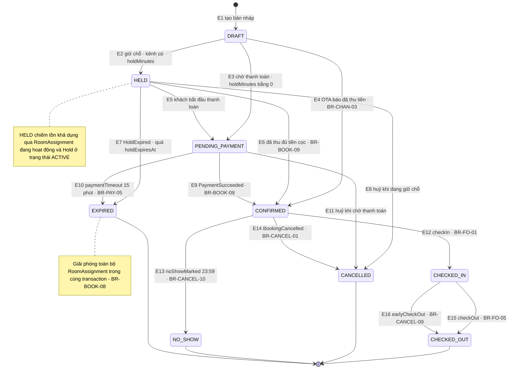

### 2.2. Bảng chuyển trạng thái chi tiết

| Mã | Từ trạng thái | Sự kiện | Điều kiện | Trạng thái đích | Hành động phát sinh | Mã BR |
|----|---------------|---------|-----------|-----------------|---------------------|-------|
| E1 | `[*]` | Tạo booking | Đủ trường bắt buộc; `checkIn` không ở quá khứ và không xa quá 365 ngày | `DRAFT` | Sinh `Booking.code`, ghi `BookingStatusHistory`, `AuditLog` | BR-BOOK-01, BR-BOOK-02, BR-GEN-06, BR-GEN-07 |
| E2 | `DRAFT` | Giữ chỗ | `channel.holdMinutes > 0` và còn tồn khả dụng cho mọi đêm | `HELD` | Tạo `RoomAssignment` cho từng đêm, tạo `Hold` (`status = ACTIVE`) với `holdExpiresAt` = thời điểm tạo + `holdMinutes`, lưu `PriceSnapshot` (`kind = ORIGINAL`) | BR-BOOK-07, BR-INV-02, BR-RATE-16 |
| E3 | `DRAFT` | Chờ thanh toán | `channel.holdMinutes = 0` và phương thức không phải `OTA_COLLECT` | `PENDING_PAYMENT` | Giữ `RoomAssignment`, tạo `Payment` ở trạng thái `PENDING`, lưu `PriceSnapshot` (`kind = ORIGINAL`) | BR-BOOK-07, BR-PAY-03, BR-RATE-16 |
| E4 | `DRAFT` | OTA đẩy booking vào qua webhook | `PaymentMethod = OTA_COLLECT` và OTA báo đã thu tiền; **miễn trừ** điều kiện `overbookLimitPct` (BR-CHAN-03), cho phép tạo kể cả khi tồn khả dụng bằng 0 | `CONFIRMED` | Đặt `oversold = true` nếu không còn phòng vật lý; mở `OverbookingCase`; phát **`BookingConfirmed`** | BR-CHAN-03, BR-OVER-01, BR-OVER-02, BR-OVER-03 |
| E5 | `HELD` | Khách bắt đầu thanh toán | `hold` chưa hết hạn; `Payment` tạo mới ở `PENDING` | `PENDING_PAYMENT` | Giữ nguyên `RoomAssignment`; chưa giải phóng `Hold` | BR-BOOK-07, BR-PAY-05 |
| E6 | `HELD` | Đã thu đủ tiền cọc (ghi nhận tại quầy hoặc chuyển khoản) | `paidAmount ≥ depositAmount`; hoặc giao dịch dùng `PaymentMethod = OTA_COLLECT`; hoặc `MANAGER`+ cho phép ghi nợ có lý do | `CONFIRMED` | Giữ `PriceSnapshot` đã lưu khi rời `DRAFT` (bất biến, kèm `engineVersion`); `Hold.status = RELEASED`; phát **`BookingConfirmed`** | BR-BOOK-09, BR-RATE-16 |
| E7 | `HELD` | **`HoldExpired`** do scheduler ACT-11 quét mỗi 30 giây | `now > holdExpiresAt`; xử lý trong vòng 60 giây | `EXPIRED` | Giải phóng mọi `RoomAssignment`; `Hold.status = EXPIRED` trong cùng transaction | BR-BOOK-08, BR-INV-04, BR-SYS-02 |
| E8 | `HELD` | Yêu cầu huỷ | Tra bậc `CancellationTier` theo `hoursBeforeCheckIn`; không có bất khả kháng | `CANCELLED` | Tính hoàn theo `paidAmount`; giải phóng `RoomAssignment`; phát **`BookingCancelled`**; mở `RefundRequest` nếu tiền hoàn lớn hơn 0 | BR-BOOK-11, BR-CANCEL-01, BR-CANCEL-04 |
| E9 | `PENDING_PAYMENT` | **`PaymentSucceeded`** từ cổng thanh toán | Callback idempotent theo `idempotencyKey`; callback gửi lại cùng khoá đã xử lý trả `E_PAY_CALLBACK_DUPLICATE` và **không** tạo `Payment` mới; `paidAmount ≥ depositAmount`, hoặc `PaymentMethod = OTA_COLLECT`, hoặc `MANAGER`+ cho phép ghi nợ | `CONFIRMED` | Giữ `PriceSnapshot` đã lưu kèm `engineVersion`; phát **`BookingConfirmed`**; gửi thông báo xác nhận | BR-PAY-03, BR-BOOK-09, BR-RATE-16 |
| E10 | `PENDING_PAYMENT` | Hết hạn giao dịch | Quá 15 phút không có callback, hoặc `holdExpiresAt` đã qua | `EXPIRED` | Chuyển `Payment` sang `FAILED`; giải phóng `RoomAssignment`; `Hold.status = RELEASED` hoặc `EXPIRED` | BR-PAY-05, BR-BOOK-08 |
| E11 | `PENDING_PAYMENT` | Yêu cầu huỷ | Khách hoặc nhân viên huỷ khi chưa thu được tiền; `refundBase = paidAmount` | `CANCELLED` | Tính hoàn trên phần đã trả; giải phóng `RoomAssignment`; phát **`BookingCancelled`** | BR-CANCEL-04, BR-BOOK-11 |
| E12 | `CONFIRMED` | Check-in tại quầy | `penaltyAmount + balanceDue = 0`; hoặc cho phép ghi nợ khi nợ ≤ `deal.threshold.checkInDebt` **và** ≤ `checkInDebtPct` của `totalAmount` do `MANAGER`+ duyệt, vượt cả hai ngưỡng phải `OWNER` duyệt; ngày VN hiện tại = ngày `checkIn`; không quá 23:59 ngày nhận phòng | `CHECKED_IN` | Gán phòng vật lý, đánh dấu khách đã tới nơi; ghi `AuditLog` kèm lý do và hạn thu của khoản nợ | BR-FO-01, BR-FO-02, BR-SYS-02 |
| E13 | `CONFIRMED` | Scheduler ghi no-show lúc 23:59 ngày nhận phòng | Booking còn `CONFIRMED` và chưa check-in | `NO_SHOW` | Áp bậc cuối của chính sách: hoàn 0%, tạo `Payment` loại `PENALTY` ở `PENDING` nếu bậc quy định phụ thu đêm đầu; giải phóng `RoomAssignment` | BR-CANCEL-10, BR-CANCEL-06 |
| E14 | `CONFIRMED` | **`BookingCancelled`** | Có yêu cầu huỷ hợp lệ; `cancelReason` thuộc `CancelReason`; nếu huỷ theo chính sách kênh ngoài thì `cancelReason = OTA_CANCELLATION`, lưu `channelPolicyCode` và **không** áp bậc hoàn của BR-CANCEL; huỷ **một phần** phòng thì booking **không** đổi trạng thái, chỉ giảm `totalAmount` và lưu `PriceSnapshot` mới `kind = PARTIAL_CANCEL` theo BR-CANCEL-19 | `CANCELLED` | Tính hoàn theo bậc; ghi `cancelledAt`, `cancelReason`, `channelPolicyCode`; giải phóng `RoomAssignment` trong cùng transaction | BR-CANCEL-01, BR-CANCEL-05, BR-BOOK-11, BR-CHAN-04 |
| E15 | `CHECKED_IN` | Check-out | `balanceDue` chốt về 0; số dư và phụ thu đã thu hoặc `MANAGER`+ cho phép ghi nợ | `CHECKED_OUT` | Tạo `HousekeepingTask`; tích điểm và cập nhật hạng khách; ghi thời điểm trả phòng thực tế | BR-FO-05, BR-FO-06, BR-CRM-03 |
| E16 | `CHECKED_IN` | Trả phòng sớm | Ngưỡng lấy từ `CancellationPolicy.earlyCheckoutFreeHours` và `earlyCheckoutRefundPct` (dữ liệu hoá, không hard-code trong `CancellationPolicyEngine`): `FLEX7`/`SAVER3` 72 giờ → 50%, `LONGSTAY14` 168 giờ → 50%, `NONREF` → 0%; cơ sở tính là `min(paidAmount, tổng giá các đêm chưa ở theo PriceSnapshot)`; báo trước dưới ngưỡng → 0% | `CHECKED_OUT` | Mở `RefundRequest` với lý do `EARLY_CHECKOUT` nếu tiền hoàn lớn hơn 0; tạo `HousekeepingTask` | BR-CANCEL-09, BR-FO-06 |

### 2.3. Chuyển đổi bị cấm và bất biến vòng đời

| Chuyển đổi bị cấm | Lý do | Mã BR |
|-------------------|-------|-------|
| `DRAFT`/`HELD` **chưa phát sinh thanh toán** → xoá cứng | Được phép xoá cứng vì chưa `CONFIRMED` và chưa có `Payment`; PHẢI ghi `AuditLog` với `beforeJson` đầy đủ **trước khi** xoá và giải phóng `RoomAssignment` cùng `Hold`, nên **không** có trạng thái đích | BR-BOOK-17, BR-BOOK-14, BR-BOOK-11 |
| `DRAFT`/`HELD` **đã phát sinh thanh toán** → xoá cứng | Đã có `Payment` thì cấm xoá cứng; phải chuyển `CANCELLED` và mở `RefundRequest` cho phần đã trả | BR-BOOK-14, BR-CANCEL-04 |
| `CONFIRMED` → xoá cứng | Cấm xoá vĩnh viễn; chỉ chuyển sang `CANCELLED` | BR-BOOK-14 |
| `CHECKED_IN` → `CANCELLED` | Đã nhận phòng thì không huỷ; kết thúc bằng `CHECKED_OUT` | BR-BOOK-13 |
| `NO_SHOW` → `CHECKED_IN` | Check-in sau 23:59 ngày nhận phòng bị từ chối | BR-FO-02 |
| `CANCELLED`, `EXPIRED`, `NO_SHOW`, `CHECKED_OUT` → `CHECKED_IN` | Trạng thái kết thúc và booking đã đóng; muốn quay lại phải tạo booking mới | BR-BOOK-14, BR-BOOK-13 |
| Bất kỳ → `HELD` | `HELD` chỉ đến từ `DRAFT`; không tái sử dụng trạng thái giữ chỗ | BR-BOOK-07 |

| Bất biến vòng đời | Nội dung | Mã BR |
|-------------------|----------|-------|
| BĐ-01 | Mỗi bộ ba `(roomId, bedNo, đêm)` có tối đa **1** `RoomAssignment` đang hoạt động; `bedNo = 0` nghĩa là cả phòng, `1..bedCount` là giường cụ thể của DOR; vi phạm bị CSDL từ chối mã `23P01` và PHẢI được chuyển thành `E_INV_ROOM_TAKEN` (HTTP 409), phân biệt với `E_INV_NO_AVAILABILITY` khi hết phòng ở tầng nghiệp vụ | BR-INV-03, BR-INV-07 |
| BĐ-02 | `EXPIRED` và `CANCELLED` giải phóng mọi `RoomAssignment` trong **cùng transaction** với đổi trạng thái | BR-BOOK-08, BR-BOOK-11 |
| BĐ-03 | `CONFIRMED` chỉ đạt được khi `paidAmount ≥ depositAmount`, trừ giao dịch có `PaymentMethod = OTA_COLLECT` hoặc được `MANAGER`+ cho phép ghi nợ | BR-BOOK-09 |
| BĐ-04 | `PriceSnapshot` chỉ ghi một lần khi vào `CONFIRMED`; giá đã chốt không đổi vì cấu hình sau đó | BR-RATE-16 |
| BĐ-05 | Tổng hoàn luỹ kế của một booking không vượt `paidAmount` | BR-PAY-07, BR-CANCEL-17 |

### 2.4. Truy vết trạng thái không tới được

| Trạng thái | Đường tới hợp lệ | Kết luận |
|------------|------------------|----------|
| `DRAFT` | Trạng thái khởi tạo E1 | Tới được |
| `HELD` | E2 | Tới được |
| `PENDING_PAYMENT` | E3, E5 | Tới được |
| `CONFIRMED` | E4, E6, E9 | Tới được |
| `CHECKED_IN` | E12 | Tới được |
| `CHECKED_OUT` | E15, E16 | Tới được |
| `CANCELLED` · `NO_SHOW` · `EXPIRED` | E8, E11, E14 · E13 · E7, E10 | Tới được |

Không có trạng thái mồ côi và không có chuyển đổi trỏ tới `[*]` từ trạng thái không kết thúc.

---

## 3. Máy trạng thái `RefundRequest`

Trạng thái dùng đúng enum `RefundStatus = PENDING | APPROVED | REJECTED | PAID | CANCELLED`. Hoàn tiền **chỉ** được chi khi yêu cầu ở `APPROVED` (BR-CANCEL-16).

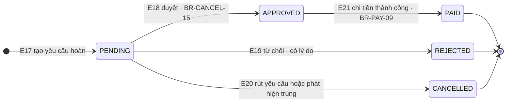

| Mã | Từ | Sự kiện | Điều kiện | Đích | Hành động phát sinh | Mã BR |
|----|----|---------|-----------|------|---------------------|-------|
| E17 | `[*]` | Yêu cầu hoàn cọc | Booking `CANCELLED`/`NO_SHOW`/`CHECKED_OUT` có `paidAmount > 0`, hoặc ca walk-out, hoặc bất khả kháng do `MANAGER`+ tạo có lý do và đính kèm `evidenceRefs` | `PENDING` | Lưu `hoursBeforeCheckIn`, `appliedTierId`, `refundPercent`, `requestedAmount`; ghi `AuditLog` | BR-CANCEL-01, BR-CANCEL-03, BR-CANCEL-05, BR-CANCEL-13 |
| E18 | `PENDING` | Duyệt hoàn tiền | Người duyệt **khác** người tạo; vai trò từ `MANAGER` trở lên; mức trên 5.000.000 VND bắt buộc `MANAGER` khác người tạo hoặc `OWNER` | `APPROVED` | Ghi `approvedBy`, `approvedAmount`, `decidedAt`; `AuditLog` kèm lý do | BR-CANCEL-15, BR-RBAC-03, BR-CANCEL-16 |
| E19 | `PENDING` | Từ chối | Hồ sơ không hợp lệ, sai bậc mốc, hoặc khách không đủ điều kiện; bắt buộc có lý do, `RefundRequest.reason` thuộc enum `CancelReason` | `REJECTED` | Ghi `decidedAt`, `reason`; `AuditLog`; thông báo cho khách | BR-CANCEL-16, BR-SYS-05 |
| E20 | `PENDING` | Huỷ yêu cầu | Khách rút yêu cầu, hoặc booking được khôi phục; chỉ người tạo hoặc `MANAGER`+ thực hiện, phải ghi lý do; đã `APPROVED` hoặc `PAID` thì **không** được huỷ | `CANCELLED` | Ghi lý do và người thực hiện; `AuditLog`; không tạo bút toán | BR-CANCEL-18, BR-SYS-05 |
| E21 | `APPROVED` | Chi hoàn tiền | Cổng hoặc quầy xác nhận chi thành công; tổng hoàn luỹ kế của booking không vượt `paidAmount`; hoàn về phương thức gốc | `PAID` | Tạo `Payment` loại `REFUND` trạng thái `SUCCEEDED`; ghi `paidAt`; tăng `Booking.refundedAmount`; thông báo kết quả hoàn tiền cho khách | BR-PAY-07, BR-PAY-08, BR-PAY-09, BR-CANCEL-12 |

| Ràng buộc bổ sung | Nội dung | Mã BR |
|-------------------|----------|-------|
| RB-01 | Huỷ do bất khả kháng đặt `isForceMajeure = true`, lưu `evidenceRefs` cho minh chứng, hoàn 100% `paidAmount`, miễn phụ thu và miễn phí xử lý | BR-CANCEL-13 |
| RB-02 | Phí xử lý hoàn tiền mặc định 0, cấu hình qua `SystemSetting`, trừ vào tiền hoàn chứ không thu thêm khách | BR-CANCEL-11, BR-SYS-02 |
| RB-03 | Cam kết chi trong 3 ngày làm việc, tối đa 7 ngày kể từ khi `APPROVED` | BR-CANCEL-12 |
| RB-04 | Đổi ngày **không** tạo `RefundRequest` | BR-CANCEL-08 |
| RB-05 | `NONREF` không bao giờ hoàn tiền ở mọi mốc | BR-CANCEL-07 |
| RB-06 | Chỉ người tạo hoặc `MANAGER`+ được huỷ yêu cầu ở `PENDING`; cấm huỷ sau khi đã `APPROVED` hoặc `PAID` | BR-CANCEL-18 |

---

## 4. Máy trạng thái `OverbookingCase`

Trạng thái dùng đúng enum `OverbookingCaseStatus = OPEN | PROPOSED | RESOLVED | ESCALATED` tại [00 §7.8](../00-tong-quan.md). Case PHẢI `RESOLVED` trước `T−24h`.

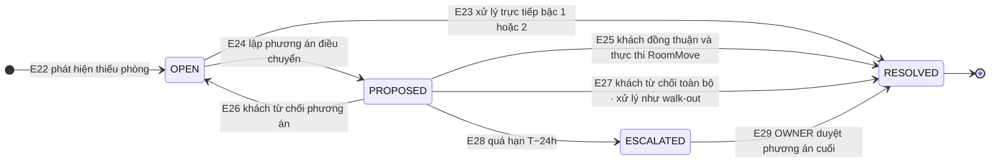

| Mã | Từ | Sự kiện | Điều kiện | Đích | Hành động phát sinh | Mã BR |
|----|----|---------|-----------|------|---------------------|-------|
| E22 | `[*]` | Phát hiện quá tải | Booking tạo khi không còn phòng vật lý, hoặc job quét mỗi giờ trên 30 ngày tới, hoặc `RoomBlock` chồng lấn `RoomAssignment` | `OPEN` | Gộp trùng theo `(propertyId, date, roomTypeId)`; tính `shortageCount`; ghi `detectedAt` | BR-OVER-03, BR-OVER-05, BR-INV-06 |
| E23 | `OPEN` | Xử lý trực tiếp | Còn phòng cùng loại cùng cơ sở, hoặc phòng hạng cao hơn có sức chứa đủ, không cần khách đồng thuận | `RESOLVED` | Tạo `RoomMove` bậc 1 hoặc 2 với `priceLocked = true`; hoàn tất trong cùng ngày xử lý | BR-OVER-08 |
| E24 | `OPEN` | Lập phương án điều chuyển | Đã tính `keepScore` cho mọi booking bị ảnh hưởng và chọn được bậc theo thang **khả dụng 1 → 2 → 4**; bậc 3 (cơ sở khác ≤ 15 km) hiện không khả dụng vì ba cơ sở cách nhau 160–300 km | `PROPOSED` | Tạo `RoomMove` với `status = PROPOSED`; gửi đề nghị tới khách và lấy đồng thuận bằng văn bản nếu có bồi thường | BR-OVER-11, BR-OVER-07, BR-OVER-10 |
| E25 | `PROPOSED` | Khách đồng thuận và thực thi | Khách xác nhận; `MANAGER`+ đã duyệt nếu có bồi thường hoặc chi phí đưa đón; `RoomMove.status` chuyển `APPROVED` rồi `EXECUTED` | `RESOLVED` | Giải phóng `RoomAssignment` cũ, tạo `RoomAssignment` mới; đặt `priceLocked = true`; ghi `compensationAmount`, `transportCost`; phát **`RoomMoveExecuted`**; thông báo trong 15 phút | BR-OVER-06, BR-OVER-07, BR-OVER-08, BR-OVER-10 |
| E26 | `PROPOSED` | Khách từ chối phương án | Vẫn còn bậc xử lý chưa thử trong thang khả dụng | `OPEN` | Đặt `RoomMove.status = REJECTED` hoặc `CANCELLED`, ghi lý do; quay lại chọn bậc kế tiếp | BR-OVER-11 |
| E27 | `PROPOSED` | Khách từ chối toàn bộ phương án | Không còn phương án nào được chấp nhận, hoặc hết các bậc khả dụng 1 → 2 → 4 sau khi loại bậc 3 | `RESOLVED` | Xử lý như walk-out: hoàn 100% `paidAmount`, bồi thường 1 đêm đầu, hỗ trợ tìm chỗ ở thay thế; phát **`RoomMoveExecuted`** với `moveType = WALK_OUT` | BR-CANCEL-14, BR-OVER-06 |
| E28 | `PROPOSED` | Quá hạn `T−24h`, hoặc **ngày thiếu phòng đã trôi qua** | Case còn ở `OPEN`/`PROPOSED`/`ESCALATED` chưa `RESOLVED` trước `T−24h` hoặc khi ngày bị thiếu phòng đã qua | `ESCALATED` | Leo thang cho `OWNER`; xử lý như sự cố tại chỗ theo thang §9.2 hoặc walk-out; ghi `OverbookingCase.delayReason`, giữ `detectedAt` và người xử lý cho báo cáo UC-REP-04; case quá hạn **không** được tự động đóng | BR-OVER-16, BR-OVER-04 |
| E29 | `ESCALATED` | `OWNER` duyệt phương án cuối | Chọn bậc còn khả thi hoặc walk-out; bồi thường do `MANAGER`+ duyệt | `RESOLVED` | Thực thi như E25 hoặc E27; ghi `resolvedAt`, `resolvedBy` | BR-OVER-04, BR-OVER-06, BR-RBAC-03 |

| Ràng buộc bổ sung | Nội dung | Mã BR |
|-------------------|----------|-------|
| RO-01 | Chỉ được bán vượt khi kênh có `overbookAllowed` và `overbookLimitPct > 0`; trần theo cơ sở = `ceil(số phòng ACTIVE × pct/100)` và **tối thiểu 1** khi `pct > 0`; trần toàn chuỗi = tổng trần theo cơ sở, không tính `ceil` trên tổng 55 phòng | BR-OVER-02, BR-RBAC-03 |
| RO-02 | Khách `CHECKED_IN` không được điều chuyển, trừ bất khả kháng và phải `MANAGER`+ duyệt | BR-OVER-09 |
| RO-03 | Thứ tự chọn khách điều chuyển: `keepScore` tăng dần, rồi `createdAt` giảm dần, rồi `bookingId` tăng dần | BR-OVER-11 |
| RO-04 | Booking `WALKIN` chưa đóng tiền và booking `HELD` không bao giờ ưu tiên hơn booking đã cọc | BR-OVER-12 |
| RO-05 | Mọi `RoomMove` đặt `priceLocked = true` và phải ghi `AuditLog` | BR-OVER-08, BR-OVER-10, BR-GEN-07 |
| RO-06 | Case quá hạn hoặc quá ngày vẫn PHẢI đi hết thang §9.2 hoặc walk-out trước khi `RESOLVED`; cấm tự động đóng | BR-OVER-16 |

---

## 5. Sơ đồ hoạt động

### 5.1. Tìm và đặt phòng trên web

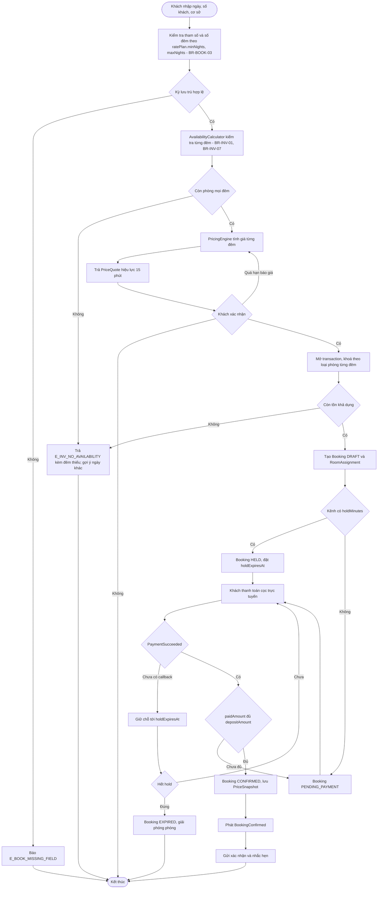

Ràng buộc của bước báo giá (BR-RATE-01, BR-RATE-02, BR-RATE-06, BR-RATE-12, BR-RATE-13, BR-RATE-15): giá cơ bản tra `RateCalendar` theo `priority` giảm dần `OVERRIDE` 100, `RATE_PLAN` 90, `SEASON` 50, `BASE` 10 khớp `(roomTypeId, date, channelCode)`, phá hoà bằng dòng khai `channelCode` cụ thể rồi `createdAt` nhỏ hơn rồi `id` tăng dần; hệ số công suất đọc từ dòng tổng hợp cấp cơ sở của `OccupancySnapshot` theo ngưỡng cấu hình `pricing.occupancyMidPct` và `pricing.occupancyHighPct`, snapshot cũ hơn 5 phút thì dùng `1,00`; khuyến mãi áp theo thứ tự tất định `AMOUNT` trước rồi `PERCENT`; `E_RATE_BELOW_FLOOR` có hai ngữ cảnh — chặn 422 khi quản lý áp khuyến mãi ở màn hình cấu hình, còn khi báo giá trực tuyến thì chỉ là cảnh báo trong `PriceQuote.warnings[]` kèm bỏ mã và giữ giá gốc nhưng vẫn cho xác nhận; `LONGSTAY14` PHẢI có giá riêng qua `RatePlan.fixedNightlyPrice` hoặc dòng `RateCalendar` nguồn `RATE_PLAN` (BR-RATE-19), nếu không hệ thống cảnh báo cấu hình vì gói sẽ trùng giá `FLEX7`; `PriceQuote` quá 15 phút phải tính lại.

### 5.2. Tạo booking tại quầy cho khách vãng lai

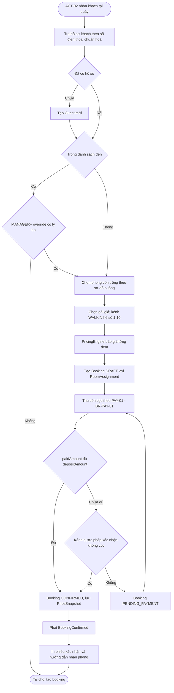

### 5.3. Giữ chỗ và hết hạn

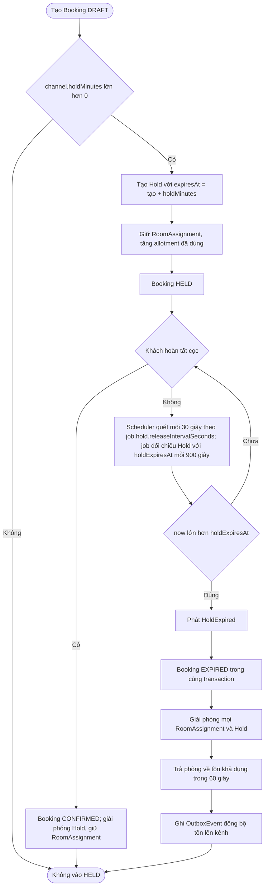

### 5.4. Huỷ booking và hoàn cọc

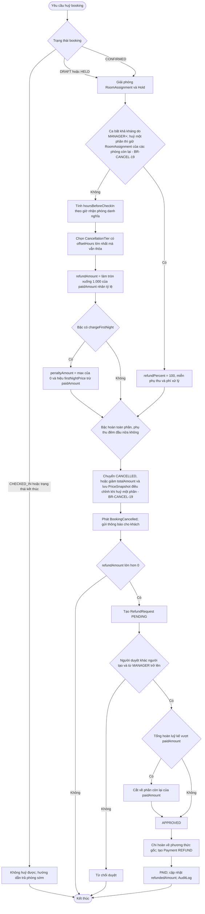

### 5.5. Phát hiện và xử lý quá tải

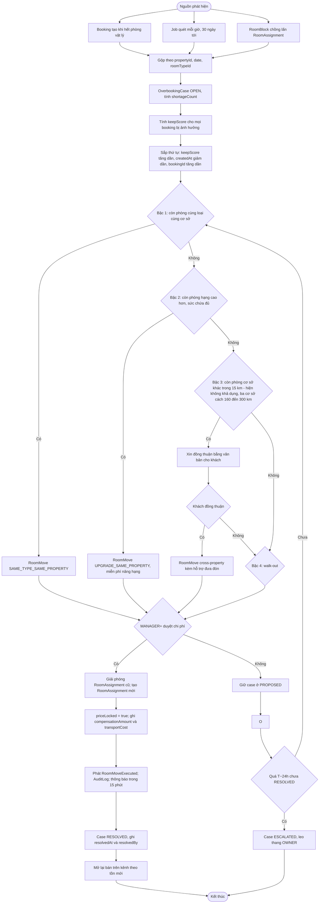

### 5.6. Check-in

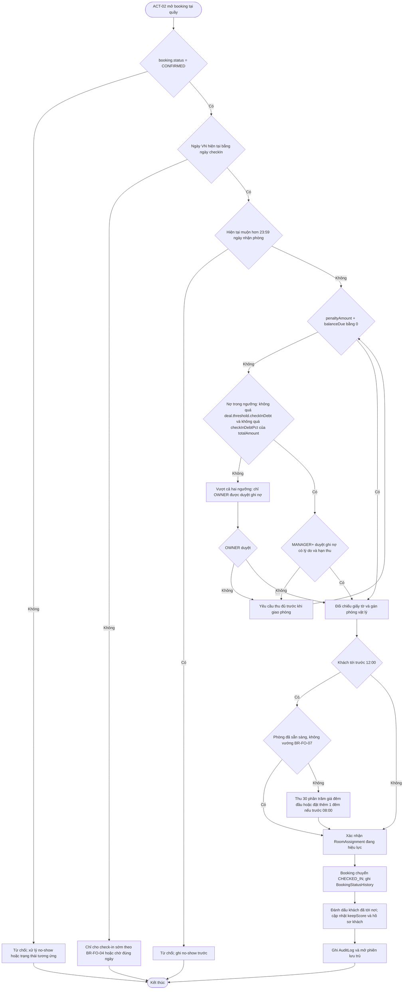

---

## 6. Sơ đồ tuần tự mức phân tích

Chỉ thể hiện đối tượng miền và lớp ca sử dụng; thứ tự gọi ở mức khái niệm, không ràng buộc kỹ thuật triển khai.

### 6.1. Luồng đặt phòng

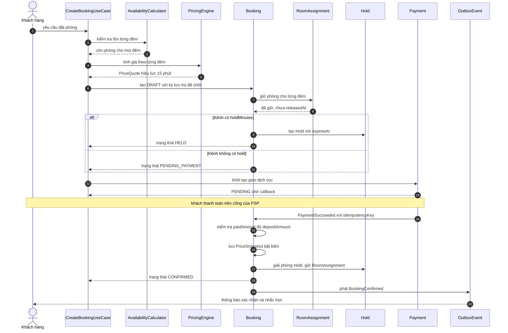

### 6.2. Luồng huỷ booking

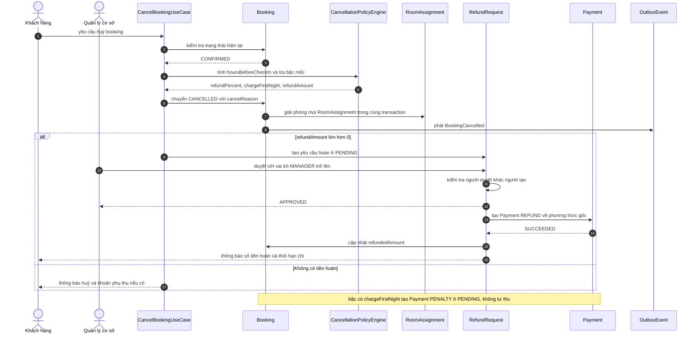

### 6.3. Luồng điều chuyển phòng khi quá tải

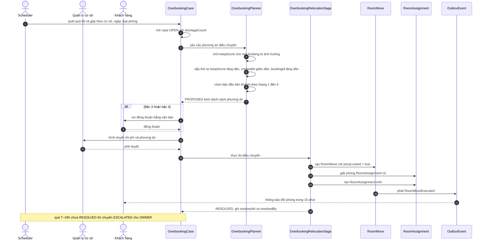

---

## 7. Bảng sự kiện miền

Sự kiện phát qua **Outbox** trong cùng transaction với thao tác ghi, bảo đảm không mất sự kiện khi tiến trình chết (BR-CHAN-06).

| Sự kiện | Nguồn phát | Bên lắng nghe | Hành động | Tính bất đồng bộ |
|---------|-----------|---------------|-----------|------------------|
| **`BookingConfirmed`** | `Booking` qua `CreateBookingUseCase` khi vào `CONFIRMED` (E4, E6, E9) | `NotificationService` | Gửi email xác nhận và nhắc hẹn theo mẫu NOTI-01 | Bất đồng bộ, gửi lại tối đa 3 lần cách nhau 5 phút |
| **`BookingConfirmed`** | Như trên | `ChannelSyncService` | Giảm allotment còn lại của kênh, phát bản ghi outbox đồng bộ tồn lên OTA | Bất đồng bộ, tối đa 5 phút |
| **`BookingConfirmed`** | Như trên | `ReportingService` | Cập nhật chỉ số công suất và doanh thu dự kiến theo kênh | Bất đồng bộ |
| **`BookingCancelled`** | `Booking` qua `CancelBookingUseCase` (E8, E11, E14) | `InventoryService` | Giải phóng `RoomAssignment` và trả phòng về tồn khả dụng | Đồng bộ trong cùng transaction với đổi trạng thái |
| **`BookingCancelled`** | Như trên | `RefundService` | Mở `RefundRequest` ở `PENDING` nếu tiền hoàn lớn hơn 0; bất khả kháng đặt `isForceMajeure = true` | Bất đồng bộ |
| **`BookingCancelled`** | Như trên | `NotificationService` | Thông báo huỷ, số tiền hoàn và thời hạn chi theo NOTI-02 | Bất đồng bộ |
| **`BookingCancelled`** | Như trên | `ChannelSyncService` | Đồng bộ lại tồn lên kênh đang mở bán | Bất đồng bộ, tối đa 5 phút |
| **`HoldExpired`** | Scheduler ACT-11 khi `now > holdExpiresAt` (E7) | `InventoryService` | Giải phóng toàn bộ `RoomAssignment` và `Hold` trong cùng transaction | Đồng bộ trong transaction xử lý hết hạn |
| **`HoldExpired`** | Như trên | `ChannelSyncService` | Trả phòng về tồn và đồng bộ lên mọi kênh đang mở bán | Bất đồng bộ, tối đa 5 phút |
| **`HoldExpired`** | Như trên | `NotificationService` | Thông báo giữ chỗ đã hết hạn nếu khách đã để lại liên hệ | Bất đồng bộ |
| **`PaymentSucceeded`** | `Payment` qua callback cổng thanh toán theo `idempotencyKey` (gửi lặp trả `E_PAY_CALLBACK_DUPLICATE`) | `BookingService` | Cộng `paidAmount` một lần duy nhất; kiểm tra `paidAmount ≥ depositAmount` để chuyển `CONFIRMED` | Đồng bộ trong transaction xử lý callback |
| **`PaymentSucceeded`** | Như trên | `NotificationService` | Gửi biên nhận cọc cho khách | Bất đồng bộ |
| **`PaymentSucceeded`** | Như trên | `ReportingService` | Cập nhật dòng tiền thu theo kênh và phương thức | Bất đồng bộ |
| **`PaymentSucceeded`** | Như trên | `AuditService` | Ghi nhật ký giao dịch, không lưu dữ liệu thẻ | Đồng bộ |
| **`RoomMoveExecuted`** | `RoomMove` qua `OverbookingService` và `OverbookingRelocationSaga` (E25, E27) | `InventoryService` | Giải phóng phòng cũ, tạo `RoomAssignment` mới giữ nguyên giá | Đồng bộ trong transaction thực thi |
| **`RoomMoveExecuted`** | Như trên | `NotificationService` | Thông báo phòng mới, chi phí hỗ trợ và bồi thường trong 15 phút | Bất đồng bộ, có ràng buộc thời hạn |
| **`RoomMoveExecuted`** | Như trên | `OverbookingService` | Chuyển `OverbookingCase` sang `RESOLVED`; ghi `resolvedAt`, `resolvedBy` | Đồng bộ |
| **`RoomMoveExecuted`** | Như trên | `ReportingService` | Cập nhật báo cáo quá tải và chi phí xử lý theo cơ sở | Bất đồng bộ |
| **`RoomMoveExecuted`** | Như trên | `AuditService` | Ghi nhật ký kèm `keepScore`, `moveType`, giá trị bồi thường | Đồng bộ |

Nguyên tắc chung: bên lắng nghe **không** được ném lỗi làm hỏng transaction nghiệp vụ đã hoàn tất; lỗi xử lý bất đồng bộ ghi lại và thử lại, đồng bộ thất bại 3 lần liên tiếp thì trả `E_CHAN_SYNC_FAILED`, đặt `Channel.syncStatus = DEGRADED` và cảnh báo `MANAGER` theo BR-CHAN-07; các chỉ số mà bên lắng nghe báo cáo (ADR, RevPAR, công suất, tỷ lệ huỷ, chi phí xử lý quá tải) PHẢI dùng đúng định nghĩa duy nhất ở BR-REP-01, DOR đếm theo đơn vị bán là giường.

---

## 8. Ma trận trạng thái × hành động

Bảng dùng làm **bảng kiểm thử tính hợp lệ của chuyển trạng thái**: mọi ô `✖` PHẢI bị từ chối, mọi ô `~` PHẢI kiểm tra đủ điều kiện ở bảng 8.2.

Ký hiệu: `✔` được phép · `~` có điều kiện · `✖` bị cấm. Cột `Đổi ngày` **không** làm đổi trạng thái booking (BR-BOOK-12): giữ nguyên trạng thái, giữ `PriceSnapshot` cũ, chỉ ghi `AuditLog`. Cột `Huỷ`: booking `roomCount > 1` có thể huỷ **một phần** — giữ trạng thái hiện tại, giảm `totalAmount`, giải phóng `RoomAssignment` của phòng bị huỷ và lưu `PriceSnapshot` điều chỉnh; huỷ hết phòng mới chuyển `CANCELLED` (BR-CANCEL-19).

### 8.1. Ma trận

| Trạng thái | Sửa booking | Đổi ngày | Huỷ | Xoá cứng | Check-in | Check-out | Đổi phòng | Thu tiền | Ghi no-show |
|------------|-------------|----------|-----|----------|----------|-----------|-----------|----------|-------------|
| `DRAFT` | ✔ | ~ | ~ | ~ | ✖ | ✖ | ✖ | ✔ | ✖ |
| `HELD` | ✔ | ~ | ~ | ~ | ✖ | ✖ | ~ | ✔ | ✖ |
| `PENDING_PAYMENT` | ✔ | ~ | ~ | ✖ | ✖ | ✖ | ~ | ✔ | ✖ |
| `CONFIRMED` | ✔ | ~ | ✔ | ✖ | ✔ | ✖ | ✔ | ✔ | ✔ |
| `CHECKED_IN` | ~ | ✖ | ✖ | ✖ | ✖ | ✔ | ~ | ✔ | ✖ |
| `CHECKED_OUT` | ✖ | ✖ | ✖ | ✖ | ✖ | ✖ | ✖ | ✖ | ✖ |
| `CANCELLED` | ✖ | ✖ | ✖ | ✖ | ✖ | ✖ | ✖ | ~ | ✖ |
| `NO_SHOW` | ✖ | ✖ | ✖ | ✖ | ✖ | ✖ | ✖ | ~ | ✖ |
| `EXPIRED` | ✖ | ✖ | ✖ | ✖ | ✖ | ✖ | ✖ | ✖ | ✖ |

### 8.2. Điều kiện của các ô có điều kiện

| Trạng thái | Hành động | Điều kiện | Mã BR |
|------------|-----------|-----------|-------|
| `DRAFT` | Xoá cứng | Chỉ khi chưa phát sinh `Payment`; đã có thanh toán thì phải chuyển `CANCELLED` và mở `RefundRequest` | BR-BOOK-14 |
| `HELD` | Xoá cứng | Như `DRAFT`, và phải giải phóng `Hold` cùng `RoomAssignment` | BR-BOOK-14, BR-BOOK-11 |
| `DRAFT` | Đổi ngày | 1 lần miễn phí khi còn ≥ 168 giờ với `FLEX7`, `SAVER3`, `LONGSTAY14`; `NONREF` thu phí 10% giá trị booking; chênh lệch tăng thì thu thêm, giảm thì không hoàn; **giữ nguyên trạng thái**, lưu `PriceSnapshot` mới `kind = RESCHEDULE` và giữ bản gốc, ghi `AuditLog`; tăng `Booking.rescheduleCount`, lần đổi thứ hai xử lý như huỷ và đặt mới | BR-BOOK-12, BR-CANCEL-08 |
| `DRAFT` | Huỷ | Giải phóng `RoomAssignment` và `Hold` cùng transaction; hoàn trên `paidAmount` | BR-BOOK-11, BR-CANCEL-04 |
| `HELD` | Đổi ngày | Như `DRAFT`, và `hold` phải còn hiệu lực | BR-BOOK-12, BR-BOOK-07 |
| `HELD` | Huỷ | Huỷ trước khi hết hold; giải phóng `Hold` và `RoomAssignment` | BR-BOOK-11 |
| `HELD` | Đổi phòng | Chỉ bậc 1 hoặc 2 của thang xử lý | BR-OVER-11 |
| `PENDING_PAYMENT` | Đổi ngày | Không khi giao dịch đang chờ callback; quá 15 phút không callback thì giao dịch `FAILED` | BR-PAY-05, BR-BOOK-12 |
| `PENDING_PAYMENT` | Huỷ | Hoàn trên phần đã trả; giao dịch đang chờ phải chuyển `FAILED` | BR-CANCEL-04 |
| `PENDING_PAYMENT` | Đổi phòng | Như `HELD` | BR-OVER-11 |
| `CONFIRMED` | Đổi ngày | Như `DRAFT`; đổi ngày không tạo `RefundRequest` | BR-BOOK-12, BR-CANCEL-08 |
| `CONFIRMED` | Check-in | `penaltyAmount + balanceDue = 0`; hoặc nợ ≤ `deal.threshold.checkInDebt` và ≤ `checkInDebtPct` của `totalAmount` do `MANAGER`+ duyệt, vượt cả hai ngưỡng phải `OWNER` duyệt; ngày VN hiện tại = ngày `checkIn`; không quá 23:59 ngày nhận phòng | BR-FO-01, BR-FO-02, BR-FO-04, BR-SYS-02 |
| `CONFIRMED` | Đổi phòng | Theo thang khả dụng 1 → 2 → 4; bậc 4 walk-out cần `MANAGER`+ duyệt; mọi `RoomMove` đi qua `PROPOSED` rồi `APPROVED` và `EXECUTED` | BR-OVER-06, BR-OVER-07, BR-OVER-11 |
| `CONFIRMED` | Ghi no-show | Chỉ do scheduler lúc 23:59 ngày nhận phòng, khi booking còn `CONFIRMED` và chưa check-in | BR-CANCEL-10 |
| `CHECKED_IN` | Sửa booking | Chỉ sửa thông tin khách và ghi chú; **không** sửa ngày lưu trú | BR-BOOK-13 |
| `CHECKED_IN` | Đổi phòng | Chỉ bất khả kháng như hỏng phòng hoặc lý do an toàn, và phải `MANAGER`+ duyệt | BR-OVER-09 |
| `CHECKED_IN` | Check-out | `balanceDue` chốt về 0; check-out muộn thu 50% hoặc 100% giá đêm cuối; trả phòng sớm hoàn `earlyCheckoutRefundPct` của `min(paidAmount, giá các đêm chưa ở)` khi báo trước đủ `earlyCheckoutFreeHours` của gói giá | BR-FO-05, BR-FO-03, BR-CANCEL-09 |
| `CANCELLED` | Thu tiền | Chỉ thu khoản `PENALTY` đã ghi công nợ ở trạng thái `PENDING` khi bậc có `chargeFirstNight = true` | BR-CANCEL-06 |
| `NO_SHOW` | Thu tiền | Chỉ thu khoản `PENALTY` phụ thu đêm đầu theo bậc cuối của chính sách | BR-CANCEL-10 |

### 8.3. Ca kiểm thử hợp lệ chuyển trạng thái bắt buộc

| # | Đầu vào | Kỳ vọng |
|---|---------|---------|
| 1 | Huỷ booking ở `CHECKED_IN` | Từ chối; không sinh `BookingStatusHistory` | 
| 2 | Check-in booking `EXPIRED` hoặc `NO_SHOW` | Từ chối theo BR-FO-02 |
| 3 | `PENDING_PAYMENT` quá 15 phút không callback | Chuyển `EXPIRED`, `Payment` là `FAILED`, tồn phòng được trả lại |
| 4 | `HELD` có `paidAmount` bằng 0 khi hết hold | Chuyển `EXPIRED`, giải phóng mọi `RoomAssignment` |
| 5 | `CONFIRMED` khi `paidAmount < depositAmount` trên kênh không miễn cọc | Từ chối chuyển trạng thái |
| 6 | Duyệt `RefundRequest` do chính người tạo | Từ chối theo BR-CANCEL-15 |
| 7 | `PENDING` sang `PAID` khi chưa `APPROVED` | Từ chối theo BR-CANCEL-16 |
| 8 | Chi hoàn vượt `paidAmount` luỹ kế của booking | Từ chối theo BR-PAY-07 |
| 9 | `OverbookingCase` ở `PROPOSED` quá `T−24h` | Chuyển `ESCALATED` và leo thang `OWNER` |
| 10 | `RoomMove` sang cơ sở khác thành phố khi khách chưa đồng thuận văn bản | Từ chối theo BR-OVER-07 |
| 11 | Xoá cứng booking `CONFIRMED` | Từ chối theo BR-BOOK-14 |
| 12 | Sửa ngày lưu trú khi `CHECKED_IN` | Từ chối theo BR-BOOK-13 |
| 13 | Huỷ `RefundRequest` đã `APPROVED` hoặc `PAID` | Từ chối theo BR-CANCEL-18; giữ nguyên trạng thái và bút toán |
| 14 | Xoá cứng booking `HELD` đã phát sinh `Payment` | Từ chối theo BR-BOOK-14; chỉ được chuyển `CANCELLED` kèm `RefundRequest` |
| 15 | Check-in với nợ vượt `deal.threshold.checkInDebt` hoặc vượt `checkInDebtPct` của `totalAmount`, chỉ có `MANAGER` duyệt | Từ chối; phải `OWNER` duyệt theo BR-FO-01 |
| 16 | Xoá cứng booking `DRAFT`/`HELD` chưa phát sinh thanh toán | Xoá thành công nhưng PHẢI có `AuditLog` với `beforeJson` đầy đủ theo BR-BOOK-17 |
| 17 | `OverbookingCase` còn `OPEN`/`PROPOSED` khi ngày thiếu phòng đã qua | Chuyển `ESCALATED`, xử lý tại chỗ, giữ `detectedAt` và lý do trễ; **không** tự động đóng theo BR-OVER-16 |
| 18 | Huỷ một phần `BookingRoom` của booking `roomCount > 1` | Booking giữ trạng thái, `totalAmount` giảm, chỉ giải phóng `RoomAssignment` của phòng bị huỷ, hoàn tính theo tỷ lệ giá phòng bị huỷ trên `totalAmount`, có `PriceSnapshot` `kind = PARTIAL_CANCEL` (BR-CANCEL-19) |

---

## 9. Đề xuất bổ sung

Các mục dưới đây **chưa có** trong [00 §7.8](../00-tong-quan.md) và [02/quy tắc nghiệp vụ](../02-nghiep-vu/quy-tac-nghiep-vu.md); đề xuất bổ sung để ma trận truy vết và ca kiểm thử có định danh chính thức.

| # | Định danh đề xuất | Nội dung | Lý do cần |
|---|-------------------|----------|-----------|
| 1 | Biến cố miền chưa có định danh cho việc hoàn tiền đã chi xong | Đề xuất thêm `RefundPaid` để `NotificationService` và `ReportingService` không phải suy diễn từ `BookingCancelled` | §3 E21 và §7 cần tách trách nhiệm rõ ràng |
| 2 | `HoldExpired` mới được định nghĩa cho nhánh `HELD`, nhưng nhánh E10 hết hạn thanh toán ở `PENDING_PAYMENT` cũng giải phóng hold mà không có biến cố riêng | Đề xuất mở rộng định nghĩa `HoldExpired` hoặc thêm `PaymentTimedOut` để §7 không phải suy diễn | §7 hiện chỉ gắn `HoldExpired` cho E7 |

---

## Tham chiếu

- [00 — Tổng quan dự án](../00-tong-quan.md) — enum `BookingStatus`, từ điển thực thể, danh mục UC
- [02 — Quy tắc nghiệp vụ](../02-nghiep-vu/quy-tac-nghiep-vu.md) — BR-BOOK-06 đến BR-BOOK-16, BR-CANCEL, BR-OVER, BR-FO
- [02 — Chính sách huỷ & hoàn cọc](../02-nghiep-vu/chinh-sach-huy-hoan-coc.md) — thang mốc thời gian và bảng quyết định
- [02 — Quá tải, ghép & đổi phòng](../02-nghiep-vu/qua-tai-ghep-doi-phong.md) — thang xử lý, `keepScore`, walk-out
- [02 — Động giá](../02-nghiep-vu/dong-gia.md) — công thức giá theo từng đêm
- [03 — Mô hình miền](mo-hinh-mien.md) — lớp, quan hệ, bất biến tĩnh
- [04 — Thiết kế lớp](../04-thiet-ke/thiet-ke-lop.md) — ánh xạ mẫu thiết kế lên các máy trạng thái này
- [04 — Sequence Diagram](../04-thiet-ke/sequence-diagram.md) — tuần tự mức thiết kế của các UC rủi ro cao
- [04 — Cơ sở dữ liệu](../04-thiet-ke/csdl.md) — ràng buộc loại trừ và chỉ mục phục vụ bất biến BĐ-01
- [01 — Yêu cầu phi chức năng](../01-yeu-cau/yeu-cau-phi-chuc-nang.md) — NFR-REL (giải phóng hold ≤60 giây, đồng bộ kênh ≤5 phút, 0 bán trùng), NFR-OBS-04 (cảnh báo `OverbookingCase` quá `T−24h`), NFR-COMP-03 (toàn vẹn hoàn tiền)
- [05 — Kế hoạch kiểm thử](../05-ke-hoach/ke-hoach-kiem-thu.md) — ca kiểm thử suy ra từ bảng 8.3
- [06 — Ma trận truy vết](../06-truy-vet/ma-tran-truy-vet.md) — BR → UC → API → Entity → Test
