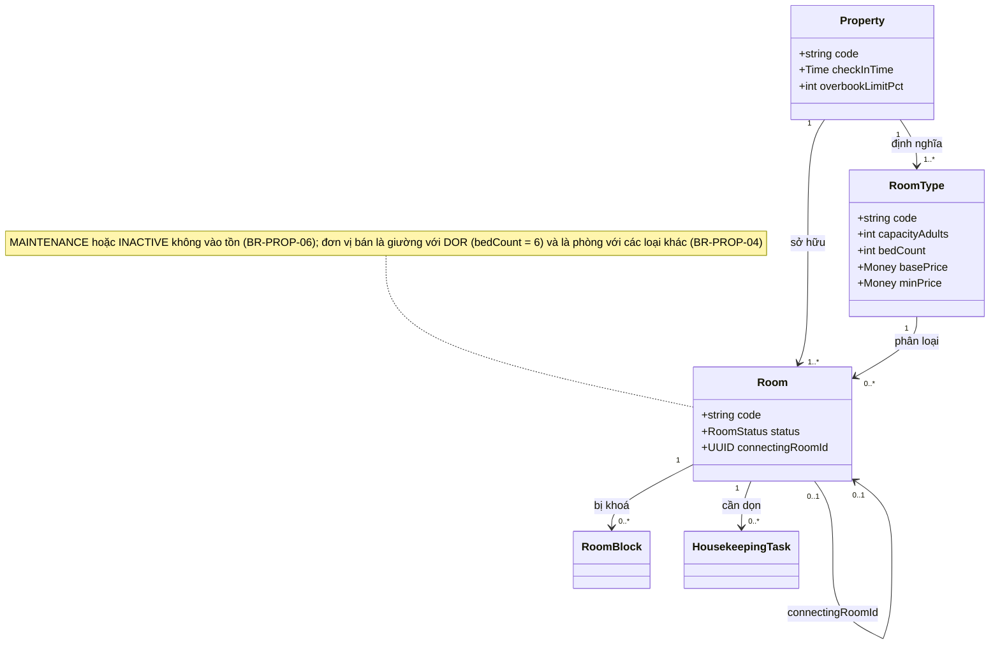
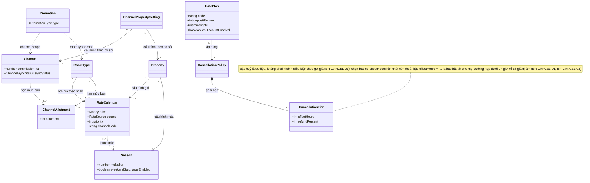
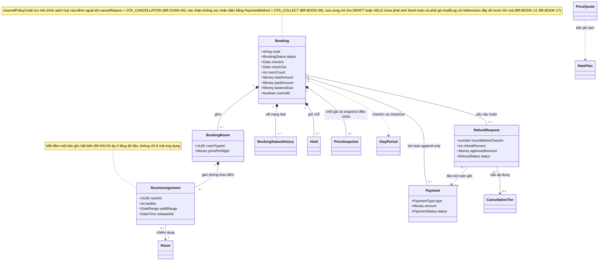
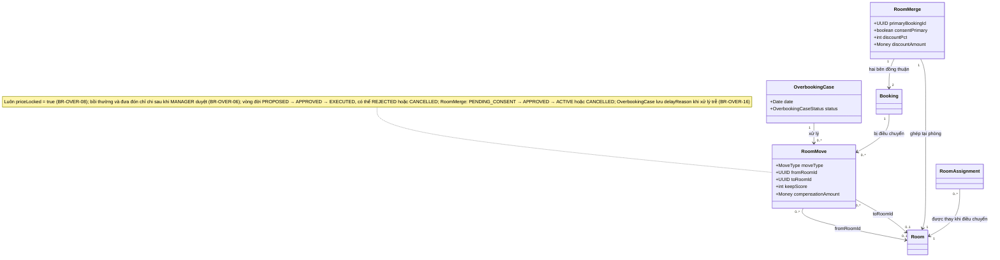
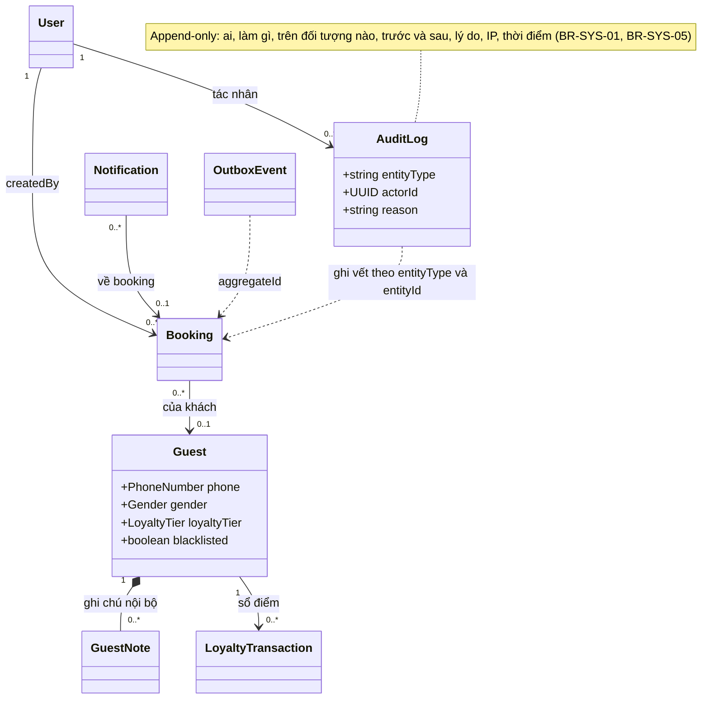
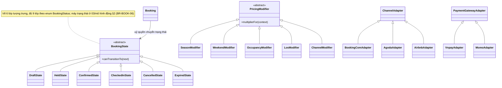
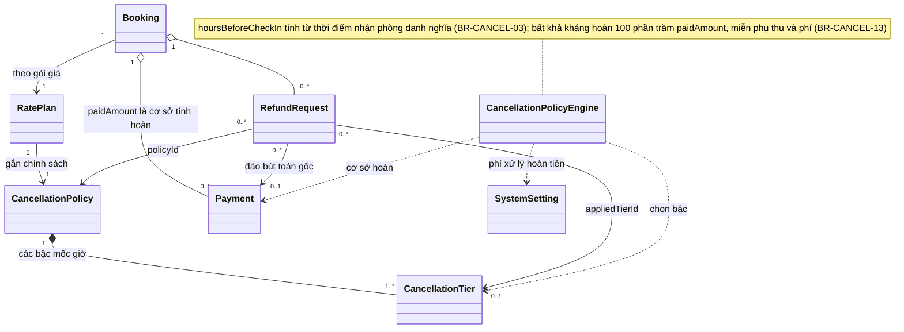
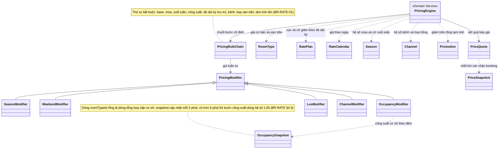
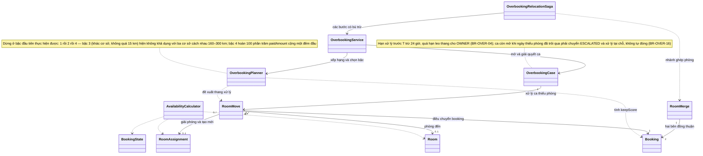

# 03 — Mô hình miền

> Mức **phân tích**: lớp, trách nhiệm, quan hệ, bất biến nghiệp vụ. KHÔNG đi vào chi tiết kỹ thuật (kiểu vật lý, chỉ mục, ORM, hợp đồng API) — phần đó thuộc [04/thiết kế lớp](../04-thiet-ke/thiet-ke-lop.md) và [04/cơ sở dữ liệu](../04-thiet-ke/csdl.md). Mọi quy tắc trong [02/quy tắc nghiệp vụ](../02-nghiep-vu/quy-tac-nghiep-vu.md) phải "cư trú" ở đúng một lớp chịu trách nhiệm. Định danh lớp/thực thể/VO lấy nguyên văn từ [00 §7](../00-tong-quan.md#7-từ-điển-thực-thể-nguồn-chân-lý-về-định-danh); hệ thống có **13 module** và **53 use case**.

---

## 1. Sơ đồ lớp miền

Bảy lát cắt dùng chung một từ điển lớp; mỗi lát cắt chỉ làm nổi bật quan hệ của mình.

### 1.1. Cơ sở – loại phòng – phòng (PROP)

### 1.2. Giá – mùa – kênh – chính sách huỷ (RATE)

### 1.3. Lõi đặt phòng – tồn phòng – thanh toán (BOOK · INV · PAY)

### 1.4. Quá tải – ghép và điều chuyển phòng (OVER)

### 1.5. Khách hàng – nền tảng (CRM · SYS)

### 1.6. Lớp giá trị và lớp dịch vụ miền

```mermaid
classDiagram
  class Money {
    <<Value Object>>
    +int amount
    +string currency
  }
  class StayPeriod {
    <<Value Object>>
    +Date checkIn
    +Date checkOut
  }
  class DateRange {
    <<Value Object>>
    +Date start
    +Date end
  }
  class ChannelContext {
    <<Value Object>>
    +string channelCode
  }
  class PhoneNumber {
    <<Value Object>>
    +string normalized
  }
  class PricingEngine {
    <<Domain Service>>
    +quote(input)
  }
  class CancellationPolicyEngine {
    <<Domain Service>>
    +resolveTier(policy, hoursBeforeCheckIn)
  }
  class AvailabilityCalculator {
    <<Domain Service>>
    +available(roomTypeId, date, channelCode)
  }
  Booking ..> Money
  Booking ..> StayPeriod
  Booking ..> ChannelContext
  RoomAssignment ..> DateRange
  Guest ..> PhoneNumber
  PricingEngine --> PricingRuleChain : chuỗi bước cố định
  PricingRuleChain --> PricingModifier : gọi tuần tự
  PricingEngine ..> RatePlan
  PricingEngine ..> RoomType
  PricingEngine ..> Season
  PricingEngine ..> Channel
  PricingEngine ..> Promotion
  PricingEngine ..> OccupancySnapshot
  CancellationPolicyEngine ..> CancellationTier
  CancellationPolicyEngine ..> Payment
  AvailabilityCalculator ..> RoomAssignment
  AvailabilityCalculator ..> Hold
  note for Money "Số nguyên VND, làm tròn tường minh (BR-GEN-01, BR-GEN-03); StayPeriod bảo đảm checkOut lớn hơn checkIn"
  note for OccupancySnapshot "Dòng roomTypeId rỗng là dòng tổng hợp cấp cơ sở — đây là dòng động cơ giá đọc; công suất = (đơn vị bán có assignment hoạt động + booking HELD còn hiệu lực) chia physicalRooms, với physicalRooms = số phòng ACTIVE đã trừ RoomBlock; snapshot cũ hơn 5 phút thì hệ số 1,00 (BR-RATE §4.3)"
```

### 1.7. Tổng quát hoá và mẫu thiết kế

---

## 2. Phân loại lớp

Xếp loại theo **trách nhiệm** (lớp chịu trách nhiệm gì trong nghiệp vụ), không theo hình dạng dữ liệu. Lớp biên ra hệ ngoài nằm trong **Lớp điều khiển** vì chúng điều phối/biên dịch, không giữ trạng thái miền.

| Lớp | Nhóm | Lý do xếp loại |
|---|---|---|
| `Property`, `RoomType`, `Room`, `RoomBlock`, `HousekeepingTask` | Lớp thực thể | Định danh riêng, vòng đời dài; phòng và loại phòng có trạng thái, khoá phòng và công việc dọn phòng tham gia bất biến tồn phòng (BR-PROP-06, BR-INV-06, BR-FO-06) |
| `Booking` | Lớp thực thể (gốc tổng hợp) | Vòng đời dài, giữ nhiều bất biến tiền tệ và trạng thái |
| `BookingRoom`, `RoomAssignment` | Lớp thực thể (bộ phận) | Có định danh riêng cho từng phần phòng và từng đêm; tồn tại phụ thuộc `Booking` |
| `Hold`, `BookingStatusHistory`, `PriceSnapshot` | Lớp thực thể | Có hạn dùng riêng, hoặc là bản ghi lịch sử/bằng chứng bất biến của booking |
| `RatePlan`, `RateCalendar`, `Season`, `Channel`, `ChannelAllotment`, `Promotion`, `CancellationPolicy`, `CancellationTier` | Lớp thực thể | Cấu hình nghiệp vụ có định danh, được cấu hình và tham chiếu lâu dài; bậc huỷ là dữ liệu có `sortOrder`, không phải nhánh điều kiện trong mã |
| `Payment` | Lớp thực thể | Bút toán append-only, có định danh, tham chiếu giao dịch ngoài |
| `RefundRequest` | Lớp thực thể | Chứng từ có vòng đời phê duyệt nhiều bước (BR-CANCEL-15 đến BR-CANCEL-18) |
| `OverbookingCase`, `RoomMove`, `RoomMerge` | Lớp thực thể | Chứng từ có vòng đời, phê duyệt, chi phí; không tái sử dụng giữa các ca |
| `Guest`, `GuestNote`, `LoyaltyTransaction`, `User`, `Notification`, `AuditLog`, `SystemSetting`, `OutboxEvent` | Lớp thực thể | Hồ sơ khách và các bản ghi nền tảng đều có định danh, vòng đời, trạng thái riêng |
| `PriceQuote` | Lớp giá trị (bản ghi tạm) | Không có định danh bền, bất biến sau khi tạo, hết hiệu lực sau 15 phút (BR-RATE-15) — bổ sung cùng nhóm lớp giá trị dưới đây |
| `ChannelPropertySetting`, `ChannelMapping`, `IdempotencyKey` | Lớp thực thể | Cấu hình theo cặp (kênh, cơ sở), ánh xạ loại phòng ↔ mã phòng OTA và khoá chống gửi lặp đều có định danh và vòng đời riêng (BR-RATE-18, BR-CHAN-08, BR-GEN-08) |
| `Money`, `StayPeriod`, `DateRange`, `CancellationTierRule`, `ChannelContext`, `PhoneNumber` | Lớp giá trị | Bất biến, so sánh theo giá trị, không có định danh ([00 §7.7](../00-tong-quan.md)) |
| `BookingConfirmed`, `BookingCancelled`, `HoldExpired`, `PaymentSucceeded`, `RoomMoveExecuted` | Lớp giá trị (biến cố miền) | Sự kiện đã xảy ra, bất biến, vận chuyển dữ liệu; phát qua `OutboxEvent` |
| `PricingEngine`, `CancellationPolicyEngine`, `AvailabilityCalculator`, `OverbookingPlanner` | Lớp dịch vụ miền | Hàm thuần, không trạng thái, không I/O; cùng đầu vào cho cùng kết quả (BR-RATE-17, BR-INV-01) |
| `PricingRuleChain` | Lớp dịch vụ miền | Điều phối thứ tự cố định của các bước giá (BR-RATE-01) — Chain of Responsibility |
| `SeasonModifier`, `WeekendModifier`, `OccupancyModifier`, `LosModifier`, `ChannelModifier` | Lớp dịch vụ miền | Mỗi lớp một hệ số, không trạng thái, thay thế được (Strategy) |
| `BookingState` và các lớp trạng thái | Lớp dịch vụ miền | Đóng gói hành vi hợp lệ theo trạng thái; `Booking` uỷ quyền, lớp trạng thái không giữ dữ liệu miền |
| `RatePlanFactory`, `BookingFactory`, `PriceQuoteBuilder` | Lớp điều khiển (khởi tạo) | Trách nhiệm dựng đối tượng nhất quán qua nhiều bước; không có nghiệp vụ lâu dài |
| `CreateBookingUseCase`, `QuotePriceUseCase`, `CancelBookingUseCase`, `RequestRefundUseCase`, `ApproveRefundUseCase`, `ResolveOverbookingUseCase`, `CheckInUseCase`, `CheckOutUseCase` | Lớp điều khiển | Mỗi lớp một ca sử dụng: nhận yêu cầu, phối hợp lớp miền, chốt giao dịch |
| `BookingService`, `InventoryService`, `RateService`, `PaymentService`, `RefundService`, `ChannelSyncService`, `OverbookingService`, `FrontOfficeService`, `GuestService`, `NotificationService`, `ReportingService`, `AuditService` | Lớp điều khiển | Dịch vụ ứng dụng: điều phối miền + hạ tầng, sở hữu ranh giới giao dịch và I/O |
| `OverbookingRelocationSaga` | Lớp điều khiển | Process Manager điều phối nhiều bước, có bù trừ khi thất bại |
| `ChannelAdapter`, `BookingComAdapter`, `AgodaAdapter`, `AirbnbAdapter` | Lớp điều khiển (biên ra) | Không giữ trạng thái miền; dịch hợp đồng kênh ngoài sang mô hình miền (Adapter + ACL) |
| `PaymentGatewayAdapter`, `VnpayAdapter`, `MomoAdapter` | Lớp điều khiển (biên ra) | Dịch giao dịch cổng thanh toán sang `Payment`; cô lập chi tiết nhà cung cấp |

---

## 3. Bảng trách nhiệm lớp (CRC)

| Lớp | Trách nhiệm | Cộng tác |
|---|---|---|
| `Booking` | Giữ trạng thái, mã đặt phòng duy nhất toàn hệ thống (BR-GEN-06) và bất biến tiền tệ của một đơn đặt phòng; tính cọc, số dư, phụ thu; mở/kết thúc hold; đóng băng giá | `BookingRoom`, `RoomAssignment`, `PriceSnapshot`, `Hold`, `PricingEngine` |
| `BookingRoom` | Đại diện nhu cầu một phòng: sức chứa, số khách, giá mỗi đêm của phần phòng | `RoomAssignment`, `RoomType`, `Booking` |
| `RoomAssignment` | Giữ một phòng vật lý cho một khoảng đêm; chống chồng lấn; giải phóng khi huỷ, hết hạn, điều chuyển | `Room`, `DateRange`, `AvailabilityCalculator` |
| `PriceSnapshot` | Bất biến hoá bảng giá từng đêm và hệ số tại thời điểm xác nhận; bằng chứng khi tính phụ thu | `Booking`, `PricingEngine` |
| `Property` | Cấu hình cơ sở: giờ nhận/trả phòng danh nghĩa, múi giờ, hạn mức bán vượt | `RoomType`, `Room`, `Season`, `OverbookingPlanner` |
| `RoomType` | Định nghĩa loại phòng: sức chứa, giá cơ bản, sàn/trần giá, cờ cho ghép phòng | `Room`, `RateCalendar`, `ChannelAllotment`, `PricingEngine` |
| `Room` | Quản lý phòng vật lý: trạng thái bán, tầng, liên kết phòng thông nhau | `RoomAssignment`, `RoomBlock`, `HousekeepingTask`, `RoomMerge` |
| `RatePlan` | Gói giá: tỷ lệ cọc, số đêm tối thiểu/tối đa, cho đổi ngày, bật giảm theo độ dài kỳ | `Booking`, `CancellationPolicy`, `PricingEngine` |
| `Channel` | Cấu hình hệ số giá, hoa hồng, thời gian hold, quyền bán vượt | `ChannelAllotment`, `PricingEngine`, `ChannelAdapter` |
| `CancellationPolicy` | Nhóm các bậc huỷ thành chính sách dùng cho gói giá; giữ chính sách mặc định | `CancellationTier`, `RatePlan` |
| `CancellationTier` | Một bậc mốc giờ: ngưỡng giờ, phần trăm hoàn, cờ phụ thu đêm đầu | `CancellationPolicyEngine`, `RefundRequest` |
| `Payment` | Bút toán thu chi của booking; mang `idempotencyKey`; callback gửi lặp trả `E_PAY_CALLBACK_DUPLICATE` và kết quả cũ, không tạo bản ghi mới (BR-PAY-03, BR-GEN-08) | `Booking`, `PaymentGatewayAdapter`, `RefundRequest` |
| `RefundRequest` | Tính hoàn theo bậc trên `paidAmount`; duyệt hai cấp; huỷ khi khách rút; giữ minh chứng bất khả kháng qua `evidenceRefs` | `CancellationPolicyEngine`, `Payment`, `ApproveRefundUseCase` |
| `Guest` | Hồ sơ khách, hạng thành viên, điểm, danh sách đen, đồng thuận dữ liệu | `Booking`, `LoyaltyTransaction`, `GuestNote` |
| `OverbookingCase` | Ca thiếu phòng theo cơ sở × ngày × loại; theo dõi hạn T−24h và leo thang | `OverbookingPlanner`, `RoomMove`, `OverbookingService` |
| `RoomMove` | Ghi nhận điều chuyển/nâng hạng/walk-out; giữ giá gốc; ghi bồi thường và đưa đón | `Booking`, `Room`, `OverbookingRelocationSaga`, `NotificationService` |
| `RoomMerge` | Ghép hai booking vào một phòng hoặc hai phòng thông nhau; thu hai cờ đồng thuận; giữ chiết khấu | `Booking`, `Room`, `OverbookingService` |
| `User` | Định danh nội bộ, vai trò và phạm vi cơ sở cho mọi thao tác ghi | `AuditLog`, `Booking`, `RefundRequest` |
| `AuditLog` | Ghi vết append-only cho mọi thao tác làm thay đổi aggregate quan trọng | `AuditService`, `Booking`, `Payment`, `RefundRequest`, `RoomMove` |
| `PricingEngine` | Tính giá từng đêm theo thứ tự cố định, kẹp sàn/trần, trả kết quả tất định | `PricingRuleChain`, `RatePlan`, `RoomType`, `Season`, `Channel`, `Promotion` |
| `CancellationPolicyEngine` | Chọn bậc theo số giờ trước nhận phòng; tính tiền hoàn và phụ thu đêm đầu | `CancellationPolicy`, `CancellationTier`, `Payment`, `SystemSetting` |
| `AvailabilityCalculator` | Tính tồn khả dụng từng đêm; chỉ cho giữ chỗ khi mọi đêm đều còn phòng | `Room`, `RoomBlock`, `RoomAssignment`, `Hold`, `ChannelAllotment` |
| `OverbookingPlanner` | Tính `keepScore`, xếp thứ tự tất định, chọn bậc thang xử lý khả thi đầu tiên | `OverbookingCase`, `Booking`, `RoomMove`, `Room` |
| `BookingService` | Điều phối tạo/sửa/huỷ booking trong một giao dịch; phát biến cố miền | `CreateBookingUseCase`, `InventoryService`, `PaymentService`, `OutboxEvent` |
| `ChannelSyncService` | Đẩy tồn phòng và giá lên OTA qua adapter; nhận webhook đặt phòng; 3 lần thất bại liên tiếp thì đặt `Channel.syncStatus = DEGRADED` và phát `E_CHAN_SYNC_FAILED` (BR-CHAN-07) | `ChannelAdapter`, `ChannelAllotment`, `OutboxEvent` |
| `OverbookingRelocationSaga` | Điều phối chuỗi bước xử lý quá tải có bù trừ: đồng thuận, đổi phòng, bồi thường, thông báo | `OverbookingService`, `RoomMove`, `PaymentService`, `NotificationService` |

---

## 4. Phân tích quan hệ

### 4.1. Tổng quát hoá / đặc biệt hoá

| Lớp cơ sở | Lớp con | Lý do chọn tổng quát hoá | BR |
|---|---|---|---|
| `PricingModifier` | `SeasonModifier`, `WeekendModifier`, `OccupancyModifier`, `LosModifier`, `ChannelModifier` | Năm bước giá cùng hợp đồng "cho biết hệ số cho một đêm", chỉ khác nguồn dữ liệu; cho phép kiểm thử từng bước độc lập | BR-RATE-01, BR-RATE-05, BR-RATE-06 |
| `BookingState` | `DraftState` … `ExpiredState` | Mỗi trạng thái có hành vi hợp lệ khác nhau; hợp nhất các nhánh điều kiện và bảo đảm mọi chuyển trạng thái đều ghi vết | BR-BOOK-06, BR-BOOK-14 |
| `ChannelAdapter` | `BookingComAdapter`, `AgodaAdapter`, `AirbnbAdapter` | Ba kênh cùng hợp đồng đẩy tồn/giá và nhận booking; khác nhau chỉ ở định dạng và xác thực | BR-CHAN-02, BR-CHAN-04, BR-CHAN-07 |
| `PaymentGatewayAdapter` | `VnpayAdapter`, `MomoAdapter` | Hai cổng cùng hợp đồng tạo giao dịch và xác minh callback; miền chỉ cần mã giao dịch, số tiền, trạng thái | BR-PAY-03, BR-PAY-04, BR-PAY-05 |

### 4.2. Cấu thành (composition) so với kết hợp (aggregation)

| Quan hệ | Loại | Lý do chọn |
|---|---|---|
| `Booking` *-- `BookingRoom` | Cấu thành | Phần phòng không có nghĩa ngoài booking; xoá cứng booking `DRAFT`/`HELD` chưa phát sinh thanh toán là xoá phần phòng, nhưng phải ghi `AuditLog` trước khi xoá (BR-BOOK-14, BR-BOOK-17) |
| `BookingRoom` *-- `RoomAssignment` | Cấu thành | Bản ghi giữ chỗ theo đêm chỉ tồn tại để phục vụ một phần phòng; giải phóng cùng lúc khi huỷ hoặc hết hạn (BR-BOOK-11) |
| `Booking` *-- `PriceSnapshot`, `BookingStatusHistory`, `Hold` | Cấu thành | Bằng chứng giá, vết trạng thái, hold chỉ có nghĩa trong phạm vi một booking (BR-RATE-16, BR-BOOK-06, BR-BOOK-07) |
| `CancellationPolicy` *-- `CancellationTier`, `Guest` *-- `GuestNote` | Cấu thành | Bậc huỷ vô nghĩa nếu tách khỏi chính sách; ghi chú thuộc hồ sơ khách và bị ẩn danh hoá cùng hồ sơ (BR-CANCEL-01, BR-CRM-05) |
| `Property` o-- `Room`, `Property` o-- `RoomType` | Kết hợp | Phòng và loại phòng có mã riêng, vòng đời riêng (bảo trì, ngừng bán) nhưng không chuyển cơ sở (BR-PROP-05) |
| `Booking` o-- `Payment` | Kết hợp | Sổ cái append-only: bút toán tồn tại độc lập, không bị sửa khi booking đổi trạng thái (BR-PAY-09) |
| `Booking` o-- `RefundRequest` | Kết hợp | Yêu cầu hoàn có vòng đời phê duyệt riêng, kéo dài sau khi booking đã huỷ (BR-CANCEL-16, BR-CANCEL-18) |
| `OverbookingCase` o-- `RoomMove` | Kết hợp | Một ca quá tải sinh nhiều lần điều chuyển; mỗi `RoomMove` vẫn là chứng từ độc lập để đối soát (BR-OVER-06) |
| `Room` o-- `RoomBlock`, `Room` o-- `HousekeepingTask` | Kết hợp | Khoá phòng và công việc dọn phòng có hiệu lực theo thời gian; phòng tồn tại độc lập |

### 4.3. Phụ thuộc (dependency)

| Quan hệ | Lý do |
|---|---|
| `Booking` ..> `Money`, `StayPeriod`, `ChannelContext`, `CancellationTierRule` | Dùng các VO làm kiểu giá trị cho tiền, thời gian, ngữ cảnh kênh, bậc huỷ; động cơ chỉ nhận giá trị bất biến, không lưu tham chiếu tới đối tượng VO |
| `RoomAssignment` ..> `DateRange`, `Guest` ..> `PhoneNumber` | `validRange` là khoảng nửa mở để ép bất biến không chồng lấn; khách nhận diện theo số điện thoại chuẩn hoá (BR-INV-03, BR-CRM-01) |
| `PriceQuote` ..> `RatePlan`, `Channel`, `RoomType` | Bản ghi tạm dùng thông tin cấu hình để tính, không sở hữu các đối tượng đó; hết hạn sau 15 phút (BR-RATE-15) |
| `Promotion` ..> `Channel`, `RoomType`, `RateCalendar` ..> `Season` | Bộ lọc phạm vi và ghi nhận mùa đã áp là dữ liệu giá trị, không phải quan hệ sở hữu |
| `AuditLog`, `OutboxEvent` ..> các aggregate | Trỏ tới đối tượng bằng `entityType`/`aggregateType` + `entityId`/`aggregateId`, không giữ tham chiếu cứng (BR-SYS-01, BR-SYS-05) |
| `PricingEngine` ..> `Season`, `Channel`, `Promotion`, `OccupancySnapshot`; `AvailabilityCalculator` ..> `Hold`, `ChannelAllotment`, `RoomBlock` | Động cơ giá đọc dữ liệu để tính nhưng không lưu trạng thái; tồn khả dụng phụ thuộc hold chưa hết hạn và allotment đã dùng của kênh khác (BR-RATE-17, BR-INV-01, NFR-MAIN-01) |

### 4.4. Quan hệ dễ nhầm và cách phân biệt

| Cặp dễ nhầm | Phân biệt | BR |
|---|---|---|
| `Booking` – `BookingRoom` – `RoomAssignment` | Ba mức: hợp đồng → nhu cầu một phòng → **một đơn vị bán trong một đêm** (`bedNo = 0` là cả phòng, `1..bedCount` là giường DOR). Bỏ `BookingRoom` là mất `pricePerNight` của phần phòng; gộp assignment vào booking là mất khả năng giải phóng từng đêm và làm mất khoá đơn vị bán | BR-BOOK-10, BR-INV-03, BR-PROP-04 |
| `ChannelAllotment` và `RoomAssignment` | Allotment là **hạn mức bán** theo kênh × loại phòng × ngày, không giữ phòng cụ thể; assignment là **giữ phòng vật lý**. Một booking OTA tiêu cả hai | BR-INV-05, BR-CHAN-08 |
| `RoomMove.fromRoomId`/`toRoomId` và `RoomAssignment` | `RoomMove` là chứng từ quyết định; thay đổi thực tế nằm ở việc giải phóng assignment cũ và tạo assignment mới — không sửa `RoomMove` để phản ánh tồn phòng | BR-OVER-08, BR-OVER-10 |
| `RoomMerge` và `RoomMove` với `SPLIT_ROOMS` | `RoomMerge` là thoả thuận ghép có hai cờ đồng thuận và chiết khấu; `RoomMove` giữ `moveType` cho tách phòng. Một ca ghép có thể kèm điều chuyển | BR-OVER-13, BR-OVER-14, BR-OVER-15 |
| `CancellationTier` (thực thể) và `CancellationTierRule` (VO) | Cố ý tách **hai tên**: thực thể là bản ghi cấu hình có `id`, `policyId`, `sortOrder`; VO là giá trị bất biến đưa vào `CancellationPolicyEngine`. Không dùng lẫn tên, không gộp thành một lớp | BR-CANCEL-01, BR-CANCEL-03 |
| `Guest` và `User` | `Guest` là khách (nhận diện theo số điện thoại), `User` là người dùng nội bộ (đăng nhập, vai trò, phạm vi cơ sở); khách không bao giờ là `User` | BR-CRM-01, BR-RBAC-01 |
| `PriceQuote` và `PriceSnapshot` | Báo giá tạm có hạn 15 phút, không bền; snapshot là bằng chứng giá đã chốt, bất biến, gắn booking | BR-RATE-15, BR-RATE-16 |
| `Room.connectingRoomId` tự liên kết | Liên kết **đối xứng hai chiều**, không phải quan hệ cha–con; ghép phòng thông nhau chỉ hợp lệ khi cả hai đầu trỏ đúng nhau | BR-OVER §9.4 |

---

## 5. Phân tích bất biến miền

| # | Bất biến | Lớp chịu trách nhiệm giữ | Cơ chế bảo đảm | BR |
|---|---|---|---|---|
| 1 | Với mọi cặp **`(đơn vị bán, đêm)`**, tối đa **một** `RoomAssignment` đang hoạt động — đơn vị bán là giường (`bedNo` 1..`bedCount`) với DOR, là phòng (`bedNo = 0`) với loại khác | `RoomAssignment`, `AvailabilityCalculator` | Ràng buộc loại trừ trên `(room_id, bed_no, valid_range)` ở tầng CSDL; khi PostgreSQL từ chối (`23P01`) phải chuyển thành `E_INV_ROOM_TAKEN` (409), cấm nuốt lỗi rồi báo thành công | BR-INV-03 |
| 2 | Chuỗi có đúng 3 cơ sở hoạt động; tổng phòng `ACTIVE` là 55, phân bổ 24/18/13; tổng **đơn vị bán** khi tính theo giường DOR là 75 | `Property`, `Room` | Kiểm tra khi thêm/ngừng phòng; kiểm thử toàn vẹn định kỳ | BR-PROP-01, BR-PROP-02 |
| 3 | Tồn khả dụng tính **hai tầng**: tồn chung = `ACTIVE − RoomBlock − RoomAssignment − hold chưa sinh assignment`; tồn kênh = `min(tồn chung, allotment − used)`, và `allotment` **không** trừ vào tồn chung | `AvailabilityCalculator`, `InventoryService` | Tính lại từ dữ liệu gốc mỗi lần hỏi; giữ chỗ trong một giao dịch có khoá bi quan | BR-INV-01, BR-INV-02, BR-CHAN-01 |
| 4 | `ChannelAllotment.allotment` không vượt số phòng `ACTIVE` của loại; `used` không vượt `allotment` | `ChannelAllotment` | Kiểm tra khi cấu hình và khi bán | BR-INV-05, BR-CHAN-08 |
| 5 | `RoomBlock` không chồng lấn assignment đang hoạt động, trừ ngoại lệ `MANAGER`+ có lý do (phải mở `OverbookingCase`) | `RoomBlock`, `AvailabilityCalculator` | Kiểm tra trong giao dịch tạo khoá phòng; tự mở ca quá tải cho booking bị ảnh hưởng | BR-INV-06 |
| 6 | `checkOut > checkIn`, tối thiểu 1 đêm, số đêm trong `[minNights, maxNights]` của gói giá | `StayPeriod`, `Booking` | VO tự kiểm tra khi khởi tạo; `Booking` kiểm tra theo gói giá | BR-BOOK-03 |
| 7 | Số khách không vượt `capacityAdults × roomCount` | `Booking`, `RoomType` | Kiểm tra khi tạo/sửa booking, từ chối `E_BOOK_OVER_CAPACITY` | BR-BOOK-04 |
| 8 | `depositAmount` = làm tròn **lên** 1.000 của `totalAmount × depositPercent / 100` | `Booking` | Tính khi xác nhận; `Money` bắt buộc số nguyên và làm tròn tường minh | BR-PAY-01, BR-CANCEL-02 |
| 9 | `balanceDue = totalAmount − paidAmount + penaltyAmount`; với booking `CANCELLED`/`NO_SHOW`/`EXPIRED` thì `balanceDue = penaltyAmount` (không tạo công nợ cho phần chưa trả); ghi nợ khi check-in chỉ trong ngưỡng cho phép | `Booking` | Tính lại từ `Payment` đã hạch toán; nợ phải ≤ 5.000.000 VND **và** ≤ 50% `totalAmount`, vượt cả hai phải `OWNER` duyệt | BR-PAY-02, BR-FO-01 |
| 10 | Tổng hoàn lũy kế của một booking không vượt `paidAmount`; huỷ **một phần** chỉ hoàn theo tỷ lệ giá các phòng bị huỷ trên `totalAmount`; yêu cầu đã `APPROVED`/`PAID` không được huỷ | `Booking`, `RefundService` | Đối chiếu toàn bộ `Payment` loại `REFUND` trước khi duyệt và trước khi chi; chặn huỷ sai trạng thái | BR-CANCEL-17, BR-CANCEL-18, BR-CANCEL-19, BR-PAY-07 |
| 11 | Tiền hoàn tính trên `paidAmount`, làm tròn **xuống** 1.000 VND | `CancellationPolicyEngine`, `RefundRequest` | Động cơ thuần trả kết quả tất định; lưu `refundPercent` và bậc áp dụng vào chứng từ | BR-CANCEL-04, BR-CANCEL-05 |
| 12 | `netRefund = refundAmount − refundFee`; khi `netRefund` trên 5.000.000 VND phải do người khác người tạo duyệt, người duyệt từ `MANAGER` trở lên; không ai tự duyệt yêu cầu của mình | `RefundRequest`, `ApproveRefundUseCase` | Kiểm tra `requestedBy` khác `approvedBy` cộng kiểm tra vai trò theo phạm vi cơ sở | BR-CANCEL-15, BR-RBAC-03 |
| 13 | Giá mỗi đêm nằm trong `[minPrice, maxPrice]`; tổng giảm không vượt 30%; khuyến mãi làm tổng xuống dưới tổng giá sàn thì **không áp mã** nhưng vẫn cho xác nhận với giá gốc | `PricingEngine`, `RoomType`, `Promotion` | Kẹp sàn/trần ở bước cố định; thứ tự áp `AMOUNT` trước, `PERCENT` sau, cùng loại theo `code` tăng dần; `E_RATE_BELOW_FLOOR` chặn ở màn hình cấu hình (422) nhưng chỉ cảnh báo ở báo giá trực tuyến | BR-RATE-01, BR-RATE-11, BR-RATE-12, BR-RATE-13 |
| 14 | Số phòng bán vượt do hệ thống chủ động không vượt **trần theo cơ sở** = `ceil(số phòng ACTIVE × overbookLimitPct / 100)`, tối thiểu 1 khi `overbookLimitPct > 0`; trần toàn chuỗi = **tổng trần theo cơ sở**; `overbookLimitPct` tối đa 5%, vượt trần trả `E_OVER_LIMIT_EXCEEDED`; booking OTA đẩy vào vẫn phải ghi `oversold = true` | `OverbookingPlanner`, `Property` | Kiểm tra đồng thời các điều kiện (a)–(d) của BR-OVER-02 trước khi cho tạo booking vượt; nhánh OTA đi theo miễn trừ của BR-CHAN-03 | BR-OVER-01, BR-OVER-02, BR-CHAN-03 |
| 15 | Mọi `RoomMove` có `priceLocked = true`; bồi thường và đưa đón chỉ chi sau khi `MANAGER`+ duyệt | `RoomMove`, `OverbookingRelocationSaga` | Giá trị mặc định ở lớp; kiểm tra trạng thái phê duyệt trước khi chi | BR-OVER-06, BR-OVER-08 |

---

## 6. Vòng đời đối tượng

| Lớp | Tạo khi | Kết thúc khi |
|---|---|---|
| `Property` | Cấu hình chuỗi (3 cơ sở) | Ngừng hoạt động (`status` đổi; không xoá vì còn chứng từ) |
| `RoomType`, `Room` | Cấu hình loại phòng / đưa phòng vào khai thác | `status = INACTIVE`; giữ bản ghi để đối soát |
| `RoomBlock`, `HousekeepingTask` | Khoá phòng để bảo trì / sinh tự động sau check-out | Hết `endDate` hoặc bị huỷ; `status = DONE` hoặc `INSPECTED` |
| `Booking` | Khách hoặc lễ tân khởi tạo ở trạng thái `DRAFT` | `CANCELLED`, `EXPIRED` hoặc `CHECKED_OUT`; lưu 10 năm |
| `BookingRoom` | Cùng lúc tạo `Booking` | Cùng `Booking` (cấu thành) |
| `RoomAssignment`, `Hold`, `LoyaltyTransaction` | Khi giữ chỗ hoặc xác nhận booking cho từng đêm / khi tạo booking trên kênh có `holdMinutes > 0` / sau check-out | `RoomAssignment` ghi `releasedAt` khi huỷ, hết hạn, điều chuyển, check-out; `Hold` chuyển `ACTIVE` → `RELEASED` hoặc `EXPIRED` |
| `BookingStatusHistory`, `PriceSnapshot` | Khi chuyển trạng thái / ngay khi booking rời `DRAFT` (`HELD`, `PENDING_PAYMENT`, `CONFIRMED`); snapshot điều chỉnh có `kind` = `RESCHEDULE` hoặc `PARTIAL_CANCEL` và `seq` tăng dần | Không kết thúc (bằng chứng bất biến); `PriceQuote` hết hạn sau 15 phút |
| `RatePlan`, `Season`, `Channel`, `Promotion`, `RateCalendar`, `ChannelAllotment` | Owner/Manager cấu hình giá, mùa, kênh, hạn mức | Hết hiệu lực hoặc `status` ngừng; dòng lịch giá bị đè bởi bản ghi `priority` cao hơn; chính sách huỷ và bậc huỷ kết thúc khi `status` ngừng dùng, gói giá đang tham chiếu giữ nguyên |
| `Payment` | Ghi nhận giao dịch hoặc callback thành công; sinh `PENALTY` khi phát sinh nợ | Không kết thúc; bút toán đảo tạo ở trạng thái `REVERSED` |
| `RefundRequest` | Khách/nhân viên yêu cầu hoàn, hoặc hệ thống tạo khi walk-out, no-show | `PAID`, `REJECTED` hoặc `CANCELLED` (khách rút hoặc booking khôi phục, chỉ khi còn `PENDING`); hồ sơ lưu 5 năm |
| `OverbookingCase`, `RoomMove`, `RoomMerge` | Sinh khi phát hiện thiếu phòng hoặc tạo booking `oversold` / khi đổi, nâng hạng, tách, walk-out, ghép phòng | Ca quá tải `RESOLVED` hoặc leo thang `OWNER`; `RoomMove` kết thúc khi bồi thường và thông báo xong; `RoomMerge` khi một trong hai booking trả phòng |
| `Guest`, `GuestNote` | Lần đầu khách đặt phòng / nhân viên ghi chú | Không xoá cứng; chỉ ẩn danh hoá theo yêu cầu (BR-CRM-05) |
| `User`, `Notification` | SysAdmin/Owner tạo tài khoản nội bộ / khi có biến cố cần thông báo | `User` chuyển `isActive = false` thay vì xoá; `Notification` có `sentAt` hoặc thất bại sau 3 lần thử |
| `AuditLog`, `SystemSetting` | Thao tác ghi trên aggregate quan trọng / khởi tạo tham số | Không kết thúc (audit lưu 5 năm; tham số chỉ cập nhật giá trị) |
| `OutboxEvent` | Trong cùng giao dịch với thay đổi nghiệp vụ | Khi phát thành công hoặc thất bại sau số lần thử tối đa |

---

## 7. Mô hình miền cho ba bài toán trọng tâm

### 7.1. BT-1 — Chính sách huỷ và hoàn cọc theo mốc thời gian

| Khía cạnh | Quyết định | BR |
|---|---|---|
| Dữ liệu hoá chính sách | Bậc huỷ là dữ liệu (`CancellationPolicy` + `CancellationTier`), không phải nhánh điều kiện theo mã gói giá | BR-CANCEL-01 |
| Cơ sở tính hoàn và phụ thu | `paidAmount` (không phải `totalAmount`), làm tròn xuống 1.000 VND; phụ thu đêm đầu sinh `Payment` loại `PENALTY` trạng thái `PENDING` (ghi nợ), không tự thu | BR-CANCEL-04, BR-CANCEL-05, BR-CANCEL-06 |
| Huỷ một phần | Booking `roomCount > 1` được huỷ một số `BookingRoom`: `refundBase` phân bổ theo tỷ lệ giá các phòng bị huỷ trên `totalAmount` rồi mới áp BR-CANCEL-05; phòng còn lại giữ nguyên giá và `RoomAssignment`; `totalAmount` giảm; lưu thêm `PriceSnapshot` điều chỉnh và **giữ** bản gốc | BR-CANCEL-19, BR-RATE-16 |
| Ngoại lệ | Bất khả kháng, walk-out và no-show dùng cùng chứng từ `RefundRequest`; trả phòng sớm tính trên `min(paidAmount, tổng giá các đêm chưa ở theo PriceSnapshot)` với ngưỡng lấy từ `CancellationPolicy.earlyCheckoutFreeHours`/`earlyCheckoutRefundPct` (không hard-code trong động cơ), ghi lý do `EARLY_CHECKOUT`; đổi ngày giữ nguyên trạng thái, giữ `PriceSnapshot` cũ, không tạo `RefundRequest` | BR-CANCEL-08, BR-CANCEL-09, BR-CANCEL-10, BR-CANCEL-13, BR-BOOK-12 |
| Kiểm soát | Duyệt hai cấp, chỉ chi khi `APPROVED`; huỷ yêu cầu chỉ khi còn `PENDING`, do người tạo hoặc `MANAGER`+; `RefundRequest.reason` ràng buộc theo enum `CancelReason` | BR-CANCEL-15, BR-CANCEL-16, BR-CANCEL-18 |

### 7.2. BT-2 — Động giá theo mùa cao điểm và theo kênh bán

| Khía cạnh | Quyết định | BR |
|---|---|---|
| Tính theo đêm | Giá tính cho từng đêm rồi cộng lại vì một kỳ lưu trú có thể bắc qua nhiều mùa | BR-RATE-01 |
| Nguồn giá cơ bản | Dòng `RateCalendar` có `priority` cao nhất khớp `(roomTypeId, date, channelCode)` thắng: `OVERRIDE` 100 → `RATE_PLAN` 90 → `SEASON` 50 → `BASE` 10; phá hoà theo thứ tự dòng khai `channelCode` cụ thể trước, rồi `createdAt` nhỏ hơn, rồi `id` tăng dần; không dòng nào khớp thì dùng `RoomType.basePrice`; giá ghi đè vẫn đi qua mọi hệ số và kẹp sàn–trần | BR-RATE-02 |
| Thứ tự chuỗi hệ số | `PricingRuleChain` giữ thứ tự cố định; mỗi `PricingModifier` chỉ biết một hệ số: mùa, cuối tuần, công suất (< 80% → 1,00 · 80–94,99% → 1,15 · ≥ 95% → 1,25), độ dài kỳ, kênh (OTA phải ≥ `1/(1−hoa hồng)`: Booking 1,25 · Agoda 1,22 · Airbnb 1,19; `AGENCY` được miễn, hoa hồng và hệ số cấu hình được theo cặp (kênh, cơ sở) qua `ChannelPropertySetting`, `Channel` chỉ là mặc định toàn chuỗi; mốc so sánh là `effectiveFrom` lớn nhất không vượt **ngày của từng đêm**, `settingId` áp dụng được ghi vào `PriceSnapshot`) | BR-RATE-01, BR-RATE-05, BR-RATE-06, BR-RATE-07, BR-RATE-18 |
| Kẹp, làm tròn, khuyến mãi | Kẹp sàn/trần theo loại phòng, so cân bằng giá **sau** kẹp (`AGENCY` ngoài phạm vi); làm tròn **lên** 1.000 mỗi đêm, sau khi trừ khuyến mãi làm tròn **xuống**; trần giảm 30%; `E_RATE_BELOW_FLOOR` có hai ngữ cảnh — chặn (422) khi áp mã trên màn hình cấu hình, cảnh báo không chặn kèm `PriceQuote.warnings[]` khi báo giá trực tuyến | BR-RATE-09, BR-RATE-11, BR-RATE-12, BR-RATE-13 |
| Ưu đãi dài ngày | `LONGSTAY14` phải có `RatePlan.fixedNightlyPrice` hoặc dòng `RateCalendar` nguồn `RATE_PLAN`; nếu không nó bằng giá `FLEX7` cho cùng kỳ và hệ thống phải cảnh báo ở màn hình cấu hình giá | BR-RATE-19 |
| Bất biến giá chốt | `PriceSnapshot` bất biến và mang `engineVersion` cùng `PriceQuote`; cấu hình giá sau đó không làm đổi booking đã xác nhận | BR-RATE-16, BR-RATE-17 |

### 7.3. BT-3 — Ghép và đổi phòng khi quá tải

| Khía cạnh | Quyết định | BR |
|---|---|---|
| Chặn bán trùng và kiểm tra tồn | Ép ở **tầng dữ liệu** bằng ràng buộc loại trừ trên `(room_id, bed_no, valid_range)` và ánh xạ `23P01` → `E_INV_ROOM_TAKEN` (409); xét từng đêm riêng biệt trong một giao dịch có khoá bi quan; hết phòng trả `E_INV_NO_AVAILABILITY` (409) kèm các đêm thiếu | BR-INV-02, BR-INV-03, BR-INV-07 |
| Bán vượt và mở ca | Bán vượt do hệ thống chủ động chỉ khi hội đủ điều kiện của BR-OVER-02, tôn trọng **trần theo cơ sở** và trần toàn chuỗi (vượt trần trả `E_OVER_LIMIT_EXCEEDED`); booking OTA đẩy vào khi hết phòng vẫn ghi `CONFIRMED` + `oversold = true` + mở `OverbookingCase`; ca quá hạn ngày thiếu phòng chuyển `ESCALATED`, không tự đóng | BR-OVER-02, BR-OVER-03, BR-OVER-16, BR-CHAN-03 |
| Thang xử lý và ưu tiên | Cùng loại cùng cơ sở → nâng hạng cùng cơ sở → walk-out; **bậc 3 (khác cơ sở, bán kính ≤ 15 km) hiện không khả dụng** vì ba cơ sở cách nhau 160–300 km, thang vận hành là 1 → 2 → 4; xếp theo `keepScore` tăng dần, `createdAt` giảm dần, `Booking.seq` tăng dần | BR-OVER §9.2, BR-OVER-11 |
| Ghép phòng, điều phối và chi phí | `MERGE_SHARE` chỉ cho loại có `allowShared = true`, giảm 20%; hai phòng thông nhau giảm 10%; khác giới tính cần **cả** hai cờ đồng thuận **và** `MANAGER`+ duyệt — thiếu đồng thuận trả `E_OVER_NO_CONSENT`, đủ đồng thuận nhưng chưa được duyệt trả `E_OVER_MERGE_GENDER`; `OverbookingRelocationSaga` điều phối có bù trừ, thông báo trong 15 phút; chi phí xử lý quá tải = Σ chiết khấu ghép phòng + Σ bồi thường walk-out + Σ chi phí đưa đón, theo định nghĩa chỉ số của `BR-REP-01` | BR-OVER-10, BR-OVER-13, BR-OVER-14, BR-OVER-15, BR-REP-01 |

---

## 8. Truy vết thực thể → quy tắc nghiệp vụ

| Thực thể | BR liên quan | UC tiêu biểu |
|---|---|---|
| `Property` | BR-PROP-01, BR-PROP-02, BR-GEN-04, BR-GEN-05, BR-OVER-01, BR-OVER-02 | UC-PROP-01, UC-OVER-01 |
| `RoomType` | BR-PROP-03, BR-PROP-04, BR-BOOK-04, BR-RATE-03, BR-RATE-04, BR-INV-05, BR-CHAN-01 | UC-PROP-02, UC-RATE-01, UC-INV-02 |
| `Room` | BR-PROP-05, BR-PROP-06, BR-INV-01, BR-INV-03, BR-FO-06, BR-FO-07, BR-OVER-13, BR-OVER-14 | UC-PROP-03, UC-FO-03, UC-OVER-03 |
| `RoomBlock`, `HousekeepingTask` | BR-INV-01, BR-INV-06, BR-PROP-06, BR-FO-06, BR-FO-07 | UC-PROP-04, UC-FO-02, UC-FO-03 |
| `RatePlan` | BR-BOOK-03, BR-BOOK-12, BR-CANCEL-01, BR-CANCEL-02, BR-CANCEL-07 | UC-RATE-01, UC-BOOK-06, UC-BOOK-08 |
| `RateCalendar`, `Season` | BR-RATE-02, BR-RATE-03, BR-RATE-04, BR-RATE-05, BR-RATE-06, BR-RATE-19, BR-RATE §4.2 | UC-RATE-01, UC-RATE-02, UC-RATE-05 |
| `Channel`, `ChannelPropertySetting`, `ChannelMapping` | BR-RATE-07, BR-RATE-08, BR-RATE-09, BR-RATE-18, BR-BOOK-07, BR-CHAN-01, BR-CHAN-03, BR-CHAN-05, BR-CHAN-07, BR-CHAN-08 | UC-CHAN-01, UC-RATE-03, UC-OVER-02 |
| `ChannelAllotment` | BR-INV-05, BR-CHAN-01, BR-CHAN-08 | UC-INV-03, UC-CHAN-02 |
| `Promotion` | BR-RATE-10, BR-RATE-11, BR-RATE-12, BR-RATE-13, BR-RATE-14 | UC-RATE-04, UC-RATE-05 |
| `PriceQuote` (có `id`, `engineVersion`, `warnings[]`), `PriceSnapshot` | BR-RATE-12, BR-RATE-15, BR-RATE-16, BR-RATE-17, BR-CANCEL-06 | UC-INV-02, UC-BOOK-01, UC-RATE-05 |
| `Booking` | BR-BOOK-01 đến BR-BOOK-17, BR-PAY-01, BR-PAY-02, BR-OVER-02, BR-OVER-03, BR-OVER-11, BR-FO-01 đến BR-FO-05, BR-CRM-04 | UC-BOOK-01 đến UC-BOOK-08, UC-OVER-01 |
| `BookingRoom` | BR-BOOK-04, BR-BOOK-10, BR-CANCEL-19 | UC-BOOK-05, UC-INV-01, UC-BOOK-08 |
| `RoomAssignment`, `Hold` | BR-BOOK-07, BR-BOOK-08, BR-BOOK-10, BR-BOOK-11, BR-INV-01, BR-INV-03, BR-INV-04, BR-OVER-08, BR-PAY-05 | UC-BOOK-04, UC-OVER-02, UC-PAY-02 |
| `CancellationPolicy`, `CancellationTier` | BR-CANCEL-01, BR-CANCEL-03, BR-CANCEL-05, BR-CANCEL-06, BR-CANCEL-07 | UC-BOOK-08, UC-PAY-04, UC-OVER-05 |
| `Payment`, `IdempotencyKey` | BR-PAY-01 đến BR-PAY-10, BR-BOOK-09, BR-CANCEL-06, BR-CANCEL-16, BR-GEN-01, BR-GEN-03, BR-GEN-08, BR-REP-01 | UC-PAY-01, UC-PAY-02, UC-PAY-03, UC-PAY-05 |
| `RefundRequest` | BR-CANCEL-04, BR-CANCEL-05, BR-CANCEL-11 đến BR-CANCEL-19, BR-PAY-07, BR-PAY-08, BR-PAY-09 | UC-PAY-04, UC-BOOK-08, UC-OVER-05 |
| `Guest`, `GuestNote`, `LoyaltyTransaction` | BR-CRM-01 đến BR-CRM-06, BR-BOOK-15, BR-OVER-11 | UC-CRM-01, UC-CRM-02, UC-CRM-03 |
| `AuditLog`, `SystemSetting`, `Notification`, `User` | BR-SYS-01, BR-SYS-02, BR-SYS-05, BR-SYS-06, BR-RBAC-01 đến BR-RBAC-06, BR-GEN-07, BR-CANCEL-11, BR-OVER-10 | UC-SYS-01, UC-SYS-02, UC-NOTI-01, UC-NOTI-02, UC-AUTH-01, UC-AUTH-02 |
| `OutboxEvent` | BR-CHAN-02, BR-CHAN-06, BR-CHAN-07 | UC-CHAN-02 |
| `OverbookingCase` | BR-OVER-03, BR-OVER-04, BR-OVER-05, BR-OVER-16, BR-INV-06 | UC-OVER-01, UC-OVER-02 |
| `RoomMove`, `RoomMerge` | BR-OVER-06 đến BR-OVER-16, BR-CANCEL-14, BR-REP-01 | UC-OVER-02, UC-OVER-03, UC-OVER-04, UC-REP-04 |
| `Money`, `StayPeriod`, `DateRange`, `ChannelContext`, `PhoneNumber` | BR-GEN-01, BR-GEN-03, BR-GEN-04, BR-BOOK-02, BR-BOOK-03, BR-INV-03, BR-RATE §4.5, BR-CRM-01 | UC-INV-02, UC-BOOK-06, UC-CRM-01 |

---

## 9. Đề xuất bổ sung

Phát hiện trong quá trình dựng mô hình miền; cần chủ trì tài liệu xương sống xác nhận. Không mục nào được tự ý thêm vào từ điển thực thể tại chỗ.

| # | Hạng mục | Loại | Đề xuất | Ảnh hưởng |
|---|---|---|---|---|
| 1 | `Booking.roomTypeId` đơn trị so với nhiều `BookingRoom` | Mâu thuẫn | Nêu rõ `Booking.roomTypeId` chỉ là loại phòng chủ đạo cho tra cứu nhanh, hoặc bỏ khỏi `Booking` | BR-BOOK-10 |
| 2 | Tồn phòng và trạng thái buồng phòng | Đã giải quyết trong thiết kế | BR-FO-06/07 kiểm readiness khi giao phòng/check-in; không trừ phòng chưa dọn khỏi tồn mọi đêm tương lai. Tồn thương mại theo BR-INV-01, block bảo trì xử lý riêng | BR-INV-01, BR-FO-06, BR-FO-07 |
| 3 | Cấu hình chính sách huỷ và gói giá | Đã bổ sung | UC-RATE-06, FR-RATE-19 và BR-RATE-20 bao phủ `CancellationPolicy`, `CancellationTier`, `RatePlan`; snapshot bất biến theo ADR-015 giữ điều khoản booking cũ khi cấu hình đổi | BR-RATE-20, BR-CANCEL-01, BR-CANCEL-02, BR-RBAC-03 |
| 4 | Module NOTI không có nhóm BR riêng | Thiếu sót | Trong 139 quy tắc không có mã `BR-NOTI` (module REP đã có `BR-REP-01`); đề xuất bổ sung quy tắc cho thử lại, mẫu và kênh thông báo | BR-SYS-06, BR-REP-01 |
| 5 | Tên lớp trạng thái booking | Bổ sung suy diễn | `DraftState` … `ExpiredState` suy ra trực tiếp từ enum `BookingStatus` (00 §7.8), không phải khái niệm mới; đề nghị ghi nhận để dùng thống nhất ở 04/thiết kế lớp | BR-BOOK-06, BR-BOOK-14 |
| 6 | Mã cơ sở `CS-01` so với mã phòng `CS01-201` | Mâu thuẫn nhỏ | BR-PROP-02 dùng `CS-01` còn BR-PROP-05 dùng `CS01`; cần chốt một dạng mã cơ sở duy nhất | BR-PROP-02, BR-PROP-05 |

---

## Tham chiếu

- [00 — Tổng quan dự án](../00-tong-quan.md) — từ điển thực thể §7, enum §7.8, actor, 13 module, danh mục 53 UC
- [01 — Yêu cầu chức năng](../01-yeu-cau/yeu-cau-chuc-nang.md) · [01 — Yêu cầu phi chức năng](../01-yeu-cau/yeu-cau-phi-chuc-nang.md) · [01 — Mô hình Use Case](../01-yeu-cau/mo-hinh-use-case.md)
- [02 — Quy tắc nghiệp vụ](../02-nghiep-vu/quy-tac-nghiep-vu.md) — nguồn chân lý 139 quy tắc BR
- [02 — Chính sách huỷ & hoàn cọc](../02-nghiep-vu/chinh-sach-huy-hoan-coc.md) · [02 — Động giá](../02-nghiep-vu/dong-gia.md) · [02 — Quá tải, ghép & đổi phòng](../02-nghiep-vu/qua-tai-ghep-doi-phong.md)
- [03 — Mô hình động](mo-hinh-dong.md) — máy trạng thái `Booking`, activity và sequence mức phân tích
- [04 — Thiết kế lớp](../04-thiet-ke/thiet-ke-lop.md) · [04 — Cơ sở dữ liệu](../04-thiet-ke/csdl.md) · [04 — Kiến trúc](../04-thiet-ke/kien-truc.md)
- [06 — Ma trận truy vết](../06-truy-vet/ma-tran-truy-vet.md) — BR → UC → API → Entity → Test
