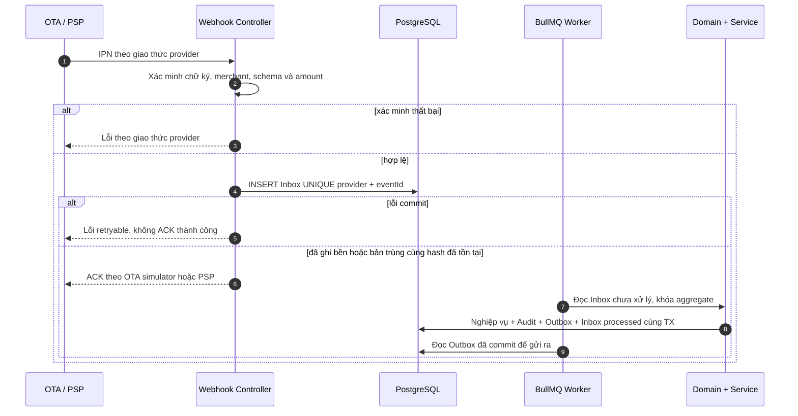

# 04 — Hợp đồng API

> Hợp đồng REST/JSON giữa backend chung và bốn giao diện (customer web, customer Android, operations web, operations Android), cùng hai nhóm tích hợp vào (OTA, cổng thanh toán).
> Định danh, tên trường, enum lấy từ [00/từ điển thực thể](../00-tong-quan.md#7-từ-điển-thực-thể-nguồn-chân-lý-về-định-danh); mọi giá trị nghiệp vụ **tham chiếu mã BR** tại [02/quy tắc nghiệp vụ](../02-nghiep-vu/quy-tac-nghiep-vu.md), không chép lại số.
> Phạm vi: các module và use case trong danh mục [00](../00-tong-quan.md). Đây là hợp đồng thiết kế; chỉ đóng băng tại **M3** khi đạt cổng nghiệm thu, không đồng nghĩa API đã được hiện thực.

---

## 1. Quy ước chung

### 1.1. Nguyên tắc nền

| # | Quy ước | Căn cứ |
|---|---------|--------|
| 1 | REST/JSON, tiền tố `/api/v1`; OpenAPI 3.1 sinh tự động từ zod trong `packages/contracts` | ADR-008, NFR-MAIN-04 |
| 2 | Tiền là **số nguyên VND**, không dùng số thực; làm tròn tường minh theo thứ tự giá | BR-GEN-01, BR-GEN-03 |
| 3 | Thời điểm là ISO 8601 **UTC** (`2026-12-24T07:00:00Z`); **ngày nghiệp vụ** là `YYYY-MM-DD` theo giờ VN | BR-GEN-02, BR-GEN-05, NFR-LOC-02 |
| 4 | Mọi thao tác ghi **PHẢI** mang `Idempotency-Key`; hiệu lực 24 giờ | BR-GEN-08 |
| 5 | Thay đổi `Booking`, `Payment`, `RefundRequest`, `RoomMove`, `SystemSetting` ghi `AuditLog` **trong cùng transaction**; miền thuần nhận thời gian/mã/sự kiện qua cổng ra `Clock`, `IdGenerator`, `OutboxPort`, `UnitOfWork` ([04/kiến trúc](kien-truc.md)) | BR-GEN-07, BR-SYS-05 |
| 6 | Không endpoint nào sửa/xoá bản ghi bất biến (`Payment` gốc, `AuditLog`, hồ sơ khách) | BR-PAY-09, BR-SYS-01, BR-CRM-05 |
| 7 | Cùng đầu vào **PHẢI** cho cùng kết quả giá trên customer web, customer Android, operations web, operations Android và API | BR-RATE-17 |
| 8 | Tên tài nguyên `kebab-case` số nhiều, khớp `snake_case` số nhiều của bảng | 00 §7 |

### 1.2. Xác thực & phân quyền

| Hạng mục | Quy định | Căn cứ |
|----------|----------|--------|
| Cơ chế | `Authorization: Bearer <accessToken>` — JWT HS256; access **15 phút**, refresh **7 ngày**, xoay vòng khi dùng | ADR-010, BR-RBAC-05 |
| Vai trò | Tập vai trò độc lập ở BR-RBAC-01, gồm SYSADMIN cho ACT-12; khách dùng phiên riêng qua `/guest-auth` | BR-RBAC-01 |
| Phạm vi cơ sở | Trừ `OWNER`, mọi vai trò chỉ truy cập dữ liệu thuộc `User.propertyScope`; ngoài phạm vi trả `403 E_AUTH_OUT_OF_SCOPE` kể cả khi đối tượng tồn tại | BR-RBAC-02, NFR-SEC-01 |
| Thao tác tài chính | Endpoint đánh dấu 🔒 **PHẢI** kèm `pinToken` từ `POST /auth/pin/verify` (hiệu lực 5 phút, dùng một lần) | BR-RBAC-05 |
| Khoá tài khoản | 5 lần đăng nhập sai liên tiếp → khoá 15 phút | BR-RBAC-06, NFR-SEC-05 |
| Ngoại lệ tích hợp | `/integrations/**` xác thực theo adapter nhà cung cấp, không dùng Bearer; chữ ký, canonicalization và ACK theo §5 | BR-CHAN-06, BR-PAY-03 |

Khách chỉ được đọc/sửa booking gắn với `guestId` của phiên đã xác thực; biết mã booking hoặc số điện thoại **không** chứng minh sở hữu. Mọi ID con (`paymentId`, `bookingRoomIds`, `refundRequestId`, `holdId`, `evidenceRefs`) phải được tra từ aggregate đã kiểm tra quyền, không nhận ID tùy ý. Khách truy cập đối tượng người khác nhận `404 E_GEN_NOT_FOUND`; nhân viên ngoài phạm vi nhận 403 theo BR-RBAC-02. Cả danh sách, báo cáo, tệp xuất, tác vụ nền do người dùng khởi tạo và kết quả phát lại idempotency đều kiểm tra quyền hiện tại.

Các trường `paidAmount`, `status`, `approvedBy`, `guestId` sở hữu, giá và quyền không được mass-assign từ JSON. Khách/công khai chỉ dùng kênh `WEB`; kênh quầy/điện thoại cần quyền nhân viên, OTA chỉ qua adapter đã xác thực. `returnUrl` phải thuộc allowlist cấu hình của máy chủ, không nhận URL bất kỳ. Tệp minh chứng dùng ID đối tượng trong kho riêng và URL ký ngắn hạn; máy chủ không tải `evidenceUrl` tùy ý từ Internet.

### 1.3. Header & định dạng trao đổi

| Header | Chiều | Bắt buộc | Ý nghĩa |
|--------|-------|----------|---------|
| `Authorization` | → | Trừ endpoint công khai và `/integrations/**` | `Bearer <accessToken>` |
| `Idempotency-Key` | → | Mọi thao tác ghi | UUID v4 do client sinh (BR-GEN-08) |
| `X-Trace-Id` | ← | Luôn | Mã tương quan, trùng `traceId` trong body lỗi |
| `Idempotency-Replayed` | ← | Khi phát lại | `true` — trả bản ghi của lần gọi trước, không tạo bản ghi mới |
| `ETag` | ← | Chi tiết aggregate có thể sửa | Phiên bản số của đối tượng, ví dụ `"7"` |
| `If-Match` | → | Thay đổi booking, refund, điều chuyển, cấu hình đã tồn tại | Phiên bản đọc gần nhất; thiếu trả 428, cũ trả 412; create và webhook không yêu cầu |

### 1.4. Bao hình phản hồi

| Trường hợp | HTTP | Body |
|-----------|------|------|
| Đọc một đối tượng | 200 | Đối tượng trực tiếp, không bọc `data` |
| Danh sách | 200 | `{ "data": [ … ], "meta": { "limit": 20, "nextCursor": null, "hasMore": false, "total": 137 } }` |
| Tạo mới | 201 | Đối tượng đã tạo + header `Location` |
| Không nội dung trả | 204 | ∅ — chỉ dùng cho giải phóng hold, gỡ `RoomBlock`, gỡ danh sách đen |
| Lỗi | 4xx/5xx | Một cấu trúc lỗi duy nhất (§4.1) |

### 1.5. Phân trang, lọc, sắp xếp

| Tham số | Mặc định | Trần | Ghi chú |
|---------|----------|------|---------|
| `limit` | 20 | 100 | Vượt trần → `400 E_GEN_VALIDATION_FAILED` |
| `cursor` | — | — | Chuỗi mờ (base64 của `createdAt` + `id`); client **KHÔNG** phân tích nội dung |
| `sort` | theo tài nguyên | — | Danh sách trường, tiền tố `-` là giảm dần; luôn có khoá phụ `id` để tất định |
| `from`, `to` | — | — | Bao gồm hai đầu; ngày VN khi lọc theo `date`, UTC khi lọc theo thời điểm ghi |
| `q` | — | — | Khớp `Guest.phone` đã chuẩn hoá `+84…` (BR-CRM-01), `Booking.code`, mã phòng |

Chọn con trỏ thay vì `offset` vì lịch tồn phòng và nhật ký kiểm toán ghi rất nhanh (NFR-PERF-02). Nhiều giá trị trong cùng tham số là OR, khác tham số là AND; tham số lạ **bị bỏ qua**, không gây lỗi.

### 1.6. Idempotency

Khoá lưu 24 giờ (BR-GEN-08), theo bộ `(principal, operation, key)`: principal lấy từ phiên đã xác thực; operation gồm HTTP method và đường dẫn chuẩn hoá **kèm ID tài nguyên**. Hash gồm JSON canonical và phiên bản `If-Match`, bỏ token/trace; không tin actor do client truyền. Cùng bộ khoá + cùng hash → phát lại status/body/Location gốc; khác hash → `409 E_SYS_IDEMPOTENCY_KEY_REUSED`. Kiểm tra quyền hiện tại trước phát lại; không để người thứ hai nhận body của người thứ nhất.

PostgreSQL là nguồn bền: claim UNIQUE, thay đổi nghiệp vụ, audit/outbox và kết quả idempotency commit cùng transaction cho lệnh nội bộ. Yêu cầu đồng thời chờ kết quả hoặc nhận `409 E_SYS_REQUEST_IN_PROGRESS` + `Retry-After`; không cùng chạy nghiệp vụ. Rollback không để khoá treo. Lệnh gọi PSP tạo chứng từ bền trước, gọi ngoài transaction bằng cùng provider request ID; mất phản hồi thì query/reconcile chứng từ đó, không tạo giao dịch khác. Redis chỉ tăng tốc. Hết TTL idempotency không xoá các UNIQUE nghiệp vụ trên giao dịch PSP, booking OTA, refund payout.

Đăng nhập/đăng ký dùng định danh phiên ẩn danh ngẫu nhiên do server cấp, có rate limit; không cache mật khẩu hoặc refresh token dạng rõ. Webhook dùng khóa tự nhiên bền ở Inbox (§5), không yêu cầu bên ngoài gửi `Idempotency-Key`. Khi retry lệnh đã thành công với `If-Match` cũ, phát lại kết quả trước kiểm tra version, nhưng sau kiểm tra quyền.

---

## 2. Danh mục endpoint theo module

**Đọc cột vai trò:** đây là hồ sơ quyền theo thao tác, **không phải thứ bậc kế thừa**. Tập quyền có hiệu lực được xác định tường minh ở §6.3; `ACCOUNTANT` không kế thừa quyền tạo booking và `HOUSEKEEPING` không được xem tài chính. `—` = công khai với response đã lọc · `GUEST` = chỉ dữ liệu của chính khách · 🔒 = PIN tài chính. `{id}` là UUID, `{code}` là mã nghiệp vụ.

### 2.1. AUTH — Định danh & phân quyền (3 UC)

| Method | Đường dẫn | Mô tả | Vai trò tối thiểu | Tham số chính | UC | BR |
|--------|-----------|-------|-------------------|---------------|----|----|
| POST | `/api/v1/auth/login` | Đăng nhập nội bộ, trả cặp access/refresh | — | `username`, `password`, `clientSurface?` (T10) | UC-AUTH-01 | BR-RBAC-06 |
| POST | `/api/v1/auth/refresh` | Xoay refresh token | — | `refreshToken` | UC-AUTH-01 | BR-RBAC-05 |
| POST | `/api/v1/auth/pin/verify` | Xác thực PIN 6 số, trả `pinToken` | FRONT_DESK | `pin` | UC-AUTH-01 | BR-RBAC-05 |
| PUT | `/api/v1/users/{userId}/access` | Gán vai trò, phạm vi cơ sở, trạng thái; chống tự nâng quyền và không vô hiệu OWNER cuối | OWNER/SYSADMIN | `role`, `propertyScope[]`, `isActive` | UC-AUTH-02 | BR-RBAC-01,02 |
| POST | `/api/v1/guest-auth/register` | Khách đăng ký tài khoản | — | `fullName`, `phone`, `email`, `password`, `consentMarketing` | UC-AUTH-03 | BR-CRM-01 |
| POST | `/api/v1/guest-auth/login` | Khách đăng nhập | — | `phone`, `password`, `clientSurface?` (T10) | UC-AUTH-03 | BR-CRM-01 |
| POST | `/api/v1/auth/logout` | Thu hồi phiên và refresh family, hết quyền trên mọi client của phiên | Đã đăng nhập | — | UC-AUTH-01, UC-AUTH-03 | BR-RBAC-05 |
| GET | `/api/v1/auth/me` | Hồ sơ phiên hiện tại: vai trò, phạm vi cơ sở, `hasPin`, `mustChangePassword` | Đã đăng nhập | — | UC-AUTH-01 | BR-RBAC-02,05 |
| POST | `/api/v1/guest-auth/refresh` | Xoay refresh của khách; phát hiện reuse thì thu hồi cả family | GUEST session | `refreshToken` | UC-AUTH-03 | BR-RBAC-05 |
| GET | `/api/v1/users` | Danh sách người dùng nội bộ cho SCR-15 | MANAGER | `cursor`, `limit`, `role`, `propertyId`, `q` | UC-AUTH-02 | BR-RBAC-01,02 |
| POST | `/api/v1/users` | Tạo người dùng với mật khẩu tạm (buộc đổi ở lần đăng nhập đầu) | OWNER/SYSADMIN | `username`, `fullName`, `phone?`, `role`, `propertyScope[]`, `temporaryPassword` | UC-AUTH-02 | BR-RBAC-01,02 |
| POST | `/api/v1/auth/password` | Đổi mật khẩu của chính mình | Đã đăng nhập | `currentPassword`, `newPassword` (8–128) | UC-AUTH-01 | BR-RBAC-05 |
| PUT | `/api/v1/auth/pin` | Đặt PIN 6 số cho chính mình | Đã đăng nhập | `pin` (6 số), `currentPassword` | UC-AUTH-01 | BR-RBAC-05 |
| DELETE | `/api/v1/users/{userId}/pin` | Xoá PIN để người dùng đặt lại | MANAGER/SYSADMIN | — | UC-AUTH-02 | BR-RBAC-05 |
| POST | `/api/v1/guest-auth/password-reset/request` | Yêu cầu đặt lại mật khẩu; **luôn 202** dù SĐT có tồn tại hay không | — | `phone` | UC-AUTH-03 | BR-CRM-01 |
| POST | `/api/v1/guest-auth/password-reset/confirm` | Đặt lại mật khẩu bằng token một lần; thu hồi mọi phiên của khách | — | `token`, `newPassword` (8–128) | UC-AUTH-03 | BR-CRM-01 |

### 2.2. PROP — Cơ sở & buồng phòng (4 UC)

| Method | Đường dẫn | Mô tả | Vai trò tối thiểu | Tham số chính | UC | BR |
|--------|-----------|-------|-------------------|---------------|----|----|
| GET | `/api/v1/properties` | Danh sách cơ sở kèm số phòng `ACTIVE` | HOUSEKEEPING | `status` | UC-PROP-01 | BR-PROP-01,02 |
| GET | `/api/v1/public/properties` | Danh sách cơ sở cho journey khách — chỉ mã, tên, giờ nhận/trả (không lộ số phòng/trần bán vượt) | — | — | UC-INV-02 | BR-PROP-01,02 |
| PATCH | `/api/v1/properties/{propertyId}` | Sửa cơ sở, đổi trần bán vượt (trần theo cơ sở, tổng chuỗi = tổng trần cơ sở), giờ nhận/trả phòng | OWNER | `overbookLimitPct`, `checkInTime`, `checkOutTime` | UC-PROP-01 | BR-OVER-01,02, BR-GEN-04 |
| POST | `/api/v1/room-types` | Tạo loại phòng (sức chứa, giá cơ bản, sàn/trần) | OWNER | `propertyId`, `code`, `capacityAdults`, `capacityChildren`, `basePrice`, `minPrice`, `maxPrice`, `allowShared` | UC-PROP-02 | BR-PROP-03,04, BR-RATE-03,04 |
| GET | `/api/v1/room-types` | Danh sách loại phòng kèm sức chứa, sàn–trần giá và `sellingUnits` (số đơn vị bán ACTIVE, dùng cho hạn mức kênh BR-INV-05) (màn SCR-20, SCR-25) | HOUSEKEEPING | `propertyId` | UC-PROP-02 | BR-PROP-03,04, BR-RATE-03,04, BR-INV-05 |
| GET | `/api/v1/rooms` | Danh sách phòng vật lý | HOUSEKEEPING | `propertyId`, `roomTypeId`, `floor`, `status` | UC-PROP-03 | BR-PROP-05 |
| PATCH | `/api/v1/room-types/{roomTypeId}` | Sửa giá cơ bản/sàn/trần, sức chứa và trạng thái; lý do bắt buộc | OWNER | `If-Match`, `reason` | UC-PROP-02 | BR-PROP-04, BR-RATE-03,04 |
| POST | `/api/v1/rooms` | Tạo phòng vật lý theo mã BR; loại phòng cùng cơ sở | MANAGER, OWNER | `propertyId`, `roomTypeId`, `code`, `floor` | UC-PROP-03 | BR-PROP-05 |
| PATCH | `/api/v1/rooms/{roomId}` | Sửa tầng, trạng thái, ghi chú; không đổi cơ sở/loại phòng | MANAGER, OWNER | `floor`, `status`, `note`, `If-Match` | UC-PROP-03 | BR-PROP-06 |
| PUT | `/api/v1/rooms/{roomId}/connecting-room` | Gán/gỡ phòng thông nhau (đối xứng hai chiều) | MANAGER | `connectingRoomId` | UC-PROP-03 | BR-OVER-15 |
| GET | `/api/v1/room-blocks` | Danh sách khoá phòng đang có (màn SCR-22 liệt kê và cảnh báo chồng lấn) | HOUSEKEEPING, FRONT_DESK, MANAGER, OWNER | `propertyId`, `roomId`, `from`, `to` | UC-PROP-04 | BR-INV-06 |
| POST | `/api/v1/room-blocks` | Khoá phòng/ngừng bán (đè assignment cần MANAGER/OWNER) | FRONT_DESK, MANAGER, OWNER | `roomId`, `startDate`, `endDate`, `reason` | UC-PROP-04 | BR-INV-06, BR-PROP-06 |
| DELETE | `/api/v1/room-blocks/{roomBlockId}` | Gỡ khoá phòng (204) | MANAGER, OWNER | `reason` | UC-PROP-04 | BR-INV-06 |

**Triển khai HB-033:** quyền đọc nội bộ được cấp tường minh cho HOUSEKEEPING,
FRONT_DESK, MANAGER và OWNER; cấu hình cơ sở/loại phòng chỉ OWNER; ghi phòng/liên
kết chỉ MANAGER/OWNER. Scope được áp tại DB; query ngoài scope bị403, không suy
ra quyền bằng thứ bậc vai trò. GET có `no-store`, phân trang ID ASC/cursor thuộc tập
lọc, `limit`1–100 (mặc định100). Tuyến công khai chỉ trả metadata đã phát hành của
cơ sở ACTIVE, không trả số phòng/trần bán vượt/version.

Property/RoomType dùng version bigint; Room dùng epoch microseconds của
`updated_at` làm version numeric safe integer. If-Match mạnh dạng `"<version>"`;
thiếu428/cũ hoặc sai412; create không cần If-Match (§1.3). Migration0005 chỉ đổi
trigger touch của Room để timestamp tăng đơn điệu kể cả transaction chờ khoá.
Ghi/replay trả ETag, dùng cùng transaction idempotency/audit/outbox; recheck role,
active và scope sau resource lock. Gán/gỡ liên kết khoá property rồi các loại/phòng
ID ASC trong cơ sở; cả nguồn/đích/đối ứng cũ được cập nhật và audit nguyên tử.

Sàn≤giá cơ bản≤trần và tiền nguyên an toàn; trần bán vượt≤5% theo BR-OVER02.
Năm mã loại phòng chuẩn/sức chứa theo BR-PROP04 và CHECK hiện có; `bedCount` DTO
loại phòng suy ra DOR6 hoặc capacityAdults, input khác giá trị chuẩn bị422.
`sellingUnits` đếm room ACTIVE bằng bed_count khi allow_shared, còn lại1.
Phòng mới nhận mã `<CS01|CS02|CS03>-<tầng><số>`; chuẩn hoá tiền tố cơ sở seed
`CS-01` thành CS01 để kiểm, không sửa ID/mã legacy đã lưu. Mã trùng trong cơ sở
→409 `E_PROP_CODE_TAKEN`. Ghi chú/lý do/nhãn trong audit che PII/bí mật có nhãn;
không có tuyến xoá cứng. Không thay dữ liệu snapshot booking đã chốt.

Theo BR-CHAN02/06, cấu hình Property và Room phát InventoryChanged; RoomType phát
RateChanged cùng InventoryChanged. Payload schemaVersion1 mang entity/property/
version và scopeALL_DATES, không bịa giới hạn ngày; liên kết mang affectedRoomIds.
Consumer đọc lại cấu hình mới cho các kênh đang mở bán; replay không phát thêm,
lỗi outbox rollback cả value/audit. Gate producer không thay bằng chứng giao OTA
của relay/consumer ở các ticket CHAN.

### 2.3. INV — Tồn phòng (3 UC)

| Method | Đường dẫn | Mô tả | Vai trò tối thiểu | Tham số chính | UC | BR |
|--------|-----------|-------|-------------------|---------------|----|----|
| GET | `/api/v1/inventory/grid` | Lịch tồn phòng dạng lưới ngày × loại phòng | FRONT_DESK, RESERVATION_AGENT, MANAGER, OWNER | `propertyId`, `from`, `to`, `roomTypeId`, `channelCode` | UC-INV-01 | BR-INV-01,07, NFR-PERF-01 |
| GET | `/api/v1/inventory/availability` | **Tìm phòng trống** theo kỳ lưu trú (§3.8) | — | `propertyId`, `roomTypeId`, `checkIn`, `checkOut`, `adults`, `children`, `roomCount`, `channelCode` | UC-INV-02 | BR-INV-01,02,07, BR-PROP-06 |
| GET | `/api/v1/channel-allotments` | Allotment theo kênh × loại phòng × ngày | MANAGER | `channelId`, `roomTypeId`, `from`, `to` | UC-INV-03 | BR-INV-05, BR-CHAN-01,08 |
| PUT | `/api/v1/channel-allotments` | Đặt lại allotment theo lô trong một transaction | MANAGER | `channelId`, `roomTypeId`, `date`, `allotment` | UC-INV-03 | BR-INV-05, BR-CHAN-01,06 |

**Quyền lưới tồn:** theo BR-RBAC-03 và UC-INV-01, cấp FRONT_DESK, RESERVATION_AGENT, MANAGER, OWNER trong scope; không cấp HOUSEKEEPING/ACCOUNTANT/SYSADMIN quyền đọc lịch tồn vận hành đầy đủ. Đây là đồng bộ thiết kế theo nguồn nghiệp vụ, không dùng thứ bậc role.

**Biểu diễn lưới tồn (HB-035):** `from` và `to` bao gồm hai đầu, tối đa 31 ngày. Ô trả `published` từ tồn công bố của engine; có `channelCode` thì thêm `channelAvailable` (kênh không hoạt động trả 0). Khi lọc `roomTypeId`, phản hồi giữ cấu trúc một loại phòng. Khi không lọc, trường bổ sung `grids` chứa mọi loại thuộc cơ sở, sắp theo `code`, `id`; các trường gốc là bản chiếu của loại đầu tiên để tương thích client cũ, không phải tổng toàn cơ sở. Cơ sở chưa có loại phòng trả 404 `E_GEN_NOT_FOUND`. GET đọc snapshot, `Cache-Control: no-store`, không giữ khoá hàng hay ghi dữ liệu.

**Phiên bản cấu hình allotment (HB-035):** GET `/channel-allotments` đọc các dòng cấu hình và phiên bản của **toàn bộ cặp `(channelId, roomTypeId)`** trong một snapshot SQL, khoảng ngày bao gồm hai đầu theo §1.5; trả `ETag: "<version>"`. Cặp chưa có cấu hình có phiên bản 1. PUT khoá dòng `channel_allotment_scopes` trước khi ghi bất kỳ dòng ngày nào, đối chiếu `If-Match` rồi giữ khoá đến khi transaction chứa batch + AuditLog kết thúc. Thiếu header → 428; token không hợp lệ hoặc cũ → 412. Mọi thay đổi cấu hình, kể cả ngày ngoài khoảng GET, tăng phiên bản; xoá rồi thêm lại không đặt lại bộ đếm. Cột cache `used` không phải cấu hình; cập nhật cache không thay token này. Token phục vụ điều kiện sửa cấu hình, không dùng làm cache validator cho demand động; GET cần `Cache-Control: no-store`. Không lấy `MAX(version)` của các dòng ngày. Writer dùng READ COMMITTED; retry toàn transaction khi gặp 40P01/40001 theo cơ chế hiện có. Đổi scope phải khoá cả hai scope theo thứ tự `(channel_id, room_type_id)` trước khi sửa dòng con.

### 2.4. RATE — Giá, mùa, kênh và chính sách

| Method | Đường dẫn | Mô tả | Vai trò tối thiểu | Tham số chính | UC | BR |
|--------|-----------|-------|-------------------|---------------|----|----|
| GET | `/api/v1/room-types/{roomTypeId}/rate-calendar` | Lịch giá theo ngày | MANAGER | `from`, `to`, `source` | UC-RATE-01 | BR-RATE-02,03 |
| PUT | `/api/v1/room-types/{roomTypeId}/rate-calendar` | Ghi đè lịch giá (`source = OVERRIDE`, `priority` cao nhất); cảnh báo khi `LONGSTAY14` không có giá riêng nên bằng giá `FLEX7` | OWNER | `date[]`, `price`, `channelCode`, `priority`, `reason`, `confirmOwnerOverride` | UC-RATE-01 | BR-RATE-02, BR-RATE-19, BR-RBAC-04 |
| GET | `/api/v1/seasons` | Danh sách mùa của cơ sở kèm hệ số, ưu tiên, phụ thu cuối tuần, phiên bản (màn SCR-27) | MANAGER | `propertyId`, `from`, `to` | UC-RATE-02 | BR-RATE-05,06 |
| POST | `/api/v1/seasons` | Tạo mùa (hệ số, `priority`, phụ thu cuối tuần) | OWNER | `propertyId`, `name`, `startDate`, `endDate`, `multiplier`, `priority`, `weekendSurchargeEnabled` | UC-RATE-02 | BR-RATE-05,06 |
| GET | `/api/v1/channels` | Danh sách kênh kèm hệ số, hoa hồng, hold, cờ bán vượt, phiên bản (màn SCR-25, SCR-28) | MANAGER | — | UC-RATE-03 | BR-RATE-07,18 |
| GET | `/api/v1/channels/{channelId}` | Chi tiết kênh kèm các dòng ghi đè theo cơ sở | MANAGER | — | UC-RATE-03 | BR-RATE-18 |
| PATCH | `/api/v1/channels/{channelId}` | Sửa hệ số/hoa hồng/hold/`overbookAllowed` mức **mặc định toàn chuỗi**; ghi đè theo cặp (kênh, cơ sở) qua `ChannelPropertySetting` (mốc so sánh là **ngày của từng đêm**: dòng có `effectiveFrom` lớn nhất ≤ ngày đêm đó thắng); cảnh báo khi hệ số dưới ngưỡng sàn `1/(1−hoa hồng)`, `AGENCY` miễn | OWNER | `multiplier`, `commissionPct`, `holdMinutes`, `overbookAllowed`, `propertyOverrides[]` | UC-RATE-03 | BR-RATE-07,09,18, BR-OVER-02 |
| GET | `/api/v1/promotions` | Danh sách khuyến mãi kèm lượt đã dùng, phạm vi và trạng thái (màn SCR-29) | MANAGER | `propertyId`, `status` | UC-RATE-04 | BR-RATE-10,11,13 |
| POST | `/api/v1/promotions` | Tạo khuyến mãi | OWNER | `code`, `type`, `value`, `minNights`, `channelScope`, `roomTypeScope`, `validFrom`, `validTo`, `maxUses`, `stackable` | UC-RATE-04 | BR-RATE-10,11,13 |
| POST | `/api/v1/quotes` | **Báo giá** kỳ lưu trú (§3.1) | — | `propertyId`, `roomTypeId`, `channelCode`, `ratePlanCode`, `checkIn`, `checkOut`, `adults`, `children`, `roomCount`, `promotionCodes[]` | UC-INV-02, UC-RATE-05 | BR-RATE-01…17 |
| POST | `/api/v1/quotes/multi-channel` | So sánh giá đồng thời nhiều kênh | MANAGER | `roomTypeId`, `checkIn`, `checkOut`, `channelCodes[]` | UC-RATE-05 | BR-RATE-07,08,09 |
| GET | `/api/v1/rate-plans` | Gói giá đang bán và điều khoản dành cho khách; không lộ cấu hình nội bộ | — | `propertyId`, `checkIn`, `checkOut` | UC-RATE-06 | BR-CANCEL-01, BR-BOOK-03 |
| GET | `/api/v1/rate-plans/admin` | Cấu hình gói giá cho chủ chuỗi: cọc, min/max đêm, chính sách áp dụng, trạng thái, phiên bản (màn SCR-70) | OWNER | — | UC-RATE-06 | BR-CANCEL-01, BR-RATE-16, BR-RATE-20 |
| PUT | `/api/v1/rate-plans/{ratePlanId}` | Cập nhật cấu hình gói giá cho báo giá mới, giữ nguyên snapshot đã bán | OWNER | `depositPercent`, `minNights`, `maxNights`, `cancellationPolicyId`, `status`, `reason` | UC-RATE-06 | BR-CANCEL-01, BR-RATE-16 |
| GET | `/api/v1/cancellation-policies` | Chính sách và toàn bộ bậc cùng version | OWNER | `status` | UC-RATE-06 | BR-CANCEL-01,02 |
| PUT | `/api/v1/cancellation-policies/{policyId}` | Thay toàn bộ bậc trong một transaction; validate mốc, phần trăm, bậc bắt tất | OWNER | `tiers[]`, `earlyCheckoutFreeHours`, `earlyCheckoutRefundPct`, `reason` | UC-RATE-06 | BR-CANCEL-01,02,09 |

Wire tier tương thích HB-050/SCR-70: `hoursBeforeCheckIn = 0` biểu diễn bậc bắt tất
`offsetHours = -1` của engine/CSDL. `earlyCheckoutFreeHours=0` là sentinel cho
ngưỡng `null` của engine/CSDL và chỉ đi cùng `earlyCheckoutRefundPct=0` (I6).
`offsetHours` và `chargeFirstNight` là trường
tùy chọn bổ sung; nếu có canonical offset thì trường legacy bằng `max(0, offsetHours)`.
Omit cờ first-night khi cập nhật giữ cờ tier cũ cùng offset (offset mới mặc định false);
gửi `false` rõ ràng để bỏ cờ. Response trả đủ canonical metadata cho client mới.
PUT giữ quyền OWNER, If-Match, audit/outbox cùng transaction; `details[].field`
theo `tiers[i].hoursBeforeCheckIn/refundPercent/chargeFirstNight` chỉ ra dòng sai.

### 2.5. BOOK — Đặt phòng (8 UC)

| Method | Đường dẫn | Mô tả | Vai trò tối thiểu | Tham số chính | UC | BR |
|--------|-----------|-------|-------------------|---------------|----|----|
| POST | `/api/v1/bookings` | **Tạo booking** (web/quầy/điện thoại) — §3.2 | GUEST | `propertyId`, `roomTypeId`, `ratePlanCode`, `channelCode`, `quoteId`, `guest`, `checkIn`, `checkOut`, `adults`, `children`, `roomCount`, `promotionCodes[]` | UC-BOOK-01, UC-BOOK-02, UC-BOOK-03 | BR-BOOK-01…16 |
| GET | `/api/v1/bookings` | Tra cứu booking (khách chỉ booking của mình), lọc/phân trang tại DB | GUEST hoặc tập quyền §6.3 | `propertyId`, `status`, `channelCode`, `from`, `to`, `q` | UC-BOOK-07 | BR-RBAC-02 |
| GET | `/api/v1/bookings/{bookingId}` | Chi tiết theo quyền, snapshot điều khoản và version; không cấp HOUSEKEEPING | GUEST hoặc tập quyền §6.3 | — | UC-BOOK-07 | BR-RBAC-02,03 |
| DELETE | `/api/v1/bookings/{bookingId}` | Xoá cứng **chỉ** `DRAFT`/`HELD` chưa phát sinh thanh toán; **PHẢI** ghi `AuditLog.beforeJson` trước khi xoá (204) | FRONT_DESK | `reason` | UC-BOOK-05 | BR-BOOK-14, BR-BOOK-17 |
| POST | `/api/v1/bookings/{bookingId}/confirm` | Xác nhận booking | FRONT_DESK | `paymentId` | UC-BOOK-01, UC-BOOK-02, UC-BOOK-03 | BR-BOOK-09 |
| POST | `/api/v1/bookings/{bookingId}/reschedule` | Đổi ngày: **không đổi trạng thái**, lưu `PriceSnapshot` mới (`kind = RESCHEDULE`) và **giữ bản cũ**, tăng `rescheduleCount`, ghi `AuditLog` | GUEST | `checkIn`, `checkOut`, `reason` | UC-BOOK-06 | BR-BOOK-12,13, BR-CANCEL-08 |
| POST | `/api/v1/bookings/{bookingId}/cancel-preview` | Xem trước tiền hoàn, không đổi trạng thái | GUEST | `reason`, `isForceMajeure` | UC-BOOK-08 | BR-CANCEL-01…06 |
| POST | `/api/v1/bookings/{bookingId}/cancel` | **Huỷ booking** (toàn phần hoặc **một phần** theo `bookingRoomIds[]` khi `roomCount > 1`) — §3.3 | GUEST | `reason`, `note`, `isForceMajeure`, `evidenceRefs[]`, `bookingRoomIds[]` | UC-BOOK-08 | BR-BOOK-11,14, BR-CANCEL-01…19 |
| POST | `/api/v1/holds` | **Giữ chỗ có thời hạn** — §3.4 | GUEST | `propertyId`, `roomTypeId`, `channelCode`, `checkIn`, `checkOut`, `adults`, `children`, `roomCount`, `quoteId` | UC-BOOK-04 | BR-BOOK-04,07, BR-INV-02 |
| DELETE | `/api/v1/holds/{holdId}` | Giải phóng hold ngay, trả phòng về tồn khả dụng (204) | FRONT_DESK | `reason` | UC-BOOK-04 | BR-INV-04 |

### 2.6. PAY — Thanh toán & hoàn tiền (5 UC)

| Method | Đường dẫn | Mô tả | Vai trò tối thiểu | Tham số chính | UC | BR |
|--------|-----------|-------|-------------------|---------------|----|----|
| POST | `/api/v1/payments` | Ghi nhận tiền cọc/số dư/hoàn tất toán (`type` ∈ `DEPOSIT`/`BALANCE`/`PENALTY`/`EXTRA_SERVICE`/`COMPENSATION`/`RESCHEDULE_FEE`) | FRONT_DESK | `bookingId`, `type`, `method`, `amount`, `note`, `pinToken` 🔒 | UC-PAY-01, UC-PAY-03 | BR-PAY-01,02,06,07 |
| POST | `/api/v1/payments/online` | **Khởi tạo thanh toán trực tuyến** — §3.5 | GUEST | `bookingId`, `type`, `method`, `amount`, `returnUrl` | UC-PAY-02 | BR-PAY-03,04,05 |
| GET | `/api/v1/payments/{paymentId}/status` | Trạng thái giao dịch (poll sau khi PSP chuyển hướng) | GUEST | — | UC-PAY-02 | BR-PAY-05 |
| GET | `/api/v1/bookings/{bookingId}/balance` | Số dư và khoản hoàn; tách khoản đã thu, khoản nợ, khoản hoàn đang giữ hạn mức; không cấp HOUSEKEEPING | GUEST hoặc nhân viên tài chính (§6.3) | — | UC-PAY-03 | BR-PAY-02 |
| POST | `/api/v1/refund-requests` | **Yêu cầu hoàn tiền** — §3.6 | FRONT_DESK | `bookingId`, `paymentId`, `reason`, `isForceMajeure`, `evidenceRefs[]` | UC-PAY-04, UC-BOOK-08 | BR-CANCEL-01…07,13 |
| POST | `/api/v1/refund-requests/{refundRequestId}/approve` | **Duyệt hoàn tiền** — §3.7 | MANAGER | `approvedAmount`, `note`, `pinToken` 🔒 | UC-PAY-04 | BR-CANCEL-15 |
| GET | `/api/v1/refund-requests` | Danh sách hồ sơ, số tiền đã giữ/chi, tuổi hồ sơ, version | Tập quyền §6.3 | `bookingId`, `status`, `propertyId` | UC-PAY-04 | BR-CANCEL-16 |
| POST | `/api/v1/refund-requests/{refundRequestId}/reject` | Từ chối PENDING, ghi lý do và trả hạn mức hoàn | MANAGER/OWNER | `note`, `pinToken` 🔒 | UC-PAY-04 | BR-CANCEL-15,17 |
| POST | `/api/v1/refund-requests/{refundRequestId}/cancel` | Rút yêu cầu còn PENDING; không khôi phục booking hay assignment | Người tạo hoặc MANAGER/OWNER | `reason` | UC-PAY-04 | BR-CANCEL-18 |
| POST | `/api/v1/refund-requests/{refundRequestId}/pay` | Chi tiền hoàn về phương thức gốc | ACCOUNTANT | `method`, `bankNote`, `pinToken` 🔒 | UC-PAY-04 | BR-CANCEL-12,16, BR-PAY-08,09 |
| POST | `/api/v1/reconciliation/daily/close` | Chốt ca/ngày, ghi nhận chênh lệch | ACCOUNTANT | `propertyId`, `businessDate`, `countedCash`, `note` | UC-PAY-05 | BR-PAY-06,10 |

### 2.7. CHAN — Kênh bán (3 UC)

| Method | Đường dẫn | Mô tả | Vai trò tối thiểu | Tham số chính | UC | BR |
|--------|-----------|-------|-------------------|---------------|----|----|
| POST | `/api/v1/channels/{channelId}/sync` | Đẩy tồn & giá lên một kênh (202) | MANAGER | `scope`, `from`, `to` | UC-CHAN-02 | BR-CHAN-02,06 |
| PUT | `/api/v1/channels/{channelId}/mappings` | Ánh xạ loại phòng ↔ mã phòng OTA | OWNER | `roomTypeId`, `providerRoomTypeCode`, `allotmentPct` | UC-CHAN-01 | BR-CHAN-01,08 |
| POST | `/api/v1/channels/{channelId}/sales-closure` | Đóng bán loại phòng theo ngày trên OTA | MANAGER | `roomTypeId`, `from`, `to`, `reason` | UC-CHAN-01 | BR-CHAN-05 |
| GET | `/api/v1/channels/{channelId}/ota-bookings` | Booking nhận từ OTA kèm trạng thái xử lý | MANAGER | `from`, `to`, `status`, `q` | UC-CHAN-03 | BR-CHAN-03,04 |

### 2.8. OVER — Quá tải & điều chuyển (5 UC)

| Method | Đường dẫn | Mô tả | Vai trò tối thiểu | Tham số chính | UC | BR |
|--------|-----------|-------|-------------------|---------------|----|----|
| GET | `/api/v1/overbooking-cases` | **Danh sách ca quá tải** — §3.9 | MANAGER | `propertyId`, `status`, `dateFrom`, `dateTo`, `roomTypeId`, `overdueOnly` | UC-OVER-01 | BR-OVER-03,04,05 |
| GET | `/api/v1/overbooking-cases/{caseId}` | Chi tiết ca quá tải + ứng viên điều chuyển đã xếp hạng | MANAGER | `includeCandidates` | UC-OVER-01 | BR-OVER-11,12 |
| POST | `/api/v1/overbooking-cases/{caseId}/relocation-plan` | Tính thang xử lý 4 bậc và thứ tự `keepScore` | MANAGER | `strategy` (`AUTO`/`MANUAL`) | UC-OVER-02 | BR-OVER-06,11,12 |
| POST | `/api/v1/overbooking-cases/{caseId}/resolve` | Đóng ca quá tải sau khi xử lý xong | MANAGER | `resolutionNote` | UC-OVER-01 | BR-OVER-04 |
| POST | `/api/v1/room-moves` | **Thực hiện điều chuyển phòng** — §3.10 | FRONT_DESK | `overbookingCaseId`, `bookingId`, `bookingRoomId`, `moveType`, `toRoomId`, `reason`, `compensationAmount`, `transportCost`, `consent` | UC-OVER-02, UC-OVER-04 | BR-OVER-06…10, BR-BOOK-11 |
| POST | `/api/v1/room-moves/{roomMoveId}/approve` | Duyệt điều chuyển và chi phí bồi thường | MANAGER | `compensationAmount`, `transportCost`, `note`, `pinToken` 🔒 | UC-OVER-02, UC-OVER-05 | BR-OVER-06,07 |
| POST | `/api/v1/room-moves/{roomMoveId}/execute` | Giải phóng phòng cũ, gán phòng mới, gửi thông báo | FRONT_DESK | `pinToken` 🔒 | UC-OVER-02 | BR-OVER-08,10, BR-BOOK-11 |
| POST | `/api/v1/room-merges` | Tạo phương án ghép phòng (`MERGE_SHARE`/`MERGE_CONNECTING`) | FRONT_DESK | `primaryBookingId`, `secondaryBookingId`, `roomId`, `discountPct` | UC-OVER-03 | BR-OVER-13,14,15 |
| POST | `/api/v1/room-merges/{roomMergeId}/consent` | Ghi nhận đồng thuận của từng bên | FRONT_DESK | `side` (`PRIMARY`/`SECONDARY`), `consented`, `evidenceUrl` | UC-OVER-03 | BR-OVER-13 |
| POST | `/api/v1/room-merges/{roomMergeId}/approve` | Duyệt ghép phòng (bắt buộc khi khác giới tính) | MANAGER | `reason` | UC-OVER-03 | BR-OVER-14 |
| POST | `/api/v1/room-merges/{roomMergeId}/execute` | Kiểm tra lại consent, sức chứa, version và gán tất cả đơn vị trong một TX | FRONT_DESK | — | UC-OVER-03 | BR-OVER-13,14,15 |

### 2.9. FO — Tiền sảnh & buồng phòng (4 UC)

| Method | Đường dẫn | Mô tả | Vai trò tối thiểu | Tham số chính | UC | BR |
|--------|-----------|-------|-------------------|---------------|----|----|
| POST | `/api/v1/front-office/check-in` | Check-in khách | FRONT_DESK | `bookingId`, `idNumber`, `actualRoomIds[]`, `earlyCheckIn`, `note` | UC-FO-01 | BR-FO-01,02,04 |
| POST | `/api/v1/front-office/check-out` | Check-out, thu phát sinh, ghi nhận trả phòng sớm với `cancelReason = EARLY_CHECKOUT`; ngưỡng đọc từ `CancellationPolicy.earlyCheckoutFreeHours`/`earlyCheckoutRefundPct` | FRONT_DESK | `bookingId`, `extras[]`, `lateCheckOut`, `earlyCheckOut`, `pinToken` 🔒 | UC-FO-02 | BR-FO-03,05,06, BR-CANCEL-09 |
| POST | `/api/v1/front-office/no-show` | Ghi nhận khách không đến | FRONT_DESK | `bookingId`, `reason` | UC-FO-04 | BR-CANCEL-10 |
| GET | `/api/v1/housekeeping/tasks` | Danh sách nhiệm vụ trong phạm vi; HOUSEKEEPING chỉ thấy việc được giao | HOUSEKEEPING, FRONT_DESK, MANAGER | `propertyId`, `businessDate`, `status`, `assignedTo`, `limit`, `cursor` | UC-FO-03 | BR-FO-06, BR-RBAC-02,03 |
| PATCH | `/api/v1/housekeeping/tasks/{taskId}` | Cập nhật nhiệm vụ theo quyền từng trường; không tự tăng tồn tương lai | HOUSEKEEPING, FRONT_DESK, MANAGER | `status`, `note`, `reason`; `assignedTo` chỉ FRONT_DESK/MANAGER; `If-Match`, `Idempotency-Key` | UC-FO-03 | BR-FO-06,07 |

HB-148 theo BR-FO-07: HOUSEKEEPING chỉ chuyển việc được giao `PENDING → IN_PROGRESS → DONE`.
FRONT_DESK/MANAGER kiểm tra `DONE → INSPECTED` hoặc mở lại `DONE/INSPECTED → PENDING`;
không thay bước dọn của HOUSEKEEPING. FRONT_DESK/MANAGER phân công cho HOUSEKEEPING còn hoạt động
và có phạm vi cơ sở; OWNER không được đọc/phân công/kiểm tra/dọn phòng theo tập quyền BR-RBAC-03. Đọc và ghi chỉ trả DTO
nhiệm vụ, không có booking/khách/tiền; ghi chú che số điện thoại, email và số định danh.
PATCH khoá phòng vật lý rồi nhiệm vụ, kiểm lại phạm vi/người được giao và phiên bản; audit và
kết quả idempotency trong cùng transaction. `completedAt` được đặt lúc DONE, giữ khi INSPECTED,
xoá khi mở lại. Trạng thái sai → 409; phiên bản cũ → 412; thiếu `If-Match` → 428. GET `no-store`.

### 2.10. CRM — Khách hàng (3 UC)

| Method | Đường dẫn | Mô tả | Vai trò tối thiểu | Tham số chính | UC | BR |
|--------|-----------|-------|-------------------|---------------|----|----|
| GET | `/api/v1/guests` | Tra cứu hồ sơ khách | FRONT_DESK | `q`, `loyaltyTier`, `blacklisted`, `propertyId` | UC-CRM-01 | BR-CRM-01 |
| POST | `/api/v1/guests` | Tạo hồ sơ khách (nhận diện theo SĐT chuẩn hoá) | FRONT_DESK | `fullName`, `phone`, `email`, `idNumber`, `dob`, `nationality`, `consentMarketing` | UC-CRM-01 | BR-CRM-01, NFR-COMP-01 |
| POST | `/api/v1/guests/{guestId}/anonymize` | Ẩn danh hoá theo yêu cầu khách (không xoá cứng) | MANAGER | `reason`, `requestedAt` | UC-CRM-01 | BR-CRM-05, NFR-COMP-01 |
| GET | `/api/v1/guests/{guestId}/loyalty` | Hạng, điểm, tổng đêm tích luỹ 12 tháng | FRONT_DESK | — | UC-CRM-02 | BR-CRM-02,03 |
| GET | `/api/v1/guests/me` | Hồ sơ của **chính khách** đang đăng nhập (phiên khách, không lộ `guestId` cho client) | — | — | UC-CRM-01 | BR-CRM-01 |
| GET | `/api/v1/guests/me/loyalty` | Hạng, điểm, số đêm của chính khách | — | — | UC-CRM-02 | BR-CRM-02,03 |
| POST | `/api/v1/guests/{guestId}/blacklist` | Đưa khách vào danh sách đen | MANAGER | `blacklistReason` | UC-CRM-03 | BR-CRM-04 |
| DELETE | `/api/v1/guests/{guestId}/blacklist` | Gỡ khỏi danh sách đen (204) | MANAGER | `reason` | UC-CRM-03 | BR-CRM-04, BR-SYS-05 |

### 2.11. NOTI — Thông báo (2 UC)

| Method | Đường dẫn | Mô tả | Vai trò tối thiểu | Tham số chính | UC | BR |
|--------|-----------|-------|-------------------|---------------|----|----|
| GET | `/api/v1/notifications` | Thông báo đã gửi kèm trạng thái và số lần thử | FRONT_DESK | `bookingId`, `channel`, `status`, `template`, `from`, `to` | UC-NOTI-01 | BR-SYS-06 |
| POST | `/api/v1/notifications/{notificationId}/resend` | Gửi lại (tối đa 3 lần, cách 5 phút) | FRONT_DESK | `reason` | UC-NOTI-02 | BR-SYS-06 |

### 2.12. REP — Báo cáo (4 UC)

| Method | Đường dẫn | Mô tả | Vai trò tối thiểu | Tham số chính | UC | BR |
|--------|-----------|-------|-------------------|---------------|----|----|
| GET | `/api/v1/reports/occupancy` | Công suất theo cơ sở/loại phòng/ngày; phòng DOR đếm theo **đơn vị bán** (giường) | MANAGER | `propertyId`, `from`, `to`, `groupBy` | UC-REP-01 | BR-REP-01, BR-INV-01, BR-PROP-03 |
| GET | `/api/v1/reports/adr-revpar` | ADR, RevPAR, phòng-đêm đã bán, phòng khả dụng | MANAGER | `propertyId`, `from`, `to`, `groupBy` | UC-REP-01 | BR-REP-01, BR-RATE-08 |
| GET | `/api/v1/reports/revenue-by-channel` | Doanh thu gộp/thuần & hoa hồng theo kênh | ACCOUNTANT | `from`, `to`, `channelId`, `propertyId` | UC-REP-02 | BR-RATE-08 |
| GET | `/api/v1/reports/cancellations` | Huỷ phòng theo bậc chính sách kèm **tỷ lệ huỷ** | ACCOUNTANT | `from`, `to`, `ratePlanCode`, `propertyId` | UC-REP-03 | BR-REP-01, BR-CANCEL-01,02 |
| GET | `/api/v1/reports/force-majeure` | Báo cáo riêng các ca bất khả kháng | OWNER | `from`, `to` | UC-REP-03 | BR-CANCEL-13 |
| GET | `/api/v1/reports/overbooking` | Số ca quá tải, thời điểm phát hiện & xử lý, tổng chi phí xử lý quá tải (chiết khấu ghép phòng + bồi thường walk-out + đưa đón) | MANAGER | `propertyId`, `from`, `to`, `status` | UC-REP-04 | BR-REP-01, BR-OVER-04,05,15,16 |
| POST | `/api/v1/reports/export` | Xuất CSV/XLSX cho kế toán (202) | ACCOUNTANT | `report`, `format`, `params` | UC-REP-01…04 | NFR-COMP-04 |

### 2.13. SYS — Nền tảng & tuân thủ (3 UC)

| Method | Đường dẫn | Mô tả | Vai trò tối thiểu | Tham số chính | UC | BR |
|--------|-----------|-------|-------------------|---------------|----|----|
| GET | `/api/v1/audit-logs` | Nhật ký kiểm toán (chỉ đọc) | MANAGER, OWNER | `actorId`, `entityType`, `entityId`, `action`, `from`, `to` | UC-SYS-01 | BR-SYS-01,05 |
| GET | `/api/v1/system-settings` | Danh sách tham số kèm kiểu giá trị, người sửa cuối, phiên bản (màn SCR-17) | OWNER | — | UC-SYS-02 | BR-SYS-02 |
| PUT | `/api/v1/system-settings/{key}` | Sửa tham số (ghi `AuditLog` cùng transaction) | OWNER | `value`, `reason` | UC-SYS-02 | BR-SYS-02, BR-GEN-07 |
| POST | `/api/v1/system/backups` | Yêu cầu sao lưu (202) | SYSADMIN | `mode` (`PITR`/`FULL`) | UC-SYS-03 | BR-SYS-03 |
| POST | `/api/v1/system/backups/{backupId}/restore` | Diễn tập phục hồi vào môi trường tạm do server chọn (202); không nhận đường dẫn/DB URL của client | SYSADMIN | `targetTimestamp`, `reason` | UC-SYS-03 | BR-SYS-03 |
| GET | `/api/v1/system/health` | Công khai chỉ `{status: "ok"}`; không lộ version, hostname, topology hay lỗi phụ thuộc | — | — | UC-SYS-03 | NFR-USE-01, NFR-USE-02 |

**Triển khai HB-036:** audit phân trang `(at DESC,id DESC)` bằng cursor UUID thuộc tập
đã lọc, giữ độ chính xác microsecond khi so cursor; khoảng thời gian `[from,to)`.
MANAGER chỉ nhận loại `Property`, `RoomType`, `Room`, `RoomBlock`, `Booking`,
`RateCalendar`, `Season`, `Promotion` có `propertyId`/`property_id` cấp đầu trong
snapshot do server ghi, riêng `Property` thêm `entity_id`. Mọi bằng chứng hiện diện
phải là string cùng một cơ sở trong scope. Thiếu/sai/mâu thuẫn/loại chưa hỗ trợ bị
loại trước count/limit; không suy diễn phạm vi từ actor hay thực thể đang có.
Các writer chưa ghi proof (gồm HousekeepingTask/ChannelAllotment) hiện chỉ OWNER
đọc được. DTO vẫn giữ schema đã phát hành: actor NULL hiển thị `SYSTEM`, entity
NULL hiển thị `GLOBAL`; snapshot được lọc bí mật/PII, không trả đầy đủ hồ sơ khách.

Settings chỉ OWNER; GET đọc mới từ DB, description NULL/rỗng hiển thị key và
updatedBy NULL hiển thị `SYSTEM`. PUT trả204 + ETag, ghi giá trị/audit/response
idempotency cùng transaction; recheck quyền/active/version sau khoá. Cache nội bộ
`RUNTIME_SETTINGS` tối đa60s tính từ lúc bắt đầu đọc DB; ghi của chính tiến trình
chỉ evict sau commit, replay không nạp lại giá trị cũ. Đây là service nội bộ dùng
chung, không cấp quyền đọc settings nghiệp vụ cho frontend/role khác.

### 2.14. Ràng buộc âm — endpoint KHÔNG được phép tồn tại

Áp dụng cho **cả 13 module**; kiểm tra bắt buộc khi review OpenAPI sinh tự động.

| Endpoint bị cấm | Lý do | BR |
|-----------------|-------|----|
| `DELETE /bookings/{id}` khi `status ≠ DRAFT/HELD`, đã phát sinh thanh toán, hoặc **không ghi `AuditLog` (beforeJson) trước khi xoá** | Đã xác nhận/đã thu tiền thì chỉ chuyển `CANCELLED` + tạo `RefundRequest`; xoá cứng phải lưu vết trước | BR-BOOK-14, BR-BOOK-17 |
| `PATCH`/`PUT`/`DELETE /bookings/{id}/price-snapshot` | Ảnh chụp giá bất biến; giá đã chốt không đổi theo cấu hình sau đó | BR-RATE-16 |
| `PATCH`/`PUT`/`DELETE /payments/{id}` | `Payment` gốc không sửa/xoá; điều chỉnh bằng bút toán loại `REFUND` | BR-PAY-09, NFR-COMP-03 |
| `POST /payments*` có trường số thẻ/CVV/ngày hết hạn | Không lưu dữ liệu thẻ | BR-PAY-04, NFR-SEC-02 |
| `PUT`/`PATCH`/`DELETE /audit-logs/**` | `AuditLog` append-only, thu hồi `UPDATE`/`DELETE` ở tầng CSDL | BR-SYS-01, NFR-SEC-04 |
| `DELETE /guests/{id}` | Chỉ ẩn danh hoá; giữ bản ghi đặt phòng vì nghĩa vụ kế toán | BR-CRM-05, NFR-COMP-02 |
| `POST /refund-requests/{id}/cancel` khi `status ∈ {APPROVED, PAID}` | Chỉ huỷ được ở `PENDING`, phải ghi lý do | BR-CANCEL-18 |
| Bất kỳ endpoint tạo hai `RoomAssignment` hoạt động trùng `(roomId, bedNo, đêm)`; hoặc dùng khoá đơn kiểu `COALESCE(bedNo, roomId)` | Bất biến cứng ép ở tầng CSDL bằng ràng buộc loại trừ trên bộ ba `(room_id, bed_no, valid_range)`; `bedNo = 0` nghĩa là cả phòng, `1..bedCount` chỉ dùng cho DOR | BR-INV-03, BR-PROP-04 |

---

## 3. Đặc tả chi tiết 10 endpoint trọng yếu

Chung cho mọi ví dụ: thao tác ghi mang `Idempotency-Key`; tiền là số nguyên VND; thời điểm UTC; nhãn `…` là UUID rút gọn cho dễ đọc. Mỗi ví dụ độc lập, dữ liệu minh hoạ không phải seed sản xuất; hệ số trong §3.1 là đầu vào fixture để kiểm số học, không khẳng định cấu hình mùa thực tế của ngày đó.

### 3.1. `POST /api/v1/quotes` — Báo giá

Lớp xử lý: `QuotePriceUseCase` → `RateService` → `PricingEngine` + `PricingRuleChain` (`SeasonModifier` → `WeekendModifier` → `OccupancyModifier` → `LosModifier` → `ChannelModifier`) → `PriceQuoteBuilder`.

```json
{
  "propertyId": "8f2a1c40-…", "roomTypeId": "b1d9c7e2-…", "channelCode": "WEB", "ratePlanCode": "FLEX7",
  "checkIn": "2026-12-24", "checkOut": "2026-12-27", "adults": 2, "children": 0, "roomCount": 1, "promotionCodes": ["EARLY10"]
}
```

Response 201:

```json
{
  "quoteId": "3c7f9b21-…", "channelCode": "WEB", "ratePlanCode": "FLEX7", "checkIn": "2026-12-24", "checkOut": "2026-12-27",
  "nights": [
    { "date": "2026-12-24", "basePrice": 650000, "seasonMultiplier": 2.00, "weekendMultiplier": 1.00, "occupancyMultiplier": 1.15, "losMultiplier": 0.95, "channelMultiplier": 1.00, "clamped": false, "nightlyPrice": 1421000 },
    { "date": "2026-12-25", "basePrice": 650000, "seasonMultiplier": 2.00, "weekendMultiplier": 1.20, "occupancyMultiplier": 1.15, "losMultiplier": 0.95, "channelMultiplier": 1.00, "clamped": false, "nightlyPrice": 1705000 },
    { "date": "2026-12-26", "basePrice": 650000, "seasonMultiplier": 2.00, "weekendMultiplier": 1.20, "occupancyMultiplier": 1.15, "losMultiplier": 0.95, "channelMultiplier": 1.00, "clamped": false, "nightlyPrice": 1705000 }
  ],
  "subtotal": 4831000, "discountAmount": 483100, "total": 4348000, "currency": "VND", "warnings": [],
  "depositPercent": 30, "depositAmount": 1305000, "engineVersion": "pricing-1.0.0",
  "quotedAt": "2026-09-19T03:12:44Z", "expiresAt": "2026-09-19T03:27:44Z"
}
```

- Thứ tự hệ số **cố định**; mỗi phần tử `nights[]` **PHẢI** trả đủ `basePrice`, `seasonMultiplier`, `weekendMultiplier`, `occupancyMultiplier`, `losMultiplier`, `channelMultiplier`, `nightlyPrice` để đối chiếu web/Android/API; `clamped = true` khi giá bị kẹp bởi `RoomType.minPrice`/`maxPrice`, kẹp trước rồi làm tròn **lên** 1.000 VND. Giá cơ bản tra trong `RateCalendar` theo `priority` giảm dần: `OVERRIDE` → `RATE_PLAN` → `SEASON` → `BASE`, khớp `(roomTypeId, date)` và `channelCode` nếu dòng có khai (BR-RATE-01,02,04; BR-GEN-03).
- Hệ số công suất lấy từ `OccupancySnapshot`; ngưỡng đọc từ `pricing.occupancyMidPct`/`pricing.occupancyHighPct`; snapshot cũ hơn 5 phút → hệ số 1,00 (BR-RATE-01, BR-SYS-02; 02 §4.3).
- Khuyến mãi áp **một lần trên tổng tạm tính** theo thứ tự tất định: `AMOUNT` trước, `PERCENT` sau, cùng loại theo `code` tăng dần; tổng giảm cắt về `pricing.maxDiscountPct`; chạm sàn → **bỏ mã, giữ giá gốc, vẫn cho xác nhận** và trả `E_RATE_BELOW_FLOOR` trong `warnings[]` (BR-RATE-10,11,12). Mã hết hạn/hết lượt → `422 E_RATE_PROMO_INVALID` (BR-RATE-14); cùng vi phạm sàn nhưng xảy ra ở màn hình cấu hình khuyến mãi thì **chặn bằng `422 E_RATE_BELOW_FLOOR`** (BR-RATE-12).
- `expiresAt` theo BR-RATE-15; quá hạn phải tính lại. Cùng đầu vào **PHẢI** cùng kết quả, chỉ `quotedAt` được khác (BR-RATE-17). `warnings[]` còn chứa cảnh báo cân bằng giá khi giá niêm yết **sau kẹp** của kênh OTA thấp hơn `WEB`; `AGENCY` ngoài phạm vi, không chặn lưu (BR-RATE-09).
- Mã lỗi: `400 E_BOOK_MISSING_FIELD`, `422 E_BOOK_OVER_CAPACITY`, `422 E_BOOK_MIN_NIGHTS`, `409 E_INV_NO_AVAILABILITY`. Giá trị mặc định gói giá (`minNights`, `losDiscountEnabled`) theo 02 §4.4.

`quoteId` phải gắn principal/phiên báo giá cùng fingerprint `{propertyId, roomTypeId, ratePlanCode, channelCode, checkIn, checkOut, adults, children, roomCount, promotionCodes}` và snapshot cấu hình đã dùng. Đổi bất cứ trường nào → `409 E_RATE_QUOTE_MISMATCH`. Giá/hệ số client gửi không có thẩm quyền. Hết TTL hoặc mất cache → trả 410 và báo giá mới để khách xác nhận, không âm thầm tăng tiền. Báo giá chưa giữ tồn; khi chuyển sang hold phải kiểm tra tồn và hạn mức khuyến mãi trong transaction. Giá đã chốt trong hold hợp lệ không tăng do quote hết TTL trong lúc chờ PSP.

### 3.2. `POST /api/v1/bookings` — Tạo booking

Lớp xử lý: `CreateBookingUseCase` → `BookingService` → `BookingFactory` → `InventoryService` (khoá bi quan theo `(roomTypeId, date)`) → `PaymentService` khi thu cọc.

```json
{
  "propertyId": "8f2a1c40-…", "roomTypeId": "b1d9c7e2-…", "ratePlanCode": "FLEX7", "channelCode": "WEB",
  "quoteId": "3c7f9b21-…", "checkIn": "2026-12-24", "checkOut": "2026-12-27", "adults": 2,
  "children": 0, "roomCount": 1, "promotionCodes": ["EARLY10"],
  "guest": { "fullName": "Nguyễn Văn A", "phone": "0901234567" }, "note": "Khách đến muộn sau 22:00"
}
```

Response 201 (`Location: /api/v1/bookings/a71c0d34-…`):

```json
{
  "id": "a71c0d34-…", "code": "PH-260919-K7M2Q", "seq": 1042, "status": "HELD", "guestId": "4e8b1f77-…",
  "propertyId": "8f2a1c40-…", "roomTypeId": "b1d9c7e2-…", "ratePlanId": "d5a7e9b3-…", "channelId": "c34a9e51-…",
  "checkIn": "2026-12-24", "checkOut": "2026-12-27", "nights": 3, "adults": 2, "children": 0, "roomCount": 1,
  "totalAmount": 4348000, "depositPercent": 30, "depositAmount": 1305000, "paidAmount": 0,
  "refundedAmount": 0, "balanceDue": 4348000, "penaltyAmount": 0, "currency": "VND", "rescheduleCount": 0,
  "holdExpiresAt": "2026-09-19T03:34:02Z", "oversold": false, "priceLocked": false, "duplicateSuspected": false,
  "channelPolicyCode": null, "note": "Khách đến muộn sau 22:00", "createdBy": "7f1d5b90-…", "createdAt": "2026-09-19T03:14:02Z"
}
```

- Kiểm tra tồn và giữ chỗ nằm trong **một** transaction có khoá bi quan; không có khe hở kiểm tra rồi ghi sau (BR-INV-02). `PriceSnapshot` **PHẢI** được lưu ngay khi booking rời `DRAFT` (`HELD`/`PENDING_PAYMENT`/`CONFIRMED`) để `firstNightPrice` luôn có cho BR-CANCEL-06 (BR-RATE-16). Ràng buộc loại trừ ở CSDL trên `(room_id, bed_no, valid_range)` từ chối (`23P01`) **PHẢI** được bắt và chuyển thành `409 E_INV_ROOM_TAKEN` — cấm nuốt lỗi rồi báo thành công (BR-INV-03).
- Request trên chưa có chứng từ thu nên chỉ tạo `HELD`, tuyệt đối không tự ghi `paidAmount` hoặc trả `CONFIRMED`. Bắt đầu PSP chuyển sang `PENDING_PAYMENT`; xác nhận theo BR-BOOK-09. Ngoại lệ miễn cọc chỉ từ chứng từ OTA thu hộ đã xác thực hoặc WALKIN được duyệt nợ theo BR-FO-01, không từ trường `method` khách tự khai.
- Hết phòng vật lý → `oversold = true` và mở `OverbookingCase`. Vượt trần bán vượt → `409 E_OVER_LIMIT_EXCEEDED` (BR-OVER-02). Miễn trừ: `overbookLimitPct` **chỉ** áp cho quyết định bán vượt do hệ thống chủ động; booking do kênh ngoài đẩy vào (OTA) vẫn **PHẢI** ghi `CONFIRMED` + `oversold = true` + mở ca quá tải, không bị chặn (BR-CHAN-03, BR-OVER-02,03).
- Trùng lặp nghi ngờ (cùng kênh + SĐT + loại phòng + ngày nhận phòng trong 24 giờ) → **không** tạo mới, trả booking cũ kèm `duplicateSuspected = true` (BR-BOOK-16); `code` sinh theo `PH-<YYMMDD>-<5 ký tự>` (BR-GEN-06).
- Mã lỗi: `400 E_BOOK_MISSING_FIELD`, `422 E_BOOK_OVER_CAPACITY`, `422 E_BOOK_MIN_NIGHTS`, `409 E_INV_NO_AVAILABILITY`, `409 E_INV_ROOM_TAKEN`, `403 E_BOOK_BLACKLISTED`, `410 E_RATE_QUOTE_EXPIRED`.

### 3.3. `POST /api/v1/bookings/{bookingId}/cancel` — Huỷ booking

Lớp xử lý: `CancelBookingUseCase` → `CancellationPolicyEngine` (chọn bậc theo `offsetHours`) → `RefundService` → `BookingState`.

```json
{ "reason": "GUEST_REQUEST", "note": "Khách đổi kế hoạch", "isForceMajeure": false,
  "evidenceRefs": [], "bookingRoomIds": [] }
```

Response 200:

```json
{
  "bookingId": "a71c0d34-…", "status": "CANCELLED", "cancelledAt": "2026-12-20T07:00:00Z",
  "cancelReason": "GUEST_REQUEST", "releasedAssignmentCount": 3,
  "cancellation": {
    "policyId": "17c2f4a8-…", "appliedTierId": "90ab1c2d-…", "hoursBeforeCheckIn": 96.0, "refundPercent": 50,
    "paidAmount": 1305000, "requestedAmount": 652000, "penaltyAmount": 0, "refundFee": 0
  },
  "refundRequest": { "id": "5d9e0f21-…", "status": "PENDING", "approvedAmount": null }
}
```

- `hoursBeforeCheckIn` tính từ thời điểm nhận phòng danh nghĩa (BR-GEN-04), đơn vị **giờ có phần thập phân**; bậc là mốc có `offsetHours` lớn nhất mà `hoursBeforeCheckIn ≥ offsetHours` (BR-CANCEL-01,03).
- Cơ sở tính hoàn là `paidAmount`, không phải `totalAmount`; hoàn làm tròn **xuống** 1.000 VND; `refundFee` đọc từ `SystemSetting.refund.feeAmount` (BR-CANCEL-04,05,11). **Huỷ một phần** (`bookingRoomIds[]` không rỗng, `roomCount > 1`): `refundBase` phân bổ theo tỷ lệ giá các phòng bị huỷ trên `totalAmount` rồi mới áp BR-CANCEL-05; phòng còn lại giữ nguyên giá và `RoomAssignment`; `totalAmount` giảm; lưu thêm một `PriceSnapshot` điều chỉnh (`kind = PARTIAL_CANCEL`, `seq` tăng) và **giữ bản gốc**; huỷ hết phòng → `CANCELLED` toàn phần (BR-CANCEL-19, BR-RATE-16). Bậc cuối `offsetHours = −1` là **bậc bắt tất** cho mọi `hoursBeforeCheckIn < 24` kể cả âm (BR-CANCEL-01). Bậc có `chargeFirstNight = true` sinh `Payment` loại `PENALTY` trạng thái `PENDING` — ghi công nợ, không tự thu (BR-CANCEL-06).
- Giải phóng assignment của **các BookingRoom bị huỷ**, chỉ toàn bộ khi huỷ toàn phần, trong cùng transaction với snapshot, trạng thái và yêu cầu hoàn (BR-BOOK-11). Bất khả kháng: chỉ `MANAGER`/`OWNER`, `reason = FORCE_MAJEURE`, **`note`** ≥ 20 ký tự và minh chứng trong `evidenceRefs[]`; hoàn theo BR-CANCEL-13. `NONREF` không hoàn ở luồng huỷ thông thường; ngoại lệ bất khả kháng/walk-out theo quy tắc riêng.
- Mã lỗi: `409 E_CANCEL_NOT_ALLOWED`, `400 E_PAY_REASON_TOO_SHORT`, `403 E_PAY_REFUND_FORCE_MAJEURE_FORBIDDEN`, `422 E_PAY_REFUND_EXCEEDS_PAID`.

### 3.4. `POST /api/v1/holds` — Giữ chỗ có thời hạn

Lớp xử lý: `CreateBookingUseCase` (nhánh hold) → `BookingService` → `InventoryService` (khoá bi quan).

```json
{
  "propertyId": "8f2a1c40-…", "roomTypeId": "b1d9c7e2-…", "channelCode": "WEB",
  "checkIn": "2026-12-24", "checkOut": "2026-12-27", "adults": 2, "children": 0,
  "roomCount": 1, "quoteId": "3c7f9b21-…"
}
```

Response 201:

```json
{
  "holdId": "e07b3c55-…", "bookingId": "f13a8d6c-…", "bookingCode": "PH-260919-R4T8X",
  "bookingStatus": "HELD", "status": "ACTIVE", "channelId": "1a2b3c4d-…", "releasedAt": null, "expiresAt": "2026-09-19T03:34:02Z", "holdExpiresAt": "2026-09-19T03:34:02Z", "quotedTotal": 4348000, "createdAt": "2026-09-19T03:14:02Z"
}
```

- `holdExpiresAt = thời điểm tạo + Channel.holdMinutes` (BR-BOOK-07); kênh có `holdMinutes = 0` (`WALKIN`, các OTA) **KHÔNG** dùng endpoint này → `409 E_BOOK_INVALID_STATE`.
- Hết hạn → `Hold.status = EXPIRED`, giải phóng toàn bộ `RoomAssignment` trong cùng transaction (BR-BOOK-08), chu kỳ giải phóng theo `job.hold.releaseIntervalSeconds` (BR-INV-04, BR-SYS-02). `DELETE /holds/{holdId}` đặt `status = RELEASED` và trả phòng về tồn khả dụng ngay (204).
- Kiểm tra tồn và giữ chỗ trong một transaction có khoá bi quan; **mọi** đêm phải còn phòng (BR-INV-02, BR-INV-07). Ràng buộc loại trừ CSDL từ chối → `409 E_INV_ROOM_TAKEN` (BR-INV-03).
- Mã lỗi: `409 E_INV_NO_AVAILABILITY`, `409 E_INV_ROOM_TAKEN`, `410 E_RATE_QUOTE_EXPIRED`, `409 E_INV_LOCK_TIMEOUT`, `422 E_BOOK_OVER_CAPACITY`.

### 3.5. `POST /api/v1/payments/online` — Khởi tạo thanh toán trực tuyến

Lớp xử lý: `PaymentService` → `PaymentGatewayAdapter` (`VnpayAdapter`/`MomoAdapter`) → `Payment` trạng thái `PENDING`.

```json
{
  "bookingId": "a71c0d34-…", "type": "DEPOSIT", "method": "VNPAY", "amount": 1305000,
  "returnUrl": "https://pinehill.vn/dat-phong/ket-qua"
}
```

Response 201:

```json
{
  "paymentId": "7e2b9d10-…", "bookingId": "a71c0d34-…", "type": "DEPOSIT", "method": "VNPAY",
  "amount": 1305000, "status": "PENDING", "providerTxnId": null,
  "paymentUrl": "https://sandbox.vnpayment.vn/paymentv2/vpcpay.html?vnp_Amount=130500000&vnp_TxnRef=PH261224K7M2Q-01",
  "expiresAt": "2026-09-19T03:29:02Z", "paidAt": null, "createdAt": "2026-09-19T03:14:02Z"
}
```

- `amount` **PHẢI** khớp `depositAmount` (hoặc `balanceDue` khi `type = BALANCE`) → lệch trả `422 E_PAY_AMOUNT_MISMATCH` (BR-PAY-01,02).
- Không có trường thẻ/CVV trong hợp đồng; lưu mã đối chiếu và kết quả (BR-PAY-04). Quá hạn là thất bại **cục bộ**, không chứng minh PSP chưa thu tiền. Job timeout và callback khoá cùng booking/payment; không giải phóng booking đã xác nhận bởi callback hoặc giao dịch khác. Callback thành công muộn phải hạch toán và đối soát theo BR-PAY-11; không tự hồi sinh booking kết thúc hoặc bán lại phòng của khách khác.
- Kết quả cuối do PSP xác nhận qua webhook (§5.2); client **KHÔNG** tự đánh dấu đã trả, đọc lại bằng `GET /payments/{paymentId}/status`. Callback trùng khoá **PHẢI** không tạo `Payment` thứ hai và không cộng dồn `paidAmount` (BR-PAY-03).
- Mã lỗi: `502 E_PAY_GATEWAY_ERROR`, `504 E_PAY_GATEWAY_TIMEOUT`. Callback trùng hợp lệ được ACK theo PSP, không trả 409 để yêu cầu khách trả lần nữa.

### 3.6. `POST /api/v1/refund-requests` — Yêu cầu hoàn tiền

Lớp xử lý: `RequestRefundUseCase` → `CancellationPolicyEngine` → `RefundService`.

```json
{
  "bookingId": "a71c0d34-…", "paymentId": "b93c1e47-…", "reason": "GUEST_REQUEST",
  "isForceMajeure": false, "evidenceRefs": [], "note": "Khách huỷ trước 4 ngày"
}
```

Response 201:

```json
{
  "id": "5d9e0f21-…", "bookingId": "a71c0d34-…", "paymentId": "b93c1e47-…", "policyId": "17c2f4a8-…",
  "hoursBeforeCheckIn": 96.0, "appliedTierId": "90ab1c2d-…", "refundPercent": 50, "requestedAmount": 652000,
  "approvedAmount": null, "refundFee": 0, "status": "PENDING", "isForceMajeure": false,
  "reason": "GUEST_REQUEST", "evidenceRefs": [], "requestedBy": "7f1d5b90-…",
  "approvedBy": null, "decidedAt": null, "paidAt": null, "createdAt": "2026-09-19T03:20:11Z"
}
```

- HB-110 bổ sung **optional read facts** cho `RefundRequest` (payload cũ vẫn hợp lệ): `netRefund`, `eventNetRefund` (NET của toàn sự kiện do server xác định), `requiresThresholdControl` (cờ theo ngưỡng SystemSetting, không hardcode ở frontend), `refundAllocations[] = { amount, payoutMethod, originalPayment, refundPayment }`. `amount` là NET phân bổ, `originalPayment` là chứng từ thu gốc bất biến, `refundPayment` là `Payment` REFUND riêng hoặc `null` khi chưa có lần chi. Frontend không tự tính phí/NET/phân bổ hay gom các hồ sơ thành sự kiện. `evidenceRefs` chỉ là minh chứng lý do hoàn, không chứng minh đã chi. SCR-38 chỉ hiện PAID đã xác minh khi các allocation có chứng từ REFUND SUCCEEDED đúng booking/amount/phương thức và tổng NET; thiếu facts thì khoá xác nhận tiền. Chi tiết booking có `payments?: Payment[]` để chọn chứng từ thu do server cung cấp. Các trường này phục vụ client/API giả; backend HB-099/100 vẫn phải hiện thực nguồn dữ liệu và tính nguyên tử theo ADR-016.
- SCR-38 giữ dấu chờ kỹ thuật qua rời màn/F5/logout trước khi POST chi và truyền cùng UUID làm `Idempotency-Key`. Dấu không chứa token/PIN/tiền/ghi chú/ID thô; giữ cả sau thành công để tab có biểu mẫu cũ không tạo khóa mới. Chỉ chứng từ server xác minh được mới đưa view ra khỏi trạng thái chờ; thiếu lưu trữ/đồng bộ tab thì không gửi chi. Guard trình duyệt không thay operation/key bền vững và đối soát PSP ở backend giữa thiết bị/profile.
- Hợp đồng chi hiện có chỉ nhận một `method`. Khi allocation của hồ sơ có nhiều phương thức hoặc đã có lần chi chưa xác minh, SCR-38 chỉ hiển thị nguồn/chứng từ và hướng đối soát; không tự tách lệnh chi hay chọn phương thức khác nguồn.
- `requestedAmount` tính trên `paidAmount` rồi làm tròn **xuống** 1.000 VND; `refundFee` đọc từ `SystemSetting.refund.feeAmount` (BR-CANCEL-04,05,11). Tổng hoàn luỹ kế **KHÔNG ĐƯỢC** vượt `paidAmount` → `422 E_PAY_REFUND_EXCEEDS_PAID` (BR-CANCEL-17, BR-PAY-07).
- Bất khả kháng: chỉ `MANAGER`/`OWNER` tạo, `reason = FORCE_MAJEURE`, **`note`** ≥ 20 ký tự, `evidenceRefs[]` lưu minh chứng, hoàn theo BR-CANCEL-13. Đổi ngày **KHÔNG** tạo `RefundRequest` (BR-CANCEL-08).
- `PENDING` → `CANCELLED` khi rút yêu cầu: chỉ người tạo hoặc `MANAGER`/`OWNER`, có lý do, giải phóng phần hạn mức hoàn đã giữ. Thao tác này không khôi phục booking kết thúc; đã `APPROVED`/`PAID` không huỷ (BR-CANCEL-18).
- Mỗi yêu cầu có `refundBase`, snapshot chính sách, phạm vi BookingRoom và danh sách phân bổ về giao dịch gốc. Khoá booking và các payment nguồn theo ID tăng dần khi đặt hạn mức; tổng đã hoàn **cộng** phần đã giữ cho các yêu cầu chưa kết thúc không vượt tiền thu đủ điều kiện. Chi hai yêu cầu đồng thời không được dùng lại một đồng tiền. Worker payout dùng một mã PSP ổn định trên mỗi allocation; timeout thì đối soát trước retry, không đánh dấu PAID trước xác nhận chi.
- Mã lỗi: `403 E_PAY_REFUND_FORCE_MAJEURE_FORBIDDEN`, `400 E_PAY_REASON_TOO_SHORT`, `409 E_PAY_REFUND_NOT_PENDING`.

### 3.7. `POST /api/v1/refund-requests/{refundRequestId}/approve` — Duyệt hoàn tiền

Lớp xử lý: `ApproveRefundUseCase` → `RefundService` → `AuditService` → `NotificationService`.

```json
{
  "approvedAmount": 652000, "note": "Đúng bậc 72 giờ, hoàn 50%",
  "pinToken": "eyJwaW5WZXJpZmllZCI6dHJ1ZSwiZXhwIjoxNzg5OTk5OTk5fQ"
}
```

Response 200:

```json
{
  "id": "5d9e0f21-…", "status": "APPROVED", "requestedAmount": 652000, "approvedAmount": 652000,
  "refundPercent": 50, "requestedBy": "7f1d5b90-…", "approvedBy": "2c9d4e15-…", "decidedAt": "2026-09-19T04:02:37Z",
  "auditLogId": "aa1f6c93-…", "payoutDeadline": "2026-09-26T04:02:37Z"
}
```

- Hai cấp ở BR-CANCEL-15 là **người lập và người duyệt độc lập**, không tự suy thành chuỗi MANAGER rồi OWNER. Tất cả mức tiền đều cấm tự duyệt; người duyệt là MANAGER/OWNER đúng phạm vi, ngưỡng so trên `netRefund`. Lưu danh tính người tạo kể cả GUEST/SYSTEM, người duyệt, thời điểm, số tiền và note; không dùng việc thiếu `requestedBy` nhân viên để bỏ guard.
- `0 ≤ approvedAmount ≤ requestedAmount` theo BR-CANCEL-05; NET bằng 0 không phát lệnh chi. Lớn hơn trả `422 E_PAY_AMOUNT_MISMATCH`. `MANAGER` có thể duyệt thấp hơn khi có lý do. Thời hạn chi theo BR-CANCEL-12.
- Ghi `AuditLog` **trong cùng transaction** kèm lý do (BR-GEN-07, BR-CANCEL-16, BR-SYS-05). Tiền chỉ được chi ở `POST /refund-requests/{id}/pay`; trạng thái cuối là `PAID` (BR-CANCEL-16).
- Mã lỗi: `403 E_RBAC_FORBIDDEN`, `401 E_AUTH_PIN_REQUIRED`, `409 E_PAY_REFUND_NOT_APPROVED`.

### 3.8. `GET /api/v1/inventory/availability` — Tìm phòng trống

Lớp xử lý: `AvailabilityCalculator` trong `packages/domain` + `InventoryService` (đọc song song lịch tồn và allotment).

Request: `GET /api/v1/inventory/availability?propertyId=8f2a1c40-…&checkIn=2026-12-24&checkOut=2026-12-27&adults=2&children=0&roomCount=1&channelCode=WEB`

Response 200:

```json
{
  "checkIn": "2026-12-24", "checkOut": "2026-12-27", "nights": 3, "channelCode": "WEB",
  "data": [
    {
      "propertyId": "8f2a1c40-…", "roomTypeId": "b1d9c7e2-…", "roomTypeCode": "STD", "roomTypeName": "Standard",
      "capacityAdults": 2, "availableCount": 4, "soldOut": false, "minNights": 1, "maxNights": 30, "nightlyFrom": 1421000, "totalFrom": 4347000
    }
  ],
  "meta": { "limit": 20, "nextCursor": null, "hasMore": false }
}
```

- `availableCount` là **min trên mọi đêm riêng biệt**; một kỳ chỉ khả dụng khi tất cả các đêm còn phòng (BR-INV-07). `roomCount` yêu cầu vượt `availableCount` → `409 E_INV_NO_AVAILABILITY` (BR-INV-07).
- Tồn **hai tầng** (BR-INV-01): *tồn chung* = đơn vị bán `ACTIVE` − `RoomBlock` − `RoomAssignment` − hold **chưa** sinh assignment; *tồn kênh* = `min(tồn chung, allotment − used)`. `allotment` là hạn mức bán của kênh, **không** trừ vào tồn chung; kênh trực tiếp không có hạn mức riêng (BR-CHAN-01). `availableCount` tính theo **đơn vị bán** — DOR bán theo giường, tổng đơn vị bán toàn chuỗi là 75 (BR-PROP-03,04). Phòng `MAINTENANCE`/`INACTIVE` **KHÔNG** xuất hiện và không tính vào tồn (BR-PROP-06).
- Tồn của một loại phòng trong ngày ≤ `SystemSetting.channel.lowInventoryThreshold` ⇒ kênh OTA đã bị đóng bán nên kết quả đã phản ánh trạng thái đó (BR-CHAN-05, BR-SYS-02).
- Endpoint chỉ đọc, **KHÔNG** cần `Idempotency-Key`; khoá phòng chỉ xảy ra ở `POST /holds` hoặc `POST /bookings` (BR-INV-02). Kết quả **PHẢI** khớp báo giá từ `/quotes` (BR-RATE-17); p95 theo NFR-PERF-01.
- Mã lỗi: `400 E_GEN_VALIDATION_FAILED`, `422 E_BOOK_OVER_CAPACITY`, `409 E_INV_NO_AVAILABILITY`.

### 3.9. `GET /api/v1/overbooking-cases` — Danh sách ca quá tải

Lớp xử lý: `OverbookingService` + `OverbookingPlanner`; dữ liệu sinh bởi job quét quá tải (ACT-11).

Request: `GET /api/v1/overbooking-cases?propertyId=8f2a1c40-…&status=OPEN&dateFrom=2026-12-20&dateTo=2026-12-31&overdueOnly=true`

Response 200:

```json
{
  "data": [
    {
      "id": "9c4b7e21-…", "propertyId": "8f2a1c40-…", "date": "2026-12-25", "roomTypeId": "b1d9c7e2-…",
      "shortageCount": 2, "status": "OPEN", "detectedAt": "2026-12-01T01:00:00Z", "resolveDeadline": "2026-12-24T07:00:00Z",
      "overdue": true, "resolvedAt": null, "resolvedBy": null, "delayReason": null,
      "affectedBookingIds": ["a71c0d34-…", "b62d8f01-…"],
      "ladderPreview": [
        { "moveType": "SAME_TYPE_SAME_PROPERTY", "feasible": false, "candidateCount": 0 },
        { "moveType": "UPGRADE_SAME_PROPERTY", "feasible": true, "candidateCount": 3 },
        { "moveType": "SAME_TYPE_CROSS_PROPERTY", "feasible": false, "candidateCount": 0, "note": "bậc 3 không khả dụng: ba cơ sở cách nhau 160–300 km" },
        { "moveType": "WALK_OUT", "feasible": true, "candidateCount": 2 }
      ]
    }
  ],
  "meta": { "limit": 20, "nextCursor": null, "hasMore": false, "overdueCount": 1 }
}
```

- Job quét chạy theo `job.overbooking.scanIntervalMinutes`, nhìn trước 30 ngày, gộp trùng theo `(propertyId, date, roomTypeId)` (BR-OVER-05, BR-SYS-02).
- `resolveDeadline = T−24h`; quá hạn → `overdue = true`, leo thang `OWNER` và hiện trên bảng điều khiển (BR-OVER-04, NFR-OBS-04). `status` dùng enum `OverbookingCaseStatus = OPEN | PROPOSED | RESOLVED | ESCALATED`.
- Ca còn `OPEN`/`PROPOSED`/`ESCALATED` khi **ngày thiếu phòng đã trôi qua** **PHẢI** chuyển `ESCALATED` và xử lý như sự cố tại chỗ (điều chuyển theo thang BR-OVER §9.2 hoặc walk-out); giữ `detectedAt`/`resolvedAt`/người xử lý/lý do trễ cho báo cáo UC-REP-04; ca quá hạn **KHÔNG** được tự động đóng (BR-OVER-16).
- `ladderPreview` **PHẢI** theo đúng thứ tự 4 bậc; `feasible = true` nghĩa là bậc đó thực hiện được. Bậc 3 (khác cơ sở, ≤ 15 km) **hiện không khả dụng** vì ba cơ sở cách nhau 160–300 km, nên thang vận hành thực tế là **1 → 2 → 4**; hệ thống vẫn trả đủ 4 bậc kèm lý do (BR-OVER-06). Xếp hạng ứng viên: `keepScore` **tăng dần** → `createdAt` **giảm dần** → `Booking.seq` **tăng dần**; booking `WALKIN` chưa trả tiền và `HELD` không bao giờ được ưu tiên hơn booking đã cọc (BR-OVER-11,12).
- Chỉ `MANAGER`+ xem, dữ liệu giới hạn theo `propertyScope` (BR-RBAC-02,03). Thứ tự ứng viên chi tiết ở `GET /overbooking-cases/{caseId}?includeCandidates=true`.

### 3.10. `POST /api/v1/room-moves` — Lập phương án điều chuyển phòng

Lớp xử lý: `ResolveOverbookingUseCase` → `OverbookingRelocationSaga` (Process Manager) → `FrontOfficeService` → `GuestService`.

```json
{
  "overbookingCaseId": "9c4b7e21-…", "bookingId": "a71c0d34-…", "bookingRoomId": "4a8d2f61-…",
  "moveType": "UPGRADE_SAME_PROPERTY", "toRoomId": "d90e4c17-…",
  "reason": "Quá tải loại STD đêm 2026-12-25, nâng hạng DLX miễn phí",
  "compensationAmount": 0, "transportCost": 0, "consent": { "granted": true, "channel": "PHONE" }
}
```

Response 201:

```json
{
  "id": "b17f5a90-…", "overbookingCaseId": "9c4b7e21-…", "bookingId": "a71c0d34-…", "bookingRoomId": "4a8d2f61-…",
  "moveType": "UPGRADE_SAME_PROPERTY", "fromRoomId": "2f6b9d43-…", "toRoomId": "d90e4c17-…",
  "fromPropertyId": "8f2a1c40-…", "toPropertyId": "8f2a1c40-…",
  "keepScore": 45, "priceLocked": true, "compensationAmount": 0, "transportCost": 0, "approvedBy": null,
  "status": "PROPOSED", "createdAt": "2026-09-19T04:30:12Z", "assignmentIds": []
}
```

- Mọi `RoomMove` **PHẢI** đặt `priceLocked = true` — khách giữ nguyên đơn giá đã chốt cho toàn kỳ (BR-OVER-08).
- Tạo phương án không đổi assignment. `/execute` kiểm tra version, phê duyệt/đồng thuận và tồn **lại**; khoá cả nguồn/đích theo thứ tự ổn định. Giải phóng nguồn + gán đích + audit + outbox commit nguyên tử; lỗi bất kỳ rollback giữ nguyên nguồn. Không gọi PSP hoặc gửi thông báo trong transaction này.
- Bậc 3 (khác cơ sở) **hiện không khả dụng** vì ba cơ sở cách nhau 160–300 km; nếu tương lai dùng cơ sở khác thì giới hạn bán kính, hỗ trợ đưa đón theo `overbooking.transportSupportCap`, và khác thành phố cần khách đồng ý bằng văn bản **và** `MANAGER`+ duyệt → `409 E_OVER_CROSS_CITY_NO_CONSENT` (BR-OVER-06,07). Bậc 4 `WALK_OUT`: hoàn 100% `paidAmount` + bồi thường 1 × giá đêm đầu theo giá gốc, kèm chứng từ `walkOutDocNo`, `guestSignatureRef`, `staffSignatureRef` (BR-OVER-06, BR-CANCEL-14).
- Chi phí bồi thường/đưa đón phải được `MANAGER`+ duyệt trước khi chi → `PROPOSED` (`APPROVED` sau khi duyệt, `EXECUTED` sau khi thực thi) cho tới `POST /room-moves/{id}/approve` (BR-OVER-06). Khách `CHECKED_IN` **KHÔNG ĐƯỢC** điều chuyển, trừ bất khả kháng và phải `MANAGER`+ duyệt → `409 E_OVER_MOVE_NOT_ALLOWED` (BR-OVER-09).
- Thực thi gửi thông báo cho khách trong thời hạn BR-OVER-10 và ghi `AuditLog`. Cạn bậc 1–3 → `409 E_OVER_NO_PLAN_AVAILABLE`.
- Ghép phòng (`MERGE_SHARE`/`MERGE_CONNECTING`): cần **cả hai** bên đồng thuận **và** `MANAGER`+ duyệt; cùng giới tính theo `Guest.gender`, giá trị `UNSPECIFIED` coi như khác giới; thiếu đồng thuận → `409 E_OVER_NO_CONSENT`, đủ đồng thuận nhưng khác giới chưa duyệt → `409 E_OVER_MERGE_GENDER` (BR-OVER-13,14). Chiết khấu ghép phòng ghi vào `RoomMerge.discountAmount`, tổng hợp vào chi phí xử lý quá tải cho báo cáo UC-REP-04 (BR-OVER-15).
- Mã lỗi: `403 E_OVER_APPROVAL_REQUIRED`, `409 E_OVER_CASE_DEADLINE_PASSED`, `401 E_AUTH_PIN_REQUIRED`.

## 4. Mô hình lỗi thống nhất

### 4.1. Cấu trúc body lỗi

```json
{
  "code": "E_BOOK_OVER_CAPACITY", "message": "Số khách vượt sức chứa của loại phòng đã chọn.",
  "traceId": "01HQ8Z3X7K9M2P4R6T8V0W1Y2A", "timestamp": "2026-09-19T03:14:02.531Z",
  "path": "/api/v1/bookings",
  "details": [ { "field": "adults", "issue": "OVER_CAPACITY", "limit": 2, "actual": 4, "message": "Tối đa 2 người lớn cho 1 phòng Standard." } ]
}
```

| Trường | Kiểu | Bắt buộc | Ghi chú |
|--------|------|----------|---------|
| `code` | string | ✔ | `E_<MOD>_<TÊN>`, chỉ dùng mã trong §4.2 |
| `message` | string | ✔ | Tiếng Việt, hiển thị được cho người dùng cuối (NFR-LOC-01) |
| `traceId` | string | ✔ | Trùng header `X-Trace-Id`; dùng tra log (NFR-OBS-01,03) |
| `timestamp`, `path` | string | ✔ | UTC ISO 8601; đường dẫn bị từ chối |
| `details[]` | array | Không | Lỗi theo trường; vắng khi lỗi không gắn trường cụ thể |
| `retryAfterSeconds` | number | Không | Số giây phải chờ trước khi thử lại; có ở `E_AUTH_ACCOUNT_LOCKED` và `E_GEN_RATE_LIMITED` (QĐ-03 T5) |
| `details[].field` | string | ✔ | Tên trường theo từ điển thực thể, hỗ trợ đường dẫn lồng `guest.phone` |
| `details[].issue` | string | ✔ | `REQUIRED`, `OUT_OF_RANGE`, `OVER_CAPACITY`, `IMMUTABLE`, … |

Lỗi 5xx **PHẢI** có `traceId` và được ghi log JSON cùng mã đó, **không** chứa PII (NFR-OBS-01, NFR-SEC-03). Client **KHÔNG ĐƯỢC** suy luận hành vi từ `message` — chỉ dùng `code`.

### 4.2. Danh mục mã lỗi

| Mã | HTTP | Thông điệp cho người dùng | Nguyên nhân | Cách xử lý |
|----|------|---------------------------|-------------|-----------|
| `E_GEN_VALIDATION_FAILED` | 400 | Dữ liệu gửi lên không hợp lệ. | Sai kiểu, thiếu định dạng, `limit` > 100 | Sửa theo `details[]` rồi gửi lại |
| `E_GEN_RATE_LIMITED` | 429 | Bạn đã gửi quá nhiều yêu cầu. | Vượt 10 lần/phút/IP cho đăng nhập và các tuyến có giới hạn (QĐ-03 quyết định 3) | Chờ `retryAfterSeconds` rồi thử lại; header `Retry-After` cùng giá trị |
| `E_SYS_IDEMPOTENCY_KEY_REUSED` | 409 | Khoá chống trùng đã dùng cho một yêu cầu khác. | Cùng `Idempotency-Key`, khác payload | Sinh khoá mới (BR-GEN-08) |
| `E_AUTH_INVALID_CREDENTIALS` | 401 | Tên đăng nhập hoặc mật khẩu không đúng. | Sai thông tin đăng nhập | Nhập lại; 5 lần sai bị khoá 15 phút (BR-RBAC-06) |
| `E_AUTH_PIN_REQUIRED` | 401 | Cần xác thực PIN cho thao tác tài chính. | Thiếu hoặc hết hạn `pinToken` | Gọi `/auth/pin/verify` rồi thử lại (BR-RBAC-05) |
| `E_AUTH_ACCOUNT_LOCKED` | 401 | Tài khoản đang tạm khoá. | 5 lần đăng nhập sai liên tiếp trong 15 phút — cả nhân viên lẫn khách (QĐ-03 quyết định 3) | Chờ `retryAfterSeconds` rồi đăng nhập lại, hoặc nhờ quản lý mở khoá (BR-RBAC-06) |
| `E_AUTH_PIN_LOCKED` | 403 | PIN đang tạm khoá. | 3 lần nhập sai PIN liên tiếp (QĐ-03 quyết định 4) | Chờ 15 phút hoặc nhờ MANAGER/SYSADMIN xoá PIN để đặt lại |
| `E_AUTH_PASSWORD_CHANGE_REQUIRED` | 403 | Phải đổi mật khẩu trước khi dùng hệ thống. | Tài khoản tạo bằng mật khẩu tạm chưa đổi (QĐ-03 quyết định 8) | Gọi `POST /auth/password` rồi tiếp tục |
| `E_AUTH_USERNAME_TAKEN` | 409 | Tên đăng nhập đã được dùng. | Trùng `User.username` khi tạo tài khoản | Chọn tên đăng nhập khác |
| `E_AUTH_PHONE_REGISTERED` | 409 | Số điện thoại đã có hồ sơ khách. | SĐT trùng hồ sơ do lễ tân tạo (QĐ-03 T11) | Hiện "liên hệ lễ tân" để gắn tài khoản ở pha sau |
| `E_AUTH_RESET_TOKEN_INVALID` | 400 | Liên kết đặt lại mật khẩu không hợp lệ hoặc đã dùng. | Token sai, hết 30 phút, hoặc đã dùng một lần (QĐ-03 T7) | Yêu cầu liên kết mới bằng `POST /guest-auth/password-reset/request` |
| `E_RBAC_FORBIDDEN` | 403 | Bạn không có quyền thực hiện thao tác này. | Không thuộc tập permission của thao tác | Dùng tài khoản được cấp đúng quyền và phạm vi (BR-RBAC-02,03) |
| `E_AUTH_OUT_OF_SCOPE` | 403 | Bạn không được truy cập dữ liệu của cơ sở này. | Ngoài `User.propertyScope` | Chỉ thao tác trên cơ sở được giao (BR-RBAC-02) |
| `E_INV_NO_AVAILABILITY` | 409 | Loại phòng đã hết trong khoảng ngày đã chọn. | Tồn khả dụng bằng 0 ở ít nhất một đêm — tầng nghiệp vụ | Chọn ngày/loại phòng khác (BR-INV-07) |
| `E_INV_ROOM_TAKEN` | 409 | Đơn vị bán (phòng hoặc giường) vừa được gán cho khách khác, vui lòng chọn lại. | Ràng buộc loại trừ CSDL từ chối (`23P01`); hệ thống **KHÔNG** nuốt lỗi rồi báo thành công | Tải lại tồn phòng rồi thử lại (BR-INV-03) |
| `E_INV_ALLOTMENT_EXCEEDS_ROOMS` | 409 | Allotment vượt số đơn vị bán đang hoạt động. | Một hoặc nhiều ngày của batch vượt trần từng kênh (BR-INV-05); rollback cả batch | Sửa các ngày được trả trong details rồi gửi lại |
| `E_INV_LOCK_TIMEOUT` | 409 | Hệ thống đang xử lý nhiều yêu cầu, vui lòng thử lại. | Không lấy được khoá `(roomTypeId, date)` | Thử lại sau vài trăm ms (BR-INV-02) |
| `E_RATE_BELOW_FLOOR` | **422** khi áp khuyến mãi ở màn hình cấu hình; **200/201 trong `warnings[]`** khi báo giá trực tuyến | Mã khuyến mãi làm giá thấp hơn giá sàn. | Tổng sau giảm < tổng giá sàn | Cấu hình: chặn lưu, yêu cầu sửa mức giảm. Báo giá: bỏ mã, giữ giá gốc, vẫn cho xác nhận và trả cảnh báo (BR-RATE-12) |
| `E_RATE_QUOTE_EXPIRED` | 410 | Báo giá đã hết hiệu lực, vui lòng lấy giá mới. | Quá 15 phút kể từ `quotedAt` | Gọi lại `/quotes` (BR-RATE-15) |
| `E_RATE_PROMO_INVALID` | 422 | Mã khuyến mãi không hợp lệ hoặc đã hết lượt. | Hết hạn, hết lượt, sai kênh/loại phòng | Bỏ mã hoặc chọn mã khác (BR-RATE-14) |
| `E_BOOK_MISSING_FIELD` | 400 | Thiếu thông tin bắt buộc để tạo đặt phòng. | Thiếu khách/cơ sở/loại phòng/ngày/kênh/gói giá | Bổ sung theo `details[]` (BR-BOOK-01) |
| `E_BOOK_OVER_CAPACITY` | 422 | Số khách vượt sức chứa của loại phòng đã chọn. | `adults + children` > sức chứa × `roomCount` | Giảm số khách hoặc tăng số phòng (BR-BOOK-04) |
| `E_BOOK_SOLD_OUT` | 409 | Loại phòng đã hết trong khoảng ngày bạn chọn. | Tồn khả dụng bằng 0 ở ít nhất một đêm | Chọn ngày/loại phòng khác (BR-INV-01,07) |
| `E_BOOK_INVALID_DATES` | 422 | Ngày nhận/trả phòng không hợp lệ. | `checkIn` ở quá khứ, quá 365 ngày, hoặc `checkOut ≤ checkIn` | Chọn lại khoảng ngày hợp lệ (BR-BOOK-02, BR-GEN-04) |
| `E_BOOK_MIN_NIGHTS` | 422 | Số đêm không thoả gói giá đã chọn. | Nhỏ hơn `minNights` hoặc lớn hơn `maxNights` | Đổi gói giá hoặc số đêm (BR-BOOK-03) |
| `E_BOOK_INVALID_STATE` | 409 | Trạng thái đặt phòng không cho phép thao tác này. | Chuyển trạng thái sai máy trạng thái | Kiểm tra trạng thái hiện tại (BR-BOOK-06) |
| `E_BOOK_HARD_DELETE_FORBIDDEN` | 409 | Không thể xoá đặt phòng này. | Không ở `DRAFT`/`HELD`, đã phát sinh thanh toán, hoặc thiếu vết kiểm toán | Chuyển `CANCELLED` + tạo `RefundRequest`; xoá cứng phải ghi `AuditLog` trước (BR-BOOK-14, BR-BOOK-17) |
| `E_BOOK_CHECKED_IN_IMMUTABLE` | 409 | Khách đã nhận phòng, không sửa được ngày. | Booking `CHECKED_IN` | Check-out rồi tạo booking mới (BR-BOOK-13) |
| `E_BOOK_BLACKLISTED` | 403 | Khách đang trong danh sách đen. | `Guest.blacklisted = true` | Cần `MANAGER`+ ghi đè kèm lý do (BR-BOOK-15, BR-CRM-04) |
| `E_CANCEL_NOT_ALLOWED` | 409 | Không thể huỷ đặt phòng ở trạng thái hiện tại. | Đã check-out, no-show, đã huỷ, hoặc yêu cầu hoàn đã `APPROVED`/`PAID` | Kiểm tra trạng thái booking và yêu cầu hoàn (BR-BOOK-11, BR-CANCEL-16,18) |
| `E_PAY_REASON_TOO_SHORT` | 400 | Lý do quá ngắn, cần nêu rõ tối thiểu 20 ký tự. | Ca bất khả kháng thiếu lý do | Bổ sung lý do (BR-CANCEL-13) |
| `E_PAY_AMOUNT_MISMATCH` | 422 | Số tiền không khớp số phải thu. | Lệch `depositAmount`/`balanceDue`/`requestedAmount` | Dùng đúng số tiền hệ thống trả về (BR-PAY-01,02) |
| `E_PAY_CALLBACK_DUPLICATE` | ACK theo §5, không là lỗi HTTP nghiệp vụ | Giao dịch đã được ghi nhận trước đó. | Nhãn chẩn đoán nội bộ cho callback trùng hợp lệ | Trả ACK hợp lệ; không yêu cầu khách trả lần nữa (BR-PAY-03) |
| `E_PAY_GATEWAY_ERROR` | 502 | Cổng thanh toán trả lỗi. | PSP từ chối giao dịch | Thử phương thức khác (NFR-USE-02) |
| `E_PAY_SIGNATURE_INVALID` | 401 | Chữ ký callback của cổng thanh toán không hợp lệ. | Sai khoá bí mật, chuỗi canonical sai, hoặc body bị sửa | Kiểm tra cấu hình chữ ký PSP; **không** đổi trạng thái giao dịch (BR-PAY-03, NFR-SEC-05) |
| `E_PAY_GATEWAY_TIMEOUT` | 504 | Chưa xác định được kết quả cổng thanh toán. | Lỗi chờ tạo/query giao dịch | Đọc lại cùng paymentId/đối soát; không lập khoản thu mới khi kết quả cũ chưa rõ (BR-PAY-05,11) |
| `E_PAY_REFUND_EXCEEDS_PAID` | 422 | Số tiền hoàn vượt số tiền đã thu. | Tổng hoàn luỹ kế > `paidAmount` | Giảm số hoàn (BR-PAY-07, BR-CANCEL-17) |
| `E_PAY_SELF_APPROVAL` | 403 | Người tạo yêu cầu không được tự duyệt. | `approvedBy` trùng `requestedBy` | Nhờ người khác duyệt (BR-CANCEL-15) |
| `E_PAY_REFUND_NOT_APPROVED` | 409 | Yêu cầu hoàn chưa được duyệt. | Chi tiền khi chưa `APPROVED` | Duyệt trước rồi chi (BR-CANCEL-16) |
| `E_PAY_REFUND_NOT_PENDING` | 409 | Không thể huỷ yêu cầu hoàn ở trạng thái này. | Yêu cầu đã `APPROVED`/`PAID`, không còn `PENDING` | Xử lý tiếp theo quy trình chi hoàn (BR-CANCEL-16,18) |
| `E_PAY_REFUND_FORCE_MAJEURE_FORBIDDEN` | 403 | Chỉ quản lý trở lên được tạo ca bất khả kháng. | Vai trò thấp hơn `MANAGER` | Nhờ `MANAGER`+ tạo (BR-CANCEL-13) |
| `E_CHAN_SYNC_FAILED` | 502 | Đồng bộ lên kênh bán thất bại. | Lỗi liên tiếp từ phía OTA | Sau 3 lần hệ thống cảnh báo `MANAGER`, kênh `DEGRADED` (BR-CHAN-07) |
| `E_CHAN_SIGNATURE_INVALID` | 401 | Chữ ký webhook kênh bán không hợp lệ. | Sai khoá bí mật, chuỗi ký sai, hoặc body bị sửa | Kiểm tra cấu hình chữ ký kênh (§5.1) (BR-CHAN-02, BR-CHAN-06) |
| `E_CHAN_REPLAY_DETECTED` | 409 | Mã sự kiện bị tái sử dụng với nội dung khác. | Cùng ID, khác payload hash sau xác thực | Cách ly/đối soát; trùng cùng hash phải ACK bình thường (§5.1) |
| `E_OVER_LIMIT_EXCEEDED` | 409 | Đã vượt trần bán vượt của cơ sở. | Tổng vượt > trần theo cơ sở khi hệ thống chủ động bán vượt | Ngừng bán vượt hoặc chọn kênh/ngày khác (BR-OVER-02) |
| `E_OVER_MERGE_GENDER` | 409 | Chưa được quản lý duyệt để ghép khách khác giới. | Đủ đồng thuận hai bên nhưng khác giới tính (kể cả `UNSPECIFIED`) và thiếu `MANAGER`+ duyệt | Cần `MANAGER` duyệt kèm lý do hoặc chọn phương án khác (BR-OVER-14) |
| `E_OVER_NO_CONSENT` | 409 | Cần đồng thuận của khách trước khi ghép phòng. | Thiếu `consentPrimary`/`consentSecondary` | Ghi nhận đồng thuận rồi thực hiện (BR-OVER-13) |
| `E_OVER_NO_PLAN_AVAILABLE` | 409 | Không còn phương án điều chuyển khả dụng. | Cạn bậc 1–3 của thang xử lý | Chuyển sang walk-out (BR-OVER-06) |
| `E_OVER_MOVE_NOT_ALLOWED` | 409 | Khách đã nhận phòng, không điều chuyển được. | Booking `CHECKED_IN` thiếu căn cứ bất khả kháng | Cần `MANAGER`+ và lý do an toàn (BR-OVER-09) |
| `E_OVER_APPROVAL_REQUIRED` | 403 | Cần quản lý duyệt chi phí điều chuyển. | `compensationAmount`/`transportCost` chưa duyệt | Duyệt trước khi thực thi (BR-OVER-06) |
| `E_OVER_CROSS_CITY_NO_CONSENT` | 409 | Khách chưa đồng ý việc sang cơ sở khác thành phố. | Thiếu đồng thuận/duyệt | Bổ sung đồng thuận và phê duyệt (BR-OVER-07) |
| `E_OVER_CASE_DEADLINE_PASSED` | 409 | Ca quá tải đã quá hạn T−24h. | Xử lý sau hạn | Leo thang `OWNER` (BR-OVER-04) |
| `E_FO_CHECKIN_NOT_ALLOWED` | 409 | Chưa thể nhận phòng cho đặt phòng này. | Booking chưa `CONFIRMED` | Xác nhận trước (BR-FO-01) |
| `E_FO_TASK_TRANSITION_NOT_ALLOWED` | 409 | Trạng thái nhiệm vụ không cho phép thao tác này. | Bỏ bước dọn, lùi trạng thái hoặc chuyển không hợp lệ | Đọc lại task; chuyển theo BR-FO-07 |
| `E_CRM_PHONE_INVALID` | 422 | Số điện thoại không hợp lệ. | Không chuẩn hoá được về `+84…` | Nhập lại số Việt Nam hợp lệ (BR-CRM-01) |
| `E_GEN_SERVICE_UNAVAILABLE` | 503 | Hệ thống tạm thời không sẵn sàng. | Bảo trì, phụ thuộc lỗi hoặc lỗi lập trình đã che chi tiết | Thử lại; theo dõi `GET /system/health` (NFR-USE-01) |
| `E_SYS_AUDIT_IMMUTABLE` | 405 | Nhật ký kiểm toán chỉ được ghi thêm. | Yêu cầu `PATCH`/`DELETE` | Không thao tác (BR-SYS-01) |
| `E_GEN_NOT_FOUND` | 404 | Không tìm thấy dữ liệu. | Không tồn tại hoặc khách không sở hữu đối tượng | Không tiết lộ dữ liệu người khác |
| `E_PROP_CODE_TAKEN` | 409 | Mã đã được sử dụng trong cơ sở. | Trùng mã phòng/loại phòng | Chọn mã khác hoặc tải lại danh sách |
| `E_GEN_PRECONDITION_REQUIRED` | 428 | Cần phiên bản dữ liệu trước khi cập nhật. | Thiếu If-Match | Đọc chi tiết và dùng ETag |
| `E_GEN_VERSION_CONFLICT` | 412 | Dữ liệu đã được thay đổi. | If-Match không khớp version | Tải lại, so sánh, xác nhận thao tác mới |
| `E_SYS_REQUEST_IN_PROGRESS` | 409 | Yêu cầu đang được xử lý. | Khoá idempotency đang có chủ thực hiện | Retry cùng khoá sau Retry-After |
| `E_RATE_QUOTE_MISMATCH` | 409 | Báo giá không khớp yêu cầu đặt phòng. | Fingerprint/principal khác quote đã phát hành | Lấy báo giá mới cho đầu vào hiện tại |
| `E_RATE_CONFIGURATION_INVALID` | 422 | Cấu hình giá/chính sách chưa hợp lệ. | Sai mốc, thiếu catch-all, trường hoặc phạm vi gói | Hiển thị lỗi theo trường, không publish |

### 4.3. Ánh xạ sang lớp ngoại lệ miền

| Lớp trong `packages/domain` | HTTP | Ví dụ mã API |
|-----------------------------|------|--------------|
| `DomainError` — lỗi nghiệp vụ dự đoán được | 4xx | `E_BOOK_SOLD_OUT`, `E_RATE_BELOW_FLOOR` |
| `InvariantViolation` — vi phạm bất biến | 409 | `E_INV_LOCK_TIMEOUT`, `E_OVER_NO_PLAN_AVAILABLE` |
| `ExternalServiceError` — adapter ngoài | 502/504 | `E_PAY_GATEWAY_ERROR`, `E_CHAN_SYNC_FAILED` |
| Lỗi lập trình | 500 | `E_GEN_SERVICE_UNAVAILABLE` + log stack, không lộ chi tiết ra ngoài |

---

## 5. Webhook & tích hợp

### 5.1. Nhóm A — OTA đẩy đặt phòng

**Endpoint:** `POST /api/v1/integrations/ota/{channel}/bookings`, `{channel} ∈ {booking, agoda, airbnb}`, ánh xạ qua `ChannelAdapter`/ACL sang `ChannelCode` `OTA_BOOKING` · `OTA_AGODA` · `OTA_AIRBNB` (hiện thực `BookingComAdapter`, `AgodaAdapter`, `AirbnbAdapter`).

| Khía cạnh | Quy định | Căn cứ |
|-----------|----------|--------|
| Sự kiện | `eventType ∈ {booking.created, booking.modified, booking.cancelled}` | BR-CHAN-03,04 |
| Chữ ký & cửa sổ thời gian | `X-Pinehill-Signature: t=<unix>,v1=<hex(hmac_sha256(secret, t + "." + rawBody))>`; so sánh hằng thời gian; lệch `t` quá 300 giây bị từ chối; sai → `401 E_CHAN_SIGNATURE_INVALID` | NFR-SEC-05 |
| Chống phát lại | Giữ `X-Channel-Event-Id` **7 ngày**; trùng → `200 { "duplicate": true }`, không xử lý lại. Khoá gộp `(channelId, providerBookingCode)` bảo đảm mỗi booking OTA chỉ tạo đúng một `Booking` | NFR-REL-06, BR-CHAN-03 |
| Ghi nhận | Ghi Inbox bền (payload nghiệp vụ được bảo vệ + hash + ID nhà cung cấp) **trước** ACK; worker áp nghiệp vụ và ghi Outbox trong cùng transaction | BR-CHAN-06 |
| Mã phản hồi & hiệu năng | `202` khi đã bền hoá (p95 ≤ 300 ms; payload lưới tồn phòng ≤ 200 KB); `400 E_GEN_VALIDATION_FAILED` payload sai cấu trúc; `401` chữ ký; `409 E_CHAN_REPLAY_DETECTED` cùng event ID khác payload hash sau xác minh; timestamp chữ ký ngoài ±300 giây trả 401 | NFR-PERF-05 |
| Thứ tự xử lý | Một hàng đợi, khoá theo `providerBookingCode` ⇒ sự kiện cùng booking xử lý tuần tự; sự kiện cũ hơn (`providerUpdatedAt` nhỏ hơn) bị bỏ; `booking.cancelled` **luôn thắng** `booking.modified` | BR-CHAN-04 |
| Tạo mới | Booking OTA đã thu tiền (`OTA_COLLECT`) tạo thẳng `CONFIRMED` **kể cả khi tồn khả dụng bằng 0**: `overbookLimitPct` chỉ áp cho quyết định bán vượt do hệ thống chủ động, không chặn booking do kênh ngoài đẩy vào. Hệ thống ghi `oversold = true` và mở `OverbookingCase` | BR-CHAN-03, BR-OVER-02,03 |
| Huỷ | OTA huỷ theo chính sách của kênh, **không** áp BR-CANCEL; ghi `cancelReason = OTA_CANCELLATION` + `Booking.channelPolicyCode` để đối soát | BR-CHAN-04, NFR-COMP-05 |
| Thử lại | Inbox xử lý lại có backoff, cạn lượt vào dead letter để vận hành xử lý. Đồng bộ **ra** dùng Outbox; 3 lỗi liên tiếp cảnh báo và DEGRADED theo BR-CHAN-07; 5 lần thử vận chuyển thất bại đưa sự kiện ra dead letter, không mất payload | BR-CHAN-07 |
| Bán vượt | Tồn **chủ động đẩy ra** không vượt quota; booking OTA đã cam kết vẫn tiếp nhận theo BR-CHAN-03, used thực tế có thể vượt quota và phải cảnh báo | BR-CHAN-05,08 |

HMAC và `X-Channel-Event-Id` ở bảng này là **hợp đồng simulator Pine Hill**, không tuyên bố là API thật của Booking.com/Agoda/Airbnb. Khi có hợp đồng đối tác, adapter ánh xạ sang sự kiện chuẩn và có contract test riêng. Khoá tự nhiên bao gồm tài khoản đối tác/cơ sở ngoài nếu mã booking không duy nhất toàn kênh. Sự kiện khác ID có cùng booking vẫn dùng UNIQUE nghiệp vụ; timestamp bằng nhau nhưng nội dung khác thì cách ly/đối soát, không đoán thứ tự. Huỷ đến trước tạo phải lưu tombstone để create cũ không hồi sinh booking.

### 5.2. Nhóm B — Cổng thanh toán gọi về

**Endpoint:** `GET /api/v1/integrations/psp/vnpay/callback` (IPN query string) và `POST /api/v1/integrations/psp/momo/callback` (IPN JSON). Đây là ngoại lệ GET có tác dụng ghi của giao thức bên ngoài, không áp dụng cache HTTP. Return URL chỉ hiển thị kết quả đọc lại từ server.

| Khía cạnh | Quy định | Căn cứ |
|-----------|----------|--------|
| Chữ ký | Adapter theo đặc tả provider/version: VNPay ký tham số sắp xếp và URL-encode đúng quy tắc, loại trường chữ ký; MoMo ký chuỗi `key=value` nối bằng `&` theo danh sách/thứ tự của IPN, **không** nối giá trị bằng dấu pipe. So sánh constant-time, xác minh merchant/partner, order reference, currency và amount trước ghi tiền | NFR-SEC-05, BR-PAY-03 |
| Chống phát lại | Khoá theo `(provider, providerTxnId)`, đối chiếu `Payment.idempotencyKey` lưu khi khởi tạo | BR-PAY-03 |
| Idempotency | Callback hợp lệ lặp lại nhận ACK đúng provider; UNIQUE `(merchant/provider, providerTxnId)` và liên kết giao dịch gốc bảo vệ cả sau khi dọn Inbox. Cùng ID khác payload phải đối soát, không cộng tiền | BR-PAY-03, NFR-REL-06 |
| Lưu trữ | Chỉ lưu `providerTxnId`, `amount`, `status`, `paidAt`; **KHÔNG** lưu số thẻ/CVV/ngày hết hạn | BR-PAY-04, NFR-SEC-02 |
| Đối chiếu số tiền | So với payment khởi tạo, VNPay chuyển đơn vị hệ số 100 đúng một lần, MoMo theo VND. Không khớp thì không ghi thu; ánh xạ `E_PAY_AMOUNT_MISMATCH` sang mã giao thức provider | BR-PAY-01,02 |
| Quá hạn | Theo BR-PAY-05/11: timeout cục bộ không chứng minh tiền chưa thu; hold vẫn theo hạn riêng; thành công muộn phải đối soát/hoàn và không tái chiếm phòng đã nhả | BR-PAY-05, BR-PAY-11 |
| Ack | VNPay JSON `RspCode`: 00 đã ghi nhận, 02 đã xử lý, 01 không có đơn, 04 sai tiền, 97 sai chữ ký, 99 lỗi chưa lưu được. MoMo IPN đã ghi nhận trả **HTTP 204, body rỗng**. Không success-ACK khi transaction ghi nhận thất bại | BR-PAY-03 |
| Thứ tự xử lý | Khoá payment và booking; `SUCCEEDED` không lùi theo callback lỗi cũ. Payment FAILED do timeout có thể chuyển SUCCEEDED khi có bằng chứng xác minh; xử lý booking theo BR-PAY-11. Hoàn là bút toán REFUND mới | BR-PAY-09, BR-PAY-11 |

Nguồn hợp đồng kiểm tra ngày 22-09-2026: [VNPAY Payment 2.1.0/IPN](https://sandbox.vnpayment.vn/apis/docs/thanh-toan-pay/pay.html), [MoMo Payment Notification](https://developers.momo.vn/v3/vi/docs/payment/api/result-handling/notification/). Fixture chữ ký và ACK cần lưu theo phiên bản khi thi công, gồm payload hợp lệ, sai chữ ký, sai tiền, trùng và DB lỗi. Tham chiếu này không thay thế quyền truy cập sandbox/merchant.

### 5.3. Trình tự xử lý chung cho mọi webhook



**Quy tắc bắt buộc cho cả hai nhóm**

1. **Ghi bền rồi mới ACK** — Inbox là sự kiện vào, Outbox là sự kiện ra; không dùng Redis/BullMQ đơn độc làm bằng chứng đã lưu. PSP có thể ghi payment receipt cùng Inbox trong transaction nhận, còn xử lý nặng ở worker.
2. Xử lý bất đồng bộ; controller **KHÔNG** gọi động cơ giá hay nghiệp vụ nặng (NFR-PERF-05).
3. Mọi sự kiện vào đều idempotent theo khoá tự nhiên của nhà cung cấp (BR-GEN-08, BR-PAY-03).
4. Ngoài hai nhóm trên, **không** endpoint nào cho phép hệ thống ngoài gọi vào nghiệp vụ.
5. Lỗi xử lý nền **PHẢI** quan sát được: log JSON có `traceId` và metric cảnh báo (NFR-OBS-01, NFR-OBS-04).
6. Cửa sổ chữ ký simulator 300 giây không áp máy móc lên PSP; tuân thủ từng giao thức và vẫn nhận retry hợp lệ. Không log raw payload chứa PII hoặc secret; lưu payload tối thiểu có kiểm soát truy cập. Sự kiện lỗi mapping vẫn nằm trong Inbox để replay có audit sau sửa mapping.

---

## 6. Phân quyền ở tầng API

### 6.1. Bảng endpoint nhạy cảm

| Endpoint | Vai trò tối thiểu | Ràng buộc phạm vi cơ sở | Ràng buộc bổ sung |
|----------|-------------------|--------------------------|-------------------|
| `POST /payments` | FRONT_DESK | `booking.propertyId ∈ propertyScope` | PIN 6 số; ghi `createdBy` để đối soát (BR-PAY-06) |
| `POST /payments/online` | GUEST (chủ booking) hoặc FRONT_DESK | Booking thuộc khách hoặc cơ sở trong phạm vi | Chỉ khởi tạo; kết quả do PSP xác nhận (BR-PAY-03) |
| `POST /refund-requests` | FRONT_DESK | `booking.propertyId ∈ propertyScope` | `isForceMajeure` yêu cầu `MANAGER`+ và lý do ≥ 20 ký tự (BR-CANCEL-13) |
| `POST /refund-requests/{id}/approve` | MANAGER | Cơ sở của booking | Người duyệt MANAGER/OWNER ≠ người tạo, đúng scope; hai cấp là người lập + người duyệt độc lập, không phải MANAGER rồi OWNER (BR-CANCEL-15) |
| `POST /refund-requests/{id}/pay` | ACCOUNTANT | Cơ sở của booking | Chỉ khi `APPROVED`; hoàn về phương thức gốc (BR-CANCEL-16, BR-PAY-08) |
| `GET /reconciliation/**` | ACCOUNTANT | Cơ sở trong phạm vi; `OWNER` xem toàn chuỗi | Chênh lệch > 50.000 VND phải báo `MANAGER` (BR-PAY-10) |
| `POST /room-moves` | FRONT_DESK | Cả cơ sở đi và cơ sở đến thuộc phạm vi | `MANAGER`+ duyệt khi có bồi thường; khác thành phố cần đồng thuận (BR-OVER-06,07) |
| `POST /room-moves/{id}/execute` | FRONT_DESK | Cơ sở của booking | PIN; khách `CHECKED_IN` cần `MANAGER`+ (BR-OVER-09) |
| `POST /room-merges/**` | FRONT_DESK | Cơ sở của cả hai booking | Khác giới tính bắt buộc `MANAGER`+ duyệt (BR-OVER-14) |
| `PATCH /channels/{channelId}` | OWNER | Toàn chuỗi | Cảnh báo cân bằng giá khi giá thuần OTA thấp hơn `WEB` (BR-RATE-09) |
| `PUT /room-types/{roomTypeId}/rate-calendar` | OWNER | Toàn chuỗi | Lệch > ±20% cần xác nhận lại (BR-RBAC-04) |
| `GET /audit-logs` | MANAGER, OWNER | MANAGER chỉ đọc bản ghi có bằng chứng cơ sở bất biến trong scope; OWNER toàn chuỗi | Chỉ đọc; không có endpoint sửa/xoá (BR-SYS-01), không join actor/thực thể hiện tại để suy ra scope lịch sử |
| `POST /users`, `PUT /users/{id}/access` | OWNER | Toàn chuỗi | Không xoá cứng, chỉ vô hiệu hoá (BR-RBAC-01) |

### 6.2. Quy tắc thực thi

| # | Quy tắc | Căn cứ |
|---|---------|--------|
| 1 | Guard xác thực → guard vai trò → guard phạm vi cơ sở → guard trạng thái nghiệp vụ, đúng thứ tự đó | BR-RBAC-02, NFR-SEC-01 |
| 2 | Phạm vi cơ sở **PHẢI** áp ở tầng truy vấn (`propertyId IN propertyScope`), không lọc sau khi đọc | BR-RBAC-02 |
| 3 | `OWNER` có phạm vi chuỗi, không có nghĩa được phép mọi thao tác. SYSADMIN thao tác hạ tầng toàn hệ thống qua quyền kỹ thuật, không đọc hồ sơ nghiệp vụ; vai trò nghiệp vụ khác có propertyScope khác rỗng | BR-RBAC-02 |
| 5 | `ACCOUNTANT` đọc dữ liệu thanh toán/hoàn tiền nhưng **không** tạo và **không** huỷ booking | BR-RBAC-03 |
| 7 | Lớp ca sử dụng **lặp lại** kiểm tra bất biến nghiệp vụ (phòng thủ nhiều lớp), không tin tưởng guard ở tầng API | BR-BOOK-14, BR-INV-03 |

### 6.3. Tập permission và projection bắt buộc

Bảng này triển khai BR-RBAC-03, có hiệu lực cho các nhãn tóm tắt trong §2/§6.1; **không so sánh role theo thứ tự số**. Mọi route chưa được ánh xạ permission phải fail closed khi khởi động/test hợp đồng. Không tự cấp quyền viết vì được phép đọc. Khách và service principal được xử lý riêng, không gán vào vai trò nhân viên.

| Nhóm thao tác | Tập được phép | Điều kiện trên dữ liệu |
|---|---|---|
| Tìm phòng, báo giá, xem gói giá đang bán | Công khai | Chỉ WEB, response công khai không lộ quota/hoa hồng/giới hạn oversell/PII; rate limit và giới hạn khoảng ngày |
| Khách đặt/giữ, xem, đổi ngày, huỷ, trả trực tuyến | GUEST | Chỉ principal sở hữu; không khai FORCE_MAJEURE, hotel relocation, phí/giá/phê duyệt; phòng con thuộc booking |
| Xem booking/lịch tồn vận hành | FRONT_DESK, RESERVATION_AGENT, MANAGER, OWNER | Đúng cơ sở; ACCOUNTANT chỉ projection cần đối soát; HOUSEKEEPING dùng task/rooms tối giản, không booking |
| Tạo/sửa/huỷ booking tại quầy/điện thoại, giải phóng hold | FRONT_DESK, RESERVATION_AGENT | Các ngoại lệ cần quyết định MANAGER/OWNER riêng, không nâng quyền toàn request |
| Ghi nhận khoản thu | FRONT_DESK, RESERVATION_AGENT, ACCOUNTANT | RESERVATION_AGENT chỉ nhận cọc; ACCOUNTANT ghi nhận khi đối soát; PIN gắn người, hành động, đối tượng và amount |
| Check-in/out, no-show thủ công, thực thi move/merge | FRONT_DESK | No-show chỉ khi đã tới mốc BR-CANCEL-10; mọi guard trạng thái/sức chứa/sẵn sàng vẫn áp dụng |
| Lập hồ sơ hoàn từ nghiệp vụ | FRONT_DESK, RESERVATION_AGENT, MANAGER, OWNER; service principal được chỉ định | Quyền thao tác nguồn, snapshot, giữ hạn mức hoàn; khách tạo qua lệnh cancel của chính mình |
| Duyệt/từ chối hoàn, duyệt move/merge/ngoại lệ | MANAGER, OWNER | Khác người lập, đúng cơ sở, số tiền/version như lúc duyệt; nguyên tắc BR-CANCEL-15 |
| Chi hoàn/bồi thường, đối soát và xuất tài chính | ACCOUNTANT | Hồ sơ đã duyệt; tệp xuất gắn principal và scope, URL tải có hạn, không dùng link công khai |
| Đọc báo cáo tài chính | ACCOUNTANT, OWNER | MANAGER chỉ báo cáo vận hành cơ sở của mình; không có quyền chi tiền vì được xem báo cáo |
| Tạo block, cấu hình quota, đồng bộ kênh, xử lý case | MANAGER, OWNER | Đúng scope; đối tượng đích và các booking bị ảnh hưởng cùng được kiểm tra |
| Giá/mùa/kênh/policy/rateplan/tham số nghiệp vụ | OWNER | MANAGER chỉ khuyến mãi được UC-RATE-04 cho phép trong scope, không sửa giá/policy qua endpoint khuyến mãi |
| Xem/cập nhật dọn phòng | HOUSEKEEPING, FRONT_DESK, MANAGER | HOUSEKEEPING chỉ việc được giao và PENDING/IN_PROGRESS/DONE; FRONT_DESK/MANAGER phân công, INSPECTED/mở lại; không trả hồ sơ khách/giá |
| Hồ sơ khách, điểm | FRONT_DESK, RESERVATION_AGENT, MANAGER, OWNER | Projection phù hợp nhiệm vụ, khách phải có booking thuộc scope; không lộ lịch sử toàn chuỗi từ số điện thoại |
| Blacklist/ẩn danh hoá | MANAGER, OWNER | Có lý do, quyền trên hồ sơ, kiểm tra lịch lưu giữ và nghĩa vụ đang mở |
| Thông báo đã gửi/gửi lại | FRONT_DESK, RESERVATION_AGENT, MANAGER | Đúng booking/scope, che thông tin người nhận trên danh sách, chống gửi trùng |
| Người dùng/quyền | OWNER, SYSADMIN | Không tự cấp quyền nghiệp vụ, có audit, chống loại bỏ quản trị cuối; thay quyền/vô hiệu hoá thu hồi phiên |
| Backup/restore/tham số kỹ thuật/health chi tiết | SYSADMIN | Tách credential hạ tầng; restore chỉ môi trường diễn tập; không gồm quyền thanh toán |
| Audit | MANAGER, OWNER; SYSADMIN projection kỹ thuật | Lọc scope và che PII, không trả token/bí mật/payload thanh toán |

Phiên refresh có token hash, family, expiry, revokedAt; rotation reuse thu hồi family. Web back-office phải cưỡng chế **idle timeout** ở máy chủ theo BR-RBAC-05, không chỉ dùng JWT có tuổi thọ cố định. Dùng cookie HttpOnly/Secure và bảo vệ CSRF nếu xác thực cookie; Android dùng secure storage. PIN có rate limit độc lập; token PIN một lần không được replay sang booking/amount khác, nhưng retry idempotent thành công được trả kết quả cũ sau kiểm quyền.

### 6.4. Hợp đồng validation và tác vụ dài

- `adults`/`children`/`roomCount` là số nguyên; `childAges[]` phải có đúng `children` phần tử, tuổi tính tại ngày nhận phòng theo BR-BOOK-05, không thu ngày sinh nếu chỉ cần nhóm tuổi. Quote snapshot lưu nhóm tuổi và phụ thu áp dụng; chưa chốt cấu hình phụ thu thì không báo giá có phụ thu bằng con số tự đoán.
- `bookingRoomIds[]` không trùng, tất cả ACTIVE và thuộc đúng booking. Khoảng lưu trú là `[checkIn, checkOut)`; bộ lọc báo cáo phải khai rõ `businessDate` hay thời điểm UTC và không dùng lẫn. Lệnh đổi ngày phải gửi quote mới đã chấp nhận và version; giữ nguyên giá/điều khoản phần còn lại theo BR-BOOK-12.
- `requestedAmount`/`approvedAmount` của refund là **tiền hoàn gộp**, `netRefund=max(0, gross-refundFee)` là tiền thực chi. Reservation/leg/payout tính trên net, không trừ phí lần hai. `reason` là enum, `note` là lý do tự do, `evidenceRefs[]` chỉ ID tệp được phép.
- Lệnh trả 202 (sync, export, backup/restore) trả `{operationId,status,statusUrl}` và `Location`. `GET /api/v1/operations/{operationId}` kiểm tra người khởi tạo/quyền hiện tại, trả PENDING/RUNNING/SUCCEEDED/FAILED, lỗi đã che, resultRef khi có. Trạng thái này là DTO tác vụ kỹ thuật, không mở rộng enum booking/refund. Tệp xuất hết hạn phải tạo yêu cầu mới; không giữ URL tải trong audit công khai.
- Danh sách có thứ tự ổn định `(sortKey,id)`, cursor gắn bộ lọc/phạm vi và được ký. Không lấy `propertyId` từ cursor làm nguồn cấp quyền. Endpoint ghi từ chối trường lạ để phát hiện lỗi hợp đồng và tránh mass assignment.

---

## 7. Chiến lược phiên bản & tương thích ngược

### 7.1. Nguyên tắc

| # | Quy tắc |
|---|---------|
| 1 | Phiên bản **chỉ** nằm ở URI: `/api/v1`; không dùng header phiên bản, không dùng tham số truy vấn |
| 2 | Chỉ tăng **phiên bản lớn** khi thay đổi phá vỡ tương thích; thay đổi tương thích **KHÔNG** tăng phiên bản |
| 3 | OpenAPI 3.1 sinh tự động từ zod là nguồn chân lý; CI **PHẢI** thất bại nếu hợp đồng lệch mã (NFR-MAIN-04) |
| 4 | Client **PHẢI** bỏ qua trường lạ; server **KHÔNG** đổi ngữ nghĩa trường đã công bố |
| 5 | Bản ghi bất biến theo thời gian (`PriceSnapshot`, `AuditLog`) là hợp đồng vĩnh viễn — không đổi cấu trúc bản ghi đã lưu |

### 7.2. Phân loại thay đổi

| Thay đổi | Tăng phiên bản? | Ghi chú |
|----------|-----------------|---------|
| Thêm endpoint, thêm trường **tuỳ chọn** vào request, thêm trường vào response, thêm tham số lọc/sắp xếp | Không | |
| Thêm giá trị mới cho enum, thêm mã lỗi mới | Không | Client phải chịu được giá trị chưa biết; **cảnh báo** khi mở rộng `BookingStatus`, `RefundStatus`, `OverbookingCaseStatus` |
| Nới lỏng kiểm tra hợp lệ | Không | |
| Đổi tên trường, bỏ trường, đổi kiểu/đơn vị/ngữ nghĩa | **Có** | Chỉ sau khi đã deprecate (§7.3) |
| Thêm trường **bắt buộc** vào request | **Có** | Không bao giờ thêm bắt buộc vào phiên bản đang chạy |
| Đổi mã HTTP của một kết quả; bắt buộc `Idempotency-Key` ở endpoint trước đây không cần | **Có** | |

### 7.3. Gỡ bỏ trường

| Bước | Thời lượng tối thiểu | Yêu cầu bằng chứng |
|------|----------------------|--------------------|
| Song song hai phiên bản | **12 tháng** với thay đổi phá vỡ tương thích | Chỉ số truy cập theo phiên bản đạt 0 trước khi gỡ |
| Bỏ trường khỏi response | ≥ 90 ngày sau deprecate | Log truy vấn cho thấy không client nào đọc trường đó |
| Bỏ tham số khỏi request | ≥ 180 ngày sau deprecate | 0 yêu cầu dùng tham số trong 30 ngày liền |

### 7.4. Tương thích với các bên tiêu thụ

| Bên tiêu thụ | Ràng buộc |
|--------------|-----------|
| Customer web + operations web | Dùng chung `packages/contracts` và `packages/api-client`; mỗi app có release/version gate độc lập |
| Customer Android + operations Android | Bản cũ **PHẢI** chạy được với API mới ít nhất **3 tháng**; dùng cờ tính năng từ `/system-settings` thay vì buộc nâng cấp (BR-SYS-02) |
| `ChannelAdapter` (OTA) | Hợp đồng adapter là nội bộ; payload nhà cung cấp được chuẩn hoá ở ACL, không rò vào miền |

---

## Đề xuất bổ sung

Định danh **chưa có** trong [00 §7](../00-tong-quan.md#7-từ-điển-thực-thể-nguồn-chân-lý-về-định-danh) nhưng cần cho hợp đồng API. Đề nghị bổ sung vào từ điển thực thể **trước khi đóng băng OpenAPI** ở mốc M3.

| # | Định danh đề xuất | Loại | Lý do |
|---|-------------------|------|-------|
| 1 | `Payment.sessionExpiresAt` | trường dẫn xuất | Mốc 15 phút của giao dịch trực tuyến (BR-PAY-05); chỉ trả trong response, không lưu CSDL |
| 2 | Bao hình danh sách `data` và `meta { limit, nextCursor, hasMore, total }` | quy ước | Phân trang con trỏ cần tên trường thống nhất; đề nghị chuẩn hoá thành quy ước hợp đồng |
| 3 | `availableCount`, `nightlyFrom`, `totalFrom`, `roomTypeCode` | trường dẫn xuất | Kết quả tìm phòng trống cần số lượng khả dụng và giá từ (BR-INV-01); `roomTypeCode` lấy từ `RoomType.code` |
| 4 | `OverbookingCase.resolveDeadline`, `overdue`, `delayReason`, `affectedBookingIds[]`, `ladderPreview[]` | trường dẫn xuất | Hạn T−24h và thang 4 bậc phải hiển thị được cho quản lý (BR-OVER-04,06,11) |

## Tham chiếu

- [00 — Tổng quan dự án](../00-tong-quan.md) — từ điển thực thể, enum, danh mục 53 use case, 13 module, stack
- [02 — Quy tắc nghiệp vụ](../02-nghiep-vu/quy-tac-nghiep-vu.md) — nguồn chân lý 139 quy tắc BR
- [02 — Chính sách huỷ & hoàn cọc](../02-nghiep-vu/chinh-sach-huy-hoan-coc.md) — thang mốc thời gian, bảng quyết định
- [02 — Động giá](../02-nghiep-vu/dong-gia.md) — công thức giá và thứ tự hệ số
- [02 — Quá tải – ghép & đổi phòng](../02-nghiep-vu/qua-tai-ghep-doi-phong.md) — thang điều chuyển, walk-out
- [01 — Yêu cầu phi chức năng](../01-yeu-cau/yeu-cau-phi-chuc-nang.md) — NFR-PERF, NFR-REL, NFR-SEC, NFR-OBS, NFR-LOC
- [01 — Mô hình use case](../01-yeu-cau/mo-hinh-use-case.md) — đặc tả UC tham chiếu trong bảng endpoint
- [03 — Mô hình động](../03-phan-tich/mo-hinh-dong.md) — máy trạng thái `BookingStatus`, tuần tự mức phân tích
- [04 — Kiến trúc](kien-truc.md) — module, hexagonal, ADR
- [04 — Thiết kế lớp](thiet-ke-lop.md) — lớp và mẫu thiết kế dùng trong từng endpoint
- [04 — Sequence Diagram](sequence-diagram.md) — tuần tự chi tiết cho các luồng rủi ro cao
- [04 — Cơ sở dữ liệu](csdl.md) — ERD, DDL, ràng buộc loại trừ chống trùng phòng
- [04 — Thiết kế màn hình](thiet-ke-man-hinh.md) — màn hình tiêu thụ từng endpoint
- [05 — Kế hoạch Sprint](../05-ke-hoach/ke-hoach-sprint.md) — sprint giao từng nhóm endpoint
- [06 — Ma trận truy vết](../06-truy-vet/ma-tran-truy-vet.md) — BR → UC → API → Entity → Test
