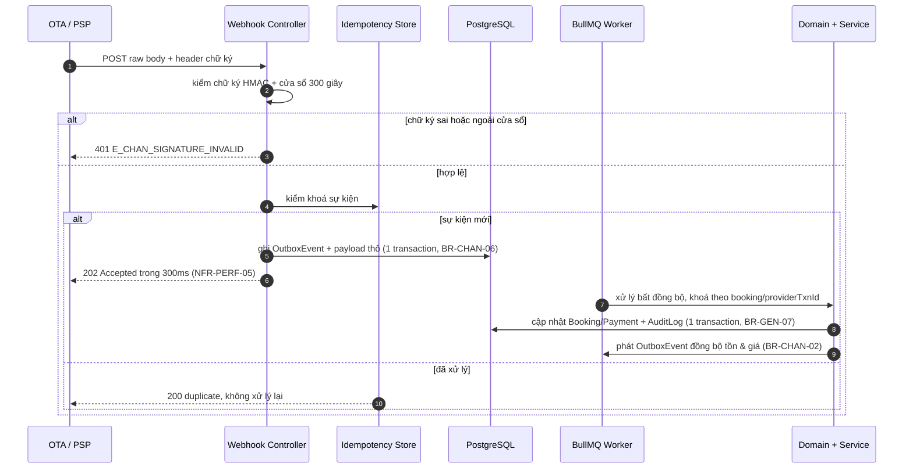

# 04 — Hợp đồng API

> Hợp đồng REST/JSON giữa các giao diện (web khách, web back-office, Android) và tầng ứng dụng, cùng hai nhóm tích hợp vào (OTA, cổng thanh toán).
> Định danh, tên trường, enum lấy từ [00/từ điển thực thể](../00-tong-quan.md#7-từ-điển-thực-thể-nguồn-chân-lý-về-định-danh); mọi giá trị nghiệp vụ **tham chiếu mã BR** tại [02/quy tắc nghiệp vụ](../02-nghiep-vu/quy-tac-nghiep-vu.md), không chép lại số.
> Phạm vi: **13 module** · **52 use case** · **136 quy tắc BR**. Đóng băng hợp đồng tại mốc **M3** ([05/lộ trình](../05-ke-hoach/lo-trinh.md)).

---

## 1. Quy ước chung

### 1.1. Nguyên tắc nền

| # | Quy ước | Căn cứ |
|---|---------|--------|
| 1 | REST/JSON, tiền tố `/api/v1`; OpenAPI 3.1 sinh tự động từ zod trong `packages/contracts` | ADR-008, NFR-MAIN-04 |
| 2 | Tiền là **số nguyên VND**, không dùng số thực; làm tròn tường minh theo thứ tự giá | BR-GEN-01, BR-GEN-03 |
| 3 | Thời điểm là ISO 8601 **UTC** (`2026-12-24T07:00:00Z`); **ngày nghiệp vụ** là `YYYY-MM-DD` theo giờ VN | BR-GEN-02, BR-GEN-05, NFR-LOC-02 |
| 4 | Mọi thao tác ghi **PHẢI** mang `Idempotency-Key`; hiệu lực 24 giờ | BR-GEN-08 |
| 5 | Thay đổi `Booking`, `Payment`, `RefundRequest`, `RoomMove`, `SystemSetting` ghi `AuditLog` **trong cùng transaction**; miền thuần nhận thời gian/mã/sự kiện qua cổng ra `Clock`, `IdGenerator`, `OutboxPort`, `UnitOfWork` ([04/kiến trúc](kien-truc.md)) | BR-GEN-07, BR-SYS-05 |
| 6 | Không endpoint nào sửa/xoá bản ghi bất biến (`Payment` gốc, `AuditLog`, hồ sơ khách) | BR-PAY-09, BR-SYS-01, BR-CRM-05 |
| 7 | Cùng đầu vào **PHẢI** cho cùng kết quả giá trên web khách, Android và API | BR-RATE-17 |
| 8 | Tên tài nguyên `kebab-case` số nhiều, khớp `snake_case` số nhiều của bảng | 00 §7 |

### 1.2. Xác thực & phân quyền

| Hạng mục | Quy định | Căn cứ |
|----------|----------|--------|
| Cơ chế | `Authorization: Bearer <accessToken>` — JWT HS256; access **15 phút**, refresh **7 ngày**, xoay vòng khi dùng | ADR-010, BR-RBAC-05 |
| Vai trò | `OWNER` · `MANAGER` · `FRONT_DESK` · `RESERVATION_AGENT` · `ACCOUNTANT` · `HOUSEKEEPING`; khách dùng phiên riêng qua `/guest-auth` | BR-RBAC-01 |
| Phạm vi cơ sở | Trừ `OWNER`, mọi vai trò chỉ truy cập dữ liệu thuộc `User.propertyScope`; ngoài phạm vi trả `403 E_AUTH_OUT_OF_SCOPE` kể cả khi đối tượng tồn tại | BR-RBAC-02, NFR-SEC-01 |
| Thao tác tài chính | Endpoint đánh dấu 🔒 **PHẢI** kèm `pinToken` từ `POST /auth/pin/verify` (hiệu lực 5 phút, dùng một lần) | BR-RBAC-05 |
| Khoá tài khoản | 5 lần đăng nhập sai liên tiếp → khoá 15 phút | BR-RBAC-06, NFR-SEC-05 |
| ⚠️ Ngoại lệ | Mọi endpoint `/integrations/**` xác thực bằng **chữ ký HMAC**, không dùng Bearer (§5) | BR-CHAN-06, BR-PAY-03 |

### 1.3. Header & định dạng trao đổi

| Header | Chiều | Bắt buộc | Ý nghĩa |
|--------|-------|----------|---------|
| `Authorization` | → | Trừ endpoint công khai và `/integrations/**` | `Bearer <accessToken>` |
| `Idempotency-Key` | → | Mọi thao tác ghi | UUID v4 do client sinh (BR-GEN-08) |
| `X-Trace-Id` | ← | Luôn | Mã tương quan, trùng `traceId` trong body lỗi |
| `Idempotency-Replayed` | ← | Khi phát lại | `true` — trả bản ghi của lần gọi trước, không tạo bản ghi mới |

### 1.4. Bao hình phản hồi

| Trường hợp | HTTP | Body |
|-----------|------|------|
| Đọc một đối tượng | 200 | Đối tượng trực tiếp, không bọc `data` |
| Danh sách | 200 | `{ "data": [ … ], "meta": { "limit": 20, "nextCursor": null, "hasMore": false, "total": 137 } }` |
| Tạo mới | 201 | Đối tượng đã tạo + header `Location` |
| Không nội dung trả | 204 | ∅ — chỉ dùng cho giải phóng hold, gỡ `RoomBlock`, gỡ danh sách đen |
| Lỗi | 4xx/5xx | Một cấu trúc lỗi duy nhất (§4.1) |

### 1.5. Phân trang, lọc, sắp xếp

| Tham số | Mặc định | Trần | Ghi chú |
|---------|----------|------|---------|
| `limit` | 20 | 100 | Vượt trần → `400 E_GEN_VALIDATION_FAILED` |
| `cursor` | — | — | Chuỗi mờ (base64 của `createdAt` + `id`); client **KHÔNG** phân tích nội dung |
| `sort` | theo tài nguyên | — | Danh sách trường, tiền tố `-` là giảm dần; luôn có khoá phụ `id` để tất định |
| `from`, `to` | — | — | Bao gồm hai đầu; ngày VN khi lọc theo `date`, UTC khi lọc theo thời điểm ghi |
| `q` | — | — | Khớp `Guest.phone` đã chuẩn hoá `+84…` (BR-CRM-01), `Booking.code`, mã phòng |

Chọn con trỏ thay vì `offset` vì lịch tồn phòng và nhật ký kiểm toán ghi rất nhanh (NFR-PERF-02). Nhiều giá trị trong cùng tham số là OR, khác tham số là AND; tham số lạ **bị bỏ qua**, không gây lỗi.

### 1.6. Idempotency

Khoá lưu 24 giờ (BR-GEN-08). Cùng khoá + cùng payload → phát lại kết quả gốc kèm `Idempotency-Replayed: true`; cùng khoá + payload khác → `409 E_SYS_IDEMPOTENCY_KEY_REUSED`. Gửi lặp 10 lần **PHẢI** tạo đúng **1** bản ghi (NFR-REL-06). Webhook dùng cùng cơ chế với khoá tự nhiên của nhà cung cấp (§5).

---

## 2. Danh mục endpoint theo module

**Vai trò tối thiểu:** `—` = công khai · `GUEST` = khách đã đăng nhập · 🔒 = yêu cầu PIN tài chính. `{id}` là UUID, `{code}` là mã nghiệp vụ.

### 2.1. AUTH — Định danh & phân quyền (3 UC)

| Method | Đường dẫn | Mô tả | Vai trò tối thiểu | Tham số chính | UC | BR |
|--------|-----------|-------|-------------------|---------------|----|----|
| POST | `/api/v1/auth/login` | Đăng nhập nội bộ, trả cặp access/refresh | — | `username`, `password` | UC-AUTH-01 | BR-RBAC-06 |
| POST | `/api/v1/auth/refresh` | Xoay refresh token | — | `refreshToken` | UC-AUTH-01 | BR-RBAC-05 |
| POST | `/api/v1/auth/pin/verify` | Xác thực PIN 6 số, trả `pinToken` | FRONT_DESK | `pin` | UC-AUTH-01 | BR-RBAC-05 |
| PUT | `/api/v1/users/{userId}/access` | Gán vai trò, phạm vi cơ sở, trạng thái | OWNER | `role`, `propertyScope[]`, `isActive` | UC-AUTH-02 | BR-RBAC-01,02 |
| POST | `/api/v1/guest-auth/register` | Khách đăng ký tài khoản | — | `fullName`, `phone`, `email`, `password`, `consentMarketing` | UC-AUTH-03 | BR-CRM-01 |
| POST | `/api/v1/guest-auth/login` | Khách đăng nhập | — | `phone`, `password` | UC-AUTH-03 | BR-CRM-01 |

### 2.2. PROP — Cơ sở & buồng phòng (4 UC)

| Method | Đường dẫn | Mô tả | Vai trò tối thiểu | Tham số chính | UC | BR |
|--------|-----------|-------|-------------------|---------------|----|----|
| GET | `/api/v1/properties` | Danh sách cơ sở kèm số phòng `ACTIVE` | HOUSEKEEPING | `status` | UC-PROP-01 | BR-PROP-01,02 |
| PATCH | `/api/v1/properties/{propertyId}` | Sửa cơ sở, đổi trần bán vượt (trần theo cơ sở, tổng chuỗi = tổng trần cơ sở), giờ nhận/trả phòng | OWNER | `overbookLimitPct`, `checkInTime`, `checkOutTime` | UC-PROP-01 | BR-OVER-01,02, BR-GEN-04 |
| POST | `/api/v1/room-types` | Tạo loại phòng (sức chứa, giá cơ bản, sàn/trần) | OWNER | `propertyId`, `code`, `capacityAdults`, `capacityChildren`, `basePrice`, `minPrice`, `maxPrice`, `allowShared` | UC-PROP-02 | BR-PROP-03,04, BR-RATE-03,04 |
| GET | `/api/v1/rooms` | Danh sách phòng vật lý | HOUSEKEEPING | `propertyId`, `roomTypeId`, `floor`, `status` | UC-PROP-03 | BR-PROP-05 |
| PUT | `/api/v1/rooms/{roomId}/connecting-room` | Gán/gỡ phòng thông nhau (đối xứng hai chiều) | MANAGER | `connectingRoomId` | UC-PROP-03 | BR-OVER-15 |
| POST | `/api/v1/room-blocks` | Khoá phòng/ngừng bán | MANAGER | `roomId`, `startDate`, `endDate`, `reason` | UC-PROP-04 | BR-INV-06, BR-PROP-06 |
| DELETE | `/api/v1/room-blocks/{roomBlockId}` | Gỡ khoá phòng (204) | MANAGER | `reason` | UC-PROP-04 | BR-INV-06 |

### 2.3. INV — Tồn phòng (3 UC)

| Method | Đường dẫn | Mô tả | Vai trò tối thiểu | Tham số chính | UC | BR |
|--------|-----------|-------|-------------------|---------------|----|----|
| GET | `/api/v1/inventory/grid` | Lịch tồn phòng dạng lưới ngày × loại phòng | HOUSEKEEPING | `propertyId`, `from`, `to`, `roomTypeId`, `channelCode` | UC-INV-01 | BR-INV-01,07, NFR-PERF-01 |
| GET | `/api/v1/inventory/availability` | **Tìm phòng trống** theo kỳ lưu trú (§3.8) | — | `propertyId`, `roomTypeId`, `checkIn`, `checkOut`, `adults`, `children`, `roomCount`, `channelCode` | UC-INV-02 | BR-INV-01,02,07, BR-PROP-06 |
| GET | `/api/v1/channel-allotments` | Allotment theo kênh × loại phòng × ngày | MANAGER | `channelId`, `roomTypeId`, `from`, `to` | UC-INV-03 | BR-INV-05, BR-CHAN-01,08 |
| PUT | `/api/v1/channel-allotments` | Đặt lại allotment theo lô trong một transaction | MANAGER | `channelId`, `roomTypeId`, `date`, `allotment` | UC-INV-03 | BR-INV-05, BR-CHAN-01,06 |

### 2.4. RATE — Giá, mùa, kênh (5 UC)

| Method | Đường dẫn | Mô tả | Vai trò tối thiểu | Tham số chính | UC | BR |
|--------|-----------|-------|-------------------|---------------|----|----|
| GET | `/api/v1/room-types/{roomTypeId}/rate-calendar` | Lịch giá theo ngày | MANAGER | `from`, `to`, `source` | UC-RATE-01 | BR-RATE-02,03 |
| PUT | `/api/v1/room-types/{roomTypeId}/rate-calendar` | Ghi đè lịch giá (`source = OVERRIDE`, `priority` cao nhất); cảnh báo khi `LONGSTAY14` không có giá riêng nên bằng giá `FLEX7` | OWNER | `date[]`, `price`, `channelCode`, `priority`, `reason`, `confirmOwnerOverride` | UC-RATE-01 | BR-RATE-02, BR-RATE-19, BR-RBAC-04 |
| POST | `/api/v1/seasons` | Tạo mùa (hệ số, `priority`, phụ thu cuối tuần) | OWNER | `propertyId`, `name`, `startDate`, `endDate`, `multiplier`, `priority`, `weekendSurchargeEnabled` | UC-RATE-02 | BR-RATE-05,06 |
| PATCH | `/api/v1/channels/{channelId}` | Sửa hệ số/hoa hồng/hold/`overbookAllowed` mức **mặc định toàn chuỗi**; ghi đè theo cặp (kênh, cơ sở) qua `ChannelPropertySetting` (mốc so sánh là **ngày của từng đêm**: dòng có `effectiveFrom` lớn nhất ≤ ngày đêm đó thắng); cảnh báo khi hệ số dưới ngưỡng sàn `1/(1−hoa hồng)`, `AGENCY` miễn | OWNER | `multiplier`, `commissionPct`, `holdMinutes`, `overbookAllowed`, `propertyOverrides[]` | UC-RATE-03 | BR-RATE-07,09,18, BR-OVER-02 |
| POST | `/api/v1/promotions` | Tạo khuyến mãi | OWNER | `code`, `type`, `value`, `minNights`, `channelScope`, `roomTypeScope`, `validFrom`, `validTo`, `maxUses`, `stackable` | UC-RATE-04 | BR-RATE-10,11,13 |
| POST | `/api/v1/quotes` | **Báo giá** kỳ lưu trú (§3.1) | — | `propertyId`, `roomTypeId`, `channelCode`, `ratePlanCode`, `checkIn`, `checkOut`, `adults`, `children`, `roomCount`, `promotionCodes[]` | UC-INV-02, UC-RATE-05 | BR-RATE-01…17 |
| POST | `/api/v1/quotes/multi-channel` | So sánh giá đồng thời nhiều kênh | MANAGER | `roomTypeId`, `checkIn`, `checkOut`, `channelCodes[]` | UC-RATE-05 | BR-RATE-07,08,09 |

### 2.5. BOOK — Đặt phòng (8 UC)

| Method | Đường dẫn | Mô tả | Vai trò tối thiểu | Tham số chính | UC | BR |
|--------|-----------|-------|-------------------|---------------|----|----|
| POST | `/api/v1/bookings` | **Tạo booking** (web/quầy/điện thoại) — §3.2 | GUEST | `propertyId`, `roomTypeId`, `ratePlanCode`, `channelCode`, `quoteId`, `guest`, `checkIn`, `checkOut`, `adults`, `children`, `roomCount`, `promotionCodes[]` | UC-BOOK-01, UC-BOOK-02, UC-BOOK-03 | BR-BOOK-01…16 |
| GET | `/api/v1/bookings` | Tra cứu booking (lọc + phân trang con trỏ) | HOUSEKEEPING | `propertyId`, `status`, `channelCode`, `from`, `to`, `q` | UC-BOOK-07 | BR-RBAC-02 |
| DELETE | `/api/v1/bookings/{bookingId}` | Xoá cứng **chỉ** `DRAFT`/`HELD` chưa phát sinh thanh toán; **PHẢI** ghi `AuditLog.beforeJson` trước khi xoá (204) | FRONT_DESK | `reason` | UC-BOOK-05 | BR-BOOK-14, BR-BOOK-17 |
| POST | `/api/v1/bookings/{bookingId}/confirm` | Xác nhận booking | FRONT_DESK | `paymentId` | UC-BOOK-01, UC-BOOK-02, UC-BOOK-03 | BR-BOOK-09 |
| POST | `/api/v1/bookings/{bookingId}/reschedule` | Đổi ngày: **không đổi trạng thái**, lưu `PriceSnapshot` mới (`kind = RESCHEDULE`) và **giữ bản cũ**, tăng `rescheduleCount`, ghi `AuditLog` | GUEST | `checkIn`, `checkOut`, `reason` | UC-BOOK-06 | BR-BOOK-12,13, BR-CANCEL-08 |
| POST | `/api/v1/bookings/{bookingId}/cancel-preview` | Xem trước tiền hoàn, không đổi trạng thái | GUEST | `reason`, `isForceMajeure` | UC-BOOK-08 | BR-CANCEL-01…06 |
| POST | `/api/v1/bookings/{bookingId}/cancel` | **Huỷ booking** (toàn phần hoặc **một phần** theo `bookingRoomIds[]` khi `roomCount > 1`) — §3.3 | GUEST | `reason`, `note`, `isForceMajeure`, `evidenceRefs[]`, `bookingRoomIds[]` | UC-BOOK-08 | BR-BOOK-11,14, BR-CANCEL-01…19 |
| POST | `/api/v1/holds` | **Giữ chỗ có thời hạn** — §3.4 | GUEST | `propertyId`, `roomTypeId`, `channelCode`, `checkIn`, `checkOut`, `adults`, `children`, `roomCount`, `quoteId` | UC-BOOK-04 | BR-BOOK-04,07, BR-INV-02 |
| DELETE | `/api/v1/holds/{holdId}` | Giải phóng hold ngay, trả phòng về tồn khả dụng (204) | FRONT_DESK | `reason` | UC-BOOK-04 | BR-INV-04 |

### 2.6. PAY — Thanh toán & hoàn tiền (5 UC)

| Method | Đường dẫn | Mô tả | Vai trò tối thiểu | Tham số chính | UC | BR |
|--------|-----------|-------|-------------------|---------------|----|----|
| POST | `/api/v1/payments` | Ghi nhận tiền cọc/số dư/hoàn tất toán (`type` ∈ `DEPOSIT`/`BALANCE`/`PENALTY`/`EXTRA_SERVICE`/`COMPENSATION`/`RESCHEDULE_FEE`) | FRONT_DESK | `bookingId`, `type`, `method`, `amount`, `note`, `pinToken` 🔒 | UC-PAY-01, UC-PAY-03 | BR-PAY-01,02,06,07 |
| POST | `/api/v1/payments/online` | **Khởi tạo thanh toán trực tuyến** — §3.5 | GUEST | `bookingId`, `type`, `method`, `amount`, `returnUrl` | UC-PAY-02 | BR-PAY-03,04,05 |
| GET | `/api/v1/payments/{paymentId}/status` | Trạng thái giao dịch (poll sau khi PSP chuyển hướng) | GUEST | — | UC-PAY-02 | BR-PAY-05 |
| GET | `/api/v1/bookings/{bookingId}/balance` | `balanceDue`, `penaltyAmount`, `refundedAmount`; booking `CANCELLED`/`NO_SHOW`/`EXPIRED` **không** tạo công nợ phần chưa trả, `balanceDue = penaltyAmount` | HOUSEKEEPING | — | UC-PAY-03 | BR-PAY-02 |
| POST | `/api/v1/refund-requests` | **Yêu cầu hoàn tiền** — §3.6 | FRONT_DESK | `bookingId`, `paymentId`, `reason`, `isForceMajeure`, `evidenceRefs[]` | UC-PAY-04, UC-BOOK-08 | BR-CANCEL-01…07,13 |
| POST | `/api/v1/refund-requests/{refundRequestId}/approve` | **Duyệt hoàn tiền** — §3.7 | MANAGER | `approvedAmount`, `note`, `pinToken` 🔒 | UC-PAY-04 | BR-CANCEL-15 |
| POST | `/api/v1/refund-requests/{refundRequestId}/cancel` | Khách rút yêu cầu / booking được khôi phục → `CANCELLED` | FRONT_DESK | `reason` | UC-PAY-04 | BR-CANCEL-18 |
| POST | `/api/v1/refund-requests/{refundRequestId}/pay` | Chi tiền hoàn về phương thức gốc | ACCOUNTANT | `method`, `bankNote`, `pinToken` 🔒 | UC-PAY-04 | BR-CANCEL-12,16, BR-PAY-08,09 |
| POST | `/api/v1/reconciliation/daily/close` | Chốt ca/ngày, ghi nhận chênh lệch | ACCOUNTANT | `propertyId`, `businessDate`, `countedCash`, `note` | UC-PAY-05 | BR-PAY-06,10 |

### 2.7. CHAN — Kênh bán (3 UC)

| Method | Đường dẫn | Mô tả | Vai trò tối thiểu | Tham số chính | UC | BR |
|--------|-----------|-------|-------------------|---------------|----|----|
| POST | `/api/v1/channels/{channelId}/sync` | Đẩy tồn & giá lên một kênh (202) | MANAGER | `scope`, `from`, `to` | UC-CHAN-02 | BR-CHAN-02,06 |
| PUT | `/api/v1/channels/{channelId}/mappings` | Ánh xạ loại phòng ↔ mã phòng OTA | OWNER | `roomTypeId`, `providerRoomTypeCode`, `allotmentPct` | UC-CHAN-01 | BR-CHAN-01,08 |
| POST | `/api/v1/channels/{channelId}/sales-closure` | Đóng bán loại phòng theo ngày trên OTA | MANAGER | `roomTypeId`, `from`, `to`, `reason` | UC-CHAN-01 | BR-CHAN-05 |
| GET | `/api/v1/channels/{channelId}/ota-bookings` | Booking nhận từ OTA kèm trạng thái xử lý | MANAGER | `from`, `to`, `status`, `q` | UC-CHAN-03 | BR-CHAN-03,04 |

### 2.8. OVER — Quá tải & điều chuyển (5 UC)

| Method | Đường dẫn | Mô tả | Vai trò tối thiểu | Tham số chính | UC | BR |
|--------|-----------|-------|-------------------|---------------|----|----|
| GET | `/api/v1/overbooking-cases` | **Danh sách ca quá tải** — §3.9 | MANAGER | `propertyId`, `status`, `dateFrom`, `dateTo`, `roomTypeId`, `overdueOnly` | UC-OVER-01 | BR-OVER-03,04,05 |
| GET | `/api/v1/overbooking-cases/{caseId}` | Chi tiết ca quá tải + ứng viên điều chuyển đã xếp hạng | MANAGER | `includeCandidates` | UC-OVER-01 | BR-OVER-11,12 |
| POST | `/api/v1/overbooking-cases/{caseId}/relocation-plan` | Tính thang xử lý 4 bậc và thứ tự `keepScore` | MANAGER | `strategy` (`AUTO`/`MANUAL`) | UC-OVER-02 | BR-OVER-06,11,12 |
| POST | `/api/v1/overbooking-cases/{caseId}/resolve` | Đóng ca quá tải sau khi xử lý xong | MANAGER | `resolutionNote` | UC-OVER-01 | BR-OVER-04 |
| POST | `/api/v1/room-moves` | **Thực hiện điều chuyển phòng** — §3.10 | FRONT_DESK | `overbookingCaseId`, `bookingId`, `bookingRoomId`, `moveType`, `toRoomId`, `reason`, `compensationAmount`, `transportCost`, `consent` | UC-OVER-02, UC-OVER-04 | BR-OVER-06…10, BR-BOOK-11 |
| POST | `/api/v1/room-moves/{roomMoveId}/approve` | Duyệt điều chuyển và chi phí bồi thường | MANAGER | `compensationAmount`, `transportCost`, `note`, `pinToken` 🔒 | UC-OVER-02, UC-OVER-05 | BR-OVER-06,07 |
| POST | `/api/v1/room-moves/{roomMoveId}/execute` | Giải phóng phòng cũ, gán phòng mới, gửi thông báo | FRONT_DESK | `pinToken` 🔒 | UC-OVER-02 | BR-OVER-08,10, BR-BOOK-11 |
| POST | `/api/v1/room-merges` | Tạo phương án ghép phòng (`MERGE_SHARE`/`MERGE_CONNECTING`) | FRONT_DESK | `primaryBookingId`, `secondaryBookingId`, `roomId`, `discountPct` | UC-OVER-03 | BR-OVER-13,14,15 |
| POST | `/api/v1/room-merges/{roomMergeId}/consent` | Ghi nhận đồng thuận của từng bên | FRONT_DESK | `side` (`PRIMARY`/`SECONDARY`), `consented`, `evidenceUrl` | UC-OVER-03 | BR-OVER-13 |
| POST | `/api/v1/room-merges/{roomMergeId}/approve` | Duyệt ghép phòng (bắt buộc khi khác giới tính) | MANAGER | `reason` | UC-OVER-03 | BR-OVER-14 |

### 2.9. FO — Tiền sảnh & buồng phòng (4 UC)

| Method | Đường dẫn | Mô tả | Vai trò tối thiểu | Tham số chính | UC | BR |
|--------|-----------|-------|-------------------|---------------|----|----|
| POST | `/api/v1/front-office/check-in` | Check-in khách | FRONT_DESK | `bookingId`, `idNumber`, `actualRoomIds[]`, `earlyCheckIn`, `note` | UC-FO-01 | BR-FO-01,02,04 |
| POST | `/api/v1/front-office/check-out` | Check-out, thu phát sinh, ghi nhận trả phòng sớm với `cancelReason = EARLY_CHECKOUT`; ngưỡng đọc từ `CancellationPolicy.earlyCheckoutFreeHours`/`earlyCheckoutRefundPct` | FRONT_DESK | `bookingId`, `extras[]`, `lateCheckOut`, `earlyCheckOut`, `pinToken` 🔒 | UC-FO-02 | BR-FO-03,05,06, BR-CANCEL-09 |
| POST | `/api/v1/front-office/no-show` | Ghi nhận khách không đến | FRONT_DESK | `bookingId`, `reason` | UC-FO-04 | BR-CANCEL-10 |
| GET | `/api/v1/housekeeping/tasks` | Danh sách việc dọn phòng | HOUSEKEEPING | `propertyId`, `businessDate`, `status`, `assignedTo` | UC-FO-03 | BR-FO-06 |
| PATCH | `/api/v1/housekeeping/tasks/{taskId}` | Cập nhật trạng thái/nhận việc; `DONE`/`INSPECTED` trả phòng về tồn khả dụng | HOUSEKEEPING | `status`, `assignedTo`, `note` | UC-FO-03 | BR-FO-06,07 |

### 2.10. CRM — Khách hàng (3 UC)

| Method | Đường dẫn | Mô tả | Vai trò tối thiểu | Tham số chính | UC | BR |
|--------|-----------|-------|-------------------|---------------|----|----|
| GET | `/api/v1/guests` | Tra cứu hồ sơ khách | FRONT_DESK | `q`, `loyaltyTier`, `blacklisted`, `propertyId` | UC-CRM-01 | BR-CRM-01 |
| POST | `/api/v1/guests` | Tạo hồ sơ khách (nhận diện theo SĐT chuẩn hoá) | FRONT_DESK | `fullName`, `phone`, `email`, `idNumber`, `dob`, `nationality`, `consentMarketing` | UC-CRM-01 | BR-CRM-01, NFR-COMP-01 |
| POST | `/api/v1/guests/{guestId}/anonymize` | Ẩn danh hoá theo yêu cầu khách (không xoá cứng) | MANAGER | `reason`, `requestedAt` | UC-CRM-01 | BR-CRM-05, NFR-COMP-01 |
| GET | `/api/v1/guests/{guestId}/loyalty` | Hạng, điểm, tổng đêm tích luỹ 12 tháng | FRONT_DESK | — | UC-CRM-02 | BR-CRM-02,03 |
| POST | `/api/v1/guests/{guestId}/blacklist` | Đưa khách vào danh sách đen | MANAGER | `blacklistReason` | UC-CRM-03 | BR-CRM-04 |
| DELETE | `/api/v1/guests/{guestId}/blacklist` | Gỡ khỏi danh sách đen (204) | MANAGER | `reason` | UC-CRM-03 | BR-CRM-04, BR-SYS-05 |

### 2.11. NOTI — Thông báo (2 UC)

| Method | Đường dẫn | Mô tả | Vai trò tối thiểu | Tham số chính | UC | BR |
|--------|-----------|-------|-------------------|---------------|----|----|
| GET | `/api/v1/notifications` | Thông báo đã gửi kèm trạng thái và số lần thử | FRONT_DESK | `bookingId`, `channel`, `status`, `template`, `from`, `to` | UC-NOTI-01 | BR-SYS-06 |
| POST | `/api/v1/notifications/{notificationId}/resend` | Gửi lại (tối đa 3 lần, cách 5 phút) | FRONT_DESK | `reason` | UC-NOTI-02 | BR-SYS-06 |

### 2.12. REP — Báo cáo (4 UC)

| Method | Đường dẫn | Mô tả | Vai trò tối thiểu | Tham số chính | UC | BR |
|--------|-----------|-------|-------------------|---------------|----|----|
| GET | `/api/v1/reports/occupancy` | Công suất theo cơ sở/loại phòng/ngày; phòng DOR đếm theo **đơn vị bán** (giường) | MANAGER | `propertyId`, `from`, `to`, `groupBy` | UC-REP-01 | BR-REP-01, BR-INV-01, BR-PROP-03 |
| GET | `/api/v1/reports/adr-revpar` | ADR, RevPAR, phòng-đêm đã bán, phòng khả dụng | MANAGER | `propertyId`, `from`, `to`, `groupBy` | UC-REP-01 | BR-REP-01, BR-RATE-08 |
| GET | `/api/v1/reports/revenue-by-channel` | Doanh thu gộp/thuần & hoa hồng theo kênh | ACCOUNTANT | `from`, `to`, `channelId`, `propertyId` | UC-REP-02 | BR-RATE-08 |
| GET | `/api/v1/reports/cancellations` | Huỷ phòng theo bậc chính sách kèm **tỷ lệ huỷ** | ACCOUNTANT | `from`, `to`, `ratePlanCode`, `propertyId` | UC-REP-03 | BR-REP-01, BR-CANCEL-01,02 |
| GET | `/api/v1/reports/force-majeure` | Báo cáo riêng các ca bất khả kháng | OWNER | `from`, `to` | UC-REP-03 | BR-CANCEL-13 |
| GET | `/api/v1/reports/overbooking` | Số ca quá tải, thời điểm phát hiện & xử lý, tổng chi phí xử lý quá tải (chiết khấu ghép phòng + bồi thường walk-out + đưa đón) | MANAGER | `propertyId`, `from`, `to`, `status` | UC-REP-04 | BR-REP-01, BR-OVER-04,05,15,16 |
| POST | `/api/v1/reports/export` | Xuất CSV/XLSX cho kế toán (202) | ACCOUNTANT | `report`, `format`, `params` | UC-REP-01…04 | NFR-COMP-04 |

### 2.13. SYS — Nền tảng & tuân thủ (3 UC)

| Method | Đường dẫn | Mô tả | Vai trò tối thiểu | Tham số chính | UC | BR |
|--------|-----------|-------|-------------------|---------------|----|----|
| GET | `/api/v1/audit-logs` | Nhật ký kiểm toán (chỉ đọc) | MANAGER | `actorId`, `entityType`, `entityId`, `action`, `from`, `to` | UC-SYS-01 | BR-SYS-01,05 |
| PUT | `/api/v1/system-settings/{key}` | Sửa tham số (ghi `AuditLog` cùng transaction) | OWNER | `value`, `reason` | UC-SYS-02 | BR-SYS-02, BR-GEN-07 |
| POST | `/api/v1/system/backups` | Yêu cầu sao lưu (202) | OWNER | `mode` (`PITR`/`FULL`) | UC-SYS-03 | BR-SYS-03 |
| POST | `/api/v1/system/backups/{backupId}/restore` | Diễn tập phục hồi vào môi trường tạm (202) | OWNER | `targetTimestamp`, `reason` | UC-SYS-03 | BR-SYS-03 |
| GET | `/api/v1/system/health` | Kiểm tra sống/chết, phiên bản, trạng thái phụ thuộc | — | — | UC-SYS-03 | NFR-USE-01, NFR-USE-02 |

### 2.14. Ràng buộc âm — endpoint KHÔNG được phép tồn tại

Áp dụng cho **cả 13 module**; kiểm tra bắt buộc khi review OpenAPI sinh tự động.

| Endpoint bị cấm | Lý do | BR |
|-----------------|-------|----|
| `DELETE /bookings/{id}` khi `status ≠ DRAFT/HELD`, đã phát sinh thanh toán, hoặc **không ghi `AuditLog` (beforeJson) trước khi xoá** | Đã xác nhận/đã thu tiền thì chỉ chuyển `CANCELLED` + tạo `RefundRequest`; xoá cứng phải lưu vết trước | BR-BOOK-14, BR-BOOK-17 |
| `PATCH`/`PUT`/`DELETE /bookings/{id}/price-snapshot` | Ảnh chụp giá bất biến; giá đã chốt không đổi theo cấu hình sau đó | BR-RATE-16 |
| `PATCH`/`PUT`/`DELETE /payments/{id}` | `Payment` gốc không sửa/xoá; điều chỉnh bằng bút toán loại `REFUND` | BR-PAY-09, NFR-COMP-03 |
| `POST /payments*` có trường số thẻ/CVV/ngày hết hạn | Không lưu dữ liệu thẻ | BR-PAY-04, NFR-SEC-02 |
| `PUT`/`PATCH`/`DELETE /audit-logs/**` | `AuditLog` append-only, thu hồi `UPDATE`/`DELETE` ở tầng CSDL | BR-SYS-01, NFR-SEC-04 |
| `DELETE /guests/{id}` | Chỉ ẩn danh hoá; giữ bản ghi đặt phòng vì nghĩa vụ kế toán | BR-CRM-05, NFR-COMP-02 |
| `POST /refund-requests/{id}/cancel` khi `status ∈ {APPROVED, PAID}` | Chỉ huỷ được ở `PENDING`, phải ghi lý do | BR-CANCEL-18 |
| Bất kỳ endpoint tạo hai `RoomAssignment` hoạt động trùng `(roomId, bedNo, đêm)`; hoặc dùng khoá đơn kiểu `COALESCE(bedNo, roomId)` | Bất biến cứng ép ở tầng CSDL bằng ràng buộc loại trừ trên bộ ba `(room_id, bed_no, valid_range)`; `bedNo = 0` nghĩa là cả phòng, `1..bedCount` chỉ dùng cho DOR | BR-INV-03, BR-PROP-04 |

---

## 3. Đặc tả chi tiết 10 endpoint trọng yếu

Chung cho mọi ví dụ: thao tác ghi mang `Idempotency-Key`; tiền là số nguyên VND; thời điểm UTC; nhãn `…` là UUID rút gọn cho dễ đọc.

### 3.1. `POST /api/v1/quotes` — Báo giá

Lớp xử lý: `QuotePriceUseCase` → `RateService` → `PricingEngine` + `PricingRuleChain` (`SeasonModifier` → `WeekendModifier` → `OccupancyModifier` → `LosModifier` → `ChannelModifier`) → `PriceQuoteBuilder`.

```json
{
  "propertyId": "8f2a1c40-…", "roomTypeId": "b1d9c7e2-…", "channelCode": "WEB", "ratePlanCode": "FLEX7",
  "checkIn": "2026-12-24", "checkOut": "2026-12-27", "adults": 2, "children": 0, "roomCount": 1, "promotionCodes": ["EARLY10"]
}
```

Response 201:

```json
{
  "quoteId": "3c7f9b21-…", "channelCode": "WEB", "ratePlanCode": "FLEX7", "checkIn": "2026-12-24", "checkOut": "2026-12-27",
  "nights": [
    { "date": "2026-12-24", "basePrice": 650000, "seasonMultiplier": 2.00, "weekendMultiplier": 1.00, "occupancyMultiplier": 1.15, "losMultiplier": 0.95, "channelMultiplier": 1.00, "clamped": false, "nightlyPrice": 1421000 },
    { "date": "2026-12-25", "basePrice": 650000, "seasonMultiplier": 2.00, "weekendMultiplier": 1.20, "occupancyMultiplier": 1.15, "losMultiplier": 0.95, "channelMultiplier": 1.00, "clamped": false, "nightlyPrice": 1705000 },
    { "date": "2026-12-26", "basePrice": 650000, "seasonMultiplier": 2.00, "weekendMultiplier": 1.20, "occupancyMultiplier": 1.15, "losMultiplier": 0.95, "channelMultiplier": 1.00, "clamped": false, "nightlyPrice": 1705000 }
  ],
  "subtotal": 4831000, "discountAmount": 483100, "total": 4347000, "currency": "VND", "warnings": [],
  "depositPercent": 30, "depositAmount": 1305000, "engineVersion": "pricing-1.0.0",
  "quotedAt": "2026-09-19T03:12:44Z", "expiresAt": "2026-09-19T03:27:44Z"
}
```

- Thứ tự hệ số **cố định**; mỗi phần tử `nights[]` **PHẢI** trả đủ `basePrice`, `seasonMultiplier`, `weekendMultiplier`, `occupancyMultiplier`, `losMultiplier`, `channelMultiplier`, `nightlyPrice` để đối chiếu web/Android/API; `clamped = true` khi giá bị kẹp bởi `RoomType.minPrice`/`maxPrice`, kẹp trước rồi làm tròn **lên** 1.000 VND. Giá cơ bản tra trong `RateCalendar` theo `priority` giảm dần: `OVERRIDE` → `RATE_PLAN` → `SEASON` → `BASE`, khớp `(roomTypeId, date)` và `channelCode` nếu dòng có khai (BR-RATE-01,02,04; BR-GEN-03).
- Hệ số công suất lấy từ `OccupancySnapshot`; ngưỡng đọc từ `pricing.occupancyMidPct`/`pricing.occupancyHighPct`; snapshot cũ hơn 5 phút → hệ số 1,00 (BR-RATE-01, BR-SYS-02; 02 §4.3).
- Khuyến mãi áp **một lần trên tổng tạm tính** theo thứ tự tất định: `AMOUNT` trước, `PERCENT` sau, cùng loại theo `code` tăng dần; tổng giảm cắt về `pricing.maxDiscountPct`; chạm sàn → **bỏ mã, giữ giá gốc, vẫn cho xác nhận** và trả `E_RATE_BELOW_FLOOR` trong `warnings[]` (BR-RATE-10,11,12). Mã hết hạn/hết lượt → `422 E_RATE_PROMO_INVALID` (BR-RATE-14); cùng vi phạm sàn nhưng xảy ra ở màn hình cấu hình khuyến mãi thì **chặn bằng `422 E_RATE_BELOW_FLOOR`** (BR-RATE-12).
- `expiresAt` theo BR-RATE-15; quá hạn phải tính lại. Cùng đầu vào **PHẢI** cùng kết quả, chỉ `quotedAt` được khác (BR-RATE-17). `warnings[]` còn chứa cảnh báo cân bằng giá khi giá niêm yết **sau kẹp** của kênh OTA thấp hơn `WEB`; `AGENCY` ngoài phạm vi, không chặn lưu (BR-RATE-09).
- Mã lỗi: `400 E_BOOK_MISSING_FIELD`, `422 E_BOOK_OVER_CAPACITY`, `422 E_BOOK_MIN_NIGHTS`, `409 E_INV_NO_AVAILABILITY`. Giá trị mặc định gói giá (`minNights`, `losDiscountEnabled`) theo 02 §4.4.

### 3.2. `POST /api/v1/bookings` — Tạo booking

Lớp xử lý: `CreateBookingUseCase` → `BookingService` → `BookingFactory` → `InventoryService` (khoá bi quan theo `(roomTypeId, date)`) → `PaymentService` khi thu cọc.

```json
{
  "propertyId": "8f2a1c40-…", "roomTypeId": "b1d9c7e2-…", "ratePlanCode": "FLEX7", "channelCode": "PHONE",
  "quoteId": "3c7f9b21-…", "checkIn": "2026-12-24", "checkOut": "2026-12-27", "adults": 2,
  "children": 0, "roomCount": 1, "promotionCodes": ["EARLY10"],
  "guest": { "fullName": "Nguyễn Văn A", "phone": "0901234567" }, "note": "Khách đến muộn sau 22:00"
}
```

Response 201 (`Location: /api/v1/bookings/a71c0d34-…`):

```json
{
  "id": "a71c0d34-…", "code": "PH-261224-K7M2Q", "seq": 1042, "status": "CONFIRMED", "guestId": "4e8b1f77-…",
  "propertyId": "8f2a1c40-…", "roomTypeId": "b1d9c7e2-…", "ratePlanId": "d5a7e9b3-…", "channelId": "c34a9e51-…",
  "checkIn": "2026-12-24", "checkOut": "2026-12-27", "nights": 3, "adults": 2, "children": 0, "roomCount": 1,
  "totalAmount": 4347000, "depositPercent": 30, "depositAmount": 1305000, "paidAmount": 1305000,
  "refundedAmount": 0, "balanceDue": 3042000, "penaltyAmount": 0, "currency": "VND", "rescheduleCount": 0,
  "holdExpiresAt": null, "oversold": false, "priceLocked": false, "duplicateSuspected": false,
  "channelPolicyCode": null, "note": "Khách đến muộn sau 22:00", "createdBy": "7f1d5b90-…", "createdAt": "2026-09-19T03:14:02Z"
}
```

- Kiểm tra tồn và giữ chỗ nằm trong **một** transaction có khoá bi quan; không có khe hở kiểm tra rồi ghi sau (BR-INV-02). `PriceSnapshot` **PHẢI** được lưu ngay khi booking rời `DRAFT` (`HELD`/`PENDING_PAYMENT`/`CONFIRMED`) để `firstNightPrice` luôn có cho BR-CANCEL-06 (BR-RATE-16). Ràng buộc loại trừ ở CSDL trên `(room_id, bed_no, valid_range)` từ chối (`23P01`) **PHẢI** được bắt và chuyển thành `409 E_INV_ROOM_TAKEN` — cấm nuốt lỗi rồi báo thành công (BR-INV-03).
- Xác nhận không cọc nhận diện bằng `PaymentMethod = OTA_COLLECT` (không theo tên kênh) hoặc `MANAGER`+ cho phép ghi nợ có lý do; ngoài hai trường hợp đó booking ở `PENDING_PAYMENT` tới khi `paidAmount ≥ depositAmount` (BR-BOOK-09).
- Hết phòng vật lý → `oversold = true` và mở `OverbookingCase`. Vượt trần bán vượt → `409 E_OVER_LIMIT_EXCEEDED` (BR-OVER-02). Miễn trừ: `overbookLimitPct` **chỉ** áp cho quyết định bán vượt do hệ thống chủ động; booking do kênh ngoài đẩy vào (OTA) vẫn **PHẢI** ghi `CONFIRMED` + `oversold = true` + mở ca quá tải, không bị chặn (BR-CHAN-03, BR-OVER-02,03).
- Trùng lặp nghi ngờ (cùng kênh + SĐT + loại phòng + ngày nhận phòng trong 24 giờ) → **không** tạo mới, trả booking cũ kèm `duplicateSuspected = true` (BR-BOOK-16); `code` sinh theo `PH-<YYMMDD>-<5 ký tự>` (BR-GEN-06).
- Mã lỗi: `400 E_BOOK_MISSING_FIELD`, `422 E_BOOK_OVER_CAPACITY`, `422 E_BOOK_MIN_NIGHTS`, `409 E_INV_NO_AVAILABILITY`, `409 E_INV_ROOM_TAKEN`, `403 E_BOOK_BLACKLISTED`, `410 E_RATE_QUOTE_EXPIRED`.

### 3.3. `POST /api/v1/bookings/{bookingId}/cancel` — Huỷ booking

Lớp xử lý: `CancelBookingUseCase` → `CancellationPolicyEngine` (chọn bậc theo `offsetHours`) → `RefundService` → `BookingState`.

```json
{ "reason": "GUEST_REQUEST", "note": "Khách đổi kế hoạch", "isForceMajeure": false,
  "evidenceRefs": [], "bookingRoomIds": [] }
```

Response 200:

```json
{
  "bookingId": "a71c0d34-…", "status": "CANCELLED", "cancelledAt": "2026-12-20T07:00:00Z",
  "cancelReason": "GUEST_REQUEST", "releasedAssignmentCount": 3,
  "cancellation": {
    "policyId": "17c2f4a8-…", "appliedTierId": "90ab1c2d-…", "hoursBeforeCheckIn": 96.0, "refundPercent": 50,
    "paidAmount": 1305000, "requestedAmount": 652000, "penaltyAmount": 0, "refundFee": 0
  },
  "refundRequest": { "id": "5d9e0f21-…", "status": "PENDING", "approvedAmount": null }
}
```

- `hoursBeforeCheckIn` tính từ thời điểm nhận phòng danh nghĩa (BR-GEN-04), đơn vị **giờ có phần thập phân**; bậc là mốc có `offsetHours` lớn nhất mà `hoursBeforeCheckIn ≥ offsetHours` (BR-CANCEL-01,03).
- Cơ sở tính hoàn là `paidAmount`, không phải `totalAmount`; hoàn làm tròn **xuống** 1.000 VND; `refundFee` đọc từ `SystemSetting.refund.feeAmount` (BR-CANCEL-04,05,11). **Huỷ một phần** (`bookingRoomIds[]` không rỗng, `roomCount > 1`): `refundBase` phân bổ theo tỷ lệ giá các phòng bị huỷ trên `totalAmount` rồi mới áp BR-CANCEL-05; phòng còn lại giữ nguyên giá và `RoomAssignment`; `totalAmount` giảm; lưu thêm một `PriceSnapshot` điều chỉnh (`kind = PARTIAL_CANCEL`, `seq` tăng) và **giữ bản gốc**; huỷ hết phòng → `CANCELLED` toàn phần (BR-CANCEL-19, BR-RATE-16). Bậc cuối `offsetHours = −1` là **bậc bắt tất** cho mọi `hoursBeforeCheckIn < 24` kể cả âm (BR-CANCEL-01). Bậc có `chargeFirstNight = true` sinh `Payment` loại `PENALTY` trạng thái `PENDING` — ghi công nợ, không tự thu (BR-CANCEL-06).
- Giải phóng **toàn bộ** `RoomAssignment` trong **cùng transaction** với đổi trạng thái (BR-BOOK-11). Bất khả kháng: chỉ `MANAGER`+, `reason` ≥ 20 ký tự, minh chứng trong `evidenceRefs[]`, hoàn 100%, miễn phụ thu và phí (BR-CANCEL-13); `NONREF` hoàn 0% mọi mốc (BR-CANCEL-07).
- Mã lỗi: `409 E_CANCEL_NOT_ALLOWED`, `400 E_PAY_REASON_TOO_SHORT`, `403 E_PAY_REFUND_FORCE_MAJEURE_FORBIDDEN`, `422 E_PAY_REFUND_EXCEEDS_PAID`.

### 3.4. `POST /api/v1/holds` — Giữ chỗ có thời hạn

Lớp xử lý: `CreateBookingUseCase` (nhánh hold) → `BookingService` → `InventoryService` (khoá bi quan).

```json
{
  "propertyId": "8f2a1c40-…", "roomTypeId": "b1d9c7e2-…", "channelCode": "WEB",
  "checkIn": "2026-12-24", "checkOut": "2026-12-27", "adults": 2, "children": 0,
  "roomCount": 1, "quoteId": "3c7f9b21-…"
}
```

Response 201:

```json
{
  "holdId": "e07b3c55-…", "bookingId": "f13a8d6c-…", "bookingCode": "PH-260919-R4T8X",
  "bookingStatus": "HELD", "status": "ACTIVE", "channelId": "1a2b3c4d-…", "releasedAt": null, "expiresAt": "2026-09-19T03:34:02Z", "holdExpiresAt": "2026-09-19T03:34:02Z", "quotedTotal": 4347000, "createdAt": "2026-09-19T03:14:02Z"
}
```

- `holdExpiresAt = thời điểm tạo + Channel.holdMinutes` (BR-BOOK-07); kênh có `holdMinutes = 0` (`WALKIN`, các OTA) **KHÔNG** dùng endpoint này → `409 E_BOOK_INVALID_STATE`.
- Hết hạn → `Hold.status = EXPIRED`, giải phóng toàn bộ `RoomAssignment` trong cùng transaction (BR-BOOK-08), chu kỳ giải phóng theo `job.hold.releaseIntervalSeconds` (BR-INV-04, BR-SYS-02). `DELETE /holds/{holdId}` đặt `status = RELEASED` và trả phòng về tồn khả dụng ngay (204).
- Kiểm tra tồn và giữ chỗ trong một transaction có khoá bi quan; **mọi** đêm phải còn phòng (BR-INV-02, BR-INV-07). Ràng buộc loại trừ CSDL từ chối → `409 E_INV_ROOM_TAKEN` (BR-INV-03).
- Mã lỗi: `409 E_INV_NO_AVAILABILITY`, `409 E_INV_ROOM_TAKEN`, `410 E_RATE_QUOTE_EXPIRED`, `409 E_INV_LOCK_TIMEOUT`, `422 E_BOOK_OVER_CAPACITY`.

### 3.5. `POST /api/v1/payments/online` — Khởi tạo thanh toán trực tuyến

Lớp xử lý: `PaymentService` → `PaymentGatewayAdapter` (`VnpayAdapter`/`MomoAdapter`) → `Payment` trạng thái `PENDING`.

```json
{
  "bookingId": "a71c0d34-…", "type": "DEPOSIT", "method": "VNPAY", "amount": 1305000,
  "returnUrl": "https://pinehill.vn/dat-phong/ket-qua"
}
```

Response 201:

```json
{
  "paymentId": "7e2b9d10-…", "bookingId": "a71c0d34-…", "type": "DEPOSIT", "method": "VNPAY",
  "amount": 1305000, "status": "PENDING", "providerTxnId": null,
  "paymentUrl": "https://sandbox.vnpayment.vn/paymentv2/vpcpay.html?vnp_Amount=130500000&vnp_TxnRef=PH261224K7M2Q-01",
  "expiresAt": "2026-09-19T03:29:02Z", "paidAt": null, "createdAt": "2026-09-19T03:14:02Z"
}
```

- `amount` **PHẢI** khớp `depositAmount` (hoặc `balanceDue` khi `type = BALANCE`) → lệch trả `422 E_PAY_AMOUNT_MISMATCH` (BR-PAY-01,02).
- Không có trường thẻ/CVV trong hợp đồng; chỉ lưu `providerTxnId`, `amount`, `status` (BR-PAY-04). Quá hạn chờ callback → `FAILED` và giải phóng hold theo BR-PAY-05.
- Kết quả cuối do PSP xác nhận qua webhook (§5.2); client **KHÔNG** tự đánh dấu đã trả, đọc lại bằng `GET /payments/{paymentId}/status`. Callback trùng khoá **PHẢI** không tạo `Payment` thứ hai và không cộng dồn `paidAmount` (BR-PAY-03).
- Mã lỗi: `409 E_PAY_CALLBACK_DUPLICATE`, `502 E_PAY_GATEWAY_ERROR`, `504 E_PAY_GATEWAY_TIMEOUT`.

### 3.6. `POST /api/v1/refund-requests` — Yêu cầu hoàn tiền

Lớp xử lý: `RequestRefundUseCase` → `CancellationPolicyEngine` → `RefundService`.

```json
{
  "bookingId": "a71c0d34-…", "paymentId": "b93c1e47-…", "reason": "GUEST_REQUEST",
  "isForceMajeure": false, "evidenceRefs": [], "note": "Khách huỷ trước 4 ngày"
}
```

Response 201:

```json
{
  "id": "5d9e0f21-…", "bookingId": "a71c0d34-…", "paymentId": "b93c1e47-…", "policyId": "17c2f4a8-…",
  "hoursBeforeCheckIn": 96.0, "appliedTierId": "90ab1c2d-…", "refundPercent": 50, "requestedAmount": 652000,
  "approvedAmount": null, "refundFee": 0, "status": "PENDING", "isForceMajeure": false,
  "reason": "GUEST_REQUEST", "evidenceRefs": [], "requestedBy": "7f1d5b90-…",
  "approvedBy": null, "decidedAt": null, "paidAt": null, "createdAt": "2026-09-19T03:20:11Z"
}
```

- `requestedAmount` tính trên `paidAmount` rồi làm tròn **xuống** 1.000 VND; `refundFee` đọc từ `SystemSetting.refund.feeAmount` (BR-CANCEL-04,05,11). Tổng hoàn luỹ kế **KHÔNG ĐƯỢC** vượt `paidAmount` → `422 E_PAY_REFUND_EXCEEDS_PAID` (BR-CANCEL-17, BR-PAY-07).
- Bất khả kháng: chỉ `MANAGER`+ tạo, `reason` ≥ 20 ký tự, `evidenceRefs[]` lưu minh chứng, hoàn 100%, miễn phụ thu và phí; ca này vào báo cáo riêng (BR-CANCEL-13, NFR-COMP-05). Đổi ngày **KHÔNG** tạo `RefundRequest` (BR-CANCEL-08).
- `PENDING` → `CANCELLED` khi khách rút yêu cầu hoặc booking được khôi phục: chỉ người tạo hoặc `MANAGER`+, phải ghi lý do; đã `APPROVED`/`PAID` thì **KHÔNG** huỷ được (BR-CANCEL-18).
- Mã lỗi: `403 E_PAY_REFUND_FORCE_MAJEURE_FORBIDDEN`, `400 E_PAY_REASON_TOO_SHORT`, `409 E_PAY_REFUND_NOT_PENDING`.

### 3.7. `POST /api/v1/refund-requests/{refundRequestId}/approve` — Duyệt hoàn tiền

Lớp xử lý: `ApproveRefundUseCase` → `RefundService` → `AuditService` → `NotificationService`.

```json
{
  "approvedAmount": 652000, "note": "Đúng bậc 72 giờ, hoàn 50%",
  "pinToken": "eyJwaW5WZXJpZmllZCI6dHJ1ZSwiZXhwIjoxNzg5OTk5OTk5fQ"
}
```

Response 200:

```json
{
  "id": "5d9e0f21-…", "status": "APPROVED", "requestedAmount": 652000, "approvedAmount": 652000,
  "refundPercent": 50, "requestedBy": "7f1d5b90-…", "approvedBy": "2c9d4e15-…", "decidedAt": "2026-09-19T04:02:37Z",
  "auditLogId": "aa1f6c93-…", "payoutDeadline": "2026-09-26T04:02:37Z"
}
```

- Ngưỡng hai cấp so trên `netRefund = refundAmount − refundFee` theo `SystemSetting.deal.threshold.minor`: vượt ngưỡng **PHẢI** do người **khác** người tạo duyệt; người tạo không bao giờ tự duyệt được ở mọi mức tiền → `403 E_PAY_SELF_APPROVAL` (BR-CANCEL-15, BR-SYS-02).
- `approvedAmount ≤ requestedAmount`; lớn hơn trả `422 E_PAY_AMOUNT_MISMATCH`. `MANAGER` có thể duyệt thấp hơn khi có lý do. Thời hạn chi theo BR-CANCEL-12.
- Ghi `AuditLog` **trong cùng transaction** kèm lý do (BR-GEN-07, BR-CANCEL-16, BR-SYS-05). Tiền chỉ được chi ở `POST /refund-requests/{id}/pay`; trạng thái cuối là `PAID` (BR-CANCEL-16).
- Mã lỗi: `403 E_RBAC_FORBIDDEN`, `401 E_AUTH_PIN_REQUIRED`, `409 E_PAY_REFUND_NOT_APPROVED`.

### 3.8. `GET /api/v1/inventory/availability` — Tìm phòng trống

Lớp xử lý: `AvailabilityCalculator` trong `packages/domain` + `InventoryService` (đọc song song lịch tồn và allotment).

Request: `GET /api/v1/inventory/availability?propertyId=8f2a1c40-…&checkIn=2026-12-24&checkOut=2026-12-27&adults=2&children=0&roomCount=1&channelCode=WEB`

Response 200:

```json
{
  "checkIn": "2026-12-24", "checkOut": "2026-12-27", "nights": 3, "channelCode": "WEB",
  "data": [
    {
      "propertyId": "8f2a1c40-…", "roomTypeId": "b1d9c7e2-…", "roomTypeCode": "STD", "roomTypeName": "Standard",
      "capacityAdults": 2, "availableCount": 4, "soldOut": false, "minNights": 1, "maxNights": 30, "nightlyFrom": 1421000, "totalFrom": 4347000
    }
  ],
  "meta": { "limit": 20, "nextCursor": null, "hasMore": false }
}
```

- `availableCount` là **min trên mọi đêm riêng biệt**; một kỳ chỉ khả dụng khi tất cả các đêm còn phòng (BR-INV-07). `roomCount` yêu cầu vượt `availableCount` → `409 E_INV_NO_AVAILABILITY` (BR-INV-07).
- Tồn **hai tầng** (BR-INV-01): *tồn chung* = đơn vị bán `ACTIVE` − `RoomBlock` − `RoomAssignment` − hold **chưa** sinh assignment; *tồn kênh* = `min(tồn chung, allotment − used)`. `allotment` là hạn mức bán của kênh, **không** trừ vào tồn chung; kênh trực tiếp không có hạn mức riêng (BR-CHAN-01). `availableCount` tính theo **đơn vị bán** — DOR bán theo giường, tổng đơn vị bán toàn chuỗi là 75 (BR-PROP-03,04). Phòng `MAINTENANCE`/`INACTIVE` **KHÔNG** xuất hiện và không tính vào tồn (BR-PROP-06).
- Tồn của một loại phòng trong ngày ≤ `SystemSetting.channel.lowInventoryThreshold` ⇒ kênh OTA đã bị đóng bán nên kết quả đã phản ánh trạng thái đó (BR-CHAN-05, BR-SYS-02).
- Endpoint chỉ đọc, **KHÔNG** cần `Idempotency-Key`; khoá phòng chỉ xảy ra ở `POST /holds` hoặc `POST /bookings` (BR-INV-02). Kết quả **PHẢI** khớp báo giá từ `/quotes` (BR-RATE-17); p95 theo NFR-PERF-01.
- Mã lỗi: `400 E_GEN_VALIDATION_FAILED`, `422 E_BOOK_OVER_CAPACITY`, `409 E_INV_NO_AVAILABILITY`.

### 3.9. `GET /api/v1/overbooking-cases` — Danh sách ca quá tải

Lớp xử lý: `OverbookingService` + `OverbookingPlanner`; dữ liệu sinh bởi job quét quá tải (ACT-11).

Request: `GET /api/v1/overbooking-cases?propertyId=8f2a1c40-…&status=OPEN&dateFrom=2026-12-20&dateTo=2026-12-31&overdueOnly=true`

Response 200:

```json
{
  "data": [
    {
      "id": "9c4b7e21-…", "propertyId": "8f2a1c40-…", "date": "2026-12-25", "roomTypeId": "b1d9c7e2-…",
      "shortageCount": 2, "status": "OPEN", "detectedAt": "2026-12-01T01:00:00Z", "resolveDeadline": "2026-12-24T07:00:00Z",
      "overdue": true, "resolvedAt": null, "resolvedBy": null, "delayReason": null,
      "affectedBookingIds": ["a71c0d34-…", "b62d8f01-…"],
      "ladderPreview": [
        { "moveType": "SAME_TYPE_SAME_PROPERTY", "feasible": false, "candidateCount": 0 },
        { "moveType": "UPGRADE_SAME_PROPERTY", "feasible": true, "candidateCount": 3 },
        { "moveType": "SAME_TYPE_CROSS_PROPERTY", "feasible": false, "candidateCount": 0, "note": "bậc 3 không khả dụng: ba cơ sở cách nhau 160–300 km" },
        { "moveType": "WALK_OUT", "feasible": true, "candidateCount": 2 }
      ]
    }
  ],
  "meta": { "limit": 20, "nextCursor": null, "hasMore": false, "overdueCount": 1 }
}
```

- Job quét chạy theo `job.overbooking.scanIntervalMinutes`, nhìn trước 30 ngày, gộp trùng theo `(propertyId, date, roomTypeId)` (BR-OVER-05, BR-SYS-02).
- `resolveDeadline = T−24h`; quá hạn → `overdue = true`, leo thang `OWNER` và hiện trên bảng điều khiển (BR-OVER-04, NFR-OBS-04). `status` dùng enum `OverbookingCaseStatus = OPEN | PROPOSED | RESOLVED | ESCALATED`.
- Ca còn `OPEN`/`PROPOSED`/`ESCALATED` khi **ngày thiếu phòng đã trôi qua** **PHẢI** chuyển `ESCALATED` và xử lý như sự cố tại chỗ (điều chuyển theo thang BR-OVER §9.2 hoặc walk-out); giữ `detectedAt`/`resolvedAt`/người xử lý/lý do trễ cho báo cáo UC-REP-04; ca quá hạn **KHÔNG** được tự động đóng (BR-OVER-16).
- `ladderPreview` **PHẢI** theo đúng thứ tự 4 bậc; `feasible = true` nghĩa là bậc đó thực hiện được. Bậc 3 (khác cơ sở, ≤ 15 km) **hiện không khả dụng** vì ba cơ sở cách nhau 160–300 km, nên thang vận hành thực tế là **1 → 2 → 4**; hệ thống vẫn trả đủ 4 bậc kèm lý do (BR-OVER-06). Xếp hạng ứng viên: `keepScore` **tăng dần** → `createdAt` **giảm dần** → `Booking.seq` **tăng dần**; booking `WALKIN` chưa trả tiền và `HELD` không bao giờ được ưu tiên hơn booking đã cọc (BR-OVER-11,12).
- Chỉ `MANAGER`+ xem, dữ liệu giới hạn theo `propertyScope` (BR-RBAC-02,03). Thứ tự ứng viên chi tiết ở `GET /overbooking-cases/{caseId}?includeCandidates=true`.

### 3.10. `POST /api/v1/room-moves` — Thực hiện điều chuyển phòng

Lớp xử lý: `ResolveOverbookingUseCase` → `OverbookingRelocationSaga` (Process Manager) → `FrontOfficeService` → `GuestService`.

```json
{
  "overbookingCaseId": "9c4b7e21-…", "bookingId": "a71c0d34-…", "bookingRoomId": "4a8d2f61-…",
  "moveType": "UPGRADE_SAME_PROPERTY", "toRoomId": "d90e4c17-…",
  "reason": "Quá tải loại STD đêm 2026-12-25, nâng hạng DLX miễn phí",
  "compensationAmount": 0, "transportCost": 0, "consent": { "granted": true, "channel": "PHONE" }
}
```

Response 201:

```json
{
  "id": "b17f5a90-…", "overbookingCaseId": "9c4b7e21-…", "bookingId": "a71c0d34-…", "bookingRoomId": "4a8d2f61-…",
  "moveType": "UPGRADE_SAME_PROPERTY", "fromRoomId": "2f6b9d43-…", "toRoomId": "d90e4c17-…",
  "fromPropertyId": "8f2a1c40-…", "toPropertyId": "8f2a1c40-…",
  "keepScore": 45, "priceLocked": true, "compensationAmount": 0, "transportCost": 0, "approvedBy": null,
  "status": "PROPOSED", "createdAt": "2026-09-19T04:30:12Z", "assignmentIds": ["c50a3e87-…"]
}
```

- Mọi `RoomMove` **PHẢI** đặt `priceLocked = true` — khách giữ nguyên đơn giá đã chốt cho toàn kỳ (BR-OVER-08).
- Bậc 3 (khác cơ sở) **hiện không khả dụng** vì ba cơ sở cách nhau 160–300 km; nếu tương lai dùng cơ sở khác thì giới hạn bán kính, hỗ trợ đưa đón theo `overbooking.transportSupportCap`, và khác thành phố cần khách đồng ý bằng văn bản **và** `MANAGER`+ duyệt → `409 E_OVER_CROSS_CITY_NO_CONSENT` (BR-OVER-06,07). Bậc 4 `WALK_OUT`: hoàn 100% `paidAmount` + bồi thường 1 × giá đêm đầu theo giá gốc, kèm chứng từ `walkOutDocNo`, `guestSignatureRef`, `staffSignatureRef` (BR-OVER-06, BR-CANCEL-14).
- Chi phí bồi thường/đưa đón phải được `MANAGER`+ duyệt trước khi chi → `PROPOSED` (`APPROVED` sau khi duyệt, `EXECUTED` sau khi thực thi) cho tới `POST /room-moves/{id}/approve` (BR-OVER-06). Khách `CHECKED_IN` **KHÔNG ĐƯỢC** điều chuyển, trừ bất khả kháng và phải `MANAGER`+ duyệt → `409 E_OVER_MOVE_NOT_ALLOWED` (BR-OVER-09).
- Thực thi gửi thông báo cho khách trong thời hạn BR-OVER-10 và ghi `AuditLog`. Cạn bậc 1–3 → `409 E_OVER_NO_PLAN_AVAILABLE`.
- Ghép phòng (`MERGE_SHARE`/`MERGE_CONNECTING`): cần **cả hai** bên đồng thuận **và** `MANAGER`+ duyệt; cùng giới tính theo `Guest.gender`, giá trị `UNSPECIFIED` coi như khác giới; thiếu đồng thuận → `409 E_OVER_NO_CONSENT`, đủ đồng thuận nhưng khác giới chưa duyệt → `409 E_OVER_MERGE_GENDER` (BR-OVER-13,14). Chiết khấu ghép phòng ghi vào `RoomMerge.discountAmount`, tổng hợp vào chi phí xử lý quá tải cho báo cáo UC-REP-04 (BR-OVER-15).
- Mã lỗi: `403 E_OVER_APPROVAL_REQUIRED`, `409 E_OVER_CASE_DEADLINE_PASSED`, `401 E_AUTH_PIN_REQUIRED`.

## 4. Mô hình lỗi thống nhất

### 4.1. Cấu trúc body lỗi

```json
{
  "code": "E_BOOK_OVER_CAPACITY", "message": "Số khách vượt sức chứa của loại phòng đã chọn.",
  "traceId": "01HQ8Z3X7K9M2P4R6T8V0W1Y2A", "timestamp": "2026-09-19T03:14:02.531Z",
  "path": "/api/v1/bookings",
  "details": [ { "field": "adults", "issue": "OVER_CAPACITY", "limit": 2, "actual": 4, "message": "Tối đa 2 người lớn cho 1 phòng Standard." } ]
}
```

| Trường | Kiểu | Bắt buộc | Ghi chú |
|--------|------|----------|---------|
| `code` | string | ✔ | `E_<MOD>_<TÊN>`, chỉ dùng mã trong §4.2 |
| `message` | string | ✔ | Tiếng Việt, hiển thị được cho người dùng cuối (NFR-LOC-01) |
| `traceId` | string | ✔ | Trùng header `X-Trace-Id`; dùng tra log (NFR-OBS-01,03) |
| `timestamp`, `path` | string | ✔ | UTC ISO 8601; đường dẫn bị từ chối |
| `details[]` | array | Không | Lỗi theo trường; vắng khi lỗi không gắn trường cụ thể |
| `details[].field` | string | ✔ | Tên trường theo từ điển thực thể, hỗ trợ đường dẫn lồng `guest.phone` |
| `details[].issue` | string | ✔ | `REQUIRED`, `OUT_OF_RANGE`, `OVER_CAPACITY`, `IMMUTABLE`, … |

Lỗi 5xx **PHẢI** có `traceId` và được ghi log JSON cùng mã đó, **không** chứa PII (NFR-OBS-01, NFR-SEC-03). Client **KHÔNG ĐƯỢC** suy luận hành vi từ `message` — chỉ dùng `code`.

### 4.2. Danh mục mã lỗi

| Mã | HTTP | Thông điệp cho người dùng | Nguyên nhân | Cách xử lý |
|----|------|---------------------------|-------------|-----------|
| `E_GEN_VALIDATION_FAILED` | 400 | Dữ liệu gửi lên không hợp lệ. | Sai kiểu, thiếu định dạng, `limit` > 100 | Sửa theo `details[]` rồi gửi lại |
| `E_SYS_IDEMPOTENCY_KEY_REUSED` | 409 | Khoá chống trùng đã dùng cho một yêu cầu khác. | Cùng `Idempotency-Key`, khác payload | Sinh khoá mới (BR-GEN-08) |
| `E_AUTH_INVALID_CREDENTIALS` | 401 | Tên đăng nhập hoặc mật khẩu không đúng. | Sai thông tin đăng nhập | Nhập lại; 5 lần sai bị khoá 15 phút (BR-RBAC-06) |
| `E_AUTH_PIN_REQUIRED` | 401 | Cần xác thực PIN cho thao tác tài chính. | Thiếu hoặc hết hạn `pinToken` | Gọi `/auth/pin/verify` rồi thử lại (BR-RBAC-05) |
| `E_RBAC_FORBIDDEN` | 403 | Bạn không có quyền thực hiện thao tác này. | Vai trò thấp hơn mức tối thiểu hoặc ngoài phạm vi được phép | Nhờ người có quyền (`MANAGER`+) hoặc dùng tài khoản thuộc cơ sở đó (BR-RBAC-02,03) |
| `E_AUTH_OUT_OF_SCOPE` | 403 | Bạn không được truy cập dữ liệu của cơ sở này. | Ngoài `User.propertyScope` | Chỉ thao tác trên cơ sở được giao (BR-RBAC-02) |
| `E_INV_NO_AVAILABILITY` | 409 | Loại phòng đã hết trong khoảng ngày đã chọn. | Tồn khả dụng bằng 0 ở ít nhất một đêm — tầng nghiệp vụ | Chọn ngày/loại phòng khác (BR-INV-07) |
| `E_INV_ROOM_TAKEN` | 409 | Đơn vị bán (phòng hoặc giường) vừa được gán cho khách khác, vui lòng chọn lại. | Ràng buộc loại trừ CSDL từ chối (`23P01`); hệ thống **KHÔNG** nuốt lỗi rồi báo thành công | Tải lại tồn phòng rồi thử lại (BR-INV-03) |
| `E_INV_LOCK_TIMEOUT` | 409 | Hệ thống đang xử lý nhiều yêu cầu, vui lòng thử lại. | Không lấy được khoá `(roomTypeId, date)` | Thử lại sau vài trăm ms (BR-INV-02) |
| `E_RATE_BELOW_FLOOR` | **422** khi áp khuyến mãi ở màn hình cấu hình; **200/201 trong `warnings[]`** khi báo giá trực tuyến | Mã khuyến mãi làm giá thấp hơn giá sàn. | Tổng sau giảm < tổng giá sàn | Cấu hình: chặn lưu, yêu cầu sửa mức giảm. Báo giá: bỏ mã, giữ giá gốc, vẫn cho xác nhận và trả cảnh báo (BR-RATE-12) |
| `E_RATE_QUOTE_EXPIRED` | 410 | Báo giá đã hết hiệu lực, vui lòng lấy giá mới. | Quá 15 phút kể từ `quotedAt` | Gọi lại `/quotes` (BR-RATE-15) |
| `E_RATE_PROMO_INVALID` | 422 | Mã khuyến mãi không hợp lệ hoặc đã hết lượt. | Hết hạn, hết lượt, sai kênh/loại phòng | Bỏ mã hoặc chọn mã khác (BR-RATE-14) |
| `E_BOOK_MISSING_FIELD` | 400 | Thiếu thông tin bắt buộc để tạo đặt phòng. | Thiếu khách/cơ sở/loại phòng/ngày/kênh/gói giá | Bổ sung theo `details[]` (BR-BOOK-01) |
| `E_BOOK_OVER_CAPACITY` | 422 | Số khách vượt sức chứa của loại phòng đã chọn. | `adults + children` > sức chứa × `roomCount` | Giảm số khách hoặc tăng số phòng (BR-BOOK-04) |
| `E_BOOK_SOLD_OUT` | 409 | Loại phòng đã hết trong khoảng ngày bạn chọn. | Tồn khả dụng bằng 0 ở ít nhất một đêm | Chọn ngày/loại phòng khác (BR-INV-01,07) |
| `E_BOOK_INVALID_DATES` | 422 | Ngày nhận/trả phòng không hợp lệ. | `checkIn` ở quá khứ, quá 365 ngày, hoặc `checkOut ≤ checkIn` | Chọn lại khoảng ngày hợp lệ (BR-BOOK-02, BR-GEN-04) |
| `E_BOOK_MIN_NIGHTS` | 422 | Số đêm không thoả gói giá đã chọn. | Nhỏ hơn `minNights` hoặc lớn hơn `maxNights` | Đổi gói giá hoặc số đêm (BR-BOOK-03) |
| `E_BOOK_INVALID_STATE` | 409 | Trạng thái đặt phòng không cho phép thao tác này. | Chuyển trạng thái sai máy trạng thái | Kiểm tra trạng thái hiện tại (BR-BOOK-06) |
| `E_BOOK_HARD_DELETE_FORBIDDEN` | 409 | Không thể xoá đặt phòng này. | Không ở `DRAFT`/`HELD`, đã phát sinh thanh toán, hoặc thiếu vết kiểm toán | Chuyển `CANCELLED` + tạo `RefundRequest`; xoá cứng phải ghi `AuditLog` trước (BR-BOOK-14, BR-BOOK-17) |
| `E_BOOK_CHECKED_IN_IMMUTABLE` | 409 | Khách đã nhận phòng, không sửa được ngày. | Booking `CHECKED_IN` | Check-out rồi tạo booking mới (BR-BOOK-13) |
| `E_BOOK_BLACKLISTED` | 403 | Khách đang trong danh sách đen. | `Guest.blacklisted = true` | Cần `MANAGER`+ ghi đè kèm lý do (BR-BOOK-15, BR-CRM-04) |
| `E_CANCEL_NOT_ALLOWED` | 409 | Không thể huỷ đặt phòng ở trạng thái hiện tại. | Đã check-out, no-show, đã huỷ, hoặc yêu cầu hoàn đã `APPROVED`/`PAID` | Kiểm tra trạng thái booking và yêu cầu hoàn (BR-BOOK-11, BR-CANCEL-16,18) |
| `E_PAY_REASON_TOO_SHORT` | 400 | Lý do quá ngắn, cần nêu rõ tối thiểu 20 ký tự. | Ca bất khả kháng thiếu lý do | Bổ sung lý do (BR-CANCEL-13) |
| `E_PAY_AMOUNT_MISMATCH` | 422 | Số tiền không khớp số phải thu. | Lệch `depositAmount`/`balanceDue`/`requestedAmount` | Dùng đúng số tiền hệ thống trả về (BR-PAY-01,02) |
| `E_PAY_CALLBACK_DUPLICATE` | 409 | Giao dịch đã được ghi nhận trước đó. | Callback gửi lại với khoá idempotency đã xử lý | Không gửi lại; đọc trạng thái cũ (BR-PAY-03) |
| `E_PAY_GATEWAY_ERROR` | 502 | Cổng thanh toán trả lỗi. | PSP từ chối giao dịch | Thử phương thức khác (NFR-USE-02) |
| `E_PAY_SIGNATURE_INVALID` | 401 | Chữ ký callback của cổng thanh toán không hợp lệ. | Sai khoá bí mật, chuỗi canonical sai, hoặc body bị sửa | Kiểm tra cấu hình chữ ký PSP; **không** đổi trạng thái giao dịch (BR-PAY-03, NFR-SEC-05) |
| `E_PAY_GATEWAY_TIMEOUT` | 504 | Cổng thanh toán không phản hồi kịp. | Quá 15 phút không có callback | Giao dịch chuyển `FAILED`, tạo lại (BR-PAY-05) |
| `E_PAY_REFUND_EXCEEDS_PAID` | 422 | Số tiền hoàn vượt số tiền đã thu. | Tổng hoàn luỹ kế > `paidAmount` | Giảm số hoàn (BR-PAY-07, BR-CANCEL-17) |
| `E_PAY_SELF_APPROVAL` | 403 | Người tạo yêu cầu không được tự duyệt. | `approvedBy` trùng `requestedBy` | Nhờ người khác duyệt (BR-CANCEL-15) |
| `E_PAY_REFUND_NOT_APPROVED` | 409 | Yêu cầu hoàn chưa được duyệt. | Chi tiền khi chưa `APPROVED` | Duyệt trước rồi chi (BR-CANCEL-16) |
| `E_PAY_REFUND_NOT_PENDING` | 409 | Không thể huỷ yêu cầu hoàn ở trạng thái này. | Yêu cầu đã `APPROVED`/`PAID`, không còn `PENDING` | Xử lý tiếp theo quy trình chi hoàn (BR-CANCEL-16,18) |
| `E_PAY_REFUND_FORCE_MAJEURE_FORBIDDEN` | 403 | Chỉ quản lý trở lên được tạo ca bất khả kháng. | Vai trò thấp hơn `MANAGER` | Nhờ `MANAGER`+ tạo (BR-CANCEL-13) |
| `E_CHAN_SYNC_FAILED` | 502 | Đồng bộ lên kênh bán thất bại. | Lỗi liên tiếp từ phía OTA | Sau 3 lần hệ thống cảnh báo `MANAGER`, kênh `DEGRADED` (BR-CHAN-07) |
| `E_CHAN_SIGNATURE_INVALID` | 401 | Chữ ký webhook kênh bán không hợp lệ. | Sai khoá bí mật, chuỗi ký sai, hoặc body bị sửa | Kiểm tra cấu hình chữ ký kênh (§5.1) (BR-CHAN-02, BR-CHAN-06) |
| `E_CHAN_REPLAY_DETECTED` | 409 | Sự kiện đã được xử lý trước đó. | Trùng `channelEventId` trong cửa sổ 7 ngày | Không xử lý lại (§5.1) |
| `E_OVER_LIMIT_EXCEEDED` | 409 | Đã vượt trần bán vượt của cơ sở. | Tổng vượt > trần theo cơ sở khi hệ thống chủ động bán vượt | Ngừng bán vượt hoặc chọn kênh/ngày khác (BR-OVER-02) |
| `E_OVER_MERGE_GENDER` | 409 | Chưa được quản lý duyệt để ghép khách khác giới. | Đủ đồng thuận hai bên nhưng khác giới tính (kể cả `UNSPECIFIED`) và thiếu `MANAGER`+ duyệt | Cần `MANAGER` duyệt kèm lý do hoặc chọn phương án khác (BR-OVER-14) |
| `E_OVER_NO_CONSENT` | 409 | Cần đồng thuận của khách trước khi ghép phòng. | Thiếu `consentPrimary`/`consentSecondary` | Ghi nhận đồng thuận rồi thực hiện (BR-OVER-13) |
| `E_OVER_NO_PLAN_AVAILABLE` | 409 | Không còn phương án điều chuyển khả dụng. | Cạn bậc 1–3 của thang xử lý | Chuyển sang walk-out (BR-OVER-06) |
| `E_OVER_MOVE_NOT_ALLOWED` | 409 | Khách đã nhận phòng, không điều chuyển được. | Booking `CHECKED_IN` thiếu căn cứ bất khả kháng | Cần `MANAGER`+ và lý do an toàn (BR-OVER-09) |
| `E_OVER_APPROVAL_REQUIRED` | 403 | Cần quản lý duyệt chi phí điều chuyển. | `compensationAmount`/`transportCost` chưa duyệt | Duyệt trước khi thực thi (BR-OVER-06) |
| `E_OVER_CROSS_CITY_NO_CONSENT` | 409 | Khách chưa đồng ý việc sang cơ sở khác thành phố. | Thiếu đồng thuận/duyệt | Bổ sung đồng thuận và phê duyệt (BR-OVER-07) |
| `E_OVER_CASE_DEADLINE_PASSED` | 409 | Ca quá tải đã quá hạn T−24h. | Xử lý sau hạn | Leo thang `OWNER` (BR-OVER-04) |
| `E_FO_CHECKIN_NOT_ALLOWED` | 409 | Chưa thể nhận phòng cho đặt phòng này. | Booking chưa `CONFIRMED` | Xác nhận trước (BR-FO-01) |
| `E_CRM_PHONE_INVALID` | 422 | Số điện thoại không hợp lệ. | Không chuẩn hoá được về `+84…` | Nhập lại số Việt Nam hợp lệ (BR-CRM-01) |
| `E_GEN_SERVICE_UNAVAILABLE` | 503 | Hệ thống tạm thời không sẵn sàng. | Bảo trì, phụ thuộc lỗi hoặc lỗi lập trình đã che chi tiết | Thử lại; theo dõi `GET /system/health` (NFR-USE-01) |
| `E_SYS_AUDIT_IMMUTABLE` | 405 | Nhật ký kiểm toán chỉ được ghi thêm. | Yêu cầu `PATCH`/`DELETE` | Không thao tác (BR-SYS-01) |

### 4.3. Ánh xạ sang lớp ngoại lệ miền

| Lớp trong `packages/domain` | HTTP | Ví dụ mã API |
|-----------------------------|------|--------------|
| `DomainError` — lỗi nghiệp vụ dự đoán được | 4xx | `E_BOOK_SOLD_OUT`, `E_RATE_BELOW_FLOOR` |
| `InvariantViolation` — vi phạm bất biến | 409 | `E_INV_LOCK_TIMEOUT`, `E_OVER_NO_PLAN_AVAILABLE` |
| `ExternalServiceError` — adapter ngoài | 502/504 | `E_PAY_GATEWAY_ERROR`, `E_CHAN_SYNC_FAILED` |
| Lỗi lập trình | 500 | `E_GEN_SERVICE_UNAVAILABLE` + log stack, không lộ chi tiết ra ngoài |

---

## 5. Webhook & tích hợp

### 5.1. Nhóm A — OTA đẩy đặt phòng

**Endpoint:** `POST /api/v1/integrations/ota/{channel}/bookings`, `{channel} ∈ {booking, agoda, airbnb}`, ánh xạ qua `ChannelAdapter`/ACL sang `ChannelCode` `OTA_BOOKING` · `OTA_AGODA` · `OTA_AIRBNB` (hiện thực `BookingComAdapter`, `AgodaAdapter`, `AirbnbAdapter`).

| Khía cạnh | Quy định | Căn cứ |
|-----------|----------|--------|
| Sự kiện | `eventType ∈ {booking.created, booking.modified, booking.cancelled}` | BR-CHAN-03,04 |
| Chữ ký & cửa sổ thời gian | `X-Pinehill-Signature: t=<unix>,v1=<hex(hmac_sha256(secret, t + "." + rawBody))>`; so sánh hằng thời gian; lệch `t` quá 300 giây bị từ chối; sai → `401 E_CHAN_SIGNATURE_INVALID` | NFR-SEC-05 |
| Chống phát lại | Giữ `X-Channel-Event-Id` **7 ngày**; trùng → `200 { "duplicate": true }`, không xử lý lại. Khoá gộp `(channelId, providerBookingCode)` bảo đảm mỗi booking OTA chỉ tạo đúng một `Booking` | NFR-REL-06, BR-CHAN-03 |
| Ghi nhận | Lưu payload thô + `OutboxEvent` **trước** khi trả lời; mọi thay đổi tồn/giá sinh `OutboxEvent` trong cùng transaction | BR-CHAN-06 |
| Mã phản hồi & hiệu năng | `202` khi đã bền hoá (p95 ≤ 300 ms; payload lưới tồn phòng ≤ 200 KB); `400 E_GEN_VALIDATION_FAILED` payload sai cấu trúc; `401` chữ ký; `409 E_CHAN_REPLAY_DETECTED` phát lại ngoài cửa sổ | NFR-PERF-05 |
| Thứ tự xử lý | Một hàng đợi, khoá theo `providerBookingCode` ⇒ sự kiện cùng booking xử lý tuần tự; sự kiện cũ hơn (`providerUpdatedAt` nhỏ hơn) bị bỏ; `booking.cancelled` **luôn thắng** `booking.modified` | BR-CHAN-04 |
| Tạo mới | Booking OTA đã thu tiền (`OTA_COLLECT`) tạo thẳng `CONFIRMED` **kể cả khi tồn khả dụng bằng 0**: `overbookLimitPct` chỉ áp cho quyết định bán vượt do hệ thống chủ động, không chặn booking do kênh ngoài đẩy vào. Hệ thống ghi `oversold = true` và mở `OverbookingCase` | BR-CHAN-03, BR-OVER-02,03 |
| Huỷ | OTA huỷ theo chính sách của kênh, **không** áp BR-CANCEL; ghi `cancelReason = OTA_CANCELLATION` + `Booking.channelPolicyCode` để đối soát | BR-CHAN-04, NFR-COMP-05 |
| Thử lại | 5 lần, backoff mũ; cạn lượt → `OutboxEvent.status = FAILED`, cảnh báo `MANAGER`, `Channel.syncStatus = DEGRADED` + `consecutiveSyncFailures` + `lastSyncError` | BR-CHAN-07 |
| Bán vượt | Số phòng bán trên OTA không bao giờ vượt `ChannelAllotment.allotment` còn lại; tồn ≤ 2 tự đóng bán OTA | BR-CHAN-05,08 |

### 5.2. Nhóm B — Cổng thanh toán gọi về

**Endpoint:** `POST /api/v1/integrations/psp/{provider}/callback`, `{provider} ∈ {vnpay, momo}`.

| Khía cạnh | Quy định | Căn cứ |
|-----------|----------|--------|
| Chữ ký | VNPay `vnp_SecureHash` = HMAC-SHA512 trên chuỗi tham số đã sắp xếp; MoMo `signature` = HMAC-SHA256 trên chuỗi canonical `accessKey\|amount\|extraData\|message\|orderId\|orderInfo\|orderType\|partnerCode\|payType\|requestId\|responseTime\|resultCode\|transId`. Sai → `401 E_PAY_SIGNATURE_INVALID` | NFR-SEC-05, BR-PAY-03 |
| Chống phát lại | Khoá theo `(provider, providerTxnId)`, đối chiếu `Payment.idempotencyKey` lưu khi khởi tạo | BR-PAY-03 |
| Idempotency | Gửi lại cùng callback → ack `200`, **không** tạo `Payment` thứ hai, **không** cộng dồn `paidAmount`; kiểm tra và cập nhật trong một transaction | BR-PAY-03, NFR-REL-06 |
| Lưu trữ | Chỉ lưu `providerTxnId`, `amount`, `status`, `paidAt`; **KHÔNG** lưu số thẻ/CVV/ngày hết hạn | BR-PAY-04, NFR-SEC-02 |
| Đối chiếu số tiền | `amount` khác số đã khởi tạo → `422 E_PAY_AMOUNT_MISMATCH`, không đổi trạng thái booking, phát cảnh báo | BR-PAY-01,02 |
| Quá hạn | Quá **15 phút** không có callback → `FAILED`, giải phóng hold tương ứng | BR-PAY-05 |
| Ack | Trả đúng đặc tả nhà cung cấp: VNPay `{"RspCode":"00","Message":"Confirm Success"}`, MoMo `{"resultCode":0,"message":"Success"}`; lỗi nội bộ vẫn ack để PSP không gửi lặp vô hạn, xử lý lại bằng hàng đợi | BR-PAY-03 |
| Thứ tự xử lý | Khoá theo `providerTxnId`; `SUCCEEDED` là trạng thái cuối, callback `FAILED` đến sau bị bỏ; hoàn tiền là bút toán **mới** loại `REFUND`, không sửa giao dịch gốc | BR-PAY-09 |

### 5.3. Trình tự xử lý chung cho mọi webhook



**Quy tắc bắt buộc cho cả hai nhóm**

1. **Ghi bền rồi mới ack** — không bao giờ ack trước khi `OutboxEvent` nằm trong CSDL.
2. Xử lý bất đồng bộ; controller **KHÔNG** gọi động cơ giá hay nghiệp vụ nặng (NFR-PERF-05).
3. Mọi sự kiện vào đều idempotent theo khoá tự nhiên của nhà cung cấp (BR-GEN-08, BR-PAY-03).
4. Ngoài hai nhóm trên, **không** endpoint nào cho phép hệ thống ngoài gọi vào nghiệp vụ.
5. Lỗi xử lý nền **PHẢI** quan sát được: log JSON có `traceId` và metric cảnh báo (NFR-OBS-01, NFR-OBS-04).

---

## 6. Phân quyền ở tầng API

### 6.1. Bảng endpoint nhạy cảm

| Endpoint | Vai trò tối thiểu | Ràng buộc phạm vi cơ sở | Ràng buộc bổ sung |
|----------|-------------------|--------------------------|-------------------|
| `POST /payments` | FRONT_DESK | `booking.propertyId ∈ propertyScope` | PIN 6 số; ghi `createdBy` để đối soát (BR-PAY-06) |
| `POST /payments/online` | GUEST (chủ booking) hoặc FRONT_DESK | Booking thuộc khách hoặc cơ sở trong phạm vi | Chỉ khởi tạo; kết quả do PSP xác nhận (BR-PAY-03) |
| `POST /refund-requests` | FRONT_DESK | `booking.propertyId ∈ propertyScope` | `isForceMajeure` yêu cầu `MANAGER`+ và lý do ≥ 20 ký tự (BR-CANCEL-13) |
| `POST /refund-requests/{id}/approve` | MANAGER | Cơ sở của booking | Người duyệt ≠ người tạo; > 5.000.000 VND bắt buộc hai cấp (BR-CANCEL-15) |
| `POST /refund-requests/{id}/pay` | ACCOUNTANT | Cơ sở của booking | Chỉ khi `APPROVED`; hoàn về phương thức gốc (BR-CANCEL-16, BR-PAY-08) |
| `GET /reconciliation/**` | ACCOUNTANT | Cơ sở trong phạm vi; `OWNER` xem toàn chuỗi | Chênh lệch > 50.000 VND phải báo `MANAGER` (BR-PAY-10) |
| `POST /room-moves` | FRONT_DESK | Cả cơ sở đi và cơ sở đến thuộc phạm vi | `MANAGER`+ duyệt khi có bồi thường; khác thành phố cần đồng thuận (BR-OVER-06,07) |
| `POST /room-moves/{id}/execute` | FRONT_DESK | Cơ sở của booking | PIN; khách `CHECKED_IN` cần `MANAGER`+ (BR-OVER-09) |
| `POST /room-merges/**` | FRONT_DESK | Cơ sở của cả hai booking | Khác giới tính bắt buộc `MANAGER`+ duyệt (BR-OVER-14) |
| `PATCH /channels/{channelId}` | OWNER | Toàn chuỗi | Cảnh báo cân bằng giá khi giá thuần OTA thấp hơn `WEB` (BR-RATE-09) |
| `PUT /room-types/{roomTypeId}/rate-calendar` | OWNER | Toàn chuỗi | Lệch > ±20% cần xác nhận lại (BR-RBAC-04) |
| `GET /audit-logs` | MANAGER | Giới hạn theo `propertyScope` khi áp dụng được | Chỉ đọc; không có endpoint sửa/xoá (BR-SYS-01) |
| `POST /users`, `PUT /users/{id}/access` | OWNER | Toàn chuỗi | Không xoá cứng, chỉ vô hiệu hoá (BR-RBAC-01) |

### 6.2. Quy tắc thực thi

| # | Quy tắc | Căn cứ |
|---|---------|--------|
| 1 | Guard xác thực → guard vai trò → guard phạm vi cơ sở → guard trạng thái nghiệp vụ, đúng thứ tự đó | BR-RBAC-02, NFR-SEC-01 |
| 2 | Phạm vi cơ sở **PHẢI** áp ở tầng truy vấn (`propertyId IN propertyScope`), không lọc sau khi đọc | BR-RBAC-02 |
| 3 | `OWNER` không giới hạn cơ sở; mọi vai trò khác có `propertyScope` bắt buộc khác rỗng | BR-RBAC-02 |
| 5 | `ACCOUNTANT` đọc dữ liệu thanh toán/hoàn tiền nhưng **không** tạo và **không** huỷ booking | BR-RBAC-03 |
| 7 | Lớp ca sử dụng **lặp lại** kiểm tra bất biến nghiệp vụ (phòng thủ nhiều lớp), không tin tưởng guard ở tầng API | BR-BOOK-14, BR-INV-03 |

---

## 7. Chiến lược phiên bản & tương thích ngược

### 7.1. Nguyên tắc

| # | Quy tắc |
|---|---------|
| 1 | Phiên bản **chỉ** nằm ở URI: `/api/v1`; không dùng header phiên bản, không dùng tham số truy vấn |
| 2 | Chỉ tăng **phiên bản lớn** khi thay đổi phá vỡ tương thích; thay đổi tương thích **KHÔNG** tăng phiên bản |
| 3 | OpenAPI 3.1 sinh tự động từ zod là nguồn chân lý; CI **PHẢI** thất bại nếu hợp đồng lệch mã (NFR-MAIN-04) |
| 4 | Client **PHẢI** bỏ qua trường lạ; server **KHÔNG** đổi ngữ nghĩa trường đã công bố |
| 5 | Bản ghi bất biến theo thời gian (`PriceSnapshot`, `AuditLog`) là hợp đồng vĩnh viễn — không đổi cấu trúc bản ghi đã lưu |

### 7.2. Phân loại thay đổi

| Thay đổi | Tăng phiên bản? | Ghi chú |
|----------|-----------------|---------|
| Thêm endpoint, thêm trường **tuỳ chọn** vào request, thêm trường vào response, thêm tham số lọc/sắp xếp | Không | |
| Thêm giá trị mới cho enum, thêm mã lỗi mới | Không | Client phải chịu được giá trị chưa biết; **cảnh báo** khi mở rộng `BookingStatus`, `RefundStatus`, `OverbookingCaseStatus` |
| Nới lỏng kiểm tra hợp lệ | Không | |
| Đổi tên trường, bỏ trường, đổi kiểu/đơn vị/ngữ nghĩa | **Có** | Chỉ sau khi đã deprecate (§7.3) |
| Thêm trường **bắt buộc** vào request | **Có** | Không bao giờ thêm bắt buộc vào phiên bản đang chạy |
| Đổi mã HTTP của một kết quả; bắt buộc `Idempotency-Key` ở endpoint trước đây không cần | **Có** | |

### 7.3. Gỡ bỏ trường

| Bước | Thời lượng tối thiểu | Yêu cầu bằng chứng |
|------|----------------------|--------------------|
| Song song hai phiên bản | **12 tháng** với thay đổi phá vỡ tương thích | Chỉ số truy cập theo phiên bản đạt 0 trước khi gỡ |
| Bỏ trường khỏi response | ≥ 90 ngày sau deprecate | Log truy vấn cho thấy không client nào đọc trường đó |
| Bỏ tham số khỏi request | ≥ 180 ngày sau deprecate | 0 yêu cầu dùng tham số trong 30 ngày liền |

### 7.4. Tương thích với các bên tiêu thụ

| Bên tiêu thụ | Ràng buộc |
|--------------|-----------|
| Web khách & web back-office | Dùng chung `packages/contracts`; nâng cấp cùng nhịp API |
| Android (ACT-02, ACT-04, ACT-07) | Bản cũ **PHẢI** chạy được với API mới ít nhất **3 tháng**; dùng cờ tính năng từ `/system-settings` thay vì buộc nâng cấp (BR-SYS-02) |
| `ChannelAdapter` (OTA) | Hợp đồng adapter là nội bộ; payload nhà cung cấp được chuẩn hoá ở ACL, không rò vào miền |

---

## Đề xuất bổ sung

Định danh **chưa có** trong [00 §7](../00-tong-quan.md#7-từ-điển-thực-thể-nguồn-chân-lý-về-định-danh) nhưng cần cho hợp đồng API. Đề nghị bổ sung vào từ điển thực thể **trước khi đóng băng OpenAPI** ở mốc M3.

| # | Định danh đề xuất | Loại | Lý do |
|---|-------------------|------|-------|
| 1 | `Payment.sessionExpiresAt` | trường dẫn xuất | Mốc 15 phút của giao dịch trực tuyến (BR-PAY-05); chỉ trả trong response, không lưu CSDL |
| 2 | Bao hình danh sách `data` và `meta { limit, nextCursor, hasMore, total }` | quy ước | Phân trang con trỏ cần tên trường thống nhất; đề nghị chuẩn hoá thành quy ước hợp đồng |
| 3 | `availableCount`, `nightlyFrom`, `totalFrom`, `roomTypeCode` | trường dẫn xuất | Kết quả tìm phòng trống cần số lượng khả dụng và giá từ (BR-INV-01); `roomTypeCode` lấy từ `RoomType.code` |
| 4 | `OverbookingCase.resolveDeadline`, `overdue`, `delayReason`, `affectedBookingIds[]`, `ladderPreview[]` | trường dẫn xuất | Hạn T−24h và thang 4 bậc phải hiển thị được cho quản lý (BR-OVER-04,06,11) |

## Tham chiếu

- [00 — Tổng quan dự án](../00-tong-quan.md) — từ điển thực thể, enum, danh mục 52 use case, 13 module, stack
- [02 — Quy tắc nghiệp vụ](../02-nghiep-vu/quy-tac-nghiep-vu.md) — nguồn chân lý 136 quy tắc BR
- [02 — Chính sách huỷ & hoàn cọc](../02-nghiep-vu/chinh-sach-huy-hoan-coc.md) — thang mốc thời gian, bảng quyết định
- [02 — Động giá](../02-nghiep-vu/dong-gia.md) — công thức giá và thứ tự hệ số
- [02 — Quá tải – ghép & đổi phòng](../02-nghiep-vu/qua-tai-ghep-doi-phong.md) — thang điều chuyển, walk-out
- [01 — Yêu cầu phi chức năng](../01-yeu-cau/yeu-cau-phi-chuc-nang.md) — NFR-PERF, NFR-REL, NFR-SEC, NFR-OBS, NFR-LOC
- [01 — Mô hình use case](../01-yeu-cau/mo-hinh-use-case.md) — đặc tả UC tham chiếu trong bảng endpoint
- [03 — Mô hình động](../03-phan-tich/mo-hinh-dong.md) — máy trạng thái `BookingStatus`, tuần tự mức phân tích
- [04 — Kiến trúc](kien-truc.md) — module, hexagonal, ADR
- [04 — Thiết kế lớp](thiet-ke-lop.md) — lớp và mẫu thiết kế dùng trong từng endpoint
- [04 — Sequence Diagram](sequence-diagram.md) — tuần tự chi tiết cho các luồng rủi ro cao
- [04 — Cơ sở dữ liệu](csdl.md) — ERD, DDL, ràng buộc loại trừ chống trùng phòng
- [04 — Thiết kế màn hình](thiet-ke-man-hinh.md) — màn hình tiêu thụ từng endpoint
- [05 — Kế hoạch Sprint](../05-ke-hoach/ke-hoach-sprint.md) — sprint giao từng nhóm endpoint
- [06 — Ma trận truy vết](../06-truy-vet/ma-tran-truy-vet.md) — BR → UC → API → Entity → Test
