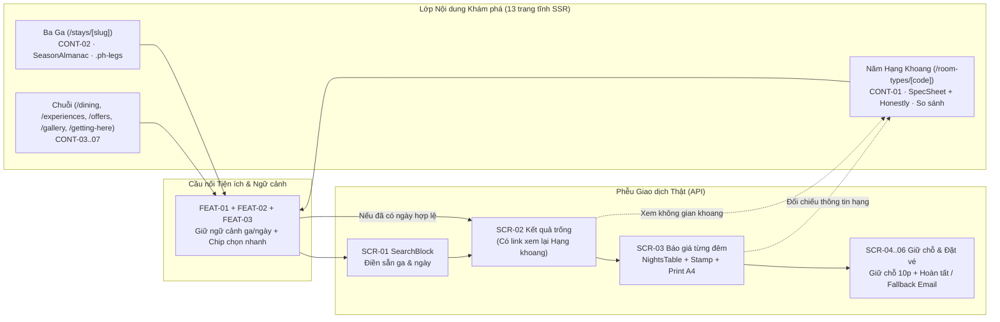

# Báo cáo góp ý cải tiến UI/UX, Animation, Tính năng trải nghiệm và Hệ thống nội dung tĩnh cho Customer Web

**Đánh giá của frontend lead (14/11/2026):** xem [kế hoạch phát triển giao diện §8](ke-hoach-phat-trien-giao-dien-tiep-theo.md#8-đánh-giá-báo-cáo-góp-ý-uiux-và-nội-dung-14112026): mục nào nhận, nhận có điều chỉnh, không nhận và ticket tương ứng.

**Trạng thái:** Tài liệu tham chiếu kỹ thuật & thiết kế cho agent thi công (`HB-311` và các ticket cải tiến sau `HB-310`) · **Ngày:** 14/11/2026 · **Phạm vi:** `apps/customer-web`, `DESIGN.md` · **Tài liệu nền:** [DESIGN.md](../../DESIGN.md), [ADR-019](adr/ADR-019-he-thong-thiet-ke-tuyen-pine-hill.md), [Kế hoạch nội dung tĩnh](ke-hoach-noi-dung-web-tinh.md), [Kế hoạch phát triển giao diện tiếp theo](ke-hoach-phat-trien-giao-dien-tiep-theo.md), [Ticket HB-310](../08-thi-cong/tickets/HB-310-trang-noi-dung-mau.md), [Yêu cầu API từ Frontend](../../YEU-CAU-API-TU-FRONTEND.md), [AGENTS.md](../../AGENTS.md)

---

## 1. Bối cảnh, mục tiêu và đối chiếu 3 nguồn tham chiếu

### 1.1. Hiện trạng `apps/customer-web` sau `HB-310`
Tính đến commit `59bc54b` (`HB-310`), `apps/customer-web` đã hoàn thành nền móng kiến trúc và giao dịch vững chắc:
- **Hệ thống thiết kế "Tuyến Pine Hill":** Đã chuẩn hoá 3 vật liệu (*Giấy biểu mẫu* `#DFE5F0`, *Vé hồng phấn* `#F0C2B3` với mực in xanh `#1B3A82` / đỏ dấu bấm `#B8341C` / `#962A16`, *Bảng ga đen thông* `#121614` với chữ hổ phách `#F2B632` và xanh còn chỗ `#7CD08A`), bộ chữ `Barlow Condensed` + `Be Vietnam Pro`, và 4 quy tắc tên riêng trong [DESIGN.md](../../DESIGN.md) & [ADR-019](adr/ADR-019-he-thong-thiet-ke-tuyen-pine-hill.md).
- **Luồng giao dịch 13 màn hình (`SCR-01`…`SCR-13`):** Hoạt động đầy đủ với API thật (`POST /quotes`, `POST /bookings`), `Idempotency-Key`, giữ chỗ 10 phút và tra cứu đặt phòng.
- **Lớp nội dung tĩnh bước đầu (`HB-309` + `HB-310`):** Đã tách hệ thống đa ngôn ngữ `src/i18n/` (chỉ `vi`) và dựng khuôn trang mẫu cho `/stays/da-lat` ([station-sheet.tsx](../../apps/customer-web/src/app/%28guest%29/stays/%5Bslug%5D/station-sheet.tsx)) và `/room-types/DLX` ([cabin-sheet.tsx](../../apps/customer-web/src/app/%28guest%29/room-types/%5Bcode%5D/cabin-sheet.tsx)).

**Hai khoảng trống cốt lõi cần giải quyết ở các đợt tiếp theo (`HB-311` và các ticket cải tiến):**
1. **Khoảng trống thông tin ra quyết định:** Nếu đối chiếu với chuẩn mực thông tin khách hàng từ bộ khai thác `Impeccable/amanoi-dig`, lớp nội dung tĩnh hiện tại mới dừng ở mức giới thiệu tối giản (2 đoạn văn kể chuyện, 3–4 dòng thông số cơ bản). Khách chưa thấy cấu trúc không gian phòng, những gì vé đã bao gồm / chưa bao gồm, nhịp sống một ngày tại ga, lịch thời tiết theo mùa, phương án di chuyển chi tiết hay các gói ưu đãi theo độ dài kỳ ở.
2. **Khoảng trống tương tác, độ mượt và tính thuận tiện:** Phần lớn trang nội dung và trang chủ vẫn ở trạng thái đọc tĩnh một chiều; chưa có liên kết 2 chiều giữa sơ đồ và danh sách, thiếu ngữ cảnh ngày/ga được bảo toàn khi khách chuyển giữa trang khám phá và trang đặt vé, chuyển động phản hồi cơ khí mới chỉ dừng ở `.ph-flap` trên bảng giờ và hover cơ bản, và còn thiếu bảng responsive đồng bộ cho `NightsTable` / `.ph-sample-table` trên màn hẹp `360px`.

### 1.2. Vai trò của hai bộ tài liệu tham chiếu ngoài repo
Agent thi công sử dụng hai bộ nghiên cứu tại `Impeccable/` theo hai vai trò tách biệt, **tuyệt đối không trộn lẫn ngôn ngữ thẩm mỹ**:

| Nguồn tham chiếu | Bản chất tài liệu | Vai trò chuyển vị vào Pine Hill (`apps/customer-web`) |
| :--- | :--- | :--- |
| `Impeccable/villa-castagneto-gallery` | 4 phương án thử nghiệm UX theo trường phái **Dụng cụ đo đạc & Ấn phẩm in** (`01-chart-altitude`, `02-nautical-sheet`, `03-slate-chalk`, `04-cloth-ledger`) + `ANALYSIS.md`. | **Nguồn kỹ thuật tương tác & UI:** liên kết 2 chiều hình ↔ bảng, thước đo vị trí cuộn, tính minh bạch thẳng thắn (`honestly` / `not-list`), lịch mùa tương tác điền sẵn ngày, container query `cqi`, thẻ bảng mobile `td[data-label]`, ghim đánh số + chú giải, dấu đóng `.stamp` và đường lùi `mailto:`. |
| `Impeccable/amanoi-dig` | Hồ sơ khai thác 50 trang tiếng Việt (1.552 block nội dung, 19 schema `HotelRoom`), `REPORT.md`, `DESIGN.md`, `data/content.json` và bản dựng `clone/`. | **Nguồn chuẩn mực thông tin khách hàng & kỷ luật chuyển động tĩnh tại:** cấu trúc chiều sâu thông tin cho từng điểm chạm (*Phòng ở, Điểm đến, Ẩm thực, Trải nghiệm & What's On, Ưu đãi theo số đêm, Đường đến & Visa, Gallery đa tỉ lệ*) và kỷ luật chuyển động *nhẹ, một lần, không giật layout*. |

---

## 2. Ranh giới thiết kế — "Bộ lọc chuyển vị sang Tuyến Pine Hill"

> [!IMPORTANT]
> Mọi agent thi công **bắt buộc** đi qua bộ lọc 6 điều dưới đây trước khi viết CSS, JSX hoặc dữ liệu từ hai nguồn tham chiếu. Vi phạm các mục này sẽ phá vỡ [DESIGN.md](../../DESIGN.md) hoặc hàng rào [AGENTS.md](../../AGENTS.md).

1. **Giữ *The No Cream Rule* & *The Ticket Ink Rule*:** Không dùng nền kem/cát (`#f3eee7` của Amanoi; `#EDD08A`, `#f4f5f0`, `#ece4d0` của Villa Castagneto). Mọi trang dùng đúng 3 vật liệu Pine Hill: nền `#DFE5F0`, giấy vé `#F0C2B3` (chữ chính `#1B3A82` / `#1A1716`, chữ phụ `#6B2F22`, dấu bấm `#962A16`), bảng ga `#121614` (chữ `#F4EFE6`, số/nhấn `#F2B632`, trạng thái tốt `#7CD08A`).
2. **Giữ *The No Eyebrow Rule* & kỷ luật 2 họ phông:** Không dùng chữ `.eyebrow` nhỏ xếp trên `h2`, không đưa serif (`Lyon Display`, `Spectral`) hay phông viết tay (`Caveat`, `Homemade Apple`) vào codebase. Duy trì `Barlow Condensed` (tiêu đề, mã ga, số lớn `tabular-nums`) và `Be Vietnam Pro` (thân bài, nhãn, nút). Nếu cần mã định danh trên khối, dùng tem mã ga/khoang (`.ph-station-code`, `.ph-class-code`) hoặc đường dẫn điều hướng `Breadcrumbs`.
3. **Giữ *The Paper Only Rule*:** Không dùng `backdrop-filter: blur(...)` (như header cuộn của Amanoi), không dùng nút pill hay đổ bóng khối nặng; chỉ dùng đường viền phẳng, đường răng cưa đứt nét hoặc bóng giấy kẹp tối giản đã quy định trong [DESIGN.md](../../DESIGN.md).
4. **Không bịa số liệu & không tự tính giá/chính sách ở Frontend:**
   - Theo [DESIGN.md](../../DESIGN.md) (mục *Content Pages*) và [YEU-CAU-API-TU-FRONTEND.md](../../YEU-CAU-API-TU-FRONTEND.md) (§5): chỉ in thông số có nguồn thật (sức chứa, số chỗ ngủ `bedCount`, giờ nhận/trả phòng từ `GET /public/properties`, các quy tắc hoàn/huỷ từ chính sách). Không tự bịa diện tích `m²` hoặc đơn giá bán cứng khi API/seed chưa cung cấp; mọi nội dung kể chuyện/tiện ích minh hoạ ở `src/content/` phải gắn cờ `illustrative: true` và tách biệt khỏi dữ liệu giao dịch.
   - Mọi bộ chọn tháng/mùa hay nút chọn nhanh ngày chỉ đóng vai trò **điền sẵn tiêu chí tìm kiếm (`prefill`)**, báo giá cuối cùng luôn do `POST /quotes` trả về.
5. **Render nội dung chính từ Server (SSR-First):** Không học theo cách để trống `<tbody>` rồi dùng JS render toàn bộ bảng như biến thể `02` và `03` của Villa Castagneto. Mọi bảng mùa, thực đơn, lịch trình, chặng đường phải render HTML đầy đủ từ Server Component của Next.js; Client Component chỉ nâng cấp tương tác.
6. **Không lạm dụng hiệu ứng nặng GPU hoặc vi phạm tương phản WCAG 2.1 AA:** Cấm Canvas chạy `requestAnimationFrame` liên tục (Mẫu `02`), cấm SVG `feTurbulence` trên văn bản (Mẫu `03`), cấm chữ mờ trang trí không đạt tỉ lệ tương phản `4.5:1` (như `.sounding` ở Mẫu `01` hay `--muted` `#82847f` ở bản mẫu Amanoi). Mọi màn hình mới phải đạt `0` lỗi `serious`/`critical` với `@axe-core/playwright`.

---

## 3. Cải tiến UI/UX & Bố cục dụng cụ (`UX-01` → `UX-08`)

Các hạng mục dưới đây chuyển vị những kỹ thuật đắt giá nhất từ 4 mẫu `villa-castagneto-gallery` và cấu trúc trình bày của `amanoi-dig` vào đúng hệ component của `apps/customer-web`:

| Mã | Hạng mục & nguồn cảm hứng | Hiện trạng trên `apps/customer-web` | Giải pháp thi công chi tiết theo ngôn ngữ "Tuyến Pine Hill" | File dự kiến tác động | Mức ưu tiên |
| :--- | :--- | :--- | :--- | :--- | :--- |
| **UX-01** | **Chuẩn hoá bảng dữ liệu Mobile bằng `td[data-label]::before`** *(Mẫu 04 `.register` + Mẫu 02 `.mcards`)* | • `AvailabilityTable` (`SCR-02`) đã chuyển dạng thẻ 2 cột bằng `td[data-label]::before` ([globals.css](../../apps/customer-web/src/app/globals.css#L2573-L2658)).<br>• **Nhưng** `.ph-sample-table` ở trang chủ đang ẩn hoàn toàn cột `.ph-sample-why` bằng `display: none` ở `<760px` ([globals.css](../../apps/customer-web/src/app/globals.css#L2568-L2570)), làm mất lý do thay đổi giá từng đêm.<br>• `NightsTable` ở `SCR-03` ([quote-tables.tsx](../../apps/customer-web/src/app/%28guest%29/rooms/%5BroomTypeId%5D/quote-tables.tsx#L62-L103)) chỉ thu chữ, dễ chật trên 360px. | • Gắn `data-label` lên các ô `td` của `.ph-sample-table` và `NightsTable` (kết hợp nhãn i18n sẵn có).<br>• Ở `@media (max-width: 639px)`, bỏ `display: none` của `.ph-sample-why`; chuyển mỗi hàng đêm thành thẻ 2 cột: hàng đầu in Thứ/Ngày + Thành tiền, hàng dưới chiếm trọn 2 cột (`grid-column: 1 / -1`) in lý do hệ số (`mùa thấp × cuối tuần...`) hoặc ghi chú sàn/trần.<br>• Đảm bảo `0px` tràn ngang tại `360px`. | • [page.tsx](../../apps/customer-web/src/app/%28guest%29/page.tsx)<br>• [quote-tables.tsx](../../apps/customer-web/src/app/%28guest%29/rooms/%5BroomTypeId%5D/quote-tables.tsx)<br>• [globals.css](../../apps/customer-web/src/app/globals.css) | **P1 — Cao** (Quick Win) |
| **UX-02** | **Liên kết hai chiều Hình ↔ Bảng (2-Way Diagram Sync)** *(Mẫu 01 `#elevSvg` ↔ `.room` + Mẫu 02 `#rose` ↔ `#ll`)* | • `RouteMap` ([route-map.tsx](../../apps/customer-web/src/components/content/route-map.tsx)) và 3 thẻ ga `.ph-station` trên trang chủ / `DepartureBoard` hoạt động tách rời.<br>• Danh sách 5 hạng phòng `.ph-classes` chưa có sơ đồ trực quan để khách phân biệt cấu trúc chỗ ngủ giữa `STD`, `SUP`, `DLX`, `FAM`, `DOR`. | • **Cho 3 Ga:** Bọc `RouteMap` và dải `.ph-stations` (hoặc `DepartureBoard`) trong một trình điều phối client nhẹ (progressive enhancement): hover/focus vào ga nào trên `RouteMap` thì thẻ ga bên dưới nổi viền nhấn `#1B3A82` / `#F2B632`, và ngược lại.<br>• **Cho 5 Hạng Khoang:** Thiết kế **Sơ đồ mặt cắt Đoàn tàu 5 Khoang** bằng SVG tĩnh nhẹ (SSR, phong cách bản vẽ kỹ thuật mực xanh trên giấy `#DFE5F0`): biểu diễn 5 toa/khoang từ khoang đôi (`STD`), đôi rộng (`SUP`), khoang ba (`DLX`), khoang bốn (`FAM`), tới khoang 6 giường tầng (`DOR`). Hover/focus/chọn khoang trên SVG sẽ sáng đúng hàng trong `.ph-classes` và cập nhật dòng tóm tắt `aria-live="polite"`. | • [route-map.tsx](../../apps/customer-web/src/components/content/route-map.tsx)<br>• Component mới `cabin-diagram.tsx` trong `src/components/content/`<br>• [page.tsx](../../apps/customer-web/src/app/%28guest%29/page.tsx)<br>• [station-sheet.tsx](../../apps/customer-web/src/app/%28guest%29/stays/%5Bslug%5D/station-sheet.tsx)<br>• [content-pages.css](../../apps/customer-web/src/app/content-pages.css) | **P1 — Cao** |
| **UX-03** | **Khối minh bạch "Nói thẳng trước khi đặt" (`honestly`) & "Vé gồm / Chưa gồm"** *(Mẫu 03 `.honest` + `.not-list` & Mẫu 01 `.notices`)* | • Trang hạng khoang hiện có `SpecSheet` ([cabin-sheet.tsx](../../apps/customer-web/src/app/%28guest%29/room-types/%5Bcode%5D/cabin-sheet.tsx#L41-L68)) với 7 dòng cơ bản và `suits`.<br>• Chưa có phần cảnh báo trung thực những giới hạn dễ gây hiểu nhầm khi nhận phòng (VD: `DOR` dùng tắm chung, Đà Lạt nhiều dốc/không điều hoà lạnh công suất lớn, giá chưa gồm ăn sáng hoặc xe đón sân bay). | • Thêm vùng `honestly` ("Nói thẳng trước khi đặt") vào `SpecSheet` và trang ga (nền vé hồng nhạt `#F6DCD3`, viền trái `3px solid #962A16`).<br>• Thêm khối **2 cột đối chiếu**: *Trong vé tiêu chuẩn đã gồm gì* vs. *Hạng này KHÔNG bao gồm / Không phù hợp với ai* (học từ `.not-list` của Mẫu 03 nhưng thay dấu viết tay bằng gạch đầu dòng kỹ thuật mực `#6B2F22`, không dùng tick list).<br>• Tóm tắt 1 dòng lưu ý quan trọng này ngay cạnh `QuoteSummary` ở `SCR-03`. | • [room-type-pages.ts](../../apps/customer-web/src/content/room-type-pages.ts)<br>• [property-pages.ts](../../apps/customer-web/src/content/property-pages.ts)<br>• [cabin-sheet.tsx](../../apps/customer-web/src/app/%28guest%29/room-types/%5Bcode%5D/cabin-sheet.tsx)<br>• [station-sheet.tsx](../../apps/customer-web/src/app/%28guest%29/stays/%5Bslug%5D/station-sheet.tsx) | **P1 — Cao** |
| **UX-04** | **Kỷ luật Container Query (`cqi`) & Đầu trang cuống sổ (`.runhead`, `.stamp`)** *(Mẫu 01 `cqi` + Mẫu 04 `.runhead` / `.stamp`)* | • `.ph-content-title` (`content-pages.css#L73`) và các tiêu đề trong `.ph-ticket`, `.ph-sample` dùng `vw` (`clamp(..., 5.4vw, ...)`), khi đặt trong lưới 2 cột hẹp (`900px–1150px`) dễ bị co giãn không tương xứng với khung chứa. | • Gắn `container-type: inline-size` cho `.ph-ticket-main`, `.ph-sample`, `.ph-content-head-copy` và chuyển cỡ chữ hiển thị lớn sang đơn vị `cqi` (ví dụ `clamp(2.4rem, 11cqi, 4.4rem)`) để tiêu đề luôn vừa khít cột vé ở mọi kích thước.<br>• Chuẩn hoá dải đầu đề kỹ thuật `.ph-runhead` (hiển thị *Tuyến Pine Hill · Mã ga · Mã khoang · Ngày xem/in*) và tái sử dụng `.ph-stamp` (`content-pages.css#L396`) làm dấu trạng thái trên `SCR-03` (*BÁO GIÁ HIỆU LỰC*), `SCR-05`, `SCR-06` (*ĐÃ GIỮ CHỖ / ĐÃ XÁC NHẬN*). | • [globals.css](../../apps/customer-web/src/app/globals.css)<br>• [content-pages.css](../../apps/customer-web/src/app/content-pages.css)<br>• [quote-tables.tsx](../../apps/customer-web/src/app/%28guest%29/rooms/%5BroomTypeId%5D/quote-tables.tsx) | **P2 — Trung bình** |
| **UX-05** | **Ghim đánh số trên ảnh & Định dạng Chặng đường (`.ph-legs`)** *(Mẫu 01 `.pin` + `.legend` & Mẫu 04 `.legs`)* | • Khối `.ph-arrival` ([station-sheet.tsx](../../apps/customer-web/src/app/%28guest%29/stays/%5Bslug%5D/station-sheet.tsx#L187-L194)) hiện là danh sách `<ul>` toàn chữ xuôi.<br>• Ảnh áp phích và ảnh toàn cảnh chưa có chú thích từng điểm khu vực. | • Tái cấu trúc phần "Đến ga" và trang `/getting-here` theo mẫu **Bảng chặng đường (`.ph-legs`)**: cột trái cố định thời gian/khoảng cách chữ `tabular-nums` (`45 PHÚT · 30 KM`, `3G45 PHÚT · TÀU SPT`), cột phải tên điểm trung chuyển + ghi chú thực tế.<br>• Hỗ trợ tuỳ chọn gắn ghim số `[01]`, `[02]` lên ảnh sơ đồ/khuôn viên (nền `#121614`, số `#F2B632`, vùng chạm tối thiểu hoặc liên kết chú giải); dưới `640px` ẩn ghim nổi trên ảnh và tự động hiện `<ol class="ph-pin-legend">` bên dưới (theo Mẫu 01). | • [station-sheet.tsx](../../apps/customer-web/src/app/%28guest%29/stays/%5Bslug%5D/station-sheet.tsx)<br>• Trang mới `/getting-here` (`HB-311`)<br>• [content-pages.css](../../apps/customer-web/src/app/content-pages.css) | **P2 — Trung bình - Cao** |
| **UX-06** | **Thước hành trình & Chỉ mục cuộn trang (Route Scroll-Spy)** *(Mẫu 01 `.rail` + Mẫu 03 `aria-current` + Mẫu 04 `.tabs`)* | • Trang chủ dài (7 band nội dung) và trang Ga (`StationSheet`) có 5–6 dải nội dung nhưng thiếu thanh neo báo người dùng đang đọc tới đâu.<br>• Chưa đặt `scroll-margin-top` đồng nhất cho các section neo (ngoài `#search-block`). | • Bổ sung thanh/cột **"Mục lục tuyến trên trang"** (trên desktop là dải tab neo mảnh ở lề phải hoặc thanh phụ dưới header; trên `<900px` gộp gọn ngang trên đầu thân bài để không xung đột với `.ph-sticky-stub` 52px ở đáy màn).<br>• Dùng `IntersectionObserver` gắn `aria-current="true"` theo mục đang xem.<br>• Đặt `scroll-margin-top: 24px` (hoặc tương ứng chiều cao thanh neo) cho mọi `section[id]` (học từ QA checklist của `amanoi-dig`). | • [page.tsx](../../apps/customer-web/src/app/%28guest%29/page.tsx)<br>• [station-sheet.tsx](../../apps/customer-web/src/app/%28guest%29/stays/%5Bslug%5D/station-sheet.tsx)<br>• [content-pages.css](../../apps/customer-web/src/app/content-pages.css) | **P3 — Bổ trợ** |
| **UX-07** | **Nhịp dọc xen kẽ Band tối `#121614` & Thư viện ảnh đa tỉ lệ `dense`** *(amanoi-dig §2.3, §3.8, §3.9)* | • Trên [station-sheet.tsx](../../apps/customer-web/src/app/%28guest%29/stays/%5Bslug%5D/station-sheet.tsx) nhiều phần cùng nằm trên nền `#DFE5F0`.<br>• `GalleryGrid` ([content-pages.css](../../apps/customer-web/src/app/content-pages.css#L258-L324)) chỉ hỗ trợ 1 ô lớn `2×2` đầu tiên, các ô sau cố định `4/3`. | • Áp dụng nguyên tắc **không đặt quá 2 section dài cùng nền liền nhau** của `amanoi-dig`: trên các trang nội dung dài (`/stays/[slug]`, `/experiences`, `/dining`), xen kẽ `#DFE5F0` → **Dải Bảng ga đen `#121614`** (dành cho lịch mùa/hoạt động/giờ phục vụ) → `#DFE5F0` → **Dải Vé hồng `#F0C2B3`** (danh sách phòng/CTA).<br>• Mở rộng `.ph-gallery` với class tuỳ biến `--tall` (`grid-row: span 2`) và `--wide` (`grid-column: span 2`) kết hợp `grid-auto-flow: dense` khi số ảnh `≥ 6` (chuẩn cho trang `/gallery` của `HB-311`), vẫn giữ khung ảnh kẹp `6px` của Pine Hill. | • [gallery-grid.tsx](../../apps/customer-web/src/components/content/gallery-grid.tsx)<br>• [content-pages.css](../../apps/customer-web/src/app/content-pages.css)<br>• Các trang nội dung `HB-311` | **P2 — Trung bình - Cao** |
| **UX-08** | **Nâng cấp Lightbox cảm ứng & Modal Video tư liệu lười tải (Lazy Video)** *(amanoi-dig §3.10, §3.11)* | • Lightbox `<dialog>` ([gallery-grid.tsx](../../apps/customer-web/src/components/content/gallery-grid.tsx#L21-L87)) đã có bộ đếm `n/tổng`, `Esc`, `←`/`→`, trả focus tốt.<br>• Còn thiếu thao tác chạm/vuốt ngang (swipe) trên điện thoại và click backdrop để đóng. | • Thêm sự kiện `onClick` vào `<dialog>` để đóng khi bấm ra ngoài vùng `<figure>` (`e.target === dialog.current`).<br>• Hỗ trợ vuốt trái/phải (`pointerdown`/`pointerup` hoặc `touch`) trong `.ph-lightbox-figure` để chuyển ảnh mượt trên mobile.<br>• Mở rộng tuỳ chọn **Video tư liệu ga** (nếu sau này có video): áp dụng đúng cơ chế *chỉ inject `<iframe>`/`<video>` khi mở modal và xoá DOM khi đóng* từ `amanoi-dig/clone/app.js` để trang luôn đạt LCP `< 2.5s`. | • [gallery-grid.tsx](../../apps/customer-web/src/components/content/gallery-grid.tsx)<br>• [content-pages.css](../../apps/customer-web/src/app/content-pages.css) | **P2 — Trung bình** |

---

## 4. Animation, độ mượt mà và phản hồi cơ khí (`ANIM-01` → `ANIM-06`)

Dựa trên sự điềm tĩnh, không rung giật của `amanoi-dig/DESIGN.md` (`cubic-bezier(0.22, 0.61, 0.36, 1)`) kết hợp với chất **cơ khí đường sắt** đang có ở `.ph-flap` ([globals.css](../../apps/customer-web/src/app/globals.css#L934-L939)), đề xuất bộ 6 quy chuẩn chuyển động dưới đây. Mọi hiệu ứng chỉ chạy trên `transform` và `opacity` (compositor-only, `60fps`, `CLS = 0`).

### Token chuyển động đề xuất bổ sung vào `:root` của `globals.css`
```css
--ph-ease-out: cubic-bezier(0.22, 0.61, 0.36, 1);    /* Lướt mượt, dừng êm (reveal, hover ảnh) */
--ph-ease-snap: cubic-bezier(0.34, 1.56, 0.64, 1);   /* Nảy nhẹ dứt khoát (con dấu, lật bảng ga) */
--ph-dur-fast: 180ms;
--ph-dur-med: 380ms;
--ph-dur-reveal: 560ms;
```

### Bảng đặc tả Animation & Micro-interactions

| Mã | Tên hiệu ứng & vị trí áp dụng | Cơ chế kỹ thuật & thông số chuẩn | Giá trị trải nghiệm |
| :--- | :--- | :--- | :--- |
| **ANIM-01** | **Bảng lật cơ khí có phản hồi khi đổi lựa chọn** *(DepartureBoard & StationTimetable)* | • Giữ `.ph-flap` khi tải trang lần đầu.<br>• Bổ sung hiệu ứng tick nhẹ (`keyframes` đổi độ sáng viền hổ phách + `rotateX(-12deg) -> 0deg` trong `180ms var(--ph-ease-snap)`) trên hàng được bấm "Chọn ga" hoặc trên ô giờ nhận/trả phòng của [station-timetable.tsx](../../apps/customer-web/src/components/content/station-timetable.tsx) khi chuyển trạng thái từ `--:--` sang dữ liệu thật từ API. | Tạo cảm giác bảng giờ ga tàu "lạch cạch" thật sự sống động mỗi khi dữ liệu khớp hoặc người dùng tương tác. |
| **ANIM-02** | **Đóng dấu xác nhận "Thump" (`.ph-stamp`)** *(Trang khoang, Báo giá `SCR-03`, Kết quả giữ chỗ/đặt phòng `SCR-05`/`06`)* | • Chuyển vị trực tiếp từ mẫu `04-cloth-ledger`: khi báo giá tải xong hoặc booking được xác nhận, tem dấu `.ph-cabin-stamp` / trạng thái chạy 1 lần `scale(1.22) rotate(-5deg) -> scale(1) rotate(-2deg)` trong `260ms var(--ph-ease-snap)`.<br>• Áp dụng đúng 1 lần khi mount/xác nhận, không lặp. | Khắc sâu dấu ấn thị giác của "vé đã đóng dấu" tại các thời điểm quan trọng nhất (xem giá, giữ chỗ 10 phút, nhận mã `PH-...`). |
| **ANIM-03** | **Phản hồi "Cuống vé & Mũi tên dẫn" trên CTA & Link khám phá** | • Kết hợp từ `amanoi-dig` (`.link-arrow span { transition: transform 350ms }`) và vé Pine Hill: khi hover/focus vào `.ph-station-more`, `.ph-class-price`, mũi tên `→` dịch `translateX(4px)` trong `220ms var(--ph-ease-out)`.<br>• Khi hover/focus nút tìm kiếm trên `.ph-ticket` hoặc `.ph-sticky-stub`, đường nét đứt chia cuống vé chuyển sắc xanh/đỏ rõ hơn, tạo cảm giác sẵn sàng "xé vé bước tiếp". | Tăng độ nhạy xúc giác cho các liên kết chuyển tiếp giữa vùng đọc và vùng đặt phòng mà không cần dùng gradient hay bóng loè loẹt. |
| **ANIM-04** | **Scroll Reveal "An toàn SSR" & Hover ảnh bên trong khung cố định** *(Theo `amanoi-dig` §1.6 & §9)* | • **Scroll Reveal an toàn SSR:** Tuyệt đối không đặt `opacity: 0` mặc định trong CSS (tránh trắng trang nếu JS chậm hoặc chụp screenshot sớm). Chỉ gắn lớp kích hoạt khi JS sẵn sàng và chỉ trượt nhẹ `translateY(14px -> 0)` trên các section **phía dưới màn hình đầu** với ngưỡng `IntersectionObserver` `0.08`, tự huỷ theo dõi sau 1 lần hiện (`560ms var(--ph-ease-out)`). Tuyệt đối không áp reveal lên khu vực LCP đầu trang (`HeroIntro`, `.ph-ticket`, `.ph-content-head`).<br>• **Hover ảnh không giật:** Thuộc tính `transition: transform 750ms var(--ph-ease-out)` chỉ đặt lên thẻ `` bên trong `.ph-gallery button` hoặc ảnh ga có khung `aspect-ratio` cố định + `overflow: hidden`, hover `scale(1.035)`. | Trang cuộn mượt, có nhịp thở biên tập cao cấp tương đương Amanoi nhưng không vi phạm LCP `< 2.5s` và giữ `CLS = 0`. |
| **ANIM-05** | **Khung chờ Skeleton đúng hình dáng Vé/Bảng** *(`SCR-02`, `SCR-03`, `SCR-06`)* | • Thay trạng thái chờ chữ thô trên `SCR-02` và `SCR-03` bằng khung skeleton giữ nguyên kích thước của `PriceStrip` (tem giá nhấp nháy nhẹ) và `NightsTable` (khung dòng cố định chiều cao), đồng bộ màu nền `#E9E5DF` / `#1C221F`. | Loại bỏ cảm giác "giật cục nhảy trang" khi `POST /quotes` hoặc `GET /availability` đang tải, giúp trải nghiệm liền mạch hơn hẳn. |
| **ANIM-06** | **Công tắc tổng `prefers-reduced-motion: reduce`** *(Bắt buộc)* | • Mở rộng khối `@media (prefers-reduced-motion: reduce)` trong [globals.css](../../apps/customer-web/src/app/globals.css#L694) và [content-pages.css](../../apps/customer-web/src/app/content-pages.css#L594): vô hiệu hoá toàn bộ reveal, tick bảng ga, đóng dấu `thump`, zoom ảnh hover và thanh cuộn mượt. | Bảo đảm 100% tiêu chuẩn tiếp cận (accessibility) và giữ độ ổn định tuyệt đối cho bộ test E2E Playwright. |

---

## 5. Kiến nghị tính năng tăng thuận tiện & ấn tượng (`FEAT-01` → `FEAT-06`)

6 tính năng dưới đây tập trung giải quyết **ma sát thật của người dùng** khi đi từ trang nội dung sang bước đặt phòng, tôn trọng ranh giới nghiệp vụ (không tính giá/chính sách thay máy chủ):

1. **`FEAT-01` — Bảo toàn Ngữ cảnh Hành trình xuyên suốt (Cross-Page Journey Context):**
   - *Vấn đề hiện trạng:* Khi khách đã chọn Ga, Ngày nhận/trả và Số khách ở `SearchBlock` rồi bấm sang đọc `/stays/da-lat`, `/room-types/DLX` hay `/offers`, liên kết `searchCtaHref` ([property-pages.ts](../../apps/customer-web/src/content/property-pages.ts#L93-L96)) chỉ đưa về `/?ga=da-lat#search-block` — làm mất toàn bộ ngày và số khách họ vừa chọn. Ở hướng ngược lại, khi khách đang ở `SCR-02` hoặc `SCR-03` muốn xem kỹ phòng đó trông ra sao thì chưa có link xem nhanh.
   - *Giải pháp:*
     - Lưu `lastSearchCriteria` (`propertyId`, `ga`, `checkIn`, `checkOut`, `adults`, `children`) vào URL query nối tiếp hoặc `sessionStorage` nhẹ (tương thích SSR/không lỗi khi ẩn danh).
     - Khi trang `/stays/[slug]` hoặc `/room-types/[code]` phát hiện đã có ngày hợp lệ từ ngữ cảnh trước: hiển thị dòng tóm tắt trên `.ph-sticky-stub` và nút chính (*"Đà Lạt · 24/12 → 27/12 · 2 khách"*), đổi CTA thành **"Xem phòng trống cho kỳ này"** và dẫn thẳng sang `/search?...` (`SCR-02`) thay vì bắt nhập lại từ trang chủ.
     - Trên `SCR-02` và `SCR-03`, gắn link phụ **"Xem hồ sơ hạng khoang ↗"** trỏ tới `/room-types/[code]` (giữ nguyên query để quay lại không mất dữ liệu).

2. **`FEAT-02` — Bảng "Lịch Mùa & Thời tiết tại Ga" tương tác → Điền sẵn Ngày (`SeasonAlmanac`):**
   - *Nguồn cảm hứng:* Bảng *"Your month"* (`#month` của Mẫu `03`) và bảng lịch 7 tháng (`#alm` của Mẫu `02`).
   - *Thiết kế:* Trên trang `/stays/[slug]` và `/experiences`, dựng một bảng đen thông (`#121614`) hoặc cặp nút radio 4 mùa / 12 tháng đặc trưng của ga đó (ví dụ Đà Lạt: *T11–T12 Săn mây & dã quỳ · T1–T3 Mùa khô mai anh đào · T4–T6 Mát mẻ đầu hè · T7–T10 Mùa mưa chiều & sương*).
   - *Tiện ích:* Chọn tháng nào sẽ hiện ngay: nhiệt độ ngày/đêm, lượng nắng/mưa, gợi ý trải nghiệm đẹp nhất, gợi ý trang phục, nhãn mùa tham khảo (*Thấp điểm / Bình thường / Cao điểm*), kèm nút **"Chọn cuối tuần trong tháng này →"** tự động điền `checkIn`/`checkOut` gợi ý vào `/?ga=...&checkIn=...&checkOut=...#search-block`.

3. **`FEAT-03` — Chip chọn nhanh Chặng lưu trú ("Quick-Select Journey Chips") trong `SearchBlock`:**
   - *Vấn đề hiện trạng:* Chọn `<input type="date">` 2 lần (ngày đến, ngày đi) trên điện thoại tốn 4–6 chạm chỉ để xem thử giá.
   - *Thiết kế:* Đặt 3 chip bấm nhanh (chiều cao tối thiểu `44px` hoặc pill vuông 3px đúng *The Paper Only Rule*) ngay trong [search-block.tsx](../../apps/customer-web/src/app/%28guest%29/search/search-block.tsx) cạnh ô ngày:
     - `Cuối tuần này (2 đêm)`
     - `Chặng 3 đêm (có mức giảm kỳ ở)`
     - `Chặng 5 đêm (nghỉ dài)`
   - *Tiện ích:* Bấm 1 chạm để điền đồng bộ ngày nhận/trả, cập nhật tức thì bảng các `.ph-segment` (*CHẶNG 1, CHẶNG 2, CHẶNG 3*) trên tấm vé và dòng `DateLine` tiếng Việt bên dưới. Không ảnh hưởng đến quyền chọn ngày tự do trên `<input type="date">`.

4. **`FEAT-04` — Trục thời gian "Mốc Huỷ Minh hoạ theo Ngày Nhận Phòng của bạn":**
   - *Vấn đề hiện trạng:* Khách hay nhầm khái niệm "7 ngày trước giờ nhận phòng 14:00" (`LandingContent` FAQ câu 1).
   - *Thiết kế:* Ở trang chủ/báo giá khi khách đã chọn `checkIn` (hoặc trên `SCR-03` / `SCR-05` dùng dữ liệu gói giá thật), tính/hiển thị thêm dòng thời điểm mốc quy đổi cụ thể cạnh thanh hoàn tiền (ví dụ: *"Nhận phòng 14:00 24/12 → Huỷ miễn phí 100% trước 14:00 17/12"*). Trên trang nội dung tĩnh phải ghi chú rõ là ví dụ theo giờ nhận phòng tiêu chuẩn của cơ sở; trên `SCR-03`/`SCR-05` đọc theo điều khoản gói máy chủ trả.

5. **`FEAT-05` — Ma trận So sánh 5 Hạng Khoang ("Cabin Comparison Strip"):**
   - *Nguồn cảm hứng:* Cách Amanoi phân tầng rõ ràng 19 hạng phòng trên trang tổng quan `accommodation` + bảng thông số của Mẫu `01`/`04`.
   - *Thiết kế:* Đặt trên `/room-types/[code]` (hoặc nâng cấp khối `OtherClasses` và `#hang-phong`), cho phép bật chế độ so sánh nhanh giữa hạng đang xem với 4 hạng còn lại theo đúng các thuộc tính có nguồn: *Mã · Sức chứa · Số chỗ ngủ · Loại giường/không gian · Có phòng tắm riêng hay chung · Hợp nhất với ai*. Giúp nhóm 3–4 người hoặc người đi một mình quyết định ngay giữa `SUP`, `DLX`, `FAM`, `DOR`.

6. **`FEAT-06` — Chia sẻ Link Báo giá, Chế độ In A4 (`@media print`) & Đường lùi Email (`mailto:`):**
   - *Nguồn cảm hứng:* Mẫu `04-cloth-ledger` (`mailto:` composer & in ấn cuống sổ) và Mẫu `03-slate-chalk` (`history.replaceState`).
   - *Thiết kế 3 lớp thuận tiện:*
     1. **Nút "Sao chép đường dẫn hành trình":** Tại `SCR-03` ([room-detail-screen.tsx](../../apps/customer-web/src/app/%28guest%29/rooms/%5BroomTypeId%5D/room-detail-screen.tsx)), cho phép copy nhanh URL kèm đủ tiêu chí & `ratePlanCode` để gửi cho bạn đồng hành cùng xem bảng giá từng đêm.
     2. **Stylesheet In A4 (`@media print`):** Trên `SCR-03` (Phiếu báo giá) và `SCR-06` (Chi tiết đặt phòng), ẩn header/footer điều hướng, giữ nguyên bảng `NightsTable`, `QuoteSummary` và mã booking thành một tờ phiếu vé tàu gọn đẹp trên 1 trang A4 khi khách nhấn Ctrl+P / Lưu PDF.
     3. **Đường lùi `mailto:` khi API lỗi mạng:** Trong `ErrorPanel` của `SCR-03` và [book-screen.tsx](../../apps/customer-web/src/app/%28guest%29/book/book-screen.tsx#L79-L89), bên cạnh nút *"Thử lại"*, bổ sung nút phụ *"Gửi yêu cầu giữ chỗ qua Email lễ tân"* mở `mailto:` điền sẵn Ga, Hạng phòng, Ngày nhận/trả, Số khách và Tên khách vừa nhập — đảm bảo khách không bị mất công sức nhập lại khi mạng chập chờn.

---

## 6. Chuẩn mực thông tin từ `amanoi-dig` & Kiến nghị hệ thống nội dung tĩnh phụ trợ (`CONT-01` → `CONT-08`)

Qua phân tích 50 trang HTML tiếng Việt và 1.552 block nội dung trong `Impeccable/amanoi-dig/amanoi-dig/data/content.json`, có thể rút ra bài học cốt lõi: **Amanoi bán kỳ nghỉ bằng sự rõ ràng tuyệt đối về ngữ cảnh sử dụng ở mọi điểm chạm**, chứ không chỉ bằng ảnh đẹp.

### 6.1. Bảng đối chiếu chuẩn mực thông tin (`amanoi-dig` vs. Hiện trạng Pine Hill)

| Nhóm trang | Thông tin chuẩn mực `amanoi-dig` cung cấp cho khách | Hiện trạng `apps/customer-web` (`HB-310`) | Khoảng trống cần bù đắp ở `HB-311` (`CONT-*`) |
| :--- | :--- | :--- | :--- |
| **1. Trang Cơ sở** (`/stays/[slug]`) | 4 con số định danh (`.facts`), câu chuyện cảnh quan & kiến trúc, nhịp sống ngày-đêm, ẩm thực & trải nghiệm tại chỗ, bản đồ & thời gian từ sân bay, danh sách hạng phòng kèm ưu đãi. | Mới có tên ga, độ cao, khí hậu, 1 dòng mùa đẹp, 2 đoạn kể chuyện, 3 gạch đầu dòng đến ga và bảng 5 hạng phòng ([property-pages.ts](../../apps/customer-web/src/content/property-pages.ts)). | Bổ sung `CONT-02`: 4 thông số định danh ga, **"Một ngày tại Ga"** theo 3 mốc giờ, tiện ích dùng chung tại ga, lịch mùa `SeasonAlmanac`, bảng chặng đến ga `.ph-legs`. |
| **2. Trang Hạng phòng** (`/room-types/[code]`) | Với mỗi hạng (*Lake Pavilion*, *Wellness Pool Villa*, *Residence*): (a) Bố cục không gian & hướng nhìn; (b) **Gói lưu trú bao gồm** (trà chiều, minibar, hoạt động miễn phí); (c) **Danh sách tiện nghi cụ thể** (giường, bàn viết, hiên gỗ, tắm bồn, wifi/âm thanh); (d) Các góc chụp (toàn cảnh, hiên, phòng ngủ, bàn viết); (e) So sánh với các hạng khác. | Mới có 2 đoạn mô tả, sức chứa, số chỗ ngủ, 1 dòng `suits`, link về ga và danh sách các hạng khác ([room-type-pages.ts](../../apps/customer-web/src/content/room-type-pages.ts)). Chưa có ảnh đa góc, tiện nghi, hay gói gồm gì. | Bổ sung `CONT-01`: Mở rộng `RoomTypePageCopy` với bố cục khoang, danh sách quyền lợi đi kèm, nhóm tiện nghi (gắn `illustrative: true` và tách rõ phần phụ thuộc cơ sở), khối "Nói thẳng" (`UX-03`), và brief chụp đa góc (`anh-trang-khach.md`). |
| **3. Trang Di chuyển** (`/getting-here`) | Đường bay quốc tế (liệt kê từng thành phố & số giờ bay thẳng tới `SGN`/`CXR`), đường bay nội địa, đường bộ cao tốc, thời gian xe từ sân bay, **hướng dẫn Visa / e-Visa cho khách quốc tế**, dịch vụ đưa đón VIP, sơ đồ vị trí & liên hệ trực tiếp. | Chưa có trang `/getting-here` (nằm trong kế hoạch `HB-311`). Trang chủ mới có 1 dòng `station.getThere`. | Dựng trang `/getting-here` theo `CONT-03`: Bảng chặng đường đến đủ 3 ga (`DL`, `PT`, `VT`) bằng máy bay, tàu hoả `SPT`, cao tốc, tàu cao tốc cánh ngầm; khối hỗ trợ khách quốc tế & e-Visa (chuẩn bị cho `HB-312`/`HB-313`); sơ đồ mạng lưới tuyến vẽ SVG/CSS. |
| **4. Trang Ẩm thực** (`/dining`) | Tách từng không gian (Nhà hàng chính, Bar, Beach Club), giờ mở cửa chính xác (`7:00 – 22:30`), khung giờ trà chiều (`15:30 – 16:30`), nguyên liệu địa phương theo mùa, không gian trong nhà/hiên ngoài/phòng riêng. | Chưa có trang `/dining` (nằm trong `HB-311`). Khách chưa biết tại Pine Hill có phục vụ ăn sáng hay không, gần khu nào có gì ăn. | Dựng trang `/dining` theo `CONT-04`: Giới thiệu **Quầy ăn & Trà sáng tại 3 Ga** theo 3 nhịp (*Bữa sáng ga · Trà chiều 15:00–17:00 · Bữa tối & gợi ý quanh ga*), giờ mở cửa, trạng thái đi kèm vé hay gọi riêng, lưu ý ăn chay/dị ứng. |
| **5. Trang Trải nghiệm** (`/experiences`) | Chia theo chủ đề (*Khám phá VQG Núi Chúa, Thể thao biển, Gia đình, Wellness*) **VÀ** có trang `What's On` ghi rõ lịch sự kiện/hoạt động (*Diễn ra quanh năm* vs. *Mỗi tối thứ Bảy* vs. *Theo mùa*). | Chưa có trang `/experiences` (nằm trong `HB-311`). | Dựng trang `/experiences` theo `CONT-05`: Tổ chức theo 3 ga × hoạt động quanh ga + **Bảng lật "Lịch trải nghiệm theo mùa & cuối tuần"** (phân biệt rõ hoạt động *Quanh năm* và *Theo mùa*), nối trực tiếp sang tìm phòng tại ga tương ứng. |
| **6. Trang Ưu đãi** (`/offers`) | Không ghi giá bán cứng mà dùng mô hình **Ưu đãi bậc thang theo số đêm** (*Kỳ 3 đêm gồm… · Kỳ 5 đêm gồm… · Kỳ 7 đêm gồm…*), thời hạn hiệu lực, và khối **Điều khoản & Điều kiện** cực rõ ràng (ngày loại trừ, giường phụ, chính sách huỷ). | Chưa có trang `/offers`. Trang chủ mới giải thích sơ lược 6 hệ số giá và 4 gói hoàn tiền (`FLEX7`, `SAVER3`, `LONGSTAY14`, `NONREF`). | Dựng trang `/offers` theo `CONT-06`: Khớp **100% quy tắc thật** của Pine Hill (*Mức ở từ 3 đêm*, *Mức ở từ 14 đêm + gói LONGSTAY14*, *Đặt trực tiếp trên web*, bảng so sánh 4 gói giá + Điều khoản áp dụng minh bạch). |
| **7. Trang Thư viện ảnh** (`/gallery`) | 126 ảnh có bố cục dense, chú thích tiếng Việt 12–22 từ giàu chi tiết thực tế, chế độ xem Lưới / Đơn chiếc. | Mới có 15 ô ảnh cơ bản ([photo-slots.ts](../../apps/customer-web/src/content/photo-slots.ts)), chưa có trang `/gallery` toàn chuỗi. | Dựng trang `/gallery` theo `CONT-07`: Bộ lọc theo Ga & Chủ đề, lưới masonry đa tỉ lệ, mở rộng `photo-slots.ts` thêm ô ảnh góc phòng/tiện ích chung và cập nhật [Brief ảnh](anh-trang-khach.md). |

---

### 6.2. Chi tiết 8 Hạng mục Nội dung Tĩnh Phụ trợ cần triển khai (`CONT-01` → `CONT-08`)

> [!NOTE]
> **Xử lý ranh giới dữ liệu có nguồn (`DESIGN.md` vs. `amanoi-dig`):** Trong lúc chưa có API chi tiết tiện nghi theo từng cơ sở ([YEU-CAU-API-TU-FRONTEND.md](../../YEU-CAU-API-TU-FRONTEND.md) §5), agent phải chia dữ liệu trong `src/content/` thành 2 lớp tách bạch:
> - **Lớp có nguồn xác thực:** mã ga, mã khoang, `sleeps` (`bedCount`), `capacity`, giờ nhận/trả phòng (từ API), các hệ số giá & mốc hoàn (từ `landing-content.ts`).
> - **Lớp nội dung phụ trợ gắn cờ `illustrative: true`:** bố cục khoang, tiện ích tham khảo, lịch hoạt động, bữa sáng/trà chiều, chặng đường di chuyển. Khối này giữ chuẩn đầy đủ thông tin để khách đánh giá đúng sản phẩm khi demo, đồng thời sẵn sàng thay thế bằng dữ liệu thật hoặc API khi Backend mở rộng hợp đồng.

#### `CONT-01` — Làm giàu Hồ sơ 5 Hạng Khoang (`STD`, `SUP`, `DLX`, `FAM`, `DOR`)
Mở rộng `RoomTypePageKey` và `RoomTypePageCopy` trong [room-type-pages.ts](../../apps/customer-web/src/content/room-type-pages.ts) cho đủ 5 hạng:
```ts
export interface RoomTypePageCopy {
  readonly summary: string;
  readonly description: readonly string[];
  readonly cabinLayout: string;              // Bố cục không gian & giường ngủ trong khoang
  readonly suits: string;
  readonly inclusions: readonly string[];    // Vé tiêu chuẩn đã gồm gì (gửi hành lý, trà sáng, wifi...)
  readonly amenities: readonly string[];     // Tiện nghi tiêu biểu của khoang (illustrative)
  readonly honestly: string;                 // Nói thẳng giới hạn (VD: DOR dùng tắm chung, STD gọn cho 1-2 đêm)
  readonly notIncluded: readonly string[];   // Những thứ KHÔNG nằm sẵn trong giá phòng cơ bản
  readonly comparisonTip: string;            // Khi nào nên chọn hạng này thay vì hạng liền kề
  readonly seoTitle: string;
  readonly seoDescription: string;
  readonly illustrative: true;
}
```
- **Mở rộng ô ảnh trong [photo-slots.ts](../../apps/customer-web/src/content/photo-slots.ts):** Mỗi hạng khoang nên chuẩn bị cấu trúc hỗ trợ 2–3 ô ảnh phụ (ví dụ `hang-DLX`, `hang-DLX-2`, `hang-DLX-bath`) với quy tắc cũ: *chưa có file ảnh thật trong `public/images/pine-hill/` thì tự ẩn gọn không hiện khung trống*.

#### `CONT-02` — Làm giàu Hồ sơ 3 Cơ sở / Tờ giới thiệu Ga (`da-lat`, `phan-thiet`, `vung-tau`)
Mở rộng `PropertyPageCopy` trong [property-pages.ts](../../apps/customer-web/src/content/property-pages.ts):
- **`stationFacts`:** 4 thông số định danh ngắn gọn (Độ cao / Thời gian từ TP.HCM / Nhiệt độ đặc trưng / Quy mô 5 hạng khoang).
- **`dayRhythm` ("Một ngày tại Ga"):** 3 chặng giờ (`06:30 – 09:00` · `10:00 – 16:00` · `17:30 – 21:30`) tả đúng không khí bản địa (Đà Lạt săn sương đồi thông; Phan Thiết đón bình minh đồi cát & gió biển; Vũng Tàu leo dốc hải đăng chiều muộn).
- **`stationServices`:** Tiện ích nhà ga dùng chung (quầy gửi hành lý sớm/muộn cho khách đi xe đêm, góc pha cà phê/trà nóng, hỗ trợ gọi xe/thuê xe máy tại quầy).
- **`arrivalLegs`:** Chuyển mảng `arrival: string[]` thành cấu trúc `{ timeOrDistance: string; route: string; note?: string }[]` để render thành bảng chặng `.ph-legs` (`UX-05`).
- **`seasons`:** 4 chặng thời tiết trong năm nuôi component `SeasonAlmanac` (`FEAT-02`).

#### `CONT-03` — Thiết kế chi tiết trang `/getting-here` ("Đường đến 3 Ga Tuyến Pine Hill")
Lấy cảm hứng trực tiếp từ trang `/resorts/amanoi/getting-here-amanoi` của `amanoi-dig`:
- **Phần 1 — Bảng chặng theo từng Ga (`.ph-legs`):**
  - *Ga Đà Lạt (`DL`):* Bay tới sân bay Liên Khương (`DLI`: 50 phút từ TP.HCM, 1g50 từ Hà Nội) + 45 phút taxi/xe buýt 30 km; Xe giường nằm đêm từ TP.HCM (~7 giờ, có khu gửi hành lý sáng sớm tại quầy lễ tân).
  - *Ga Phan Thiết (`PT`):* Tàu hoả `SPT1/SPT2` từ Ga Sài Gòn tới Ga Phan Thiết (~3g45 phút — điểm nhấn gắn chặt với bản sắc đường sắt Pine Hill); Ô tô cao tốc TP.HCM – Phan Thiết (~2g30–3 giờ).
  - *Ga Vũng Tàu (`VT`):* Ô tô cao tốc (~2 giờ); Tàu cao tốc cánh ngầm bến Bạch Đằng – Vũng Tàu (~1g30 phút).
- **Phần 2 — Sơ đồ mạng lưới kết nối (SVG/CSS tĩnh):** Vẽ sơ đồ trực quan các cửa ngõ (`TP.HCM / Sân bay Tân Sơn Nhất SGN`, `Liên Khương DLI`, `Ga Phan Thiết`, `Bến Bạch Đằng`) kết nối về 3 Ga Pine Hill bằng nét vẽ kỹ thuật, 0 phụ thuộc API bản đồ bên ngoài.
- **Phần 3 — Hướng dẫn cho Khách quốc tế (nền sẵn cho `HB-312` `en` & `HB-313` đa ngữ):** Chặng nối từ sân bay quốc tế `SGN` / `CXR`, lưu ý e-Visa / miễn thị thực Việt Nam, khung giờ hoạt động lễ tân (`UTC+7`) và thông tin liên hệ hỗ trợ trước chuyến đi.

#### `CONT-04` — Thiết kế chi tiết trang `/dining` ("Bữa sáng tại Ga & Ẩm thực quanh Tuyến")
Học cấu trúc trang `/dining` và `/dining/restaurant` của `amanoi-dig` nhưng chuyển vị đúng quy mô thực tế của một chuỗi boutique/lưu trú 5 hạng (Standard → Dorm):
- Tổ chức theo **3 khung giờ phục vụ trong ngày tại các Ga** (*06:30–10:00 Bữa sáng & Cà phê phin · 15:00–17:00 Góc trà nóng & bánh nhẹ · Tối & Gợi ý quán bản địa đi bộ 5–10 phút quanh ga*).
- Minh bạch hoàn toàn ở từng mục: *Giờ mở cửa · Có ở những ga nào · Đã gồm trong giá phòng hay gọi riêng tại quầy · Ghi chú đặt trước cho nhóm `FAM` / chế độ ăn chay*.

#### `CONT-05` — Thiết kế chi tiết trang `/experiences` ("Nhịp trải nghiệm & Lịch theo mùa")
Kết hợp trang `/experiences` + `/experiences/whats-on` của `amanoi-dig`:
- **Nhóm 1 — Trải nghiệm bản địa gắn với 3 Ga:** Không viết chung chung; gắn chặt với địa hình thật (*Đà Lạt: đi bộ rừng thông buổi sáng trước khi sương tan, đạp xe quanh hồ; Phan Thiết: lên đồi cát bình minh trước 7h, lướt ván/gió biển tháng 12–4; Vũng Tàu: đi bộ đường hải đăng núi Nhỏ chiều muộn*).
- **Nhóm 2 — Bảng lật "Lịch hoạt động & Mùa đẹp trên Tuyến" (`What's On`):** Bảng ga `#121614` liệt kê hoạt động diễn ra **Quanh năm** vs. **Theo mùa** (T11–T3 Đà Lạt mùa khô, T12–T4 Phan Thiết mùa gió đẹp, T5–T10 Vũng Tàu ngày thường yên tĩnh) kèm nút dẫn thẳng tới trang ga hoặc tìm phòng.

#### `CONT-06` — Thiết kế chi tiết trang `/offers` ("Ưu đãi kỳ ở & Đối chiếu 4 gói vé")
Áp dụng cấu trúc *"Discover Amanoi"* (bậc thang quyền lợi theo số đêm + Điều khoản & Điều kiện nghiêm ngặt) vào đúng quy tắc giá của Pine Hill:
- **Không bịa khuyến mãi giả hay đơn giá tiền cố định.** Tập trung giải thích rõ 3 đòn bẩy tiết kiệm thật có trong engine giá:
  1. **Ưu đãi độ dài kỳ ở (từ 3 đêm & từ 14 đêm):** Trình bày rõ tác động của hệ số `× độ dài kỳ ở` trên từng chặng đêm và cách kết hợp với gói `LONGSTAY14` khi ở dài ngày.
  2. **Lợi ích đặt trực tiếp Kênh Web (`× kênh`):** So sánh trực quan đặt trực tiếp vs. qua trung gian (thấy từng dòng giá đêm + chạm sàn/trần rõ ràng, giữ chỗ riêng 10 phút trước thanh toán, tra cứu và đổi ngày chủ động).
  3. **Bảng đối chiếu 4 gói giá (`FLEX7`, `SAVER3`, `LONGSTAY14`, `NONREF`):** Đặt song song 4 gói theo *Mức cọc · Hoàn 100% · Hoàn 50% · Đổi ngày miễn phí · Khuyên dùng cho ai*.
  4. **Khối Điều khoản & Điều kiện:** Nguyên tắc áp dụng mã khuyến mãi (nếu có ở bước báo giá), chính sách hoàn theo số tiền thực trả, và bảo vệ bất khả kháng 100%.

#### `CONT-07` — Thiết kế chi tiết trang `/gallery` & Nâng cấp [Anh trang khach](anh-trang-khach.md)
- Trang `/gallery` tổng hợp ảnh đã có trong `ALL_PHOTO_SLOTS` với 2 hàng bộ lọc (*Theo Ga: Tất cả / Đà Lạt / Phan Thiết / Vũng Tàu* và *Theo Nhóm: Áp phích Ga / Khoang phòng / Cảnh quan*), dựng bằng lưới `dense` (`UX-07`) + Lightbox cảm ứng/bàn phím (`UX-08`).
- Chuẩn hoá câu `alt` trong [photo-slots.ts](../../apps/customer-web/src/content/photo-slots.ts) theo quy tắc `amanoi-dig/DESIGN.md` (§4.4): 12–22 từ tả cảnh + vật thể chính + bối cảnh ánh sáng, không mở đầu bằng *"Hình ảnh"*.
- Thêm nút neo trên từng ảnh trong Lightbox trỏ thẳng tới trang `/stays/[slug]` hoặc `/room-types/[code]` tương ứng để biến thư viện ảnh thành kênh dẫn đặt phòng tự nhiên.

#### `CONT-08` — Hoàn thiện Hệ thống Điều hướng Khám phá & Mobile Drawer (`guest-shell.tsx`)
- Mở rộng `NAV_ITEMS` trong [guest-shell.tsx](../../apps/customer-web/src/components/guest-shell.tsx) theo đúng §4 Đợt 4 của [kế hoạch phát triển giao diện](ke-hoach-phat-trien-giao-dien-tiep-theo.md):
  - Nhóm Khám phá: `Ba ga` (`/#tuyen` hoặc dropdown/liên kết tới 3 ga), `Hạng khoang` (`/#hang-phong`), `Ẩm thực` (`/dining`), `Trải nghiệm` (`/experiences`), `Ưu đãi` (`/offers`), `Đường đến` (`/getting-here`), `Thư viện ảnh` (`/gallery`).
  - Nhóm Giao dịch: `Tìm phòng` (`/#search-block`), `Tra cứu vé` (`/bookings`), `Tài khoản` (`/account/login`).
- Trên màn hình hẹp (`< 760px`), cung cấp nút menu mở ngăn kéo bảng ga (`aria-expanded`, `aria-controls`, đóng bằng phím `Esc`, khoá cuộn body khi mở — học từ `.mobile-menu` của `amanoi-dig/clone/app.js`), giúp thanh header giữ gọn gàng trên 1 hàng mà vẫn truy cập được toàn bộ 13 trang nội dung.

---

## 7. Kiến trúc luồng dẫn khách từ Nội dung tĩnh vào Phễu đặt phòng



---

## 8. Bảng phân kỳ thi công cho Agent (Gắn với `HB-311` & các Ticket sau)

Để không làm phình `max_lines` của một PR duy nhất và bám sát quy trình `AGENTS.md`, các cải tiến được chia thành **3 gói thi công độc lập**:

| Gói / Ticket dự kiến | Mục tiêu chính | Các mã áp dụng | Nhóm file `allow` chính | Tiêu chí xong đặc thù của gói |
| :--- | :--- | :--- | :--- | :--- |
| **Gói A — Gộp vào `HB-311`** *(Đợt 4: Nhân nội dung 3+5+5 trang)* | Dựng đủ 3 trang Ga, 5 trang Khoang, 5 trang toàn chuỗi đạt chuẩn thông tin khách hàng `amanoi-dig`. | `CONT-01`…`CONT-08`, `UX-03`, `UX-05` (`.ph-legs`), `UX-07` (xen kẽ band `#121614` & gallery `dense`) | `apps/customer-web/src/content/**`, `apps/customer-web/src/app/(guest)/**`, `apps/customer-web/src/components/guest-shell.tsx`, `apps/customer-web/src/components/content/**`, `apps/customer-web/src/app/content-pages.css`, `apps/customer-web/src/i18n/catalogs/vi/**`, `docs/04-thiet-ke/anh-trang-khach.md` | • Đủ 13 trang nội dung truy cập độc lập, 0 placeholder rỗng.<br>• Unit test phủ mọi `slug`, `code`, `galleryIds`.<br>• Mọi dữ liệu chưa lấy từ API đều có cờ `illustrative: true`. |
| **Gói B — Ticket cải tiến UX Dụng cụ & Animation** *(Sau `HB-311`)* | Nâng độ sắc nét dụng cụ, tương tác 2 chiều, bảng mobile và hệ chuyển động cơ khí 60fps. | `UX-01`, `UX-02`, `UX-04`, `UX-06`, `UX-08`, `ANIM-01`…`ANIM-06` | `apps/customer-web/src/app/globals.css`, `apps/customer-web/src/app/content-pages.css`, `apps/customer-web/src/components/content/**`, `apps/customer-web/src/app/(guest)/page.tsx`, `apps/customer-web/src/app/(guest)/rooms/[roomTypeId]/quote-tables.tsx` | • `NightsTable` & `.ph-sample-table` hiển thị đủ cột trên `360px` (`0px` tràn ngang).<br>• Sơ đồ `RouteMap` & Mặt cắt 5 khoang điều khiển được bằng phím `Tab`/mũi tên, có `aria-live`.<br>• `prefers-reduced-motion: reduce` tắt 100% animation. |
| **Gói C — Ticket tính năng Giữ ngữ cảnh & Thuận tiện đặt vé** | Thu hẹp khoảng cách từ đọc nội dung sang báo giá/giữ chỗ; bổ sung Lịch mùa, Chip chọn ngày, In A4 và Fallback Email. | `FEAT-01`…`FEAT-06` | `apps/customer-web/src/app/(guest)/search/**`, `apps/customer-web/src/app/(guest)/rooms/[roomTypeId]/**`, `apps/customer-web/src/app/(guest)/book/**`, `apps/customer-web/src/components/content/**`, `tests/e2e/**` | • Chuyển từ trang nội dung khi đã có tiêu chí giữ nguyên ngày/ga sang `SCR-02`.<br>• Chọn tháng ở `SeasonAlmanac` hoặc Chip nhanh điền ngày hợp lệ vào `SearchBlock`.<br>• In A4 `SCR-03`/`SCR-06` gọn, `ErrorPanel` có nút `mailto:` phụ không ảnh hưởng idempotency. |

---

## 9. Danh sách kiểm thu bắt buộc dành cho Agent thi công

Trước khi mở PR cho bất kỳ gói nào ở §8, agent thi công phải tự xác minh và ghi rõ kết quả trong mô tả PR (theo mục 3 của [AGENTS.md](../../AGENTS.md)):

1. **Kiểm tra tĩnh & hợp đồng:**
   - `pnpm --filter @pinehill/customer-web typecheck` và lint (`complexity`, `max-lines`, không dùng `as` cast mới) đạt `0` lỗi.
   - `npm run check` (`check-links`, `check-ids`, `check-mermaid`) xanh nếu có cập nhật tài liệu `docs/`.
   - Không có bất kỳ công thức tự tính tiền, tự áp giảm giá hay tự quyết định mốc huỷ bằng JS ở `src/content/` hoặc UI.
2. **Kiểm tra Accessibility (`@axe-core/playwright`):**
   - `0` lỗi mức `serious`/`critical` trên cả 13 trang nội dung mới và các màn `SCR-01`…`SCR-06` đã chạm vào.
   - Mọi tương tác mới (sơ đồ khoang 2 chiều, bộ chọn tháng/chip, mobile menu drawer, lightbox) điều khiển được hoàn toàn bằng bàn phím, có `:focus-visible` chuẩn Pine Hill và quản lý đúng focus trả về / khoá scroll.
3. **Kiểm tra Responsive & Hiệu năng hiển thị:**
   - Kiểm tra `document.documentElement.scrollWidth <= document.documentElement.clientWidth` tại 4 ngưỡng: `1440×900`, `1024×768`, `768×1024`, `360×800`.
   - Kiểm tra `.ph-sticky-stub` ở `360×800` không che nội dung cuối hay `<footer>`.
   - Không bật `opacity: 0` mặc định trước JS; khu vực màn hình đầu không dùng animation trễ làm kéo dài LCP.
4. **Kiểm tra hồi quy E2E trên bản chạy thật:**
   - Chạy lại toàn bộ suite `tests/e2e/` liên quan (đặc biệt luồng `SCR-01` → `SCR-07` và `scr80-trang-noi-dung.spec.ts`) để bảo đảm thêm lớp nội dung, animation và feature thuận tiện không phá vỡ luồng đặt vé hiện có.
5. **Đối chiếu trực quan với [DESIGN.md](../../DESIGN.md):**
   - Tự kiểm tra danh sách *Do's & Don'ts* của [DESIGN.md](../../DESIGN.md): tuyệt đối không lọt nền kem, chữ eyebrow trên tiêu đề, ảnh hero toàn màn đè form, hay mã nội bộ lộ ra giao diện khách hàng.
