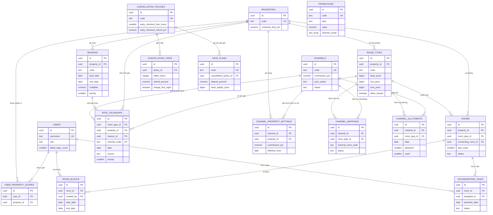
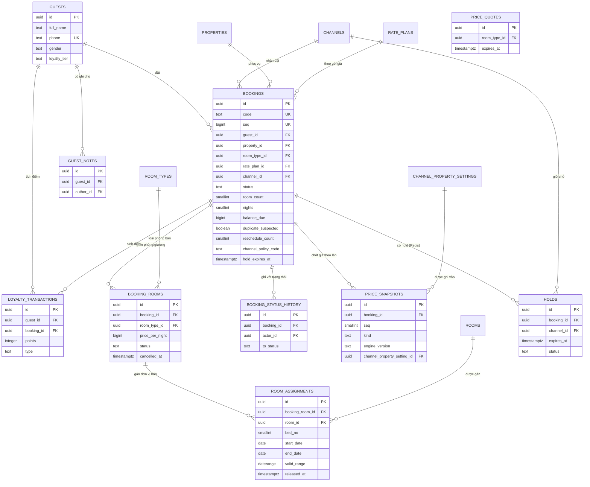

# 04 — Cơ sở dữ liệu

> Thiết kế CSDL vật lý cho hệ thống đặt phòng – homestay chuỗi Pine Hill: **3 cơ sở · 55 phòng · 75 đơn vị bán · 7 kênh bán · 13 module**.
> CSDL mục tiêu **PostgreSQL 16** (ADR-003): Prisma 6 sinh phần thân bảng, **migration SQL thủ công** cho ràng buộc loại trừ, cột sinh, chỉ mục biểu thức và trigger.
> Định danh thực thể/enum: [00 §7](../00-tong-quan.md#7-từ-điển-thực-thể-nguồn-chân-lý-về-định-danh) · Quy tắc nghiệp vụ: [02/quy-tắc-nghiệp-vụ](../02-nghiep-vu/quy-tac-nghiep-vu.md) (**139 BR**).
> §3 là nguồn DDL chạy theo thứ tự; §9 gồm **5 truy vấn then chốt**. Kết quả kiểm chứng phải gắn với phiên bản tài liệu và môi trường thực thi; không suy diễn kiểm thử PostgreSQL 16 từ kiểm tra cú pháp hoặc PostgreSQL nhúng.
> Nguồn duy nhất của mọi giá trị số là file BR — tài liệu này chỉ **tham chiếu mã BR**.

---

## 1. Quy ước thiết kế CSDL

| # | Quy ước | Ghi chú |
|---|---------|---------|
| 1 | Tên bảng `snake_case` **số nhiều**; cột là `snake_case` của trường `camelCase` trong [00 §7](../00-tong-quan.md#7-từ-điển-thực-thể-nguồn-chân-lý-về-định-danh) | `channelPolicyCode` → `channel_policy_code` |
| 2 | Khoá chính **UUID** (`gen_random_uuid()`); mọi quan hệ đều có **khoá ngoại** | Không lộ số lượng bản ghi; hợp nhất dữ liệu đa nguồn |
| 3 | Mọi bảng có `created_at`/`updated_at` kiểu `timestamptz`, **lưu UTC** | BR-GEN-02, NFR-LOC-02; `updated_at` tự cập nhật bằng trigger |
| 4 | **Tiền = `bigint` VND**, không dùng số thực | BR-GEN-01, NFR-LOC-03; phần trăm dùng `numeric(5,2)` |
| 5 | Enum lưu dạng `text` + `CHECK (… IN (…))`, **không** dùng kiểu `ENUM` của PostgreSQL | Thêm giá trị = migration thường; triển khai cuốn chiếu không bị khoá `ALTER TYPE` |
| 6 | Ngày dùng `date`, thời điểm `timestamptz`, khoảng ngày `daterange` **nửa mở `[start, end)`** | BR-GEN-04; nửa mở để đêm liền kề không chồng lấn (§4) |
| 7 | Đơn vị tồn phòng là **`(room_id, bed_no)`**: `bed_no = 0` = cả phòng, `1..bedCount` = giường (chỉ DOR) | BR-INV-03, BR-PROP-04; 55 phòng = **75 đơn vị bán** (BR-PROP-03) |
| 8 | Bất biến ép được ở CSDL thì **ép ở CSDL** (`EXCLUDE`/`CHECK`/`UNIQUE`/cột sinh/trigger) | BR-INV-02/03, NFR-REL-01/05 |
| 9 | Bảng append-only bị thu hồi quyền ghi ở tầng CSDL | BR-SYS-01, NFR-SEC-04 (§7) |
| 10 | Mọi thao tác ghi mang `Idempotency-Key` → bảng `idempotency_keys` (24 giờ) và cột `UNIQUE` nơi cần | BR-GEN-08, BR-PAY-03 |
| 11 | **Không** lưu dữ liệu thẻ (số thẻ, hết hạn, CVV) | BR-PAY-04, NFR-SEC-02 |
| 12 | `audit_logs.entity_id` **không** là khoá ngoại | BR-BOOK-17: xoá cứng booking vẫn giữ được vết nhật ký |
| 13 | `outbox_events` chống lưng cho cổng ra `OutboxPort`; nhật ký và sự kiện ghi trong **cùng transaction** `UnitOfWork` | BR-GEN-07, BR-CHAN-06 · [04/kiến-trúc](kien-truc.md) |

### 1.1. Ghi chú kiểu dữ liệu quyết định

| Cột | Kiểu | Vì sao |
|-----|------|--------|
| `room_assignments.bed_no` | `smallint NOT NULL DEFAULT 0` | BR-INV-03: đơn vị bán là (phòng, giường). `0` = cả phòng, `1..bedCount` = giường (chỉ DOR — BR-PROP-04, `MERGE_SHARE`) |
| `room_assignments.valid_range` | `daterange GENERATED ALWAYS AS (daterange(start_date, end_date, '[)')) STORED` | Khoá loại trừ cần kiểu khoảng có chỉ mục GiST (§4) |
| `bookings.nights` | `smallint GENERATED ALWAYS AS ((check_out - check_in)::smallint) STORED` | BR-BOOK-03: số đêm suy ra từ khoảng ngày |
| `bookings.seq` | `bigint NOT NULL DEFAULT nextval('bookings_seq') UNIQUE` | BR-OVER-11: phá hoà cuối khi xếp khách điều chuyển, tăng đơn điệu (UUID không có thứ tự) |
| `bookings.balance_due` | `bigint` projection ≥ 0 | BR-PAY-02: tổng nghĩa vụ còn phải thu từ `booking_charges` và `payment_allocations`; cập nhật cùng transaction, không dùng công thức cột sinh theo tổng thu |
| `payments.amount` | `bigint` **có dấu** | BR-PAY-09: bút toán `REFUND` ghi âm để doanh thu thuần cộng trực tiếp |
| `rate_calendars.priority` | `smallint` + `CHECK` khớp `source` | BR-RATE-02: `OVERRIDE` 100 → `RATE_PLAN` 90 → `SEASON` 50 → `BASE` 10 |
| `rate_calendars.channel_code` | `text NULL` (FK `channels.code`) | BR-RATE-02: dòng khai kênh chỉ áp cho kênh đó; `NULL` = mọi kênh |
| `cancellation_policies.early_checkout_free_hours` / `early_checkout_refund_pct` | `smallint NULL` / `numeric(5,2)` | BR-CANCEL-09: ngưỡng trả phòng sớm phải là **dữ liệu**, không hard-code trong `CancellationPolicyEngine` |
| `price_snapshots.seq`, `kind` | `smallint` / `text` | BR-RATE-16, BR-CANCEL-19: giữ bản gốc và các bản điều chỉnh (`RESCHEDULE`, `PARTIAL_CANCEL`) |
| `price_snapshots.channel_property_setting_id` | FK | BR-RATE-18: ghi lại dòng `ChannelPropertySetting` đã chọn (theo `effectiveFrom` của từng đêm) để tái lập kết quả |
| `refund_requests.reason` | enum `CancelReason` | Ràng buộc theo enum, không phải chuỗi tự do (BR-CANCEL-13/18/19) |
| `refund_requests.net_refund` | cột sinh `greatest(0, coalesce(approved_amount, requested_amount) − refund_fee)` | BR-CANCEL-05: phí không được làm tiền hoàn âm; mọi ngưỡng phê duyệt và báo cáo so trên **`netRefund`** |
| `guests.phone` | `text` + `UNIQUE` từng phần | BR-CRM-01: nhận diện khách theo SĐT chuẩn hoá `+84…` (NFR-LOC-04) |
| `bookings.external_ref` | `text` + `UNIQUE (channel_id, external_ref)` | BR-CHAN-03/04: đối soát booking OTA, chặn webhook gửi lại tạo bản ghi mới |

### 1.2. Hai bản ghi **không** nằm trong PostgreSQL

| Thực thể | Nơi lưu | Vì sao | Nguồn chân lý |
|----------|---------|--------|---------------|
| `PriceQuote` | Redis 7, khoá `quote:<quoteId>`, TTL **900 giây** | Hiệu lực 15 phút rồi phải tính lại (BR-RATE-15). Trường lưu: `id`, `propertyId`, `roomTypeId`, `ratePlanCode`, `channelCode`, `checkIn`, `checkOut`, `nights[]` (mỗi phần tử có `basePrice`, các hệ số, `clamped`, `nightlyPrice`), `subtotal`, `discountAmount`, `total`, `depositAmount`, `currency`, `quotedAt`, `expiresAt`, `warnings[]` (BR-RATE-12 đường báo giá trực tuyến) | Bản ghi bất biến khi booking rời `DRAFT` là `price_snapshots` (BR-RATE-16) |
| `Hold` | Redis 7, khoá `hold:<bookingId>`: `id`, `bookingId`, `channelId`, `expiresAt`, `status` (`ACTIVE`/`RELEASED`/`EXPIRED`), `releasedAt` | Bộ đếm nhanh của đường giữ chỗ; job giải phóng mỗi 30 giây (`job.hold.releaseIntervalSeconds`) và job đối chiếu mỗi 900 giây (`job.holdReconcile.intervalSeconds`) phát hiện hold treo | **`bookings.hold_expires_at`** — mọi truy vấn tồn phòng đọc từ đây, không đọc Redis (BR-INV-04, NFR-REL-02) |

---

## 2. Sơ đồ ERD

### 2.1. Nhóm A — Định danh, cơ sở, giá & kênh bán



### 2.2. Nhóm B — Khách hàng, đặt phòng & đơn vị bán theo đêm



### 2.3. Nhóm C — Quá tải, thanh toán & hệ thống

```mermaid
erDiagram
  PROPERTIES ||--o{ OVERBOOKING_CASES : "phát sinh"
  ROOM_TYPES ||--o{ OVERBOOKING_CASES : "thiếu phòng"
  BOOKINGS ||--o{ ROOM_MOVES : "được điều chuyển"
  BOOKING_ROOMS ||--o{ ROOM_MOVES : "đổi đơn vị"
  ROOMS ||--o{ ROOM_MOVES : "điểm đi/đến"
  USERS ||--o{ ROOM_MOVES : "duyệt"
  BOOKINGS ||--o{ ROOM_MERGES : "ghép chính"
  BOOKINGS ||--o{ ROOM_MERGES : "ghép phụ"
  ROOMS ||--o{ ROOM_MERGES : "ghép tại"
  BOOKINGS ||--o{ PAYMENTS : "thanh toán"
  USERS ||--o{ PAYMENTS : "thu tiền"
  BOOKINGS ||--o{ REFUND_REQUESTS : "yêu cầu hoàn"
  PAYMENTS ||--o{ REFUND_REQUESTS : "hoàn cho giao dịch"
  CANCELLATION_POLICIES ||--o{ REFUND_REQUESTS : "theo chính sách"
  CANCELLATION_TIERS ||--o{ REFUND_REQUESTS : "áp bậc"
  USERS ||--o{ REFUND_REQUESTS : "tạo/duyệt"
  BOOKINGS ||--o{ NOTIFICATIONS : "thông báo"
  USERS ||--o{ AUDIT_LOGS : "hành động"
  USERS ||--o{ IDEMPOTENCY_KEYS : "gửi yêu cầu"
  CHANNELS ||--o{ OUTBOX_EVENTS : "đồng bộ tới"
  PROPERTIES ||--o{ OCCUPANCY_SNAPSHOTS : "đo công suất"
  ROOM_TYPES ||--o{ OCCUPANCY_SNAPSHOTS : "theo loại phòng"

  OVERBOOKING_CASES {
    uuid id PK
    uuid property_id FK
    uuid room_type_id FK
    date date
    smallint shortage_count
    text status
    timestamptz escalated_at
    text delay_reason
  }
  ROOM_MOVES {
    uuid id PK
    uuid booking_id FK
    uuid booking_room_id FK
    uuid from_room_id FK
    uuid to_room_id FK
    text move_type
    smallint keep_score
    boolean price_locked
    bigint compensation_amount
    text walk_out_doc_no
  }
  ROOM_MERGES {
    uuid id PK
    uuid primary_booking_id FK
    uuid secondary_booking_id FK
    uuid room_id FK
    boolean consent_primary
    boolean consent_secondary
    bigint discount_amount
    text status
  }
  PAYMENTS {
    uuid id PK
    uuid booking_id FK
    uuid created_by FK
    text type
    text method
    bigint amount
    text idempotency_key UK
  }
  REFUND_REQUESTS {
    uuid id PK
    uuid booking_id FK
    uuid payment_id FK
    uuid policy_id FK
    uuid applied_tier_id FK
    uuid requested_by FK
    uuid approved_by FK
    text status
    text reason
    bigint net_refund
  }
  NOTIFICATIONS {
    uuid id PK
    uuid booking_id FK
    text channel
    text status
    smallint retry_count
  }
  AUDIT_LOGS {
    uuid id PK
    uuid actor_id FK
    text actor_role
    text entity_type
    uuid entity_id
    text prev_hash
    text row_hash
  }
  IDEMPOTENCY_KEYS {
    uuid id PK
    text key UK
    uuid actor_id FK
    text request_hash
    timestamptz expires_at
  }
  SYSTEM_SETTINGS {
    uuid id PK
    text key UK
    text value_type
    uuid updated_by FK
  }
  OUTBOX_EVENTS {
    uuid id PK
    uuid channel_id FK
    text event_type
    text status
  }
  OCCUPANCY_SNAPSHOTS {
    uuid id PK
    uuid property_id FK
    uuid room_type_id FK
    date date
    smallint physical_rooms
    smallint sold_rooms
    numeric occupancy_pct
  }
```



---

## 3. DDL PostgreSQL 16

Thứ tự khối lệnh là **thứ tự phụ thuộc khoá ngoại** (bảng không phụ thuộc tạo trước), không phải thứ tự nhóm module: `loyalty_transactions` đặt sau `bookings`, khối ràng buộc/trigger/chỉ mục/quyền đặt sau cùng.

### 3.1. Phần nền: extension, sequence, hàm ngữ cảnh phiên

```sql
-- PostgreSQL 16 — đồ án Pine Hill Homestay
CREATE EXTENSION IF NOT EXISTS btree_gist;   -- kiểu chỉ mục gist cho uuid/smallint (ràng buộc loại trừ)
CREATE EXTENSION IF NOT EXISTS pgcrypto;     -- digest() SHA-256 cho chuỗi băm AuditLog

-- Ngữ cảnh phiên, ứng dụng đặt trong mỗi transaction ghi:
--   SET LOCAL app.actor_id = '<uuid>';  SET LOCAL app.actor_role = 'MANAGER';
CREATE OR REPLACE FUNCTION fn_current_role() RETURNS text
LANGUAGE sql STABLE AS $$
  SELECT COALESCE(current_setting('app.actor_role', true), 'ANONYMOUS')
$$;

CREATE SEQUENCE IF NOT EXISTS bookings_seq;  -- BR-OVER-11: phá hoà theo thứ tự tăng đơn điệu
```

### 3.2. Bảng theo nhóm module

#### 3.2.1. AUTH+PROP — Người dùng, cơ sở & buồng phòng

```sql
CREATE TABLE users (
  id                 uuid PRIMARY KEY DEFAULT gen_random_uuid(),
  username           text NOT NULL UNIQUE,
  password_hash      text NOT NULL,
  full_name          text NOT NULL,
  role               text NOT NULL CHECK (role IN ('OWNER','MANAGER','FRONT_DESK','RESERVATION_AGENT','ACCOUNTANT','HOUSEKEEPING','SYSADMIN')),
  phone              text,
  is_active          boolean NOT NULL DEFAULT true,
  failed_login_count smallint NOT NULL DEFAULT 0 CHECK (failed_login_count >= 0),
  locked_until       timestamptz,
  last_login_at      timestamptz,
  created_at timestamptz NOT NULL DEFAULT now(), updated_at timestamptz NOT NULL DEFAULT now(),
  must_change_password boolean NOT NULL DEFAULT false,
  password_changed_at timestamptz
);

CREATE TABLE properties (
  id                  uuid PRIMARY KEY DEFAULT gen_random_uuid(),
  code                text NOT NULL UNIQUE,
  name                text NOT NULL,
  address             text NOT NULL,
  phone               text NOT NULL,
  check_in_time       time NOT NULL DEFAULT '14:00',
  check_out_time      time NOT NULL DEFAULT '12:00',
  timezone            text NOT NULL DEFAULT 'Asia/Ho_Chi_Minh',
  overbook_limit_pct  numeric(4,2) NOT NULL DEFAULT 0,
  latitude            numeric(9,6) NOT NULL,
  longitude           numeric(9,6) NOT NULL,
  status              text NOT NULL DEFAULT 'ACTIVE' CHECK (status IN ('ACTIVE','INACTIVE')),
  created_at timestamptz NOT NULL DEFAULT now(), updated_at timestamptz NOT NULL DEFAULT now(),
  CONSTRAINT ck_properties_overbook_pct CHECK (overbook_limit_pct >= 0 AND overbook_limit_pct <= 5)
);

CREATE TABLE room_types (
  id                uuid PRIMARY KEY DEFAULT gen_random_uuid(),
  property_id       uuid NOT NULL REFERENCES properties(id) ON DELETE RESTRICT,
  code              text NOT NULL CHECK (code IN ('STD','SUP','DLX','FAM','DOR')),
  name              text NOT NULL,
  capacity_adults   smallint NOT NULL CHECK (capacity_adults > 0),
  capacity_children smallint NOT NULL DEFAULT 0 CHECK (capacity_children >= 0),
  base_price        bigint NOT NULL CHECK (base_price > 0),
  min_price         bigint NOT NULL CHECK (min_price > 0),
  max_price         bigint NOT NULL CHECK (max_price > 0),
  allow_shared      boolean NOT NULL DEFAULT false,
  status            text NOT NULL DEFAULT 'ACTIVE' CHECK (status IN ('ACTIVE','INACTIVE')),
  created_at timestamptz NOT NULL DEFAULT now(), updated_at timestamptz NOT NULL DEFAULT now(),
  CONSTRAINT uq_room_types_property_code UNIQUE (property_id, code),
  CONSTRAINT ck_room_types_price_band CHECK (min_price <= base_price AND base_price <= max_price),
  CONSTRAINT ck_room_types_shared_only_dor CHECK (NOT allow_shared OR code = 'DOR')
);

CREATE TABLE rooms (
  id                  uuid PRIMARY KEY DEFAULT gen_random_uuid(),
  property_id         uuid NOT NULL REFERENCES properties(id) ON DELETE RESTRICT,
  room_type_id        uuid NOT NULL REFERENCES room_types(id) ON DELETE RESTRICT,
  code                text NOT NULL,
  name                text NOT NULL,
  floor               smallint NOT NULL DEFAULT 0,
  status              text NOT NULL DEFAULT 'ACTIVE' CHECK (status IN ('ACTIVE','MAINTENANCE','INACTIVE')),
  connecting_room_id  uuid REFERENCES rooms(id) ON DELETE SET NULL,
  bed_count           smallint NOT NULL DEFAULT 1 CHECK (bed_count >= 1),   -- BR-PROP-04: DOR = 6, còn lại = 1
  note                text,
  created_at timestamptz NOT NULL DEFAULT now(), updated_at timestamptz NOT NULL DEFAULT now(),
  CONSTRAINT uq_rooms_property_code UNIQUE (property_id, code),
  CONSTRAINT ck_rooms_not_self_connecting CHECK (connecting_room_id IS NULL OR connecting_room_id <> id)
);

CREATE TABLE user_property_scopes (
  id          uuid PRIMARY KEY DEFAULT gen_random_uuid(),
  user_id     uuid NOT NULL REFERENCES users(id) ON DELETE CASCADE,
  property_id uuid NOT NULL REFERENCES properties(id) ON DELETE CASCADE,
  created_at timestamptz NOT NULL DEFAULT now(), updated_at timestamptz NOT NULL DEFAULT now(),
  CONSTRAINT uq_user_property_scopes UNIQUE (user_id, property_id)
);

CREATE TABLE room_blocks (
  id          uuid PRIMARY KEY DEFAULT gen_random_uuid(),
  room_id     uuid NOT NULL REFERENCES rooms(id) ON DELETE CASCADE,
  start_date  date NOT NULL,
  end_date    date NOT NULL,
  reason      text NOT NULL CHECK (reason IN ('MAINTENANCE','RENOVATION','OWNER_USE','DEEP_CLEAN')),
  created_by  uuid NOT NULL REFERENCES users(id) ON DELETE RESTRICT,
  created_at timestamptz NOT NULL DEFAULT now(), updated_at timestamptz NOT NULL DEFAULT now(),
  CONSTRAINT ck_room_blocks_range CHECK (end_date > start_date)
);

CREATE TABLE housekeeping_tasks (
  id            uuid PRIMARY KEY DEFAULT gen_random_uuid(),
  room_id       uuid NOT NULL REFERENCES rooms(id) ON DELETE CASCADE,
  business_date date NOT NULL,
  status        text NOT NULL DEFAULT 'PENDING' CHECK (status IN ('PENDING','IN_PROGRESS','DONE','INSPECTED')),
  assigned_to   uuid REFERENCES users(id) ON DELETE SET NULL,
  note          text,
  completed_at  timestamptz,
  created_at timestamptz NOT NULL DEFAULT now(), updated_at timestamptz NOT NULL DEFAULT now(),
  CONSTRAINT uq_housekeeping_room_date UNIQUE (room_id, business_date)
);
```

#### 3.2.2. RATE — Giá, mùa & kênh bán

```sql
CREATE TABLE cancellation_policies (
  id         uuid PRIMARY KEY DEFAULT gen_random_uuid(),
  code       text NOT NULL UNIQUE,
  name       text NOT NULL,
  is_default boolean NOT NULL DEFAULT false,
  early_checkout_free_hours smallint CHECK (early_checkout_free_hours IS NULL OR early_checkout_free_hours >= 0),
  early_checkout_refund_pct numeric(5,2) NOT NULL DEFAULT 0
                     CHECK (early_checkout_refund_pct >= 0 AND early_checkout_refund_pct <= 100),
  status     text NOT NULL DEFAULT 'ACTIVE' CHECK (status IN ('ACTIVE','INACTIVE')),
  created_at timestamptz NOT NULL DEFAULT now(), updated_at timestamptz NOT NULL DEFAULT now()
);

CREATE TABLE cancellation_tiers (
  id                 uuid PRIMARY KEY DEFAULT gen_random_uuid(),
  policy_id          uuid NOT NULL REFERENCES cancellation_policies(id) ON DELETE CASCADE,
  offset_hours       integer NOT NULL CHECK (offset_hours >= -1),
  refund_percent     numeric(5,2) NOT NULL CHECK (refund_percent >= 0 AND refund_percent <= 100),
  charge_first_night boolean NOT NULL DEFAULT false,
  label              text NOT NULL,
  sort_order         smallint NOT NULL CHECK (sort_order > 0),
  created_at timestamptz NOT NULL DEFAULT now(), updated_at timestamptz NOT NULL DEFAULT now(),
  CONSTRAINT uq_cancellation_tiers_order UNIQUE (policy_id, sort_order),
  CONSTRAINT uq_cancellation_tiers_offset UNIQUE (policy_id, offset_hours)
);

CREATE TABLE rate_plans (
  id                  uuid PRIMARY KEY DEFAULT gen_random_uuid(),
  code                text NOT NULL UNIQUE CHECK (code IN ('FLEX7','SAVER3','NONREF','LONGSTAY14')),
  name                text NOT NULL,
  deposit_percent     numeric(5,2) NOT NULL CHECK (deposit_percent >= 0 AND deposit_percent <= 100),
  cancellation_policy_id uuid NOT NULL REFERENCES cancellation_policies(id) ON DELETE RESTRICT,
  min_nights          smallint NOT NULL DEFAULT 1 CHECK (min_nights >= 1),
  max_nights          smallint NOT NULL DEFAULT 365,
  fixed_nightly_price bigint CHECK (fixed_nightly_price IS NULL OR fixed_nightly_price > 0),
  los_discount_enabled boolean NOT NULL DEFAULT true,
  reschedule_allowed  boolean NOT NULL DEFAULT true,
  reschedule_min_hours integer NOT NULL DEFAULT 168 CHECK (reschedule_min_hours >= 0),
  reschedule_fee_pct numeric(5,2) NOT NULL DEFAULT 0 CHECK (reschedule_fee_pct BETWEEN 0 AND 100),
  max_reschedules smallint NOT NULL DEFAULT 1 CHECK (max_reschedules >= 0),
  status              text NOT NULL DEFAULT 'ACTIVE' CHECK (status IN ('ACTIVE','INACTIVE')),
  created_at timestamptz NOT NULL DEFAULT now(), updated_at timestamptz NOT NULL DEFAULT now(),
  CONSTRAINT ck_rate_plans_nights CHECK (max_nights >= min_nights)
);

CREATE TABLE channels (
  id                uuid PRIMARY KEY DEFAULT gen_random_uuid(),
  code              text NOT NULL UNIQUE
                    CHECK (code IN ('WEB','PHONE','WALKIN','OTA_BOOKING','OTA_AGODA','OTA_AIRBNB','AGENCY')),
  name              text NOT NULL,
  multiplier        numeric(5,3) NOT NULL CHECK (multiplier > 0),
  commission_pct    numeric(5,2) NOT NULL DEFAULT 0 CHECK (commission_pct >= 0 AND commission_pct <= 50),
  hold_minutes      integer NOT NULL DEFAULT 0 CHECK (hold_minutes >= 0),
  overbook_allowed  boolean NOT NULL DEFAULT false,
  status            text NOT NULL DEFAULT 'ACTIVE' CHECK (status IN ('ACTIVE','INACTIVE')),
  sync_status       text NOT NULL DEFAULT 'OK' CHECK (sync_status IN ('OK','DEGRADED')),
  consecutive_sync_failures smallint NOT NULL DEFAULT 0 CHECK (consecutive_sync_failures >= 0),
  last_sync_at      timestamptz,
  last_sync_error   text,
  created_at timestamptz NOT NULL DEFAULT now(), updated_at timestamptz NOT NULL DEFAULT now()
);

CREATE TABLE channel_property_settings (
  id                  uuid PRIMARY KEY DEFAULT gen_random_uuid(),
  channel_id          uuid NOT NULL REFERENCES channels(id) ON DELETE CASCADE,
  property_id         uuid NOT NULL REFERENCES properties(id) ON DELETE CASCADE,
  commission_pct      numeric(5,2) NOT NULL CHECK (commission_pct >= 0 AND commission_pct <= 50),
  multiplier_override numeric(5,3) CHECK (multiplier_override IS NULL OR multiplier_override > 0),
  effective_from      date NOT NULL,
  created_at timestamptz NOT NULL DEFAULT now(), updated_at timestamptz NOT NULL DEFAULT now(),
  CONSTRAINT uq_channel_property_settings UNIQUE (channel_id, property_id, effective_from)
);

CREATE TABLE channel_mappings (
  id                      uuid PRIMARY KEY DEFAULT gen_random_uuid(),
  channel_id              uuid NOT NULL REFERENCES channels(id) ON DELETE CASCADE,
  room_type_id            uuid NOT NULL REFERENCES room_types(id) ON DELETE CASCADE,
  external_room_code      text NOT NULL,
  external_rate_plan_code text,
  status                  text NOT NULL DEFAULT 'ACTIVE' CHECK (status IN ('ACTIVE','INACTIVE')),
  created_at timestamptz NOT NULL DEFAULT now(), updated_at timestamptz NOT NULL DEFAULT now(),
  CONSTRAINT uq_channel_mappings_room UNIQUE (channel_id, room_type_id),
  CONSTRAINT uq_channel_mappings_external UNIQUE (channel_id, external_room_code)
);

CREATE TABLE seasons (
  id                        uuid PRIMARY KEY DEFAULT gen_random_uuid(),
  property_id               uuid REFERENCES properties(id) ON DELETE CASCADE,
  code                      text NOT NULL CHECK (code IN ('SE-NY','SE-TET','SE-REUN','SE-NAT','SE-SUM','SE-SHO','SE-LOW')),
  name                      text NOT NULL,
  start_date                date NOT NULL,
  end_date                  date NOT NULL,
  multiplier                numeric(5,3) NOT NULL CHECK (multiplier > 0),
  priority                  smallint NOT NULL CHECK (priority >= 0),
  weekend_surcharge_enabled boolean NOT NULL DEFAULT true,
  status                    text NOT NULL DEFAULT 'ACTIVE' CHECK (status IN ('ACTIVE','INACTIVE')),
  created_at timestamptz NOT NULL DEFAULT now(), updated_at timestamptz NOT NULL DEFAULT now(),
  CONSTRAINT ck_seasons_range CHECK (end_date >= start_date),
  CONSTRAINT uq_seasons_scope_code_start UNIQUE (property_id, code, start_date)
);

CREATE TABLE rate_calendars (
  id           uuid PRIMARY KEY DEFAULT gen_random_uuid(),
  room_type_id uuid NOT NULL REFERENCES room_types(id) ON DELETE CASCADE,
  property_id  uuid NOT NULL REFERENCES properties(id) ON DELETE CASCADE,
  date         date NOT NULL,
  price        bigint NOT NULL CHECK (price > 0),
  source       text NOT NULL DEFAULT 'BASE' CHECK (source IN ('BASE','SEASON','OVERRIDE','RATE_PLAN')),
  priority     smallint NOT NULL,
  channel_code text REFERENCES channels(code) ON DELETE CASCADE,
  season_id    uuid REFERENCES seasons(id) ON DELETE SET NULL,
  rate_plan_id uuid REFERENCES rate_plans(id) ON DELETE RESTRICT,
  reason       text,
  created_by   uuid REFERENCES users(id) ON DELETE SET NULL,
  created_at timestamptz NOT NULL DEFAULT now(), updated_at timestamptz NOT NULL DEFAULT now(),
  CONSTRAINT ck_rate_calendars_priority CHECK (
    (source = 'OVERRIDE'  AND priority = 100) OR
    (source = 'RATE_PLAN' AND priority = 90)  OR
    (source = 'SEASON'    AND priority = 50)  OR
    (source = 'BASE'      AND priority = 10)),
  CONSTRAINT ck_rate_calendars_season CHECK (source = 'SEASON' OR season_id IS NULL),
  CONSTRAINT ck_rate_calendars_plan CHECK ((source = 'RATE_PLAN') = (rate_plan_id IS NOT NULL)),
  CONSTRAINT ck_rate_calendars_reason CHECK (source <> 'OVERRIDE' OR length(coalesce(reason, '')) > 0)
);

CREATE TABLE channel_allotments (
  id            uuid PRIMARY KEY DEFAULT gen_random_uuid(),
  channel_id    uuid NOT NULL REFERENCES channels(id) ON DELETE CASCADE,
  room_type_id  uuid NOT NULL REFERENCES room_types(id) ON DELETE CASCADE,
  date          date NOT NULL,
  allotment     smallint NOT NULL CHECK (allotment >= 0),
  used          smallint NOT NULL DEFAULT 0 CHECK (used >= 0),
  is_closed     boolean NOT NULL DEFAULT false,
  closed_reason text,
  closed_at     timestamptz,
  created_at timestamptz NOT NULL DEFAULT now(), updated_at timestamptz NOT NULL DEFAULT now(),
  CONSTRAINT uq_channel_allotments_scope UNIQUE (channel_id, room_type_id, date),
  CONSTRAINT ck_channel_allotments_closed CHECK (is_closed = false OR closed_at IS NOT NULL)
);

CREATE TABLE channel_allotment_scopes (
  channel_id uuid NOT NULL REFERENCES channels(id) ON DELETE CASCADE,
  room_type_id uuid NOT NULL REFERENCES room_types(id) ON DELETE CASCADE,
  version bigint NOT NULL DEFAULT 1 CHECK (version > 0),
  PRIMARY KEY (channel_id, room_type_id)
);

CREATE TABLE promotions (
  id               uuid PRIMARY KEY DEFAULT gen_random_uuid(),
  code             text NOT NULL UNIQUE,
  name             text NOT NULL,
  type             text NOT NULL CHECK (type IN ('PERCENT','AMOUNT')),
  value            numeric(12,2) NOT NULL CHECK (value > 0),
  min_nights       smallint NOT NULL DEFAULT 1 CHECK (min_nights >= 1),
  channel_scope    text[] NOT NULL DEFAULT '{}',
  room_type_scope  text[] NOT NULL DEFAULT '{}',
  valid_from       date NOT NULL,
  valid_to         date NOT NULL,
  max_uses         integer CHECK (max_uses IS NULL OR max_uses > 0),
  used_count       integer NOT NULL DEFAULT 0 CHECK (used_count >= 0),
  stackable        boolean NOT NULL DEFAULT false,
  status           text NOT NULL DEFAULT 'ACTIVE' CHECK (status IN ('ACTIVE','INACTIVE')),
  created_at timestamptz NOT NULL DEFAULT now(), updated_at timestamptz NOT NULL DEFAULT now(),
  CONSTRAINT ck_promotions_window CHECK (valid_to >= valid_from),
  CONSTRAINT ck_promotions_percent CHECK (type <> 'PERCENT' OR value <= 100),
  CONSTRAINT ck_promotions_usage CHECK (max_uses IS NULL OR used_count <= max_uses),
  CONSTRAINT ck_promotions_channels CHECK (channel_scope <@ ARRAY['WEB','PHONE','WALKIN','OTA_BOOKING','OTA_AGODA','OTA_AIRBNB','AGENCY']::text[]),
  CONSTRAINT ck_promotions_room_types CHECK (room_type_scope <@ ARRAY['STD','SUP','DLX','FAM','DOR']::text[])
);
```

#### 3.2.3. CRM — Khách hàng

```sql
CREATE TABLE guests (
  id                 uuid PRIMARY KEY DEFAULT gen_random_uuid(),
  full_name          text NOT NULL,
  phone              text NOT NULL,
  email              text,
  id_number          text,
  dob                date,
  nationality        text DEFAULT 'VN',
  loyalty_tier       text NOT NULL DEFAULT 'GUEST' CHECK (loyalty_tier IN ('GUEST','MEMBER','SILVER','GOLD','PLATINUM')),
  loyalty_points     integer NOT NULL DEFAULT 0 CHECK (loyalty_points >= 0),
  total_stays        smallint NOT NULL DEFAULT 0 CHECK (total_stays >= 0),
  blacklisted        boolean NOT NULL DEFAULT false,
  blacklist_reason   text,
  notes              text,
  gender             text NOT NULL DEFAULT 'UNSPECIFIED'
                     CHECK (gender IN ('MALE','FEMALE','OTHER','UNSPECIFIED')),
  consent_marketing  boolean NOT NULL DEFAULT false,
  consent_at         timestamptz,
  consent_version    text,
  anonymized_at      timestamptz,
  created_at timestamptz NOT NULL DEFAULT now(), updated_at timestamptz NOT NULL DEFAULT now(),
  CONSTRAINT ck_guests_phone_normalized CHECK (anonymized_at IS NOT NULL OR phone ~ '^\+84[0-9]{9}$'),
  CONSTRAINT ck_guests_blacklist_reason CHECK (NOT blacklisted OR blacklist_reason IS NOT NULL)
);

CREATE TABLE guest_credentials (
  guest_id uuid PRIMARY KEY REFERENCES guests(id) ON DELETE CASCADE,
  password_hash text NOT NULL,
  failed_login_count smallint NOT NULL DEFAULT 0 CHECK (failed_login_count >= 0),
  locked_until timestamptz,
  password_changed_at timestamptz,
  created_at timestamptz NOT NULL DEFAULT now(), updated_at timestamptz NOT NULL DEFAULT now()
);

CREATE TABLE auth_sessions (
  id uuid PRIMARY KEY DEFAULT gen_random_uuid(),
  principal_type text NOT NULL CHECK (principal_type IN ('USER','GUEST')),
  user_id uuid REFERENCES users(id) ON DELETE CASCADE,
  guest_id uuid REFERENCES guests(id) ON DELETE CASCADE,
  surface text NOT NULL CHECK (surface IN ('OPS_WEB','OPS_ANDROID','GUEST_WEB','GUEST_ANDROID')),
  family_id uuid NOT NULL,
  token_hash text NOT NULL UNIQUE,
  created_at timestamptz NOT NULL DEFAULT now(),
  last_seen_at timestamptz NOT NULL DEFAULT now(),
  expires_at timestamptz NOT NULL,
  rotated_at timestamptz,
  revoked_at timestamptz,
  revoke_reason text,
  ip inet,
  user_agent text,
  updated_at timestamptz NOT NULL DEFAULT now(),
  CONSTRAINT ck_auth_sessions_principal CHECK (
    (principal_type = 'USER' AND user_id IS NOT NULL AND guest_id IS NULL) OR
    (principal_type = 'GUEST' AND guest_id IS NOT NULL AND user_id IS NULL)
  ),
  CONSTRAINT ck_auth_sessions_surface CHECK (
    (principal_type = 'USER' AND surface IN ('OPS_WEB','OPS_ANDROID')) OR
    (principal_type = 'GUEST' AND surface IN ('GUEST_WEB','GUEST_ANDROID'))
  ),
  CONSTRAINT ck_auth_sessions_expiry CHECK (expires_at > created_at),
  CONSTRAINT uq_auth_sessions_id_user UNIQUE (id, user_id)
);
CREATE INDEX idx_auth_sessions_family ON auth_sessions (family_id);
CREATE INDEX idx_auth_sessions_active_user ON auth_sessions (user_id)
  WHERE revoked_at IS NULL AND rotated_at IS NULL AND user_id IS NOT NULL;
CREATE INDEX idx_auth_sessions_active_guest ON auth_sessions (guest_id)
  WHERE revoked_at IS NULL AND rotated_at IS NULL AND guest_id IS NOT NULL;

CREATE TABLE user_pins (
  user_id uuid PRIMARY KEY REFERENCES users(id) ON DELETE CASCADE,
  pin_hash text NOT NULL,
  failed_count smallint NOT NULL DEFAULT 0 CHECK (failed_count >= 0),
  locked_until timestamptz,
  set_at timestamptz NOT NULL DEFAULT now(),
  created_at timestamptz NOT NULL DEFAULT now(), updated_at timestamptz NOT NULL DEFAULT now()
);

CREATE TABLE pin_grants (
  id uuid PRIMARY KEY DEFAULT gen_random_uuid(),
  token_hash text NOT NULL UNIQUE,
  user_id uuid NOT NULL REFERENCES users(id) ON DELETE CASCADE,
  session_id uuid NOT NULL,
  purpose text NOT NULL,
  booking_id uuid,
  created_at timestamptz NOT NULL DEFAULT now(),
  expires_at timestamptz NOT NULL,
  consumed_at timestamptz,
  updated_at timestamptz NOT NULL DEFAULT now(),
  CONSTRAINT fk_pin_grants_session_user FOREIGN KEY (session_id, user_id)
    REFERENCES auth_sessions(id, user_id) ON DELETE CASCADE,
  CONSTRAINT ck_pin_grants_expiry CHECK (expires_at > created_at AND expires_at <= created_at + interval '5 minutes')
);

CREATE TABLE guest_password_resets (
  id uuid PRIMARY KEY DEFAULT gen_random_uuid(),
  guest_id uuid NOT NULL REFERENCES guests(id) ON DELETE CASCADE,
  token_hash text NOT NULL UNIQUE,
  created_at timestamptz NOT NULL DEFAULT now(),
  expires_at timestamptz NOT NULL,
  consumed_at timestamptz,
  updated_at timestamptz NOT NULL DEFAULT now(),
  CONSTRAINT ck_guest_password_resets_expiry CHECK (expires_at > created_at AND expires_at <= created_at + interval '30 minutes')
);

CREATE TABLE guest_notes (
  id         uuid PRIMARY KEY DEFAULT gen_random_uuid(),
  guest_id   uuid NOT NULL REFERENCES guests(id) ON DELETE CASCADE,
  content    text NOT NULL,
  author_id  uuid REFERENCES users(id) ON DELETE SET NULL,
  created_at timestamptz NOT NULL DEFAULT now(), updated_at timestamptz NOT NULL DEFAULT now()
);
```

#### 3.2.4. BOOK — Đặt phòng & đơn vị bán theo đêm

```sql
CREATE TABLE bookings (
  id                 uuid PRIMARY KEY DEFAULT gen_random_uuid(),
  code               text NOT NULL UNIQUE CHECK (code ~ '^PH-[0-9]{6}-[A-Z0-9]{5}$'),
  seq                bigint NOT NULL DEFAULT nextval('bookings_seq') UNIQUE,   -- BR-OVER-11: phá hoà tất định
  guest_id           uuid NOT NULL REFERENCES guests(id) ON DELETE RESTRICT,
  property_id        uuid NOT NULL REFERENCES properties(id) ON DELETE RESTRICT,
  room_type_id       uuid NOT NULL REFERENCES room_types(id) ON DELETE RESTRICT,
  rate_plan_id       uuid NOT NULL REFERENCES rate_plans(id) ON DELETE RESTRICT,
  channel_id         uuid NOT NULL REFERENCES channels(id) ON DELETE RESTRICT,
  check_in           date NOT NULL,
  check_out          date NOT NULL,
  nights             smallint GENERATED ALWAYS AS ((check_out - check_in)::smallint) STORED,
  adults             smallint NOT NULL CHECK (adults > 0),
  children           smallint NOT NULL DEFAULT 0 CHECK (children >= 0),
  status             text NOT NULL DEFAULT 'DRAFT'
                     CHECK (status IN ('DRAFT','HELD','PENDING_PAYMENT','CONFIRMED','CHECKED_IN','CHECKED_OUT','CANCELLED','NO_SHOW','EXPIRED')),
  room_count         smallint NOT NULL DEFAULT 1 CHECK (room_count > 0),
  total_amount       bigint NOT NULL DEFAULT 0 CHECK (total_amount >= 0),
  deposit_percent    numeric(5,2) NOT NULL CHECK (deposit_percent >= 0 AND deposit_percent <= 100),
  deposit_amount     bigint NOT NULL DEFAULT 0 CHECK (deposit_amount >= 0),
  paid_amount        bigint NOT NULL DEFAULT 0 CHECK (paid_amount >= 0),
  refunded_amount    bigint NOT NULL DEFAULT 0 CHECK (refunded_amount >= 0),
  penalty_amount     bigint NOT NULL DEFAULT 0 CHECK (penalty_amount >= 0),
  balance_due        bigint NOT NULL DEFAULT 0 CHECK (balance_due >= 0), -- projection du sổ nghĩa vụ/phân bổ (§3.6)
  currency           char(3) NOT NULL DEFAULT 'VND',
  hold_expires_at    timestamptz,
  oversold           boolean NOT NULL DEFAULT false,
  duplicate_suspected boolean NOT NULL DEFAULT false,
  price_locked       boolean NOT NULL DEFAULT false,
  external_ref       text,
  channel_policy_code text,
  reschedule_count   smallint NOT NULL DEFAULT 0 CHECK (reschedule_count >= 0),
  note               text,
  created_by         uuid REFERENCES users(id) ON DELETE SET NULL,
  created_at timestamptz NOT NULL DEFAULT now(), updated_at timestamptz NOT NULL DEFAULT now(),
  cancelled_at       timestamptz,
  cancel_reason      text CHECK (cancel_reason IS NULL OR cancel_reason IN
                     ('GUEST_REQUEST','FORCE_MAJEURE','HOTEL_RELOCATION','PAYMENT_TIMEOUT','DUPLICATE','NO_SHOW',
                     'SYSTEM','OTA_CANCELLATION','EARLY_CHECKOUT')),
  CONSTRAINT ck_bookings_range CHECK (check_out > check_in),
  CONSTRAINT ck_bookings_refund_cap CHECK (refunded_amount <= paid_amount),
  CONSTRAINT ck_bookings_cancelled CHECK (status <> 'CANCELLED' OR cancelled_at IS NOT NULL),
  CONSTRAINT ck_bookings_hold CHECK (status NOT IN ('HELD','PENDING_PAYMENT') OR hold_expires_at IS NOT NULL)
);

CREATE TABLE booking_rooms (
  id              uuid PRIMARY KEY DEFAULT gen_random_uuid(),
  booking_id      uuid NOT NULL REFERENCES bookings(id) ON DELETE CASCADE,
  room_type_id    uuid NOT NULL REFERENCES room_types(id) ON DELETE RESTRICT,
  adults          smallint NOT NULL CHECK (adults > 0),
  children        smallint NOT NULL DEFAULT 0 CHECK (children >= 0),
  price_per_night bigint NOT NULL CHECK (price_per_night >= 0),
  status          text NOT NULL DEFAULT 'ACTIVE' CHECK (status IN ('ACTIVE','CANCELLED')),
  cancelled_at    timestamptz,
  CONSTRAINT ck_booking_rooms_cancelled CHECK (status <> 'CANCELLED' OR cancelled_at IS NOT NULL),
  created_at timestamptz NOT NULL DEFAULT now(), updated_at timestamptz NOT NULL DEFAULT now()
);

CREATE TABLE room_assignments (
  id              uuid PRIMARY KEY DEFAULT gen_random_uuid(),
  booking_room_id uuid NOT NULL REFERENCES booking_rooms(id) ON DELETE CASCADE,
  room_id         uuid NOT NULL REFERENCES rooms(id) ON DELETE RESTRICT,
  bed_no          smallint NOT NULL DEFAULT 0 CHECK (bed_no >= 0),
  start_date      date NOT NULL,
  end_date        date NOT NULL,
  valid_range     daterange GENERATED ALWAYS AS (daterange(start_date, end_date, '[)')) STORED,
  released_at     timestamptz,
  release_reason  text,
  created_at timestamptz NOT NULL DEFAULT now(), updated_at timestamptz NOT NULL DEFAULT now(),
  CONSTRAINT ck_room_assignments_range CHECK (end_date > start_date)
);

CREATE TABLE booking_status_history (
  id          uuid PRIMARY KEY DEFAULT gen_random_uuid(),
  booking_id  uuid NOT NULL REFERENCES bookings(id) ON DELETE CASCADE,
  from_status text,
  to_status   text NOT NULL,
  reason      text,
  actor_id    uuid REFERENCES users(id) ON DELETE SET NULL,
  at          timestamptz NOT NULL DEFAULT now(),
  created_at timestamptz NOT NULL DEFAULT now(), updated_at timestamptz NOT NULL DEFAULT now()
);

CREATE TABLE price_snapshots (
  id           uuid PRIMARY KEY DEFAULT gen_random_uuid(),
  booking_id   uuid NOT NULL REFERENCES bookings(id) ON DELETE CASCADE,
  seq          smallint NOT NULL CHECK (seq > 0),
  kind         text NOT NULL DEFAULT 'ORIGINAL'
               CHECK (kind IN ('ORIGINAL','RESCHEDULE','PARTIAL_CANCEL')),
  payload_json jsonb NOT NULL,
  quote_id uuid UNIQUE,
  quote_fingerprint text,
  gross_amount bigint NOT NULL CHECK (gross_amount >= 0),
  commission_amount bigint NOT NULL CHECK (commission_amount >= 0 AND commission_amount <= gross_amount),
  policy_snapshot_json jsonb NOT NULL CHECK (jsonb_typeof(policy_snapshot_json) = 'object'),
  engine_version text NOT NULL,
  channel_property_setting_id uuid REFERENCES channel_property_settings(id) ON DELETE RESTRICT,
  captured_at  timestamptz NOT NULL DEFAULT now(),
  created_at timestamptz NOT NULL DEFAULT now(), updated_at timestamptz NOT NULL DEFAULT now(),
  CONSTRAINT uq_price_snapshots_seq UNIQUE (booking_id, seq),
  CONSTRAINT ck_snapshot_quote CHECK (
    (quote_id IS NULL AND quote_fingerprint IS NULL)
    OR (kind = 'ORIGINAL' AND quote_id IS NOT NULL AND length(coalesce(quote_fingerprint, '')) > 0))
);
```

#### 3.2.5. OVER — Quá tải & điều chuyển

```sql
CREATE TABLE overbooking_cases (
  id              uuid PRIMARY KEY DEFAULT gen_random_uuid(),
  property_id     uuid NOT NULL REFERENCES properties(id) ON DELETE RESTRICT,
  date            date NOT NULL,
  room_type_id    uuid NOT NULL REFERENCES room_types(id) ON DELETE RESTRICT,
  shortage_count  smallint NOT NULL CHECK (shortage_count > 0),
  status          text NOT NULL DEFAULT 'OPEN' CHECK (status IN ('OPEN','PROPOSED','RESOLVED','ESCALATED')),
  detected_at     timestamptz NOT NULL DEFAULT now(),
  resolved_at     timestamptz,
  escalated_at    timestamptz,
  delay_reason    text,
  resolved_by     uuid REFERENCES users(id) ON DELETE SET NULL,
  created_at timestamptz NOT NULL DEFAULT now(), updated_at timestamptz NOT NULL DEFAULT now(),
  CONSTRAINT ck_overbooking_resolved CHECK (status <> 'RESOLVED' OR (resolved_at IS NOT NULL AND resolved_by IS NOT NULL)),
  CONSTRAINT ck_overbooking_escalated CHECK (status <> 'ESCALATED' OR escalated_at IS NOT NULL)
);

CREATE TABLE room_moves (
  id               uuid PRIMARY KEY DEFAULT gen_random_uuid(),
  booking_id       uuid NOT NULL REFERENCES bookings(id) ON DELETE CASCADE,
  booking_room_id  uuid NOT NULL REFERENCES booking_rooms(id) ON DELETE CASCADE,
  move_type        text NOT NULL CHECK (move_type IN
                   ('SAME_TYPE_SAME_PROPERTY','UPGRADE_SAME_PROPERTY','SAME_TYPE_CROSS_PROPERTY',
                    'UPGRADE_CROSS_PROPERTY','WALK_OUT','SPLIT_ROOMS','MERGE_SHARE','MERGE_CONNECTING')),
  from_room_id     uuid REFERENCES rooms(id) ON DELETE SET NULL,
  to_room_id       uuid REFERENCES rooms(id) ON DELETE SET NULL,
  from_property_id uuid REFERENCES properties(id) ON DELETE SET NULL,
  to_property_id   uuid REFERENCES properties(id) ON DELETE SET NULL,
  reason           text NOT NULL,
  keep_score       smallint NOT NULL DEFAULT 0 CHECK (keep_score >= 0 AND keep_score <= 173),
  price_locked     boolean NOT NULL DEFAULT true,
  compensation_amount bigint NOT NULL DEFAULT 0 CHECK (compensation_amount >= 0),
  transport_cost   bigint NOT NULL DEFAULT 0 CHECK (transport_cost >= 0),
  walk_out_doc_no      text,
  guest_signature_ref  text,
  staff_signature_ref  text,
  approved_by      uuid REFERENCES users(id) ON DELETE RESTRICT,
  status           text NOT NULL DEFAULT 'PROPOSED' CHECK (status IN ('PROPOSED','APPROVED','EXECUTED','REJECTED','CANCELLED')),
  created_at timestamptz NOT NULL DEFAULT now(), updated_at timestamptz NOT NULL DEFAULT now(),
  CONSTRAINT ck_room_moves_target CHECK (to_room_id IS NOT NULL OR move_type = 'WALK_OUT'),
  CONSTRAINT ck_room_moves_approval CHECK (status NOT IN ('APPROVED','EXECUTED') OR approved_by IS NOT NULL),
  CONSTRAINT ck_room_moves_price_lock CHECK (price_locked),
  CONSTRAINT ck_room_moves_walkout_doc CHECK (move_type <> 'WALK_OUT' OR status <> 'EXECUTED' OR walk_out_doc_no IS NOT NULL)
);

CREATE TABLE room_merges (
  id                 uuid PRIMARY KEY DEFAULT gen_random_uuid(),
  primary_booking_id uuid NOT NULL REFERENCES bookings(id) ON DELETE CASCADE,
  secondary_booking_id uuid NOT NULL REFERENCES bookings(id) ON DELETE CASCADE,
  room_id            uuid NOT NULL REFERENCES rooms(id) ON DELETE RESTRICT,
  move_type          text NOT NULL CHECK (move_type IN ('MERGE_SHARE','MERGE_CONNECTING')),
  consent_primary    boolean NOT NULL DEFAULT false,
  consent_secondary  boolean NOT NULL DEFAULT false,
  discount_pct       numeric(5,2) NOT NULL CHECK (discount_pct BETWEEN 0 AND 100),
  discount_amount    bigint NOT NULL DEFAULT 0 CHECK (discount_amount >= 0),
  approved_by        uuid REFERENCES users(id) ON DELETE SET NULL,
  status             text NOT NULL DEFAULT 'PENDING_CONSENT'
                     CHECK (status IN ('PENDING_CONSENT','APPROVED','ACTIVE','CANCELLED')),
  created_at timestamptz NOT NULL DEFAULT now(), updated_at timestamptz NOT NULL DEFAULT now(),
  CONSTRAINT ck_room_merges_distinct CHECK (primary_booking_id <> secondary_booking_id),
  CONSTRAINT ck_room_merges_consent CHECK (status NOT IN ('APPROVED','ACTIVE')
    OR (consent_primary AND consent_secondary AND approved_by IS NOT NULL))
);
```

#### 3.2.6. PAY — Thanh toán & hoàn tiền

```sql
CREATE TABLE payments (
  id              uuid PRIMARY KEY DEFAULT gen_random_uuid(),
  booking_id      uuid NOT NULL REFERENCES bookings(id) ON DELETE RESTRICT,
  type            text NOT NULL CHECK (type IN ('DEPOSIT','BALANCE','REFUND','PENALTY','EXTRA_SERVICE',
                                                 'COMPENSATION','RESCHEDULE_FEE')),
  method          text NOT NULL CHECK (method IN ('VNPAY','MOMO','CASH','BANK_TRANSFER','OTA_COLLECT')),
  amount          bigint NOT NULL CHECK (amount <> 0),
  status          text NOT NULL DEFAULT 'PENDING' CHECK (status IN ('PENDING','SUCCEEDED','FAILED','REVERSED')),
  provider_txn_id text,
  idempotency_key text NOT NULL, -- mã nghiệp vụ do server tạo, không sao chép khoá HTTP của khách
  paid_at         timestamptz,
  created_by      uuid REFERENCES users(id) ON DELETE SET NULL,
  note            text,
  created_at timestamptz NOT NULL DEFAULT now(), updated_at timestamptz NOT NULL DEFAULT now(),
  CONSTRAINT uq_payments_idempotency UNIQUE (booking_id, type, idempotency_key),
  CONSTRAINT uq_payments_provider_txn UNIQUE (method, provider_txn_id),
  CONSTRAINT ck_payments_sign CHECK ((type = 'REFUND' AND amount < 0) OR (type <> 'REFUND' AND amount > 0)),
  CONSTRAINT ck_payments_paid_at CHECK (status <> 'SUCCEEDED' OR paid_at IS NOT NULL),
  CONSTRAINT ck_payments_cash_shift CHECK (method <> 'CASH' OR created_by IS NOT NULL)
);

CREATE TABLE refund_requests (
  id                   uuid PRIMARY KEY DEFAULT gen_random_uuid(),
  booking_id           uuid NOT NULL REFERENCES bookings(id) ON DELETE RESTRICT,
  event_key            text NOT NULL CHECK (length(event_key) > 0),
  payment_id           uuid REFERENCES payments(id) ON DELETE RESTRICT, -- tham chiếu nguồn đơn nếu có; phân bổ đầy đủ ở refund_allocations
  policy_id            uuid NOT NULL REFERENCES cancellation_policies(id) ON DELETE RESTRICT,
  hours_before_check_in numeric(10,2) NOT NULL,
  applied_tier_id      uuid REFERENCES cancellation_tiers(id) ON DELETE SET NULL,
  refund_percent       numeric(5,2) NOT NULL CHECK (refund_percent >= 0 AND refund_percent <= 100),
  requested_amount     bigint NOT NULL CHECK (requested_amount >= 0),
  approved_amount      bigint CHECK (approved_amount IS NULL OR approved_amount >= 0),
  refund_fee           bigint NOT NULL DEFAULT 0 CHECK (refund_fee >= 0),
  net_refund           bigint GENERATED ALWAYS AS
                         (greatest(0::bigint, coalesce(approved_amount, requested_amount) - refund_fee)) STORED,
  status               text NOT NULL DEFAULT 'PENDING' CHECK (status IN ('PENDING','APPROVED','REJECTED','PAID','CANCELLED')),
  is_force_majeure     boolean NOT NULL DEFAULT false,
  evidence_refs        text[] NOT NULL DEFAULT '{}',
  reason               text NOT NULL CHECK (reason IN
                       ('GUEST_REQUEST','FORCE_MAJEURE','HOTEL_RELOCATION','PAYMENT_TIMEOUT',
                        'DUPLICATE','NO_SHOW','SYSTEM','OTA_CANCELLATION','EARLY_CHECKOUT')),
  requested_by         uuid REFERENCES users(id) ON DELETE RESTRICT,
  requester_type       text NOT NULL CHECK (requester_type IN ('USER','GUEST','SYSTEM')),
  requester_id         text NOT NULL CHECK (length(requester_id) > 0),
  approved_by          uuid REFERENCES users(id) ON DELETE RESTRICT,
  decided_at           timestamptz,
  cancelled_at         timestamptz,
  paid_at              timestamptz,
  created_at timestamptz NOT NULL DEFAULT now(), updated_at timestamptz NOT NULL DEFAULT now(),
  CONSTRAINT uq_refund_event UNIQUE (booking_id, event_key),
  CONSTRAINT ck_refund_requester CHECK (
    (requester_type = 'USER' AND requested_by IS NOT NULL AND requester_id = requested_by::text)
    OR (requester_type IN ('GUEST','SYSTEM') AND requested_by IS NULL)),
  CONSTRAINT ck_refund_requests_two_level CHECK (approved_by IS NULL OR approved_by <> requested_by),
  CONSTRAINT ck_refund_amount_limit CHECK (approved_amount IS NULL OR approved_amount <= requested_amount),
  CONSTRAINT ck_refund_requests_force_majeure CHECK (NOT is_force_majeure OR reason = 'FORCE_MAJEURE'),
  CONSTRAINT ck_refund_requests_approved CHECK (status NOT IN ('APPROVED','PAID') OR
    (approved_amount IS NOT NULL AND approved_by IS NOT NULL AND decided_at IS NOT NULL)),
  CONSTRAINT ck_refund_requests_paid CHECK (status <> 'PAID' OR (approved_amount IS NOT NULL AND paid_at IS NOT NULL)),
  CONSTRAINT ck_refund_requests_cancelled CHECK (status <> 'CANCELLED' OR (cancelled_at IS NOT NULL AND decided_at IS NULL))
);

-- Sổ nghĩa vụ và phân bổ tiền: chi tiết vật lý của Booking/Payment (BR-PAY-02).
CREATE TABLE booking_charges (
  id uuid PRIMARY KEY DEFAULT gen_random_uuid(),
  booking_id uuid NOT NULL REFERENCES bookings(id) ON DELETE RESTRICT,
  booking_room_id uuid REFERENCES booking_rooms(id) ON DELETE RESTRICT,
  stay_date date,
  kind text NOT NULL CHECK (kind IN ('ROOM','PENALTY','RESCHEDULE_FEE','EXTRA_SERVICE')),
  source_key text NOT NULL,
  amount bigint NOT NULL CHECK (amount >= 0),
  voided_amount bigint NOT NULL DEFAULT 0 CHECK (voided_amount >= 0 AND voided_amount <= amount),
  reason text,
  created_at timestamptz NOT NULL DEFAULT now(), updated_at timestamptz NOT NULL DEFAULT now(),
  UNIQUE (booking_id, source_key),
  CHECK (kind <> 'ROOM' OR (booking_room_id IS NOT NULL AND stay_date IS NOT NULL))
);

CREATE TABLE payment_allocations (
  id uuid PRIMARY KEY DEFAULT gen_random_uuid(),
  payment_id uuid NOT NULL REFERENCES payments(id) ON DELETE RESTRICT,
  charge_id uuid NOT NULL REFERENCES booking_charges(id) ON DELETE RESTRICT,
  amount bigint NOT NULL CHECK (amount > 0),
  released_amount bigint NOT NULL DEFAULT 0 CHECK (released_amount >= 0 AND released_amount <= amount),
  release_reason text,
  created_at timestamptz NOT NULL DEFAULT now(), updated_at timestamptz NOT NULL DEFAULT now(),
  UNIQUE (payment_id, charge_id),
  CHECK (released_amount = 0 OR length(btrim(coalesce(release_reason, ''))) > 0)
);

-- Chi tiết vật lý của RefundRequest; không thêm cấp duyệt bắt buộc.
CREATE TABLE refund_approvals (
  id uuid PRIMARY KEY DEFAULT gen_random_uuid(),
  refund_request_id uuid NOT NULL REFERENCES refund_requests(id) ON DELETE RESTRICT,
  request_version bigint NOT NULL CHECK (request_version > 0),
  approver_id uuid NOT NULL REFERENCES users(id) ON DELETE RESTRICT,
  approver_role text NOT NULL CHECK (approver_role IN ('MANAGER','OWNER')),
  decision text NOT NULL CHECK (decision IN ('APPROVED','REJECTED')),
  approved_amount bigint CHECK (approved_amount >= 0),
  refund_fee bigint NOT NULL CHECK (refund_fee >= 0),
  reason text NOT NULL CHECK (length(btrim(reason)) > 0),
  created_at timestamptz NOT NULL DEFAULT now(), updated_at timestamptz NOT NULL DEFAULT now(),
  UNIQUE (refund_request_id, request_version),
  CHECK (decision <> 'APPROVED' OR approved_amount IS NOT NULL)
);

CREATE TABLE refund_allocations (
  id uuid PRIMARY KEY DEFAULT gen_random_uuid(),
  refund_request_id uuid NOT NULL REFERENCES refund_requests(id) ON DELETE RESTRICT,
  original_payment_id uuid NOT NULL REFERENCES payments(id) ON DELETE RESTRICT,
  refund_payment_id uuid UNIQUE REFERENCES payments(id) ON DELETE RESTRICT,
  amount bigint NOT NULL CHECK (amount > 0),
  created_at timestamptz NOT NULL DEFAULT now(), updated_at timestamptz NOT NULL DEFAULT now(),
  UNIQUE (refund_request_id, original_payment_id)
);
```

#### 3.2.7. CRM (tiếp) — Điểm thưởng (tạo sau `bookings`)

```sql
CREATE TABLE loyalty_transactions (
  id         uuid PRIMARY KEY DEFAULT gen_random_uuid(),
  guest_id   uuid NOT NULL REFERENCES guests(id) ON DELETE CASCADE,
  booking_id uuid REFERENCES bookings(id) ON DELETE SET NULL,
  points     integer NOT NULL CHECK (points <> 0),
  type       text NOT NULL CHECK (type IN ('EARN','REDEEM','EXPIRE','ADJUST')),
  reason     text,
  created_at timestamptz NOT NULL DEFAULT now(), updated_at timestamptz NOT NULL DEFAULT now(),
  CONSTRAINT uq_loyalty_booking_type UNIQUE NULLS NOT DISTINCT (guest_id, booking_id, type)
);
```

#### 3.2.8. SYS — Hệ thống, thông báo & nhật ký

```sql
CREATE TABLE notifications (
  id            uuid PRIMARY KEY DEFAULT gen_random_uuid(),
  booking_id    uuid REFERENCES bookings(id) ON DELETE SET NULL,
  recipient     text NOT NULL,
  channel       text NOT NULL CHECK (channel IN ('EMAIL','SMS','ZALO_OA','PUSH')),
  template      text NOT NULL,
  payload_json  jsonb NOT NULL DEFAULT '{}',
  status        text NOT NULL DEFAULT 'PENDING' CHECK (status IN ('PENDING','SENT','FAILED','CANCELLED')),
  sent_at       timestamptz,
  retry_count   smallint NOT NULL DEFAULT 0 CHECK (retry_count >= 0),
  error_message text,
  created_at timestamptz NOT NULL DEFAULT now(), updated_at timestamptz NOT NULL DEFAULT now(),
  CONSTRAINT ck_notifications_sent CHECK (status <> 'SENT' OR sent_at IS NOT NULL)
);

CREATE SEQUENCE audit_chain_seq;
CREATE TABLE audit_logs (
  id          uuid PRIMARY KEY DEFAULT gen_random_uuid(),
  chain_seq   bigint NOT NULL UNIQUE,
  actor_id    uuid REFERENCES users(id) ON DELETE SET NULL,
  actor_role  text NOT NULL,
  action      text NOT NULL,
  entity_type text NOT NULL,
  entity_id   uuid,
  before_json jsonb,
  after_json  jsonb,
  reason      text,
  ip_address  inet,
  at          timestamptz NOT NULL DEFAULT now(),
  prev_hash   text,
  row_hash    text NOT NULL,
  created_at timestamptz NOT NULL DEFAULT now(), updated_at timestamptz NOT NULL DEFAULT now()
);

-- Khoá bắt buộc theo BR-SYS-02: refund.feeAmount, job.hold.releaseIntervalSeconds,
-- job.holdReconcile.intervalSeconds, job.channelSync.intervalSeconds, job.overbooking.scanIntervalMinutes,
-- job.occupancy.snapshotIntervalSeconds, job.noShow.markTime, deal.threshold.minor,
-- deal.threshold.checkInDebt, checkInDebtPct, channel.lowInventoryThreshold,
-- pricing.weekendMultiplier, pricing.maxDiscountPct, overbooking.transportSupportCap.
CREATE TABLE system_settings (
  id          uuid PRIMARY KEY DEFAULT gen_random_uuid(),
  key         text NOT NULL UNIQUE,
  value       text NOT NULL,
  value_type  text NOT NULL DEFAULT 'STRING' CHECK (value_type IN ('STRING','NUMBER','BOOLEAN','JSON')),
  description text,
  updated_by  uuid REFERENCES users(id) ON DELETE SET NULL,
  created_at timestamptz NOT NULL DEFAULT now(), updated_at timestamptz NOT NULL DEFAULT now()
);

CREATE TABLE idempotency_keys (
  id                 uuid PRIMARY KEY DEFAULT gen_random_uuid(),
  key                text NOT NULL CHECK (length(key) BETWEEN 1 AND 255),
  principal_type     text NOT NULL CHECK (principal_type IN ('USER','GUEST','SYSTEM','ANONYMOUS')),
  principal_id       text NOT NULL CHECK (length(principal_id) > 0),
  method             text NOT NULL CHECK (method IN ('POST','PUT','PATCH','DELETE')),
  path               text NOT NULL CHECK (left(path, 1) = '/'),
  actor_id           uuid REFERENCES users(id) ON DELETE SET NULL,
  request_hash       text NOT NULL,
  status             text NOT NULL DEFAULT 'IN_PROGRESS' CHECK (status IN ('IN_PROGRESS','COMPLETED')),
  lease_token        uuid NOT NULL DEFAULT gen_random_uuid(),
  lease_expires_at   timestamptz NOT NULL,
  response_status    smallint CHECK (response_status BETWEEN 100 AND 599),
  response_body_json jsonb,
  response_headers_json jsonb,
  expires_at         timestamptz NOT NULL,
  created_at timestamptz NOT NULL DEFAULT now(), updated_at timestamptz NOT NULL DEFAULT now(),
  CONSTRAINT uq_idempotency_scope UNIQUE (principal_type, principal_id, method, path, key),
  CONSTRAINT ck_idempotency_keys_expiry CHECK (expires_at > created_at),
  CONSTRAINT ck_idempotency_result CHECK (
    (status = 'IN_PROGRESS' AND response_status IS NULL)
    OR (status = 'COMPLETED' AND response_status IS NOT NULL))
);

CREATE TABLE webhook_inbox (
  id uuid PRIMARY KEY DEFAULT gen_random_uuid(),
  provider text NOT NULL CHECK (length(provider) > 0),
  provider_account_id text NOT NULL CHECK (length(provider_account_id) > 0),
  event_id text NOT NULL CHECK (length(event_id) > 0),
  payload_hash text NOT NULL,
  payload_json jsonb NOT NULL,
  signature_verified_at timestamptz NOT NULL,
  status text NOT NULL DEFAULT 'PENDING' CHECK (status IN ('PENDING','PROCESSING','PROCESSED','FAILED','DEAD_LETTER')),
  attempts integer NOT NULL DEFAULT 0 CHECK (attempts >= 0),
  available_at timestamptz NOT NULL DEFAULT now(),
  lease_token uuid,
  lease_expires_at timestamptz,
  processed_at timestamptz,
  last_error text,
  created_at timestamptz NOT NULL DEFAULT now(), updated_at timestamptz NOT NULL DEFAULT now(),
  UNIQUE (provider, provider_account_id, event_id),
  CHECK (status <> 'PROCESSING' OR (lease_token IS NOT NULL AND lease_expires_at IS NOT NULL)),
  CHECK (status <> 'PROCESSED' OR processed_at IS NOT NULL)
);

CREATE TABLE outbox_events (
  id             uuid PRIMARY KEY DEFAULT gen_random_uuid(),
  event_type     text NOT NULL,
  aggregate_type text NOT NULL,
  aggregate_id   uuid NOT NULL,
  channel_id     uuid REFERENCES channels(id) ON DELETE SET NULL,
  payload_json   jsonb NOT NULL,
  status         text NOT NULL DEFAULT 'PENDING' CHECK (status IN ('PENDING','PUBLISHED','FAILED','DEAD_LETTER')),
  attempts       smallint NOT NULL DEFAULT 0 CHECK (attempts >= 0),
  last_error     text,
  available_at   timestamptz NOT NULL DEFAULT now(),
  created_at     timestamptz NOT NULL DEFAULT now(),
  processed_at   timestamptz,
  updated_at     timestamptz NOT NULL DEFAULT now(),
  CONSTRAINT ck_outbox_published CHECK (status <> 'PUBLISHED' OR processed_at IS NOT NULL)
);

CREATE TABLE occupancy_snapshots (
  id             uuid PRIMARY KEY DEFAULT gen_random_uuid(),
  property_id    uuid NOT NULL REFERENCES properties(id) ON DELETE CASCADE,
  room_type_id   uuid REFERENCES room_types(id) ON DELETE CASCADE,
  date           date NOT NULL,
  physical_rooms smallint NOT NULL CHECK (physical_rooms >= 0),
  sold_rooms     smallint NOT NULL CHECK (sold_rooms >= 0),
  occupancy_pct  numeric(10,2) NOT NULL CHECK (occupancy_pct >= 0), -- cam kết OTA có thể vượt 200%
  captured_at    timestamptz NOT NULL DEFAULT now(),
  created_at timestamptz NOT NULL DEFAULT now(), updated_at timestamptz NOT NULL DEFAULT now(),
  CONSTRAINT uq_occupancy_snapshots_scope UNIQUE NULLS NOT DISTINCT (property_id, room_type_id, date)
);

-- Trạng thái giao bền từng consumer; Redis/BullMQ chỉ là vận chuyển (ADR-017).
CREATE TABLE event_deliveries (
  event_id uuid NOT NULL REFERENCES outbox_events(id) ON DELETE RESTRICT,
  consumer text NOT NULL CHECK (length(btrim(consumer)) > 0),
  status text NOT NULL DEFAULT 'PENDING' CHECK (status IN ('PENDING','PROCESSING','COMPLETED','DEAD_LETTER')),
  lease_token uuid,
  lease_expires_at timestamptz,
  attempts integer NOT NULL DEFAULT 0 CHECK (attempts >= 0),
  completed_at timestamptz,
  last_error text,
  created_at timestamptz NOT NULL DEFAULT now(), updated_at timestamptz NOT NULL DEFAULT now(),
  PRIMARY KEY (consumer, event_id),
  CHECK (status <> 'PROCESSING' OR (lease_token IS NOT NULL AND lease_expires_at IS NOT NULL)),
  CHECK (status <> 'COMPLETED' OR completed_at IS NOT NULL)
);
```


PIN grant gắn đúng user của phiên; FK booking đặt sau `bookings` theo thứ tự phụ thuộc. Xoá phiên/user/booking xoá grant để token không trở thành không có phạm vi. Chỉ mục phiên còn hiệu lực lọc chưa thu hồi/chưa xoay; expiry/idle được ứng dụng kiểm thêm (QĐ-03).

```sql
ALTER TABLE pin_grants ADD CONSTRAINT fk_pin_grants_booking FOREIGN KEY (booking_id) REFERENCES bookings(id) ON DELETE CASCADE;
```

**`operations` — thao tác bất đồng bộ (migration `0006_report_export_operations`, HB-163).** Mỗi thao tác nền
(xuất báo cáo trước, sao lưu sau này) ghi lại người yêu cầu và **ảnh chụp phạm vi cơ sở** để job chạy sau vẫn
chỉ chạm dữ liệu người yêu cầu được xem (BR-RBAC-02). `payload_json` giữ tham số yêu cầu, `result_json` là
ảnh chụp kết quả cho worker sinh tệp (job xoá sau khi ghi tệp), `result_path`/`result_expires_at` là tệp tạm
và hạn tải. Bảng được đọc/ghi bằng **SQL thô** trong `modules/sys/operations` và `modules/rep/export`, không
khai trong Prisma schema để tránh sinh lại client trong cùng migration.

```sql
CREATE TABLE operations (
  id                uuid PRIMARY KEY DEFAULT gen_random_uuid(),
  kind              text NOT NULL CHECK (kind IN ('REPORT_EXPORT')),
  status            text NOT NULL DEFAULT 'PENDING'
                    CHECK (status IN ('PENDING','RUNNING','SUCCEEDED','FAILED')),
  requested_by      uuid NOT NULL REFERENCES users(id) ON DELETE RESTRICT,
  property_scope    uuid[] NOT NULL DEFAULT '{}',
  payload_json      jsonb NOT NULL,
  result_json       jsonb,
  result_ref        text,
  result_path       text,
  result_expires_at timestamptz,
  error_code        text,
  error_message     text,
  created_at        timestamptz NOT NULL DEFAULT now(),
  updated_at        timestamptz NOT NULL DEFAULT now(),
  started_at        timestamptz,
  finished_at       timestamptz,
  CONSTRAINT ck_operations_failed CHECK (
    status <> 'FAILED' OR (error_code IS NOT NULL AND finished_at IS NOT NULL)),
  CONSTRAINT ck_operations_succeeded CHECK (
    status <> 'SUCCEEDED' OR (result_ref IS NOT NULL AND result_path IS NOT NULL AND finished_at IS NOT NULL))
);

CREATE INDEX idx_operations_requested_by ON operations (requested_by, created_at DESC);
```

**`refund_payout_operations` — thao tác chi hoàn bền (migration `0007_refund_payout_operations`, HB-100).**
ADR-016 tách trạng thái **kỹ thuật** của một leg chi khỏi `refund_requests.status`: hồ sơ vẫn `APPROVED`
(tiền còn giữ hạn mức) cho tới khi PSP xác nhận; timeout để operation ở `UNKNOWN` để đối soát, không trả
reservation. Mỗi dòng ứng với **một** `refund_allocations` (UNIQUE `refund_allocation_id`/`refund_payment_id`)
nên không thể sinh leg hay chứng từ chi thứ hai cho cùng request+receipt. `psp_key` là khoá idempotency bền
của PSP; chỉ thay sau khi PSP xác nhận lần trước thất bại dứt điểm. `lease_token`+`lease_expires_at`+`version`
là hàng rào để worker đã mất lease không commit kết quả. Bảng đọc/ghi bằng SQL thô trong
`modules/pay/payouts` và `apps/worker/src/jobs/refund-payout` (có model Prisma để client khớp lược đồ).

```sql
CREATE TABLE refund_payout_operations (
  id                  uuid PRIMARY KEY DEFAULT gen_random_uuid(),
  refund_request_id   uuid NOT NULL REFERENCES refund_requests(id) ON DELETE RESTRICT,
  refund_allocation_id uuid NOT NULL UNIQUE REFERENCES refund_allocations(id) ON DELETE RESTRICT,
  original_payment_id uuid NOT NULL REFERENCES payments(id) ON DELETE RESTRICT,
  refund_payment_id   uuid NOT NULL UNIQUE REFERENCES payments(id) ON DELETE RESTRICT,
  method              text NOT NULL CHECK (method IN ('VNPAY','MOMO','BANK_TRANSFER')),
  amount              bigint NOT NULL CHECK (amount > 0),
  bank_note           text,
  status              text NOT NULL DEFAULT 'READY'
                      CHECK (status IN ('READY','IN_FLIGHT','UNKNOWN','SUCCEEDED','FAILED_FINAL')),
  psp_key             text NOT NULL UNIQUE CHECK (length(btrim(psp_key)) > 0),
  provider_txn_id     text,
  attempts            integer NOT NULL DEFAULT 0 CHECK (attempts >= 0),
  lease_token         uuid,
  lease_expires_at    timestamptz,
  version             bigint NOT NULL DEFAULT 1 CHECK (version > 0),
  last_error          text,
  started_at          timestamptz,
  finished_at         timestamptz,
  created_at          timestamptz NOT NULL DEFAULT now(),
  updated_at          timestamptz NOT NULL DEFAULT now(),
  CONSTRAINT ck_refund_payout_lease CHECK (
    status <> 'IN_FLIGHT' OR (lease_token IS NOT NULL AND lease_expires_at IS NOT NULL)),
  CONSTRAINT ck_refund_payout_succeeded CHECK (
    status <> 'SUCCEEDED' OR (provider_txn_id IS NOT NULL AND finished_at IS NOT NULL)),
  CONSTRAINT ck_refund_payout_failed CHECK (
    status <> 'FAILED_FINAL' OR last_error IS NOT NULL)
);

CREATE INDEX idx_refund_payout_ready
  ON refund_payout_operations (created_at)
  WHERE status IN ('READY','IN_FLIGHT','UNKNOWN');

-- Chỉ dùng khi REFUND_PAYOUT_SIMULATOR=true (dev/test): sổ phía PSP mô phỏng, ghi bằng kết nối riêng để
-- mô phỏng "PSP đã chi trước khi DB nghiệp vụ commit".
CREATE TABLE refund_payout_simulator_transfers (
  id              uuid PRIMARY KEY DEFAULT gen_random_uuid(),
  psp_key         text NOT NULL UNIQUE CHECK (length(btrim(psp_key)) > 0),
  method          text NOT NULL CHECK (method IN ('VNPAY','MOMO')),
  amount          bigint NOT NULL CHECK (amount > 0),
  status          text NOT NULL CHECK (status IN ('SUCCEEDED','FAILED')),
  provider_txn_id text NOT NULL UNIQUE,
  created_at      timestamptz NOT NULL DEFAULT now()
);
```

### 3.3. Ràng buộc loại trừ, trigger bảo vệ bất biến

```sql
-- expectedVersion/If-Match là đầu vào API; version là giá trị lưu ở CSDL.
DO $$
DECLARE t text;
BEGIN
  FOREACH t IN ARRAY ARRAY['bookings','refund_requests','room_moves','room_merges','housekeeping_tasks','properties','room_types',
    'channels','channel_property_settings','channel_allotments','cancellation_policies',
    'channel_mappings','overbooking_cases',
    'cancellation_tiers','rate_plans','seasons','rate_calendars','promotions','system_settings']
  LOOP
    EXECUTE format('ALTER TABLE %I ADD COLUMN version bigint NOT NULL DEFAULT 1 CHECK (version > 0)', t);
  END LOOP;
END $$;

CREATE FUNCTION fn_increment_version() RETURNS trigger LANGUAGE plpgsql AS $$
BEGIN
  NEW.version := OLD.version + 1;
  RETURN NEW;
END $$;

DO $$
DECLARE t record;
BEGIN
  FOR t IN SELECT table_name FROM information_schema.columns
    WHERE table_schema = 'public' AND column_name = 'version'
      -- Bảng mới tự khai trigger version tên prefixed (xem block ngay dưới); vòng lặp này chỉ phục vụ
      -- các bảng của baseline để catalog khớp migration 0001.
      AND table_name <> 'refund_payout_operations'
  LOOP
    EXECUTE format('CREATE TRIGGER trg_version BEFORE UPDATE ON %I FOR EACH ROW EXECUTE FUNCTION fn_increment_version()', t.table_name);
  END LOOP;
END $$;

-- HB-100: `trg_refund_payout_operations_version` là tên khai trong migration 0007 (cùng lối
-- `trg_refund_requests_guard`); trigger `updated_at` vẫn do vòng lặp chung cuối §3.3 sinh ra.
CREATE TRIGGER trg_refund_payout_operations_version BEFORE UPDATE ON refund_payout_operations
  FOR EACH ROW EXECUTE FUNCTION fn_increment_version();

CREATE FUNCTION fn_immutable_record() RETURNS trigger LANGUAGE plpgsql AS $$
BEGIN
  -- Cascade chỉ khi parent đã qua guard xoá DRAFT/HELD và lưu bằng chứng vào AuditLog.
  IF TG_OP = 'DELETE' AND TG_TABLE_NAME = 'price_snapshots' THEN
    IF NOT EXISTS (SELECT 1 FROM bookings WHERE id = OLD.booking_id)
       AND EXISTS (SELECT 1 FROM audit_logs WHERE entity_id = OLD.booking_id
                    AND entity_type = 'Booking' AND action = 'DELETE') THEN
      RETURN OLD;
    END IF;
  END IF;
  RAISE EXCEPTION 'immutable record in %', TG_TABLE_NAME USING ERRCODE = '42501';
END $$;
CREATE TRIGGER trg_price_snapshots_immutable BEFORE UPDATE OR DELETE ON price_snapshots
  FOR EACH ROW EXECUTE FUNCTION fn_immutable_record();
CREATE TRIGGER trg_refund_approvals_immutable BEFORE UPDATE OR DELETE ON refund_approvals
  FOR EACH ROW EXECUTE FUNCTION fn_immutable_record();

CREATE FUNCTION fn_guard_booking_delete() RETURNS trigger LANGUAGE plpgsql AS $$
BEGIN
  IF OLD.status NOT IN ('DRAFT','HELD') OR EXISTS (SELECT 1 FROM payments WHERE booking_id = OLD.id)
     OR length(btrim(coalesce(current_setting('app.delete_reason', true), ''))) = 0 THEN
    RAISE EXCEPTION 'only unpaid DRAFT/HELD with deletion reason can be deleted' USING ERRCODE = '23514';
  END IF;
  INSERT INTO audit_logs(actor_id, actor_role, action, entity_type, entity_id, before_json, reason)
    VALUES (nullif(current_setting('app.actor_id', true), '')::uuid, fn_current_role(),
      'DELETE', 'Booking', OLD.id, jsonb_build_object('booking', to_jsonb(OLD),
        'priceSnapshots', (SELECT coalesce(jsonb_agg(to_jsonb(s)), '[]'::jsonb)
          FROM price_snapshots s WHERE s.booking_id = OLD.id)),
      current_setting('app.delete_reason', true));
  RETURN OLD;
END $$;
CREATE TRIGGER trg_bookings_delete BEFORE DELETE ON bookings
  FOR EACH ROW EXECUTE FUNCTION fn_guard_booking_delete();

CREATE FUNCTION fn_guard_refund_approval() RETURNS trigger LANGUAGE plpgsql AS $$
DECLARE r refund_requests%ROWTYPE; u users%ROWTYPE;
BEGIN
  SELECT * INTO STRICT r FROM refund_requests WHERE id = NEW.refund_request_id FOR UPDATE;
  SELECT * INTO STRICT u FROM users WHERE id = NEW.approver_id;
  IF r.status <> 'PENDING' OR r.version <> NEW.request_version
    OR NEW.approver_id = r.requested_by OR NOT u.is_active
    OR u.role NOT IN ('MANAGER','OWNER') OR NEW.approver_role <> u.role
    OR NEW.refund_fee <> r.refund_fee THEN
    RAISE EXCEPTION 'invalid refund approval or stale version' USING ERRCODE = '23514';
  END IF;
  IF u.role = 'MANAGER' AND NOT EXISTS (
    SELECT 1 FROM bookings b JOIN user_property_scopes s ON s.property_id = b.property_id
      WHERE b.id = r.booking_id AND s.user_id = u.id) THEN
    RAISE EXCEPTION 'approver outside property scope' USING ERRCODE = '23514';
  END IF;
  RETURN NEW;
END $$;
CREATE TRIGGER trg_refund_approvals_guard BEFORE INSERT ON refund_approvals
  FOR EACH ROW EXECUTE FUNCTION fn_guard_refund_approval();

CREATE FUNCTION fn_guard_refund_request() RETURNS trigger LANGUAGE plpgsql AS $$
BEGIN
  IF NEW.requester_type = 'GUEST' AND NOT EXISTS (
    SELECT 1 FROM bookings b WHERE b.id = NEW.booking_id AND b.guest_id::text = NEW.requester_id) THEN
    RAISE EXCEPTION 'refund guest must own booking' USING ERRCODE = '23514';
  END IF;
  IF NEW.payment_id IS NOT NULL AND NOT EXISTS (
    SELECT 1 FROM payments p WHERE p.id = NEW.payment_id AND p.booking_id = NEW.booking_id AND p.amount > 0) THEN
    RAISE EXCEPTION 'refund source belongs to another booking' USING ERRCODE = '23514';
  END IF;
  IF TG_OP = 'INSERT' THEN
    IF NEW.status <> 'PENDING' THEN
      RAISE EXCEPTION 'refund starts PENDING' USING ERRCODE = '23514';
    END IF;
    RETURN NEW;
  END IF;
  IF (NEW.booking_id, NEW.event_key, NEW.requester_type, NEW.requester_id, NEW.requested_by)
    IS DISTINCT FROM (OLD.booking_id, OLD.event_key, OLD.requester_type, OLD.requester_id, OLD.requested_by) THEN
    RAISE EXCEPTION 'refund requester and booking are immutable' USING ERRCODE = '23514';
  END IF;
  IF OLD.status <> 'PENDING' AND (
    (NEW.approved_amount, NEW.refund_fee, NEW.requested_amount, NEW.approved_by, NEW.decided_at)
      IS DISTINCT FROM (OLD.approved_amount, OLD.refund_fee, OLD.requested_amount, OLD.approved_by, OLD.decided_at)
    OR (NEW.status <> OLD.status AND NOT (OLD.status = 'APPROVED' AND NEW.status = 'PAID'))) THEN
    RAISE EXCEPTION 'refund decision is final' USING ERRCODE = '23514';
  END IF;
  IF OLD.status = 'PENDING' AND NEW.status IN ('APPROVED','REJECTED') AND NOT EXISTS (
    SELECT 1 FROM refund_approvals a WHERE a.refund_request_id = OLD.id
      AND a.request_version = OLD.version AND a.decision = NEW.status
      AND a.approver_id = NEW.approved_by AND a.refund_fee = NEW.refund_fee
      AND a.approved_amount IS NOT DISTINCT FROM NEW.approved_amount) THEN
    RAISE EXCEPTION 'independent approval record required' USING ERRCODE = '23514';
  END IF;
  IF OLD.status = 'PENDING' AND NEW.status = 'PAID' THEN
    RAISE EXCEPTION 'approve before paying' USING ERRCODE = '23514';
  END IF;
  IF NEW.status IN ('PENDING','APPROVED') AND (SELECT coalesce(sum(a.amount), 0)
    FROM refund_allocations a WHERE a.refund_request_id = NEW.id)
    > greatest(0::bigint, coalesce(NEW.approved_amount, NEW.requested_amount) - NEW.refund_fee) THEN
    RAISE EXCEPTION 'adjust reserved allocations before reducing refund' USING ERRCODE = '23514';
  END IF;
  IF NEW.status = 'PAID' AND (SELECT coalesce(sum(a.amount), 0)
      FROM refund_allocations a JOIN payments p ON p.id = a.refund_payment_id
     WHERE a.refund_request_id = NEW.id AND p.status = 'SUCCEEDED')
      <> greatest(0::bigint, coalesce(NEW.approved_amount, NEW.requested_amount) - NEW.refund_fee) THEN
    RAISE EXCEPTION 'successful allocations must equal net refund' USING ERRCODE = '23514';
  END IF;
  RETURN NEW;
END $$;
CREATE TRIGGER trg_refund_requests_guard BEFORE INSERT OR UPDATE ON refund_requests
  FOR EACH ROW EXECUTE FUNCTION fn_guard_refund_request();

CREATE FUNCTION fn_guard_refund_allocation() RETURNS trigger LANGUAGE plpgsql AS $$
DECLARE r refund_requests%ROWTYPE; p payments%ROWTYPE; reserved numeric;
BEGIN
  SELECT * INTO STRICT r FROM refund_requests WHERE id = NEW.refund_request_id FOR UPDATE;
  SELECT * INTO STRICT p FROM payments WHERE id = NEW.original_payment_id FOR UPDATE;
  IF r.status NOT IN ('PENDING','APPROVED') OR p.booking_id <> r.booking_id OR p.amount <= 0 OR p.status <> 'SUCCEEDED' THEN
    RAISE EXCEPTION 'allocation needs pending/approved refund and successful original payment' USING ERRCODE = '23514';
  END IF;
  IF TG_OP = 'UPDATE' AND ((NEW.refund_request_id, NEW.original_payment_id)
    IS DISTINCT FROM (OLD.refund_request_id, OLD.original_payment_id)
    OR (r.status <> 'PENDING' AND NEW.amount <> OLD.amount)) THEN
    RAISE EXCEPTION 'allocation source and amount are immutable' USING ERRCODE = '23514';
  END IF;
  SELECT coalesce(sum(a.amount), 0) INTO reserved FROM refund_allocations a
    JOIN refund_requests rr ON rr.id = a.refund_request_id
    WHERE a.original_payment_id = p.id AND a.id <> NEW.id AND rr.status IN ('PENDING','APPROVED','PAID');
  IF reserved + NEW.amount > p.amount OR NEW.amount + (
    SELECT coalesce(sum(a.amount), 0) FROM refund_allocations a
    WHERE a.refund_request_id = r.id AND a.id <> NEW.id) > r.net_refund THEN
    RAISE EXCEPTION 'refund allocation exceeds available funds' USING ERRCODE = '23514';
  END IF;
  IF NEW.refund_payment_id IS NOT NULL AND (r.status <> 'APPROVED' OR NOT EXISTS (
    SELECT 1 FROM payments rp WHERE rp.id = NEW.refund_payment_id
      AND rp.booking_id = r.booking_id AND rp.type = 'REFUND'
      AND (rp.method = p.method OR (p.method = 'CASH' AND rp.method = 'BANK_TRANSFER' AND length(btrim(coalesce(rp.note, ''))) > 0))
      AND rp.amount = -NEW.amount)) THEN
    RAISE EXCEPTION 'refund payment must match original method, booking and allocation' USING ERRCODE = '23514';
  END IF;
  IF TG_OP = 'UPDATE' AND OLD.refund_payment_id IS NOT NULL
    AND NEW.refund_payment_id IS DISTINCT FROM OLD.refund_payment_id THEN
    RAISE EXCEPTION 'reuse the same refund payment when retrying' USING ERRCODE = '23514';
  END IF;
  RETURN NEW;
END $$;
CREATE TRIGGER trg_refund_allocations_guard BEFORE INSERT OR UPDATE ON refund_allocations
  FOR EACH ROW EXECUTE FUNCTION fn_guard_refund_allocation();
CREATE TRIGGER trg_refund_allocations_no_delete BEFORE DELETE ON refund_allocations
  FOR EACH ROW EXECUTE FUNCTION fn_immutable_record();

CREATE FUNCTION fn_guard_payment_identity() RETURNS trigger LANGUAGE plpgsql AS $$
BEGIN
  IF (NEW.booking_id, NEW.type, NEW.method, NEW.amount, NEW.idempotency_key)
    IS DISTINCT FROM (OLD.booking_id, OLD.type, OLD.method, OLD.amount, OLD.idempotency_key)
    OR (OLD.provider_txn_id IS NOT NULL AND NEW.provider_txn_id IS DISTINCT FROM OLD.provider_txn_id)
    OR (OLD.status = 'SUCCEEDED' AND NEW.status <> 'SUCCEEDED') THEN
    RAISE EXCEPTION 'payment identity and successful receipt are immutable; use a refund entry'
      USING ERRCODE = '23514';
  END IF;
  RETURN NEW;
END $$;
CREATE TRIGGER trg_payments_identity BEFORE UPDATE ON payments
  FOR EACH ROW EXECUTE FUNCTION fn_guard_payment_identity();

-- ─────────────────────────────────────────────────────────────────────────────
-- BR-INV-03 — BẤT BIẾN CỨNG: mỗi (room_id, bed_no, đêm) tối đa 1 RoomAssignment hoạt động.
-- Đơn vị bán là (phòng, giường): bed_no = 0 nghĩa là "cả phòng" (mọi loại phòng bán theo
-- phòng), bed_no = 1..bedCount là giường cụ thể (chỉ DOR — BR-PROP-04, MERGE_SHARE).
-- ─────────────────────────────────────────────────────────────────────────────
ALTER TABLE room_assignments
  ADD CONSTRAINT excl_room_assignments_no_double_booking
  EXCLUDE USING gist (room_id WITH =,
    (CASE WHEN bed_no = 0 THEN int4range(0, NULL, '[)')
          ELSE int4range(bed_no::int, bed_no::int + 1, '[)') END) WITH &&,
    valid_range WITH &&)
  WHERE (released_at IS NULL);

-- Một BookingRoom chỉ được gán một nơi trong một đêm; đổi phòng dùng đoạn ngày liền kề.
ALTER TABLE room_assignments
  ADD CONSTRAINT excl_booking_room_one_assignment
  EXCLUDE USING gist (booking_room_id WITH =, valid_range WITH &&)
  WHERE (released_at IS NULL);

-- Đơn vị bán hợp lệ: giường chỉ tồn tại ở phòng đa giường, số giường không vượt sức chứa phòng.
CREATE OR REPLACE FUNCTION fn_guard_bed_no() RETURNS trigger
LANGUAGE plpgsql AS $$
DECLARE
  v_shared   boolean;
  v_bed_count smallint;
BEGIN
  SELECT rt.allow_shared, r.bed_count INTO v_shared, v_bed_count
    FROM rooms r JOIN room_types rt ON rt.id = r.room_type_id
   WHERE r.id = NEW.room_id;
  IF NEW.bed_no = 0 THEN
    IF v_shared THEN
      RAISE EXCEPTION 'DOR requires individual bed claims, not bed_no=0' USING ERRCODE = '23514';
    END IF;
    RETURN NEW;
  END IF;
  IF NOT v_shared THEN
    RAISE EXCEPTION 'E_PROP_NOT_SHARED: phòng % bán theo phòng, không dùng bed_no > 0', NEW.room_id
      USING ERRCODE = '23514';
  END IF;
  IF NEW.bed_no > v_bed_count THEN
    RAISE EXCEPTION 'E_PROP_BED_NO_RANGE: bed_no % vượt số giường % của phòng', NEW.bed_no, v_bed_count
      USING ERRCODE = '23514';
  END IF;
  RETURN NEW;
END $$;

CREATE TRIGGER trg_room_assignments_bed_no
  BEFORE INSERT OR UPDATE ON room_assignments
  FOR EACH ROW EXECUTE FUNCTION fn_guard_bed_no();

-- Phòng thường bán một đơn vị dù có nhiều giường vật lý (BR-PROP-04).
CREATE OR REPLACE FUNCTION fn_guard_room_bed_count() RETURNS trigger
LANGUAGE plpgsql AS $$
DECLARE v_shared boolean;
BEGIN
  SELECT allow_shared INTO v_shared FROM room_types WHERE id = NEW.room_type_id;
  IF EXISTS (SELECT 1 FROM room_assignments ra WHERE ra.room_id = NEW.id
      AND ra.released_at IS NULL AND (ra.bed_no > NEW.bed_count OR (NOT v_shared AND ra.bed_no > 0))) THEN
    RAISE EXCEPTION 'E_PROP_BED_COUNT: thay đổi sức chứa làm mất đơn vị đang được gán'
      USING ERRCODE = '23514';
  END IF;
  RETURN NEW;
END $$;

CREATE TRIGGER trg_rooms_bed_count
  BEFORE INSERT OR UPDATE ON rooms
  FOR EACH ROW EXECUTE FUNCTION fn_guard_room_bed_count();

-- Không thể khoá một phòng lên lịch đang có assignment hoạt động (BR-INV-06).
CREATE OR REPLACE FUNCTION fn_guard_room_block_overlap() RETURNS trigger
LANGUAGE plpgsql AS $$
DECLARE
  v_room_id uuid          := COALESCE(NEW.room_id, OLD.room_id);
  v_range   daterange;
BEGIN
  -- Mọi đường ghi block/assignment khoá cùng room; transaction dùng READ COMMITTED.
  PERFORM 1 FROM rooms WHERE id = v_room_id FOR UPDATE;
  IF TG_TABLE_NAME = 'room_blocks' THEN
    v_range := daterange(NEW.start_date, NEW.end_date, '[)');
    IF EXISTS (SELECT 1 FROM room_assignments ra
                WHERE ra.room_id = v_room_id
                  AND ra.released_at IS NULL
                  AND ra.valid_range && v_range) THEN
      IF fn_current_role() NOT IN ('MANAGER','OWNER') THEN
        RAISE EXCEPTION 'E_INV_BLOCK_OVERLAP: khoá phòng chồng lấn lịch đang hoạt động'
          USING ERRCODE = '23P01';
      END IF;
    END IF;
  ELSE
    IF NEW.released_at IS NOT NULL THEN RETURN NEW; END IF;
    -- Cột GENERATED chưa có giá trị trong BEFORE trigger.
    v_range := daterange(NEW.start_date, NEW.end_date, '[)');
    IF EXISTS (SELECT 1 FROM room_blocks b
                WHERE b.room_id = v_room_id
                  AND daterange(b.start_date, b.end_date, '[)') && v_range) THEN
      RAISE EXCEPTION 'E_INV_ROOM_BLOCKED: phòng đang bị khoá trong khoảng ngày này'
        USING ERRCODE = '23P01';
    END IF;
  END IF;
  RETURN NEW;
END $$;

CREATE TRIGGER trg_room_blocks_overlap_guard
  BEFORE INSERT OR UPDATE ON room_blocks
  FOR EACH ROW EXECUTE FUNCTION fn_guard_room_block_overlap();

CREATE TRIGGER trg_room_assignments_block_guard
  BEFORE INSERT OR UPDATE ON room_assignments
  FOR EACH ROW EXECUTE FUNCTION fn_guard_room_block_overlap();

-- BR-INV-05 — allotment một ngày không vượt số đơn vị bán của loại phòng.
CREATE OR REPLACE FUNCTION fn_guard_allotment_capacity() RETURNS trigger
LANGUAGE plpgsql AS $$
DECLARE
  v_physical integer;
BEGIN
  -- Ghi used thực tế của OTA không phải sửa cấu hình quota.
  IF TG_OP = 'UPDATE' AND (NEW.allotment, NEW.room_type_id, NEW.date)
    IS NOT DISTINCT FROM (OLD.allotment, OLD.room_type_id, OLD.date) THEN RETURN NEW; END IF;
  SELECT sum(CASE WHEN rt.allow_shared THEN r.bed_count ELSE 1 END)::int INTO v_physical
    FROM rooms r JOIN room_types rt ON rt.id = r.room_type_id
   WHERE r.room_type_id = NEW.room_type_id AND r.status = 'ACTIVE';
  IF NEW.allotment > coalesce(v_physical, 0) THEN
    RAISE EXCEPTION 'E_INV_ALLOTMENT_EXCEEDS_ROOMS: allotment % > % đơn vị bán',
      NEW.allotment, v_physical USING ERRCODE = '23514';
  END IF;
  RETURN NEW;
END $$;

CREATE TRIGGER trg_channel_allotments_capacity
  BEFORE INSERT OR UPDATE ON channel_allotments
  FOR EACH ROW EXECUTE FUNCTION fn_guard_allotment_capacity();

CREATE FUNCTION fn_invalidate_allotment_scope() RETURNS trigger LANGUAGE plpgsql AS $$
DECLARE
  old_channel uuid;
  old_type uuid;
  new_channel uuid;
  new_type uuid;
  scope record;
BEGIN
  -- Demand/cache updates are not configuration edits. Child versions remain independent.
  IF TG_OP = 'UPDATE' AND
    ROW(OLD.channel_id, OLD.room_type_id, OLD.date, OLD.allotment,
        OLD.is_closed, OLD.closed_reason, OLD.closed_at) IS NOT DISTINCT FROM
    ROW(NEW.channel_id, NEW.room_type_id, NEW.date, NEW.allotment,
        NEW.is_closed, NEW.closed_reason, NEW.closed_at) THEN
    RETURN NULL;
  END IF;
  IF TG_OP <> 'INSERT' THEN
    old_channel := OLD.channel_id;
    old_type := OLD.room_type_id;
  END IF;
  IF TG_OP <> 'DELETE' THEN
    new_channel := NEW.channel_id;
    new_type := NEW.room_type_id;
  END IF;
  -- Order both keys on moves; preserve counters after child deletion (no ABA).
  FOR scope IN
    SELECT channel_id, room_type_id FROM (
      SELECT old_channel AS channel_id, old_type AS room_type_id
      UNION SELECT new_channel, new_type
    ) pairs WHERE channel_id IS NOT NULL ORDER BY channel_id, room_type_id
  LOOP
    -- Parent cascade must not recreate an orphan counter.
    INSERT INTO channel_allotment_scopes(channel_id, room_type_id, version)
      SELECT scope.channel_id, scope.room_type_id, 2
      WHERE EXISTS (SELECT 1 FROM channels WHERE id = scope.channel_id)
        AND EXISTS (SELECT 1 FROM room_types WHERE id = scope.room_type_id)
      ON CONFLICT (channel_id, room_type_id) DO UPDATE
        SET version = channel_allotment_scopes.version + 1;
  END LOOP;
  RETURN NULL;
END $$;
CREATE TRIGGER trg_allotment_scope AFTER INSERT OR UPDATE OR DELETE ON channel_allotments
  FOR EACH ROW EXECUTE FUNCTION fn_invalidate_allotment_scope();

-- BR-SYS-01 + NFR-SEC-04 — app role không sửa/xoá; superuser không nằm trong trust boundary này.
CREATE OR REPLACE FUNCTION fn_audit_logs_append_only() RETURNS trigger
LANGUAGE plpgsql AS $$
BEGIN
  RAISE EXCEPTION 'E_SYS_AUDIT_IMMUTABLE: AuditLog là append-only, cấm UPDATE/DELETE'
    USING ERRCODE = '42501';
END $$;

CREATE TRIGGER trg_audit_logs_append_only
  BEFORE UPDATE OR DELETE ON audit_logs
  FOR EACH ROW EXECUTE FUNCTION fn_audit_logs_append_only();

-- Hash chuẩn dùng epoch; không phụ thuộc TimeZone session khi kiểm tra.
CREATE FUNCTION fn_audit_digest(a audit_logs, previous_hash text) RETURNS text
LANGUAGE sql STABLE AS $$
  SELECT encode(digest(jsonb_build_array(coalesce(previous_hash, 'GENESIS'),
    to_jsonb(a) - 'row_hash' - 'prev_hash' - 'at' - 'created_at' - 'updated_at',
    extract(epoch FROM a.at), extract(epoch FROM a.created_at))::text, 'sha256'), 'hex')
$$;

-- Cấp chain_seq SAU khóa; thứ tự append không phụ thuộc timestamp/UUID của client.
CREATE OR REPLACE FUNCTION fn_audit_logs_hash_chain() RETURNS trigger
LANGUAGE plpgsql AS $$
DECLARE
  v_prev text;
BEGIN
  PERFORM pg_advisory_xact_lock(hashtext('audit_logs.chain'));
  NEW.chain_seq := nextval('audit_chain_seq');
  SELECT row_hash INTO v_prev FROM audit_logs ORDER BY chain_seq DESC LIMIT 1;
  NEW.prev_hash := v_prev;
  NEW.row_hash := fn_audit_digest(NEW, v_prev);
  RETURN NEW;
END $$;

CREATE TRIGGER trg_audit_logs_hash_chain
  BEFORE INSERT ON audit_logs
  FOR EACH ROW EXECUTE FUNCTION fn_audit_logs_hash_chain();

-- Cập nhật updated_at tự động cho mọi bảng nghiệp vụ (AuditLog được miễn: append-only).
CREATE OR REPLACE FUNCTION fn_touch_updated_at() RETURNS trigger
LANGUAGE plpgsql AS $$
BEGIN
  NEW.updated_at := now();
  RETURN NEW;
END $$;

CREATE OR REPLACE FUNCTION fn_touch_room_updated_at() RETURNS trigger LANGUAGE plpgsql AS $$
BEGIN
  NEW.updated_at := GREATEST(OLD.updated_at + interval '1 microsecond', NEW.updated_at, clock_timestamp());
  RETURN NEW;
END $$;

DO $$
DECLARE t record;
BEGIN
  FOR t IN
    SELECT c.table_name FROM information_schema.columns c
     WHERE c.table_schema = 'public' AND c.column_name = 'updated_at'
       AND c.table_name <> 'audit_logs'
  LOOP
    EXECUTE format(
      'CREATE TRIGGER %I BEFORE UPDATE ON %I FOR EACH ROW EXECUTE FUNCTION %I()',
      'trg_' || t.table_name || '_touch', t.table_name,
      CASE WHEN t.table_name = 'rooms' THEN 'fn_touch_room_updated_at' ELSE 'fn_touch_updated_at' END);
  END LOOP;
END $$;
```

### 3.4. Chỉ mục

```sql
-- Tồn phòng theo khoảng ngày (BR-INV-01, BR-INV-07, UC-INV-01/02)
CREATE UNIQUE INDEX uq_snapshot_original ON price_snapshots(booking_id) WHERE kind = 'ORIGINAL';
CREATE UNIQUE INDEX uq_snapshot_quote_acceptance ON price_snapshots((payload_json->>'quoteId'))
  WHERE kind = 'ORIGINAL' AND payload_json->>'quoteId' IS NOT NULL;
CREATE INDEX idx_delivery_pending ON event_deliveries(status, lease_expires_at)
  WHERE status IN ('PENDING','PROCESSING');
CREATE INDEX idx_room_assignments_active_room_range
  ON room_assignments USING gist (room_id, bed_no, valid_range) WHERE released_at IS NULL;
CREATE INDEX idx_room_assignments_booking_room
  ON room_assignments (booking_room_id) WHERE released_at IS NULL;
CREATE INDEX idx_rooms_active_by_type
  ON rooms (room_type_id, property_id) WHERE status = 'ACTIVE';
CREATE INDEX idx_room_blocks_range
  ON room_blocks USING gist (room_id, (daterange(start_date, end_date, '[)')));
-- Booking theo khách, theo cơ sở và theo hạn cọc (UC-BOOK-07, BR-PAY-02)
CREATE INDEX idx_bookings_guest_created ON bookings (guest_id, created_at DESC);
CREATE INDEX idx_bookings_property_checkin ON bookings (property_id, check_in);
CREATE INDEX idx_bookings_deposit_due
  ON bookings (status, check_in) WHERE status IN ('HELD','PENDING_PAYMENT');
CREATE INDEX idx_bookings_hold_expiry
  ON bookings (hold_expires_at) WHERE status IN ('HELD','PENDING_PAYMENT');
CREATE UNIQUE INDEX uq_bookings_channel_external_ref
  ON bookings (channel_id, external_ref) WHERE external_ref IS NOT NULL;
CREATE INDEX idx_bookings_cancel_reason
  ON bookings (cancel_reason) WHERE cancel_reason IS NOT NULL;
-- Thanh toán theo ngày, theo booking và theo ca (UC-PAY-05, BR-PAY-10)
CREATE INDEX idx_payments_paid_at ON payments (paid_at) WHERE status = 'SUCCEEDED';
CREATE INDEX idx_payments_booking ON payments (booking_id, created_at DESC);
CREATE INDEX idx_refund_requests_status ON refund_requests (status, created_at DESC);
-- Đồng bộ kênh qua outbox (BR-CHAN-02, BR-CHAN-06)
CREATE INDEX idx_outbox_pending
  ON outbox_events (available_at, created_at) WHERE status IN ('PENDING','FAILED');
-- Quá tải: gộp trùng theo (property, date, roomType) và hạn T−24h (BR-OVER-04/05)
CREATE UNIQUE INDEX uq_overbooking_open_case
  ON overbooking_cases (property_id, date, room_type_id) WHERE status <> 'RESOLVED';
CREATE INDEX idx_overbooking_deadline
  ON overbooking_cases (date) WHERE status <> 'RESOLVED';
-- Giá, mùa, allotment (UC-RATE-01/02/05, UC-INV-03)
CREATE INDEX idx_rate_calendars_date ON rate_calendars (date);
CREATE INDEX idx_seasons_window ON seasons (start_date, end_date) WHERE status = 'ACTIVE';
CREATE INDEX idx_channel_allotments_date ON channel_allotments (date, room_type_id);
-- Khách, điểm thưởng, danh sách đen (UC-CRM-01/02/03)
CREATE UNIQUE INDEX uq_guests_phone ON guests (phone) WHERE anonymized_at IS NULL;
CREATE INDEX idx_guests_blacklist ON guests (blacklisted) WHERE blacklisted;
CREATE INDEX idx_loyalty_guest_created ON loyalty_transactions (guest_id, created_at DESC);
-- Nhật ký kiểm toán & hàng đợi thông báo (UC-SYS-01, BR-SYS-06)
CREATE INDEX idx_audit_logs_entity ON audit_logs (entity_type, entity_id, at DESC);
CREATE INDEX idx_audit_logs_actor ON audit_logs (actor_id, at DESC);
CREATE INDEX idx_notifications_pending
  ON notifications (status, created_at) WHERE status IN ('PENDING','FAILED');
-- Buồng phòng, điều chuyển, công suất (BR-FO-06, UC-OVER-02, BR-RATE-04.3)
CREATE INDEX idx_housekeeping_date_status ON housekeeping_tasks (business_date, status);
CREATE INDEX idx_room_moves_booking ON room_moves (booking_id, created_at DESC);
CREATE UNIQUE INDEX uq_room_merges_active_secondary
  ON room_merges (secondary_booking_id) WHERE status = 'ACTIVE';
CREATE UNIQUE INDEX uq_room_merges_active_primary
  ON room_merges (primary_booking_id) WHERE status = 'ACTIVE';
CREATE INDEX idx_rate_calendars_lookup
  ON rate_calendars (room_type_id, date, priority DESC, channel_code, created_at);
CREATE INDEX idx_payments_collector_vn_day
  ON payments (created_by, ((paid_at AT TIME ZONE 'Asia/Ho_Chi_Minh')::date))
  WHERE method = 'CASH' AND status = 'SUCCEEDED';
CREATE INDEX idx_occupancy_snapshots_property_date
  ON occupancy_snapshots (property_id, date) WHERE room_type_id IS NULL;
CREATE INDEX idx_idempotency_keys_expiry ON idempotency_keys (expires_at) WHERE status = 'COMPLETED';
CREATE INDEX idx_idempotency_keys_recovery ON idempotency_keys (lease_expires_at) WHERE status = 'IN_PROGRESS';
CREATE INDEX idx_webhook_inbox_pending ON webhook_inbox (available_at, created_at) WHERE status IN ('PENDING','FAILED');
CREATE INDEX idx_webhook_inbox_recovery ON webhook_inbox (lease_expires_at) WHERE status = 'PROCESSING';
CREATE INDEX idx_refund_allocations_source ON refund_allocations (original_payment_id);
CREATE INDEX idx_booking_charges_booking ON booking_charges (booking_id);
CREATE INDEX idx_payment_allocations_charge ON payment_allocations (charge_id);
CREATE INDEX idx_channel_property_settings_effective
  ON channel_property_settings (channel_id, property_id, effective_from DESC);
```

### 3.5. Vai trò CSDL và quyền (append-only)

```sql
-- BR-SYS-01 — thu hồi quyền ghi trên bảng append-only ở tầng CSDL.
DO $$
BEGIN
  IF NOT EXISTS (SELECT 1 FROM pg_roles WHERE rolname = 'app_rw') THEN
    CREATE ROLE app_rw LOGIN;
  END IF;
  IF NOT EXISTS (SELECT 1 FROM pg_roles WHERE rolname = 'app_ro') THEN
    CREATE ROLE app_ro LOGIN;
  END IF;
  IF NOT EXISTS (SELECT 1 FROM pg_roles WHERE rolname = 'analytics_ro') THEN
    CREATE ROLE analytics_ro LOGIN;
  END IF;
END $$;

GRANT USAGE ON SCHEMA public TO app_rw, app_ro, analytics_ro;
GRANT USAGE, SELECT ON ALL SEQUENCES IN SCHEMA public TO app_rw;
GRANT SELECT, INSERT, UPDATE, DELETE ON ALL TABLES IN SCHEMA public TO app_rw;
GRANT SELECT ON ALL TABLES IN SCHEMA public TO app_ro;
-- Analytics không được đọc users/guests/inbox/raw audit; cấp view tổng hợp đã review khi thi công.
GRANT SELECT ON properties, room_types, channels TO analytics_ro;

REVOKE UPDATE, DELETE, TRUNCATE ON audit_logs FROM app_rw, app_ro, analytics_ro;
REVOKE UPDATE, DELETE, TRUNCATE ON price_snapshots, refund_approvals FROM app_rw, app_ro, analytics_ro;
REVOKE DELETE, TRUNCATE ON refund_allocations, payments, refund_requests FROM app_rw, app_ro, analytics_ro;

-- Quyền mặc định cho bảng tạo về sau; mọi migration PHẢI chạy lại khối REVOKE ở trên
-- cho các bảng append-only mới (xem §8.3 Quy tắc migration).
ALTER DEFAULT PRIVILEGES IN SCHEMA public
  GRANT SELECT, INSERT, UPDATE, DELETE ON TABLES TO app_rw;
ALTER DEFAULT PRIVILEGES IN SCHEMA public GRANT SELECT ON TABLES TO app_ro;
```

### 3.6. Hợp đồng ghi dữ liệu và giới hạn bảo vệ

**Snapshot giá/policy.** `PriceQuote` vẫn ở Redis; quote hết TTL phải báo giá lại. Khi rời DRAFT, cùng transaction tạo đủ `BookingRoom`, chốt snapshot và giữ chỗ. Mỗi snapshot mới mô tả **toàn bộ** booking hiện hành; không sửa snapshot cũ. `gross_amount = tổng nights[].grossAmount = Booking.totalAmount`, `commission_amount = tổng nights[].commissionAmount`; số tiền nguyên VND, phần dư khi phân bổ giảm giá chia theo thứ tự `bookingRoomId, date` cố định. Hoa hồng mỗi dòng tính từ giá sau phân bổ giảm và `commissionPct` đã phân giải theo ngày đêm, làm tròn VND một lần mỗi dòng. Không nhân tổng booking với hoa hồng live.

| Đường dẫn trong `payload_json` | Nội dung bắt buộc |
|---|---|
| `schemaVersion` | Phiên bản cấu trúc JSON (khởi đầu 1); khác `engine_version` là phiên bản thuật toán |
| `ratePlan` | `id`, `code`, `version`, `depositPercent`, `minNights`, `maxNights`, `fixedNightlyPrice`, `losDiscountEnabled`, `rescheduleAllowed`, `rescheduleMinHours`, `rescheduleFeePct`, `maxReschedules` đã chốt |
| `policy` | `id`, `code`, `version`, `earlyCheckoutFreeHours`, `earlyCheckoutRefundPct`, `tiers[]` gồm `id`, `offsetHours`, `refundPercent`, `chargeFirstNight`, `sortOrder`; bằng `policy_snapshot_json` |
| `stay` | `checkIn`, `checkOut`, `timezone`, `checkInTime`, `checkOutTime`; tính mốc huỷ từ điều kiện đã chốt |
| `nights[]` | Một dòng cho mỗi `bookingRoomId`/`date`: giá cơ bản, mọi hệ số, nguồn/ID/version giá, `grossAmount` sau giảm, `commissionPct`, `commissionAmount`, `channelPropertySettingId` (nullable), `channelPropertySettingVersion` (nullable), `channelVersion` dùng fallback |
| `totals` | `subtotal`, `discountAmount`, `grossAmount`, `commissionAmount`, `depositAmount`, `currency` |

Cột `channel_property_setting_id` cấp snapshot chỉ là tham chiếu tiện tra khi mọi đêm dùng cùng cấu hình (NULL khi hỗn hợp); **mỗi đêm** mới là nguồn xác định setting. Policy/tier và điều kiện gói đang sống được sửa với `version`; huỷ/hoàn đọc bản sao chốt, không đọc lại live policy. Dịch vụ cấu hình kiểm tra đúng một tier −1, các ngưỡng không trùng, tỷ lệ hoàn không tăng khi huỷ muộn hơn, và toàn bộ gói+tier+audit+outbox cùng transaction (BR-RATE-20). `CHECK` từng dòng không tự kiểm tra được những điều kiện cả tập này. Giá nguồn RATE_PLAN phải lọc `rate_plan_id` đúng gói.

**Khoá, phiên bản và quyền.** API dùng `UPDATE ... WHERE id = :id AND version = :expectedVersion RETURNING version`; trigger tăng version, 0 dòng cập nhật trả lỗi xung đột theo API. Mọi callback/job/confirm/cancel/reschedule/check-in khóa Booking trước, rồi RefundRequest, Payment theo UUID tăng dần; thao tác cấu hình nhiều dòng cũng khóa theo thứ tự cố định. Sau khi lấy khóa, so hạn giữ chỗ với `clock_timestamp()` (không dùng `now()` đã chốt ở đầu transaction chờ khóa). Giữ chỗ khóa các `room_types` theo UUID trước khi đọc lại Q1, rồi khóa room/quota và ghi booking/assignment/used/audit/outbox nguyên tử. Mọi luồng tăng/giảm tồn phải theo giao thức này, kể cả webhook. `EXCLUDE` chỉ bảo vệ chồng lấn assignment, không chứng minh không oversell ở booking chưa gán. Chỉ vai trò dịch vụ tin cậy được đặt `app.actor_role`; các vai trò nghiệp vụ gồm SYSADMIN **không** là cây kế thừa quyền (OWNER không tự có quyền thu/chi của ACCOUNTANT).

**Idempotency và inbox.** `principal_id` lấy từ danh tính đã xác thực (`USER`: User UUID; `GUEST`: Guest UUID đã xác thực; `SYSTEM`: mã service/job; `ANONYMOUS`: định danh phiên do server cấp). `path` chuẩn hoá nhưng giữ ID tài nguyên và query có nghĩa; `request_hash` gồm body chuẩn hoá và `If-Match`. Commit bản ghi IN_PROGRESS trước khi bắt đầu xử lý. Trùng scope khác hash trả conflict; cùng hash còn xử lý trả lỗi đang xử lý; COMPLETED replay status/body/các header an toàn đã lưu. Worker claim bằng CAS `lease_token`; trong transaction nghiệp vụ khóa dòng idempotency, kiểm tra token, ghi kết quả COMPLETED cùng commit với mutation/outbox. Lease hết chỉ cho phép worker mới tiếp quản khi khóa được dòng; không được chạy hai mutation song song. Dọn TTL **chỉ COMPLETED**, xử lý IN_PROGRESS treo qua recovery. Timeout gọi PSP dùng khóa chi ổn định của Payment và truy vấn PSP, không tạo payment mới.

Webhook chỉ nhận sau xác minh chữ ký/merchant/số tiền/tiền tệ; commit `webhook_inbox` trước ACK. Trùng `(provider, provider_account_id, event_id)` phải cùng hash, khác hash ghi cảnh báo và không ghi đè payload. Worker claim bằng lease, khóa inbox rồi Booking; mutation, payment dedup, audit/outbox và PROCESSED cùng transaction. Crash trước commit được retry; sau commit không chạy lại. `payments.provider_txn_id` là mã PSP chuẩn hoá kèm merchant/account khi PSP chỉ bảo đảm duy nhất theo merchant; UNIQUE `(method, provider_txn_id)` sống lâu hơn TTL idempotency. Payload chỉ lưu dữ liệu nghiệp vụ cần thiết, không lưu thẻ/token bí mật.

**Sổ nghĩa vụ và thu/hoàn.** `booking_charges.amount − voided_amount` là nghĩa vụ hiện hành theo phòng–đêm hoặc loại phí. Tiền đã trả cho một nghĩa vụ = tổng `payment_allocations.amount − released_amount` từ Payment thu SUCCEEDED. `balance_due` là tổng phần còn thiếu không âm của từng nghĩa vụ. `paid_amount` tổng thu SUCCEEDED không giảm khi hoàn; `refunded_amount` chỉ REFUND SUCCEEDED. COMPENSATION là chi ra, không tham gia tiền thu/phân bổ nợ. Khi huỷ/đổi, giảm nghĩa vụ bằng `voided_amount`, giải phóng đúng phân bổ cũ và dự trữ tiền hoàn bằng `refund_allocations`; không dùng tiền đó bù phần ở còn lại. EXPIRED miễn phí/phạt theo BR-BOOK-18. Không cộng `penalty_amount` lần nữa vào `balance_due`.

Dịch vụ dưới khóa Booking/Payment kiểm tra: charge, nguồn thu và booking-room cùng Booking; chỉ phân bổ nguồn thu SUCCEEDED; tổng phân bổ còn hiệu lực + phần giữ hoàn/đã hoàn không vượt từng nguồn thu; không trả dư một nghĩa vụ; đồng bộ các projection với ledger. Trigger refund chặn vượt nguồn hoàn và sai phương thức, nhưng **không thay thế** kiểm tra tổng hợp giữa hai sổ. CHECK trên các projection chỉ kiểm miền giá trị, không chứng minh tổng ledger đúng. Cần integration test giao dịch cạnh tranh và job đối chiếu trước vận hành; DDL không phải một API tự hoàn tất kế toán.

**Yêu cầu và quyết định hoàn.** `requested_amount`/`approved_amount` là gross; `net_refund = max(0, gross − refund_fee)`. `requester_type/requester_id` giữ dấu người khởi tạo; `requested_by` chỉ có khi USER; SYSTEM phải là danh tính scheduler được dịch vụ cho phép, không nhận tự do từ body. Một sự kiện huỷ/thu muộn tạo một yêu cầu, nhiều dòng refund-allocation cho các nguồn/phương thức; duyệt tổng net, không tách để né ngưỡng. Một MANAGER hoặc OWNER độc lập ghi `refund_approvals` ở `request_version` hiện hành và cập nhật quyết định cùng transaction. Đây là requester + approver theo BR-CANCEL-15, **không** tự thêm chuỗi MANAGER rồi OWNER. `approved_by` là người ra quyết định; `decided_at` bắt buộc cho quyết định. Thay đổi đề nghị lúc PENDING làm tăng version và vô hiệu hoá quyết định cũ; quyết định đã kết thúc không sửa tiền. ACCOUNTANT thực hiện chi theo quyền API, approval trigger không cấp quyền chi.

`refund_allocations` giữ nguồn thu từ PENDING; khi APPROVED, gắn mỗi dòng với một Payment REFUND có khóa chi ổn định. Hoàn đúng phương thức gốc; gốc CASH được BANK_TRANSFER có ghi thông tin tài khoản theo BR-PAY-08. PSP timeout giữ Payment PENDING và request APPROVED; tra giao dịch cũ trước retry. Chỉ PAID khi tổng nguồn chi SUCCEEDED khớp net; net bằng 0 không tạo Payment 0. Tiền đến sau hạn ghi nhận SUCCEEDED đúng một lần nhưng không xác nhận lại/chiếm phòng: giữ hoặc chuyển EXPIRED và tạo yêu cầu hoàn riêng 100% khoản đến muộn, phí 0 theo BR-PAY-11. Callback FAILED→SUCCEEDED được phép sau xác minh; bút toán đã SUCCEEDED không sửa căn cước/số tiền hoặc đảo trạng thái để che hoàn.

---

## 4. Ràng buộc chống trùng phòng — phần cốt lõi (BR-INV-03)

### 4.1. DDL đầy đủ

```sql
-- 1. Cột sinh khoảng ngày nửa mở [start_date, end_date)
ALTER TABLE room_assignments
  ADD COLUMN valid_range daterange
    GENERATED ALWAYS AS (daterange(start_date, end_date, '[)')) STORED;

-- 2. Kiểu chỉ mục gist cho uuid (btree_gist) + ràng buộc loại trừ trên BỘ BA
CREATE EXTENSION IF NOT EXISTS btree_gist;

ALTER TABLE room_assignments
  ADD CONSTRAINT excl_room_assignments_no_double_booking
  EXCLUDE USING gist (room_id WITH =,
    (CASE WHEN bed_no = 0 THEN int4range(0, NULL, '[)')
          ELSE int4range(bed_no::int, bed_no::int + 1, '[)') END) WITH &&,
    valid_range WITH &&)
  WHERE (released_at IS NULL);
```

### 4.2. Ràng buộc này hoạt động thế nào

| Thành phần | Vai trò |
|-----------|---------|
| `daterange(start_date, end_date, '[)')` | Khoảng **nửa mở**: đêm cuối là `end_date − 1`. Trả phòng ngày 27 rồi nhận phòng ngày 27 là hai đêm khác nhau, **không** chồng lấn |
| `WITH =` trên `room_id` | Chỉ đối kháng khi **cùng một phòng vật lý** |
| `WITH &&` trên khoảng giường | `bed_no = 0` thành `[0,∞)` xung đột với mọi giường trong phòng; giường n thành `[n,n+1)`. Hai giường khác nhau không va chạm, cả phòng và bất kỳ giường nào luôn va chạm |
| `WITH &&` trên `valid_range` | Giao khoảng khác rỗng ⇒ chiếm trùng đêm cùng đơn vị bán ⇒ bị từ chối |
| `WHERE (released_at IS NULL)` | Chỉ áp cho `RoomAssignment` **đang hoạt động**; bản ghi đã giải phóng (đổi phòng, huỷ, hết hạn hold) không chiếm tồn nhưng vẫn giữ để kiểm toán |
| `btree_gist` | Lớp toán tử GiST cho `uuid` và `smallint` để ghép cùng `daterange` trong một chỉ mục loại trừ |

Ràng buộc tạo GiST theo **biểu thức khoảng giường**; chỉ mục `idx_room_assignments_active_room_range` riêng phục vụ truy vấn trực tiếp theo `bed_no`. §3 còn loại trừ chồng đêm trên cùng `booking_room_id` để một đơn vị đặt không bị gán hai nơi.

### 4.3. Vì sao bộ ba `(room_id, bed_no, valid_range)`, **không** dùng khoá đơn tổng hợp

| Phương án | Kết quả |
|-----------|---------|
| **Bộ ba `(room_id, bed_no, valid_range)` (đã chọn)** | Đúng ngữ nghĩa đơn vị bán. `bed_no = 0` cho phòng bán nguyên phòng; `1..6` cho từng giường DOR ⇒ BR-PROP-04 (bán theo giường) và `MERGE_SHARE` (hai booking chung một phòng DOR) cùng tồn tại |
| Khoá đơn sinh kiểu `sell_unit_id` / `COALESCE(bed_no::text, room_id)` | **Bị cấm**: số giường lặp lại ở mọi phòng (giường 1 của CS01-301 và giường 1 của CS03-203), khoá gộp sẽ **va chạm giữa hai phòng khác nhau** và chặn oan các lần gán phòng hợp lệ |
| `UNIQUE (room_id, bed_no, start_date, end_date)` | Chỉ chặn hai bản ghi **trùng khít** ngày; kỳ `24→27` và `25→28` vẫn lọt dù chồng hai đêm. `EXCLUDE … WITH &&` so **giao khoảng** |

### 4.4. Vì sao PHẢI là ràng buộc CSDL, không phải kiểm tra ở ứng dụng

| # | Lý do | Hệ quả nếu chỉ kiểm tra ở ứng dụng |
|---|-------|-------------------------------------|
| 1 | **Tranh chấp đồng thời**: hai yêu cầu cùng đêm đọc "còn 1 đơn vị" rồi cùng ghi (đọc–ghi không nguyên tử) | Bán trùng ngay cao điểm — tái diễn sự cố 2–4 vụ/tháng |
| 2 | **Nhiều đường ghi**: web khách, app Android, webhook OTA, job lịch, script vận hành, migration dữ liệu | Một đường ghi quên kiểm tra là đủ phá bất biến; phải sửa 6 nơi thay vì ép 1 nơi |
| 3 | **Nhiều tiến trình API**: `SELECT … FOR UPDATE` (BR-INV-02) chỉ hiệu lực trong một transaction của một kết nối; khoá phân tán Redis có thể hết hạn hoặc mất khi sự cố | Ràng buộc CSDL là **tuyến phòng thủ cuối**, không phụ thuộc hạ tầng trung gian |
| 4 | **Dữ liệu cũ**: nhập lịch sử, phục hồi bản sao lưu, sửa dữ liệu bằng SQL | Dữ liệu sai vẫn lọt qua kiểm tra ở ứng dụng |
| 5 | **Chi phí**: ràng buộc chạy trong chính câu `INSERT`, không thêm khoá, không thêm round-trip | Nhanh hơn và ít mã hơn kiểm tra hai bước ở tầng dịch vụ |

Tầng ứng dụng vẫn kiểm tra tồn **trước** (báo lỗi thân thiện, chốt giá) và giữ chỗ vẫn dùng khoá bi quan theo BR-INV-02; nhưng tính đúng đắn cuối cùng do `EXCLUDE` bảo đảm (BR-INV-03, NFR-REL-01).

### 4.5. Ánh xạ mã lỗi PostgreSQL → mã lỗi nghiệp vụ

| SQLSTATE | Nguồn sinh | Mã lỗi ứng dụng | HTTP |
|----------|-----------|-----------------|------|
| **`23P01`** | `excl_room_assignments_no_double_booking` (mất tranh chấp đơn vị bán) | **`E_INV_ROOM_TAKEN`** | 409 |
| `23P01` | trigger `trg_room_blocks_overlap_guard`, `trg_room_assignments_block_guard` | `E_INV_ROOM_BLOCKED` · `E_INV_BLOCK_OVERLAP` | 409 |
| `23505` | `uq_payments_idempotency` / `uq_payments_provider_txn` | **`E_PAY_CALLBACK_DUPLICATE`** — đối chiếu nguồn và số tiền rồi trả kết quả cũ | 200 nếu khớp |
| `23505` | `uq_idempotency_scope` | kiểm hash/trạng thái: chỉ replay COMPLETED; khác hash conflict, IN_PROGRESS chưa có kết quả để replay (§3.6) | theo API |
| `23505` | `bookings.code` · `uq_bookings_channel_external_ref` · `uq_guests_phone` | `E_BOOK_DUPLICATE` · trả booking đã có · `E_CRM_DUPLICATE_PHONE` | 409 / 200 |
| `23514` | `CHECK` nghiệp vụ; trigger `bed_no`, `bed_count`, allotment | `E_BOOK_OVER_CAPACITY` · `E_OVER_NO_CONSENT` · `E_OVER_MERGE_GENDER` (khác giới chưa duyệt) · `E_INV_ALLOTMENT_EXCEEDS_ROOMS` · `E_CANCEL_ALREADY_DECIDED` | 422 |
| `23503` | FK `RESTRICT` (xoá cứng booking đã có thanh toán) | `E_BOOK_NOT_DELETABLE` (BR-BOOK-14/17) | 409 |
| `42501` | trigger `AuditLog` append-only, `REVOKE` | `E_AUTH_FORBIDDEN` (lỗi cấu hình vai trò, không phải lỗi người dùng) | 403 |
| `40001` / `40P01` | `serialization_failure` / `deadlock_detected` khi giữ chỗ | không phải lỗi nghiệp vụ — **thử lại** tối đa 3 lần, backoff luỹ thừa | 503 khi hết lượt |

Hai mã **không** sinh từ SQLSTATE, do tầng nghiệp vụ/job trả về:

| Mã | Sinh khi | BR |
|----|----------|----|
| `E_INV_NO_AVAILABILITY` (409) | Kiểm tra tồn theo từng đêm không đạt — kèm danh sách đêm thiếu | BR-INV-07 |
| `E_CHAN_SYNC_FAILED` (502/503) | Đồng bộ OTA thất bại 3 lần liên tiếp ⇒ `channels.sync_status = 'DEGRADED'` + cảnh báo `MANAGER` | BR-CHAN-07 |
| `E_OVER_LIMIT_EXCEEDED` (422) | Vượt trần bán vượt của cơ sở (`ceil(phòng ACTIVE × pct/100)`, tối thiểu 1 khi `pct > 0`) | BR-OVER-02 |
| `E_RATE_BELOW_FLOOR` | (a) **chặn 422** khi quản lý áp khuyến mãi trên màn hình cấu hình; (b) **cảnh báo không chặn** trong `PriceQuote.warnings[]` ở báo giá trực tuyến — bỏ mã, vẫn cho xác nhận | BR-RATE-12 |

**Phân biệt hai mã 409 hết phòng**: `E_INV_NO_AVAILABILITY` là *kết quả kiểm tra nghiệp vụ* (chưa ghi CSDL); `E_INV_ROOM_TAKEN` là *ràng buộc CSDL từ chối* khi có tranh chấp đồng thời. Cùng tình huống người dùng thấy, khác nguồn phát hiện. Tầng hạ tầng PHẢI bắt `23P01` và chuyển thành `E_INV_ROOM_TAKEN`, **cấm** nuốt lỗi rồi báo thành công (BR-INV-03).

---

## 5. Bất biến nghiệp vụ ép ở tầng CSDL

| # | Bất biến | Cách ép | BR / NFR |
|---|----------|---------|----------|
| 1 | Mỗi **đơn vị bán**/đêm tối đa **1** assignment; gán cả phòng xung đột mọi giường | `EXCLUDE` theo phòng + khoảng giường + khoảng ngày (§3.3); thêm EXCLUDE trên booking-room/đêm | BR-INV-03, NFR-REL-01 |
| 2 | `bed_no > 0` chỉ dùng cho phòng đa dụng và không vượt `bedCount` | Trigger `trg_room_assignments_bed_no` ném `23514` | BR-PROP-04, BR-OVER §9.4 |
| 3 | Đổi số giường không được làm mất giường đang gán; phòng thường bán 1 đơn vị dù có nhiều giường | Trigger `trg_rooms_bed_count`; cách đếm theo `allow_shared` trong Q1/Q3 | BR-PROP-04, BR-PROP-03 |
| 4 | `check_out > check_in` (tối thiểu 1 đêm) | `CHECK ck_bookings_range`, `ck_room_assignments_range` (miền: `StayPeriod`) | BR-BOOK-03 |
| 5 | Số đêm luôn khớp khoảng ngày | Cột sinh `bookings.nights` | BR-BOOK-03/10 |
| 6 | Số dư không âm | CHECK; **tính đúng với ledger do transaction ứng dụng + đối chiếu** §3.6, không được bảo đảm bởi CHECK | BR-PAY-02 |
| 7 | Thứ tự tạo booking tăng đơn điệu để xếp ưu tiên tất định | `SEQUENCE bookings_seq` + `bookings.seq UNIQUE` | BR-OVER-11 |
| 8 | Mã booking đúng `PH-<YYMMDD>-<5 ký tự>` và duy nhất | `CHECK (code ~ …)` + `UNIQUE` | BR-GEN-06 |
| 9 | Tổng hoàn projection ≤ tổng thu projection | `CHECK ck_bookings_refund_cap`; khớp sổ thu/hoàn cần transaction ứng dụng + đối chiếu §3.6 | BR-CANCEL-17, BR-PAY-07 |
| 10 | Người tạo **không** tự duyệt yêu cầu hoàn tiền của mình | `CHECK ck_refund_requests_two_level` | BR-CANCEL-15 |
| 11 | `isForceMajeure` ⇒ `reason = 'FORCE_MAJEURE'`; lý do ≥ 20 ký tự ghi ở `audit_logs.reason` | `CHECK ck_refund_requests_force_majeure` + quy trình | BR-CANCEL-13 |
| 12 | Chỉ `PAID` khi đã duyệt, có mốc chi và tổng allocation chi SUCCEEDED bằng net | CHECK + `trg_refund_requests_guard` | BR-CANCEL-16 |
| 13 | Yêu cầu đã `APPROVED`/`PAID` **không** huỷ hoặc sửa số tiền được | `trg_refund_requests_guard` kiểm tra trạng thái cũ và mới | BR-CANCEL-18 |
| 14 | `refundBase` phân bổ theo phòng bị huỷ; phòng còn lại giữ nguyên | `booking_rooms.status/cancelled_at` + `refund_requests.net_refund` (cột sinh) | **BR-CANCEL-19**, BR-CANCEL-05 |
| 15 | Callback trùng giao dịch không tạo bút toán thứ hai | UNIQUE `(booking_id,type,idempotency_key)` và `(method,provider_txn_id)`; xác minh payload theo §3.6 | BR-PAY-03 |
| 16 | Khoá idempotency độc lập theo principal/method/path, có lưu IN_PROGRESS | `uq_idempotency_scope` + CHECK trạng thái; replay/recovery do giao thức §3.6 | BR-GEN-08 |
| 17 | Hoàn ghi âm; không sửa căn cước/số tiền bút toán thu | `CHECK ck_payments_sign` + `trg_payments_identity` + REVOKE DELETE | BR-PAY-09 |
| 18 | Tiền mặt phải gắn người thu (đối soát theo cặp *người thu – ngày VN*) | `CHECK ck_payments_cash_shift` + `idx_payments_collector_vn_day` | BR-PAY-06/10 |
| 19 | Khi cấu hình, `allotment` không vượt đơn vị ACTIVE; `used` có thể vượt do OTA đã xác nhận | Trigger capacity chỉ cho thay đổi cấu hình; dịch vụ đóng bán khi quota hết, không từ chối nhập cam kết ngoài | BR-INV-05, BR-CHAN-01/08 |
| 20 | Khoá phòng không chồng lấn lịch hoạt động (trừ `MANAGER`+ có lý do) | Trigger `trg_room_blocks_overlap_guard` / `trg_room_assignments_block_guard` ném `23P01` | BR-INV-06 |
| 21 | Một ca quá tải chưa xử lý cho mỗi `(cơ sở, ngày, loại phòng)` | `UNIQUE` từng phần `uq_overbooking_open_case … WHERE status <> 'RESOLVED'` | BR-OVER-05 |
| 22 | Ca `RESOLVED` có người và thời điểm; ca `ESCALATED` có mốc leo thang (case quá hạn không tự đóng) | `CHECK ck_overbooking_resolved`, `ck_overbooking_escalated` | BR-OVER-04, **BR-OVER-16** |
| 23 | Điều chuyển giữ nguyên giá gốc | `CHECK ck_room_moves_price_lock (price_locked)` | BR-OVER-08 |
| 24 | Move APPROVED/EXECUTED phải có người duyệt; REJECTED/CANCELLED không bắt buộc; WALK_OUT EXECUTED mới bắt buộc biên bản | `ck_room_moves_approval`, `ck_room_moves_target`, `ck_room_moves_walkout_doc` | BR-OVER-06 |
| 25 | `keepScore` nằm trong miền giá trị của công thức | `CHECK (keep_score BETWEEN 0 AND 173)` | BR-OVER-11 |
| 26 | Ghép phòng chỉ `APPROVED`/`ACTIVE` khi cả hai đồng ý **và** `MANAGER`+ đã duyệt | `CHECK ck_room_merges_consent` | BR-OVER-13/14 |
| 27 | Một booking không nằm trong hai ghép đang hoạt động (mỗi vai) | `uq_room_merges_active_primary`, `…_secondary` | BR-OVER-13 |
| 28 | `HELD`/`PENDING_PAYMENT` có `hold_expires_at`; `CANCELLED` có `cancelled_at` | `CHECK ck_bookings_hold`, `ck_bookings_cancelled` | BR-BOOK-07/14/18 |
| 29 | Không xoá cứng booking đã phát sinh thanh toán | FK `payments.booking_id ON DELETE RESTRICT` | BR-BOOK-14 |
| 30 | Xoá cứng `DRAFT`/`HELD` vẫn giữ vết nhật ký | `audit_logs.entity_id` không FK + `before_json` ghi trước khi xoá | **BR-BOOK-17**, BR-GEN-07 |
| 31 | Giá/policy đã chốt bất biến, lưu đủ mỗi lần kèm engineVersion và số tiền hoa hồng | UNIQUE + trigger cấm UPDATE/DELETE + REVOKE; đối chiếu tổng payload do ứng dụng §3.6 | BR-RATE-16/18/20 |
| 32 | Khách nhận diện duy nhất theo SĐT chuẩn hoá `+84…` | `UNIQUE` từng phần `uq_guests_phone … WHERE anonymized_at IS NULL` | BR-CRM-01 |
| 33 | Mỗi booking chỉ sinh điểm một lần cho mỗi loại bút toán | `UNIQUE NULLS NOT DISTINCT (guest_id, booking_id, type)` | BR-CRM-03/06 |
| 34 | Sàn ≤ giá cơ bản ≤ trần; mã loại phòng thuộc enum | `CHECK ck_room_types_price_band`, `CHECK code IN (…)` | BR-RATE-03/04 |
| 35 | `RateCalendar.priority` khớp `source`; giá ghi đè phải có lý do | `CHECK ck_rate_calendars_priority`, `ck_rate_calendars_reason` | BR-RATE-02 |
| 36 | Mã phòng OTA duy nhất trong một kênh; mỗi loại phòng một ánh xạ | `uq_channel_mappings_external`, `uq_channel_mappings_room` | BR-CHAN-08 |
| 37 | Mỗi `(kênh, cơ sở, effectiveFrom)` một dòng cấu hình hoa hồng/hệ số | `uq_channel_property_settings` | BR-RATE-18 |
| 38 | Mã phòng duy nhất trong phạm vi một cơ sở | `UNIQUE (property_id, code)` | BR-PROP-05 |
| 39 | Một nhiệm vụ buồng phòng cho mỗi `(phòng, ngày nghiệp vụ)` | `UNIQUE uq_housekeeping_room_date` | BR-FO-06 |
| 40 | Khuyến mãi: `PERCENT ≤ 100`, `used_count ≤ max_uses`, phạm vi thuộc enum | `CHECK ck_promotions_*` | BR-RATE-10/13/14 |
| 41 | `AuditLog` append-only với vai trò ứng dụng | Trigger + REVOKE; superuser/owner DB vẫn có thể vô hiệu hoá trigger, cần kiểm soát vận hành độc lập | BR-SYS-01, NFR-SEC-04 |
| 42 | Chuỗi băm `AuditLog` liền mạch | Trigger `trg_audit_logs_hash_chain` (SHA-256 qua `prev_hash`) | NFR-SEC-04 |
| 43 | Mọi bảng đều có `updated_at` tự cập nhật | Trigger `trg_<bảng>_touch` (trừ `AuditLog`) | Quy ước §1 |

**Bất biến thiết kế này giao cho transaction ứng dụng + kiểm thử/đối chiếu** (có thể hiện thực thêm deferred trigger; DDL hiện tại không tự bảo vệ đầy đủ):

| Bất biến | Lý do không ép ở CSDL | BR |
|----------|----------------------|----|
| Booking OTA vượt tồn phải có `oversold = true` **và** một `OverbookingCase` | Quan hệ xuyên ba bảng, phát sinh trong luồng webhook | BR-CHAN-03, BR-OVER-03 |
| Không bán vượt quá trần của cơ sở và trần 5% tuyệt đối | Phụ thuộc cấu hình và số phòng `ACTIVE` tại thời điểm bán | BR-OVER-02 |
| Booking rời `DRAFT` phải có `PriceSnapshot` (`HELD`/`PENDING_PAYMENT`/`CONFIRMED`) | Quan hệ xuyên bảng, kiểm bằng truy vấn đối chiếu hằng ngày | BR-RATE-16 |
| `LONGSTAY14` phải có giá riêng, khác `FLEX7` | Cảnh báo cấu hình trên màn hình, không chặn dữ liệu | BR-RATE-19 |
| `balanceDue = 0` khi check-in (hoặc đúng vai trò được duyệt nợ) | Balance đã gồm phạt/phí, không cộng lần hai; kiểm tra ledger và quyền trong giao dịch | BR-FO-01, BR-PAY-02 |

---

## 6. Chỉ mục theo truy vấn thực tế

| # | Truy vấn nghiệp vụ | Chỉ mục | Loại | Lý do chọn |
|---|--------------------|---------|------|-----------|
| 1 | Tồn phòng theo khoảng ngày (Q1), kiểm tra một đơn vị bán (Q2) | `idx_room_assignments_active_room_range (room_id, bed_no, valid_range)` | GiST, từng phần `WHERE released_at IS NULL` | Do ràng buộc `EXCLUDE` tạo; phục vụ cả kiểm tra lẫn báo cáo |
| 2 | Lưới tồn phòng 30 ngày (Q3) | `idx_rooms_active_by_type (room_type_id, property_id) WHERE status = 'ACTIVE'` | B-tree từng phần | Liệt kê phòng bán được của cơ sở |
| 3 | Chặn khoá phòng chồng lấn (BR-INV-06) | `idx_room_blocks_range (room_id, (daterange(start_date, end_date)))` | GiST biểu thức | Trigger đối chiếu khoảng ngày với `room_blocks` |
| 4 | Tra giá cơ bản theo `priority` (BR-RATE-02) | `idx_rate_calendars_lookup (room_type_id, date, priority DESC, channel_code, created_at)` | B-tree tổ hợp | Mỗi đêm tra đúng một dòng thắng, kể cả khi cùng `priority` |
| 5 | Cấu hình hoa hồng/hệ số theo (kênh, cơ sở) (BR-RATE-18) | `idx_channel_property_settings_effective (channel_id, property_id, effective_from DESC)` | B-tree tổ hợp | Chọn dòng `effectiveFrom` lớn nhất ≤ ngày của đêm |
| 6 | Booking theo khách (UC-BOOK-07) | `idx_bookings_guest_created (guest_id, created_at DESC)` | B-tree tổ hợp | Lịch sử đặt phòng, mới nhất trước |
| 7 | Danh sách đến/đi theo cơ sở (UC-FO-01/02) | `idx_bookings_property_checkin (property_id, check_in)` | B-tree tổ hợp | Lọc theo cơ sở và ngày |
| 8 | Booking sắp đến hạn cọc (Q4) | `idx_bookings_deposit_due (status, check_in) WHERE status IN ('HELD','PENDING_PAYMENT')` | B-tree từng phần | Tập nhỏ, quét định kỳ |
| 9 | Job hết hạn hold (BR-INV-04, ≤ 60 giây) | `idx_bookings_hold_expiry (hold_expires_at) WHERE status = 'HELD'` | B-tree từng phần | `Booking.holdExpiresAt` là nguồn chân lý; Redis chỉ là bộ đếm nhanh |
| 10 | Huỷ theo lý do (UC-REP-03) | `idx_bookings_cancel_reason WHERE cancel_reason IS NOT NULL` | B-tree từng phần | Báo cáo huỷ, bỏ qua phần lớn bảng |
| 11 | Thanh toán theo ngày (Q5, UC-PAY-05) | `idx_payments_paid_at (paid_at) WHERE status = 'SUCCEEDED'` | B-tree từng phần | Báo cáo doanh thu – đối soát |
| 12 | Đối soát tiền mặt theo cặp *(người thu, ngày VN)* (BR-PAY-06/10) | `idx_payments_collector_vn_day (created_by, ((paid_at AT TIME ZONE 'Asia/Ho_Chi_Minh')::date)) WHERE method='CASH' AND status='SUCCEEDED'` | B-tree biểu thức, từng phần | "Ngày" là ngày VN, không phải ngày UTC |
| 13 | Hàng đợi duyệt hoàn tiền (UC-PAY-04) | `idx_refund_requests_status (status, created_at DESC)` | B-tree tổ hợp | So ngưỡng trên `net_refund` |
| 14 | Chống trùng booking OTA (BR-CHAN-03) | `uq_bookings_channel_external_ref WHERE external_ref IS NOT NULL` | B-tree duy nhất từng phần | Webhook gửi lại không tạo bản ghi mới |
| 15 | Phát lại thao tác ghi theo `Idempotency-Key` (BR-GEN-08) | `idempotency_keys.key UNIQUE` + `idx_idempotency_keys_expiry` | B-tree duy nhất + B-tree | Trả kết quả cũ trong 24 giờ; job dọn bản ghi hết hạn |
| 16 | Đồng bộ kênh qua outbox (BR-CHAN-02) | `idx_outbox_pending (available_at, created_at) WHERE status IN ('PENDING','FAILED')` | B-tree từng phần | Worker chỉ thấy việc cần làm |
| 17 | Bảng điều khiển quá tải (UC-OVER-01) | `uq_overbooking_open_case`, `idx_overbooking_deadline (date) WHERE status <> 'RESOLVED'` | B-tree duy nhất/từng phần | Gộp trùng và sắp theo hạn T−24h |
| 18 | Mùa đang hiệu lực (UC-RATE-02) | `idx_seasons_window (start_date, end_date) WHERE status='ACTIVE'` | B-tree từng phần | Chọn mùa theo `priority` rồi khoảng hẹp hơn |
| 19 | Allotment theo ngày (UC-INV-03) | `idx_channel_allotments_date (date, room_type_id)` | B-tree tổ hợp | Đọc theo ngày rồi theo loại phòng |
| 20 | Tra cứu nhật ký (UC-SYS-01) | `idx_audit_logs_entity (entity_type, entity_id, at DESC)`, `idx_audit_logs_actor (actor_id, at DESC)` | B-tree tổ hợp | "Ai đã làm gì với đối tượng này" |
| 21 | Hàng đợi thông báo & gửi lại (BR-SYS-06) | `idx_notifications_pending (status, created_at) WHERE status IN ('PENDING','FAILED')` | B-tree từng phần | Gửi lại tối đa 3 lần |
| 22 | Buồng phòng theo ngày (UC-FO-03) | `idx_housekeeping_date_status (business_date, status)` | B-tree tổ hợp | Danh sách việc của nhân viên dọn phòng |
| 23 | Điểm thưởng theo khách (UC-CRM-02) | `idx_loyalty_guest_created (guest_id, created_at DESC)` | B-tree tổ hợp | Sao kê điểm |
| 24 | Điều chuyển theo booking (UC-OVER-02, UC-REP-04) | `idx_room_moves_booking (booking_id, created_at DESC)` | B-tree tổ hợp | Vết điều chuyển và tổng hợp chi phí xử lý quá tải |
| 25 | Dòng công suất cấp cơ sở (BR-RATE §4.3) | `idx_occupancy_snapshots_property_date (property_id, date) WHERE room_type_id IS NULL` | B-tree từng phần | Chỉ dòng tổng hợp được động cơ giá đọc |

**Không đánh chỉ mục** cho bảng nhỏ và ít giá trị (`properties`, `room_types`, `channels`, `cancellation_tiers`, `system_settings`, `promotions`): quét tuần tự vài chục bản ghi rẻ hơn duy trì chỉ mục. Bảng lớn dùng chỉ mục **từng phần** để không phình theo dữ liệu lịch sử.

---

## 7. Nhật ký kiểm toán append-only (BR-SYS-01, NFR-SEC-04)

### 7.1. Ba lớp bảo vệ

| Lớp | Cơ chế | Chặn được gì |
|-----|--------|--------------|
| 1. Quyền | `REVOKE UPDATE, DELETE, TRUNCATE ON audit_logs FROM app_rw, app_ro, analytics_ro` | Ứng dụng bị lộ thông tin đăng nhập vẫn không sửa được nhật ký |
| 2. Trigger | `trg_audit_logs_append_only` ném `42501` | Chặn DML thường; **không** chống được superuser/owner có thể tắt trigger hoặc TRUNCATE. Tách credential và log quản trị ra nơi độc lập |
| 3. Chuỗi băm | Hash toàn nội dung nghiệp vụ và chain_seq; số thứ tự cấp dưới khóa | Phát hiện sửa dữ liệu khi đối chiếu nội dung, liên kết và checkpoint ngoài DB; người có toàn quyền DB có thể tính lại cả chuỗi nên hash đơn độc không là bằng chứng chống mọi can thiệp |

### 7.2. DDL (trích §3.3 và §3.5)

```sql
CREATE OR REPLACE FUNCTION fn_audit_logs_append_only() RETURNS trigger
LANGUAGE plpgsql AS $$
BEGIN
  RAISE EXCEPTION 'E_SYS_AUDIT_IMMUTABLE: AuditLog là append-only, cấm UPDATE/DELETE'
    USING ERRCODE = '42501';
END $$;

CREATE TRIGGER trg_audit_logs_append_only
  BEFORE UPDATE OR DELETE ON audit_logs
  FOR EACH ROW EXECUTE FUNCTION fn_audit_logs_append_only();

REVOKE UPDATE, DELETE, TRUNCATE ON audit_logs FROM app_rw, app_ro, analytics_ro;
```

Phân vai thực thi: **ứng dụng** ghi nhật ký bằng `app_rw` (chỉ `INSERT`/`SELECT`) trong **cùng transaction** với thao tác ghi — cổng `UnitOfWork` (BR-GEN-07); **migration/quản trị** dùng vai trò chủ sở hữu riêng; **báo cáo/BI** dùng `analytics_ro` chỉ đọc. Đường xoá cứng booking `DRAFT`/`HELD` (BR-BOOK-17) PHẢI ghi `AuditLog` với `before_json` **trước** câu `DELETE` trong cùng transaction.

### 7.3. Kiểm chứng chuỗi băm

```sql
-- Số bản ghi bị đứt chuỗi (kỳ vọng 0). Chạy hằng ngày, kết quả vào báo cáo SYS.
SELECT count(*) AS broken_links
  FROM (
    SELECT prev_hash, row_hash, lag(row_hash) OVER (ORDER BY chain_seq) AS expected_prev,
           fn_audit_digest(a, a.prev_hash) AS expected_hash
      FROM audit_logs a
  ) s
 WHERE prev_hash IS DISTINCT FROM expected_prev OR row_hash IS DISTINCT FROM expected_hash;
```

Lưu trữ: nhật ký giữ **5 năm**, booking/thanh toán **10 năm** (BR-SYS-04, NFR-COMP-02); sao lưu PITR với RPO ≤ 15 phút, RTO ≤ 4 giờ (BR-SYS-03). Nhật ký cũ chuyển sang bảng lưu trữ lạnh theo tháng (§10) nhưng `REVOKE` và trigger **phải được áp lại** cho mọi bảng mới.

---

## 8. Chiến lược migration

### 8.1. Thứ tự migration

| Thứ tự | Migration | Nội dung | Nguồn |
|--------|-----------|----------|-------|
| 0001 | `0001_baseline` | Toàn bộ §3: 42 bảng, extension, sequence, hàm, khoá, `CHECK`, `EXCLUDE`, cột sinh, chỉ mục, trigger và quyền `app_rw` | Đầu ra `extract:sql` từ SHA nguồn ghi trong SQL; đóng băng sau khi tạo (QĐ-02) |
| 0002 | `0002_auth_sessions` | Hai cột users và 5 bảng credential/phiên/PIN/grant/reset; CHECK/FK/hash UNIQUE/index/updated-at trigger; §3 hiện có 47 bảng | HB-010, QĐ-03; không sửa baseline0001 |
| Sau baseline | Migration tiến mới | Mỗi thay đổi schema có file migration mới **và** cập nhật §3 trong cùng PR; Prisma Migrate áp SQL và ghi lịch sử, `schema.prisma` sinh bằng `prisma db pull` | QĐ-02 mục 2–3 |

Seed dữ liệu tham chiếu thuộc HB-018; phân mảnh `audit_logs` là công việc tương lai, không nằm trong baseline.

### 8.2. Quy tắc migration (chỉ tiến, không lùi)

| # | Quy tắc | Lý do |
|---|---------|-------|
| 1 | Migration **chỉ tiến** (`forward-only`); không viết `down`. Sửa lỗi = migration bù tiến tiếp theo | CSDL đang phục vụ dữ liệu thật; `down` tự động gần như luôn mất dữ liệu |
| 2 | Không sửa file migration đã phát hành; mọi thay đổi là file mới | Lịch sử CSDL của các môi trường phải hội tụ |
| 3 | Mọi migration **idempotent** (`IF NOT EXISTS`, `DO $$ … $$`) | Chạy lại an toàn khi deploy dở dang |
| 4 | Thay đổi phá vỡ tương thích theo **expand → migrate → contract** | API cũ và mới chạy song song khi triển khai cuốn chiếu |
| 5 | `CHECK` mới trên bảng lớn: thêm `NOT VALID` rồi `VALIDATE CONSTRAINT` | Không khoá bảng lâu |
| 6 | `CREATE INDEX CONCURRENTLY` cho mọi chỉ mục trên bảng đang phục vụ; `lock_timeout = '3s'` | NFR-USE-01: không gián đoạn vận hành |
| 7 | Phần Prisma không hỗ trợ (ràng buộc loại trừ, cột sinh, chỉ mục biểu thức, trigger, `REVOKE`) **bắt buộc** nằm trong file SQL thủ công và có kiểm thử xác nhận tồn tại | ADR-003, RSK-04 |
| 8 | CI chạy `migrate` trên **CSDL trống** và trên bản sao lược đồ phiên bản trước (shadow database) | US-INF-01, ADR-011 |
| 9 | Migration ước tính > 30 giây chạy trong cửa sổ bảo trì, ngoài giờ cao điểm | NFR-USE-01 |
| 10 | Mọi migration ghi nhật ký triển khai: file, thời điểm, người chạy, kết quả, thời lượng | Truy vết vận hành |

### 8.3. Kiểm thử bắt buộc sau mỗi migration

```sql
-- 1. Mọi bảng đều có khoá chính (kỳ vọng 0 dòng)
SELECT c.relname FROM pg_class c JOIN pg_namespace n ON n.oid = c.relnamespace
 WHERE n.nspname = 'public' AND c.relkind = 'r'
   AND NOT EXISTS (SELECT 1 FROM pg_constraint k WHERE k.conrelid = c.oid AND k.contype = 'p');

-- 2. Ràng buộc loại trừ chống bán trùng vẫn tồn tại và đúng định nghĩa
SELECT conname, pg_get_constraintdef(oid) FROM pg_constraint
 WHERE conrelid = 'room_assignments'::regclass AND contype = 'x';

-- 3. Bảng append-only không còn quyền ghi cho vai trò ứng dụng (kỳ vọng false)
SELECT has_table_privilege('app_rw', 'audit_logs', 'UPDATE') AS can_update;
```

### 8.4. Quy trình rollback

| Bước | Hành động | Ghi chú |
|------|-----------|---------|
| 1 | **Chụp ảnh trước khi migrate**: snapshot + điểm PITR | Cho phép quay lui chính xác tới trước migration |
| 2 | Chạy migration trên **bản sao lược đồ + dữ liệu** trước, đo thời lượng, chạy lại §8.3 | Không thử trên môi trường sản xuất |
| 3 | Migration **thất bại giữa chừng**: dừng phát hành, chạy migration bù tiến (idempotent) để đưa lược đồ về trạng thái mong muốn | Không chạy `down` |
| 4 | Dữ liệu hỏng/không thể bù: **phục hồi PITR** về mốc trước migration, rồi phát lại thay đổi theo outbox | RTO ≤ 4 giờ, RPO ≤ 15 phút (BR-SYS-03, NFR-REL-04) |
| 5 | Sau rollback: chạy lại §8.3, diễn tập trên bản sao, ghi biên bản sự cố | BR-SYS-03 |
| 6 | Cấm rollback trong giờ cao điểm; cần `MANAGER`+ phê duyệt và ghi `AuditLog` | BR-GEN-07 |

Chi tiết quy trình và tiêu chí vào/ra: [05/kế-hoạch-kiểm-thử](../05-ke-hoach/ke-hoach-kiem-thu.md).

---

## 9. Năm câu truy vấn then chốt

### Q1 — Tồn khả dụng **hai tầng** theo loại phòng và khoảng ngày (BR-INV-01, BR-INV-07)

Tham số: `$1` ngày nhận phòng, `$2` ngày trả phòng, `$3` mã kênh đang xét.

- `available_general = supply − demand` là tồn **thương mại**, có thể âm: `supply` loại mỗi đơn vị bị block một lần; `demand` đếm từng `BookingRoom` hiệu lực một lần. `physical_available` riêng là tập ACTIVE trừ **hợp** block/assignment, không trừ hai lần phần giao. Bán thường phải đủ cả tồn thương mại và khả năng gán vật lý trên mọi đêm (BR-INV-01).
- `available_channel` = `min(available_general, allotment − used của kênh đang xét)`; kênh trực tiếp không có hạn mức riêng (BR-CHAN-01) nên bằng `available_general`.
- Cam kết gồm `HELD`/`PENDING_PAYMENT` chưa hết `hold_expires_at` của **mọi kênh**, và `CONFIRMED`/`CHECKED_IN` (kể cả oversold chưa gán). Mỗi đơn vị bán có một `booking_rooms` từ lúc rời DRAFT; phòng huỷ một phần không còn tạo cam kết. DOR đếm theo **giường** (`bed_count`), phòng thường đếm 1, bất kể số giường vật lý.
- Chỉ `WEB`/`PHONE`/`WALKIN` không cần quota; OTA thiếu dòng dùng mặc định BR-CHAN-01 (80% số đơn vị ACTIVE, làm tròn xuống, tối thiểu 1 khi có phòng), AGENCY thiếu dòng trả 0. `is_closed` hoặc kênh ngừng hoạt động trả 0. Q1 tính `used` từ demand thật; cột `channel_allotments.used` là cache cập nhật cùng transaction, có thể vượt allotment khi tiếp nhận OTA đã xác nhận (BR-CHAN-08).
- Giá trị âm = số đơn vị đang thiếu ⇒ mở `OverbookingCase` với `shortage_count = −available` (BR-OVER-03).

```sql
WITH nights AS (
  SELECT $1::date + i AS stay_date
    FROM generate_series(0, $2::date - $1::date - 1) AS i
),
units AS (
  SELECT r.id AS room_id, r.property_id, r.room_type_id, s.bed_no
    FROM rooms r
    JOIN room_types rt ON rt.id = r.room_type_id
    CROSS JOIN LATERAL generate_series(
      CASE WHEN rt.allow_shared THEN 1 ELSE 0 END,
      CASE WHEN rt.allow_shared THEN r.bed_count ELSE 0 END) AS s(bed_no)
   WHERE r.status = 'ACTIVE'
),
physical_free AS (
  SELECT rt.property_id, rt.id AS room_type_id, n.stay_date,
    count(u.room_id)::int AS active_units,
    count(u.room_id) FILTER (WHERE NOT EXISTS (
      SELECT 1 FROM room_blocks bl WHERE bl.room_id = u.room_id
        AND daterange(bl.start_date, bl.end_date, '[)') @> n.stay_date))::int AS supply,
    count(u.room_id) FILTER (WHERE
      NOT EXISTS (SELECT 1 FROM room_blocks bl WHERE bl.room_id = u.room_id
        AND daterange(bl.start_date, bl.end_date, '[)') @> n.stay_date)
      AND NOT EXISTS (SELECT 1 FROM room_assignments ra WHERE ra.room_id = u.room_id
        AND ra.released_at IS NULL AND ra.valid_range @> n.stay_date
        AND (ra.bed_no = 0 OR ra.bed_no = u.bed_no)))::int AS free_units
    FROM room_types rt CROSS JOIN nights n
    LEFT JOIN units u ON u.room_type_id = rt.id
   GROUP BY rt.property_id, rt.id, n.stay_date
),
demand AS (
  SELECT coalesce(ar.property_id, b.property_id) AS property_id,
         coalesce(ar.room_type_id, br.room_type_id) AS room_type_id,
         n.stay_date, b.channel_id, br.id AS booking_room_id
    FROM bookings b
    JOIN booking_rooms br ON br.booking_id = b.id AND br.status = 'ACTIVE'
    JOIN nights n ON n.stay_date >= b.check_in AND n.stay_date < b.check_out
    LEFT JOIN room_assignments ra ON ra.booking_room_id = br.id
      AND ra.released_at IS NULL AND ra.valid_range @> n.stay_date
    LEFT JOIN rooms ar ON ar.id = ra.room_id
   WHERE (b.status IN ('CONFIRMED','CHECKED_IN')
      OR (b.status IN ('HELD','PENDING_PAYMENT') AND b.hold_expires_at > now()))
),
pool AS (
  SELECT pf.*, pf.supply - (SELECT count(*) FROM demand d
    WHERE d.property_id = pf.property_id AND d.room_type_id = pf.room_type_id
      AND d.stay_date = pf.stay_date)::int AS available_general
    FROM physical_free pf
)
SELECT pr.code AS property, rt.code AS room_type, p.stay_date, p.available_general,
       p.free_units AS physical_available,
       CASE WHEN ch.status <> 'ACTIVE' OR pr.status <> 'ACTIVE' OR ca.is_closed THEN 0
            WHEN ch.code IN ('WEB','PHONE','WALKIN') THEN greatest(0, p.available_general)
            ELSE greatest(0, least(p.available_general,
              coalesce(ca.allotment, CASE WHEN ch.code LIKE 'OTA\_%' ESCAPE '\'
                THEN CASE WHEN p.active_units = 0 THEN 0
                  ELSE greatest(1, floor(p.active_units * 0.80)::int) END ELSE 0 END)
              - (SELECT count(*) FROM demand d WHERE d.channel_id = ch.id
                 AND d.property_id = p.property_id AND d.room_type_id = p.room_type_id
                 AND d.stay_date = p.stay_date)))
       END AS available_channel
  FROM pool p JOIN properties pr ON pr.id = p.property_id
  JOIN room_types rt ON rt.id = p.room_type_id
  JOIN channels ch ON ch.code = $3::text
  LEFT JOIN channel_allotments ca ON ca.channel_id = ch.id
    AND ca.room_type_id = p.room_type_id AND ca.date = p.stay_date
 ORDER BY pr.code, rt.code, p.stay_date;
```

### Q2 — Một đơn vị bán cụ thể còn trống? (BR-INV-02)

Tham số: `$1` phòng, `$2` `bed_no` (`0` chỉ cho phòng không bán chung; DOR dùng `1..bedCount`), `$3`/`$4` khoảng ngày. Thuê trọn DOR phải kiểm và giữ tất cả giường trong cùng transaction, không tạo assignment `bed_no=0`. Tách riêng lý do bận (lịch gán phòng / khoá bảo trì) để thông báo đúng cho lễ tân.

```sql
SELECT r.code AS room_code, r.bed_count, $2::smallint AS requested_bed_no,
       (r.status = 'ACTIVE') AS room_active,
       NOT EXISTS (SELECT 1 FROM room_assignments ra
                    WHERE ra.room_id = r.id AND ra.released_at IS NULL
                      AND ($2::smallint = 0 OR ra.bed_no IN (0, $2::smallint))
                      AND ra.valid_range && daterange($3::date, $4::date, '[)')) AS free_of_assignment,
       NOT EXISTS (SELECT 1 FROM room_blocks b
                    WHERE b.room_id = r.id
                      AND daterange(b.start_date, b.end_date, '[)') && daterange($3::date, $4::date, '[)')) AS free_of_block
  FROM rooms r
 WHERE r.id = $1::uuid;
```

### Q3 — Lưới tồn phòng 30 ngày của một cơ sở (UC-INV-01)

Tham số: `$1` cơ sở, `$2` ngày bắt đầu. Trả số phòng của cơ sở × 30 dòng (CS-01: 24 × 30; 55 là toàn chuỗi), kèm số đơn vị bán và số đơn vị bị chiếm; ưu tiên hết bán → bảo trì → đầy → còn một phần (DOR) → trống.

```sql
SELECT r.code AS room_code, rt.code AS room_type, gs::date AS stay_date,
       CASE WHEN rt.allow_shared THEN r.bed_count ELSE 1 END AS sellable_units,
       coalesce(oc.occupied_units, 0) AS occupied_units,
       CASE
         WHEN r.status <> 'ACTIVE' THEN 'OUT_OF_SERVICE'
         WHEN EXISTS (SELECT 1 FROM room_blocks b
                       WHERE b.room_id = r.id
                         AND daterange(b.start_date, b.end_date, '[)') @> gs::date) THEN 'BLOCKED'
         WHEN coalesce(oc.occupied_units, 0) >= CASE WHEN rt.allow_shared THEN r.bed_count ELSE 1 END THEN 'FULL'
         WHEN coalesce(oc.occupied_units, 0) > 0 THEN 'PARTIAL'
         ELSE 'FREE'
       END AS room_state
  FROM rooms r
  JOIN room_types rt ON rt.id = r.room_type_id
  CROSS JOIN generate_series($2::date, $2::date + 29, interval '1 day') AS gs
  LEFT JOIN LATERAL (
    SELECT sum(CASE WHEN ra.bed_no > 0 OR NOT rt.allow_shared THEN 1 ELSE r.bed_count END)::int AS occupied_units
      FROM room_assignments ra
     WHERE ra.room_id = r.id AND ra.released_at IS NULL AND ra.valid_range @> gs::date) oc ON true
 WHERE r.property_id = $1::uuid
 ORDER BY r.code, gs;
```

### Q4 — Danh sách booking sắp đến hạn cọc (BR-BOOK-09, BR-OVER-04)

Tham số: `$1` khoảng thời gian tới (mặc định `'24 hours'`). Hạn cọc = `hold_expires_at` nếu đang giữ chỗ, ngược lại là **giờ nhận phòng danh nghĩa − 24 giờ** (BR-GEN-04, từ `Property.checkInTime`).

```sql
SELECT b.code AS booking_code, b.status, g.full_name, g.phone, ch.code AS channel,
       b.check_in, b.check_out, b.room_count,
       (b.check_in + pr.check_in_time) AT TIME ZONE pr.timezone AS checkin_at,
       b.total_amount, b.deposit_amount, b.paid_amount,
       b.deposit_amount - b.paid_amount AS deposit_outstanding,
       b.hold_expires_at,
       coalesce(b.hold_expires_at,
                ((b.check_in + pr.check_in_time) AT TIME ZONE pr.timezone) - interval '24 hours') AS deposit_deadline
  FROM bookings b
  JOIN guests g ON g.id = b.guest_id
  JOIN properties pr ON pr.id = b.property_id
  JOIN channels ch ON ch.id = b.channel_id
 WHERE b.status IN ('HELD','PENDING_PAYMENT')
   AND b.paid_amount < b.deposit_amount
   AND coalesce(b.hold_expires_at,
                ((b.check_in + pr.check_in_time) AT TIME ZONE pr.timezone) - interval '24 hours')
       <= now() + $1::interval
 ORDER BY deposit_deadline;
```

### Q5 — Báo cáo doanh thu gộp và thuần theo kênh (BR-RATE-08, UC-REP-02)

Tham số: `$1`, `$2` khoảng ngày nhận phòng `[from,to)`. Đây là báo cáo giá trị booking đã xác nhận/đã ở, không phải sổ tiền thu theo ngày thanh toán. Lấy **snapshot mới nhất** (mỗi snapshot là toàn bộ giá trị hiện hành, không phải delta); hoa hồng đã phân bổ theo từng phòng–đêm sau giảm giá ở §3.6. Không đọc hoa hồng cấu hình hiện tại. Hoàn tiền hiển thị riêng, không trừ lần nữa nếu giá trị booking đã giảm trong snapshot PARTIAL_CANCEL; huỷ/no-show/expired báo riêng. Booking thiếu snapshot được đếm riêng để báo lỗi dữ liệu, không âm thầm dùng cấu hình hiện tại.

```sql
WITH realized AS (
  SELECT b.channel_id, sum(ps.gross_amount) AS gross,
         sum(ps.commission_amount) AS commission, sum(b.refunded_amount) AS refunded,
         count(*) FILTER (WHERE ps.id IS NULL)::int AS missing_snapshots
    FROM bookings b
    LEFT JOIN LATERAL (SELECT s.id, s.gross_amount, s.commission_amount
      FROM price_snapshots s WHERE s.booking_id = b.id ORDER BY s.seq DESC LIMIT 1) ps ON true
   WHERE b.status IN ('CONFIRMED','CHECKED_IN','CHECKED_OUT')
     AND b.check_in >= $1::date AND b.check_in < $2::date
   GROUP BY b.channel_id
),
cancelled AS (
  SELECT b.channel_id, count(*)::int AS cancelled_bookings, sum(b.refunded_amount) AS refunded_amount
    FROM bookings b
   WHERE b.status IN ('CANCELLED','NO_SHOW','EXPIRED')
     AND b.check_in >= $1::date AND b.check_in < $2::date
   GROUP BY b.channel_id
)
SELECT ch.code AS channel_code, ch.name AS channel_name,
       coalesce(rz.gross, 0) AS gross_revenue,
       coalesce(rz.commission, 0) AS channel_commission,
       coalesce(rz.gross, 0) - coalesce(rz.commission, 0) AS net_revenue,
       coalesce(rz.refunded, 0) AS refunded_of_realized,
       coalesce(rz.missing_snapshots, 0) AS missing_snapshots,
       coalesce(cx.cancelled_bookings, 0) AS cancelled_bookings,
       coalesce(cx.refunded_amount, 0) AS refunded_of_cancelled
  FROM channels ch
  LEFT JOIN realized rz ON rz.channel_id = ch.id
  LEFT JOIN cancelled cx ON cx.channel_id = ch.id
 ORDER BY net_revenue DESC;
```

---

## 10. Ước lượng dung lượng & tăng trưởng

Giả định thiết kế: **75 đơn vị bán** (34 + 23 + 18 — BR-PROP-03), công suất bình quân 55%, kỳ lưu trú bình quân 2,2 đêm ⇒ **≈ 15.000 đơn vị–đêm/năm**, **≈ 6.800 booking/năm**, tỷ lệ huỷ 12% (BR-REP-01).

| Bảng | Bản ghi/năm | Cỡ dòng | Dung lượng/năm | Chiến lược lưu trữ |
|------|-------------|---------|----------------|--------------------|
| `bookings` | ≈ 6.800 | ~680 B | ~4,6 MB | Giữ 10 năm (BR-SYS-04) |
| `booking_rooms` | ≈ 7.800 | ~170 B | ~1,3 MB | Giữ 10 năm |
| `room_assignments` | ≈ 15.500 | ~210 B | ~3,3 MB | Giữ 10 năm; chỉ mục GiST từng phần |
| `booking_status_history` | ≈ 34.000 | ~150 B | ~5 MB | Giữ 3 năm rồi lưu trữ lạnh |
| `price_snapshots` | ≈ 7.500 | ~2 KB | ~15 MB | Giữ 10 năm (đối soát giá, tái lập kết quả BR-RATE-17) |
| `PriceQuote` (Redis) | ≈ 80.000 | ~1,2 KB | ~20 MB RAM | TTL 900 giây, tự hết hạn (BR-RATE-15) |
| `Hold` (Redis) | ≈ 8.000 | ~150 B | ~1,2 MB RAM | TTL theo `channel.holdMinutes`; đối chiếu mỗi 900 giây |
| `payments` | ≈ 20.000 | ~420 B | ~8,4 MB | Giữ 10 năm, không xoá (BR-PAY-09) |
| `refund_requests` | ≈ 900 | ~520 B | ~0,5 MB | Giữ 10 năm |
| `idempotency_keys` | ≈ 60.000 | ~400 B | ~24 MB | Xoá bản ghi hết hạn (24 giờ) bằng job mỗi giờ |
| `notifications` | ≈ 20.000 | ~1 KB | ~20 MB | Giữ 1 năm, sau đó chỉ giữ số liệu tổng hợp |
| `outbox_events` | ≈ 120.000 | ~700 B | ~84 MB | Xoá `PUBLISHED` sau 30 ngày |
| `audit_logs` | ≈ 300.000 | ~900 B | ~270 MB | **Phân mảnh theo tháng**; giữ 5 năm (BR-SYS-04) |
| `occupancy_snapshots` | ≈ 6.600 | ~140 B | ~0,9 MB | (1 dòng cơ sở + 5 dòng loại phòng) × 3 cơ sở × 365; giữ 3 năm |
| `rate_calendars` | ≈ 5.500 | ~180 B | ~1 MB | Giữ 3 năm + toàn bộ dòng đang hiệu lực |
| `channel_allotments` | ≈ 38.000 | ~120 B | ~4,6 MB | 7 kênh × 15 loại phòng × 365; giữ 2 năm |
| `channel_mappings`, `channel_property_settings`, `promotions`, `seasons`, `system_settings` | ≈ 200 | ~150 B | < 0,1 MB | Cấu hình, giữ vô thời hạn |
| `loyalty_transactions`, `guest_notes`, `room_moves`, `room_merges`, `overbooking_cases` | ≈ 9.000 | ~380 B | ~3,4 MB | Giữ 10 năm (vết điều chuyển, bồi thường — UC-REP-04) |
| **Tổng** | **≈ 660.000** | | **≈ 450 MB/năm** (≈ 0,6 GB/năm kể cả chỉ mục) | |

| Chủ đề | Quyết định |
|--------|-----------|
| Dung lượng 10 năm | ≈ 4,5 GB dữ liệu + chỉ mục — gọn trong một máy chủ, chưa cần sharding |
| `audit_logs` là bảng lớn nhất | Phân mảnh khai báo theo tháng (migration 0009); mỗi mảnh áp lại `REVOKE` + trigger; mảnh quá 5 năm detach sang schema lưu trữ lạnh |
| `outbox_events` | Hàng đợi ngắn hạn: xoá `PUBLISHED` quá 30 ngày và `DEAD_LETTER` quá 90 ngày (sau khi xử lý tay) |
| `idempotency_keys` | Bảng chỉ có giá trị trong 24 giờ: job xoá bản ghi hết hạn mỗi giờ; giữ chỉ mục `expires_at` để job quét nhanh |
| Báo cáo (BR-REP-01) | `ADR`, `RevPAR`, công suất, tỷ lệ huỷ và chi phí xử lý quá tải tính **theo đơn vị bán** (DOR theo giường); công thức do BR-REP-01 định nghĩa, báo cáo **không** tự định nghĩa lại |
| Vacuum & bloat | `autovacuum_vacuum_scale_factor = 0.05` cho `room_assignments`, `outbox_events`, `notifications`, `idempotency_keys`; theo dõi `pg_stat_user_tables.n_dead_tup` |
| Sao lưu | PITR + dump logic hằng ngày; RPO ≤ 15 phút, RTO ≤ 4 giờ (BR-SYS-03) |
| Lưu trữ lạnh | Xuất Parquet theo năm cho `booking_status_history`, `notifications` cũ; dữ liệu tài chính **không** rời CSDL quan hệ |
| Kiểm chứng hiệu năng | p95 tra cứu tồn phòng < 800 ms ở 200 người dùng đồng thời; kịch bản 200 yêu cầu giữ cùng một đơn vị bán/đêm phải cho **đúng 1** thành công (NFR-PERF-01, NFR-REL-01) |

---

## 10.1. Migration 0005 — phiên bản phòng từ updated_at (HB-033)

Room không có cột version; API dùng epoch microseconds của updated_at làm token
optimistic concurrency. Trigger touch chung dùng now() (thời điểm bắt đầu
transaction), có thể lùi sau khi chờ khoá hoặc ghi lại trong cùng transaction.
Migration `0005_room_updated_at` thay **riêng** trg_rooms_touch bằng hàm
fn_touch_room_updated_at: `GREATEST(OLD.updated_at + interval '1 microsecond',
NEW.updated_at, clock_timestamp())`. Các cột/trigger version bigint khác giữ
nguyên; không thêm cột, không thay Prisma model hay thời gian nghiệp vụ booking.
Timestamp này phục vụ phiên bản phòng; không dùng nó thay Clock của tính phí.
Migration được deploy/redeploy trên PostgreSQL16 bởi runner hiện có; test HB033
kiểm microsecond chính xác, hai lệnh cùng version, quyền đổi lúc chờ và rollback
cả cặp liên kết khi audit lỗi. Schema baseline vẫn là nguồn tạo bảng, migration
này là bước tiến riêng, không sửa migration đã áp dụng.

## 10.2. Migration 0006 — bảng `operations` cho thao tác bất đồng bộ (HB-163)

Bảng `operations` (§3.2) ghi vết thao tác nền: loại, trạng thái, người yêu cầu, ảnh chụp phạm vi cơ sở,
tham số, ảnh chụp kết quả cho worker, và tệp xuất tạm kèm hạn. Migration tiến thuần (bảng mới, một chỉ mục);
không sửa cột/trigger của bảng cũ, không đổi Prisma model (module đọc/ghi bằng SQL thô). HB-179 (sao lưu) dùng
lại bảng này nên `kind` là enum mở rộng được khi thêm loại thao tác mới.

## 10.3. Migration 0007 — thao tác chi hoàn bền (HB-100)

Bảng `refund_payout_operations` (§3.2) là trạng thái **kỹ thuật** của từng leg chi hoàn theo ADR-016:
`READY/IN_FLIGHT/UNKNOWN/SUCCEEDED/FAILED_FINAL`, khoá PSP bền, lease/version cho worker và unique
`refund_allocation_id`/`refund_payment_id` (một leg cho mỗi request+receipt). `refund_payout_simulator_transfers`
là sổ PSP mô phỏng chỉ dùng ở dev/test. Migration tiến thuần: hai bảng mới, một chỉ mục bộ phận, trigger
`updated_at`/`version`; không sửa bảng cũ, không đổi trạng thái nghiệp vụ `RefundStatus`. `schema.prisma` được
sinh lại bằng `prisma db pull` cho hai bảng này.

## 11. Đề xuất bổ sung

Các mục dưới đây **chưa có trong [00 §7](../00-tong-quan.md#7-từ-điển-thực-thể-nguồn-chân-lý-về-định-danh)** (bản đóng băng 139 BR) nhưng cần thiết để CSDL chứa đủ dữ liệu mà quy tắc nghiệp vụ yêu cầu. Đây là **đề xuất**, không tự thêm vào xương sống.

| # | Bổ sung | Loại | Vì sao bắt buộc | BR/NFR |
|---|---------|------|-----------------|--------|
| 1 | `Booking.externalRef` | Cột | Đối soát và chống trùng booking đẩy từ OTA; cặp `(channelId, externalRef)` là khoá duy nhất từng phần | BR-CHAN-03/04 |
| 2 | `BookingRoom.status`, `BookingRoom.cancelledAt` | Cột | Huỷ một phần cần biết phòng/giường nào đã huỷ để phân bổ `refundBase` theo tỷ lệ | BR-CANCEL-19 |
| 3 | `RefundRequest.netRefund` | Cột sinh | BR-CANCEL-05 định nghĩa `netRefund = refundAmount − refundFee` và mọi ngưỡng phê duyệt/báo cáo so trên nó; CSDL nên tính sẵn để không lệch giữa các tầng | BR-CANCEL-05, BR-CANCEL-15 |
| 4 | `OverbookingCase.escalatedAt` | Cột | BR-OVER-16 yêu cầu giữ **mốc leo thang** (đã có `delayReason`) cho báo cáo UC-REP-04 | BR-OVER-16 |
| 5 | `Guest.anonymizedAt` | Cột | Ẩn danh hoá theo yêu cầu khách, không xoá cứng hồ sơ | BR-CRM-05, NFR-COMP-01 |
| 6 | `Property.latitude`, `Property.longitude` **(tuỳ chọn)** | Cột | Bậc 3 của thang điều chuyển hiện **không khả dụng** (ba cơ sở cách nhau 160–300 km; thang vận hành là 1 → 2 → 4). Nếu chủ đầu tư không dự kiến mở cơ sở trong bán kính 15 km thì **bỏ** hai cột và cấu hình bậc 3 thành "không có phương án" | [02 §9.2](../02-nghiep-vu/quy-tac-nghiep-vu.md#92-thang-xử-lý-khi-thiếu-phòng) |
| 7 | `user_property_scopes` | Bảng nối | `User.propertyScope[]` là mảng — cần bảng nối để mọi quan hệ đều có khoá ngoại | BR-RBAC-02 |
| 8 | Enum chưa có trong [00 §7.8](../00-tong-quan.md#78-enum-canonical): `PropertyStatus = ACTIVE\|INACTIVE`, `NotificationStatus = PENDING\|SENT\|FAILED\|CANCELLED`, `LoyaltyTxnType = EARN\|REDEEM\|EXPIRE\|ADJUST`, `HoldStatus = ACTIVE\|RELEASED\|EXPIRED`, `PriceSnapshotKind = ORIGINAL\|RESCHEDULE\|PARTIAL_CANCEL` | Enum | Giá trị đã dùng trong nghiệp vụ nhưng chưa có tên enum chuẩn | BR-PROP-01, BR-SYS-06, BR-CRM-03, 00 §7.3, BR-RATE-16 |
| 9 | `Promotion.channelScope`, `roomTypeScope` hiện thực bằng `text[]` + `CHECK` tập giá trị | Quyết định | Không cần bảng nối cho danh sách ≤ 7 kênh / 5 loại phòng; `CHECK` vẫn ép đúng enum | BR-RATE-10 |
| 10 | `PriceQuote` (Redis) và `Hold` (Redis) không có bảng PostgreSQL | Quyết định | Đều là bản ghi **tạm**: 900 giây và theo `holdMinutes`; nguồn chân lý tương ứng là `price_snapshots` và `bookings.hold_expires_at` | BR-RATE-15, BR-BOOK-07, BR-INV-04, NFR-REL-02 |
| 11 | Mã lỗi `E_AUTH_FORBIDDEN` (ánh xạ `42501` từ trigger/`REVOKE`) và `E_BOOK_NOT_DELETABLE` | Mã lỗi | Cần để tầng API trả đúng 403/409 thay vì 500; `DesignApi` cần xác nhận tên trong [04/api](api.md) §4.2 | BR-SYS-01, BR-BOOK-14/17 |

---

## Tham chiếu

- [00 — Tổng quan dự án](../00-tong-quan.md) — từ điển thực thể §7, enum §7.8, quyết định công nghệ §9
- [02 — Quy tắc nghiệp vụ](../02-nghiep-vu/quy-tac-nghiep-vu.md) — **139 quy tắc BR** (nguồn chân lý, gồm `BR-REP-01`)
- [02 — Quá tải, ghép & đổi phòng](../02-nghiep-vu/qua-tai-ghep-doi-phong.md) — thang xử lý, ghép phòng, walk-out
- [02 — Chính sách huỷ & hoàn cọc](../02-nghiep-vu/chinh-sach-huy-hoan-coc.md) · [02 — Động giá](../02-nghiep-vu/dong-gia.md)
- [03 — Mô hình miền](../03-phan-tich/mo-hinh-mien.md) · [03 — Mô hình động](../03-phan-tich/mo-hinh-dong.md) — máy trạng thái `Booking`, phối hợp khoá khi giữ chỗ
- [04 — Kiến trúc](kien-truc.md) — ADR-003 (PostgreSQL 16 + Prisma), ADR-004 (Redis), cổng ra `UnitOfWork`/`OutboxPort`
- [04 — Thiết kế lớp](thiet-ke-lop.md) — `AvailabilityCalculator`, `PricingEngine`, `OverbookingPlanner`
- [04 — API](api.md) — mã lỗi `E_*` (§4.2), idempotency, webhook
- [04 — Thiết kế màn hình](thiet-ke-man-hinh.md) — lưới tồn phòng, bảng điều khiển quá tải
- [05 — Kế hoạch kiểm thử](../05-ke-hoach/ke-hoach-kiem-thu.md) — 200 yêu cầu đồng thời, diễn tập phục hồi §8.4
- [05 — Quy tắc kỹ thuật](../05-ke-hoach/quy-tac-ky-thuat.md) — chuẩn code, quy trình migration
- [01 — Yêu cầu phi chức năng](../01-yeu-cau/yeu-cau-phi-chuc-nang.md) — NFR-REL-01/02/04, NFR-SEC-04, NFR-COMP-02, NFR-LOC-02/03/04
- [06 — Ma trận truy vết](../06-truy-vet/ma-tran-truy-vet.md) — BR → UC → API → Entity → Test
