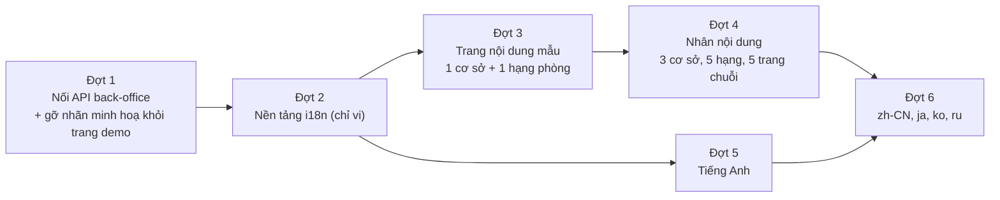

# Kế hoạch phát triển giao diện frontend sau PR #298

**Trạng thái:** Đã chốt (frontend lead, 13/11/2026); quyết định ở §6; đánh giá báo cáo góp ý UI/UX ở §8 (14/11/2026) · **Ngày:** 13/11/2026 · **Phạm vi:** `apps/customer-web`, `apps/operations-web`, `packages/ui-web` · **Liên quan:** [Kế hoạch nội dung tĩnh](ke-hoach-noi-dung-web-tinh.md), [Kế hoạch đa ngôn ngữ](ke-hoach-da-ngon-ngu-customer-web.md), [ADR-019](adr/ADR-019-he-thong-thiet-ke-tuyen-pine-hill.md), [DESIGN.md](../../DESIGN.md), [Sổ nợ kỹ thuật](../07-ban-giao/no-ky-thuat.md), [Ảnh trang khách](anh-trang-khach.md)

Tài liệu này ghép hai hướng PR #298 đã đặt ra (nội dung tĩnh, đa ngôn ngữ) với các việc frontend mà backend vừa mở khoá trên `main`, rồi xếp thành các đợt có thứ tự phụ thuộc.

## 1. Hiện trạng trên `main` (1c6dbae)

**Đã có**

- Hệ thống thiết kế "Tuyến Pine Hill" (ADR-019, `DESIGN.md`): token chung, ba vật liệu, thang nút 44/52/56 px, hàng nút và hàng bộ lọc chuẩn.
- Customer web: 13 màn nghiệp vụ (SCR-01…13) và trang chủ dạng cuộn (ga, hạng phòng, giá theo chặng, bảng trả vé, bốn bước, hỏi nhanh).
- 15 ảnh minh hoạ theo ô ảnh. Cách ghép: 10 ảnh Amanoi, 4 ảnh Wikimedia (CC BY/BY-SA), 1 ảnh Pexels.
- Operations web đã khoác thế giới vé tàu: thanh bên bảng ga, tờ đăng nhập dạng vé, đồng hồ giờ VN.

**Nợ đã trả (cập nhật 16/11/2026)**

- TD-09, TD-06, TD-08 (SCR-23, SCR-27, SCR-29 nối API mới): HB-308.
- TD-44 (cơ sở đang làm việc cho mọi màn ops): HB-314, HB-320.
- TD-41 (web-session phủ đăng ký, đặt lại mật khẩu, giữ `Retry-After`) và phần header của TD-42 (trạng thái đăng nhập trên mọi trang khách): HB-324.

**Nợ frontend còn mở**

- **TD-42 (phần còn lại):** `consentVersion = 2026-10` chưa có nguồn trong `docs/02`; chờ chủ dự án hoặc nghiệp vụ chốt.
- **Ngày trong `<input type="date">`** hiển thị theo locale trình duyệt (`mm/dd/yyyy` trên máy cài tiếng Anh); đã có dòng ngày định dạng bên dưới (Q8).
- **API công khai** chưa có ảnh, mô tả, tiện nghi theo cơ sở và hạng phòng ([YEU-CAU §5](../../YEU-CAU-API-TU-FRONTEND.md)).
- **Mốc huỷ quy ra ngày giờ (FEAT-04):** chờ API trả mốc tuyệt đối (YEU-CAU §7).
- **TD-83:** LCP trang ga trên Lighthouse `simulate` 3,6–3,9 s (đạt với `devtools`: 2,28–2,41 s); xem [kết quả đo](do-lighthouse-trang-noi-dung.md).

## 2. Vấn đề còn tồn

**Hoãn tới ngày phát hành công khai.** Bản hiện tại là demo cho khách, không phát hành. Theo chủ dự án, các mục sau tạm bỏ qua và **phải rà lại trước khi deploy rộng rãi**:

- **Bản quyền ảnh:** 10 ảnh Amanoi không có giấy phép tái sử dụng (trái lý do loại bản Amanoi ghi trong ADR-019); 4 ảnh Wikimedia CC BY/BY-SA chưa hiện ghi công trên trang.
- **Nội dung minh hoạ:** mô tả ga, hạng phòng và các trang nội dung mới là minh hoạ, chưa phải thông tin thật của Pine Hill.
- **Bản dịch:** câu chữ pháp lý (huỷ, hoàn, thanh toán) ở các locale mới chưa có người duyệt.

Trong lúc demo, mọi dữ liệu minh hoạ vẫn mang cờ (`illustrative`, `license`) trong `src/content/`, nhưng **trang không hiện nhãn "minh hoạ"** để bản demo trông hoàn chỉnh.

**Xử lý trong các đợt**

| # | Vấn đề | Xử lý |
|---|---|---|
| P1 | E2E SCR-07 (3 ca) đỏ khi chạy trên dev server: API trả 401 ngay sau khi tạo booking thành công | Chạy lại bằng cấu hình chuẩn (build + `next start`) ở đợt 1; lỗi thật thì sửa trong đợt |
| P2 | E2E SCR-12 khoá câu "hợp đồng chưa có trường này…", câu kỹ thuật hiện thẳng cho khách | Đổi ở đợt 2 khi chuyển câu chữ sang catalog: ticket HB-309 ghi rõ việc đổi assertion và lý do, test khoá mới được ghim lại theo quy trình của AGENTS.md |
| P3 | Ticket HB-300 và HB-305 trên `main` vẫn mô tả hướng Lyon/Amanoi Editorial | Không sửa đặc tả cũ; ticket mới (HB-308+) dẫn chiếu ADR-019 và DESIGN.md |
| P4 | Trang `/dining`: Pine Hill không có dịch vụ ăn uống trong nghiệp vụ (§8.3) | **Chủ dự án quyết (15/11/2026):** giữ trang, nội dung minh hoạ. Làm ở [HB-318](../08-thi-cong/tickets/HB-318-am-thuc-va-gia-da-gom.md) |
| P5 | Khối "Vé gồm / Chưa gồm", dịch vụ tại ga: chưa có điều khoản (Q12) | **Chủ dự án quyết (15/11/2026):** giá đã gồm tiện nghi cơ bản. Điều khoản ở [tien-nghi-trong-gia.md](../02-nghiep-vu/tien-nghi-trong-gia.md); khối "Giá đã gồm" làm ở HB-318 |
| P6 | Nút "giữ chỗ qua email" khi lỗi mạng mở kênh đặt phòng ngoài hệ thống (§8.3) | **Chủ dự án quyết (15/11/2026):** chỉ hiện liên hệ lễ tân (`NEXT_PUBLIC_FRONT_DESK_CONTACT`), không `mailto:`; làm ở HB-323 |

## 3. Thứ tự đề xuất và lý do

- **Đợt 1 làm ngay.** API đã có và giá trị dùng hằng ngày cho lễ tân và quản lý là cao nhất; cũng là phần back-office còn trống rõ nhất khi demo.
- **i18n trước nội dung tĩnh.** Nếu dựng 13 trang nội dung bằng chuỗi tiếng Việt viết trong JSX rồi mới tách catalog, toàn bộ trang phải viết lại lần hai. Route nội dung cũng phụ thuộc quyết định URL locale (`/stays/da-lat` hay `/vi/stays/da-lat`).
- **Một trang mẫu trước khi nhân bản.** Trang cơ sở và trang hạng phòng là hai khuôn mới cho thế giới vé tàu. Chốt khuôn trên một trang, đo a11y và hiệu năng ảnh, rồi mới nhân ra 8 trang.

## 4. Các đợt

### Đợt 0 — Gỡ nhãn minh hoạ khỏi trang demo (gộp vào PR đầu của đợt 1)

- Bỏ dòng "Toàn bộ ảnh và mô tả … là minh hoạ" ở trang chủ và hậu tố "ảnh minh hoạ" trong `alt`; `alt` chỉ tả nội dung ảnh.
- Thêm trường `illustrative`/`license` cho từng ô ảnh trong `photo-slots.ts` để rà lại trước ngày phát hành công khai (§2).

### Đợt 1 — Nối API mới cho back-office

| Màn | Việc | Ghi chú thiết kế |
|---|---|---|
| SCR-23 Bảng điều khiển ngày | Thay khối "chưa hỗ trợ" bằng 3 cột đến / đang ở / đi, danh sách ca quá tải mở (link sang SCR-43), kênh `DEGRADED` (link sang SCR-41) | Bảng thẳng cột, số `tabular-nums`. Đây là màn duy nhất ở back-office được dùng hàng bảng ga (chữ hổ phách trên nền đen) cho tiêu đề ba cột, vì nó đúng nghĩa là "bảng giờ trong ngày". HOUSEKEEPING không có quyền: giữ màn cấm truy cập hiện có |
| SCR-27 Mùa & hệ số | Sửa và ngừng mùa: `If-Match` theo `version`, ô lý do bắt buộc, xử lý 409/412 bằng khối "dữ liệu đã đổi, tải lại" | Hộp thoại xác nhận ngừng dùng `.ph-btn-danger` |
| SCR-29 Khuyến mãi | Sửa và tắt sớm: hiện `usedCount`, các bước giống SCR-27 | Không tự tính giá sau giảm ở frontend |
| TD-44 | Chuyển các màn ops còn tự lấy `propertyId` sang `useWorkingProperty()` | Bỏ select "Cơ sở" lặp lại trên từng màn, chỉ để lại ở thanh ngữ cảnh |

Mỗi màn có unit test cho model, E2E trên API giả và axe.

### Đợt 2 — Nền tảng i18n, chỉ tiếng Việt (bước 2–3 của kế hoạch đa ngôn ngữ)

- **Cấu trúc thư mục:** `src/i18n/` gồm `locales.ts`, `catalogs/vi.ts`, translator phía server và provider phía client. Gộp `account/messages.ts` và `pay/messages-payment.ts` vào namespace.
- **Bỏ singleton `t`.** Server component nhận translator theo request.
- **Định dạng theo locale:** `formatMoney`, `formatCalendarDate`, nhãn thứ trong `stamps.tsx` nhận tham số locale, mặc định `vi-VN` để operations web không đổi.
- **Nội dung tĩnh hiện có** (`landing-content.ts`, `photo-slots.ts`) chuyển sang dạng khoá theo locale.
- **Ô ngày:** giữ `<input type="date">` gốc (bàn phím, trình đọc màn hình và bộ chọn ngày của điện thoại đều dùng tốt). Ngay dưới ô hiện ngày đã định dạng theo locale (vd. "T5, 24/12/2026"), để khách luôn thấy đúng ngày dù trình duyệt hiển thị `mm/dd/yyyy`.
- **Test khoá SCR-12:** đổi assertion sang câu cho khách (P2).
- **Nghiệm thu:** mọi test hiện có xanh, không đổi giao diện tiếng Việt (so ảnh chụp trước/sau).

### Đợt 3 — Trang nội dung mẫu

- **Hai trang:** `/stays/da-lat` và `/room-types/DLX`, dựng theo §3–§5 của kế hoạch nội dung tĩnh.
- **Bổ sung DESIGN.md trước khi dựng.** Bốn component mới cần quy tắc riêng để không thành khuôn "resort editorial" chung chung:
  - Trang cơ sở là **"tờ giới thiệu ga"**: áp phích ga làm đầu trang, bảng giờ nhận/trả phòng, sơ đồ tuyến đánh dấu ga đang xem.
  - Trang hạng phòng là **"hạng khoang"**: nhãn mã hạng, bảng thông số in như mặt sau vé.
  - `GalleryGrid` có lightbox dùng được bằng bàn phím.
  - `StickyBookingCta` trên điện thoại là cuống vé dính đáy màn, cao 52 px, không che nội dung cuối trang.
- **CTA sang luồng đặt phòng:** khi chưa có ngày, đưa về khối tìm phòng có chọn sẵn ga; khi có ngày, sang SCR-03.
- **Metadata:** canonical, Open Graph, JSON-LD `Hotel`, `HotelRoom`, `BreadcrumbList`.
- **Nghiệm thu:** axe 0 lỗi serious/critical, không cuộn ngang ở 360 px, LCP ảnh đầu trang dưới 2,5 s trên cấu hình Lighthouse mobile, `impeccable detect` 0 lỗi.

### Đợt 4 — Nhân nội dung

- Tách làm hai ticket (§8.4):
  - **HB-311:** 3 trang ga + 5 trang hạng, khớp cơ sở theo `slug` (TD-82 đã trả). Phần trang sâu hơn (CONT-01/02, UX-05) tách sang HB-322.
  - **HB-311b:** trang cấp chuỗi getting-here, experiences, offers, gallery + menu "Khám phá" (trên điện thoại là ngăn kéo).
- Trang `/dining` làm ở HB-318 (P4): quầy ăn sáng, góc trà, quanh ga, nội dung minh hoạ.
- Nội dung chưa có nguồn thật đánh dấu `illustrative: true` (trang không hiện nhãn, quyết định Q1).
- Không đưa số liệu, giải thưởng, tiện nghi hay dịch vụ khi chưa có nguồn. "Giá đã gồm" chỉ theo [tien-nghi-trong-gia.md](../02-nghiep-vu/tien-nghi-trong-gia.md) (P5).

### Đợt 5 — Tiếng Anh

- URL locale theo quyết định của lead; nút chọn ngôn ngữ là `<select>` có nhãn, không dùng cờ.
- Thêm `hreflang`, `html lang` theo locale, metadata tiếng Anh.
- Nối `money(amount, locale)` (`src/i18n/format.ts`) vào các màn còn gọi `formatMoney` mặc định `vi-VN`: HB-309 đã cho hàm nhận locale nhưng chưa đổi từng chỗ gọi vì chỉ có `vi`.
- Bản demo dùng bản dịch do frontend soạn; câu chữ về huỷ, hoàn tiền và thanh toán được đánh dấu cần duyệt trước ngày phát hành công khai (§2).

### Đợt 6 — zh-CN, ja, ko, ru

- **Font:** Barlow Condensed không có glyph CJK. Các chỗ dùng chữ cạnh hẹp viết hoa (bảng ga, biển ga, nút "Tìm phòng") cần quy tắc thay thế cho CJK: font Noto Sans CJK, không viết hoa, không giãn chữ. Ghi quy tắc này vào DESIGN.md ở đợt 2 để component chuẩn bị sẵn.
- **Tiếng Nga dài hơn:** kiểm nút, bảng ga và cuống vé ở 360 px.

## 5. Ticket

| Ticket | Đợt | Nội dung | Trạng thái | Phụ thuộc |
|---|---|---|---|---|
| [HB-308](../08-thi-cong/tickets/HB-308-dot-1-back-office-api-moi.md) | 0 + 1 | SCR-23 bảng ngày, SCR-27 sửa/ngừng mùa, SCR-29 sửa/tắt khuyến mãi, TD-44 cho SCR-23/27, gỡ nhãn minh hoạ trang demo | Đã merge ([#302](https://github.com/minhtuluc/HotelBuild/pull/302)) | — |
| [HB-309](../08-thi-cong/tickets/HB-309-nen-tang-i18n-customer-web.md) | 2 | Nền tảng i18n customer web (chỉ `vi`), định dạng theo locale, dòng ngày dưới ô ngày, đổi câu phí đổi ngày SCR-12, sửa lỗi phiên khi chạy dev | Đã merge ([#306](https://github.com/minhtuluc/HotelBuild/pull/306)) | HB-308 (cùng sửa danh mục khách) |
| [HB-310](../08-thi-cong/tickets/HB-310-trang-noi-dung-mau.md) | 3 | Trang cơ sở và trang hạng phòng mẫu + mục DESIGN.md mới | PR [#305](https://github.com/minhtuluc/HotelBuild/pull/305) | HB-309 |
| [HB-316](../08-thi-cong/tickets/HB-316-gop-y-ux-chuyen-dong.md) | — | Góp ý UI/UX gói B: bảng giá mobile (UX-01), cỡ chữ theo khung (UX-04), lightbox chạm (UX-08), token và bộ chuyển động ANIM-01…06 | Đã merge ([#316](https://github.com/minhtuluc/HotelBuild/pull/316)) | — |
| [HB-311](../08-thi-cong/tickets/HB-311-nhan-trang-ga-va-hang.md) | 4 | 3 trang ga + 5 trang hạng, khớp theo `slug` (UX-03 có nguồn đã làm ở HB-318) | Đang làm | HB-310, HB-319 |
| [HB-322](../08-thi-cong/tickets/HB-322-trang-ga-va-hang-sau-hon.md) | 4 | Trang ga/hạng sâu hơn: CONT-02 (thông số ga, "Một ngày tại ga", lịch mùa điền sẵn ngày FEAT-02), CONT-01 (bố cục khoang, ảnh nhiều góc), bảng chặng đường (UX-05) | Đang làm | HB-317 |
| [HB-311b](../08-thi-cong/tickets/HB-311b-trang-toan-chuoi.md) | 4 | getting-here, experiences, offers, gallery + menu "Khám phá" (CONT-03/05/06/07/08) | Đang làm | HB-322 |
| [HB-323](../08-thi-cong/tickets/HB-323-so-sanh-so-do-muc-luc-le-tan.md) | — | So sánh năm hạng (FEAT-05), sơ đồ hai chiều + mặt cắt khoang (UX-02), mục lục trang ga (UX-06), nhịp nền (UX-07), liên hệ lễ tân khi lỗi mạng (P6) | Đang làm | HB-311b |
| [HB-324](../08-thi-cong/tickets/HB-324-phien-khach-web-session.md) | — | Phiên khách: web-session phủ đăng ký và đặt lại mật khẩu, giữ Retry-After (TD-41); trạng thái đăng nhập trên header mọi trang khách (TD-42) | Đang làm | HB-323 |
| [HB-317](../08-thi-cong/tickets/HB-317-giu-ngu-canh-va-tien-ich.md) | — | Góp ý UI/UX gói C: giữ ngữ cảnh ga/ngày (FEAT-01), nút chọn nhanh số đêm (FEAT-03), sao chép link + in A4 (FEAT-06). FEAT-02 (lịch mùa) chuyển sang HB-322 | Đang làm | HB-311 |
| [HB-312](../08-thi-cong/tickets/HB-312-locale-en.md) | 5 | Locale `en` | Đã merge ([#308](https://github.com/minhtuluc/HotelBuild/pull/308)) | HB-309 |
| [HB-313](../08-thi-cong/tickets/HB-313-locale-zh-ja-ko-ru.md) | 6 | Locale `zh-CN`, `ja`, `ko`, `ru` + font | Đã merge ([#311](https://github.com/minhtuluc/HotelBuild/pull/311)) | HB-312 |
| [HB-318](../08-thi-cong/tickets/HB-318-am-thuc-va-gia-da-gom.md) | — | Trang `/dining` (P4) + khối "Giá đã gồm" (P5, UX-03) trên trang ẩm thực, hạng phòng, ga | Đã merge ([#312](https://github.com/minhtuluc/HotelBuild/pull/312)) | HB-313 |
| HB-315 | — | E2E SCR-48 bàn tiền sảnh xanh lại sau #298 | Đã merge ([#303](https://github.com/minhtuluc/HotelBuild/pull/303)) | — |
| [HB-314](../08-thi-cong/tickets/HB-314-co-so-dang-lam-viec.md) | — | TD-44 cho các màn vận hành còn lại (lưới tồn, lịch giá, danh sách booking, báo cáo, kênh, người dùng, hạng phòng, SCR-40/43/47) | Đã merge ([#309](https://github.com/minhtuluc/HotelBuild/pull/309)) | HB-308 |
| [HB-320](../08-thi-cong/tickets/HB-320-co-so-dang-lam-viec-phan-3.md) | — | TD-44 phần 3: danh sách booking (ô chọn cơ sở), form tạo hạng phòng, ghi đè kênh, đối soát, khoá phòng, báo giá đa kênh, khách thân thiết — TD-44 đã trả | Đã merge ([#315](https://github.com/minhtuluc/HotelBuild/pull/315)) | HB-314 |

E2E SCR-07 (P1) được kiểm lại trong HB-308.

Việc cần backend, đề xuất gửi song song qua [YEU-CAU-API-TU-FRONTEND.md](../../YEU-CAU-API-TU-FRONTEND.md):

- Ảnh, mô tả, tiện nghi, diện tích theo cơ sở × hạng phòng trong API công khai (đã ghi §5).
- Nhận `Accept-Language` hoặc trả mã ổn định cho tên gói giá, chính sách và lỗi nghiệp vụ.

## 6. Quyết định của frontend lead

| # | Câu hỏi | Quyết định | Lý do |
|---|---|---|---|
| Q1 | Bản quyền ảnh, nội dung minh hoạ | Bỏ qua cho demo; trang không hiện nhãn minh hoạ; rà lại trước ngày phát hành công khai | Chủ dự án quyết định: demo không phát hành, nhãn tạm làm hỏng buổi demo |
| Q2 | URL locale | `/` là tiếng Việt; locale khác có tiền tố (`/en/...`, `/ja/...`); `x-default` trỏ `/` | Không đổi URL đang chạy, link đã chia sẻ và ~100 E2E hiện có; tiếng Việt vẫn là thị trường chính |
| Q3 | 5 hay 15 trang hạng phòng | 5 trang dùng chung toàn chuỗi | API chưa có dữ liệu theo cơ sở; 15 trang minh hoạ chỉ là 5 trang chép ba lần |
| Q4 | Nhóm trang nội dung làm trước | Trang cơ sở (`/stays/[slug]`) | Nối thẳng vào khối tìm phòng (chọn sẵn ga) và dùng lại áp phích, ảnh ga đã có |
| Q5 | Tiếng Trung | Chỉ `zh-CN` | Khách Trung Quốc đại lục là nhóm chính; `zh-TW` thêm sau nếu có nhu cầu |
| Q6 | Duyệt bản dịch pháp lý | Demo dùng bản dịch do frontend soạn, đánh dấu cần duyệt | Không chặn demo; duyệt trước ngày phát hành công khai |
| Q7 | Test khoá SCR-12 có câu kỹ thuật | Đổi trong HB-309 theo quy trình ghim test khoá | Khách không nên đọc "hợp đồng chưa có trường này" |
| Q8 | Ô ngày theo locale | Giữ ô ngày gốc + dòng ngày đã định dạng bên dưới | Bộ chọn ngày tự viết khó đạt a11y và trải nghiệm điện thoại bằng bộ chọn gốc |
| Q9 | Font CJK, Cyrillic | Dùng font hệ thống (Noto Sans CJK, Hiragino, Malgun Gothic) làm fallback, chưa đóng gói | Đủ cho demo, tránh tăng dung lượng; đóng gói nếu QA thấy lỗi hiển thị |
| Q10 | Thứ tự | Đợt 1 → 2 → 3 → 4, tiếng Anh (đợt 5) làm ngay sau đợt 2 song song với nội dung | Đợt 1 không phụ thuộc gì; i18n trước nội dung để không viết lại trang |
| Q11 | Báo cáo góp ý UI/UX (14/11/2026) | Nhận phần UX/animation; phần nội dung chỉ nhận thứ có nguồn hoặc thuần mô tả (§8) | Nội dung minh hoạ được phép cho demo (Q1), điều khoản bán hàng thì không: trang nội dung không được nói khác báo giá |
| Q12 | "Vé gồm / chưa gồm", dịch vụ tại ga, giờ phục vụ | Chỉ làm theo điều khoản trong `docs/02` (đã có từ 15/11/2026: `tien-nghi-trong-gia.md`) | Là điều khoản thương mại; AGENTS.md cấm đưa policy vào frontend |
| Q13 | Mốc huỷ quy ra ngày giờ (FEAT-04) | Không tính ở frontend; chỉ hiện khi API trả mốc tuyệt đối (yêu cầu API §7) | Tự cộng trừ giờ là tự áp chính sách huỷ |
| Q14 | Nhãn mùa "thấp/cao điểm" trên lịch mùa | Không in | Mùa giá là cấu hình theo cơ sở (SCR-27), nhãn tĩnh có thể lệch báo giá |
| Q15 | So sánh "đặt web lợi hơn trung gian" ở `/offers` | Không in | Quy tắc cân bằng giá kênh (BR-RATE-09) |
| Q16 | Thứ tự sau đợt 3 | HB-316 và HB-312 làm ngay (song song); HB-311 sau TD-82; HB-311b, HB-317 sau HB-311 | HB-316 độc lập; dịch trước khi nhân nội dung để không dịch lại; trang ga cần slug thật |

## 7. Tiêu chí chung cho mọi đợt

- Theo `DESIGN.md`: ba vật liệu, thang nút, không nhãn nhỏ trên tiêu đề, không nền kem.
- Không tự tính giá, tồn hay chính sách ở frontend.
- Typecheck, lint, unit test, E2E liên quan, axe (WCAG 2.1 AA) và `impeccable detect` 0 lỗi trên trang đã đổi.
- Không cuộn ngang ở 360 px; vùng chạm ≥ 44 px.
- Operations web và hai app Android không đổi hành vi khi `customer-web` thêm locale.

## 8. Đánh giá báo cáo góp ý UI/UX và nội dung (14/11/2026)

Nguồn: [báo cáo góp ý cải tiến UI/UX và nội dung customer web](bao-cao-gop-y-cai-tien-ui-ux-va-noi-dung-customer-web.md). Đã đối chiếu với `docs/01-yeu-cau`, `docs/02-nghiep-vu` và hợp đồng API: không có ăn sáng, phòng tắm chung, wifi, gửi hành lý; "đưa đón" chỉ xuất hiện ở điều chuyển khi quá tải.

### 8.1. Nhận gần như nguyên

| Mã | Ticket | Ghi chú |
|---|---|---|
| UX-01 | HB-316 | Lỗi thật: `.ph-sample-why` đang bị ẩn dưới 760 px |
| UX-04, UX-08 | HB-316 | Không đụng nghiệp vụ |
| UX-06, UX-07 | HB-311 / HB-311b | Mục lục bám cuộn chỉ cho trang dài; gallery nhiều tỉ lệ khi ≥ 6 ảnh |
| ANIM-01…06 | HB-316 | Không `opacity: 0` trước JS, không chạm vùng LCP, tắt hết khi `prefers-reduced-motion` |
| CONT-07, CONT-08 | HB-311b | Đã có trong đợt 4 |
| FEAT-01 | HB-317 | Ngữ cảnh nằm trong URL; `sessionStorage` chỉ là dự phòng |
| FEAT-03 | HB-317 | Nhãn trung tính (2 / 3 / 5 đêm), không hứa mức giảm |
| FEAT-06 (sao chép link, in A4) | HB-317 | |

### 8.2. Nhận có điều chỉnh

| Mã | Điều chỉnh |
|---|---|
| UX-02 | Sơ đồ ga ↔ thẻ ga: được. Mặt cắt 5 khoang chỉ vẽ số chỗ ngủ (seed `bedCount`) và việc Dorm bán theo giường, không vẽ cách kê giường |
| UX-03 | Chỉ ghi điều có nguồn: Dorm bán theo giường trong phòng chung; giá đổi theo đêm; tiền hoàn tính trên số đã trả; ba cơ sở cách nhau 160–300 km nên không điều chuyển chéo. Màu dùng token `world-ticketLight` (#F7E5DE), không thêm #F6DCD3 |
| CONT-01, CONT-02 | "Một ngày tại ga", bố cục khoang: mô tả, gắn `illustrative`. Không có tiện ích, dịch vụ, giờ phục vụ |
| CONT-03 | Thời gian đi đường là ước lượng, gắn `illustrative`; không ghi mã chuyến tàu hay giờ chạy; e-Visa chỉ đặt link tới cổng chính thức |
| CONT-05 | Hoạt động quanh ga: được. Lịch sự kiện có ngày cụ thể: không |
| CONT-06 | Chỉ trình bày quy tắc có trong `docs/02` (giảm theo số đêm, 4 gói hoàn); bỏ so sánh với trung gian (Q15) |
| FEAT-02 | Điền sẵn ngày: được; nhiệt độ/mưa gắn `illustrative`; không nhãn mùa giá (Q14) |

### 8.3. Không nhận (chờ chủ dự án quyết)

| Mã | Lý do | Việc chờ |
|---|---|---|
| CONT-04 `/dining` | Không có dịch vụ ăn uống trong nghiệp vụ; "đã gồm trong giá" là điều khoản | Đã quyết P4: giữ trang, nội dung minh hoạ (HB-318) |
| UX-03 khối "Vé gồm / Chưa gồm" | Điều khoản thương mại chưa có (Q12) | Đã quyết P5: điều khoản ở `docs/02-nghiep-vu/tien-nghi-trong-gia.md` (HB-318) |
| FEAT-04 trên trang tĩnh | Tự áp chính sách huỷ (Q13) | Yêu cầu API §7 |
| FEAT-06 "giữ chỗ qua email" | Mở kênh đặt phòng ngoài hệ thống: không giữ chỗ, không chống gửi trùng | P6: đề xuất chỉ hiện liên hệ lễ tân (`NEXT_PUBLIC_FRONT_DESK_CONTACT`) |

### 8.4. Phân kỳ

Gói A của báo cáo (13 trang + CONT-01…08) quá một PR. Tách như bảng §5: HB-316 (gói B), HB-311 + HB-311b (gói A), HB-317 (gói C). Danh sách kiểm thu §9 của báo cáo áp cho cả bốn ticket, thêm `impeccable detect` 0 lỗi.
| [HB-325](../08-thi-cong/tickets/HB-325-lcp-anh-va-muc-luc-trang-chu.md) | 3 | Đo Lighthouse mobile 14 trang nội dung ([kết quả](do-lighthouse-trang-noi-dung.md)): ảnh nhiều cỡ, bỏ schema zod khỏi trang không cần, font; mục lục bám cuộn trang chủ (UX-06) | Đang làm | HB-324 |
| [HB-326](../08-thi-cong/tickets/HB-326-anh-minh-hoa-cho-o-con-trong.md) | — | Ảnh minh hoạ cho các chỗ còn chờ ảnh: ảnh nhiều góc của năm hạng (CONT-01), chín hoạt động ở /experiences, ba dịch vụ ở /dining (22 ảnh Commons/Pexels) | Đang làm | HB-325 |
