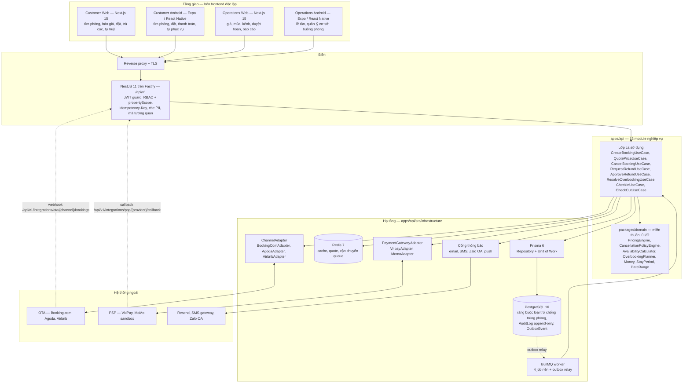
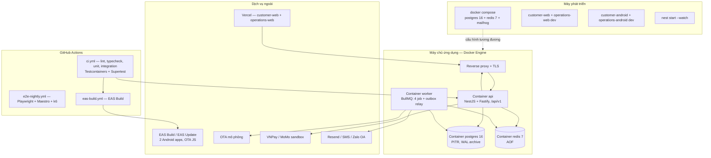

# 04 — Kiến trúc hệ thống

> Tài liệu này chốt **kiến trúc phần mềm, phân rã module, chiến lược dữ liệu, triển khai và quan sát** cho hệ thống đặt phòng Pine Hill. Nguồn chân lý nghiệp vụ là [02/quy tắc nghiệp vụ](../02-nghiep-vu/quy-tac-nghiep-vu.md); định danh, enum và cấu trúc repo đích lấy từ [00/tổng quan](../00-tong-quan.md). Mỗi quyết định lớn có ADR tương ứng ở [adr/README.md](adr/README.md).

---

## 1. Mục tiêu và ràng buộc định hình kiến trúc

| # | Ràng buộc | Nguồn | Hệ quả kiến trúc bắt buộc |
|---|-----------|-------|---------------------------|
| 1 | Không được bán trùng một **đơn vị bán** `(roomId, bedNo, đêm)` — `bedNo = 0` nghĩa là cả phòng, `1..bedCount` là giường của DOR | BR-INV-03, BR-PROP-04, NFR-REL-01 | Bất biến ép ở tầng CSDL bằng ràng buộc loại trừ ba cột — quyết định ADR-003 |
| 2 | Kiểm tra tồn và giữ chỗ phải nằm trong **một** transaction có khoá bi quan | BR-INV-02 | Một workflow sở hữu transaction; nhiều instance tuân cùng giao thức khóa PostgreSQL theo ADR-014 |
| 2 | Cùng đầu vào giá → cùng kết quả trên customer web, customer Android, operations web, operations Android và API | BR-RATE-17, NFR-MAIN-01 | `packages/domain` là nguồn tính authoritative ở backend; frontend chỉ hiển thị `PriceQuote` từ API — ADR-001, ADR-007 |
| 3 | Mọi thao tác ghi sinh `AuditLog` trong cùng transaction | BR-GEN-07, BR-SYS-01 | Unit of Work bao cả thực thể nghiệp vụ lẫn bản ghi kiểm toán |
| 4 | Thao tác ghi idempotent theo `Idempotency-Key` (24 giờ) | BR-GEN-08, NFR-REL-06 | Kho idempotency đặt ở Redis, không ở tầng giao diện |
| 5 | Đồng bộ tồn/giá lên OTA ngay khi có thay đổi, chậm nhất 5 phút | BR-CHAN-02, NFR-REL-03 | Outbox giao dịch + hàng đợi việc nền; gọi OTA là I/O bất đồng bộ |
| 6 | Giải phóng hold trong ≤ 60 giây | BR-INV-04, NFR-REL-02 | Job quét Booking trên PostgreSQL, giờ DB sau khóa; hoạt động cả khi Redis mất |
| 8 | Quá tải phải được xử lý trước T−24h | BR-OVER-04, NFR-OBS-04 | Job quét quá tải theo giờ + cảnh báo leo thang |
| 9 | Không lưu dữ liệu thẻ; che PII trong log | BR-PAY-04, NFR-SEC-02/03 | Adapter PSP là ranh giới chống rò rỉ; lớp log che dữ liệu |
| 10 | Ngân sách 750 giờ, nhóm 5 người, một môn học | [05/lộ trình](../05-ke-hoach/lo-trinh.md) | Số đơn vị triển khai tối thiểu; ưu tiên ranh giới module rõ thay vì hạ tầng phân tán |

**Kết luận kiến trúc (chi tiết ở §10):** đường cơ sở là **kiến trúc khối mô-đun (modular monolith)** — một API NestJS, một tiến trình worker, ranh giới module cưỡng chế bằng kiểm tra phụ thuộc, ruột theo **kiến trúc lục giác**, giao tiếp nội bộ qua sự kiện miền + outbox. Ánh xạ chi tiết từng NFR sang quyết định kiến trúc nằm ở [01 — Yêu cầu phi chức năng](../01-yeu-cau/yeu-cau-phi-chuc-nang.md) §11.

---

## 2. Sơ đồ kiến trúc tổng thể



| Thành phần | Công nghệ | Trách nhiệm | ADR |
|------------|-----------|-------------|-----|
| Customer Web + Operations Web | Next.js 15 App Router, Tailwind, shadcn/ui | Hai ứng dụng deploy độc lập; dùng `packages/contracts` + `packages/api-client`, không dùng chung route/auth state | ADR-005 |
| Customer Android + Operations Android | Expo (React Native), Expo Router | Hai ứng dụng deploy độc lập; dùng `packages/contracts` + `packages/api-client`, khác navigation và quyền | ADR-006 |
| API | NestJS 11 + Fastify, Node 22 LTS | HTTP, xác thực, điều phối ca sử dụng, phát sự kiện | ADR-002 |
| Worker | Cùng image Docker, entrypoint khác | 4 job nền + outbox relay | ADR-004, ADR-012 |
| CSDL | PostgreSQL 16 + `btree_gist` | Nguồn chân lý tồn phòng, kiểm toán, outbox | ADR-003 |
| Cache & khoá | Redis 7 | Hold, khoá phân tán, cache báo giá/tồn, idempotency | ADR-004 |
| Adapter OTA | `ChannelAdapter` + ACL | Chuẩn hoá payload OTA thành lệnh miền; mô phỏng trong phạm vi môn học | ADR-008 |
| Adapter PSP | `PaymentGatewayAdapter` | Tạo giao dịch, nhận callback, không chạm dữ liệu thẻ | ADR-009 |
| Thông báo | Cổng ra `NotificationPort` | Hàng đợi thông báo đa kênh, ghi `Notification` | BR-SYS-06 |

---

## 3. Kiến trúc lục giác trong `apps/api`

### 3.1. Ba vòng

```mermaid
flowchart LR
  subgraph INNER["Vòng 1 — Miền thuần: packages/domain"]
    direction TB
    D1["PricingEngine + PricingRuleChain + 5 PricingModifier"]
    D2["CancellationPolicyEngine"]
    D3["AvailabilityCalculator"]
    D4["OverbookingPlanner + keepScore"]
    D5["Value Object: Money, StayPeriod, DateRange, ChannelContext"]
  end

  subgraph APP["Vòng 2 — Ứng dụng: modules/&lt;mod&gt;/application"]
    direction TB
    A1["8 ca sử dụng (CreateBookingUseCase, QuotePriceUseCase, ...)"]
    A2["Dịch vụ ứng dụng (BookingService, OverbookingService, ...)"]
    A3["Cổng ra khai báo tại application/ports<br/>BookingRepository, InventoryRepository, ChannelAdapter,<br/>PaymentGatewayAdapter, NotificationPort, OutboxPort, Clock, IdGenerator"]
  end

  subgraph OUTER["Vòng 3 — Hạ tầng: modules/&lt;mod&gt;/infrastructure, src/infrastructure"]
    direction TB
    O1["PrismaBookingRepository, PrismaInventoryRepository, ..."]
    O2["BookingComAdapter, AgodaAdapter, AirbnbAdapter"]
    O3["VnpayAdapter, MomoAdapter"]
    O4["BullMqQueue, RedisCache, PrismaOutbox, SystemClock, UuidGenerator"]
    O5["Controller NestJS + DTO contracts ở presentation/"]
  end

  OUTER -->|"phụ thuộc vào cổng/vào ca sử dụng"| APP
  APP -->|"phụ thuộc một chiều vào miền"| INNER
```



**Cổng ra dùng chung (tên đã chốt):** `Clock`, `IdGenerator`, `OutboxPort`, `NotificationPort`, `UnitOfWork` cùng repository theo module (`BookingRepository`, `InventoryRepository`, …); facade của mỗi module là `modules/<mod>/index.ts`; hậu tố tệp thống nhất `.use-case.ts`, `.service.ts`, `.repository.ts`, `.adapter.ts`, `.controller.ts`, `.spec.ts`.

**Luật vàng:** mũi tên phụ thuộc **chỉ đi vào trong**. Miền không biết gì về NestJS, Prisma, HTTP hay Redis; ứng dụng không biết gì về PostgreSQL hay BullMQ. `packages/domain` không import Prisma, Nest, HTTP, `Date.now()` hay bất kỳ I/O nào ([00 §10](../00-tong-quan.md)) — thời gian, mã định danh truyền vào qua tham số hoặc qua cổng `Clock`/`IdGenerator` (NFR-MAIN-01, NFR-MAIN-05).

### 3.2. Bảng quy tắc phụ thuộc

| Tầng | Vị trí | Được phép trỏ vào | Cấm tuyệt đối | Cơ chế cưỡng chế |
|------|--------|-------------------|---------------|------------------|
| Miền thuần | `packages/domain/src` | TypeScript stdlib; các tệp trong cùng gói | `@nestjs/*`, `@prisma/client`, `ioredis`, `bullmq`, `axios`, `zod`, `@pinehill/contracts`, `Date.now()`, `Math.random()`, `process.env`, `fs`, `fetch` | ESLint `no-restricted-imports` + `no-restricted-globals`; test "0 I/O" chạy trong CI |
| Hợp đồng | `packages/contracts/src` | `zod`, `@pinehill/domain` (kiểu VO) | Nest, Prisma, HTTP client, truy cập CSDL, `process.env` | ESLint ranh giới gói |
| Ứng dụng | `modules/*/application`, `workers/*` | `@pinehill/domain`, `@pinehill/contracts`, `application/ports`, `@nestjs/common` chỉ cho `@Injectable`/DI token | `@prisma/client`, `ioredis`, `bullmq`, `axios`, `fastify`, Prisma types, SQL thô | ESLint `no-restricted-imports`; review bắt buộc khi sửa `application/ports` |
| Hạ tầng | `modules/*/infrastructure`, `src/infrastructure` | mọi thư viện kỹ thuật; cổng của module mình; DTO `contracts` | Import chéo sang `infrastructure` của module khác; đọc bảng không thuộc module mình; rò mã lỗi thô của CSDL ra ngoài | Kiểm tra phụ thuộc (dependency-cruiser) trong CI; bảng ánh xạ lỗi CSDL → mã miền (`23P01` → `E_INV_ROOM_TAKEN`) có kiểm thử |
| Giao diện | `modules/*/presentation`, `src/common` | ca sử dụng của module mình, DTO `contracts`, guard/filter dùng chung | `@prisma/client`, truy cập repository, gọi module khác ngoài facade | Kiểm tra phụ thuộc + test hợp đồng API (NFR-MAIN-04) |

| Quy tắc liên module | Nội dung |
|---------------------|---------|
| R1 | Module chỉ được import **facade** của module khác tại `modules/<mod>/index.ts`; không import lớp nội bộ. |
| R2 | Gọi đồng bộ giữa hai module chỉ qua facade; thay đổi trạng thái đi qua **sự kiện miền + outbox**, không gọi chéo vào repository. |
| R3 | Không có khoá ngoại Prisma xuyên module trong schema; ràng buộc tham chiếu kiểm ở tầng dịch vụ ứng dụng. |
| R4 | Chỉ `SYS` được ghi `AuditLog`/`OutboxEvent`; mọi module khác gọi qua `SystemApi` trong cùng Unit of Work. |
| R5 | Vòng lặp phụ thuộc giữa hai module bị cấm; phát hiện trong CI là lỗi build. |

---

## 4. Phân rã 13 module NestJS

| Module | Trách nhiệm chính | Thực thể sở hữu | API công khai nội bộ (facade) | Sự kiện phát ra (`OutboxEvent`) |
|--------|-------------------|-----------------|-------------------------------|---------------------------------|
| **AUTH** | Đăng nhập nội bộ, vai trò, phạm vi cơ sở, phiên — UC-AUTH-01/02/03 | `User` | `AuthApi.authenticate`, `AuthApi.requirePermission(user, action)`, `AuthApi.propertyScopeOf(userId)` | — |
| **PROP** | Cơ sở, loại phòng, phòng vật lý, sơ đồ buồng, khoá phòng — UC-PROP-01/02/03/04 | `Property`, `RoomType`, `Room`, `RoomBlock`, `HousekeepingTask` | `PropertyApi.getProperty`, `PropertyApi.roomsOfType`, `PropertyApi.blockRoom`, `PropertyApi.roomsForSale` | — |
| **INV** | Tồn khả dụng, lịch phòng, kiểm tra trống theo từng đêm — UC-INV-01/02/03 | Không sở hữu bảng riêng; chiếu từ `RoomAssignment`, `RoomBlock`, `Hold`, `ChannelAllotment` | `InventoryApi.checkAvailability`, `InventoryApi.hold`, `InventoryApi.release`, `InventoryApi.availabilityGrid`, `InventoryApi.occupancyRate` | — |
| **RATE** | Giá cơ bản (kèm cảnh báo khi gói dài ngày không có giá riêng, BR-RATE-19), lịch giá, mùa, hệ số/hoa hồng theo cặp (kênh, cơ sở), khuyến mãi, báo giá — UC-RATE-01/02/03/04/05 | `RatePlan`, `RateCalendar`, `Season`, `Channel`, `ChannelAllotment`, `ChannelPropertySetting`, `Promotion` (đọc `CancellationPolicy`/`CancellationTier` do PAY sở hữu, theo [00 §7.5](../00-tong-quan.md)) | `RateApi.quote`, `RateApi.channelContext`, `RateApi.allotment`, `RateApi.priceForNight` | — |
| **BOOK** | Vòng đời booking, giữ chỗ, đổi ngày, huỷ toàn phần và **huỷ một phần theo `BookingRoom`** khi `roomCount > 1` (phân bổ `refundBase` theo tỷ lệ giá phòng bị huỷ, lưu thêm `PriceSnapshot` điều chỉnh và giữ bản gốc — BR-CANCEL-19), snapshot giá lưu ngay khi rời `DRAFT` (BR-RATE-16), xoá cứng `DRAFT`/`HELD` có ghi `AuditLog` `beforeJson` trước khi xoá (BR-BOOK-17) — UC-BOOK-01/02/03/04/05/06/07/08 | `Booking`, `BookingRoom`, `RoomAssignment`, `BookingStatusHistory`, `PriceSnapshot`, `Hold` | `BookApi.create`, `BookApi.confirm`, `BookApi.cancel`, `BookApi.reschedule`, `BookApi.findByCode` | `BookingConfirmed`, `BookingCancelled`, `HoldExpired` |
| **PAY** | Cọc, thanh toán trực tuyến, số dư, hoàn tiền (người lập/người duyệt độc lập, huỷ yêu cầu `PENDING`), chính sách huỷ dữ liệu hoá gồm ngưỡng trả phòng sớm, đối soát, hoa hồng — UC-PAY-01/02/03/04/05 · BR-PAY-03/04/07/09, BR-CANCEL-15/16/18 | `Payment`, `RefundRequest`, `CancellationPolicy`, `CancellationTier` | `PaymentApi.recordDeposit`, `PaymentApi.initiateOnline`, `PaymentApi.applyCallback`, `PaymentApi.balanceOf`, `PaymentApi.requestRefund`, `PaymentApi.approveRefund`, `PaymentApi.cancelRefund` | `PaymentSucceeded` |
| **CHAN** | Cấu hình kênh, ánh xạ loại phòng ↔ mã phòng OTA `ChannelMapping` (BR-CHAN-08), đồng bộ tồn/giá, nhận booking & huỷ từ OTA — UC-CHAN-01/02/03 | `ChannelMapping`; cập nhật `Channel.syncStatus`, `consecutiveSyncFailures`, `lastSyncAt`, `lastSyncError` (chủ sở hữu `Channel` là RATE) qua `RateApi` | `ChannelApi.pushAvailability`, `ChannelApi.pushRate`, `ChannelApi.ingestOtaBooking`, `ChannelApi.ingestOtaCancellation`, `ChannelApi.health` | — (tiêu thụ outbox của INV/RATE/BOOK) |
| **OVER** | Phát hiện quá tải, thang điều chuyển (vận hành thực tế **1 → 2 → 4**; bậc 3 `SAME_TYPE_CROSS_PROPERTY`/`UPGRADE_CROSS_PROPERTY` hiện **không khả dụng** vì ba cơ sở cách nhau 160–300 km), ghép phòng, walk-out — UC-OVER-01/02/03/04/05 | `OverbookingCase`, `RoomMove`, `RoomMerge` | `OverbookingApi.scan`, `OverbookingApi.openCase`, `OverbookingApi.proposeRelocation`, `OverbookingApi.executeRoomMove`, `OverbookingApi.mergeRooms`, `OverbookingApi.walkOut` | `RoomMoveExecuted` |
| **FO** | Check-in, check-out, no-show, trạng thái buồng phòng — UC-FO-01/02/03/04 | Không sở hữu bảng riêng; ghi `HousekeepingTask` qua `PropertyApi` | `FrontOfficeApi.checkIn`, `FrontOfficeApi.checkOut`, `FrontOfficeApi.markNoShow`, `FrontOfficeApi.arrivals`, `FrontOfficeApi.departures` | — (dùng `PaymentSucceeded`, `BookingConfirmed`) |
| **CRM** | Hồ sơ khách (kèm giới tính phục vụ điều kiện ghép phòng BR-OVER-14), hạng, điểm, danh sách đen — UC-CRM-01/02/03 | `Guest`, `GuestNote`, `LoyaltyTransaction` | `GuestApi.resolveByPhone`, `GuestApi.tierOf`, `GuestApi.addPoints`, `GuestApi.isBlacklisted` | — |
| **NOTI** | Mẫu và hàng đợi thông báo đa kênh — UC-NOTI-01/02 | `Notification` | `NotificationApi.enqueue(template, recipient, payload)`, `NotificationApi.historyOf(bookingId)` | — |
| **REP** | Báo cáo công suất, ADR/RevPAR, doanh thu kênh, huỷ/hoàn, quá tải — định nghĩa chỉ số theo **nguồn chân lý duy nhất** `BR-REP-01`, phòng DOR đếm theo đơn vị bán (giường) — UC-REP-01/02/03/04 | Không sở hữu bảng; đọc mô hình đọc (view) | `ReportApi.occupancy`, `ReportApi.revenueByChannel`, `ReportApi.cancellations`, `ReportApi.overbooking` | — |
| **SYS** | Nhật ký kiểm toán, tham số hệ thống, outbox, việc nền — UC-SYS-01/02/03 | `AuditLog`, `SystemSetting`, `OutboxEvent` | `SystemApi.audit`, `SystemApi.setting`, `SystemApi.publish`, `SystemApi.health` | — (kênh phát mọi sự kiện ra ngoài) |

**Quy ước facade:** mỗi module xuất đúng một facade `<Tên>Api` tại `modules/<mod>/index.ts`; facade chỉ phơi phương thức nghiệp vụ và DTO `packages/contracts`, không phơi kiểu Prisma. Chi tiết lớp và ánh xạ mẫu thiết kế: [thiet-ke-lop.md](thiet-ke-lop.md).

**Biến cố miền đã chốt** (5): `BookingConfirmed`, `BookingCancelled`, `HoldExpired`, `PaymentSucceeded`, `RoomMoveExecuted`. Mẫu **Observer + Outbox**: module ghi sự kiện vào bảng `outbox_events` **trong cùng transaction** với thay đổi nghiệp vụ (BR-GEN-07, BR-CHAN-06); `OutboxRelay` phát lại vào BullMQ.

**Nơi cư trú của các mẫu thiết kế** (chi tiết lớp ở [thiet-ke-lop.md](thiet-ke-lop.md)): Strategy `PricingModifier` với 5 hiện thực (`SeasonModifier`, `WeekendModifier`, `OccupancyModifier`, `LosModifier`, `ChannelModifier`) + Chain of Responsibility `PricingRuleChain` + Builder `PriceQuoteBuilder` ở RATE và `packages/domain`; State `BookingState` + Factory `BookingFactory` ở BOOK; Factory `RatePlanFactory` ở RATE; Decorator phụ thu (check-in sớm, check-out muộn) ở FO; Adapter + Anti-Corruption Layer `ChannelAdapter` (`BookingComAdapter`, `AgodaAdapter`, `AirbnbAdapter`) ở CHAN và `PaymentGatewayAdapter` (`VnpayAdapter`, `MomoAdapter`) ở PAY; Value Object ở `packages/domain`; Repository + Unit of Work ở tầng hạ tầng mọi module; Process Manager/Saga `OverbookingRelocationSaga` ở OVER.

---

## 5. Chiến lược chia sẻ mã giữa backend và bốn frontend

| Gói | Nội dung | Dùng bởi | Bắt buộc vì |
|-----|----------|----------|--------------|
| `packages/domain` | Động cơ giá, chính sách huỷ, tính tồn, quy hoạch điều chuyển, VO, lỗi miền | `apps/api`, `apps/worker`, test; frontend không import để tự quyết định nghiệp vụ | BR-RATE-17: mọi surface nhận cùng `PriceQuote` từ backend |
| `packages/contracts` | Schema `zod` cho DTO vào/ra, mã lỗi `E_<MOD>_<TÊN>`, kiểu đọc từ suy luận zod, tài liệu OpenAPI sinh ra | API, worker và cả bốn frontend | Một nguồn sự thật cho hợp đồng API (NFR-MAIN-04, ADR-008) |
| `packages/api-client` | Client REST typed, correlation, retry an toàn, `Idempotency-Key`, xử lý lỗi chuẩn | Bốn frontend; không chứa luật giá/policy | Một seam truy cập backend, tránh mỗi app tự viết giao thức |
| `packages/ui-web` / `packages/ui-native` | Design token và primitive trình bày tương ứng từng nền tảng | Hai web / hai Android | Nhất quán thương hiệu mà không chia sẻ component sai ngữ cảnh |
| `packages/config` | `tsconfig`, cấu hình ESLint, Prettier dùng chung | Toàn monorepo | Nhất quán quy ước, tránh lệch cấu hình giữa các app (NFR-MAIN-02) |

| Cấm chia sẻ | Lý do |
|-------------|-------|
| Mã giao diện (component React, hook, style, navigation) giữa web và Android | Nền tảng và tương tác khác nhau; chia sẻ UI tạo trừu tượng giả, làm chậm cả hai |
| Truy cập CSDL, Prisma client, SQL, kết nối Redis dưới mọi hình thức | Chỉ `apps/api` được chạm dữ liệu; web/Android đi qua API để giữ phân quyền `propertyScope` (BR-RBAC-02, NFR-SEC-01) |
| Trạng thái phiên, token, logic xác thực tự viết lại | Xác thực do API quyết định; client chỉ giữ token theo hợp đồng (`packages/contracts`) |
| Quy tắc nghiệp vụ sao chép vào client (ví dụ bảng bậc huỷ hard-code) | BR-CANCEL-01 cấm `if/else` cứng; client **gọi API** và đọc kết quả/snapshot, không tự quyết định tiền hoặc quyền |
| Bí mật, biến môi trường, `process.env` đọc trực tiếp trong `packages/*` | Cấu hình chỉ nạp ở `apps/*/src/config` và kiểm tra bằng zod lúc khởi động |

---

## 6. Cây thư mục đích

```text
ooad-homestay/
├── apps/
│   ├── api/
│   │   ├── src/
│   │   │   ├── main.ts, app.module.ts
│   │   │   ├── common/{filters,guards,interceptors,decorators,errors}/
│   │   │   ├── infrastructure/
│   │   │   │   ├── prisma/prisma.service.ts, prisma.unit-of-work.ts
│   │   │   │   ├── redis/{cache.service.ts,lock.service.ts,idempotency.store.ts}
│   │   │   │   ├── queue/{bullmq.module.ts,queue.producer.ts}
│   │   │   │   ├── outbox/{outbox.relay.ts,outbox.publisher.ts}
│   │   │   │   ├── adapters/ota/{booking-com,agoda,airbnb}.adapter.ts
│   │   │   │   ├── adapters/psp/{vnpay,momo}.adapter.ts
│   │   │   │   └── crypto-clocks/{system.clock.ts,uuid.generator.ts,pii.masker.ts}
│   │   │   └── modules/
│   │   │       ├── auth/{application,domain,infrastructure,presentation}/
│   │   │       ├── prop/{application,domain,infrastructure,presentation}/
│   │   │       ├── inv/{application,domain,infrastructure,presentation}/
│   │   │       ├── rate/{application,domain,infrastructure,presentation}/
│   │   │       ├── book/{application,domain,infrastructure,presentation}/
│   │   │       ├── pay/{application,domain,infrastructure,presentation}/
│   │   │       ├── chan/{application,domain,infrastructure,presentation}/
│   │   │       ├── over/{application,domain,infrastructure,presentation}/
│   │   │       ├── fo/{application,domain,infrastructure,presentation}/
│   │   │       ├── crm/{application,domain,infrastructure,presentation}/
│   │   │       ├── noti/{application,domain,infrastructure,presentation}/
│   │   │       ├── rep/{application,domain,infrastructure,presentation}/
│   │   │       └── sys/{application,domain,infrastructure,presentation}/
│   │   ├── prisma/{schema.prisma,migrations/,seed.ts}
│   │   └── test/{unit,integration}/
│   ├── worker/
│   │   └── src/{jobs,outbox,scheduler,adapters}/
│   ├── customer-web/
│   │   └── src/{app,components,lib,hooks,api}/
│   ├── customer-android/
│   │   └── src/{app,components,screens,hooks,api,storage}/
│   ├── operations-web/
│   │   └── src/{app,components,lib,hooks,api}/
│   └── operations-android/
│       └── src/{app,components,screens,hooks,api,storage}/
├── packages/
│   ├── domain/
│   │   └── src/
│   │       ├── value-objects/{money,stay-period,date-range,channel-context,phone-number}.ts
│   │       ├── pricing/{pricing-engine,pricing-rule-chain,price-quote-builder}.ts
│   │       ├── pricing/modifiers/{season,weekend,occupancy,los,channel}.modifier.ts
│   │       ├── cancellation/{cancellation-policy-engine,tier-resolver}.ts
│   │       ├── availability/{availability-calculator,availability-query}.ts
│   │       ├── overbooking/{overbooking-planner,keep-score}.ts
│   │       ├── booking/{booking-state,status-transition}.ts
│   │       └── shared/{errors,result,ids,clock}.ts
│   ├── contracts/
│   │   └── src/{common,booking,payment,rate,inventory,overbooking,fo,crm,noti,rep}/
│   │       └── mỗi thư mục: *.schema.ts (zod), *.dto.ts, *.error.ts
│   ├── api-client/
│   ├── ui-web/
│   ├── ui-native/
│   └── config/{tsconfig.base.json,eslint.preset.cjs,prettier.json}
├── infra/
│   ├── docker-compose.yml            # postgres 16, redis 7, mailhog
│   ├── sql/                          # migration thủ công: ràng buộc loại trừ, chỉ mục riêng
│   └── backup/{pgbackrest.conf,drill-checklist.md}
├── docs/                             # tài liệu này
├── .github/workflows/{ci.yml,e2e-nightly.yml,eas-build.yml}
└── docker/{api.Dockerfile,worker.Dockerfile}
```

**Quy tắc đặt tệp:** mỗi module có đúng 4 thư mục con `application/`, `domain/`, `infrastructure/`, `presentation/`; tệp dùng `kebab-case` với hậu tố vai trò (`.use-case.ts`, `.service.ts`, `.repository.ts`, `.adapter.ts`, `.controller.ts`, `.spec.ts`). Tên lớp giữ đúng danh mục ở [00 §10](../00-tong-quan.md) và mục **Contract** của đề bài.

---

## 7. Sơ đồ triển khai



| Hạng mục | Quyết định | Ghi chú |
|----------|-----------|---------|
| API + worker | **Một image Docker duy nhất**, hai entrypoint (`api.Dockerfile` chạy `node dist/main.js`, `worker.Dockerfile` chạy `node dist/worker.js`) | Cùng mã, cùng phụ thuộc; triển khai tách để job không tranh CPU với HTTP |
| CSDL & cache | PostgreSQL 16 và Redis 7 trong `infra/docker-compose.yml` khi phát triển; container có volume + sao lưu PITR khi vận hành | BR-SYS-03, NFR-REL-04: RPO ≤ 15 phút, RTO ≤ 4 giờ |
| Customer/operations web | Hai project Vercel độc lập (`customer-web`, `operations-web`), cùng `NEXT_PUBLIC_API_BASE_URL` và contract version gate | ADR-005 |
| Customer/operations Android | Hai application ID và pipeline EAS độc lập; EAS Update chỉ cho bản vá JS thuần | ADR-006; ngoài phạm vi iOS ([00 §3.2](../00-tong-quan.md)) |
| Bí mật | GitHub Actions secrets + Vercel Environment Variables + EAS Secrets | NFR-SEC-06: 0 bí mật trong repo; `.env*` bị `.gitignore` |
| Nạp cấu hình | `zod` kiểm tra biến môi trường lúc khởi động, thiếu biến thì **dừng tiến trình** | NFR-MAIN-05: giá trị nghiệp vụ đọc từ `SystemSetting`, không hard-code |
| Quy mô | 1 API, 1 worker là đủ cho 55 phòng và 3 cơ sở; nhân bản API ở tầng sau không cần đổi mã | NFR-USE-01: uptime ≥ 99,5%/tháng |

### 7.1. Biến môi trường và bí mật

| Biến | Dùng ở | Bắt buộc | Nguồn |
|------|--------|----------|-------|
| `DATABASE_URL` | api, worker | Có | Secret |
| `REDIS_URL` | api, worker | Có | Secret |
| `JWT_ACCESS_SECRET`, `JWT_REFRESH_SECRET` | api | Có | Secret (ADR-010) |
| `IDEMPOTENCY_TTL_HOURS` | api | Không (mặc định 24) | Biến thường, khớp BR-GEN-08 |
| `VNPAY_TMN_CODE`, `VNPAY_HASH_SECRET` | api | Có khi bật kênh VNPay | Secret |
| `MOMO_PARTNER_CODE`, `MOMO_ACCESS_KEY`, `MOMO_SECRET_KEY` | api | Có khi bật kênh MoMo | Secret |
| `OTA_BOOKING_*`, `OTA_AGODA_*`, `OTA_AIRBNB_*` (base URL, khoá, mô phỏng) | api, worker | Chỉ khi tích hợp thật | Secret; mặc định trỏ bộ mô phỏng |
| `NOTI_EMAIL_API_KEY`, `NOTI_SMS_*`, `NOTI_ZALO_OA_*` | worker | Có khi gửi thật | Secret |
| `BUSINESS_TIMEZONE` | api, worker | Có (`Asia/Ho_Chi_Minh`) | Biến thường, BR-GEN-05 |
| `LOG_LEVEL`, `OTEL_EXPORTER_OTLP_ENDPOINT`, `OTEL_SAMPLE_RATIO` | api, worker | Không | Biến thường, NFR-OBS-01/03 |
| `NEXT_PUBLIC_API_BASE_URL` | web | Có | Vercel env |
| `EXPO_PUBLIC_API_BASE_URL`, `EXPO_PUBLIC_APP_VARIANT` | mobile | Có | EAS env |

---

## 8. Chiến lược dữ liệu

### 8.1. Tách đường đọc và đường ghi

| Đường | Cơ chế | Đối tượng dùng | Ràng buộc |
|-------|--------|----------------|-----------|
| **Ghi** | Aggregate + Repository + Unit of Work; mọi thay đổi đi qua ca sử dụng; transaction bao gồm thực thể, `AuditLog`, `OutboxEvent` | BOOK, PAY, OVER, FO, INV | BR-INV-02, BR-GEN-07, NFR-REL-05 |
| **Đọc nghiệp vụ** | Query service trả DTO phẳng, **không** dựng aggregate, chỉ đọc | Tra cứu booking, lịch tồn phòng, danh sách đến/đi | NFR-PERF-01/02 |
| **Đọc báo cáo** | Materialized view + cache Redis, làm mới theo lịch | REP: công suất, ADR/RevPAR, doanh thu kênh | NFR-PERF-04 |
| **Tách vật lý (đường nâng cấp)** | Khi vượt ngưỡng tải: thêm read replica cho đường đọc báo cáo; ứng dụng đã tách sẵn nên chỉ đổi `DATABASE_URL` của tầng đọc | — | Chưa cần trong phạm vi môn học |

Nguyên tắc: **một workflow giao dịch chung** sở hữu bất biến tồn phòng; nhiều tiến trình phối hợp bằng khóa PostgreSQL; đường đọc không bao giờ tự quyết định còn phòng — chỉ gọi `InventoryApi.checkAvailability` hoặc đọc cache có nguồn gốc từ đó.

### 8.2. Chỉ mục (chi tiết DDL ở [csdl.md](csdl.md))

| Bảng | Chỉ mục / ràng buộc | Phục vụ |
|------|--------------------|---------|
| `room_assignments` | `EXCLUDE` trên room_id, khoảng đơn vị bán và valid_range như CSDL §3; thêm EXCLUDE booking_room_id/range; `bed_no` NOT NULL mặc định `0` (cả phòng), `1..bedCount` cho DOR. Cấm khoá đơn kiểu `COALESCE(bed_no::text, room_id)`/`sell_unit_id` — số giường lặp ở mọi phòng nên khoá đó chặn oan gán phòng hợp lệ | BR-INV-03, BR-PROP-04, NFR-REL-01 |
| `room_assignments` | `(booking_room_id)`, `(room_id, start_date)` | Trả phòng khi huỷ/no-show, dựng lịch tồn |
| `bookings` | `UNIQUE (code)`, `(property_id, status, check_in)`, `(guest_id, created_at)` | Tra cứu theo mã, danh sách đến/đi, chống trùng BR-BOOK-16 |
| `bookings` | Trạng thái và hold_expires_at | Nguồn job expiry BR-BOOK-18; Hold là projection |
| `occupancy_snapshots` | `(property_id, date, room_type_id)`, `room_type_id` rỗng = dòng tổng hợp cấp cơ sở (dòng BR §4.3 đọc); `physical_rooms` = số phòng ACTIVE **đã trừ `RoomBlock`** | Hệ số công suất của bước 4 trong BR-RATE-01 |
| `payments` | `(booking_id, status)`, unique key có phạm vi nghiệp vụ và định danh provider/account/transaction theo CSDL §3, `(created_by, paid_at)` | Số dư, chống cộng tiền hai lần BR-PAY-03, đối soát tiền mặt theo cặp (người thu, ngày VN) BR-PAY-06/10 |
| `outbox_events` | `(status, created_at)` | Outbox relay |
| `audit_logs` | `(entity_type, entity_id, at)`, `(actor_id, at)` | UC-SYS-01; bảng append-only BR-SYS-01 |
| `notifications` | `(status, created_at)` | Gửi lại tối đa 3 lần BR-SYS-06 |
| `channel_allotments` | `UNIQUE (channel_id, room_type_id, date)` | BR-INV-05, BR-CHAN-08 |
| `overbooking_cases` | `UNIQUE (property_id, date, room_type_id)`, `(status, detected_at)` | Gộp trùng BR-OVER-05, cảnh báo T−24h |
| `rate_calendars` | `(room_type_id, date, channel_code, priority DESC)` | Tra giá cơ bản theo `priority` giảm dần BR-RATE-02 |

### 8.3. Cache và khoá phân tán (Redis 7 — ADR-004)

Redis chỉ tăng tốc, không sở hữu bất biến tiền/tồn. [ADR-014](adr/ADR-014-giao-dich-ton-phong.md) và [ADR-017](adr/ADR-017-inbox-outbox-idempotency.md) thay các mô tả khóa Redis làm điều kiện trước khi ghi.

| Khoá | Nội dung | Hạn và vô hiệu hoá |
|---|---|---|
| avail theo cơ sở/loại/ngày/kênh | Tồn hiển thị theo BR-INV-01 | 60 giây; cập nhật sau thay đổi, lệnh giữ chỗ luôn đọc lại primary |
| quote theo quoteId | Giá, input fingerprint, principal, policy, commission, engineVersion | 15 phút; không xoá quote còn hạn khi cấu hình đổi; snapshot acceptance theo ADR-015 |
| occupancy theo cơ sở/ngày | Hệ số công suất | 5 phút; cũ quá ngưỡng dùng hệ số 1,00 theo BR-RATE |
| idempotency cache | Bản sao kết quả, khóa gồm principal + method/path + key | Không dùng làm nguồn dedup; quyền hiện tại được kiểm trước replay, PostgreSQL giữ request hash và kết quả |
| channel sync cache | Trạng thái và mốc đồng bộ | Vô hiệu khi Channel đổi; lỗi cache không làm mất công việc |

### 8.4. Outbox và idempotency

1. Application workflow ghi thực thể, history, audit, OutboxEvent và kết quả idempotency cùng transaction.
2. OutboxRelay claim công việc bằng lease PostgreSQL, đẩy queue sau commit. Enqueue thành công không có nghĩa mọi consumer đã hoàn tất; event_deliveries lưu trạng thái từng consumer.
3. Worker idempotent, ghi completion cùng tác động DB. Crash/mất Redis có thể phát lại; phục hồi từ công việc chưa hoàn tất trong PostgreSQL. Gửi ngoài DB dùng key provider hoặc đối soát.
4. Webhook xác minh chữ ký/account/order/amount trước dedup; Inbox bền trước ACK đúng provider. Callback hợp lệ lặp lại không cộng tiền. Worker khóa cùng booking/payment với expiry và timeout.
5. Booking OTA thiếu phòng vẫn CONFIRMED + oversold + OverbookingCase và được tính trong demand; không chịu trần bán vượt chủ động. Chuỗi đồng bộ thất bại theo BR-CHAN-07 đánh dấu DEGRADED và cảnh báo.
6. Không listener nào giải phóng tồn, cộng tiền hoặc tạo refund lần hai sau khi workflow gốc đã commit các tác động đó. Thông báo/báo cáo/đồng bộ ngoài hệ thống là tác vụ sau commit.

### 8.5. Bốn job nền

| Job | Chu kỳ | Quyết định |
|---|---|---|
| Hết hạn hold | 30 giây; SLA 60 giây | Quét Booking HELD/PENDING_PAYMENT theo holdExpiresAt trên primary; khóa booking rồi tài nguyên, đọc giờ DB sau khóa; đúng hạn là hết hạn. EXPIRED + release assignment/quota + history/audit/outbox cùng TX. Callback đã CONFIRMED thì bỏ qua |
| Quét quá tải | 60 phút, nhìn 30 ngày | Tính demand theo BR-INV-01, gộp case; quá T−24h hoặc ngày thiếu phòng đã qua mà chưa giải quyết thì ESCALATED, không tự đóng |
| Đồng bộ kênh | 300 giây và outbox | Push tồn/giá ngoài TX; close OTA theo ngưỡng cấu hình; retry và DEGRADED theo BR-CHAN-07 |
| No-show | 23:59 ngày VN | Chỉ CONFIRMED chưa check-in; khóa booking và kiểm lại. NO_SHOW + release + nghĩa vụ/hoàn có reservation + history/audit/outbox cùng TX |

Chu kỳ lấy từ SystemSetting. Job idempotent và chạy nhiều instance nhờ khóa/CAS/lease PostgreSQL; Redis mất không ngăn expiry. Đối chiếu cache/hold mỗi 900 giây chỉ sửa projection. PaymentTimeoutJob theo BR-PAY-05/11 không nhả hold trước holdExpiresAt và không kết luận chưa thu tiền.

### 8.6. Ghi đồng thời và bất biến

| Bước | Cơ chế |
|---|---|
| 1 | BEGIN và claim idempotency/Inbox bền. Xác định đủ booking/tài nguyên cần khóa |
| 2 | Khóa booking → property → type → room → quota/promotion → payment thu gốc → refund, từng nhóm theo ID tăng; ADR-014. Khóa property/type có sẵn bảo vệ cả tập assignment rỗng |
| 3 | Đọc lại facts, version và giờ DB; xét demand mọi kênh từng đêm và khả năng gán cả kỳ. DOR giữ từng giường, không gán bedNo=0 |
| 4 | Thay trạng thái, assignment, quota, snapshot/allocations theo workflow; 23P01 rollback và trả E_INV_ROOM_TAKEN; deadlock/serialization retry toàn bộ hữu hạn |
| 5 | History, audit, outbox và kết quả idempotency commit cùng tác động. Chỉ gọi PSP/OTA/thông báo sau commit |

Bài kiểm hai kết nối trong tests/database.test.mjs chứng minh tranh chấp constraint khi writer đầu commit và rollback. Mục tiêu 200 yêu cầu của NFR-REL-01 còn cần ứng dụng và bài tải riêng; không suy ra từ test hai writer.

### 8.7. Sao lưu và lưu trữ

| Hạng mục | Chính sách |
|----------|-----------|
| Sao lưu | PITR với WAL archive; RPO ≤ 15 phút, RTO ≤ 4 giờ; diễn tập phục hồi mỗi học kỳ có biên bản (BR-SYS-03, NFR-REL-04) |
| Lưu trữ | Booking & thanh toán 10 năm; nhật ký kiểm toán 5 năm; hồ sơ khách ẩn danh hoá theo yêu cầu thay vì xoá cứng (BR-SYS-04, BR-CRM-05, NFR-COMP-01/02) |
| Kiểm toán | `audit_logs` append-only, thu hồi quyền `UPDATE`/`DELETE` ở tầng CSDL (BR-SYS-01, NFR-SEC-04); xoá cứng chỉ áp cho `DRAFT`/`HELD` và vẫn phải ghi `AuditLog` trước khi xoá (BR-BOOK-14/17) |
| Toàn vẹn tài chính | Không sửa/xoá `Payment` gốc; hoàn ghi thành bút toán `REFUND`; tổng hoàn ≤ `paidAmount` (BR-PAY-07/09, NFR-COMP-03) |

---

## 9. Kiến trúc quan sát

### 9.1. Log có cấu trúc

Mọi dòng log là **một đối tượng JSON** trên `stdout` (NFR-OBS-01); trường tối thiểu:

| Trường | Ý nghĩa |
|--------|---------|
| `ts`, `level`, `service` (`api`\|`worker`), `module` (13 mã module) | Định vị nguồn |
| `useCase` | Tên ca sử dụng đang chạy, ví dụ `CreateBookingUseCase` |
| `correlationId`, `causationId` | Mã tương quan §9.2 |
| `actorId`, `actorRole`, `propertyId`, `bookingId` | Ngữ cảnh nghiệp vụ |
| `outcome` (`ok`\|`rejected`\|`error`), `errorCode` (`E_<MOD>_<TÊN>`, ví dụ `E_INV_ROOM_TAKEN`, `E_INV_NO_AVAILABILITY`, `E_CHAN_SYNC_FAILED`, `E_PAY_CALLBACK_DUPLICATE`, `E_OVER_MERGE_GENDER`, `E_OVER_LIMIT_EXCEEDED`, `E_RATE_BELOW_FLOOR`), `durationMs` | Kết quả và độ trễ |
| `retryCount`, `channelCode`, `provider` | Chỉ có ở log worker/adapter |

Che dữ liệu: **không** ghi số điện thoại, email, số giấy tờ, dữ liệu thẻ; `pii.masker.ts` che theo danh sách trường trước khi ghi (NFR-SEC-03). Log ứng dụng **không thay thế** `AuditLog`: `AuditLog` là bản ghi nghiệp vụ bắt buộc theo BR-SYS-05, có giá trị trước/sau và lý do.

### 9.2. Mã tương quan

| Bước | Hành vi |
|------|--------|
| Vào | API nhận `Idempotency-Key` và mã tương quan (tự sinh nếu thiếu), đưa vào ngữ cảnh request |
| Trong | Mọi dòng log, lỗi, và bản ghi `OutboxEvent` mang cùng mã tương quan |
| Ra | Gọi OTA/PSP/thông báo truyền mã tương quan qua header; webhook đến giữ mã của đối tác và thêm mã nội bộ |
| Việc nền | Job nhận mã tương quan của sự kiện gốc (`causationId`) để truy vết chuỗi |

Bật OpenTelemetry: lấy mẫu ≥ 10% lưu lượng và **100%** yêu cầu lỗi, lưu 7 ngày (NFR-OBS-03).

### 9.3. Số liệu nghiệp vụ

| Nhóm | Số liệu | Nguồn |
|------|---------|-------|
| Bốn tín hiệu vàng | độ trễ (p50/p95/p99), lưu lượng, tỉ lệ lỗi, độ bão hoà | HTTP middleware + `durationMs` (NFR-OBS-02) |
| Chỉ số báo cáo | ADR, RevPAR, công suất, tỷ lệ huỷ, chi phí xử lý quá tải — không định nghĩa lại ở đâu khác | `BR-REP-01`, module REP |
| Đặt phòng | số booking theo kênh/ngày, tỉ lệ chuyển đổi báo giá → xác nhận, tỉ lệ huỷ theo gói giá | `BookingConfirmed`, `BookingCancelled` |
| Tồn phòng & kênh | tồn khả dụng theo loại phòng, số kênh `DEGRADED`, số lần đồng bộ thất bại, độ trễ đồng bộ | `ChannelApi.health`, outbox |
| Quá tải | số `OverbookingCase` đang mở, số ca quá T−24h, tổng chi phí xử lý quá tải (chiết khấu ghép phòng + bồi thường walk-out + chi phí đưa đón) | `RoomMoveExecuted`, `RoomMerge`, `overbooking_cases`, BR-OVER-15 |
| Thanh toán & hoàn | số giao dịch theo trạng thái, số `RefundRequest` chờ duyệt, tuổi lớn nhất của yêu cầu chưa chi | `PaymentSucceeded`, `refund_requests` |
| Hàng đợi | độ sâu hàng đợi, số job thất bại theo loại, tuổi sự kiện outbox | BullMQ + `outbox_events` |

### 9.4. Cảnh báo

| Cảnh báo | Điều kiện | Đích | Quy tắc |
|----------|-----------|------|---------|
| Xung đột gán phòng | CSDL từ chối ràng buộc loại trừ > 0 lần (`E_INV_ROOM_TAKEN`, SQLSTATE `23P01`) | Kỹ thuật | BR-INV-03 |
| Tồn khả dụng âm | Bất kỳ `(roomTypeId, date)` có tồn < 0 | Kỹ thuật + `MANAGER` | BR-INV-01 |
| Kênh suy giảm | `Channel.consecutiveSyncFailures` đạt ngưỡng 3 → `E_CHAN_SYNC_FAILED`, kênh chuyển `ChannelSyncStatus.DEGRADED`; hoặc độ trễ đồng bộ > 5 phút | `MANAGER` | BR-CHAN-07, NFR-REL-03 |
| Sắp hết phòng trên kênh | Tồn ≤ 2 phòng khi kênh OTA còn mở bán | Trực vận hành | BR-CHAN-05, NFR-OBS-04 |
| Quá tải quá hạn | `OverbookingCase` chưa `RESOLVED` khi quá T−24h, hoặc còn mở khi ngày thiếu phòng đã trôi qua | `OWNER` | BR-OVER-04 và BR-OVER-16, NFR-OBS-04 |
| Lệch đối soát tiền mặt | Chênh lệch theo cặp (người thu, ngày VN) vượt ngưỡng của BR-PAY-10 | `MANAGER` | BR-PAY-10, BR-PAY-06 |
| Hoàn tiền quá SLA | Tuổi yêu cầu đã duyệt > 7 ngày | `OWNER`, `ACCOUNTANT` | BR-CANCEL-12 |
| Đăng nhập bất thường | 5 lần thất bại liên tiếp trên một tài khoản | Kỹ thuật | BR-RBAC-06, NFR-SEC-05 |
| SLO burn-rate | Tốc độ tiêu hao ngân sách lỗi vượt ngưỡng; phát hiện ≤ 5 phút | Kỹ thuật | NFR-OBS-02 |

---

## 10. Quyết định và đánh đổi

| Tiêu chí | **Khối mô-đun (chọn)** | Microservices | Monolith truyền thống (nhiều tầng) |
|----------|------------------------|---------------|-----------------------------------|
| Số đơn vị triển khai | 2 (api, worker) cùng image | 6–8 dịch vụ + hạ tầng thông điệp | 1 |
| Bất biến chống trùng phòng (BR-INV-02/03) | Một transaction, một CSDL — **dễ chứng minh** | Cần saga/2PC, rủi ro mất bất biến | Một transaction, nhưng ranh giới mã mờ |
| Chia sẻ miền thuần cho web + Android (BR-RATE-17) | `packages/domain` dùng chung, hàm thuần | Vẫn dùng chung được nhưng phải đồng bộ phiên bản giữa các dịch vụ | Thường không có gói miền dùng chung; dễ lệch giá |
| Ranh giới module | Cưỡng chế bằng kiểm tra phụ thuộc trong CI (bảng §3.2) | Ranh giới tự nhiên theo mạng | Không cưỡng chế; module dần phụ thuộc chéo |
| Chi phí vận hành | Thấp: 1 image, 1 CSDL, 1 cache | Cao: service discovery, tracing phân tán, nhiều pipeline | Thấp nhất |
| Phù hợp ngân sách 750 giờ, nhóm 5 người | Có | Không | Có, nhưng trả giá bằng khả năng kiểm thử bất biến |
| Khả năng chịu tải mục tiêu (200 người dùng đồng thời, 55 phòng) | Thừa sức; nhân bản API theo chiều ngang không đổi mã | Thừa, thừa nhiều lần so với nhu cầu | Đủ, nhưng khó tách khi cần |
| Khả năng tiến hoá | Tách module ra dịch vụ riêng khi có nhu cầu thật; outbox đã là ranh giới sẵn sàng | Đã tách sẵn nhưng sớm | Khó tách, phải viết lại |
| Rủi ro chính | Kỷ luật ranh giới phụ thuộc yếu đi nếu CI không kiểm | Suy giảm độ tin cậy, debug xuyên dịch vụ, trễ tiến độ | Miền lẫn ORM/HTTP, không kiểm thử được hàm thuần |
| Kết luận | **Đường cơ sở** | Loại cho phạm vi môn học | Loại vì vi phạm NFR-MAIN-01 |

**Vì sao chọn khối mô-đun:** mọi ràng buộc ở §1 đều là ràng buộc **toàn vẹn dữ liệu và tính đúng nghiệp vụ**, không phải ràng buộc quy mô. Giao dịch đơn giản hơn, kiểm thử rẻ hơn, và ranh giới module vẫn đủ chặt để đổi sang microservices về sau nếu cần — trong khi chi phí vận hành tăng ở microservices là thứ nhóm 5 người không trả được trong 15 tuần.

Chọn **một image, hai entrypoint** thay vì hai image riêng vì API và worker dùng chung miền, chung repository, chung cấu hình; tách image sẽ tạo hai bản triển khai lệch phiên bản — nguồn lỗi tinh vi trong luồng outbox.

---

## 11. Quy ước và định danh chốt tại tài liệu này

Các định danh dưới đây **không thuộc từ điển thực thể** ở [00 §7](../00-tong-quan.md) nhưng đã được **chốt** và là chuẩn áp dụng cho toàn bộ `docs/04-thiet-ke/` ([api.md](api.md), [csdl.md](csdl.md), [sequence-diagram.md](sequence-diagram.md), [thiet-ke-lop.md](thiet-ke-lop.md) bám theo). Không mục nào trong bảng này thêm quy tắc nghiệp vụ mới — mọi giá trị nghiệp vụ vẫn chỉ định nghĩa ở [02/quy tắc nghiệp vụ](../02-nghiep-vu/quy-tac-nghiep-vu.md).

| # | Loại | Định danh đã chốt | Dùng ở |
|---|------|-------------------|--------|
| 1 | Sự kiện miền | `RefundRequested`, `RefundApproved`, `NoShowMarked`, `AvailabilityChanged`, `RateChanged`, `ChannelSyncFailed` (bổ sung cho 5 biến cố ở §4) | §4, §8.4 |
| 2 | Cổng ra | `Clock`, `IdGenerator`, `OutboxPort`, `NotificationPort`, `UnitOfWork` và repository theo module (`BookingRepository`, `InventoryRepository`, `ChannelAdapter`, `PaymentGatewayAdapter`, …) | §3.1, §3.2 |
| 3 | Mã lỗi | Hai mã do tài liệu này chốt: `E_CHAN_SYNC_FAILED` (đồng bộ kênh thất bại 3 lần liên tiếp, BR-CHAN-07), `E_PAY_CALLBACK_DUPLICATE` (callback lặp khoá idempotency, BR-PAY-03). Danh mục đầy đủ 54 mã `E_*` thuộc [api.md](api.md) §4.2 — xương sống và tài liệu này chỉ nêu ví dụ | §8.4, §8.5, §9.1, §9.4 |
| 4 | Hàng đợi, header, endpoint | Hàng đợi `q.hold-expiry`, `q.overbooking-scan`, `q.channel-sync`, `q.no-show-mark`, `q.outbox-relay`; header `X-Correlation-Id`; endpoint `/api/v1/health/live`, `/api/v1/health/ready`, `/metrics` | §7, §8.4, §8.5, §9.2 |
| 5 | Số liệu | Tên metric nghiệp vụ ở §9.3 (`booking_confirmed_total`, `overbooking_open_cases`, `channel_sync_failures_total`, …) | §9.3 |
| 6 | Quy ước mã nguồn | Facade mỗi module là `modules/<mod>/index.ts`; hậu tố tệp `.use-case.ts`, `.service.ts`, `.repository.ts`, `.adapter.ts`, `.controller.ts`, `.spec.ts`; tên gói `@pinehill/domain`, `@pinehill/contracts`, `@pinehill/config` | §3.1, §4, §5, §6 |

Ngoài bảng trên, tài liệu này không thêm định danh nào khác.

---

## Tham chiếu

- [00 — Tổng quan dự án](../00-tong-quan.md) — bối cảnh, actor, từ điển thực thể, enum, danh mục 53 use case, stack, cấu trúc repo
- [01 — Yêu cầu phi chức năng](../01-yeu-cau/yeu-cau-phi-chuc-nang.md) — NFR-PERF, NFR-REL, NFR-SEC, NFR-USE, NFR-MAIN, NFR-COMP, NFR-OBS, NFR-LOC
- [02 — Quy tắc nghiệp vụ](../02-nghiep-vu/quy-tac-nghiep-vu.md) — 139 quy tắc BR, nguồn chân lý
- [03 — Mô hình miền](../03-phan-tich/mo-hinh-mien.md) · [03 — Mô hình động](../03-phan-tich/mo-hinh-dong.md)
- [04 — ADR](adr/README.md) — 13 quyết định kiến trúc (ADR-001…ADR-013)
- [04 — Thiết kế lớp](thiet-ke-lop.md) · [04 — Sequence Diagram](sequence-diagram.md)
- [04 — Cơ sở dữ liệu](csdl.md) · [04 — API](api.md) · [04 — Thiết kế màn hình](thiet-ke-man-hinh.md)
- [05 — Lộ trình](../05-ke-hoach/lo-trinh.md) · [05 — Kế hoạch Sprint](../05-ke-hoach/ke-hoach-sprint.md)
- [06 — Ma trận truy vết](../06-truy-vet/ma-tran-truy-vet.md)
