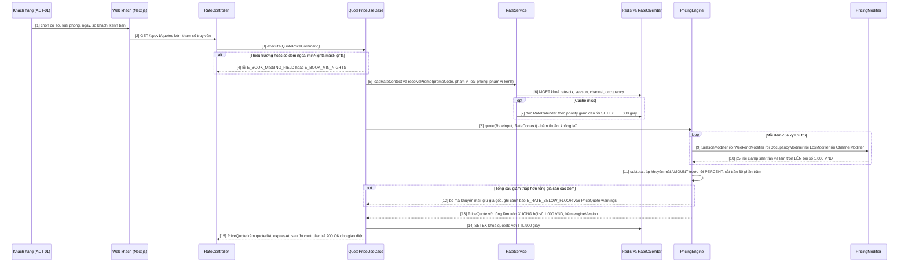
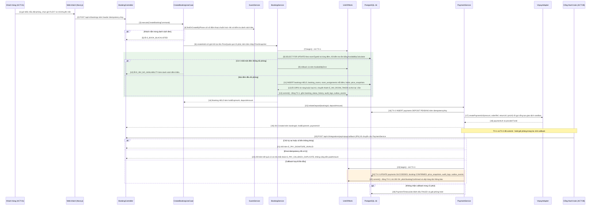
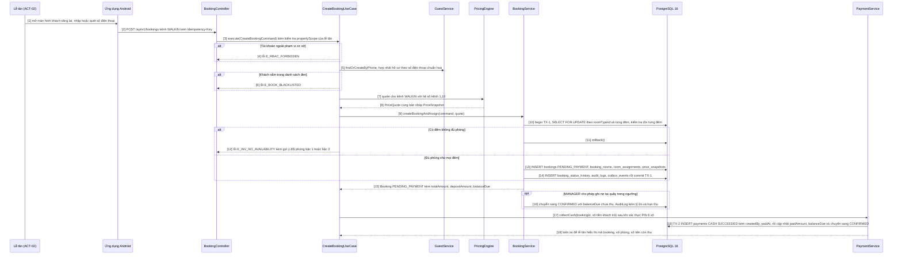
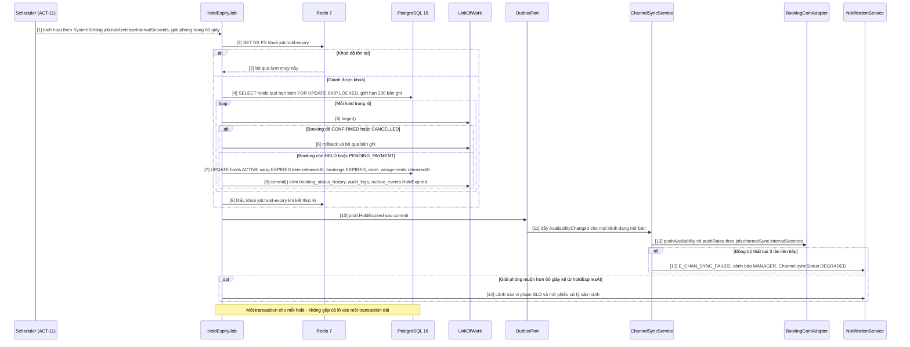
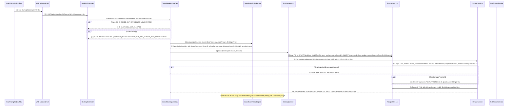
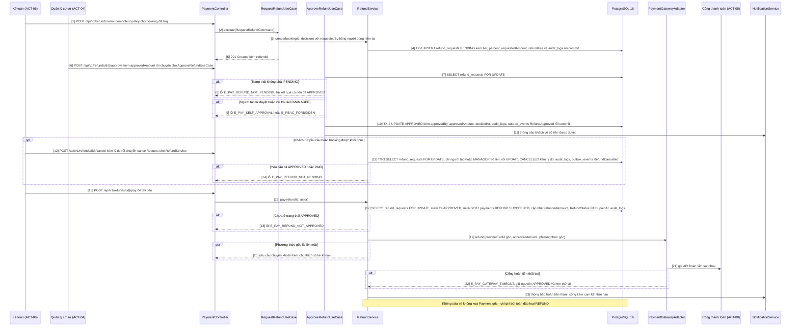
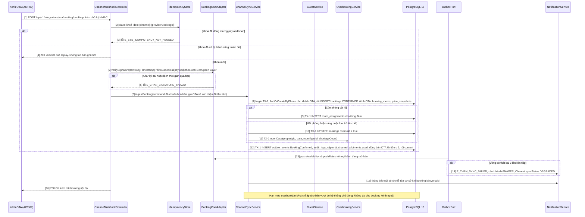
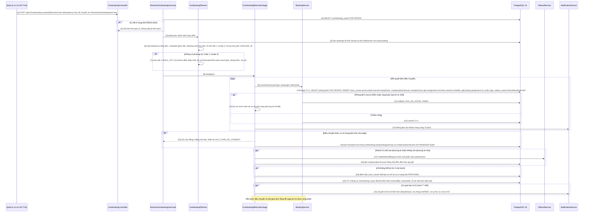

# 04 — Sơ đồ tuần tự thiết kế

> **8 luồng tuần tự mức thiết kế** cho các ca sử dụng rủi ro cao — nơi ba bài toán trọng tâm BT-1/BT-2/BT-3 gặp tầng hạ tầng (giao dịch, khoá, idempotency, webhook, saga).
> Mỗi luồng gồm **sơ đồ Mermaid** và **bảng bước** khớp số `[n]` trong sơ đồ: bên gọi · bên nhận · thông điệp · giao dịch/khoá · mã BR.
> Định danh lớp, cổng, biến cố lấy từ [00 §7](../00-tong-quan.md); tên cổng ra dùng chung theo [04/kiến trúc](kien-truc.md) §3.2; mọi giá trị nghiệp vụ **chỉ tham chiếu mã BR** trong [02/quy tắc nghiệp vụ](../02-nghiep-vu/quy-tac-nghiep-vu.md).

## 0. Quy ước đọc sơ đồ

| Ký hiệu | Nghĩa |
|---|---|
| `->>` / `-->>` | lời gọi đồng bộ bên gọi chờ kết quả / trả kết quả, thông điệp bất đồng bộ, hoặc lỗi |
| `alt` · `else` · `opt` · `loop` | rẽ nhánh nghiệp vụ (**mỗi luồng đều có nhánh lỗi**) · bước tuỳ điều kiện · lặp theo đêm hoặc bản ghi |
| `rect` / `Note over` | khối đánh dấu ranh giới giao dịch / ràng buộc bất biến và ghi chú thi hành |
| `[n]` | số bước, khớp cột `#` của bảng ngay dưới sơ đồ |

| Tầng | Thành phần dùng thống nhất |
|---|---|
| Miền thuần `packages/domain` (0 I/O) | `PricingEngine`, `CancellationPolicyEngine`, `AvailabilityCalculator`, `OverbookingPlanner`, `Money`, `StayPeriod`, `DateRange` |
| Lớp ca sử dụng | `QuotePriceUseCase`, `CreateBookingUseCase`, `CancelBookingUseCase`, `RequestRefundUseCase`, `ApproveRefundUseCase`, `ResolveOverbookingUseCase` |
| Dịch vụ ứng dụng | `BookingService`, `InventoryService`, `RateService`, `PaymentService`, `RefundService`, `ChannelSyncService`, `OverbookingService`, `GuestService`, `NotificationService`, `AuditService` |
| Cổng vào / cổng ra | `*Controller` (REST `/api/v1`, webhook) · `UnitOfWork`, `OutboxPort`, `NotificationPort`, `Clock`, `IdGenerator` · `ChannelAdapter` (`BookingComAdapter`…) · `PaymentGatewayAdapter` (`VnpayAdapter`, `MomoAdapter`) |
| Mẫu thiết kế | Strategy + Chain of Responsibility (`PricingModifier`, `PricingRuleChain`), State (`BookingState`), Adapter/ACL, Observer + Outbox, Repository + Unit of Work, Factory, Decorator, Saga (`OverbookingRelocationSaga`), Value Object, Builder (`PriceQuoteBuilder`) |

| Chủ đề | Quy ước áp dụng cho mọi luồng | Mã BR |
|---|---|---|
| Giao dịch | một transaction cho (kiểm tra tồn + giữ chỗ + outbox); **không gọi mạng ngoài trong transaction** | BR-INV-02, BR-GEN-07 |
| Khoá | `SELECT … FOR UPDATE` theo `(roomTypeId, date)`; ràng buộc loại trừ trên bộ ba `(room_id, bed_no, valid_range)` với `bed_no = 0` nghĩa là cả phòng, `1..bedCount` là giường DOR; PostgreSQL trả `23P01` → `E_INV_ROOM_TAKEN`; tồn khả dụng tính **hai tầng**: tồn chung = `ACTIVE − RoomBlock − RoomAssignment − hold chưa sinh assignment`, tồn kênh = `min(tồn chung, allotment − used)` | BR-INV-01/02/03, BR-PROP-04 |
| Idempotency | header `Idempotency-Key` cho mọi thao tác ghi, lưu vết bằng thực thể `IdempotencyKey` và khoá Redis `idem:{key}`; gửi lặp trả đúng kết quả cũ | BR-GEN-08, BR-PAY-03 |
| Outbox | `OutboxEvent` ghi **trong cùng transaction**, phát sau commit qua BullMQ; tham số job đọc từ `SystemSetting` | BR-CHAN-06, BR-SYS-02 |
| Thời gian / tiền | lưu UTC, so mốc theo giờ VN; `Money` số nguyên VND, làm tròn theo BR-GEN-03 | BR-GEN-01/02/05 |

| # | Luồng | UC chính | Module · Sprint | BR trọng tâm |
|---|---|---|---|---|
| 1 | Báo giá đa kênh | UC-INV-02, UC-RATE-05 | RATE, INV · GĐ-4 | BR-RATE-01…19 |
| 2 | Tạo booking web, giữ chỗ, cọc | UC-BOOK-01, UC-BOOK-04, UC-PAY-02 | BOOK, PAY, INV · GĐ-4 | BR-INV-02/03/07, BR-BOOK-01…17, BR-PAY-01…05 |
| 3 | Tạo booking tại quầy, tiền mặt | UC-BOOK-02, UC-PAY-01 | BOOK, PAY, CRM · GĐ-4 | BR-RATE-07, BR-BOOK-07/09/10, BR-FO-01, BR-PAY-06 |
| 4 | Hold hết hạn, đồng bộ kênh | UC-BOOK-04, UC-CHAN-02 | BOOK, INV, CHAN · GĐ-4 | BR-BOOK-07/08, BR-INV-04, BR-CHAN-02/06/07 |
| 5 | Huỷ booking và tính hoàn cọc | UC-BOOK-08 | BOOK, PAY · GĐ-5 | BR-BOOK-11/12/14/17, BR-CANCEL-01…19, BR-PAY-07 |
| 6 | Duyệt và chi hoàn tiền hai cấp | UC-PAY-04 | PAY · GĐ-5 | BR-CANCEL-11…18, BR-RBAC-03, BR-PAY-08/09 |
| 7 | Nhận booking OTA qua webhook | UC-CHAN-03 | CHAN, BOOK, OVER · GĐ-6 | BR-CHAN-01…08, BR-OVER-02/03, BR-GEN-08 |
| 8 | Quá tải và điều chuyển phòng | UC-OVER-01, UC-OVER-02, UC-OVER-04 | OVER, BOOK · GĐ-6 | BR-OVER-01…16, BR-CANCEL-14 |

---

## 1. Luồng 1 — Báo giá đa kênh

| Hạng mục | Nội dung |
|---|---|
| UC / Actor | UC-INV-02, UC-RATE-05 · ACT-01, ACT-04, ACT-09 |
| Giao dịch & khoá | **Không** giao dịch ghi CSDL; chỉ đọc cache hoặc replica chỉ đọc, tính thuần trong `PricingEngine` |
| Sự kiện & nhánh lỗi | không phát biến cố; lỗi: thiếu trường bắt buộc · số đêm ngoài giới hạn gói giá · khuyến mãi chạm sàn (cảnh báo, **không** chặn xác nhận) |
| BR trọng tâm | BR-RATE-01…19 (thứ tự hệ số cố định, hiệu lực 15 phút, bất biến kết quả theo đầu vào) |

| # | Bên gọi | Bên nhận | Thông điệp | Giao dịch / khoá | Mã BR |
|---|---|---|---|---|---|
| 1 | Khách hàng | Web khách | chọn cơ sở, loại phòng, ngày, số khách, kênh bán | không | BR-RATE-17 |
| 2 | Web khách | `RateController` | `GET /api/v1/quotes` kèm tham số | không (chỉ đọc) | BR-RATE-17 |
| 3 | `RateController` | `QuotePriceUseCase` | `execute(QuotePriceCommand)` | không | — |
| 4 | `QuotePriceUseCase` | `RateController` | lỗi `E_BOOK_MISSING_FIELD` / `E_BOOK_MIN_NIGHTS` | không; chưa tính giá | BR-BOOK-01, BR-BOOK-03 |
| 5 | `QuotePriceUseCase` | `RateService` | nạp ngữ cảnh giá và chọn khuyến mãi hợp lệ | đọc cache | BR-RATE-02, BR-RATE-13 |
| 6 | `RateService` | Redis + `RateCalendar` | `MGET` khoá `rate-ctx:*`, `season:*`, `channel:*`, `occ:*` | không khoá | BR-RATE-17 |
| 7 | `RateService` | Redis + `RateCalendar` | cache miss: đọc `RateCalendar` theo `priority` giảm dần (`OVERRIDE` 100 → `RATE_PLAN` 90 → `SEASON` 50 → `BASE` 10), phá hoà theo `channelCode` khai cụ thể → `createdAt` nhỏ hơn → `id` tăng dần, rồi `SETEX` TTL 300 giây; mốc so sánh `effectiveFrom` là **ngày của từng đêm** (không theo `quotedAt`), dòng có `effectiveFrom` lớn nhất ≤ ngày đêm đó thắng và `settingId` được ghi vào `PriceSnapshot` | chỉ đọc, không khoá ghi | BR-RATE-02, BR-RATE-18 |
| 8 | `QuotePriceUseCase` | `PricingEngine` | `quote(RateInput, RateContext)` — gọi hàm thuần | **0 I/O**, không giao dịch | BR-RATE-17, NFR-MAIN-01 |
| 9 | `PricingEngine` | `PricingModifier` | chuỗi Strategy từng đêm: mùa → cuối tuần → **công suất** (lấy từ `OccupancySnapshot` dòng cấp cơ sở, `physicalRooms` đã trừ `RoomBlock`; snapshot cũ hơn 5 phút → 1,00) → LOS → kênh | không; **thứ tự cố định** | BR-RATE-01, BR-RATE-06 |
| 10 | `PricingModifier` | `PricingEngine` | `p5` → `clamp(minPrice, maxPrice)` → làm tròn LÊN 1.000 VND | không; hệ số kênh OTA phải ≥ `1/(1 − hoa hồng)`, `AGENCY` được miễn | BR-RATE-04, BR-RATE-07, BR-RATE-18, BR-GEN-03 |
| 11 | `PricingEngine` | chính nó | `subtotal = Σ nightlyPrice`; khuyến mãi áp **một lần** trên subtotal: `AMOUNT` trước, `PERCENT` sau, cùng loại theo `code` tăng dần, cắt trần 30% | không; áp sau khi làm tròn từng đêm | BR-RATE-10, BR-RATE-11, BR-RATE-13 |
| 12 | `PricingEngine` | `QuotePriceUseCase` | tổng sau giảm dưới sàn → **bỏ mã khuyến mãi**, giữ giá chưa giảm, ghi `E_RATE_BELOW_FLOOR` vào `PriceQuote.warnings[]` | không; báo giá trực tuyến **chỉ cảnh báo** và vẫn cho xác nhận, còn màn hình cấu hình giá **chặn 422** | BR-RATE-12 |
| 13 | `PricingEngine` | `QuotePriceUseCase` | `PriceQuote` (`PriceQuoteBuilder`) kèm `engineVersion`, tổng làm tròn XUỐNG 1.000 VND | không | BR-GEN-03, BR-RATE-01 |
| 14 | `QuotePriceUseCase` | Redis | `SETEX` khoá `quote:{quoteId}` TTL 900 giây | không | BR-RATE-15 |
| 15 | `QuotePriceUseCase` | `RateController` | `PriceQuote` kèm `quotedAt`, `expiresAt` rồi trả `200 OK` cho giao diện | không | BR-RATE-15, BR-RATE-17 |

- Bước 8–13 nằm trong `packages/domain`: không `Date.now()` (dùng cổng `Clock`), không truy vấn CSDL (ADR-007, NFR-MAIN-01). Hệ số kênh và hoa hồng cấu hình được theo cặp (kênh, cơ sở) qua `ChannelPropertySetting`, `Channel.commissionPct` chỉ là mặc định toàn chuỗi (BR-RATE-18); `LONGSTAY14` PHẢI có giá riêng (`RatePlan.fixedNightlyPrice` hoặc dòng `RateCalendar` nguồn `RATE_PLAN`), thiếu thì cảnh báo ở màn hình cấu hình (BR-RATE-19).
- Cân bằng giá so trên **giá niêm yết sau bước kẹp sàn/trần**, `AGENCY` ngoài phạm vi (BR-RATE-09); cùng khoá cache dùng cho web, Android và API nên ba nền tảng không thể lệch giá (BR-RATE-17).

---

## 2. Luồng 2 — Tạo booking trên web kèm giữ chỗ và thanh toán cọc

| Hạng mục | Nội dung |
|---|---|
| UC / Actor | UC-BOOK-01, UC-BOOK-04, UC-PAY-02 · ACT-01 (ACT-08 là actor phụ) |
| Giao dịch & khoá | **TX-1** kiểm tra tồn + giữ chỗ + outbox + audit · **TX-2** ghi `Payment` `PENDING` · **TX-3** xử lý callback |
| Sự kiện & nhánh lỗi | phát `BookingConfirmed`, `PaymentSucceeded`, `AvailabilityChanged`; lỗi: danh sách đen · hết phòng · vi phạm ràng buộc loại trừ · chữ ký callback sai · callback trùng · quá 15 phút không callback |
| BR trọng tâm | BR-INV-02/03/07, BR-BOOK-01…10/16/17, BR-PAY-01…05, BR-RATE-15/16 |

| # | Bên gọi | Bên nhận | Thông điệp | Giao dịch / khoá | Mã BR |
|---|---|---|---|---|---|
| 1 | Khách hàng | Web khách | biểu mẫu: khách, cơ sở, loại phòng, ngày, gói giá, mã khuyến mãi | không | BR-BOOK-01 |
| 2 | Web khách | `BookingController` | `POST /api/v1/bookings` + `Idempotency-Key` | khoá Redis `idem:{key}` TTL 24 giờ | BR-GEN-08 |
| 3 | `BookingController` | `CreateBookingUseCase` | `execute(CreateBookingCommand)` | không | — |
| 4 | `CreateBookingUseCase` | `GuestService` | `findOrCreateByPhone` (`+84…`) + kiểm tra danh sách đen | giao dịch ngắn cho `guests` | BR-CRM-01, BR-BOOK-16 |
| 5 | `CreateBookingUseCase` | `BookingController` | lỗi `E_BOOK_BLACKLISTED` (MANAGER+ override có lý do thì đi tiếp) | không; ghi `AuditLog` khi override | BR-BOOK-15, BR-CRM-04 |
| 6 | `CreateBookingUseCase` | `BookingService` | `createHold(command, quote)`; tính lại giá nếu `PriceQuote` quá 15 phút, dựng nháp `PriceSnapshot` | không | BR-RATE-15, BR-RATE-16, BR-BOOK-07 |
| 7 | `BookingService` | `UnitOfWork` | `begin()` — **mở TX-1** | bắt đầu transaction | BR-INV-02, NFR-REL-05 |
| 8 | `BookingService` | PostgreSQL | `SELECT … FOR UPDATE` theo `(roomTypeId, date)` + `checkAvailability` xét **từng đêm** | **khoá bi quan** trên hàng tồn phòng ngày | BR-INV-02, BR-INV-07 |
| 9 | `BookingService` | `UnitOfWork` | `rollback()` khi có đêm không đủ phòng | **đóng TX-1 không ghi gì** | BR-INV-02 |
| 10 | `CreateBookingUseCase` | `BookingController` | `409` kèm `E_INV_NO_AVAILABILITY` và danh sách đêm thiếu (kênh `WEB` không bán vượt) | không | BR-INV-07, BR-OVER-02 |
| 11 | `BookingService` | PostgreSQL | **TX-1** `INSERT bookings` `HELD`, `booking_rooms`, `room_assignments` mỗi đêm, `holds` (`holdExpiresAt = now + channel.holdMinutes`), `price_snapshots` | trong TX-1; snapshot lưu **ngay khi rời `DRAFT`** để BR-CANCEL-06 có `firstNightPrice` | BR-BOOK-06/07/10, BR-RATE-16 |
| 12 | PostgreSQL | `BookingService` | `23P01` từ ràng buộc loại trừ `(room_id, bed_no, valid_range)` → bắt và đổi thành `E_INV_ROOM_TAKEN`, thử lại 1 lần | **bất biến CSDL**, cấm nuốt lỗi rồi báo thành công | BR-INV-03 |
| 13 | `BookingService` | `UnitOfWork` | `commit()` — **đóng TX-1** (`booking_status_history`, `audit_logs`, `outbox_events` cùng transaction) | commit nguyên tử; outbox phát sau commit | BR-BOOK-06, BR-GEN-07, BR-CHAN-06 |
| 14 | `BookingService` | `CreateBookingUseCase` | `Booking` `HELD` kèm `holdExpiresAt`, `depositAmount` | sau commit, outbox đẩy `AvailabilityChanged` | BR-BOOK-07, BR-CHAN-02 |
| 15 | `CreateBookingUseCase` | `PaymentService` | `initiateDeposit(bookingId, depositAmount)` (`roundUp` 1.000 VND) | không | BR-PAY-01, BR-CANCEL-02 |
| 16 | `PaymentService` | PostgreSQL | **TX-2** `INSERT payments` (`DEPOSIT`, `PENDING`) kèm `idempotencyKey` | giao dịch ngắn; **không lưu dữ liệu thẻ** | BR-PAY-03, BR-PAY-04 |
| 17 | `PaymentService` | `VnpayAdapter` | `createPaymentUrl(...)` rồi adapter gọi cổng | ngoài giao dịch, không giữ khoá CSDL | BR-PAY-04 |
| 18 | `VnpayAdapter` | `PaymentService` | `paymentUrl` + `providerTxnId` | không | BR-PAY-04 |
| 19 | `PaymentService` | `BookingController` | `201 Created` kèm `bookingId`, `holdExpiresAt`, `paymentUrl` để chuyển hướng khách | không | BR-BOOK-07 |
| 20 | Cổng thanh toán | `BookingController` | `POST /api/v1/integrations/psp/{provider}/callback` (IPN) | webhook chống trùng theo `providerTxnId` | BR-PAY-03 |
| 21 | `PaymentService` | `BookingController` | `400` kèm `E_PAY_SIGNATURE_INVALID` | **không ghi gì**, giữ `Payment` `PENDING` | BR-PAY-03 |
| 22 | `PaymentService` | `BookingController` | `200` kèm kết quả cũ và `E_PAY_CALLBACK_DUPLICATE`; **không** cộng dồn `paidAmount` | idempotent theo `idempotencyKey` | BR-PAY-03, BR-GEN-08 |
| 23 | `PaymentService` | `UnitOfWork` | `begin()` — **mở TX-3** | bắt đầu transaction | NFR-REL-05 |
| 24 | `PaymentService` | PostgreSQL | **TX-3** `UPDATE payments` → `SUCCEEDED`, chuyển booking sang `CONFIRMED`, ghi `price_snapshots`, `audit_logs`, `outbox_events` | trong TX-3; xác nhận khi `paidAmount ≥ depositAmount` | BR-BOOK-06/09, BR-RATE-16, BR-CHAN-06 |
| 25 | `PaymentService` | `UnitOfWork` | `commit()` — **đóng TX-3**, trả `200 OK`, phát `BookingConfirmed`, xếp hàng đợi thông báo | commit nguyên tử | NFR-REL-05, BR-SYS-06 |
| 26 | `PaymentService` | PostgreSQL | quá 15 phút không callback: `PaymentTimeoutJob` đánh dấu `FAILED` và giải phóng hold | giao dịch riêng của job | BR-PAY-05, BR-BOOK-08 |

- **Thứ tự bắt buộc:** TX-1 (giữ chỗ) commit **trước** khi gọi cổng thanh toán — không giữ khoá CSDL trong lúc chờ mạng (NFR-REL-05).
- Ba nhánh lỗi không để lại dấu vết: bước 9–10 không ghi bản ghi nào, bước 21 không đổi `paidAmount`, bước 22 không tạo `Payment` thứ hai.

---

## 3. Luồng 3 — Tạo booking tại quầy (khách vãng lai, thu tiền mặt)

| Hạng mục | Nội dung |
|---|---|
| UC / Actor | UC-BOOK-02, UC-PAY-01 · ACT-02 (Lễ tân) |
| Giao dịch & khoá | **TX-1** giữ chỗ + gán phòng + outbox · **TX-2** ghi `Payment` tiền mặt, cập nhật `paidAmount` và chuyển `PENDING_PAYMENT` → `CONFIRMED`; **không** tạo `Hold` vì `WALKIN` có `holdMinutes = 0` |
| Sự kiện & nhánh lỗi | phát `BookingConfirmed`, `AvailabilityChanged`; lỗi: ngoài `propertyScope` · danh sách đen · hết phòng (không được bán vượt) · in biên lai lỗi |
| BR trọng tâm | BR-RATE-07, BR-BOOK-07/09/10, BR-PAY-01/02/06/10, BR-FO-01, BR-CRM-01, BR-RBAC-02/05 |

| # | Bên gọi | Bên nhận | Thông điệp | Giao dịch / khoá | Mã BR |
|---|---|---|---|---|---|
| 1 | Lễ tân | Ứng dụng Android | mở màn hình khách vãng lai, nhập/quét SĐT | không | NFR-USE-05 |
| 2 | Ứng dụng Android | `BookingController` | `POST /api/v1/bookings` kênh `WALKIN` + `Idempotency-Key` | khoá `idem:{key}` | BR-GEN-08 |
| 3 | `BookingController` | `CreateBookingUseCase` | `execute(CreateBookingCommand)` + kiểm tra `propertyScope` | không | BR-RBAC-02 |
| 4 | `CreateBookingUseCase` | `BookingController` | lỗi `E_RBAC_FORBIDDEN` khi ngoài phạm vi cơ sở | không; ghi nhật ký từ chối | BR-RBAC-02 |
| 5 | `CreateBookingUseCase` | `GuestService` | `findOrCreateByPhone` — khách vãng lai thường chưa có hồ sơ | giao dịch ngắn cho `guests` | BR-CRM-01 |
| 6 | `CreateBookingUseCase` | `BookingController` | lỗi `E_BOOK_BLACKLISTED` | không | BR-BOOK-15, BR-CRM-04 |
| 7 | `CreateBookingUseCase` | `PricingEngine` | `quote` cho `WALKIN` — hệ số kênh theo BR-RATE-07 | **hàm thuần** | BR-RATE-07 |
| 8 | `PricingEngine` | `CreateBookingUseCase` | `PriceQuote` + nháp `PriceSnapshot` | không | BR-RATE-16 |
| 9 | `CreateBookingUseCase` | `BookingService` | `createBookingAndAssign(command, quote)` | không | BR-BOOK-10 |
| 10 | `BookingService` | PostgreSQL | `begin TX-1` + `SELECT … FOR UPDATE` theo `(roomTypeId, date)` + kiểm tra tồn từng đêm | **khoá bi quan**; `AvailabilityCalculator` | BR-INV-02, BR-INV-07 |
| 11 | `BookingService` | PostgreSQL | `rollback()` khi có đêm không đủ phòng | đóng TX-1 không ghi | BR-INV-02 |
| 12 | `CreateBookingUseCase` | `BookingController` | `409` kèm `E_INV_NO_AVAILABILITY` + gợi ý bậc 1/bậc 2 của thang điều chuyển | không; `WALKIN` không được bán vượt | BR-INV-07, BR-OVER-02, BR-OVER-05 |
| 13 | `BookingService` | PostgreSQL | **TX-1** `INSERT bookings` **`PENDING_PAYMENT`**, `booking_rooms`, `room_assignments`, `price_snapshots` | trong TX-1 | BR-BOOK-07, BR-BOOK-10 |
| 14 | `BookingService` | PostgreSQL | **TX-1** `INSERT booking_status_history`, `audit_logs`, `outbox_events` rồi `commit` | trong TX-1; outbox cùng transaction | BR-BOOK-06, BR-GEN-07, BR-CHAN-06 |
| 15 | `BookingService` | `CreateBookingUseCase` | `Booking` `PENDING_PAYMENT` kèm `totalAmount`, `depositAmount`, `balanceDue` | không | BR-PAY-02 |
| 16 | `BookingService` | PostgreSQL | MANAGER cho phép ghi nợ: nợ ≤ `deal.threshold.checkInDebt` **và** ≤ `checkInDebtPct` của `totalAmount`, vượt cả hai phải `OWNER` duyệt | giao dịch ngắn; bắt buộc `AuditLog` kèm lý do và hạn thu | BR-BOOK-09, BR-FO-01, BR-SYS-02 |
| 17 | `CreateBookingUseCase` | `PaymentService` | `collectCash(bookingId, amount)` — thao tác tài chính yêu cầu nhập lại PIN 6 số | không | BR-PAY-01, BR-RBAC-05 |
| 18 | `PaymentService` | PostgreSQL | **TX-2** `INSERT payments` (`CASH`, `DEPOSIT`) kèm `createdBy` + `paidAt`; cập nhật `paidAmount`, `balanceDue`, `PENDING_PAYMENT` → `CONFIRMED` | trong TX-2; tiền là số nguyên VND | BR-BOOK-09, BR-GEN-01, BR-PAY-02/06 |
| 19 | `PaymentService` | `CreateBookingUseCase` | biên lai để lễ tân hiển thị mã booking, số phòng, số tiền còn thu | đối soát tiền mặt theo cặp **(người thu, ngày VN)**, không có ca làm việc | BR-PAY-06, BR-PAY-10, NFR-USE-05 |

- Bước 13 **bỏ qua** `HELD` vì `WALKIN` có `holdMinutes = 0` (BR-BOOK-07); booking chỉ đạt `CONFIRMED` khi đã thu đủ cọc, **hoặc** có `PaymentMethod = OTA_COLLECT`, **hoặc** `MANAGER` cho phép ghi nợ trong ngưỡng BR-FO-01 (BR-BOOK-09). Thu tiền mặt ở TX-2 **tách** khỏi TX-1: booking đã giữ phòng kể cả khi bước thu tiền lỗi; xác nhận thành công xếp hàng đợi SMS/Zalo OA theo BR-SYS-06.

---

## 4. Luồng 4 — Hold hết hạn: giải phóng phòng và đồng bộ kênh

| Hạng mục | Nội dung |
|---|---|
| UC / Actor | UC-BOOK-04, UC-CHAN-02 · ACT-11 (Scheduler) |
| Giao dịch & khoá | **một TX cho mỗi hold**: giải phóng `RoomAssignment` + chuyển `EXPIRED` + outbox trong cùng transaction; `FOR UPDATE SKIP LOCKED` trên `holds`; khoá Redis `job:hold-expiry` |
| Sự kiện & nhánh lỗi | phát `HoldExpired`, `AvailabilityChanged`; lỗi: booking đã `CONFIRMED` do callback về trước · giải phóng muộn quá 60 giây · đồng bộ kênh thất bại 3 lần |
| BR trọng tâm | BR-BOOK-07/08, BR-INV-04, BR-CHAN-02/06/07, BR-SYS-02 |

| # | Bên gọi | Bên nhận | Thông điệp | Giao dịch / khoá | Mã BR |
|---|---|---|---|---|---|
| 1 | Scheduler (ACT-11) | `HoldExpiryJob` | kích hoạt định kỳ; khoảng chạy đọc từ `job.hold.releaseIntervalSeconds` = 30 | SLO: giải phóng ≤ 60 giây | BR-INV-04, BR-SYS-02 |
| 2 | `HoldExpiryJob` | Redis | `SET NX PX job:hold-expiry` | khoá phân tán chống chạy song song | ADR-004 |
| 3 | Redis | `HoldExpiryJob` | khoá đã tồn tại → bỏ qua lượt chạy | không | ADR-004 |
| 4 | `HoldExpiryJob` | PostgreSQL | `SELECT holds` quá hạn `FOR UPDATE SKIP LOCKED` (≤ 200) | khoá bi quan có bỏ qua; job đối chiếu `Hold` ↔ `Booking.holdExpiresAt` chạy theo `job.holdReconcile.intervalSeconds` = 900 | BR-INV-04, BR-SYS-02, NFR-REL-02 |
| 5 | `HoldExpiryJob` | `UnitOfWork` | `begin()` — **mở TX cho một hold** | một transaction cho mỗi bản ghi | BR-BOOK-08 |
| 6 | `HoldExpiryJob` | `UnitOfWork` | booking đã `CONFIRMED`/`CANCELLED` → `rollback`, bỏ qua | **không giải phóng phòng đã bán** | BR-BOOK-09 |
| 7 | `HoldExpiryJob` | PostgreSQL | `Hold.status` → `EXPIRED` kèm `releasedAt`, `bookings` → `EXPIRED`, `room_assignments.releasedAt` | trong TX; phòng về tồn khả dụng ngay | BR-BOOK-08, BR-INV-04 |
| 8 | `HoldExpiryJob` | `UnitOfWork` | `commit()` kèm `booking_status_history`, `audit_logs`, `outbox_events` (`HoldExpired`) | commit nguyên tử | BR-BOOK-06, BR-GEN-07, BR-CHAN-06 |
| 9 | `HoldExpiryJob` | Redis | `DEL` khoá job khi kết thúc lô | không | ADR-004 |
| 10 | `HoldExpiryJob` | `OutboxPort` | phát `HoldExpired` **sau** commit | ngoài giao dịch | BR-CHAN-06 |
| 11 | `OutboxPort` | `ChannelSyncService` | đẩy `AvailabilityChanged` cho mọi kênh đang mở bán | hàng đợi BullMQ | BR-CHAN-02, BR-CHAN-06 |
| 12 | `ChannelSyncService` | `BookingComAdapter` | `pushAvailability` + `pushRates`; chu kỳ quét từ `job.channelSync.intervalSeconds` = 300 | ngoài giao dịch; chậm nhất 5 phút | BR-CHAN-02, BR-SYS-02 |
| 13 | `ChannelSyncService` | `NotificationService` | 3 lần thất bại liên tiếp → `E_CHAN_SYNC_FAILED`, cảnh báo `MANAGER`, `Channel.syncStatus = DEGRADED` | không | BR-CHAN-07, NFR-OBS-04 |
| 14 | `HoldExpiryJob` | `NotificationService` | cảnh báo vi phạm SLO 60 giây, mở phiếu vận hành | không | BR-INV-04, NFR-REL-02 |

- Bước 6–7 là **khoá chống đua**: nếu khách vừa trả cọc thành công (luồng 2 bước 24) thì job không được giải phóng phòng. Bước 4 dùng `SKIP LOCKED` để nhiều tiến trình chạy job song song mà không chặn nhau; kênh trực tiếp không cần push, chỉ OTA đang mở bán nhận bước 12.

---

## 5. Luồng 5 — Huỷ booking và tính hoàn cọc

| Hạng mục | Nội dung |
|---|---|
| UC / Actor | UC-BOOK-08 · ACT-01, ACT-02, ACT-03, ACT-04 |
| Giao dịch & khoá | **TX-1** huỷ + giải phóng `RoomAssignment` + outbox · **TX-2** tạo `RefundRequest` và `Payment` phụ thu; `FOR UPDATE` trên `bookings`, `refund_requests` |
| Sự kiện & nhánh lỗi | phát `BookingCancelled`, `RefundRequested`, `AvailabilityChanged`; lỗi: trạng thái không cho huỷ · thiếu lý do bất khả kháng · hoàn 0 đồng · tổng hoàn lũy kế vượt `paidAmount` |
| BR trọng tâm | BR-BOOK-11/12/14/17, BR-CANCEL-01…19, BR-PAY-07, BR-GEN-03 |

| # | Bên gọi | Bên nhận | Thông điệp | Giao dịch / khoá | Mã BR |
|---|---|---|---|---|---|
| 1 | Khách hàng / Lễ tân | Web hoặc Android | yêu cầu huỷ booking kèm lý do (tuỳ chọn) | không | BR-BOOK-11 |
| 2 | Web/Android | `BookingController` | `POST /api/v1/bookings/{id}/cancel` + `Idempotency-Key` | khoá `idem:{key}` TTL 24 giờ | BR-GEN-08 |
| 3 | `BookingController` | `CancelBookingUseCase` | `execute(CancelBookingCommand)` + kiểm tra `propertyScope` | không | BR-RBAC-02 |
| 4 | `CancelBookingUseCase` | `BookingController` | lỗi `E_CANCEL_NOT_ALLOWED` | không | BR-BOOK-06, BR-BOOK-13 |
| 5 | `CancelBookingUseCase` | `BookingController` | bất khả kháng: bắt buộc `MANAGER`+, lý do ≥ 20 ký tự và `evidenceRefs` minh chứng | không | BR-CANCEL-13, NFR-COMP-05 |
| 6 | `CancelBookingUseCase` | `CancellationPolicyEngine` | `evaluate(policy, tiers, checkInDateTime, now, paidAmount, firstNightPrice)` | **hàm thuần**, không I/O | BR-CANCEL-01, BR-CANCEL-03 |
| 7 | `CancellationPolicyEngine` | `CancelBookingUseCase` | chọn bậc theo `offsetHours` lớn nhất không vượt `hoursBeforeCheckIn`, bậc bắt tất `−1` áp cho mọi mốc dưới 24 giờ kể cả giá trị âm; `refundAmount = floor(paidAmount × percent / 100 / 1000) × 1000`; `penaltyAmount` khi bậc có `chargeFirstNight`; bất khả kháng hoàn 100% và miễn phí | **cơ sở tính là `paidAmount`**, giờ VN | BR-CANCEL-01/03/04/05/06/13, BR-GEN-03 |
| 8 | `CancelBookingUseCase` | `BookingService` | `cancel(bookingId, reason, decision)` | không | BR-BOOK-11 |
| 9 | `BookingService` | PostgreSQL | **TX-1** `UPDATE bookings` → `CANCELLED`, `room_assignments.releasedAt`, `INSERT booking_status_history`, `audit_logs`, `outbox_events` (`BookingCancelled`) rồi `commit` | đổi trạng thái và giải phóng phòng **cùng transaction** | BR-BOOK-11, BR-GEN-07, BR-CHAN-06 |
| 10 | `CancelBookingUseCase` | `RefundService` | `createRefundRequest(bookingId, decision)` khi `refundAmount > 0` | không | BR-CANCEL-16 |
| 11 | `RefundService` | PostgreSQL | **TX-2** `INSERT refund_requests` `PENDING` kèm `policyId`, `appliedTierId`, `hoursBeforeCheckIn`, `refundPercent`, `requestedAmount`, `refundFee` (`refund.feeAmount`), `reason` theo enum `CancelReason`, rồi kiểm tra tổng hoàn lũy kế | trong TX-2, khoá hàng booking | BR-CANCEL-01/11/17, BR-PAY-07, BR-SYS-02 |
| 12 | `RefundService` | `CancelBookingUseCase` | lỗi `E_PAY_REFUND_EXCEEDS_PAID` | **rollback TX-2** | BR-CANCEL-17, BR-PAY-07 |
| 13 | `RefundService` | PostgreSQL | **TX-2** `INSERT payments` loại `PENALTY` `PENDING` (ghi công nợ, không tự thu) | trong TX-2; chỉ khi bậc có `chargeFirstNight` | BR-CANCEL-06 |
| 14 | `RefundService` | PostgreSQL | `commit TX-2`, giải phóng allotment và đẩy tồn khả dụng mới lên kênh qua outbox | ngoài giao dịch sau commit | BR-CHAN-02, BR-CHAN-06 |
| 15 | `RefundService` | `CancelBookingUseCase` | `RefundRequest` `PENDING` chờ duyệt hai cấp, rồi thông báo khách số tiền hoàn dự kiến | không; xử lý tiếp ở luồng 6 | BR-CANCEL-12/15/16, BR-SYS-06 |

- Bước 6–7 thuộc `packages/domain`: bảng bậc **dữ liệu hoá**, không `if/else` theo gói giá (BR-CANCEL-01, NFR-MAIN-05).
- Huỷ một phần: booking có `roomCount > 1` huỷ một số `BookingRoom`, `refundBase` phân bổ theo tỷ lệ giá các phòng bị huỷ trên `totalAmount` rồi mới áp BR-CANCEL-05, phòng còn lại giữ nguyên giá và `RoomAssignment`, `totalAmount` giảm và lưu thêm `PriceSnapshot` với `kind = PARTIAL_CANCEL`, `seq` tăng dần trong khi bản `ORIGINAL` được giữ nguyên — BR-CANCEL-19; booking ở `CANCELLED`/`NO_SHOW`/`EXPIRED` không tạo công nợ cho phần `totalAmount − paidAmount`, chỉ giữ `balanceDue = penaltyAmount` (BR-PAY-02).
- Xoá cứng chỉ áp cho `DRAFT`/`HELD` chưa phát sinh thanh toán và PHẢI ghi `AuditLog` đầy đủ **trước khi** xoá (BR-BOOK-14, BR-BOOK-17); đổi ngày không tạo chuyển trạng thái, giữ `PriceSnapshot` cũ và tăng `rescheduleCount` (BR-BOOK-12); trả phòng sớm dùng chung động cơ, cơ sở tính `min(paidAmount, tổng giá các đêm chưa ở)` với ngưỡng đọc từ `CancellationPolicy.earlyCheckoutFreeHours` và `earlyCheckoutRefundPct` (FLEX7 72/50 · SAVER3 72/50 · LONGSTAY14 168/50 · NONREF 0) chứ không suy ra từ `CancellationTier` (BR-CANCEL-01/09).

---

## 6. Luồng 6 — Duyệt và chi hoàn tiền hai cấp

| Hạng mục | Nội dung |
|---|---|
| UC / Actor | UC-PAY-04 · ACT-06 (Kế toán), ACT-04 (Quản lý cơ sở), ACT-05 khi vượt cấp |
| Giao dịch & khoá | **TX-1** tạo yêu cầu · **TX-2** duyệt · **TX-3** huỷ yêu cầu · **TX-4** chi và ghi `Payment` loại `REFUND`; `FOR UPDATE` trên `refund_requests` ở cả ba nhánh |
| Sự kiện & nhánh lỗi | phát `RefundRequested`, `RefundApproved`, `RefundCancelled`, `RefundPaid`; lỗi: trạng thái không `PENDING` · người duyệt trùng người tạo · vai trò không đủ · chưa `APPROVED` đã chi · cổng hoàn tiền thất bại |
| BR trọng tâm | BR-CANCEL-11…18, BR-RBAC-03, BR-PAY-07/08/09, BR-SYS-01/02/05 |

| # | Bên gọi | Bên nhận | Thông điệp | Giao dịch / khoá | Mã BR |
|---|---|---|---|---|---|
| 1 | Kế toán (ACT-06) | `PaymentController` | `POST /api/v1/refunds` + `Idempotency-Key` | khoá `idem:{key}` | BR-GEN-08 |
| 2 | `PaymentController` | `RequestRefundUseCase` | `execute(RequestRefundCommand)` | không | — |
| 3 | `RequestRefundUseCase` | `RefundService` | `create(bookingId, decision)` với `requestedBy = currentUser` | không | BR-CANCEL-16 |
| 4 | `RefundService` | PostgreSQL | **TX-1** `INSERT refund_requests` `PENDING` kèm `appliedTierId`, `refundPercent`, `requestedAmount`, `refundFee`; `INSERT audit_logs`; `commit` | trong TX-1; append-only | BR-CANCEL-01/11, BR-GEN-07, BR-SYS-01/02/05 |
| 5 | `RequestRefundUseCase` | `PaymentController` | `201 Created` kèm `refundId`, trạng thái `PENDING` | không | BR-CANCEL-16 |
| 6 | Quản lý cơ sở (ACT-04) | `PaymentController` | `POST /api/v1/refunds/{id}/approve` kèm `approvedAmount`, chuyển cho `ApproveRefundUseCase` | không | BR-RBAC-03 |
| 7 | `ApproveRefundUseCase` | PostgreSQL | `SELECT refund_requests FOR UPDATE` | **khoá bi quan** chống duyệt song song | BR-CANCEL-15 |
| 8 | `ApproveRefundUseCase` | `PaymentController` | lỗi `E_PAY_REFUND_NOT_PENDING`; nếu đã `APPROVED` trả kết quả cũ | không ghi thêm | BR-CANCEL-16, BR-GEN-08 |
| 9 | `ApproveRefundUseCase` | `PaymentController` | lỗi `E_PAY_SELF_APPROVAL` / `E_RBAC_FORBIDDEN` | không; ghi nhật ký từ chối | BR-CANCEL-15, BR-RBAC-03 |
| 10 | `ApproveRefundUseCase` | PostgreSQL | **TX-2** `UPDATE refund_requests` → `APPROVED` kèm `approvedBy`, `approvedAmount`, `decidedAt`, `audit_logs`, `outbox_events` (`RefundApproved`), `commit`; cắt `approvedAmount` về `requestedAmount` khi vượt | trong TX-2; ngưỡng hai cấp so trên `netRefund = refundAmount − refundFee` theo `deal.threshold.minor` | BR-CANCEL-05/15/16, BR-PAY-07, BR-SYS-02/05 |
| 11 | `ApproveRefundUseCase` | `NotificationService` | thông báo khách số tiền đã duyệt | ngoài giao dịch | BR-SYS-06, BR-CANCEL-12 |
| 12 | Kế toán (ACT-06) | `PaymentController` | `POST /api/v1/refunds/{id}/cancel` kèm lý do, chuyển `cancelRequest` cho `RefundService` | không | BR-CANCEL-18 |
| 13 | `RefundService` | PostgreSQL | **TX-3** `SELECT … FOR UPDATE`, chỉ người tạo hoặc `MANAGER`+ được huỷ, rồi `UPDATE refund_requests` → `CANCELLED` kèm `reason` theo enum `CancelReason`, `audit_logs`, `outbox_events` (`RefundCancelled`) | **khoá bi quan**; ghi lý do bắt buộc | BR-CANCEL-18, BR-RBAC-03, BR-SYS-05 |
| 14 | `RefundService` | `PaymentController` | lỗi `E_PAY_REFUND_NOT_PENDING` khi yêu cầu đã `APPROVED`/`PAID` | không ghi | BR-CANCEL-18 |
| 15 | Kế toán (ACT-06) | `PaymentController` | `POST /api/v1/refunds/{id}/pay` để chi tiền | không | BR-RBAC-03 |
| 16 | `PaymentController` | `RefundService` | `pay(refundId, actor)` | không | BR-CANCEL-16 |
| 17 | `RefundService` | PostgreSQL | `SELECT … FOR UPDATE` + kiểm tra `APPROVED`; **TX-4** `INSERT payments` (`REFUND`, `SUCCEEDED`), cập nhật `refundedAmount`, `RefundStatus = PAID`, `paidAt`, `audit_logs` | **khoá bi quan** trước khi chi; **bút toán đảo** | BR-CANCEL-16, BR-PAY-07/09, BR-SYS-01/05 |
| 18 | `RefundService` | `PaymentController` | lỗi `E_PAY_REFUND_NOT_APPROVED` | không; **không chi tiền** | BR-CANCEL-16 |
| 19 | `RefundService` | `PaymentGatewayAdapter` | `refund(providerTxnId gốc, approvedAmount, phương thức gốc)` | ngoài giao dịch | BR-PAY-08 |
| 20 | `RefundService` | `PaymentController` | gốc là tiền mặt → chuyển khoản kèm chú thích số tài khoản | không | BR-PAY-08 |
| 21 | `PaymentGatewayAdapter` | Cổng thanh toán | gọi API hoàn tiền sandbox (VNPay/MoMo) | gọi mạng ngoài | BR-PAY-08 |
| 22 | `PaymentGatewayAdapter` | `RefundService` | cổng lỗi/timeout → `E_PAY_GATEWAY_TIMEOUT`, giữ `APPROVED`, hẹn thử lại | không đổi trạng thái | BR-CANCEL-12, NFR-USE-02 |
| 23 | `RefundService` | `NotificationService` | thông báo hoàn tiền thành công kèm cam kết thời hạn | ngoài giao dịch | BR-SYS-06, BR-CANCEL-12 |
 **Hai cấp** ở bước 6–10: người tạo (bước 3) và người duyệt (bước 9) khác nhau với **mọi** mức tiền; ngưỡng so trên `netRefund` và khoản trên `deal.threshold.minor` bắt buộc người duyệt từ `MANAGER` trở lên (BR-CANCEL-05/15, BR-RBAC-03, BR-SYS-02).
- Bước 12–14 là BR-CANCEL-18: chỉ yêu cầu `PENDING` mới chuyển `CANCELLED`; cổng hoàn tiền lỗi (bước 22) không buộc duyệt lại vì yêu cầu vẫn `APPROVED`.

---

## 7. Luồng 7 — Nhận booking từ OTA qua webhook

| Hạng mục | Nội dung |
|---|---|
| UC / Actor | UC-CHAN-03 · ACT-09 (Kênh OTA) |
| Giao dịch & khoá | **TX-1** tạo booking + `RoomAssignment` + `OverbookingCase` + allotment + outbox; khoá Redis `idem:{channel}:{providerBookingId}` khẳng định trước khi mở TX; `FOR UPDATE` tồn phòng |
| Sự kiện & nhánh lỗi | phát `BookingConfirmed`, `OverbookingCaseOpened`, `AvailabilityChanged`; lỗi: khoá idempotency dùng lại với payload khác · chữ ký HMAC sai · dữ liệu không map được · đồng bộ kênh thất bại |
| BR trọng tâm | BR-CHAN-01…08 (**BR-CHAN-03: booking kênh ngoài đẩy vào luôn `CONFIRMED` + `oversold = true` + mở `OverbookingCase`, không bị chặn bởi `overbookLimitPct`**), BR-OVER-02/03, BR-CRM-01, BR-GEN-08 |

| # | Bên gọi | Bên nhận | Thông điệp | Giao dịch / khoá | Mã BR |
|---|---|---|---|---|---|
| 1 | Kênh OTA | `ChannelWebhookController` | `POST /api/v1/integrations/ota/{channel}/bookings` + chữ ký HMAC | khoá Redis theo `providerBookingId` | BR-CHAN-03 |
| 2 | `ChannelWebhookController` | `IdempotencyStore` | `claim idem:{channel}:{providerBookingId}` (kèm hash payload) | `SET NX PX` | BR-GEN-08 |
| 3 | `IdempotencyStore` | `ChannelWebhookController` | lỗi `E_SYS_IDEMPOTENCY_KEY_REUSED` khi cùng khoá nhưng payload khác | không ghi | BR-GEN-08 |
| 4 | `ChannelWebhookController` | Kênh OTA | `200` kèm kết quả replay khi đã xử lý trước đó | **không tạo bản ghi mới** | BR-GEN-08 |
| 5 | `ChannelWebhookController` | `BookingComAdapter` | `verifySignature` rồi `toCanonical(payload)` (Adapter + ACL) | không | BR-CHAN-03 |
| 6 | `BookingComAdapter` | `ChannelWebhookController` | `401` kèm `E_CHAN_SIGNATURE_INVALID` | không ghi; ghi nhật ký bảo mật | NFR-SEC-05 |
| 7 | `ChannelWebhookController` | `ChannelSyncService` | `ingestBooking(command)` — kênh, gói giá, giá OTA, xác nhận đã thu tiền | không | BR-CHAN-03 |
| 8 | `ChannelSyncService` | PostgreSQL | **TX-1** `begin`, `findOrCreateByPhone`, `INSERT bookings` `CONFIRMED` (phương thức `OTA_COLLECT`), `booking_rooms`, `price_snapshots` | trong TX-1; xác nhận không cọc theo `PaymentMethod` | BR-CHAN-03, BR-BOOK-09, BR-CRM-01, BR-RATE-16 |
| 9 | `ChannelSyncService` | PostgreSQL | **TX-1** `INSERT room_assignments` cho từng đêm | trong TX-1; ràng buộc loại trừ bảo vệ | BR-INV-03 |
| 10 | `ChannelSyncService` | PostgreSQL | **TX-1** `UPDATE bookings.oversold = true` khi không còn phòng vật lý hoặc ràng buộc loại trừ từ chối (`E_INV_ROOM_TAKEN`) | trong TX-1 | BR-OVER-03, BR-INV-03 |
| 11 | `OverbookingService` | PostgreSQL | **TX-1** `openCase(propertyId, date, roomTypeId, shortageCount)` | trong TX-1: booking và ca quá tải cùng transaction | BR-OVER-03 |
| 12 | `ChannelSyncService` | PostgreSQL | **TX-1** `INSERT outbox_events` (`BookingConfirmed`), `audit_logs`, cập nhật `channel_allotments.used`, đóng bán OTA khi tồn ≤ `channel.lowInventoryThreshold`, `commit` | trong TX-1 | BR-CHAN-05/06/08, BR-SYS-02 |
| 13 | `OutboxPort` | `BookingComAdapter` | `pushAvailability` + `pushRates` tới mọi kênh đang mở bán | ngoài giao dịch; chậm nhất 5 phút | BR-CHAN-02, BR-CHAN-06 |
| 14 | `OutboxPort` | `NotificationService` | 3 lần thất bại liên tiếp → `E_CHAN_SYNC_FAILED`, cảnh báo `MANAGER`, `Channel.syncStatus = DEGRADED` | không | BR-CHAN-07, NFR-OBS-04 |
| 15 | `ChannelSyncService` | `NotificationService` | thông báo nội bộ cho lễ tân cơ sở khi có booking `oversold` | ngoài giao dịch | BR-OVER-03, BR-OVER-04 |
| 16 | `ChannelWebhookController` | Kênh OTA | `200 OK` kèm mã booking nội bộ | không; trong ngân sách phản hồi webhook | NFR-PERF-05 |

- Bước 2–4 là **idempotency hai lớp**: khoá Redis chặn trùng nhanh, bước 12 ghi outbox trong cùng giao dịch nên không mất sự kiện dù worker chết.
- BR-CHAN-03 miễn trừ tường minh: bước 8–11 **luôn** tạo `CONFIRMED` + `oversold = true` + `OverbookingCase` khi hết phòng; `E_OVER_LIMIT_EXCEEDED` chỉ áp cho bán vượt do hệ thống chủ động; `overbookLimitPct` (trần theo cơ sở, tổng trần toàn chuỗi) chỉ ràng buộc bán vượt do hệ thống chủ động ở luồng 2, 3, 8.

---

## 8. Luồng 8 — Xử lý quá tải và điều chuyển phòng

| Hạng mục | Nội dung |
|---|---|
| UC / Actor | UC-OVER-01, UC-OVER-02, UC-OVER-04 · ACT-04; ACT-05 khi leo thang |
| Giao dịch & khoá | **một TX cho mỗi bước điều chuyển** (gán phòng mới + giải phóng phòng cũ + `RoomMove` + outbox) và **TX-2** đóng ca; `FOR UPDATE` trên `overbooking_cases` và phòng đích; ràng buộc loại trừ là chốt chặn cuối |
| Sự kiện & nhánh lỗi | phát `RoomMoveExecuted`, `RefundRequested` (nhánh walk-out), `AvailabilityChanged`; lỗi: ca đã đóng · phòng đích vừa bị chiếm · thiếu đồng ý khi điều chuyển khác tỉnh · khách từ chối phương án · ca quá hạn T−24h |
| BR trọng tâm | BR-OVER-01…16, BR-CANCEL-14, BR-INV-02/03, BR-PAY-08 |

| # | Bên gọi | Bên nhận | Thông điệp | Giao dịch / khoá | Mã BR |
|---|---|---|---|---|---|
| 1 | Quản lý cơ sở (ACT-04) | `OverbookingController` | `POST /api/v1/overbooking-cases/{id}/resolve` + `Idempotency-Key`, chuyển cho `ResolveOverbookingUseCase` | khoá `idem:{key}` | BR-GEN-08 |
| 2 | `ResolveOverbookingUseCase` | PostgreSQL | `SELECT overbooking_cases FOR UPDATE` | **khoá bi quan** chống hai quản lý xử lý cùng ca | BR-OVER-03 |
| 3 | `ResolveOverbookingUseCase` | `OverbookingController` | ca đã `RESOLVED` → trả kết quả cũ | không | BR-GEN-08 |
| 4 | `ResolveOverbookingUseCase` | `OverbookingPlanner` | `plan(case, danh sách ứng viên)` | **hàm thuần**, không I/O | BR-OVER-11 |
| 5 | `OverbookingPlanner` | PostgreSQL | đọc bookings bị ảnh hưởng, tính `keepScore` từng booking | chỉ đọc | BR-OVER-11 |
| 6 | `OverbookingPlanner` | chính nó | xếp `keepScore` tăng dần → `createdAt` giảm dần → `Booking.seq` tăng dần; thử bậc 1 `SAME_TYPE_SAME_PROPERTY` và bậc 2 `UPGRADE_SAME_PROPERTY` (sức chứa ≥ số khách); loại ứng viên `CHECKED_IN` | **thứ tự tất định**; bậc 3 `*_CROSS_PROPERTY` hiện **không khả dụng** vì ba cơ sở cách nhau 160–300 km | BR-OVER-07, BR-OVER-09, BR-OVER-11, BR-OVER-12 |
| 7 | `OverbookingPlanner` | chính nó | không còn phương án ở bậc 1–2 → chọn bậc 4 `WALK_OUT`, rồi trả `RelocationPlan` | không | BR-OVER-06, BR-OVER-11 |
| 8 | `ResolveOverbookingUseCase` | `OverbookingRelocationSaga` | `start(plan)` — Process Manager điều phối nhiều bước | không | BR-OVER-10 |
| 9 | `OverbookingRelocationSaga` | `BookingService` | `moveRoom(moveType, bookingId, toRoomId)` | không | BR-OVER-08 |
| 10 | `BookingService` | PostgreSQL | **TX-1** `begin`, `SELECT` phòng đích `FOR UPDATE`, kiểm tra tồn từng đêm, `INSERT room_moves` (`priceLocked = true`, `keepScore`, `compensationAmount`, `transportCost`), gán `room_assignments` mới theo `(roomId, bedNo)`, giải phóng assignment cũ, `audit_logs`, `outbox_events` (`RoomMoveExecuted`) | **khoá bi quan** phòng đích; **giữ giá gốc**; không để bộ ba `(roomId, bedNo, đêm)` trùng | BR-INV-02/03/07, BR-OVER-06/08/10, BR-GEN-07, BR-CHAN-06 |
| 11 | `BookingService` | PostgreSQL | `rollback()` khi phòng đích vừa bị chiếm hoặc ràng buộc loại trừ từ chối (`E_INV_ROOM_TAKEN`) | đóng TX-1 không ghi | BR-INV-03 |
| 12 | `OverbookingRelocationSaga` | chính nó | bù trừ bước hiện tại (compensation) và chuyển phương án kế tiếp | không; saga không để trạng thái nửa vời | BR-OVER-10 |
| 13 | `BookingService` | PostgreSQL | `commit TX-1` | commit nguyên tử | NFR-REL-05 |
| 14 | `OverbookingRelocationSaga` | `NotificationService` | thông báo cho khách trong vòng 15 phút sau điều chuyển | ngoài giao dịch; ghi `Notification` | BR-OVER-10, BR-SYS-06 |
| 15 | `OverbookingRelocationSaga` | `ResolveOverbookingUseCase` | điều chuyển khác cơ sở: bắt buộc đồng ý bằng văn bản, thiếu → `E_OVER_NO_CONSENT` | không | BR-OVER-07 |
| 16 | `OverbookingRelocationSaga` | PostgreSQL | ghi `transportCost` trong `overbooking.transportSupportCap` và `compensationAmount` chờ `MANAGER` duyệt | giao dịch ngắn; duyệt trước khi chi | BR-OVER-06, BR-RBAC-03, BR-SYS-02 |
| 17 | `OverbookingRelocationSaga` | `RefundService` | khách từ chối mọi phương án → hoàn 100% `paidAmount` | giao dịch của `RefundService` (như luồng 5 bước 10–14) | BR-CANCEL-14, BR-OVER-06 |
| 18 | `OverbookingRelocationSaga` | PostgreSQL | ghi bồi thường bằng một đêm đầu theo **giá gốc** thành `Payment` loại `COMPENSATION`, kèm `RoomMove.walkOutDocNo`, `guestSignatureRef`, `staffSignatureRef` | giao dịch ngắn; biên bản walk-out có chữ ký hai bên | BR-OVER-06, BR-CANCEL-14 |
| 19 | `OverbookingRelocationSaga` | PostgreSQL | lỗi không thể bù trừ → đánh dấu `room_moves` thất bại, mở lại ca ở `PROPOSED` | giao dịch ngắn; ca không bị đóng sai | BR-OVER-04, BR-OVER-10 |
| 20 | `OverbookingRelocationSaga` | PostgreSQL | **TX-2** đóng ca: `overbooking_cases` → `RESOLVED` kèm `resolvedBy`, `resolvedAt`, rồi trả `200` kèm biên bản điều chuyển | giao dịch ngắn | BR-OVER-03, BR-OVER-04 |
| 21 | `OverbookingRelocationSaga` | `NotificationService` | ca quá hạn T−24h → `ESCALATED` kèm `delayReason`, leo thang `OWNER`, xử lý như sự cố tại chỗ; **không** tự động đóng ca | không | BR-OVER-04, BR-OVER-16, NFR-OBS-04 |

- Bước 4–7 là `OverbookingPlanner` thuần: cùng dữ liệu ứng viên cho ra **cùng một kế hoạch**, hiển thị được cho quản lý (BR-OVER-11, NFR-MAIN-01); thang vận hành thực tế là **1 → 2 → 4**.
- Bước 10 luôn đặt `priceLocked = true` (BR-OVER-08); ghép phòng (UC-OVER-03) dùng lại chung cơ chế gán/giải phóng `RoomAssignment` theo đơn vị bán, đọc `Guest.gender` (BR-OVER-13/14), ghi chiết khấu vào `RoomMerge.discountAmount` để UC-REP-04 tổng hợp tổng chi phí xử lý quá tải theo định nghĩa chỉ số duy nhất ở BR-OVER-15 và BR-REP-01.

---

## 9. Tổng hợp giao dịch, khoá và sự kiện

| Luồng | Số TX | Ranh giới giao dịch | Khoá & chốt chặn | Rollback vì |
|---|---|---|---|---|
| 1 | 0 | chỉ đọc cache/replica rồi tính thuần | không | thiếu trường, số đêm ngoài giới hạn |
| 2 | 3 | TX-1 giữ chỗ + outbox · TX-2 `Payment` `PENDING` · TX-3 callback | `FOR UPDATE (roomTypeId, date)`, ràng buộc loại trừ, `idem:{key}` | hết phòng, `23P01`, chữ ký sai, callback trùng |
| 3 | 2 | TX-1 tạo `PENDING_PAYMENT` · TX-2 thu tiền mặt rồi `CONFIRMED` | `FOR UPDATE (roomTypeId, date)` | hết phòng, ngoài `propertyScope` |
| 4 | 1 cho mỗi hold | giải phóng assignment + `EXPIRED` + outbox | `FOR UPDATE SKIP LOCKED`, `job:hold-expiry` | booking đã `CONFIRMED`/`CANCELLED` |
| 5 | 2 | TX-1 huỷ + giải phóng · TX-2 `RefundRequest` + `PENALTY` | `FOR UPDATE` trên `bookings`, `refund_requests` | trạng thái không cho huỷ, vượt `paidAmount` |
| 6 | 4 | TX-1 tạo yêu cầu · TX-2 duyệt · TX-3 huỷ yêu cầu · TX-4 chi tiền | `FOR UPDATE` trên `refund_requests` | trạng thái sai, tự duyệt, huỷ yêu cầu đã duyệt, chưa duyệt đã chi |
| 7 | 1 | booking kênh ngoài + `OverbookingCase` + allotment + outbox | `idem:{channel}:{providerBookingId}`, `FOR UPDATE` tồn phòng | chữ ký sai, khoá dùng lại với payload khác |
| 8 | 1 mỗi bước + TX-2 | mỗi bước điều chuyển một giao dịch, đóng ca riêng | `FOR UPDATE` trên `overbooking_cases`, phòng đích, ràng buộc loại trừ | phòng đích bị chiếm, thiếu đồng ý |

| Biến cố | Phát tại | Tiêu thụ bởi | Mã BR |
|---|---|---|---|
| `BookingConfirmed` | luồng 2 (TX-3), 3 (TX-2), 7 (TX-1) | `NotificationPort`, `ChannelSyncService`, `ReportingService` | BR-BOOK-09, BR-CHAN-03  cùng `PaymentSucceeded` (luồng 2, TX-3) tới `BookingService` và `GuestService` |
| `BookingCancelled` / `HoldExpired` | luồng 5 (TX-1) / luồng 4 | `ChannelSyncService`, `RefundService`, `InventoryService` | BR-BOOK-08/11, BR-INV-04 |
| `RefundRequested` / `RefundApproved` / `RefundCancelled` / `RefundPaid` | luồng 5, luồng 6 | `NotificationPort`, `ReportingService` | BR-CANCEL-16/18, UC-REP-03 |
| `RoomMoveExecuted` | luồng 8 (TX-1) | `NotificationPort`, `ReportingService`, `ChannelSyncService` | BR-OVER-10, BR-CHAN-06 |
| `AvailabilityChanged` | luồng 2, 3, 4, 5, 7, 8 (outbox) | `ChannelSyncService` → `ChannelAdapter` | BR-CHAN-02, BR-CHAN-06 |
| `OverbookingCaseOpened` | luồng 7 (TX-1) | `OverbookingService`, bảng điều khiển | BR-OVER-03/04 |

---

## Đề xuất bổ sung

Các định danh dưới đây **chưa có** trong [00 §7](../00-tong-quan.md) và [02/quy tắc nghiệp vụ](../02-nghiep-vu/quy-tac-nghiep-vu.md); đề xuất để tài liệu tuần tự diễn đạt được nhánh lỗi và ranh giới giao dịch. Cần chốt trước khi triển khai. Danh mục đầy đủ 45 mã `E_*` do [04/API](api.md) §4.2 định nghĩa; các mã `E_RATE_BELOW_FLOOR` (hai ngữ cảnh: chặn 422 ở màn hình cấu hình, cảnh báo ở báo giá trực tuyến), `E_INV_NO_AVAILABILITY`, `E_INV_ROOM_TAKEN`, `E_CHAN_SYNC_FAILED`, `E_PAY_CALLBACK_DUPLICATE`, `E_OVER_NO_CONSENT`, `E_OVER_MERGE_GENDER`, `E_OVER_LIMIT_EXCEEDED` đã có trong nguồn chân lý — dùng nguyên văn.

| Mã lỗi | Luồng | Điều kiện |
|---|---|---|
| `E_BOOK_MIN_NIGHTS`, `E_BOOK_INVALID_DATES` | 1, 2 | số đêm ngoài `minNights`/`maxNights` (BR-BOOK-03); `checkIn` quá khứ hoặc quá 365 ngày (BR-BOOK-02) |
| `E_BOOK_BLACKLISTED` | 2, 3 | khách trong danh sách đen (BR-BOOK-15, BR-CRM-04) |
| `E_CANCEL_NOT_ALLOWED` / `E_PAY_REASON_TOO_SHORT` | 5 | trạng thái không cho huỷ (BR-BOOK-13); lý do bất khả kháng không đủ dài (BR-CANCEL-13) |
| `E_PAY_REFUND_EXCEEDS_PAID` | 5 | tổng hoàn lũy kế vượt `paidAmount` (BR-CANCEL-17, BR-PAY-07) |
| `E_PAY_SELF_APPROVAL` / `E_PAY_REFUND_NOT_PENDING` | 6 | tự duyệt yêu cầu của mình (BR-CANCEL-15); duyệt hoặc huỷ yêu cầu không ở `PENDING` (BR-CANCEL-16/18) |
| `E_PAY_REFUND_NOT_APPROVED` / `E_PAY_GATEWAY_TIMEOUT` | 6 | chi tiền khi chưa `APPROVED` (BR-CANCEL-16); cổng hoàn tiền lỗi hoặc timeout (BR-CANCEL-12) |
| `E_PAY_SIGNATURE_INVALID` | 2 | chữ ký callback PSP sai hoặc số tiền lệch (BR-PAY-03) |
| `E_CHAN_SIGNATURE_INVALID` | 7 | chữ ký webhook OTA sai (BR-CHAN-03, NFR-SEC-05) |
| `E_RBAC_FORBIDDEN` | 3, 6 | vai trò hoặc `propertyScope` không đủ (BR-RBAC-02)  và `E_SYS_IDEMPOTENCY_KEY_REUSED` (luồng 7) khi cùng khoá nhưng payload khác (BR-GEN-08) |

| Nhóm | Định danh đề xuất | Ghi chú |
|---|---|---|
| Biến cố | `BookingHeld`, `AvailabilityChanged`, `RefundRequested`, `RefundApproved`, `RefundCancelled`, `RefundPaid`, `OverbookingCaseOpened`, `OverbookingCaseResolved` | BR-BOOK-07, BR-CHAN-06, BR-CANCEL-16/18, BR-OVER-03/04 |
| Cổng / lớp hạ tầng | `IdempotencyStore`, `RateContextCache`, `QuoteStore`, `PromotionResolver` | `Clock`, `IdGenerator`, `OutboxPort`, `NotificationPort`, `UnitOfWork` đã chốt tại [04/kiến trúc](kien-truc.md) §3.2 |
| Job nền | `HoldExpiryJob`, `PaymentTimeoutJob`, `OverbookingScanJob`, `ChannelSyncJob` | ACT-11; chu kỳ đọc từ `SystemSetting` (`job.hold.releaseIntervalSeconds`, `job.channelSync.intervalSeconds`, `job.overbooking.scanIntervalMinutes`) |

| # | Điểm cần đồng bộ | Vị trí | Đề nghị |
|---|---|---|---|
| 1 | WBS ghi “Sequence diagram chi tiết (**6 luồng**)”, tài liệu này có **8 luồng** theo yêu cầu thiết kế | [05/lộ trình](../05-ke-hoach/lo-trinh.md) mục 3.3 | cập nhật WBS thành 8 luồng và định mức công sức tương ứng |
| 2 | `RefundCancelled` (BR-CANCEL-18) và cảnh báo cân bằng giá (BR-RATE-09) chưa có trong bảng biến cố miền của hợp đồng chung | [00 §7.8](../00-tong-quan.md) | bổ sung hai mục này vào bảng biến cố miền |

---

## Tham chiếu

- [00 — Tổng quan dự án](../00-tong-quan.md) — actor, quy ước mã, từ điển thực thể, enum canonical, 52 UC, 13 module, 40 NFR
- [01 — Yêu cầu chức năng](../01-yeu-cau/yeu-cau-chuc-nang.md) · [Yêu cầu phi chức năng](../01-yeu-cau/yeu-cau-phi-chuc-nang.md) · [Mô hình Use Case](../01-yeu-cau/mo-hinh-use-case.md)
- [02 — Quy tắc nghiệp vụ](../02-nghiep-vu/quy-tac-nghiep-vu.md) — nguồn chân lý 136 quy tắc BR
- [02 — Chính sách huỷ & hoàn cọc](../02-nghiep-vu/chinh-sach-huy-hoan-coc.md) · [Động giá](../02-nghiep-vu/dong-gia.md) · [Quá tải, ghép & đổi phòng](../02-nghiep-vu/qua-tai-ghep-doi-phong.md)
- [03 — Mô hình miền](../03-phan-tich/mo-hinh-mien.md) · [Mô hình động](../03-phan-tich/mo-hinh-dong.md)
- [04 — Kiến trúc](kien-truc.md) · [Thiết kế lớp](thiet-ke-lop.md) · [Cơ sở dữ liệu](csdl.md) · [API](api.md) · [Thiết kế màn hình](thiet-ke-man-hinh.md)
- [05 — Kế hoạch kiểm thử](../05-ke-hoach/ke-hoach-kiem-thu.md) · [Lộ trình](../05-ke-hoach/lo-trinh.md) · [Kế hoạch Sprint](../05-ke-hoach/ke-hoach-sprint.md)
- [06 — Ma trận truy vết](../06-truy-vet/ma-tran-truy-vet.md)
