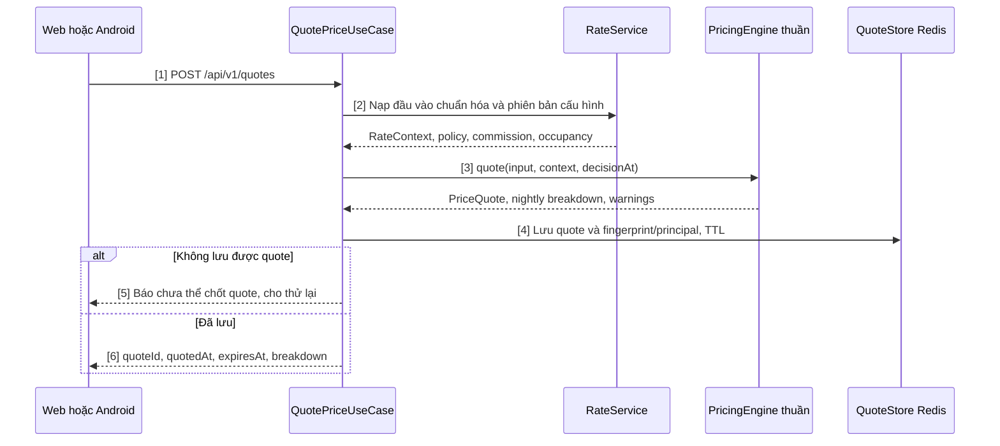
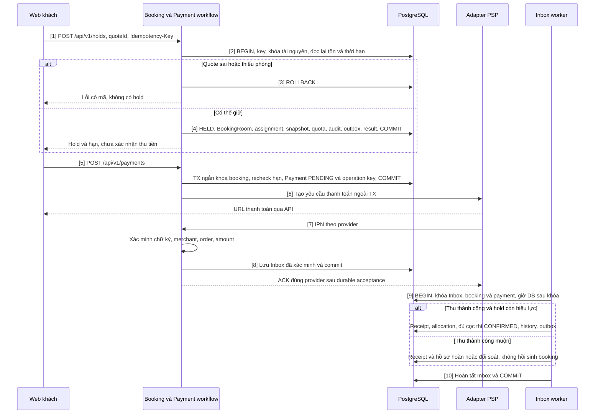
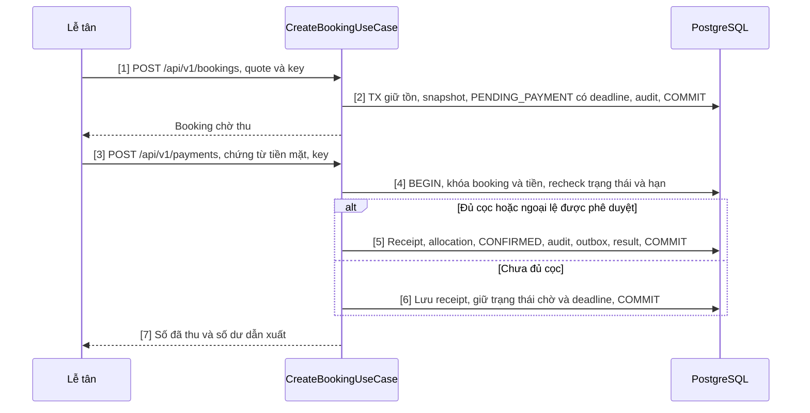
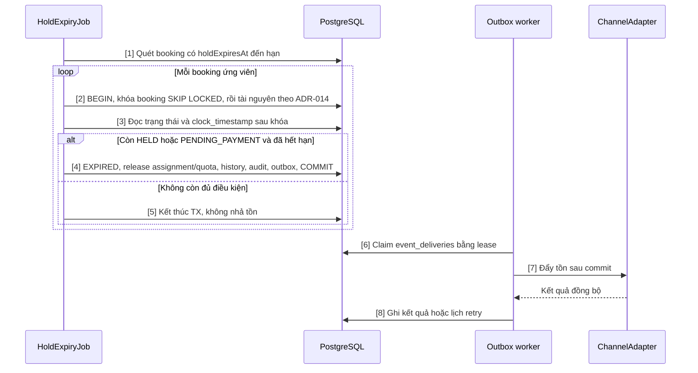
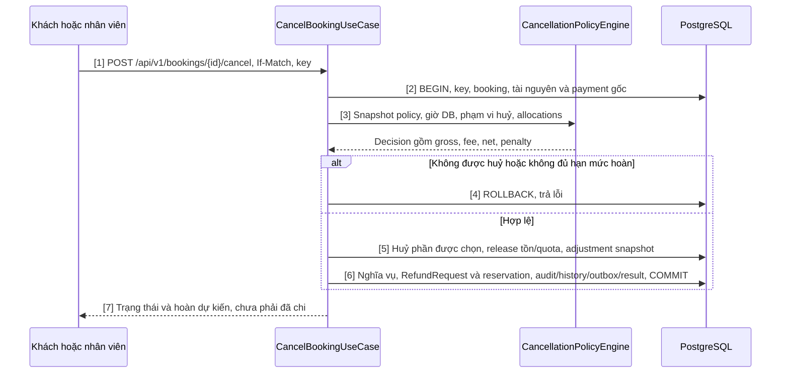
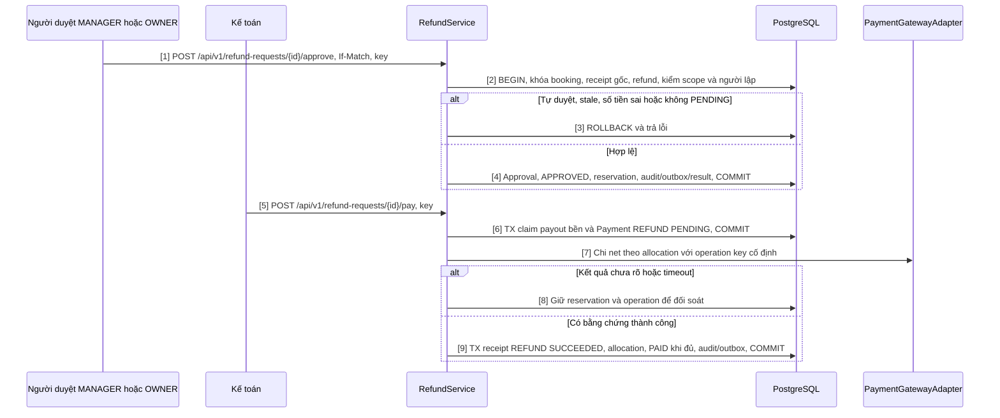
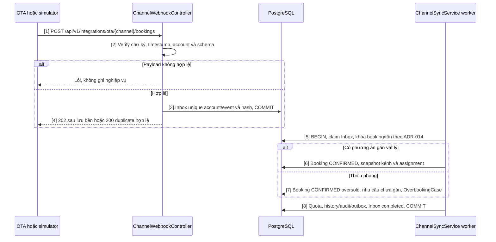
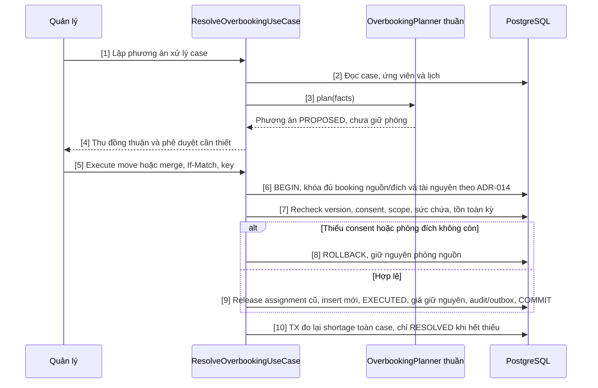

# 04 — Sơ đồ tuần tự thiết kế

Tám luồng dưới đây mô tả ranh giới giao dịch và các nhánh lỗi của thiết kế hiện hành. Hợp đồng HTTP theo [API](api.md), dữ liệu theo [CSDL](csdl.md), quyết định giao dịch theo [ADR-014](adr/ADR-014-giao-dich-ton-phong.md), snapshot theo [ADR-015](adr/ADR-015-quote-policy-bat-bien.md), tiền theo [ADR-016](adr/ADR-016-thanh-toan-hoan-tien.md), xử lý lặp theo [ADR-017](adr/ADR-017-inbox-outbox-idempotency.md).

## 0. Quy ước đọc sơ đồ

Mỗi cặp BEGIN/COMMIT là một transaction trên primary PostgreSQL. Mọi facade tham gia nhận cùng transaction; không gọi PSP, OTA hoặc gửi thông báo khi đang giữ khóa. Các bước trong sơ đồ có số tương ứng với bảng bên dưới.

| Chủ đề | Hợp đồng chung |
|---|---|
| Khóa | Idempotency/Inbox → bookings theo ID → properties → room_types → rooms → quota/promotion → payment thu gốc → refund request. Theo ADR-014; khóa hàng property/type có sẵn, không khóa một tập assignment rỗng rồi coi là an toàn |
| Tồn | Tồn thương mại = supply ACTIVE không bị block − demand mọi kênh, gồm hold còn hạn và cam kết oversold chưa gán; tìm phương án gán vật lý liên tục cả kỳ riêng. DOR dùng từng giường; thuê trọn giữ tất cả giường |
| Idempotency | PostgreSQL giữ principal + method/path + key + request hash + kết quả. Kiểm quyền hiện tại trước replay; khác payload bị từ chối, đang xử lý trả xung đột theo API |
| Version | Lệnh cập nhật dùng If-Match; thiếu trả 428, stale trả 412. Kiểm lại version sau khi khóa |
| Thời gian | Quyết định hết hạn dùng giờ DB sau khi lấy khóa; đúng deadline là hết hạn. Hold HELD và PENDING_PAYMENT dùng cùng holdExpiresAt |
| Outbox | Ghi cùng transaction; consumer có event_deliveries, lease và dedup bền. Redis/BullMQ là phương tiện vận chuyển; mất Redis không mất nguồn công việc |
| Lỗi SQL | 23P01 rollback transaction, ánh xạ E_INV_ROOM_TAKEN; deadlock/serialization retry toàn bộ theo ADR-014. Không tiếp tục ghi trong transaction đã lỗi |

## 1. Luồng 1 — Báo giá đa kênh

UC-INV-02, UC-RATE-05; BR-RATE-01…20, BR-BOOK-03/05, BR-GEN-03.

| Bước | Quyết định |
|---|---|
| 1–2 | Validate ngày, gói, số khách và childAges; xác định kênh/phạm vi từ quyền hiện tại. Nạp đầy đủ facts trước gọi miền thuần |
| 3 | Tra RateCalendar theo priority, hiệu lực từng đêm và quy tắc phá hòa; thứ tự mùa → cuối tuần → công suất → LOS → kênh. Kẹp sàn/trần, làm tròn từng đêm lên 1.000; AMOUNT trước PERCENT, trần giảm theo BR; tổng làm tròn xuống 1.000. Dưới sàn thì bỏ mã và cảnh báo theo BR-RATE-12 |
| 4 | Giữ đầu vào chuẩn hóa, giá, policy/tier, commission, engineVersion, fingerprint, principal và hạn. Thay cấu hình không xoá quote còn hạn |
| 5–6 | Quote không giữ phòng. Khi chốt kiểm principal/fingerprint/expiry; quote hết hạn yêu cầu lấy giá mới và khách chấp thuận lại, không tự thay giá |

## 2. Luồng 2 — Tạo booking trên web kèm giữ chỗ và thanh toán cọc

UC-BOOK-01/04, UC-PAY-02; BR-INV-01…07, BR-BOOK-07/08/09/18, BR-PAY-03/05/11, BR-RATE-15/16.

| Bước | Ràng buộc |
|---|---|
| 1–4 | Guest ownership, blacklist, fingerprint, đủ tồn từng đêm và đủ phương án cả kỳ. Lưu ORIGINAL PriceSnapshot khi rời DRAFT. Một BookingRoom là một đơn vị bán; không tạo assignment thứ hai khi confirm |
| 5–6 | Khởi tạo thanh toán không gia hạn hold. Gọi PSP ngoài TX với operation key bền; mất response cần query/đối soát trước tạo giao dịch mới |
| 7–8 | VNPAY GET IPN, MoMo POST IPN theo API §5; browser return không xác nhận tiền. Verify trước dedup; DB lỗi không trả ACK thành công. Duplicate hợp lệ trả ACK, không cộng tiền |
| 9–10 | SUCCEEDED không lùi theo callback lỗi cũ. Timeout cục bộ không chứng minh chưa thu; xử lý receipt muộn theo BR-PAY-11. Không sửa snapshot đã chốt |
| Timeout | PaymentTimeoutJob khóa cùng booking/payment; đánh dấu timeout theo BR-PAY-05. Expiry riêng theo holdExpiresAt, không nhả booking đã CONFIRMED |

## 3. Luồng 3 — Đặt phòng tại quầy và thu tiền mặt

UC-BOOK-02, UC-PAY-01; BR-BOOK-09/16, BR-PAY-01/02/06, BR-FO-01, BR-RBAC-02/03.

| Bước | Ràng buộc |
|---|---|
| 1–2 | Kiểm permission và propertyScope; chống đặt trùng theo BR-BOOK-16 tách biệt với replay HTTP. Giá theo quote; không cho lễ tân sửa giá ngoài quyền |
| 3–6 | Chỉ ghi tiền mặt đã thực thu, gắn người thu và ngày VN. Ngoại lệ ghi nợ cần người duyệt đủ quyền, lý do, hạn thu; không giả receipt để CONFIRMED |
| 7 | balanceDue là projection từ chứng từ và nghĩa vụ; không cộng penaltyAmount lần hai. Check-in còn kiểm readiness, ngày và hạn mức nợ theo BR-FO-01 |

## 4. Luồng 4 — Hold hết hạn và đồng bộ kênh

UC-BOOK-04, UC-CHAN-02; BR-BOOK-18, BR-INV-04, BR-CHAN-02/06/07.

| Bước | Ràng buộc |
|---|---|
| 1–5 | Quét định kỳ 30 giây, SLA nhả 60 giây; Redis không phải điều kiện chạy. Khóa trong transaction, không SELECT FOR UPDATE rồi mới BEGIN. Callback thắng khóa trước và confirm thì expiry bỏ qua |
| 4 | Tồn, quota, trạng thái và outbox nguyên tử. Job đối chiếu cache 900 giây không thay job expiry |
| 6–8 | Mỗi consumer dedup riêng; crash sau gọi OTA thì retry an toàn. Ba lần thất bại liên tiếp đánh dấu DEGRADED và cảnh báo MANAGER; đo lag/SLO theo NFR |

## 5. Luồng 5 — Huỷ booking và tính hoàn cọc

UC-BOOK-08; BR-BOOK-11/14/17, BR-CANCEL-01…19, BR-PAY-07.

| Bước | Ràng buộc |
|---|---|
| 2–3 | Đọc policy từ snapshot, không từ cấu hình mới. Huỷ từng phòng theo phân bổ receipt và các khoản đã quyết toán; không tái sử dụng toàn bộ paidAmount |
| 5–6 | Một TX cho huỷ, release và yêu cầu hoàn/reservation. Snapshot gốc bất biến; phòng còn lại giữ giá/lịch. Lỗi tạo hồ sơ hoàn rollback cả huỷ |
| 6–7 | Net = max(0, gross − fee). Phạt/hoàn/bồi thường tách chứng từ. Giữ hạn mức của yêu cầu đang mở để hai yêu cầu không cùng tiêu số tiền thu gốc |
| Xoá cứng | Nhánh DELETE riêng chỉ cho DRAFT/HELD chưa có payment; AuditLog beforeJson trước xoá. Không xoá booking CONFIRMED |

## 6. Luồng 6 — Duyệt và chi hoàn tiền độc lập

UC-PAY-04; BR-CANCEL-12/15/16/17/18, BR-PAY-08/09/11. “Hai cấp” trong mô tả cũ là người lập và người duyệt độc lập, không phải chuỗi MANAGER rồi OWNER.

| Bước | Ràng buộc |
|---|---|
| 1–4 | Người duyệt khác người lập, đúng scope và permission; không suy thứ bậc vai trò. approvedAmount là gross, không vượt requestedAmount; đầu vào sai bị từ chối thay vì cắt âm thầm |
| 5–7 | Không ghi PAID/SUCCEEDED trước PSP. Không giữ DB lock trong cuộc gọi mạng. Nhiều payment nguồn có payout riêng, key ổn định; hoàn phương thức gốc, tiền mặt hoàn bằng chuyển khoản theo BR-PAY-08 |
| 8 | Timeout không giải phóng reservation và không tạo payout mới. Query PSP/đối soát chứng từ; chỉ retry cùng operation khi an toàn |
| 9 | Callback/worker cùng khóa để chỉ hạch toán một lần. Tổng hoàn không vượt receipt đã thu; bồi thường không tính chung trần hoàn cọc |
| Reject/cancel | Chỉ xử lý PENDING; ghi lý do và nhả reservation trong TX. Rút yêu cầu hoàn không khôi phục booking hoặc assignment |

## 7. Luồng 7 — Nhận booking OTA qua webhook

UC-CHAN-03; BR-CHAN-03/04/06/08, BR-OVER-03, BR-RATE-16.

| Bước | Ràng buộc |
|---|---|
| 2–4 | Verify trước dedup. Cùng event ID khác payload đưa vào lỗi/đối soát. DB lỗi không ACK thành công; không xử lý booking nặng trước ACK |
| 5–8 | Unique channel/providerBookingCode chống hai event tạo hai booking. Booking OTA thiếu phòng vẫn được ghi nhận, không bỏ nhu cầu vì quota đóng hoặc vượt trần chủ động |
| 6–7 | Kiểm trước gán; nếu SQL lỗi 23P01 thì rollback/retry toàn TX, không tiếp tục transaction đã abort để ghi oversold |
| Sau commit | Consumer đẩy tồn/giá và thông báo nội bộ; retry từ nguồn bền. Huỷ OTA theo policy kênh đã ghi nhận, không áp nhầm chính sách trực tiếp |

## 8. Luồng 8 — Xử lý quá tải và điều chuyển phòng

UC-OVER-01/02/03/04; BR-OVER-01…16, BR-CANCEL-14. OverbookingRelocationSaga là process manager cho chờ consent và tác vụ ngoài DB; mỗi move nội bộ commit nguyên tử.

| Bước | Ràng buộc |
|---|---|
| 2–3 | Application nạp facts; planner không I/O. Xếp keepScore tăng → createdAt giảm → Booking.seq tăng, loại CHECKED_IN; thang 1 → 2 → 4 theo khoảng cách đề tài |
| 4–7 | Consent trước thực thi, không hỏi sau khi đã chuyển. Ghép phòng kiểm đồng thuận, giới tính và từng giường; kiểm lại trong TX |
| 8–9 | Release cũ và insert mới trong cùng TX; lỗi rollback khôi phục nguồn. Không tự đảo move đã commit vì gửi thông báo thất bại; muốn đảo cần lệnh mới kiểm tồn/quyền |
| Walk-out | Huỷ + release + refund reservation + nghĩa vụ bồi thường riêng cùng TX; chi tiền theo luồng 6. Giữ biên bản, chữ ký, phí vận chuyển và căn cứ giá gốc |
| 10 | Không đóng case vô điều kiện sau một move. Hết thiếu phòng không đồng nghĩa đã chi hết hoàn/bồi thường; các hồ sơ tiền theo dõi riêng. Quá hạn thì ESCALATED theo BR-OVER-16 |

## 9. Tổng hợp giao dịch, khoá và sự kiện

| Luồng | Phần bắt buộc commit cùng nhau | Sau commit |
|---|---|---|
| Hold | Booking, assignment, snapshot, quota, history, audit, outbox, idempotency result | Thanh toán, đồng bộ kênh |
| Receipt | Payment, allocation, quyết định booking, Inbox completion, audit, outbox | Thông báo, đối soát |
| Expiry | EXPIRED, release tồn/quota, history, audit, outbox | Đồng bộ kênh |
| Huỷ | Huỷ phạm vi, release, adjustment, nghĩa vụ, refund reservation, audit/outbox | Duyệt/chi hoàn |
| Hoàn | Claim operation riêng; khi có bằng chứng: receipt REFUND, allocation, trạng thái refund, audit/outbox | Thông báo kết quả |
| OTA | Booking và snapshot, assignment hoặc case oversold, quota, Inbox completion, outbox | Đẩy tồn/giá |
| Move | Assignment nguồn/đích, EXECUTED, priceLocked, audit/outbox | Thông báo, đánh giá lại case |

BookingConfirmed, BookingCancelled, HoldExpired, PaymentSucceeded, RoomMoveExecuted và AvailabilityChanged là thông báo về thay đổi đã commit. Listener không thực hiện lại release/gán phòng hoặc xác nhận booking vốn phải hoàn tất nguyên tử. Từng consumer lưu kết quả bền, phát lại không nhân tác động.

## Tham chiếu

- [Quy tắc nghiệp vụ](../02-nghiep-vu/quy-tac-nghiep-vu.md), [mô hình động](../03-phan-tich/mo-hinh-dong.md), [thiết kế lớp](thiet-ke-lop.md).
- [Kế hoạch kiểm thử](../05-ke-hoach/ke-hoach-kiem-thu.md), [hướng dẫn thi công](../07-ban-giao/huong-dan-thi-cong.md), [kết quả kiểm chứng](../07-ban-giao/ket-qua-kiem-chung.md).
