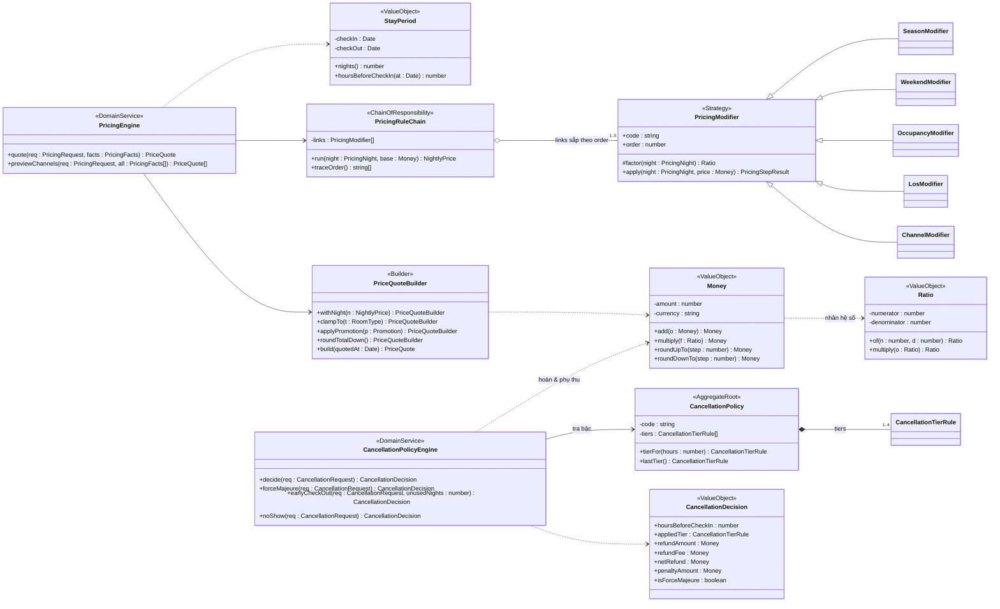
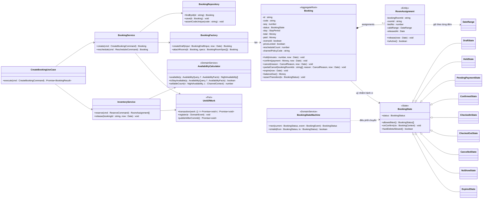
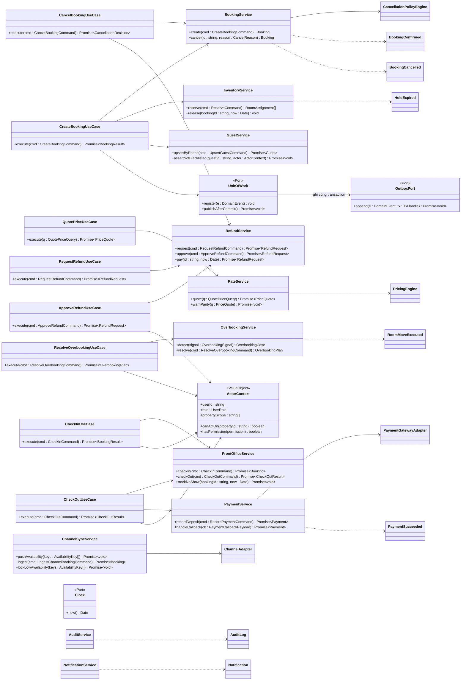
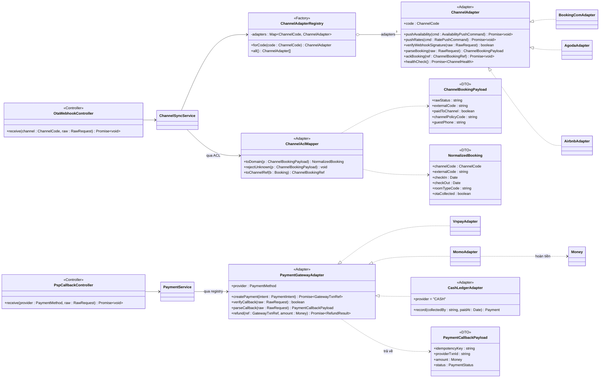
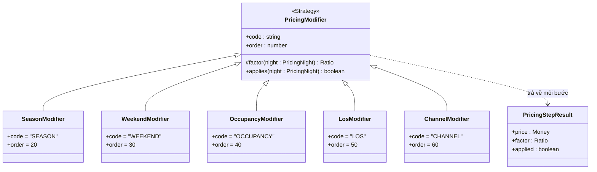
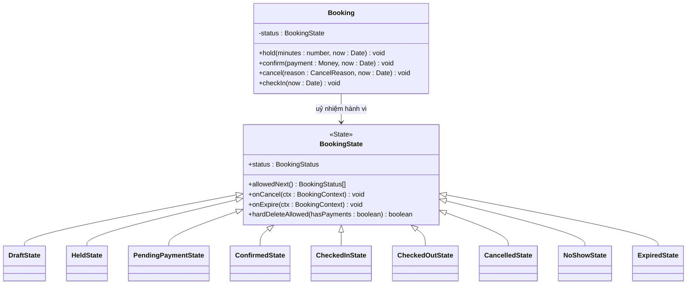
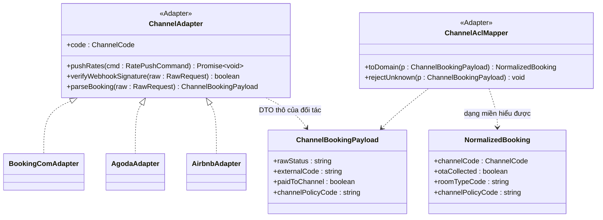
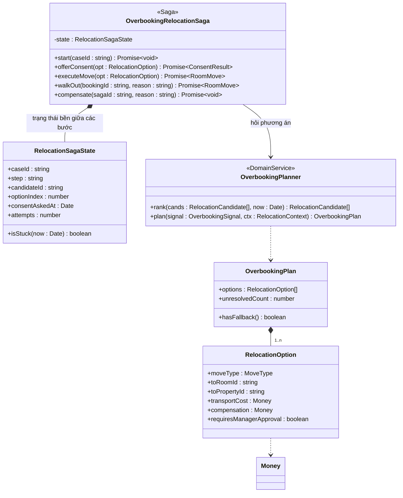

# 04 — Thiết kế lớp

> Bản thiết kế lớp mức chi tiết và ánh xạ mẫu thiết kế cho hệ thống đặt phòng Pine Hill: **13 module, 53 use case, 3 cơ sở, 55 phòng, 7 kênh bán**.
> Nguồn chân lý nghiệp vụ là [02/quy tắc nghiệp vụ](../02-nghiep-vu/quy-tac-nghiep-vu.md) — tài liệu này **chỉ tham chiếu mã BR**, không định nghĩa lại giá trị nào.
> Nguồn chân lý định danh là [00 §7](../00-tong-quan.md#7-từ-điển-thực-thể-nguồn-chân-lý-về-định-danh). Tài liệu không mô tả luồng thời gian (xem [sequence-diagram](sequence-diagram.md)) và không mô tả bảng/cột (xem [csdl](csdl.md)).
> **Cách đọc:** mỗi nhóm lớp có **một sơ đồ Mermaid** cho các lớp trung tâm và **một bảng** cho các lớp vệ tinh (kèm chữ ký chính và quyết định thiết kế) — nhờ vậy sơ đồ vẫn đọc được mà không thiếu lớp nào.

---

## 1. Quy ước trình bày

| Ký hiệu | Nghĩa | Dùng cho |
|---------|-------|----------|
| `+` | `public` | Cổng vào của lớp — tầng trên được gọi |
| `-` | `private` | Trạng thái nội bộ, chỉ lớp tự dùng |
| `#` | `protected` | Điểm mở rộng cho lớp con (Strategy, State, Decorator) |
| `~` | `package` | Chỉ dùng trong cùng gói module |
| `«X»` | Stereotype | `ValueObject` · `Entity` · `AggregateRoot` · `DomainService` · `Port` · `Repository` · `UseCase` · `ApplicationService` · `Adapter` · `Saga` · `Factory` · `Builder` · `Strategy` · `State` · `DomainEvent` · `DTO` · `Controller` |

Stereotype chỉ vẽ khi **không suy ra được từ hậu tố tên lớp**: `*Service` → `ApplicationService`, `*UseCase` → `UseCase`, `*Repository` → `Repository`, `*Adapter` → `Adapter`, `*Modifier` → `Strategy`, `*State` → `State`, `*Payload`/`*DTO` → `DTO`, `*Factory`/`*Registry` → `Factory`. Cột "loại lớp" ở §6 liệt kê đầy đủ.

Kiểu theo TypeScript 5.x `strict: true` (ADR-001). Bốn quy ước kiểu bắt buộc, có hệ quả trực tiếp lên hình dạng lớp:

| Quy ước | Hệ quả thiết kế | Neo BR |
|---------|-----------------|--------|
| Tiền là `Money` (số nguyên VND), **không bao giờ** là `number` thập phân | Mọi phép tính tiền trả về `Money` mới; không có toán tử số học trên số nguyên trần | BR-GEN-01 |
| Hệ số giá là `Ratio` (phân số hữu tỷ), **không** là `number` | `2,20 × 1,20 × 1,15` cho kết quả tất định trên web, Android và API | BR-RATE-01, BR-RATE-17 |
| Thời gian chỉ vào qua tham số `now: Date` hoặc cổng `Clock` | `packages/domain` không gọi `Date.now()`; hàm miền kiểm thử được ở mọi mốc thời gian | BR-GEN-02, BR-GEN-04, BR-GEN-05, BR-BOOK-07, BR-CANCEL-10 |
| Hàm miền là hàm thuần, không I/O | Cùng đầu vào → cùng đầu ra; kiểm thử thuộc tính bằng `fast-check`, không cần dựng CSDL | ADR-011 |

**Phân lớp gói** (khớp [kien-truc](kien-truc.md)) — miền thuần `packages/domain/src/**` (chỉ phụ thuộc nội bộ miền); hợp đồng `packages/contracts/src/**`; ứng dụng `modules/<mod>/application/**` (miền + cổng ra); hạ tầng `modules/<mod>/infrastructure/**` và `apps/api/src/infrastructure/**` (Prisma, Redis, HTTP); giao diện `modules/<mod>/presentation/**`.
**Luật bất di bất dịch:** không lớp nào trong `packages/domain` được import Prisma, Nest, `axios`, `Date` hay bất kỳ mô-đun I/O nào — đây là điều kiện để chứng minh BT-1, BT-2, BT-3 bằng hàm thuần.

---

## 2. Sơ đồ lớp thiết kế theo 5 nhóm

### 2.1. Nhóm 1 — Miền giá & chính sách (RATE, PAY)

| Lớp vệ tinh | Loại | Chữ ký / trường chính | Quyết định thiết kế | Neo BR |
|-------------|------|------------------------|---------------------|--------|
| `ChannelContext` | VO | `channelCode : ChannelCode` · `propertyId : string` · `multiplier : Ratio` · `commissionPct : number` · `netRevenue(gross : Money) : Money` | Hệ số và hoa hồng đọc theo **cặp (kênh, cơ sở)** từ `ChannelPropertySetting`, mặc định rơi về `Channel` toàn chuỗi; `netRevenue` phục vụ báo cáo gộp/thuần | BR-RATE-08, BR-RATE-18 |
| `CancellationTierRule` | VO (khác thực thể lưu trữ `CancellationTier`) | `offsetHours : number` · `refundPercent : number` · `chargeFirstNight : boolean` | `offsetHours` giảm dần, `refundPercent ∈ [0,100]` là bất biến của hàm dựng | BR-CANCEL-01, [00 §7.7](../00-tong-quan.md#77-giá-trị-miền-value-object--bất-biến-so-sánh-theo-giá-trị) |
| `CancellationRequest` | VO | `policy` · `stay : StayPeriod` · `paid : Money` · `snapshot : PriceSnapshot` · `requestedAt : Date` | Mọi dữ liệu để tính hoàn nằm trong một tham số → hàm thuần, không truy vấn trong lúc tính | BR-CANCEL-03, BR-CANCEL-04 |
| `PromotionRuleGuard` | DomainService | `selectApplicable(p : Promotion[], f : PricingFacts) : Promotion[]` · `resolve(subtotal : Money, floors : Money[]) : PromotionOutcome` | Tách luật khuyến mãi khỏi builder để kiểm thử độc lập: tối đa 2 mã và chỉ khi cả hai `stackable`; mã hết hạn/hết lượt bị từ chối **tại thời điểm xác nhận** kể cả khi báo giá trước đó đã áp | BR-RATE-10, BR-RATE-11, BR-RATE-12, BR-RATE-13, BR-RATE-14 |
| `PricingNight` | VO | `date : Date` · `season : Season` · `capacityPct : number` · `rateSource : RateSource` | Đóng gói "mọi thứ một đêm cần biết" → `SeasonModifier` không tra thêm dữ liệu | BR-RATE-05, BR-RATE-06 |
| `PricingStepResult` | VO | `price : Money` · `factor : Ratio` · `applied : boolean` · `reason : string` | Ghi vết từng hệ số để giải trình giá và sinh bảng giá từng đêm | BR-RATE-16 |
| `NightlyPrice` | VO | `date : Date` · `base : Money` · `steps : PricingStepResult[]` · `rounded : Money` | Đơn vị cộng của `subtotal`; làm tròn LÊN 1.000đ ở cấp đêm | BR-GEN-03, BR-RATE-01 |
| `PricingRequest` / `PricingFacts` | VO | `PricingRequest`: định danh truy vấn (`roomTypeId`, `channelCode`, `ratePlanId`, `checkIn`, `checkOut`, `adults`, `children`, `promoCode`, `quotedAt`). `PricingFacts`: dữ liệu đã nạp (`roomType`, `ratePlan`, `seasons`, `rateCalendar` đã sắp theo `priority`, `capacityPct`, `promotions`) | Tách "câu hỏi" khỏi "dữ liệu đã nạp" → engine thuần, tầng ứng dụng chịu trách nhiệm nạp | BR-RATE-17 |
| `PriceQuote` | VO | `id` · `propertyId` · `ratePlanCode` · `channelCode` · `nights[]` · `subtotal` · `discountAmount` · `total` · `depositAmount` · `expiresAt` · `engineVersion : string` | Hiệu lực 15 phút; quá hạn phải tính lại trước khi xác nhận; `subtotal` là tổng giá từng đêm **sau** kẹp sàn/trần của `RoomType` | BR-RATE-03, BR-RATE-04, BR-RATE-11, BR-RATE-15 |
| `RatePlan` | Entity | `code` · `depositPercent` · `cancellationPolicyId` · `minNights` · `maxNights` · `losDiscountEnabled` · `fixedNightlyPrice` | `RatePlanFactory` dựng gói giá kèm chính sách huỷ, % cọc, số đêm tối thiểu và cờ LOS; `fixedNightlyPrice` là một trong các nguồn của `#resolveBase`. `LONGSTAY14` PHẢI có giá riêng (qua `fixedNightlyPrice` hoặc dòng `RateCalendar` nguồn `RATE_PLAN`); thiếu thì hệ thống cảnh báo ở màn hình cấu hình vì gói dài ngày không còn lợi ích giá | BR-CANCEL-02, BR-BOOK-03, BR-RATE-02, BR-RATE-19 |
| `RateCalendar` | Entity | `roomTypeId` · `date` · `channelCode` · `price` · `priority` · `rateSource` · `reason` · `createdBy` | **Không có thực thể `RateOverride`**: giá cơ bản tra theo `priority` giảm dần (`OVERRIDE` 100 → `RATE_PLAN` 90 → `SEASON` 50 → `BASE` 10); dòng khai `channelCode` chỉ áp cho kênh đó | BR-RATE-02 |
| `Clock` | Port | `now() : Date` | Cổng duy nhất lấy thời gian; miền không gọi `Date.now()` | BR-GEN-02 |

### 2.2. Nhóm 2 — Miền đặt phòng & tồn phòng (BOOK, INV)

| Lớp vệ tinh | Loại | Chữ ký / trường chính | Quyết định thiết kế | Neo BR |
|-------------|------|------------------------|---------------------|--------|
| `BookingRoom` | Entity | `roomTypeId` · `adults` · `children` · `pricePerNight : Money` | Một booking nhiều phòng → mỗi phòng một `BookingRoom`, mỗi đêm một `RoomAssignment` | BR-BOOK-10 |
| `Hold` | Entity | `channelId` · `expiresAt : Date` · `releasedAt : Date` · `status` (`ACTIVE`/`RELEASED`/`EXPIRED`) | Tách khỏi `Booking` để job `hold-expiry` quét theo `expiresAt` mà không nạp aggregate; job `hold-reconcile` (`job.holdReconcile.intervalSeconds`) đối chiếu `Hold` ↔ `Booking.holdExpiresAt` để không bỏ sót hold mồ côi | BR-BOOK-07, BR-INV-04, BR-SYS-02 |
| `RoomAssignmentRepository` | Repository | `findActiveByRoom(roomId, range) : RoomAssignment[]` · `releaseAll(bookingId, now) : number` | Truy vấn theo `(roomId, khoảng ngày)` phục vụ ràng buộc loại trừ; giải phóng hàng loạt trong một transaction | BR-INV-03, BR-BOOK-11 |
| `HoldRepository` | Repository | `findExpired(now, limit) : Hold[]` · `save(h : Hold) : void` | Job nền lấy việc theo lô, không quét toàn bảng | BR-INV-04 |
| `QuotePriceUseCase` | UseCase | `execute(q : QuotePriceQuery) : Promise~PriceQuote~` | Chỉ đọc: nạp `PricingFacts` rồi gọi `PricingEngine`, không mở transaction ghi | UC-RATE-05 |
| `CancelBookingUseCase` | UseCase | `execute(cmd : CancelBookingCommand) : Promise~CancellationDecision~` | Khóa booking/tài nguyên/receipt theo ADR-014, đọc policy snapshot và phân bổ tiền; CancellationPolicyEngine thuần quyết định từ facts đã khóa. Huỷ, release, nghĩa vụ, refund reservation, audit/outbox cùng transaction. **Huỷ một phần** (`roomCount > 1`): `refundBase` theo phân bổ receipt bất biến của các BookingRoom bị huỷ, trừ phần đã quyết toán hoặc giữ cho hoàn rồi mới áp BR-CANCEL-05; các phòng còn lại giữ nguyên giá và `RoomAssignment`; `totalAmount` giảm; huỷ hết phòng → `CANCELLED` toàn phần | BR-BOOK-11, BR-CANCEL-19, UC-BOOK-08 |
| `BookingService.reschedule` | ApplicationService | `reschedule(cmd : RescheduleCommand) : Booking` | Đổi ngày **không** tạo chuyển trạng thái, **giữ nguyên** `PriceSnapshot` cũ và chỉ ghi `AuditLog` + chênh lệch giá; lần thứ hai tính như huỷ + đặt mới | BR-BOOK-12, BR-CANCEL-08 |
| `Booking.confirm` | AggregateRoot | `confirm(payment : Money, now : Date) : void` | Điều kiện xác nhận không cọc chỉ nhận diện bằng `PaymentMethod = OTA_COLLECT` (không theo tên kênh) hoặc có `MANAGER`+ cho phép ghi nợ | BR-BOOK-09 |
| `RefundRequest` | Entity | `status : RefundStatus` — `PENDING → APPROVED/REJECTED`; `PENDING → CANCELLED` khi khách rút yêu cầu hoặc booking được khôi phục · `evidenceRefs : string[]` (minh chứng bất khả kháng) · `reason : CancelReason` (không phải chuỗi tự do) | Huỷ yêu cầu chỉ do người tạo hoặc `MANAGER`+ và phải ghi lý do; đã `APPROVED`/`PAID` thì **không** huỷ được; minh chứng gắn với ca bất khả kháng | BR-CANCEL-18, BR-CANCEL-16, BR-CANCEL-13 |
| `BookingRepository.deleteHard` | Repository | `deleteHard(b : Booking, audit : AuditEntry) : void` | Xoá cứng chỉ cho `DRAFT`/`HELD` chưa phát sinh thanh toán, và PHẢI ghi `AuditLog` với `beforeJson` đầy đủ **trước khi** xoá — nghĩa vụ ghi vết không được miễn trừ bởi xoá cứng | BR-BOOK-17, BR-BOOK-14 |
| `PriceSnapshot` | Entity | `bookingId` · `seq` · `kind` (`ORIGINAL`/`RESCHEDULE`/`PARTIAL_CANCEL`) · `payloadJson` · `settingId` · `capturedAt : Date` | Ghi **ngay khi booking rời `DRAFT`** (`HELD`/`PENDING_PAYMENT`/`CONFIRMED`), không chỉ lúc xác nhận — nếu không, BR-CANCEL-06 không có `firstNightPrice` cho booking `HELD`/`EXPIRED`; đổi ngày và huỷ một phần lưu snapshot mới và **giữ** bản gốc; giá đã chốt không đổi vì cấu hình sau đó; `settingId` ghi lại dòng cấu hình kênh đã dùng (mốc so sánh `effectiveFrom` là **ngày của từng đêm**, không theo `quotedAt`) | BR-RATE-16, BR-RATE-18, BR-CANCEL-19 |
| `Booking.balanceDue` | AggregateRoot | `balanceDue() : Money` | Tổng phần còn thiếu không âm của từng nghĩa vụ `booking_charges` sau phân bổ thu SUCCEEDED, đã gồm phạt/phí/dịch vụ chưa trả. `CANCELLED`/`NO_SHOW` không tạo nợ tiền phòng đã huỷ; chỉ còn phạt/phí được phép đã chốt trừ thu phân bổ cho chúng. `EXPIRED` không có phạt/phí theo BR-BOOK-18; không cộng `penaltyAmount` lần nữa | BR-PAY-02 |
| `BookingStatusHistory` | Entity | `fromStatus` · `toStatus` · `reason` · `actorId` | Mọi chuyển trạng thái đều ghi vết, kể cả chuyển do job nền | BR-BOOK-06 |
| `AvailabilityQuery` | VO | `roomTypeId` · `propertyId` · `stay : StayPeriod` · `channelCode` · `roomCount` | Một kỳ lưu trú chỉ khả dụng khi **mọi** đêm đều còn phòng | BR-INV-07 |
| `AvailabilityFacts` | VO | `rooms[]` · `blocks[]` · `assignments[]` · `holds[]` · `allotments[]` | Đầu vào của hàm thuần (`rooms[]` chỉ gồm phòng `ACTIVE` của loại phòng tương ứng); khoá bi quan do `InventoryService` xử lý ở tầng hạ tầng. Dữ liệu nền: 3 cơ sở, ma trận phân bổ theo (cơ sở × loại phòng) với tổng đơn vị bán (phòng, hoặc giường với DOR) dùng cho cả tồn khả dụng lẫn allotment; sức chứa; mã phòng duy nhất trong cơ sở | BR-INV-01, BR-INV-02, BR-PROP-01, BR-PROP-02, BR-PROP-03, BR-PROP-04, BR-PROP-05 |
| `NightAvailability` | VO | `date` · `totalActive` · `blocked` · `assigned` · `held` · `commonAvailable` · `allottedUsed` | HAI tầng tách bạch để không đếm trùng: **tồn chung** = `max(0, supply − demand)` với `supply`/`demand` đúng BR-INV-01 (gồm CONFIRMED chưa gán, hold mọi kênh còn hạn; block trùng chỉ trừ một lần; `pool` nội bộ được âm — QĐ-05); **tồn kênh** = `min(tồn chung, allotment − used)` | BR-INV-01, BR-CHAN-01, UC-INV-01 |
| `ReserveCommand` | DTO | `bookingId` · `roomTypeId` · `stay : StayPeriod` · `roomCount` · `channelCode` | Lệnh giữ chỗ đi qua `InventoryService` để transaction và khoá nằm một chỗ | BR-INV-02 |
| `DateRange` | VO | `start : Date` · `end : Date` — nửa mở `[start, end)` | Khoảng ngày hiệu lực của `RoomAssignment`; giao nhau trên cùng `(roomId, bedNo)` là cơ sở của ràng buộc loại trừ chống trùng | BR-INV-03 |
| `BookingDraftInput` | VO | `checkIn : Date` · `checkOut : Date` · `adults` · `children` · `channelCode` · `ratePlanId` | `BookingFactory.createDraft` kiểm cửa sổ đặt phòng (`checkIn` không ở quá khứ, không xa hơn 365 ngày) và số đêm nằm trong `minNights…maxNights` của gói giá | BR-BOOK-02, BR-BOOK-03 |

### 2.3. Nhóm 3 — Miền quá tải & điều chuyển (OVER)

```mermaid
classDiagram
    direction LR
    class OverbookingCase {
        <<AggregateRoot>>
        -propertyId : string
        -date : Date
        -roomTypeId : string
        -shortageCount : number
        -status : OverbookingCaseStatus
        -resolvedAt : Date
        -delayReason : string
        +escalate(now : Date) void
        +close(by : string, now : Date) void
        +isPastDeadline(now : Date) boolean
        +dedupeKey() string
    }
    class RoomMove {
        <<Entity>>
        -bookingId : string
        -moveType : MoveType
        -toRoomId : string
        -keepScore : number
        -priceLocked : boolean
        -compensationAmount : Money
        -transportCost : Money
        -status : RoomMoveStatus
        -walkOutDocNo : string
        -guestSignatureRef : string
        -staffSignatureRef : string
        +assertPriceLocked() void
        +totalSupport() Money
    }
    class RoomMerge {
        <<Entity>>
        -primaryBookingId : string
        -secondaryBookingId : string
        -consentPrimary : boolean
        -consentSecondary : boolean
        -discountPct : number
        -discountAmount : Money
        -status : RoomMergeStatus
        +assertConsent() void
    }
    class OverbookingPlanner {
        <<DomainService>>
        +rank(cands : RelocationCandidate[], now : Date) RelocationCandidate[]
        +plan(signal : OverbookingSignal, ctx : RelocationContext) OverbookingPlan
        +canMergeShare(a : RoomMergeCandidate, b : RoomMergeCandidate) boolean
    }
    class KeepScoreCalculator {
        <<DomainService>>
        +score(c : RelocationCandidate, now : Date) KeepScoreBreakdown
        +compare(a : RelocationCandidate, b : RelocationCandidate) number
    }
    class OverbookingRelocationSaga {
        <<Saga>>
        -state : RelocationSagaState
        +start(caseId : string) Promise~void~
        +offerConsent(opt : RelocationOption) Promise~ConsentResult~
        +executeMove(opt : RelocationOption) Promise~RoomMove~
        +walkOut(bookingId : string, reason : string) Promise~RoomMove~
        +compensate(sagaId : string, reason : string) Promise~void~
    }
    class OverbookingPlan {
        <<ValueObject>>
        -caseId : string
        -options : RelocationOption[]
        -unresolvedCount : number
        +hasFallback() boolean
        +bestFor(bookingId : string) RelocationOption
    }
    class RelocationOption {
        <<ValueObject>>
        +moveType : MoveType
        +toRoomId : string
        +toPropertyId : string
        +transportCost : Money
        +compensation : Money
        +requiresManagerApproval : boolean
    }
    class RelocationCandidate {
        <<ValueObject>>
        +bookingId : string
        +seq : number
        +loyaltyTier : LoyaltyTier
        +paymentRatio : number
        +nights : number
        +createdAt : Date
    }
    class KeepScoreBreakdown {
        <<ValueObject>>
        -tierPoints : number
        -paymentPoints : number
        -nightsPoints : number
        -returningPoints : number
        -arrivalPoints : number
        +total() number
    }
    class OverbookingService {
        +detect(signal : OverbookingSignal) OverbookingCase
        +resolve(cmd : ResolveOverbookingCommand) OverbookingPlan
        +executeMove(cmd : ExecuteMoveCommand) RoomMove
        +merge(cmd : MergeRoomsCommand) RoomMerge
    }
    class ResolveOverbookingUseCase {
        +execute(cmd : ResolveOverbookingCommand) Promise~OverbookingPlan~
    }
    OverbookingCase o-- "0..n" RoomMove : điều chuyển để giải quyết
    OverbookingPlanner --> KeepScoreCalculator : xếp hạng khách
    OverbookingPlanner ..> OverbookingPlan
    OverbookingPlan *-- "1..n" RelocationOption : options
    KeepScoreCalculator ..> RelocationCandidate
    KeepScoreCalculator ..> KeepScoreBreakdown
    OverbookingRelocationSaga --> OverbookingPlanner
    OverbookingRelocationSaga ..> RoomMove : tạo
    OverbookingRelocationSaga ..> RoomMerge : tạo ghép phòng
    OverbookingService --> OverbookingPlanner
    OverbookingService --> OverbookingRelocationSaga
    OverbookingService --> OverbookingCaseRepository
    OverbookingService --> RoomMoveRepository
    ResolveOverbookingUseCase --> OverbookingService
    OverbookingRelocationSaga ..> NotificationService : thông báo ≤ 15 phút
    OverbookingRelocationSaga ..> AuditService : ghi vết
```

| Lớp vệ tinh | Loại | Chữ ký / trường chính | Quyết định thiết kế | Neo BR |
|-------------|------|------------------------|---------------------|--------|
| `OverbookingCaseRepository` | Repository | `findOpen(propertyId, from) : OverbookingCase[]` · `findOverdue(now : Date) : OverbookingCase[]` · `save(c) : void` | Tra ca đang mở theo `(propertyId, date, roomTypeId)`; gộp trùng theo `dedupeKey()`; ca còn `OPEN`/`PROPOSED`/`ESCALATED` khi ngày thiếu phòng đã trôi qua PHẢI chuyển `ESCALATED` và **không bao giờ** tự động đóng | BR-OVER-05, BR-OVER-16 |
| `RoomMoveRepository` / `RoomMergeRepository` | Repository | `findByBooking(bookingId) : RoomMove[]` · `save(m) : void` | Mọi `RoomMove` đều có bản ghi, không có đường điều chuyển “chỉ trong bộ nhớ” | BR-OVER-10 |
| `RoomMergeCandidate` | VO | `bookingId` · `gender : Gender` · `guestCount` · `groupTag` · `roomTypeId` | Ghép khác giới chỉ khi **hội đủ hai điều kiện**: hai khách đồng ý trên hệ thống **và** `MANAGER`+ duyệt; `Gender.UNSPECIFIED` được coi là khác giới | BR-OVER-13, BR-OVER-14, `E_OVER_MERGE_GENDER` |
| `SupportCostSummary` | VO | `mergeDiscounts : Money` · `walkOutCompensations : Money` · `transportCosts : Money` · `total() : Money` | Tổng chi phí xử lý quá tải (chiết khấu ghép phòng + bồi thường walk-out + đưa đón) là nguồn số liệu của báo cáo quá tải | BR-OVER-15, BR-REP-01, UC-REP-04 |
| `RelocationSagaState` | VO | `caseId` · `step` · `candidateId` · `optionIndex` · `consentAskedAt` · `attempts` · `isStuck(now) : boolean` | Trạng thái bền giữa các bước để phát hiện ca khách chưa phản hồi và leo thang trước T−24h | BR-OVER-04 |
| `OverbookingSignal` | VO | `propertyId` · `date` · `roomTypeId` · `shortageCount` · `detectedAt` | Đầu vào duy nhất của `plan()`; sinh từ job quét mỗi giờ | BR-OVER-03, BR-OVER-05 |
| `RelocationContext` | VO | `candidates[]` · `samePropertyRooms[]` · `crossPropertyRooms[]` (bán kính ≤ 15 km) · `property.overbookLimitPct` | Gom mọi nguồn lựa chọn để planner thuần túy, không truy vấn | BR-OVER-01, BR-OVER-02 |
| `CompensationPolicy` | DomainService | `forWalkOut(b : Booking) : Money` · `maxTransportCost : Money` | Bồi thường = 1 × giá đêm đầu theo giá gốc; trần đưa đón đọc từ `SystemSetting` (`overbooking.transportSupportCap`); walk-out cũng là ca huỷ do khách sạn nên hoàn 100% | BR-OVER-06, BR-CANCEL-14 |
| `TrustedRoomInventory` | Port | `findAlternativeRooms(ctx : RelocationContext) : Room[]` | Cho phép planner lấy phòng thay thế mà vẫn giữ chữ ký thuần theo tham số | BR-OVER-09 |

### 2.4. Nhóm 4 — Lớp ứng dụng & ca sử dụng

| Lớp vệ tinh | Loại | Chữ ký / trường chính | Quyết định thiết kế | Neo BR |
|-------------|------|------------------------|---------------------|--------|
| `NotificationService` | ApplicationService | `enqueue(cmd : NotificationCommand) : Promise~Notification~` · `dispatchPending(limit : number) : Promise~number~` | Hàng đợi trong CSDL; gửi lại tối đa 3 lần cách nhau 5 phút, mọi lần gửi đều có bản ghi | BR-SYS-06, UC-NOTI-01 |
| `ReportingService` | ApplicationService | `occupancy(q : ReportQuery)` · `revenueByChannel(q : ReportQuery)` · `cancellations(q)` · `overbooking(q)` | Bốn báo cáo của ban giám đốc. **BR-REP-01 là nguồn định nghĩa chỉ số duy nhất** — ADR, RevPAR, công suất, tỷ lệ huỷ, chi phí xử lý quá tải; phòng DOR đếm theo đơn vị bán (giường); mỗi báo cáo KHÔNG được tự định nghĩa lại chỉ số. Doanh thu hiển thị cả gộp và thuần sau hoa hồng | BR-REP-01, BR-RATE-08, UC-REP-01, UC-REP-02, UC-REP-03, UC-REP-04 |
| `AuditService` | ApplicationService | `record(entry : AuditEntry) : Promise~void~` | Ghi trong **cùng transaction** với thao tác nghiệp vụ; bảng append-only, ghi đủ ai/làm gì/trước-sau/lý do/IP; thời hạn lưu 5 năm, có diễn tập phục hồi | BR-GEN-07, BR-SYS-01, BR-SYS-03, BR-SYS-04, BR-SYS-05 |
| `GuestService` | ApplicationService | `upsertByPhone(cmd) : Promise~Guest~` · `assertNotBlacklisted(guestId, actor)` · `awardPoints(bookingId)` | Nhận diện khách theo số điện thoại chuẩn hoá; chặn khách trong danh sách đen trừ khi `MANAGER`+ override có lý do; điểm chỉ ghi sau check-out; hồ sơ khách không xoá cứng | BR-CRM-01, BR-CRM-02, BR-CRM-03, BR-CRM-04, BR-CRM-05, BR-CRM-06, BR-BOOK-15, BR-BOOK-16 |
| `ChannelSyncService` | ApplicationService | `pushAvailability/pushRates(keys)` · `ingest(cmd)` · `lockLowAvailability(keys)` | Đẩy thay đổi qua outbox và quét định kỳ 5 phút; tự đóng bán kênh OTA khi tồn ≤ 2 phòng và mở lại khi tồn > 2; giữ tối thiểu 20% tồn cho kênh trực tiếp | BR-CHAN-01, BR-CHAN-02, BR-CHAN-05, BR-CHAN-08 |
| `PaymentService` / `RefundService` | ApplicationService | `recordDeposit` · `startOnlinePayment` · `handleCallback` · `request/approve/pay` | Mọi ngưỡng phê duyệt và báo cáo so trên `netRefund = max(0, (approvedAmount ?? requestedAmount) − refundFee)` (không so trên `refundAmount`); Cọc làm tròn lên; số dư thu trước khi giao phòng; timeout PSP chỉ đánh dấu thất bại cục bộ, expiry riêng theo holdExpiresAt; callback muộn ghi receipt và xử lý BR-PAY-11; hoàn về phương thức gốc, ghi bằng `Payment` loại `REFUND`, không sửa bản ghi gốc; chi trong 3–7 ngày làm việc | BR-PAY-01, BR-PAY-02, BR-PAY-05, BR-PAY-06, BR-PAY-08, BR-PAY-09, BR-PAY-10, BR-CANCEL-12 |
| `FrontOfficeService` | ApplicationService | `checkIn` · `checkOut` · `markNoShow` · `assignHousekeeping(roomId, businessDate)` | Check-in chặn khi còn nợ (`balanceDue = 0`, hoặc `MANAGER`+ cho ghi nợ theo BR-FO-01) và chỉ trong ngày nhận phòng; chốt nợ về 0 trước khi in hoá đơn; sau check-out tạo `HousekeepingTask`, phòng chỉ bán lại khi task `DONE`/`INSPECTED` | BR-FO-01, BR-FO-02, BR-FO-05, BR-FO-06, BR-FO-07 |
| `ActorContext` | VO | `role : UserRole` · `propertyScope : string[]` · `canActOn(propertyId)` · `hasPermission(permission)` · `isOwner()` | Hàm thuần kiểm quyền tường minh và phạm vi cơ sở theo 7 vai trò độc lập, không suy thứ bậc; SYSADMIN không tự có quyền tài chính. Service kiểm lại quyền hiện tại, ownership và scope trước tác động hoặc replay; thay đổi giá vượt ±20% cần `OWNER` xác nhận lại; trạng thái khoá đăng nhập nằm trên `User` (`failedLoginCount`, `lockedUntil`) và được `ActorContext` phản ánh khi dựng phiên | BR-RBAC-01, BR-RBAC-02, BR-RBAC-03, BR-RBAC-04, BR-RBAC-05, BR-RBAC-06 |
| `CommandBus` (tùy chọn) | Port | `dispatch(cmd : Command) : Promise~unknown~` | Chỉ dùng để gắn `Idempotency-Key` và nhật ký; không thay thế lời gọi use case tường minh trong mã | BR-GEN-08 |

### 2.5. Nhóm 5 — Adapter kênh bán & thanh toán

| Lớp vệ tinh | Loại | Chữ ký / trường chính | Quyết định thiết kế | Neo BR |
|-------------|------|------------------------|---------------------|--------|
| `AvailabilityPushCommand` / `RatePushCommand` | DTO | `channelCode` · `keys : AvailabilityKey[]` · `payload : ChannelInventoryPush` | Lệnh đẩy tồn/giá là bất biến và ghi được vào `OutboxEvent` trong cùng transaction | BR-CHAN-02, BR-CHAN-06 |
| `ChannelBookingRef` / `ChannelHealth` | DTO | `ChannelBookingRef`: `channelCode` · `externalCode` · `ackStatus`. `ChannelHealth`: `code` · `status : ChannelSyncStatus` · `lastSyncAt` · `consecutiveSyncFailures` | Kết quả đo tại thời điểm gọi của adapter; trạng thái suy giảm lâu dài lưu ở `Channel` (`syncStatus`, `consecutiveSyncFailures`, `lastSyncAt`, `lastSyncError`); ba lần lỗi liên tiếp → `DEGRADED` + `E_CHAN_SYNC_FAILED` | BR-CHAN-07 |
| `RawRequest` | DTO | `headers : Record~string, string~` · `rawBody : Uint8Array` · `receivedAt : Date` | Giữ **nguyên bản** để kiểm chữ ký; không phân tích trước khi xác thực | BR-PAY-03, [NFR-USE-02](../01-yeu-cau/yeu-cau-phi-chuc-nang.md) |
| `PaymentIntent` / `GatewayTxnRef` / `RefundResult` | DTO | `PaymentIntent`: `bookingId` · `amount : Money` · `idempotencyKey`. `GatewayTxnRef`: `provider` · `providerTxnId`. `RefundResult`: `status` · `refundedAmount : Money` | Mọi lời gọi cổng đều mang khoá idempotency; không lưu số thẻ, CVV | BR-PAY-03, BR-PAY-04 |
| `ChannelMapping` | Entity | `channelId` · `roomTypeId` · `externalRoomCode` · `status` | Ánh xạ loại phòng ↔ mã phòng của từng OTA; không có bảng này thì không kiểm soát được số bán trên kênh | BR-CHAN-08 |
| `IdempotencyStore` | Port (thực thể lưu trữ: `IdempotencyKey`) | `begin(key : string) : Promise~IdempotencySlot~` · `complete(slot, result) : Promise~void~` | Chống gửi lặp webhook/PSP trong 24 giờ; callback trùng khoá không cộng tiền hai lần | BR-GEN-08, BR-PAY-03 |
| `ChannelSyncJob` (`workers/channel-sync`) | Worker | `run(now : Date)` — đọc `OutboxEvent` chưa xử lý, gọi `ChannelAdapter.pushAvailability/pushRates` | Đồng bộ ngay khi có thay đổi và quét định kỳ mỗi 5 phút | BR-CHAN-02 |
| `HoldExpiryJob` / `OverbookingScanJob` / `NoShowMarkJob` | Worker | `run(now : Date)` — lần lượt: giải phóng hold hết hạn · quét quá tải 30 ngày tới · đánh dấu no-show | Ba job nền tương ứng ba quy tắc có hạn chót cứng | BR-INV-04, BR-OVER-05, BR-CANCEL-10 |

---

## 3. Ánh xạ 12 mẫu thiết kế

| # | Mẫu | Lớp tham gia trong hệ thống này | Vấn đề giải quyết | Vì sao chọn mẫu này | Phương án thay thế đã loại | Neo BR / UC |
|---|-----|-------------------------------|-------------------|---------------------|----------------------------|-------------|
| 1 | **Strategy** | `PricingModifier` (cổng) · `SeasonModifier` · `WeekendModifier` · `OccupancyModifier` · `LosModifier` · `ChannelModifier` | Năm hệ số giá có công thức và điều kiện áp khác nhau, lại bật/tắt theo cấu hình gói giá và theo mùa | Mỗi hệ số kiểm thử độc lập; thêm hệ số mới chỉ thêm một lớp; `order` biến thứ tự thành dữ liệu | Một hàm `calcPrice()` với 5 khối `if` lồng nhau: không kiểm chứng được thứ tự, không tắt được từng hệ số | BR-RATE-01, BR-RATE-05, BR-RATE-06, BR-RATE-07, UC-RATE-05 |
| 2 | **Chain of Responsibility** | `PricingRuleChain` (mắt xích là 5 `PricingModifier`) | Thứ tự áp hệ số là **cố định** và phải chứng minh được, kể cả khi cấu hình tắt một hệ số | Tách "thứ tự" khỏi "công thức"; `traceOrder()` xuất dãy hệ số cho màn hình giải trình giá và cho ca kiểm thử | Gọi tuần tự cứng trong `PricingEngine`: thêm/bớt hệ số phải sửa engine (vi phạm OCP), không trace được | BR-RATE-01, BR-RATE-17 |
| 3 | **State** | `BookingState` (cổng) · `DraftState` · `HeldState` · `PendingPaymentState` · `ConfirmedState` · `CheckedInState` · `CheckedOutState` · `CancelledState` · `NoShowState` · `ExpiredState` | Vòng đời 9 trạng thái với tập chuyển tiếp hợp lệ khác nhau và hành vi riêng (xoá cứng, hết hạn hold, chốt nợ, khoá sửa ngày) | Mỗi trạng thái tự khai báo `allowedNext()` và phản ứng của nó; chuyển sai bị chặn tại một chỗ | Cột `status` + `switch` trong service: mọi service phải biết cả 9 trạng thái, thêm trạng thái phải sửa nhiều nơi | BR-BOOK-06, BR-BOOK-13, BR-BOOK-14, BR-FO-01 |
| 4 | **Adapter + Anti-Corruption Layer** | `ChannelAdapter` (`BookingComAdapter`, `AgodaAdapter`, `AirbnbAdapter`) · `PaymentGatewayAdapter` (`VnpayAdapter`, `MomoAdapter`, `CashLedgerAdapter`) · `ChannelAclMapper` · `NormalizedBooking` | Ba OTA và hai PSP khác nhau về định dạng, enum trạng thái, cơ chế ký và cách thu tiền | Miền không nhiễm khái niệm đối tác; ACL là nơi duy nhất dịch khái niệm ngoài; tích hợp thật chỉ thay lớp adapter | Gọi HTTP trực tiếp trong `ChannelSyncService`: rải `if` theo kênh trong lớp nghiệp vụ, không cắt được kênh theo thang cắt giảm phạm vi | BR-CHAN-02, BR-CHAN-03, BR-CHAN-04, BR-PAY-03, UC-CHAN-02/03 |
| 5 | **Observer + Outbox** | `UnitOfWork.register`/`publishAfterCommit` · `OutboxPort` · `OutboxEvent` · biến cố `BookingConfirmed`, `BookingCancelled`, `HoldExpired`, `PaymentSucceeded`, `RoomMoveExecuted` | Đồng bộ kênh và thông báo phải chạy ngay khi có thay đổi, nhưng không được kéo dài transaction nghiệp vụ | Outbox ghi biến cố **trong cùng transaction** (không mất sự kiện) và phát **sau commit** (không giữ khoá khi gọi mạng) | Phát biến cố trong transaction: rollback là mất thông báo, gọi OTA trong lúc giữ khoá gây nghẽn; hoặc dual-write DB + broker: có cửa sổ mất sự kiện | BR-CHAN-06, BR-CHAN-02, BR-SYS-06 |
| 6 | **Repository + Unit of Work** | `BookingRepository` · `RoomAssignmentRepository` · `HoldRepository` · `OverbookingCaseRepository` · `RoomMoveRepository` · `UnitOfWork` | Tách miền khỏi Prisma và gom nhiều thay đổi vào một transaction nguyên tử | "Kiểm tra tồn + giữ chỗ" và "đổi trạng thái + giải phóng phòng" bắt buộc nguyên tử, lại phải kiểm thử được bằng hàm thuần | Gọi Prisma client trực tiếp trong service: miền phụ thuộc hạ tầng; hoặc Active Record (thực thể tự `save()`): trộn hai trách nhiệm | BR-INV-02, BR-BOOK-11 |
| 7 | **Factory** | `BookingFactory` · `RatePlanFactory` · `ChannelAdapterRegistry` | Tạo đối tượng phức tạp mà vẫn giữ bất biến: mã booking duy nhất, phòng gắn đơn giá, gói giá buộc đúng % cọc + chính sách huỷ + số đêm tối thiểu | Hàm dựng rải rác sẽ cho phép tạo `Booking` thiếu ràng buộc; registry chọn adapter theo `ChannelCode` mà không rải `if` | Constructor công khai + kiểm tra rải rác trong service: mỗi đường tạo mới phải nhớ lại toàn bộ ràng buộc | BR-GEN-06, BR-CANCEL-02, BR-BOOK-01, BR-BOOK-02, BR-BOOK-03 |
| 8 | **Decorator** | `ChildSurchargeDecorator` · `EarlyCheckInSurchargeDecorator` · `LateCheckOutSurchargeDecorator` · `RefundFeeDecorator` (bọc `Money`/`PriceQuote`) | Phụ thu phát sinh theo nhiều tổ hợp (trẻ em, nhận phòng sớm, trả phòng muộn, phí xử lý hoàn) với thứ tự và khả năng xếp chồng khác nhau | Bọc nhiều lớp quanh cùng một số tiền; thêm loại phụ thu không sửa lớp gốc và không sửa `PricingEngine` | Cộng dồn trong `CheckOutUseCase`: logic tiền rò vào lớp ca sử dụng, không tái dùng được cho báo giá trên web | BR-BOOK-05, BR-FO-03, BR-FO-04, BR-CANCEL-11 |
| 9 | **Process Manager / Saga** | `OverbookingRelocationSaga` · `RelocationSagaState` · `RelocationOption` · `OverbookingPlanner` | Xử lý quá tải là quy trình nhiều bước, nhiều bên, có thể dừng ở bậc 3–4 và cần bù trừ khi thất bại | Cần trạng thái bền giữa các bước (chờ khách đồng thuận) và bước bù; một transaction không bao được bước chờ người | Điều phối trong controller: trạng thái quy trình nằm ngoài miền, không phát hiện được ca quá hạn T−24h; hoặc choreography thuần sự kiện: không ai chịu trách nhiệm khi khách im lặng | BR-OVER-04, BR-OVER-07, BR-OVER-10, UC-OVER-02/04 |
| 10 | **Value Object** | `Money` · `Ratio` · `StayPeriod` · `DateRange` · `ChannelContext` · `CancellationTierRule` · `CancellationDecision` · `NormalizedBooking` · `ActorContext` | Tránh "primitive obsession": tiền, khoảng ngày, hệ số, ngữ cảnh kênh đều có bất biến riêng | Bất biến ép ngay tại điểm tạo (`checkOut > checkIn`, tiền nguyên VND, hệ số hữu tỷ) thay vì kiểm tra lại ở mọi service | `number`/`Date` trần + hàm tiện ích rời: kiểm không hết, sai đơn vị tiền hoặc lệch múi giờ là lỗi câm | BR-GEN-01, BR-GEN-02, [00 §7.7](../00-tong-quan.md#77-giá-trị-miền-value-object--bất-biến-so-sánh-theo-giá-trị) |
| 11 | **Builder** | `PriceQuoteBuilder` | `PriceQuote` được lắp theo 11 bước có thứ tự cố định, có bước bị bỏ qua tuỳ cấu hình gói giá | Builder ghi lại từng bước (`NightlyPrice`, hệ số đã áp) để lưu `PriceSnapshot` và giải trình giá cho khách | Hàm `computeTotal()` một phát: không sinh được bảng giá từng đêm, không giải trình được hệ số nào đã áp | BR-RATE-01, BR-RATE-16 |
| 12 | **Domain Service** | `PricingEngine` · `CancellationPolicyEngine` · `AvailabilityCalculator` · `OverbookingPlanner` · `KeepScoreCalculator` · `BookingStateMachine` · `PromotionRuleGuard` · `CompensationPolicy` | Có quy tắc không thuộc về một thực thể nào: báo giá cần 6 nguồn dữ liệu; tồn phòng cần phòng + khoá + hold + allotment | Đặt vào thực thể sẽ tạo God Entity; đặt vào service ứng dụng sẽ trộn luật nghiệp vụ với I/O và transaction | Nhét vào `Booking`/`RoomType`: thực thể phải biết mùa, kênh, công suất — vượt ranh giới aggregate và không kiểm thử thuần được | BR-RATE-01, BR-RATE-02, BR-RATE-03, BR-RATE-04, BR-RATE-05, BR-RATE-06, BR-RATE-07, BR-RATE-08, BR-RATE-09, BR-RATE-10, BR-RATE-11, BR-RATE-12, BR-RATE-13, BR-RATE-14, BR-RATE-15, BR-RATE-16, BR-RATE-17, BR-INV-01, BR-OVER-11 |

Ba cặp dễ nhầm: **Strategy vs State** — `PricingModifier` chọn theo cấu hình, `BookingState` chọn theo vòng đời (cùng một booking đổi lớp đại diện theo thời gian). **Decorator vs Strategy** — mỗi hệ số chỉ có **một** modifier (không xếp chồng) nên là Strategy; phụ thu thì xếp chồng nên là Decorator. **Domain Service vs Application Service** — `PricingEngine`/`OverbookingPlanner` thuần, không I/O; `BookingService`/`InventoryService` mở transaction và gọi repository.

---

## 4. Sơ đồ lớp cho bốn mẫu then chốt

### 4.1. Strategy — chuỗi hệ số giá

Hai hệ số bị **bỏ qua** chứ không bị xoá khỏi chuỗi: `WeekendModifier.applies()` trả `false` khi `season.weekendSurchargeEnabled = false`; `LosModifier.applies()` trả `false` khi `ratePlan.losDiscountEnabled = false`; `OccupancyModifier.applies()` trả `false` (hệ số 1,00) khi `OccupancySnapshot` cũ hơn 5 phút. Ngưỡng công suất, ngưỡng cuối tuần và trần chiết khấu đọc từ `SystemSetting` (`pricing.occupancyMidPct`, `pricing.occupancyHighPct`, `pricing.weekendMultiplier`, `pricing.maxDiscountPct`) chứ không hard-code — thoả BR-SYS-02 (không hằng số nghiệp vụ nào nằm trong mã). Nhờ vậy `traceOrder()` luôn trả đủ 5 mã hệ số kèm cờ `applied`, đúng thứ tự BR-RATE-01.

### 4.2. State — vòng đời booking

Bảng chuyển tiếp đầy đủ và sự kiện kích hoạt ở [03/mô hình động §2](../03-phan-tich/mo-hinh-dong.md). Hai điểm cưỡng chế ở mức lớp: `hardDeleteAllowed(hasPayments)` chỉ `true` ở `DraftState`/`HeldState` **và** khi booking chưa phát sinh thanh toán (BR-BOOK-14); `HeldState.onExpire()` giải phóng `RoomAssignment` trong cùng transaction (BR-BOOK-08).

### 4.3. Adapter + ACL — kênh bán

Ranh giới ACL rất rõ: `rawStatus` (chuỗi tự do của OTA) **không** đi qua `NormalizedBooking`. `otaCollected` quyết định booking vào thẳng `CONFIRMED` kèm `oversold = true` và mở `OverbookingCase` khi tồn khả dụng bằng 0 — đây là **miễn trừ** của BR-CHAN-03, không tính vào hạn mức `overbookLimitPct` vốn chỉ áp cho quyết định bán vượt do hệ thống chủ động (BR-OVER-02). `channelPolicyCode` được lưu vào `Booking.channelPolicyCode` để đối soát khi huỷ từ OTA theo chính sách của OTA (BR-CHAN-04, UC-PAY-05). Hệ số kênh của ba OTA (`ChannelModifier`) được cấu hình theo `ChannelContext.multiplier` và phải đạt **ngưỡng sàn** `1/(1 − commissionPct)`; cảnh báo `warnParity` của `RateService` so **giá niêm yết sau bước kẹp sàn/trần**, không so trước kẹp, và bỏ qua `AGENCY` (BR-RATE-07, BR-RATE-09).

### 4.4. Process Manager — Saga điều chuyển khi quá tải

Thang được thử **theo thứ tự** `SAME_TYPE_SAME_PROPERTY → UPGRADE_SAME_PROPERTY → *_CROSS_PROPERTY → WALK_OUT`; bậc 3 chỉ khả dụng khi có cơ sở trong bán kính ≤ 15 km — với ba cơ sở hiện tại (cách nhau 160–300 km) thang **vận hành thực tế là 1 → 2 → 4**, bậc 3 là nhánh dự phòng cho tương lai. `RelocationSagaState` được ghi xuống CSDL sau mỗi bước nên `isStuck(now)` phát hiện được ca khách chưa phản hồi để leo thang trước T−24h (BR-OVER-04). Mỗi executeMove dùng một transaction cho release nguồn, gán đích, EXECUTED và audit/outbox; consent/version/tồn kiểm lại sau khóa. PROPOSED chưa giữ phòng; lỗi rollback giữ nguyên nguồn. Không tự đảo move đã commit vì lỗi thông báo; cần lệnh đảo mới kiểm quyền/tồn. Case chỉ RESOLVED khi đo lại hết shortage theo ADR-014.

---

## 5. Đặc tả giao diện chính

Bốn lớp lõi của `packages/domain` là **hàm thuần**: không I/O, không đọc đồng hồ hệ thống, không ném lỗi phụ thuộc hạ tầng. Mọi lỗi ném ra là `DomainError` mang mã `E_<MOD>_<TÊN>` ([api §mã lỗi](api.md)); mã đánh dấu `*` là đề xuất bổ sung ở §9.

### 5.1. `PricingEngine`

| Phương thức | Tham số → kiểu | Trả về | Lỗi ném ra | Thuần | Neo BR |
|------------|----------------|--------|------------|-------|--------|
| `quote` | `request : PricingRequest`, `facts : PricingFacts` | `PriceQuote` — kèm `warnings[]` khi một mã khuyến mãi bị bỏ vì chạm sàn | `E_RATE_NO_PRICE_SOURCE*` | Có | BR-RATE-01, BR-RATE-15, BR-RATE-17 |
| `previewChannels` | `request : PricingRequest`, `all : PricingFacts[]` (một bộ cho mỗi kênh) | `PriceQuote[]` | như trên, theo từng kênh | Có | UC-RATE-05, BR-RATE-17 |
| `#resolveBase` | `night : PricingNight`, `facts : PricingFacts` | `NightlyPrice` (đã có `base`, `rateSource`) — tra `RateCalendar` theo `priority` giảm dần: `OVERRIDE` 100 → `RATE_PLAN` 90 → `SEASON` 50 → `BASE` 10, khớp `(roomTypeId, date)`; phá hoà: dòng khai `channelCode` cụ thể thắng dòng để trống → `createdAt` nhỏ hơn thắng → `id` tăng dần | `E_RATE_NO_PRICE_SOURCE*` | Có | BR-RATE-02 |
| `#buildChain` | `facts : PricingFacts` | `PricingRuleChain` | — | Có | BR-RATE-01 |
| `#applyPromotions` | `subtotal : Money`, `promos : Promotion[]`, `floors : Money[]` | `PromotionOutcome` — `discount : Money`, `droppedCodes : string[]`, `warnings : string[]`; thứ tự tất định `AMOUNT` trước, `PERCENT` sau, cùng loại theo `code` tăng dần; chạm sàn thì **bỏ mã, giữ giá gốc, vẫn cho xác nhận** | không ném — trả cảnh báo `E_RATE_BELOW_FLOOR` | Có | BR-RATE-10, BR-RATE-11, BR-RATE-12, BR-RATE-13, BR-RATE-14 |
| `#toQuote` | `nights : NightlyPrice[]`, `discount : Money`, `quotedAt : Date` | `PriceQuote` (`expiresAt = quotedAt + 15 phút`) | — | Có | BR-RATE-15 |

### 5.2. `CancellationPolicyEngine`

| Phương thức | Tham số → kiểu | Trả về | Lỗi ném ra | Thuần | Neo BR |
|------------|----------------|--------|------------|-------|--------|
| `decide` | `req : CancellationRequest` | `CancellationDecision` | `E_CANCEL_TIER_NOT_FOUND*`, `E_CANCEL_REFUND_EXCEEDS_PAID*` | Có | BR-CANCEL-01, BR-CANCEL-03, BR-CANCEL-04, BR-CANCEL-05, BR-CANCEL-06, BR-CANCEL-07 |
| `forceMajeure` | `req : CancellationRequest` | `CancellationDecision` (`refundPercent = 100`, `refundFee = 0`, không phụ thu) | như trên | Có | BR-CANCEL-13 |
| `earlyCheckOut` | `req : CancellationRequest`, `unusedNights : number` | `CancellationDecision` — cơ sở tính = `min(paidAmount, tổng giá các đêm chưa ở theo PriceSnapshot)`; ngưỡng và tỷ lệ đọc từ `CancellationPolicy.earlyCheckoutFreeHours` / `earlyCheckoutRefundPct` (FLEX7 72/50 · SAVER3 72/50 · LONGSTAY14 168/50 · NONREF null/0), **không** suy từ `CancellationTierRule`; lý do ghi nhận `EARLY_CHECKOUT` | như trên | Có | BR-CANCEL-09 |
| `noShow` | `req : CancellationRequest` | `CancellationDecision` (dùng `policy.lastTier()`) | như trên | Có | BR-CANCEL-10 |
| `CancellationPolicy.tierFor` | `hoursBeforeCheckIn : number` | `CancellationTierRule` — bậc cuối (`offsetHours = −1`) là **bậc bắt tất**, áp cho mọi `hoursBeforeCheckIn < 24` kể cả giá trị âm (no-show lúc 23:59 ≈ −9,98h), nên hàm luôn trả về một bậc | không ném | Có | BR-CANCEL-01, BR-CANCEL-03 |
| `CancellationPolicy.lastTier` | — | `CancellationTierRule` | — | Có | BR-CANCEL-10 |

Bất biến `refundAmount ≤ paidAmount` và `refundAmount` là bội số 1.000đ được `CancellationDecision` tự kiểm trong hàm dựng, không phụ thuộc lớp gọi (BR-CANCEL-17, BR-GEN-03).

### 5.3. `AvailabilityCalculator`

| Phương thức | Tham số → kiểu | Trả về | Lỗi ném ra | Thuần | Neo BR |
|------------|----------------|--------|------------|-------|--------|
| `available` | `q : AvailabilityQuery`, `f : AvailabilityFacts` | `NightAvailability[]` (một phần tử mỗi đêm) | — | Có | BR-INV-01, BR-INV-05, BR-INV-06, BR-INV-07, BR-PROP-06 |
| `isStayAvailable` | `q : AvailabilityQuery`, `f : AvailabilityFacts` | `boolean` — `true` khi **mọi** đêm `available ≥ q.roomCount` | — (lớp gọi ném `E_INV_NO_AVAILABILITY`, HTTP 409) | Có | BR-INV-07 |
| `sellableCount` | `n : NightAvailability`, `c : ChannelContext` | `number` — **tồn kênh** = `min(tồn chung, allotment − used)`; `allotment` là hạn mức bán của kênh, **không** trừ vào tồn chung; kênh trực tiếp không có hạn mức riêng | — | Có | BR-INV-01, BR-CHAN-01, BR-CHAN-08 |
| `shortages` | `q : AvailabilityQuery`, `f : AvailabilityFacts` | `AvailabilityKey[]` — các `(roomTypeId, date)` thiếu | — | Có | BR-OVER-03 |

**Ranh giới thuần túy:** `AvailabilityCalculator` **không** khoá và **không** giữ chỗ. Việc kiểm tra-và-giữ trong một transaction có `SELECT … FOR UPDATE` theo `(roomTypeId, date)` thuộc `InventoryService`; bất biến **đơn vị bán** `(roomId, bedNo, đêm) ≤ 1` (`bedNo = 0` = cả phòng, `1..bedCount` = giường DOR) do ràng buộc loại trừ của PostgreSQL ép ở tầng CSDL; vi phạm trả `E_INV_ROOM_TAKEN` (BR-INV-02, BR-INV-03).

### 5.4. `OverbookingPlanner` và `KeepScoreCalculator`

| Phương thức | Tham số → kiểu | Trả về | Lỗi ném ra | Thuần | Neo BR |
|------------|----------------|--------|------------|-------|--------|
| `OverbookingPlanner.rank` | `cands : RelocationCandidate[]`, `now : Date` | `RelocationCandidate[]` — `keepScore ↑` → `createdAt ↓` → `Booking.seq ↑` (số thứ tự tăng đơn điệu, không dùng UUID) | — | Có | BR-OVER-11, BR-OVER-12 |
| `OverbookingPlanner.plan` | `signal : OverbookingSignal`, `ctx : RelocationContext` | `OverbookingPlan` (thử lần lượt 4 bậc, dừng ở bậc đầu thực hiện được) | `E_OVER_NO_OPTION*` khi `unresolvedCount > 0` và không còn bậc nào | Có | BR-OVER-06, BR-OVER-07, BR-OVER-08 |
| `OverbookingPlanner.canMergeShare` | `a : RoomMergeCandidate`, `b : RoomMergeCandidate` | `boolean` | `E_OVER_NO_CONSENT` khi thiếu một bên đồng thuận (kiểm lại khi ghi) | Có | BR-OVER-13, BR-OVER-14 |
| `KeepScoreCalculator.score` | `c : RelocationCandidate`, `now : Date` | `KeepScoreBreakdown` (5 thành phần, `total()`) | — | Có | BR-OVER-11 |
| `KeepScoreCalculator.compare` | `a`, `b : RelocationCandidate` | `number` (âm = `a` bị điều chuyển trước) | — | Có | BR-OVER-11 |

### 5.5. Lỗi miền dùng chung

| Mã lỗi | Phát ra từ | Điều kiện | Neo BR |
|--------|-----------|-----------|--------|
| `E_RATE_BELOW_FLOOR` | `PricingEngine.#applyPromotions`; `PromotionRuleGuard` ở màn hình cấu hình | **Hai ngữ cảnh:** (a) khi quản lý áp khuyến mãi trên màn hình cấu hình → **chặn**, HTTP 422; (b) khi báo giá trực tuyến → **không chặn**: bỏ mã, giữ giá gốc, vẫn cho xác nhận, trả trong `PriceQuote.warnings[]` | BR-RATE-12, BR-RATE-18 |
| `E_INV_NO_AVAILABILITY` | `InventoryService.reserve` (lớp gọi `AvailabilityCalculator.isStayAvailable`) | Không còn phòng cho ít nhất một đêm của kỳ lưu trú (HTTP 409) | BR-INV-07 |
| `E_BOOK_MISSING_FIELD` | `BookingFactory.createDraft` | Thiếu khách, cơ sở, loại phòng, ngày, số người, kênh hoặc gói giá | BR-BOOK-01 |
| `E_BOOK_OVER_CAPACITY` | `BookingFactory.attachRooms` | Số khách vượt `capacityAdults × roomCount` | BR-BOOK-04 |
| `E_OVER_NO_CONSENT` | `RoomMerge.assertConsent` | Thiếu `consentPrimary` hoặc `consentSecondary` | BR-OVER-13 |
| `E_OVER_MERGE_GENDER` | `RoomMerge.assertConsent` | Đã đủ hai đồng thuận nhưng hai khách khác giới mà chưa có `MANAGER`+ duyệt — khác với ca thiếu đồng thuận (`E_OVER_NO_CONSENT`) | BR-OVER-13, BR-OVER-14 |
| `E_STATE_INVALID_TRANSITION*` | `Booking.assertTransition` | Chuyển trạng thái ngoài `allowedNext()` của `BookingState` hiện tại | BR-BOOK-06, BR-BOOK-13 |
| `E_OVER_LIMIT_EXCEEDED` | `OverbookingService.detect` | Số phòng vượt của ngày vượt trần bán vượt theo cơ sở (`ceil(ACTIVE × pct/100)`, tối thiểu 1 khi `pct > 0`) hoặc vượt trần toàn chuỗi | BR-OVER-02 |
| `E_INV_ROOM_TAKEN` | `RoomAssignmentRepository.insert` | Ràng buộc loại trừ ở CSDL từ chối ghi `(roomId, bedNo, đêm)` đã có assignment hoạt động (PostgreSQL `23P01`) — tầng ứng dụng PHẢI bắt và chuyển thành HTTP 409, cấm nuốt lỗi rồi báo thành công. Phân biệt với `E_INV_NO_AVAILABILITY` (hết phòng ở tầng nghiệp vụ) | BR-INV-03 |
| `E_CANCEL_TIER_NOT_FOUND*` | `CancellationPolicy.tierFor` | Không có bậc nào có `offsetHours ≤ hoursBeforeCheckIn` | BR-CANCEL-01 |
| `E_CANCEL_REFUND_EXCEEDS_PAID*` | `CancellationDecision` | Tổng hoàn luỹ kế vượt `paidAmount` | BR-CANCEL-17, BR-PAY-07 |
| `E_REFUND_ALREADY_DECIDED*` | `RefundService.approve` | Huỷ yêu cầu ở trạng thái `APPROVED`/`PAID` | BR-CANCEL-18 |
| `E_REFUND_SELF_APPROVAL*` | `ApproveRefundUseCase` | Người duyệt trùng người tạo yêu cầu | BR-CANCEL-15 |
| `E_OVER_NO_OPTION*` | `OverbookingPlanner.plan` | Hết cả 4 bậc mà vẫn còn khách chưa có chỗ | BR-OVER (thang xử lý) |
| `E_PAY_CALLBACK_DUPLICATE` | `PaymentService.handleCallback` | Callback cổng thanh toán gửi lại với khoá idempotency đã xử lý — trả kết quả cũ, **không** tạo `Payment` mới | BR-PAY-03, BR-GEN-08 |
| `E_CHAN_SYNC_FAILED` | `ChannelSyncService.pushAvailability/pushRates` | Đồng bộ kênh thất bại 3 lần liên tiếp → chuyển `Channel.syncStatus = DEGRADED` và cảnh báo `MANAGER` | BR-CHAN-07 |

---

## 6. Ánh xạ sang mã nguồn

Đường dẫn khớp cây thư mục ở [kien-truc](kien-truc.md): mỗi module có 4 thư mục con cố định `domain/`, `application/`, `infrastructure/`, `presentation/`; hợp đồng ra vào nằm ở `application/ports/<x>.port.ts`; facade module là `modules/<mod>/index.ts`.

| Lớp | Tệp đích | Loại |
|-----|----------|------|
| `Money`, `Ratio` | `packages/domain/src/value-objects/money.ts` | ValueObject |
| `StayPeriod` | `packages/domain/src/value-objects/stay-period.ts` | ValueObject |
| `DateRange` | `packages/domain/src/value-objects/date-range.ts` | ValueObject |
| `ChannelContext` | `packages/domain/src/value-objects/channel-context.ts` | ValueObject |
| `PhoneNumber` | `packages/domain/src/value-objects/phone-number.ts` | ValueObject |
| `PricingEngine`, `PricingRequest`, `PricingFacts`, `PricingNight`, `PricingStepResult`, `NightlyPrice` | `packages/domain/src/pricing/pricing-engine.ts` | DomainService + VO |
| `PricingRuleChain`, `PricingModifier` | `packages/domain/src/pricing/pricing-rule-chain.ts` | Chain + Strategy |
| `SeasonModifier` | `packages/domain/src/pricing/modifiers/season-modifier.ts` | Strategy |
| `WeekendModifier` | `packages/domain/src/pricing/modifiers/weekend-modifier.ts` | Strategy |
| `OccupancyModifier` | `packages/domain/src/pricing/modifiers/occupancy-modifier.ts` | Strategy |
| `LosModifier` | `packages/domain/src/pricing/modifiers/los-modifier.ts` | Strategy |
| `ChannelModifier` | `packages/domain/src/pricing/modifiers/channel-modifier.ts` | Strategy |
| `PriceQuoteBuilder`, `PromotionRuleGuard` | `packages/domain/src/pricing/price-quote-builder.ts` | Builder + DomainService |
| `CancellationPolicyEngine`, `CancellationRequest`, `CancellationDecision` | `packages/domain/src/cancellation/cancellation-policy-engine.ts` | DomainService + VO |
| `CancellationPolicy`, `CancellationTierRule`, `RefundComputation` | `packages/domain/src/cancellation/tier-resolver.ts` | AggregateRoot + VO |
| `AvailabilityCalculator`, `NightAvailability`, `AvailabilityFacts` | `packages/domain/src/availability/availability-calculator.ts` | DomainService + VO |
| `AvailabilityQuery`, `AvailabilityKey` | `packages/domain/src/availability/availability-query.ts` | ValueObject |
| `OverbookingPlanner`, `OverbookingPlan`, `RelocationOption`, `RelocationContext`, `OverbookingSignal` | `packages/domain/src/overbooking/overbooking-planner.ts` | DomainService + VO |
| `KeepScoreCalculator`, `RelocationCandidate`, `KeepScoreBreakdown` | `packages/domain/src/overbooking/keep-score.ts` | DomainService + VO |
| `BookingState`, `DraftState`…`ExpiredState` | `packages/domain/src/booking/booking-state.ts` | State |
| `BookingStateMachine`, `BookingTransition` | `packages/domain/src/booking/status-transition.ts` | DomainService |
| `DomainError` + các mã `E_*` của miền | `packages/domain/src/shared/errors.ts` | — |
| `Clock`, `IdGenerator`, `Result` | `packages/domain/src/shared/{clock,ids,result}.ts` | Port |

| Lớp | Tệp đích | Loại |
|-----|----------|------|
| `Booking`, `BookingRoom`, `PriceSnapshot`, `BookingStatusHistory` | `apps/api/src/modules/book/domain/booking.entity.ts` | AggregateRoot + Entity |
| `RoomAssignment` | `apps/api/src/modules/book/domain/room-assignment.entity.ts` | Entity |
| `Hold` | `apps/api/src/modules/book/domain/hold.entity.ts` | Entity |
| `BookingFactory` | `apps/api/src/modules/book/application/booking.factory.ts` | Factory |
| `BookingService` | `apps/api/src/modules/book/application/booking.service.ts` | ApplicationService |
| `CreateBookingUseCase` · `QuotePriceUseCase` · `CancelBookingUseCase` | `apps/api/src/modules/book/application/use-cases/{create-booking,quote-price,cancel-booking}.use-case.ts` | UseCase |
| `BookingRepository`, `RoomAssignmentRepository`, `HoldRepository`, `UnitOfWork` | `apps/api/src/modules/book/application/ports/*.port.ts` | Port |
| `PrismaBookingRepository`, `PrismaUnitOfWork` | `apps/api/src/modules/book/infrastructure/*.repository.ts`, `apps/api/src/infrastructure/prisma/unit-of-work.ts` | Adapter |
| `BookingController` | `apps/api/src/modules/book/presentation/booking.controller.ts` | Controller |
| `InventoryService` | `apps/api/src/modules/inv/application/inventory.service.ts` | ApplicationService |
| `RateService`, `RatePlanFactory` | `apps/api/src/modules/rate/application/{rate.service,rate-plan.factory}.ts` | ApplicationService + Factory |
| `CancellationPolicy`, `CancellationTier` (thực thể lưu trữ, khác `CancellationTierRule` là giá trị miền) | `apps/api/src/modules/pay/domain/{cancellation-policy.entity.ts,cancellation-tier.entity.ts}` | Entity |
| `PaymentService`, `RefundService`, `RefundRequest` | `apps/api/src/modules/pay/{application/payment.service.ts,application/refund.service.ts,domain/refund-request.entity.ts}` | ApplicationService + Entity |
| `RequestRefundUseCase`, `ApproveRefundUseCase` | `apps/api/src/modules/pay/application/use-cases/{request-refund,approve-refund}.use-case.ts` | UseCase |
| `ChannelSyncService` | `apps/api/src/modules/chan/application/channel-sync.service.ts` | ApplicationService |
| `ChannelPropertySetting`, `ChannelMapping` | `apps/api/src/modules/chan/domain/{channel-property-setting,channel-mapping}.entity.ts` | Entity |
| `IdempotencyKey` | `apps/api/src/modules/sys/domain/idempotency-key.entity.ts` | Entity |
| `ChannelAdapter`, `ChannelAdapterRegistry`, `ChannelAclMapper` | `apps/api/src/infrastructure/adapters/ota/{channel-adapter.port.ts,registry.ts,acl.mapper.ts}` | Adapter + Factory |
| `BookingComAdapter`, `AgodaAdapter`, `AirbnbAdapter` | `apps/api/src/infrastructure/adapters/ota/{booking-com,agoda,airbnb}.adapter.ts` | Adapter |
| `PaymentGatewayAdapter`, `VnpayAdapter`, `MomoAdapter`, `CashLedgerAdapter` | `apps/api/src/infrastructure/adapters/psp/{payment-gateway.port.ts,vnpay.adapter.ts,momo.adapter.ts,cash-ledger.adapter.ts}` | Adapter |
| `OverbookingCase`, `RoomMove`, `RoomMerge` | `apps/api/src/modules/over/domain/{overbooking-case,room-move,room-merge}.entity.ts` | AggregateRoot + Entity |
| `OverbookingService`, `OverbookingRelocationSaga`, `RelocationSagaState` | `apps/api/src/modules/over/application/{overbooking.service.ts,overbooking-relocation.saga.ts}` | ApplicationService + Saga |
| `ResolveOverbookingUseCase` | `apps/api/src/modules/over/application/use-cases/resolve-overbooking.use-case.ts` | UseCase |
| `OverbookingCaseRepository`, `RoomMoveRepository`, `RoomMergeRepository` | `apps/api/src/modules/over/application/ports/*.port.ts` | Port |
| `FrontOfficeService`, `CheckInUseCase`, `CheckOutUseCase` | `apps/api/src/modules/fo/application/{front-office.service.ts,use-cases/*.use-case.ts}` | ApplicationService + UseCase |
| `GuestService`, `ActorContext` | `apps/api/src/modules/crm/application/guest.service.ts`, `apps/api/src/modules/auth/domain/actor-context.ts` | ApplicationService + VO |
| `NotificationService` | `apps/api/src/modules/noti/application/notification.service.ts` | ApplicationService |
| `ReportingService` | `apps/api/src/modules/rep/application/reporting.service.ts` | ApplicationService |
| `AuditService` | `apps/api/src/modules/sys/application/audit.service.ts` | ApplicationService |
| `OutboxPort`, `EventPublisher`, `OutboxEvent` | `apps/api/src/infrastructure/outbox/*.ts` | Port + Adapter |
| `HoldExpiryJob`, `OverbookingScanJob`, `ChannelSyncJob`, `NoShowMarkJob` | `apps/api/src/workers/{hold-expiry,overbooking-scan,channel-sync,no-show-mark}.worker.ts` | Worker |
| `CreateBookingCommand`, `QuotePriceQuery`, `CancelBookingCommand`, `ResolveOverbookingCommand` và mọi DTO/`E_*` công khai | `packages/contracts/src/{booking,rate,overbooking,payment,inventory,common}/**.ts` | Contract (zod) |
| Màn hình dùng chung báo giá (hiển thị giá từng đêm) | `apps/customer-web`, `apps/customer-android`, `apps/operations-web`, `apps/operations-android` | UI — chỉ import `packages/api-client` và `packages/contracts`; không import `packages/domain` để tự tính |

---

## 7. Nguyên tắc thiết kế đã áp dụng

| Nguyên tắc | Áp dụng cụ thể trong hệ thống này | Neo BR |
|-----------|-----------------------------------|--------|
| **SRP** — một lý do để thay đổi | `CancellationPolicyEngine` chỉ chọn bậc và tính tiền hoàn; việc tạo `RefundRequest`, phê duyệt và chi tiền nằm ở `RefundService`. Đổi luật hoàn cọc không phải sửa luồng phê duyệt và ngược lại | BR-CANCEL-15, BR-CANCEL-16 |
| **SRP (lần 2)** | `ChannelAdapter` chỉ nói chuyện HTTP với đối tác; `ChannelAclMapper` chỉ dịch khái niệm; `ChannelSyncService` chỉ điều phối. Đổi API OTA không đụng mapper, đổi enum OTA không đụng adapter | BR-CHAN-03, BR-CHAN-04 |
| **OCP** — mở để mở rộng, đóng để sửa | Thêm hệ số giá mới = thêm một lớp `PricingModifier` + một `order`; `PricingRuleChain` và `PricingEngine` không đổi. Thêm kênh OTA mới = thêm một `ChannelAdapter` + một dòng đăng ký registry | BR-RATE-01, BR-CHAN-02 |
| **LSP** | Mọi lớp con `BookingState` giữ đúng hợp đồng `allowedNext()`/`onCancel()`; không lớp con nào ném ngoại lệ “không hỗ trợ”. Trạng thái kết thúc trả mảng rỗng thay vì ném lỗi | BR-BOOK-06 |
| **ISP** | Cổng ra được chia nhỏ: `ChannelAdapter` không có phương thức hoàn tiền; `PaymentGatewayAdapter` không có phương thức đẩy tồn phòng; `Clock` chỉ có `now()` | — |
| **DIP** | `PricingEngine` phụ thuộc `PricingFacts` (VO) chứ không phụ thuộc Prisma; `BookingService` phụ thuộc `BookingRepository`/`UnitOfWork` (cổng) chứ không phụ thuộc `PrismaBookingRepository` | BR-INV-02 |
| **GRASP — Information Expert** | `KeepScoreCalculator` tính điểm vì nó nắm toàn bộ 5 thành phần điểm; `Money` tự làm tròn vì nó giữ `amount` | BR-OVER-11, BR-GEN-03 |
| **GRASP — Creator** | `BookingFactory` tạo `Booking` vì nó giữ mã định danh, gói giá và danh sách phòng; `ChannelAdapterRegistry` tạo/giữ adapter vì nó là nơi biết mọi `ChannelCode` | BR-GEN-06 |
| **GRASP — Polymorphism** | Hành vi theo trạng thái nằm ở lớp `BookingState` con thay vì chuỗi `switch (status)`; hành vi theo kênh nằm ở `ChannelAdapter` con thay vì `switch (channelCode)` | BR-BOOK-06, BR-CHAN-02 |
| **GRASP — Protected Variations** | Biến thiên “OTA đổi API”, “PSP đổi định dạng callback”, “Owner đổi hệ số mùa” đều bị chặn sau một cổng ổn định: `ChannelAdapter`, `PaymentGatewayAdapter`, `PricingModifier` | BR-RATE-02, BR-PAY-03 |
| **GRASP — Pure Fabrication** | `IdempotencyStore`, `OutboxPort`, `AuditService` không tương ứng khái niệm nghiệp vụ nào nhưng cần thiết để giữ bất biến và ghi vết | BR-GEN-08, BR-SYS-01 |
| **Không dùng Active Record** | `Booking` không có `save()`; thực thể miền không biết gì về tầng lưu trữ. Việc lưu do repository trong `UnitOfWork` thực hiện | BR-INV-02 |

---

## 8. Đo lường chất lượng thiết kế

Chỉ số mục tiêu theo nhóm lớp; cách kiểm tra nêu ở cột cuối (chạy trong CI, mỗi lần gộp mã).

| Nhóm lớp | Chỉ số gắn kết (mục tiêu) | Chỉ số khớp nối (mục tiêu) | Cách kiểm tra |
|----------|---------------------------|-----------------------------|----------------|
| Miền giá (`pricing/**`) | LCOM4 = 1 cho mỗi `PricingModifier`; mỗi lớp dưới 120 dòng | Fan-out ≤ 6; **0** import I/O; 0 vòng lặp phụ thuộc | `dependency-cruiser` chặn mọi import ngoài miền trong `packages/domain`; `eslint no-restricted-imports`; script `ts-morph` đếm LCOM4 |
| Miền chính sách huỷ (`cancellation/**`) | LCOM4 = 1; `CancellationPolicyEngine` ≤ 200 dòng | Phụ thuộc duy nhất `CancellationPolicy`, `Money`, `StayPeriod` | Độ phủ nhánh ≥ 90% cho `PricingEngine` và `CancellationPolicyEngine` ([NFR-MAIN-01](../01-yeu-cau/yeu-cau-phi-chuc-nang.md)) |
| Miền tồn phòng (`availability/**`) | LCOM4 = 1; không trạng thái (chỉ hàm thuần) | Không import `RoomAssignmentRepository` — chỉ nhận `AvailabilityFacts` | `dependency-cruiser` cấm `availability/**` import bất kỳ cổng nào; ca kiểm thử thuộc tính bằng `fast-check` |
| Miền quá tải (`overbooking/**`) | LCOM4 = 1; `OverbookingPlanner` ≤ 250 dòng | Phụ thuộc `KeepScoreCalculator` + VO; không chạm repository | Kiểm thử 4 bậc bằng bảng quyết định, cùng đầu vào cho cùng thứ tự điều chuyển |
| Lớp State (`booking/booking-state.ts`) | Mỗi lớp con ≤ 3 phương thức, không nhánh điều kiện theo `status` | Mỗi lớp con chỉ phụ thuộc `BookingContext` | Script đếm số `switch`/`if` trên `BookingStatus` ngoài `booking-state.ts` — mục tiêu **0** |
| Application Service (`modules/*/application/*.service.ts`) | Mỗi service một chủ đề; ≤ 300 dòng | Fan-out ≤ 8; chỉ phụ thuộc cổng + miền; **0** import Prisma | `dependency-cruiser` cấm `application/**` import `@prisma/client` |
| Use case (`use-cases/*.use-case.ts`) | Mỗi lớp 1 phương thức `execute`, ≤ 60 dòng, thân chỉ điều phối | Fan-out ≤ 6 | Rà soát tự động: mỗi tệp use case chỉ khai báo một lớp `*UseCase` |
| Adapter kênh & thanh toán (`infrastructure/adapters/**`) | Mỗi adapter ≤ 250 dòng; một đối tác một tệp | Chỉ phụ thuộc HTTP client + `RawRequest`; **0** import miền (trừ `Money` ở `*Adapter.refund`) | `dependency-cruiser`: `adapters/ota/**` không được import `modules/**` |
| Mapper/ACL | LCOM4 = 1; mỗi hàm thuần, dễ bảng hoá | Chỉ phụ thuộc DTO hai đầu | Ca kiểm thử bảng cho từng trạng thái OTA → `BookingStatus` |
| Controller (`presentation/**`) | Mỗi controller ≤ 5 endpoint, thân ≤ 10 dòng/endpoint | Chỉ phụ thuộc use case + DTO; không gọi repository | `eslint`/`dependency-cruiser` cấm `presentation/**` import `infrastructure/**` |
| Toàn hệ thống | 0 lớp God (≤ 400 dòng/tệp — [NFR-MAIN-02](../01-yeu-cau/yeu-cau-phi-chuc-nang.md)); độ phức tạp vòng ≤ 10 | 0 vòng lặp phụ thuộc giữa các module | `madge --circular`, ngưỡng trong CI; `eslint complexity: 10` |

---

## 9. Đề xuất bổ sung

Các định danh dưới đây **chưa có** trong [00 §7](../00-tong-quan.md#7-từ-điển-thực-thể-nguồn-chân-lý-về-định-danh) hoặc trong danh sách mã lỗi đã chốt ở [api](api.md). Đề nghị bổ sung vào nguồn chân lý tương ứng trước khi viết mã; đến khi đó mọi tài liệu khác không được dùng các tên này.

| # | Định danh đề xuất | Loại | Nơi cần bổ sung | Lý do |
|---|-------------------|------|-----------------|-------|
| 1 | `Ratio` | Value Object | 00 §7.7 | Không có `Ratio` thì hệ số giá buộc phải là `number`, mâu thuẫn BR-GEN-01 và làm BR-RATE-17 không tất định |
| 2 | `PricingStepResult`, `NightlyPrice`, `PricingNight`, `PricingRequest`, `PricingFacts` | VO / kiểu tham số | 00 §7.2 hoặc §7.7 | Đầu vào/đầu ra của `PricingEngine` cần đặt tên; nếu không, chữ ký hàm thuần chỉ còn là “một túi tham số” |
| 3 | `CancellationRequest`, `CancellationDecision`, `RefundComputation` | VO | 00 §7.5 | Đầu vào/đầu ra của `CancellationPolicyEngine`; `CancellationDecision` giữ bất biến `refund ≤ paid` |
| 4 | `AvailabilityQuery`, `AvailabilityFacts`, `AvailabilityKey`, `NightAvailability` | VO | 00 §7.3 | Tách “câu hỏi tồn phòng” khỏi “dữ liệu đã nạp” để `AvailabilityCalculator` thuần |
| 5 | `OverbookingSignal`, `OverbookingPlan`, `RelocationOption`, `RelocationContext`, `RelocationCandidate`, `RoomMergeCandidate`, `KeepScoreBreakdown`, `RelocationSagaState`, `CompensationPolicy`, `TrustedRoomInventory` | VO / DomainService / Port | 00 §7.4 | Đầu vào/đầu ra của `OverbookingPlanner` và trạng thái bền của `OverbookingRelocationSaga` |
| 6 | `DraftState`, `HeldState`, `PendingPaymentState`, `ConfirmedState`, `CheckedInState`, `CheckedOutState`, `CancelledState`, `NoShowState`, `ExpiredState`, `BookingContext`, `BookingEvent`, `BookingTransition` | lớp State | 00 §7.3 | Hệ quả trực tiếp của mẫu State cho `BookingStatus` |
| 7 | `ChildSurchargeDecorator`, `EarlyCheckInSurchargeDecorator`, `LateCheckOutSurchargeDecorator`, `RefundFeeDecorator` | Decorator | 00 §7.5 | Hiện thực hoá phụ thu theo BR-BOOK-05, BR-FO-03, BR-FO-04, BR-CANCEL-11 |
| 8 | `BookingRepository`, `RoomAssignmentRepository`, `HoldRepository`, `PriceSnapshotRepository`, `OverbookingCaseRepository`, `RoomMoveRepository`, `RoomMergeRepository`, `PricingConfigRepository`, `CancellationPolicyRepository`, `UnitOfWork`, `EventPublisher`, `OutboxPort`, `NotificationPort`, `Clock`, `IdGenerator`, `IdempotencyStore`, `CommandBus` | Port | [kien-truc](kien-truc.md) (mục cổng ra) | Cổng ra của kiến trúc hexagonal; tên đặt theo `application/ports/<x>.port.ts` |
| 9 | `ChannelBookingPayload`, `NormalizedBooking`, `ChannelBookingRef`, `ChannelHealth`, `ChannelInventoryPush`, `ChannelRatePush`, `AvailabilityPushCommand`, `RatePushCommand`, `RawRequest` | DTO hạ tầng | [api](api.md) | Kiểu dữ liệu của `ChannelAdapter`; giữ ranh giới ACL tường minh |
| 10 | `PaymentIntent`, `GatewayTxnRef`, `PaymentCallbackPayload`, `RefundResult`, `IdempotencySlot` | DTO hạ tầng | [api](api.md) | Kiểu dữ liệu của `PaymentGatewayAdapter`; mang `idempotencyKey` |
| 11 | `E_RATE_NO_PRICE_SOURCE`, `E_STATE_INVALID_TRANSITION`, `E_CANCEL_TIER_NOT_FOUND`, `E_CANCEL_REFUND_EXCEEDS_PAID`, `E_REFUND_ALREADY_DECIDED`, `E_REFUND_SELF_APPROVAL`, `E_OVER_NO_OPTION`, `E_OVER_CASE_ALREADY_RESOLVED` | mã lỗi `E_<MOD>_<TÊN>` | [api](api.md) | Các mã đã chốt (`E_BOOK_MISSING_FIELD`, `E_BOOK_OVER_CAPACITY`, `E_OVER_NO_CONSENT`, `E_RATE_BELOW_FLOOR`, `E_INV_NO_AVAILABILITY`, `E_INV_ROOM_TAKEN`, `E_PAY_CALLBACK_DUPLICATE`, `E_CHAN_SYNC_FAILED`) không phủ hết các nhánh lỗi miền ở §5 |
| 12 | `SagaStep` | Enum | 00 §7.8 | `RelocationSagaState.step` cần giá trị có kiểu (`DETECTED · RANKED · CONSENT_PENDING · MOVED · WALKED_OUT · COMPENSATED`) để job quét không phải so chuỗi tự do. Các enum `Gender`, `OverbookingCaseStatus`, `RoomMoveStatus`, `RoomMergeStatus`, `ChannelSyncStatus`, `CancelReason.EARLY_CHECKOUT` **đã được xương sống bổ sung** ở các lần cập nhật 3–5 nên không còn là đề xuất |
| 13 | `PromotionOutcome`, `SupportCostSummary` | Value Object | 00 §7.7 | `PromotionOutcome` gói kết quả áp khuyến mãi (đã giảm, mã bị bỏ, cảnh báo); `SupportCostSummary` là nguồn số liệu cho báo cáo quá tải (UC-REP-04) |

Các mục **đã được xương sống bổ sung** nên không còn nằm trong danh sách đề xuất: `OccupancySnapshot` (00 §7.2, công suất định nghĩa tại BR §4.3); mô hình ưu tiên của `RateCalendar` (`priority`, `channelCode`, `reason`, `createdBy` — **không có** thực thể `RateOverride` riêng, tài liệu này tra giá theo `priority` giảm dần); `CancellationPolicy.earlyCheckoutFreeHours` / `earlyCheckoutRefundPct` (lấp đúng lỗ hổng mà bảng `CancellationTierRule` không suy ra được, xem §5.2); `ChannelPropertySetting` cho hoa hồng và hệ số theo cặp (kênh, cơ sở), `ChannelMapping` cho ánh xạ loại phòng ↔ mã OTA, `IdempotencyKey` cho chống gửi lặp, và các enum `Gender` · `OverbookingCaseStatus` · `RoomMoveStatus` · `RoomMergeStatus` · `ChannelSyncStatus` · `CancelReason.EARLY_CHECKOUT`; các giá trị `PaymentType.COMPENSATION` · `PaymentType.RESCHEDULE_FEE`; và các trường `Booking.seq` · `RoomMove.walkOutDocNo` · `RoomMove.guestSignatureRef` · `RoomMove.staffSignatureRef`; `PriceSnapshot.seq` và `PriceSnapshot.kind` (`ORIGINAL`/`RESCHEDULE`/`PARTIAL_CANCEL`).

---

## 10. Tham chiếu

| Tài liệu | Nội dung liên quan |
|----------|--------------------|
| [00 — Tổng quan](../00-tong-quan.md) | Từ điển thực thể (§7), enum canonical (§7.8), giá trị miền (§7.7), 13 module, 53 use case, cấu trúc repository (§10) |
| [02 — Quy tắc nghiệp vụ](../02-nghiep-vu/quy-tac-nghiep-vu.md) | Nguồn chân lý của 139 quy tắc BR được tham chiếu trong toàn bộ tài liệu này |
| [02 — Chính sách huỷ & hoàn cọc](../02-nghiep-vu/chinh-sach-huy-hoan-coc.md) | Thang mốc thời gian, bảng quyết định — kiểm chứng `CancellationPolicyEngine` |
| [02 — Động giá](../02-nghiep-vu/dong-gia.md) | Công thức và ví dụ tính — kiểm chứng `PricingEngine` và `PricingRuleChain` |
| [02 — Quá tải, ghép & đổi phòng](../02-nghiep-vu/qua-tai-ghep-doi-phong.md) | Thang 4 bậc, `keepScore` — kiểm chứng `OverbookingPlanner` và Saga |
| [03 — Mô hình miền](../03-phan-tich/mo-hinh-mien.md) | Class diagram mức phân tích (bản này là mức thiết kế chi tiết hoá nó) |
| [03 — Mô hình động](../03-phan-tich/mo-hinh-dong.md) | Máy trạng thái booking (§2) và sequence mức phân tích |
| [01 — Yêu cầu phi chức năng](../01-yeu-cau/yeu-cau-phi-chuc-nang.md) | Ngưỡng chất lượng dùng ở §8: `NFR-MAIN-01/02` (miền thuần, độ phủ nhánh, kích thước tệp), `NFR-USE-02` (suy giảm êm), `NFR-PERF-04` (động cơ giá ≤ 20 ms/14 đêm) |
| [04 — Kiến trúc](kien-truc.md) | Cây thư mục đích, cổng ra, ADR — nguồn của bảng ánh xạ ở §6 |
| [04 — Sequence Diagram](sequence-diagram.md) | Tuần tự chi tiết các UC rủi ro cao, dùng chính các lớp trong tài liệu này |
| [04 — Cơ sở dữ liệu](csdl.md) | DDL, ràng buộc loại trừ chống trùng phòng, bảng `occupancy_snapshots` |
| [04 — API](api.md) | Hợp đồng REST, mã lỗi `E_<MOD>_<TÊN>`, webhook OTA/PSP — nguồn của §5.5 |
| [05 — Kế hoạch kiểm thử](../05-ke-hoach/ke-hoach-kiem-thu.md) | Bảng quyết định huỷ/hoàn, kiểm thử thuộc tính, kiểm thử tải 200 đồng thời |
| [06 — Ma trận truy vết](../06-truy-vet/ma-tran-truy-vet.md) | BR → UC → API → Entity → Test |
