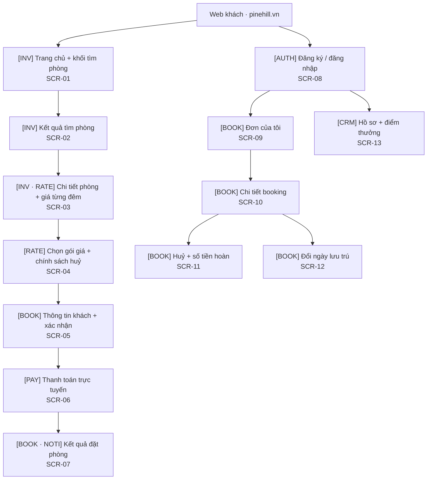
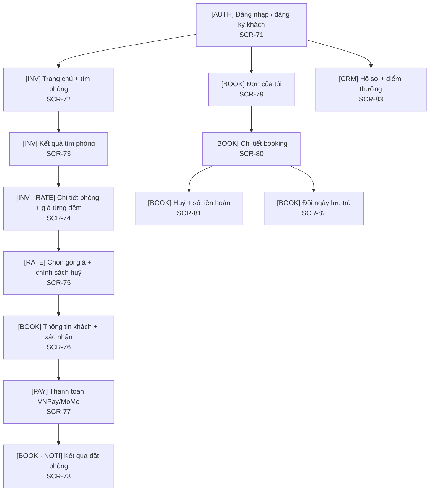
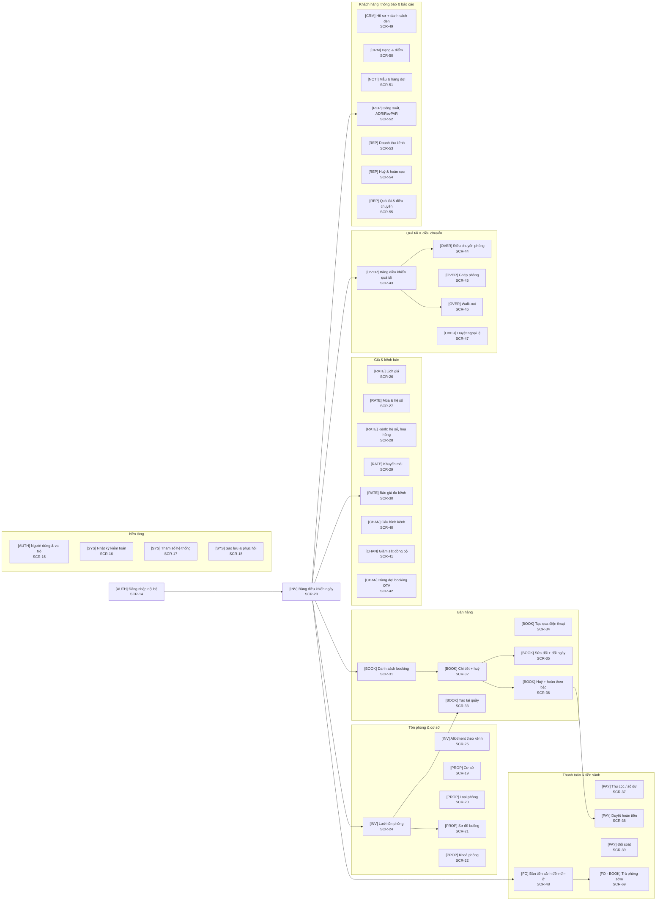
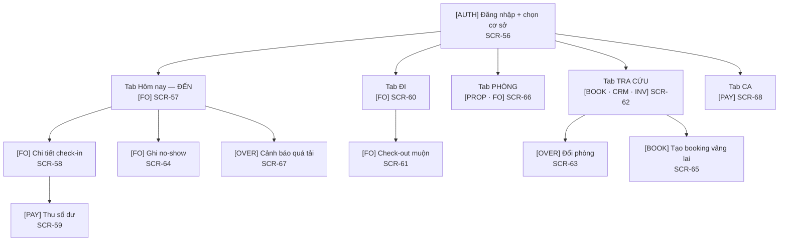
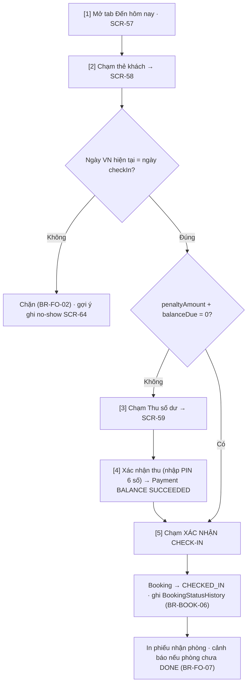
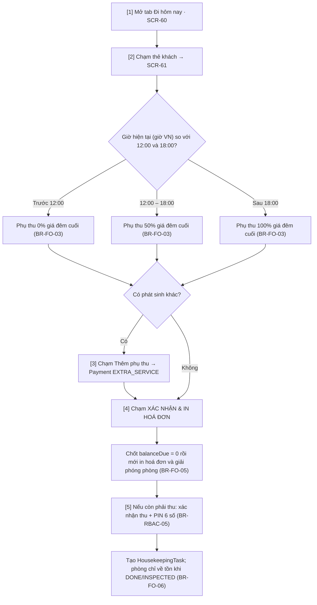
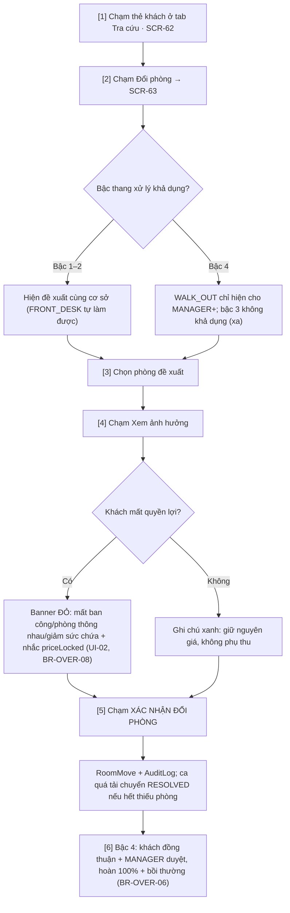
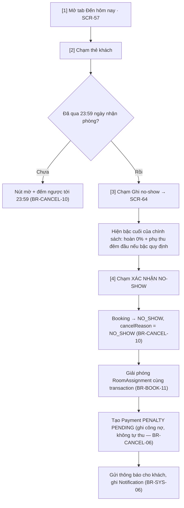

# 04 — Thiết kế màn hình

> Tài liệu chốt **cấu trúc điều hướng, danh mục màn hình, wireframe trọng yếu, luồng Android cho khách và vận hành,
> nguyên tắc giao diện, token thiết kế, trạng thái rỗng – đang tải – lỗi và yêu cầu truy cập** cho năm surface giao tiếp.
> Mọi giá trị nghiệp vụ hiển thị trên giao diện **tham chiếu mã BR**, không định nghĩa lại.

| Hạng mục | Số lượng |
|----------|----------|
| Bề mặt giao diện | 5 (customer web, customer Android, operations web, operations Android và API surface) |
| Module nghiệp vụ phủ | 13 (AUTH · PROP · INV · RATE · BOOK · PAY · CHAN · OVER · FO · CRM · NOTI · REP · SYS) |
| Use case được phủ | 52 / 52 |
| Quy tắc nghiệp vụ tham chiếu | 139 (`BR-*`, nguồn chân lý tại [02](../02-nghiep-vu/quy-tac-nghiep-vu.md)) |
| Màn hình đặc tả | 83 (SCR-01 … SCR-83) |
| Wireframe ASCII | 8 màn hình trọng yếu |
| Luồng Android | 8 (4 luồng khách + 4 luồng vận hành) |

---
## 1. Bốn frontend giao diện

| Bề mặt | Mã nền tảng | Công nghệ | Actor chính | Số màn hình | Điểm khác biệt thiết kế |
|--------|-------------|-----------|-------------|-------------|--------------------------|
| Customer Web | `WEB-GUEST` | Next.js 15 App Router, Tailwind + shadcn/ui (ADR-005) | ACT-01 | 13 | Luồng tuyến tính tìm → đặt → trả tiền; không lộ dữ liệu nội bộ |
| Customer Android | `ANDROID-GUEST` | Expo (React Native) + Expo Router, phát hành APK/EAS (ADR-006) | ACT-01 | 13 | Native flow tìm → đặt → thanh toán; secure storage, deep link callback, không lộ dữ liệu nội bộ |
| Operations Web | `WEB-OPS` | Next.js 15 App Router, Tailwind + shadcn/ui (ADR-005) | ACT-02 … ACT-06, ACT-12 | 44 | Bảng dữ liệu dày, bộ lọc, thao tác hàng loạt; mọi thao tác ghi có nhật ký |
| Operations Android | `ANDROID-OPS` | Expo (React Native) + Expo Router, phát hành APK/EAS (ADR-006) | ACT-02, ACT-04, ACT-07 | 13 | Thao tác một tay tại quầy/hiện trường; PIN 6 số cho thao tác tài chính |

Cả bốn frontend dùng chung hợp đồng REST `/api/v1`, `packages/api-client` và design token phù hợp nền tảng;
`packages/domain` chỉ chạy authoritative ở backend/worker. Cùng một đầu vào báo giá PHẢI cho cùng một kết quả trên
API và cả bốn frontend (BR-RATE-17, NFR-MAIN-04). Thời gian hiển thị theo giờ VN; tiền là số nguyên VND (BR-GEN-01…03).

---
## 2. Sơ đồ điều hướng (sitemap)
### 2.1. Web khách (`(guest)`)

### 2.2. Customer Android

Customer Android giữ cùng journey và contract với Customer Web nhưng có navigation, trạng thái offline đọc,
secure storage và deep-link payment riêng; không chia sẻ component web.

### 2.3. Operations Web (`(ops)`)

Ghi chú điều hướng: trong mỗi nhóm, màn hình liên kết theo luồng nghiệp vụ — danh sách booking → chi tiết → huỷ/đổi
ngày → duyệt hoàn tiền; bảng quá tải → điều chuyển/ghép phòng/walk-out → duyệt ngoại lệ; cấu hình kênh → giám sát
đồng bộ → hàng đợi booking OTA.
### 2.4. Operations Android (lễ tân / quản lý / buồng phòng)

### 2.5. Ma trận module × bề mặt (13 module)
| Module | Customer Web | Customer Android | Operations Web | Operations Android |
|--------|--------------|------------------|-----------------|-------------------|
| AUTH | SCR-08 | SCR-71 | SCR-14, SCR-15 | SCR-56 |
| PROP | — | — | SCR-19, SCR-20, SCR-21, SCR-22 | SCR-66 (chỉ trạng thái buồng) |
| INV | SCR-01, SCR-02, SCR-03 | SCR-72, SCR-73, SCR-74 | SCR-23, SCR-24, SCR-25 | SCR-57, SCR-62 |
| RATE | SCR-04 (chỉ xem) | SCR-75 (chỉ xem) | SCR-26 … SCR-30, SCR-70 | — |
| BOOK | SCR-05, SCR-07, SCR-09 … SCR-12 | SCR-76, SCR-78 … SCR-82 | SCR-31 … SCR-36, SCR-69 | SCR-62, SCR-65 |
| PAY | SCR-06 | SCR-77 | SCR-37, SCR-38, SCR-39 | SCR-59, SCR-68 |
| CHAN | — | — | SCR-40, SCR-41, SCR-42 | — |
| OVER | — | — | SCR-43 … SCR-47 | SCR-63, SCR-67 |
| FO | — | — | SCR-48, SCR-69 | SCR-57 … SCR-61, SCR-64, SCR-66 |
| CRM | SCR-13 | SCR-83 | SCR-49, SCR-50 | SCR-62 |
| NOTI | nhận email/SMS/Zalo | thông báo đẩy | SCR-51 | thông báo đẩy trong app |
| REP | — | — | SCR-52, SCR-53, SCR-54, SCR-55 | — |
| SYS | — | — | SCR-16, SCR-17, SCR-18 | — |

---
## 3. Danh mục màn hình (83 màn hình)
Mã `SCR-<NN>` là định danh duy nhất của màn hình, dùng trong ma trận truy vết và trong mã nguồn
(`apps/customer-web/**`, `apps/customer-android/**`, `apps/operations-web/**`, `apps/operations-android/**`). Cột **UC** chỉ liệt kê use case có thật trong
[00 §8](../00-tong-quan.md#8-danh-mục-use-case).
### 3.1. Web khách (13 màn hình)
| Mã | Màn hình | Bề mặt | Vai trò dùng | UC | Dữ liệu chính | Hành động chính |
|----|----------|--------|--------------|----|----------------|-----------------|
| SCR-01 | Trang chủ & khối tìm phòng | WEB-GUEST | ACT-01 | UC-INV-02 | Cơ sở, ngày nhận/trả, số khách, khuyến mãi nổi bật | Chọn cơ sở/ngày/số khách → tìm phòng |
| SCR-02 | Kết quả tìm phòng | WEB-GUEST | ACT-01 | UC-INV-02 | Tồn khả dụng theo loại phòng, giá từ/đêm, gói giá, sàn–trần | Lọc, sắp xếp, mở chi tiết phòng |
| SCR-03 | Chi tiết phòng & bảng giá từng đêm | WEB-GUEST | ACT-01 | UC-INV-02 | PriceQuote (nights[], hệ số mùa/tuần/công suất/LOS/kênh), sức chứa | Xem giá từng đêm, chọn gói giá |
| SCR-04 | Chọn gói giá & chính sách huỷ | WEB-GUEST | ACT-01 | UC-INV-02 | RatePlan (depositPercent, minNights, fixedNightlyPrice), CancellationPolicy (earlyCheckoutFreeHours, earlyCheckoutRefundPct) | So sánh gói, chọn gói, cảnh báo gói dài ngày không có ưu đãi (BR-RATE-19) |
| SCR-05 | Thông tin khách & xác nhận đặt | WEB-GUEST | ACT-01 | UC-BOOK-01 | Guest (SĐT +84), yêu cầu đặc biệt, mã khuyến mãi, tổng tiền | Nhập thông tin, áp khuyến mãi, tạo booking |
| SCR-06 | Thanh toán trực tuyến | WEB-GUEST | ACT-01, ACT-08 | UC-PAY-02 | Payment (DEPOSIT), depositAmount, holdExpiresAt, hiệu lực báo giá | Chọn VNPay/MoMo, xác nhận hai bước, xử lý callback lặp |
| SCR-07 | Kết quả đặt phòng & đếm ngược giữ chỗ | WEB-GUEST | ACT-01 | UC-BOOK-01, UC-BOOK-04 | Booking.code, Hold.status, holdExpiresAt, nội dung xác nhận | Xem mã, tải xác nhận, tiếp tục thanh toán |
| SCR-08 | Đăng ký / đăng nhập khách | WEB-GUEST | ACT-01 | UC-AUTH-03 | PhoneNumber chuẩn hoá, email, mật khẩu/OTP, consentMarketing | Đăng ký, đăng nhập, quên mật khẩu |
| SCR-09 | Đơn của tôi | WEB-GUEST | ACT-01 | UC-BOOK-07 | Danh sách Booking theo SĐT/mã, trạng thái, số tiền | Tra cứu, mở chi tiết |
| SCR-10 | Chi tiết booking của tôi | WEB-GUEST | ACT-01 | UC-BOOK-07 | Booking, PriceSnapshot từng đêm, Payment, RoomAssignment | Xem, tải xác nhận, mở huỷ/đổi ngày |
| SCR-11 | Huỷ đặt phòng & số tiền hoàn theo bậc | WEB-GUEST | ACT-01 | UC-BOOK-08 | CancellationTier áp dụng, hoursBeforeCheckIn, refundAmount, penaltyAmount | Xem số hoàn, chọn lý do, xác nhận huỷ |
| SCR-12 | Đổi ngày lưu trú | WEB-GUEST | ACT-01 | UC-BOOK-06 | Ngày mới, chênh lệch giá, Booking.rescheduleCount | Chọn ngày mới, xem chênh lệch, xác nhận |
| SCR-13 | Hồ sơ khách & điểm thưởng | WEB-GUEST | ACT-01 | UC-CRM-01, UC-CRM-02 | Guest, loyaltyTier, loyaltyPoints, LoyaltyTransaction, consentAt | Cập nhật hồ sơ, xem điểm/hạng, yêu cầu ẩn danh hoá |
### 3.2. Operations Web (44 màn hình)
| Mã | Màn hình | Bề mặt | Vai trò dùng | UC | Dữ liệu chính | Hành động chính |
|----|----------|--------|--------------|----|----------------|-----------------|
| SCR-14 | Đăng nhập nội bộ & chọn cơ sở | WEB-OPS | ACT-02 … ACT-06, ACT-12 | UC-AUTH-01 | User, role, propertyScope[], phiên 15 phút | Đăng nhập, chọn phạm vi cơ sở |
| SCR-15 | Người dùng, vai trò & phạm vi cơ sở | WEB-ADMIN | ACT-05, ACT-12 | UC-AUTH-02 | User, UserRole, propertyScope, failedLoginCount, lockedUntil | Tạo/sửa người dùng, gán vai trò, khoá tài khoản |
| SCR-16 | Nhật ký kiểm toán | WEB-ADMIN | ACT-05, ACT-12 | UC-SYS-01 | AuditLog (actorRole, action, beforeJson/afterJson, reason, ipAddress) | Lọc theo đối tượng/thời gian, mở chi tiết, xuất CSV |
| SCR-17 | Tham số hệ thống | WEB-ADMIN | ACT-12, ACT-05 | UC-SYS-02 | SystemSetting (deal.threshold.minor, job.hold.releaseIntervalSeconds, job.holdReconcile.intervalSeconds, …), updatedBy | Sửa tham số, xem lịch sử thay đổi |
| SCR-18 | Sao lưu & phục hồi | WEB-ADMIN | ACT-12 | UC-SYS-03 | Lịch PITR, RPO/RTO, biên bản diễn tập phục hồi | Xem trạng thái, chạy diễn tập, tải biên bản |
| SCR-19 | Cơ sở | WEB-ADMIN | ACT-05 | UC-PROP-01 | Property (checkInTime, checkOutTime, timezone, overbookLimitPct) | Thêm/sửa cơ sở, bật ngừng bán |
| SCR-20 | Loại phòng, sức chứa & sàn–trần giá | WEB-ADMIN | ACT-05, ACT-04 | UC-PROP-02 | RoomType (capacityAdults, basePrice, minPrice, maxPrice), ma trận phân bổ cơ sở × loại phòng và tổng đơn vị bán (BR-PROP-03) | Sửa ngưỡng giá, xem cảnh báo cân bằng giá |
| SCR-21 | Sơ đồ buồng & phòng vật lý | WEB-ADMIN | ACT-04, ACT-02 | UC-PROP-03 | Room (code, floor, status, connectingRoomId) | Thêm/sửa phòng, gán hai phòng thông nhau |
| SCR-22 | Khoá phòng bảo trì / ngừng bán | WEB-ADMIN | ACT-04 | UC-PROP-04 | RoomBlock (reason, startDate, endDate, createdBy) | Tạo/kết thúc khoá, xem cảnh báo chồng lấn |
| SCR-23 | Bảng điều khiển ngày | WEB-ADMIN | ACT-02, ACT-03, ACT-04 | UC-INV-01, UC-FO-01, UC-OVER-01 | Đến/đi/ở trong ngày, tồn khả dụng, ca quá tải, kênh DEGRADED | Điều hướng nhanh tới các danh sách, mở ca quá tải |
| SCR-24 | Lưới tồn phòng theo ngày | WEB-ADMIN | ACT-02, ACT-03, ACT-04 | UC-INV-01 | Tồn khả dụng theo (loại phòng, ngày), RoomBlock, RoomAssignment, Hold | Cuộn 30 ngày, mở chi tiết ô, khoá phòng, tạo booking |
| SCR-25 | Allotment theo kênh | WEB-ADMIN | ACT-05, ACT-04 | UC-INV-03 | ChannelAllotment (allotment, used) theo kênh và ngày | Sửa allotment, xem cảnh báo vượt số phòng ACTIVE |
| SCR-26 | Lịch giá & giá cơ bản | WEB-ADMIN | ACT-05 | UC-RATE-01 | RateCalendar (priority, channelCode, reason, createdBy), RateSource | Sửa giá theo ngày/loại phòng, xác nhận thay đổi lệch ±20%, cảnh báo LONGSTAY14 thiếu giá riêng (BR-RATE-19) |
| SCR-27 | Mùa & hệ số mùa | WEB-ADMIN | ACT-05 | UC-RATE-02 | Season (multiplier, priority, weekendSurchargeEnabled, createdAt) | Thêm/sửa mùa, xem mùa thắng khi chồng lấn |
| SCR-28 | Kênh bán: hệ số & hoa hồng | WEB-ADMIN | ACT-05 | UC-RATE-03 | Channel (mặc định toàn chuỗi), ChannelPropertySetting (commissionPct, multiplierOverride theo cặp kênh–cơ sở), syncStatus | Sửa hệ số/hoa hồng theo kênh và theo cơ sở, xem cảnh báo sàn hệ số (BR-RATE-18) |
| SCR-29 | Khuyến mãi | WEB-ADMIN | ACT-05, ACT-04 | UC-RATE-04 | Promotion (type, value, minNights, scope, maxUses, stackable), AMOUNT trước PERCENT | Tạo/sửa khuyến mãi, kiểm tra trần giảm 30% |
| SCR-30 | Xem trước báo giá đa kênh | WEB-ADMIN | ACT-04, ACT-05 | UC-RATE-05 | PriceQuote đối chiếu 7 kênh (so sau kẹp sàn/trần), hoa hồng, doanh thu thuần | Đổi đầu vào, so sánh 7 kênh, xuất CSV |
| SCR-70 | Gói giá & chính sách huỷ | WEB-ADMIN | ACT-05 | UC-RATE-06 | RatePlan, CancellationPolicy/tier, version, điều kiện đổi ngày, trạng thái bán; BR-RATE-20 | Tạo/sửa/ngừng bán; validate bậc; xem thay đổi trước lưu; xử lý conflict; booking cũ dùng snapshot |
| SCR-31 | Danh sách & tra cứu booking | WEB-ADMIN | ACT-02, ACT-03, ACT-04 | UC-BOOK-07 | Booking (code, channelId, status, checkIn, paidAmount, balanceDue) | Lọc nâng cao, tra theo mã/SĐT, xoá cứng DRAFT/HELD (BR-BOOK-17) |
| SCR-32 | Chi tiết booking & nút huỷ | WEB-ADMIN | ACT-02, ACT-03, ACT-04 | UC-BOOK-07, UC-BOOK-08 | Booking, PriceSnapshot (seq, kind ORIGINAL/RESCHEDULE/PARTIAL_CANCEL), Payment, RoomAssignment | Xem, huỷ (xem trước tiền hoàn), đổi ngày, huỷ một phần, đổi phòng |
| SCR-33 | Tạo booking tại quầy (khách vãng lai) | WEB-ADMIN | ACT-02 | UC-BOOK-02 | Guest vãng lai, phòng bán ngay, kênh WALKIN, tiền cọc | Nhập nhanh ≤ 5 bước, thu cọc, in xác nhận |
| SCR-34 | Tạo booking qua điện thoại | WEB-ADMIN | ACT-03 | UC-BOOK-03 | Guest tra theo SĐT, kênh PHONE, holdMinutes 1440 | Tạo, gửi xác nhận, hẹn thu cọc |
| SCR-35 | Sửa đổi booking & đổi ngày | WEB-ADMIN | ACT-02, ACT-03, ACT-04 | UC-BOOK-05, UC-BOOK-06 | Booking, chênh lệch giá, rescheduleCount, Payment RESCHEDULE_FEE (NONREF), AuditLog | Sửa thông tin, đổi ngày, thu phí đổi ngày, ghi lý do |
| SCR-36 | Huỷ booking & tính hoàn theo bậc | WEB-ADMIN | ACT-02, ACT-03, ACT-04 | UC-BOOK-08 | CancellationTier, hoursBeforeCheckIn, refundAmount, netRefund, penaltyAmount, roomCount | Xem bậc áp dụng; huỷ toàn phần hoặc một phần theo tỷ lệ giá phòng bị huỷ (BR-CANCEL-19); xác nhận hai bước |
| SCR-37 | Thu cọc / thu số dư tại quầy | WEB-ADMIN | ACT-02, ACT-03, ACT-06 | UC-PAY-01, UC-PAY-03 | Payment (DEPOSIT/BALANCE, CASH/BANK_TRANSFER), createdBy, paidAt | Ghi nhận tiền, in biên lai, xem tổng thu trong ca |
| SCR-38 | Yêu cầu & duyệt hoàn tiền hai cấp | WEB-ADMIN | ACT-04, ACT-06 | UC-PAY-04 | RefundRequest (appliedTierId, refundPercent, requestedAmount, approvedAmount, status) | Tạo yêu cầu, duyệt/từ chối, huỷ yêu cầu PENDING (BR-CANCEL-18), chi tiền |
| SCR-39 | Đối soát doanh thu, hoa hồng & công nợ | WEB-ADMIN | ACT-06 | UC-PAY-05 | Payment theo (createdBy, ngày VN) và kênh, commissionPct, chênh lệch quỹ | Đối soát, báo MANAGER khi lệch, xuất CSV |
| SCR-40 | Cấu hình kênh bán | WEB-ADMIN | ACT-05 | UC-CHAN-01 | Channel, allotment mặc định cho OTA, overbookLimitPct, trần bán vượt theo cơ sở | Bật/tắt kênh, đặt allotment; `E_OVER_LIMIT_EXCEEDED` khi vượt trần (BR-OVER-02) |
| SCR-41 | Giám sát đồng bộ kênh & outbox | WEB-ADMIN | ACT-04, ACT-05 | UC-CHAN-02 | OutboxEvent (OutboxPort), Channel.syncStatus/consecutiveSyncFailures/lastSyncError | Xem hàng đợi, đẩy lại, xử lý `E_CHAN_SYNC_FAILED` (BR-CHAN-07) |
| SCR-42 | Hàng đợi booking OTA nhận vào | WEB-ADMIN | ACT-04 | UC-CHAN-03 | Booking OTA (oversold, PaymentMethod OTA_COLLECT, channelPolicyCode) | Xem, mở OverbookingCase, đối chiếu tiền, gắn cờ nghi trùng |
| SCR-43 | Bảng điều khiển quá tải | WEB-ADMIN | ACT-04, ACT-05 | UC-OVER-01 | OverbookingCase (shortageCount, OverbookingCaseStatus, detectedAt, resolvedAt) | Xem theo hạn xử lý, mở ca, xử lý ca trễ ngày (BR-OVER-16) |
| SCR-44 | Đề xuất & thực hiện điều chuyển phòng | WEB-ADMIN | ACT-04, ACT-02 | UC-OVER-02 | RoomMove (moveType, keepScore, status PROPOSED → EXECUTED, compensationAmount, transportCost) | Chọn đề xuất, duyệt chi, thực thi, in biên bản |
| SCR-45 | Ghép phòng hai booking | WEB-ADMIN | ACT-02, ACT-04 | UC-OVER-03 | RoomMerge (consentPrimary, consentSecondary, discountPct, status), Guest.gender | Ghi đồng thuận hai bên, kiểm Guest.gender, MANAGER+ duyệt nếu khác giới |
| SCR-46 | Walk-out & bồi thường | WEB-ADMIN | ACT-04 | UC-OVER-04 | RoomMove WALK_OUT (walkOutDocNo, guestSignatureRef, staffSignatureRef), Payment COMPENSATION, hoàn 100% paidAmount + 1 đêm đầu | Xác nhận walk-out, ký biên bản, ghi bồi thường, gửi thông báo |
| SCR-47 | Duyệt ngoại lệ chính sách | WEB-ADMIN | ACT-04, ACT-05 | UC-OVER-05 | RefundRequest (isForceMajeure, reason ≥ 20 ký tự, evidenceRefs[]) | Duyệt hoàn 100%, từ chối, ghi lý do bắt buộc |
| SCR-48 | Bàn tiền sảnh: đến – đi – ở trong ngày | WEB-ADMIN | ACT-02 | UC-FO-01, UC-FO-02, UC-FO-04 | Booking hôm nay, balanceDue, HousekeepingTask, RoomAssignment | Check-in, check-out, ghi no-show, đổi phòng |
| SCR-49 | Hồ sơ khách & danh sách đen | WEB-ADMIN | ACT-02, ACT-03 | UC-CRM-01, UC-CRM-03 | Guest (gender, blacklisted, blacklistReason, consentMarketing) | Tra cứu, cập nhật, thêm/bỏ danh sách đen |
| SCR-50 | Hạng khách & điểm thưởng | WEB-ADMIN | ACT-06 | UC-CRM-02 | LoyaltyTransaction, loyaltyTier, số đêm tích luỹ 12 tháng | Xem lịch sử điểm, điều chỉnh có lý do |
| SCR-51 | Mẫu & hàng đợi thông báo | WEB-ADMIN | ACT-04 | UC-NOTI-01, UC-NOTI-02 | Notification (template, channel, status, retryCount, errorMessage) | Xem hàng đợi, gửi lại (tối đa 3 lần), xem lỗi |
| SCR-52 | Báo cáo công suất, ADR/RevPAR | WEB-ADMIN | ACT-05, ACT-04 | UC-REP-01 | OccupancySnapshot, phòng-đêm đã bán, ADR, RevPAR, công suất (định nghĩa tại BR-REP-01; DOR đếm theo giường) | Lọc theo kỳ/cơ sở, xem tử số–mẫu số từng chỉ số, xuất CSV |
| SCR-53 | Báo cáo doanh thu theo kênh | WEB-ADMIN | ACT-05, ACT-06 | UC-REP-02 | Doanh thu gộp/thuần theo 7 kênh, commissionPct, hoa hồng phải trả | Lọc kỳ, xem gộp–thuần, xuất CSV |
| SCR-54 | Báo cáo huỷ phòng & hoàn cọc | WEB-ADMIN | ACT-05, ACT-06 | UC-REP-03 | Tỷ lệ huỷ (CANCELLED ÷ tổng booking tạo trong kỳ — BR-REP-01), tổng refundAmount, tổng penaltyAmount | Lọc kỳ/gói giá, xem công thức chỉ số, xuất CSV |
| SCR-55 | Báo cáo quá tải & điều chuyển | WEB-ADMIN | ACT-04, ACT-05 | UC-REP-04 | OverbookingCase trễ ngày, RoomMove, chi phí xử lý quá tải = Σ chiết khấu ghép + Σ bồi thường + Σ đưa đón (BR-REP-01) | Lọc kỳ/cơ sở, xem chi phí xử lý, xuất CSV |
| SCR-69 | Xử lý trả phòng sớm | WEB-ADMIN | ACT-02, ACT-04 | UC-FO-02, UC-BOOK-08 | Đêm chưa ở theo PriceSnapshot, min(paidAmount, giá các đêm chưa ở) theo earlyCheckoutFreeHours/earlyCheckoutRefundPct (BR-CANCEL-09) | Xem số hoàn 50%, xác nhận trả phòng sớm, giải phóng các đêm còn lại |
### 3.3. Customer Android (13 màn hình)
| Mã | Màn hình | Bề mặt | Vai trò dùng | UC | Dữ liệu chính | Hành động chính |
|----|----------|--------|--------------|----|----------------|-----------------|
| SCR-71 | Đăng ký / đăng nhập khách | ANDROID-GUEST | ACT-01 | UC-AUTH-03 | PhoneNumber, OTP/mật khẩu, consentMarketing | Đăng nhập, đăng ký, khôi phục phiên |
| SCR-72 | Trang chủ & tìm phòng | ANDROID-GUEST | ACT-01 | UC-INV-02 | Cơ sở, ngày nhận/trả, số khách, promo | Chọn bộ lọc và tìm phòng |
| SCR-73 | Kết quả tìm phòng | ANDROID-GUEST | ACT-01 | UC-INV-02 | Availability, loại phòng, giá từ/đêm | Lọc, sắp xếp, mở chi tiết |
| SCR-74 | Chi tiết phòng & bảng giá | ANDROID-GUEST | ACT-01 | UC-INV-02 | PriceQuote.nights[], sức chứa, ảnh | Xem giá từng đêm, chọn phòng |
| SCR-75 | Gói giá & chính sách huỷ | ANDROID-GUEST | ACT-01 | UC-INV-02 | RatePlan, CancellationPolicy snapshot | So sánh và chọn gói giá |
| SCR-76 | Thông tin khách & xác nhận | ANDROID-GUEST | ACT-01 | UC-BOOK-01 | Guest, specialRequest, promo, tổng tiền | Nhập thông tin, tạo booking |
| SCR-77 | Thanh toán trực tuyến | ANDROID-GUEST | ACT-01, ACT-08 | UC-PAY-02 | Payment, holdExpiresAt, PSP redirect/deep link | Thanh toán, xử lý callback lặp |
| SCR-78 | Kết quả đặt phòng | ANDROID-GUEST | ACT-01 | UC-BOOK-01, UC-BOOK-04 | Booking.code, holdExpiresAt, notification | Xem mã, tải xác nhận, tiếp tục trả tiền |
| SCR-79 | Đơn của tôi | ANDROID-GUEST | ACT-01 | UC-BOOK-07 | Booking list, status, số tiền | Tra cứu và mở chi tiết |
| SCR-80 | Chi tiết booking | ANDROID-GUEST | ACT-01 | UC-BOOK-07 | Booking, PriceSnapshot, Payment | Xem, tải xác nhận, mở hành động |
| SCR-81 | Huỷ booking & số tiền hoàn | ANDROID-GUEST | ACT-01 | UC-BOOK-08 | CancellationTier, refundAmount, penaltyAmount | Xem trước và xác nhận huỷ |
| SCR-82 | Đổi ngày lưu trú | ANDROID-GUEST | ACT-01 | UC-BOOK-06 | Ngày mới, chênh lệch giá, rescheduleCount | Chọn ngày và xác nhận đổi |
| SCR-83 | Hồ sơ khách & điểm thưởng | ANDROID-GUEST | ACT-01 | UC-CRM-01, UC-CRM-02 | Guest, loyaltyTier, points, consentAt | Cập nhật hồ sơ, xem điểm/hạng |

### 3.4. Operations Android (13 màn hình)
| Mã | Màn hình | Bề mặt | Vai trò dùng | UC | Dữ liệu chính | Hành động chính |
|----|----------|--------|--------------|----|----------------|-----------------|
| SCR-56 | Đăng nhập & chọn cơ sở (PIN) | ANDROID-OPS | ACT-02, ACT-04, ACT-07 | UC-AUTH-01 | refresh token 7 ngày, propertyScope, PIN 6 số | Đăng nhập, mở khoá phiên bằng PIN |
| SCR-57 | Danh sách khách đến hôm nay | ANDROID-OPS | ACT-02 | UC-FO-01 | Booking đến hôm nay, depositAmount/paidAmount, RoomAssignment | Chạm thẻ khách, mở check-in, quét mã QR |
| SCR-58 | Chi tiết check-in | ANDROID-OPS | ACT-02 | UC-FO-01 | Điều kiện check-in (ngưỡng nợ BR-FO-01), phòng đã gán, giấy tờ tuỳ thân | Xác nhận check-in, ghi chú, chuyển thu số dư |
| SCR-59 | Thu số dư khi check-in | ANDROID-OPS | ACT-02 | UC-PAY-03 | balanceDue, penaltyAmount, PaymentMethod (CASH/BANK_TRANSFER/VNPAY/MOMO) | Nhập số tiền, chọn phương thức, nhập PIN, in biên lai |
| SCR-60 | Danh sách khách đi hôm nay | ANDROID-OPS | ACT-02 | UC-FO-02 | Booking CHECKED_IN trong ngày, phụ thu chưa chốt | Chạm thẻ khách, mở check-out |
| SCR-61 | Check-out muộn & phụ thu | ANDROID-OPS | ACT-02 | UC-FO-02 | Giờ hiện tại, phụ thu 0%/50%/100% giá đêm cuối, Payment EXTRA_SERVICE | Xác nhận check-out, thêm phụ thu, in hoá đơn |
| SCR-62 | Tra cứu booking & khách | ANDROID-OPS | ACT-02 | UC-BOOK-07, UC-CRM-01 | Tìm theo mã/SĐT/tên, lịch sử lưu trú, cờ blacklisted | Tra cứu, gọi khách, mở hành động nhanh |
| SCR-63 | Đổi phòng trên Android | ANDROID-OPS | ACT-02, ACT-04 | UC-OVER-02 | Đề xuất theo thang 4 bậc, keepScore, cảnh báo mất quyền lợi, priceLocked | Chọn phòng, xem ảnh hưởng, xác nhận đổi |
| SCR-64 | Ghi no-show | ANDROID-OPS | ACT-02 | UC-FO-04 | Booking CONFIRMED chưa check-in, bậc cuối chính sách, phụ thu đêm đầu | Xem số tiền bị tính, xác nhận no-show |
| SCR-65 | Tạo booking khách vãng lai | ANDROID-OPS | ACT-02 | UC-BOOK-02 | Phòng bán ngay, kênh WALKIN, tiền cọc | Tạo nhanh, thu cọc, gửi xác nhận |
| SCR-66 | Buồng phòng: danh sách việc dọn | ANDROID-OPS | ACT-07, ACT-02 | UC-FO-03 | HousekeepingTask (PENDING/IN_PROGRESS/DONE/INSPECTED), Room.status | Nhận việc, chụp ảnh, đánh dấu dọn xong |
| SCR-67 | Cảnh báo quá tải & việc gấp | ANDROID-OPS | ACT-04, ACT-02 | UC-OVER-01 | Ca quá tải theo cơ sở, hạn T−24h, hold sắp hết hạn | Mở ca, gọi khách, chuyển tiếp sang operations web |
| SCR-68 | Đối soát nhanh theo ngày | ANDROID-OPS | ACT-02, ACT-06 | UC-PAY-05 | Tiền mặt theo (người thu, ngày VN), số giao dịch, chênh lệch quỹ | Xem tổng thu theo ngày VN, báo chênh lệch, gửi MANAGER; không có khái niệm ca làm |

**Tổng: 83 màn hình** — customer web 13 · customer Android 13 · operations web 44 · operations Android 13. Cột UC chỉ chứa mã có thật trong danh
mục 53 use case; các màn hình thuần điều hướng (SCR-23, SCR-48, SCR-67) vẫn phục vụ các UC đã nêu.

---
## 4. Wireframe 8 màn hình trọng yếu
Ký hiệu: `[ … ]` là nút/bộ điều khiển, `( • )` là lựa chọn đang bật, `▾` là hộp chọn, `⌨` là ghi chú bàn phím. Mọi con
số trong wireframe là ví dụ minh hoạ; giá trị thật lấy từ BR và mã BR được ghi ngay tại chỗ.
### 4.1. Tìm phòng trên web khách — `SCR-02`
Thể hiện tồn khả dụng theo loại phòng, giá đã gồm thuế, gói giá và mốc huỷ ngay trên thẻ kết quả; bộ lọc không làm
mất ngữ cảnh ngày đã chọn (UC-INV-02, BR-INV-07, BR-RATE-15).
```text
┌────────────────────────────────────────────────────────────────────────────┐
│ PINE HILL · CS-01 Đà Lạt          Cơ sở: CS-01 Đà Lạt ▾   |   Đăng nhập ▸  │
├────────────────────────────────────────────────────────────────────────────┤
│ Nhận phòng [12/11/2026 ▾]       Trả phòng [15/11/2026 ▾]  →  3 đêm         │
│ Người lớn [2 ▾]  Trẻ em [0 ▾]  Mã KM [______] [ TÌM PHÒNG ]                │
├─ 4 lựa chọn còn phòng · 12/11/2026 → 15/11/2026 · 3 đêm · 2 người lớn ─────┤
│ [ ảnh ]       Deluxe · DLX · tối đa 3 khách · 28 m² · còn 3 phòng          │
│               Giá từ 889.000 ₫/đêm · đã gồm thuế và phí                    │
│               Gói FLEX7 · cọc 30% · huỷ ≥ 168h hoàn 100% (BR-CANCEL-02)    │
│               Kẹp giá DLX: 680.000 – 3.000.000 ₫ (BR-RATE-04)              │
│               [ Xem giá từng đêm ]   [ CHỌN ]                              │
├────────────────────────────────────────────────────────────────────────────┤
│ [ ảnh ]       Family · FAM · tối đa 4 khách · 34 m² · còn 2 phòng          │
│               Giá từ 1.448.000 ₫/đêm · đã gồm thuế và phí                  │
│               Gói SAVER3 · cọc 50% · huỷ ≥ 72h hoàn 100% (BR-CANCEL-02)    │
│               [ Xem giá từng đêm ]   [ CHỌN ]                              │
├────────────────────────────────────────────────────────────────────────────┤
│ Sắp xếp: [ Giá tăng dần ▾ ]   Lọc: [ Loại phòng ▾ ] [ Kênh: WEB ]          │
│ Báo giá còn hiệu lực 14:32 (BR-RATE-15) · giá đã gồm thuế                  │
└────────────────────────────────────────────────────────────────────────────┘
```
### 4.2. Chi tiết phòng & bảng giá từng đêm — `SCR-03`
Bảng giá bắt buộc hiển thị **từng đêm riêng biệt** kèm hệ số đã áp theo đúng thứ tự cố định BR-RATE-01; khối “vì sao là
giá này” là điều kiện để ba bề mặt cho cùng kết quả (BR-RATE-17). Hệ số công suất lấy từ `OccupancySnapshot`;
snapshot cũ hơn 5 phút ⇒ dùng 1,00 (BR-RATE-01 bước 4).
```text
┌────────────────────────────────────────────────────────────────────────────┐
│ ← Kết quả tìm phòng   Deluxe (DLX) · CS-01 Đà Lạt · 28 m² · tối đa 3 khách │
├─ BẢNG GIÁ TỪNG ĐÊM · 12/11 → 15/11/2026 · kênh WEB (BR-RATE-01) ───────────┤
│ ĐÊM        THỨ      MÙA     MÙA · TUẦN · CS · LOS      GIÁ/ĐÊM             │
│ ---------------------------------------------------------------------      │
│ 12/11/2026 Thứ Năm  SE-LOW  0,85 · 1,00 · 1,00 · 0,95  889.000 ₫           │
│ 13/11/2026 Thứ Sáu  SE-LOW  0,85 · 1,20 · 1,00 · 0,95  1.066.000 ₫         │
│ 14/11/2026 Thứ Bảy  SE-LOW  0,85 · 1,20 · 1,00 · 0,95  1.066.000 ₫         │
│ ---------------------------------------------------------------------      │
│ Tổng tạm tính (Σ giá từng đêm)              3.021.000 ₫                    │
│ Giảm giá (AMOUNT trước, PERCENT sau)        0 ₫                            │
│ TỔNG CỘNG (làm tròn XUỐNG 1.000 ₫)          3.021.000 ₫                    │
│ Cọc FLEX7 30% (làm tròn LÊN, BR-PAY-01)     907.000 ₫                      │
├─ VÌ SAO LÀ GIÁ NÀY (thứ tự hệ số cố định, BR-RATE-01) ─────────────────────┤
│ Giá cơ bản DLX 1.100.000 ₫ (BR-RATE-03) × mùa SE-LOW 0,85 (BR-RATE-05)     │
│ × cuối tuần 1,20 cho T6/T7 (BR-RATE-06) × công suất 78% → 1,00             │
│ × LOS 3 đêm → 0,95 (chỉ áp khi gói giá bật losDiscountEnabled)             │
│ × kênh WEB 1,00 (BR-RATE-07) → kẹp sàn/trần DLX 680.000–3.000.000 ₫        │
│ → làm tròn LÊN 1.000 ₫ từng đêm; cấm áp khuyến mãi trước bước này          │
├─ GÓI GIÁ ──────────────────────────────────────────────────────────────────┤
│ ( • ) FLEX7 · cọc 30% · min 1 đêm · đổi ngày ≥ 168h (BR-BOOK-12)           │
│ (   ) SAVER3 · cọc 50% · min 2 đêm · huỷ ≥ 72h hoàn 100%                   │
│ (   ) NONREF · cọc 100% · không hoàn ở mọi mốc (BR-CANCEL-07)              │
│ Báo giá hết hiệu lực sau 14:32 (BR-RATE-15) [ TIẾP TỤC ]                   │
└────────────────────────────────────────────────────────────────────────────┘
```
### 4.3. Thanh toán trực tuyến — `SCR-06`
Chỉ thu tiền cọc tại bước này, số dư thu tại quầy khi check-in (BR-PAY-02). Không hiển thị và không lưu dữ liệu thẻ
(BR-PAY-04); callback lặp khoá trả kết quả cũ với `E_PAY_CALLBACK_DUPLICATE`, không tạo `Payment` mới (BR-PAY-03).
```text
┌────────────────────────────────────────────────────────────────────────────┐
│ 1 Tìm phòng › 2 Gói giá › 3 Thông tin › [4 Thanh toán] › 5 Hoàn tất        │
├─ ĐƠN TẠM · giữ chỗ tự hết hạn sau 19:58 (BR-BOOK-07) ──────────────────────┤
│ Khách: Nguyễn Văn A · +84 90 123 4567   Mã giữ chỗ: HOLD-9F2KQ             │
│ Deluxe (DLX) · CS-01 Đà Lạt · 12/11/2026 → 15/11/2026 · 3 đêm · 2 khách    │
│ Gói giá FLEX7 · cọc 30% · huỷ ≥ 168h hoàn 100% (BR-CANCEL-02)              │
├─ CHI TIẾT TIỀN ────────────────────────────────────────────────────────────┤
│ Tổng tiền phòng (3 đêm)                           3.021.000 ₫              │
│ Cọc phải trả hôm nay — FLEX7 30% (BR-PAY-01)      907.000 ₫                │
│ Số dư thu tại quầy khi check-in (BR-PAY-02)       2.114.000 ₫              │
│ ------------------------------------------------------------               │
│ TỔNG THANH TOÁN NGAY                              907.000 ₫                │
├─ PHƯƠNG THỨC ──────────────────────────────────────────────────────────────┤
│ ( • ) VNPay        (   ) MoMo        (   ) Chuyển khoản ngân hàng          │
│ Hệ thống KHÔNG lưu số thẻ, ngày hết hạn hay CVV (BR-PAY-04).               │
│ Quá 15 phút không có callback → FAILED, giải phóng giữ chỗ (BR-PAY-05).    │
├─ CHÍNH SÁCH HUỶ ĐANG ÁP DỤNG (FLEX7, BR-CANCEL-02) ────────────────────────┤
│ ≥ 168h: hoàn 100%   ·   72–168h: hoàn 50%   ·   24–72h: 0%                 │
│ dưới 24h: 0% + phụ thu 1 đêm đầu (BR-CANCEL-06)                            │
│ Tiền hoàn tính trên số ĐÃ TRẢ, không phải tổng booking (BR-CANCEL-04).     │
│ Nút mở hộp thoại xác nhận hai bước (UI-03)    [ THANH TOÁN 907.000 ₫ ]     │
│ ⌨ Tab tới phương thức → Space chọn → Enter mở xác nhận (UI-12)             │
└────────────────────────────────────────────────────────────────────────────┘
```
### 4.4. Lưới tồn phòng back-office — `SCR-24`
Màn hình làm việc chính của lễ tân và quản lý: mỗi ô là tồn khả dụng của một loại phòng trong một đêm, kèm ký hiệu
trạng thái để không truyền đạt thông tin chỉ bằng màu (UI-06, BR-INV-01, BR-CHAN-05). Ô lưới tính theo đơn vị bán: cả
phòng (`bedNo = 0`) hoặc một giường của DOR; bất biến ép ở tầng CSDL (BR-INV-03).
```text
┌────────────────────────────────────────────────────────────────────────────┐
│ Cơ sở [ CS-01 Đà Lạt ▾ ]   Khoảng [ 13/11 → 21/11 ]   Kênh [ Tất cả ▾ ]    │
│ Lọc [ Loại phòng ▾ ] [ Trạng thái ▾ ]   Tự làm mới 60s   [ Xuất CSV ]      │
├─ TỒN KHẢ DỤNG THEO NGÀY · CS-01 Đà Lạt · 24 phòng / 34 đơn vị bán ─────────┤
│ LOẠI PHÒNG        13/11 14/11 15/11 16/11 17/11 18/11 19/11 20/11 21/11    │
│ ------------------------------------------------------------------------   │
│ Standard (STD)        4     3    2*    2*     4     6     6     5     4    │
│ Superior (SUP)        2     1    0!     1     3     4     5     4     3    │
│ Deluxe (DLX)          3     3    2*     1     4     4     5     4     3    │
│ Family (FAM)          1     1     1     1     2     2     3     2     2    │
│ Dorm (DOR) giường     6     4    2*    2*     8    10    12    10     8    │
│ ------------------------------------------------------------------------   │
│ TỔNG KHẢ DỤNG        16    12     7     7    21    26    31    25    20    │
├─ CHÚ GIẢI · ký hiệu bắt buộc có, không truyền đạt chỉ bằng màu (UI-06) ────┤
│ · trống   Đ đang ở   → đến hôm nay   ← đi hôm nay   H giữ chỗ chưa hết hạn │
│ B bảo trì/ngừng bán   D chờ dọn   ! quá tải (có OverbookingCase mở)        │
│ * khoá bán trên OTA vì tồn ≤ 2 phòng (BR-CHAN-05)                          │
├─ Ô ĐANG CHỌN ──────────────────────────────────────────────────────────────┤
│ CS01-201 · DLX · đêm 13/11/2026 · ĐANG Ở · booking PH-261112-A7K2M         │
│ Tồn chung = ACTIVE − RoomBlock − RoomAssignment − hold (chưa sinh gán)     │
│ Tồn kênh = min(tồn chung, allotment − used) · BR-INV-01 · BR-CHAN-01       │
│ [ Mở chi tiết ]  [ Khoá phòng ]  [ Tạo booking ]   ⌨ mũi tên di chuyển ô   │
└────────────────────────────────────────────────────────────────────────────┘
```
### 4.5. Chi tiết booking & nút huỷ — `SCR-32`
Khối “NẾU HUỶ BÂY GIỜ” là bắt buộc: hệ thống hiển thị số tiền hoàn và bậc áp dụng **trước** khi người dùng bấm nút
huỷ (UI-01, BR-CANCEL-04/05).
```text
┌────────────────────────────────────────────────────────────────────────────┐
│ PH-261112-A7K2M · CONFIRMED · kênh WEB    tạo 01/11/2026 09:12 (giờ VN)    │
│ Khách: Nguyễn Văn A · hạng GOLD · +84 90 123 4567 Cơ sở: CS-01 Đà Lạt      │
│ Nhận phòng 12/11/2026 14:00 → Trả phòng 15/11/2026 12:00 · 3 đêm           │
│ Phòng đã gán: CS01-201 (DLX) · gói FLEX7 · priceLocked = true (BR-OVER-08) │
├─ BẢNG GIÁ TỪNG ĐÊM · PriceSnapshot bất biến (BR-RATE-16) ──────────────────┤
│ ĐÊM        THỨ      MÙA     MÙA · TUẦN · CS · LOS      GIÁ/ĐÊM             │
│ 12/11/2026 Thứ Năm  SE-LOW  0,85 · 1,00 · 1,00 · 0,95  889.000 ₫           │
│ 13/11/2026 Thứ Sáu  SE-LOW  0,85 · 1,20 · 1,00 · 0,95  1.066.000 ₫         │
│ 14/11/2026 Thứ Bảy  SE-LOW  0,85 · 1,20 · 1,00 · 0,95  1.066.000 ₫         │
│ TỔNG CỘNG                                         3.021.000 ₫              │
│ paidAmount 907.000 ₫ · balanceDue 2.114.000 ₫ thu trước khi giao phòng     │
├─ THANH TOÁN (không sửa/xoá bản ghi gốc — BR-PAY-09) ───────────────────────┤
│ LOẠI       SỐ TIỀN        PHƯƠNG THỨC  TRẠNG THÁI   THỜI ĐIỂM              │
│ DEPOSIT    907.000 ₫      VNPAY        SUCCEEDED    01/11/2026 09:16       │
│ BALANCE*   2.114.000 ₫    —            DỰ KIẾN      thu khi check-in       │
├─ NẾU HUỶ BÂY GIỜ · bắt buộc hiển thị trước khi xác nhận (UI-01) ───────────┤
│ Bây giờ 05/11 20:00 · còn 162,0 giờ tới 14:00 12/11 (BR-CANCEL-03)         │
│ Bậc áp dụng: FLEX7 mốc 72h → hoàn 50% của paidAmount (BR-CANCEL-02)        │
│ SỐ TIỀN HOÀN DỰ KIẾN: 453.000 ₫   ·   Phụ thu đêm đầu: 0 ₫ (BR-CANCEL-06)  │
│ Sau khi huỷ KHÔNG thể hoàn tác; phòng trả về tồn ngay (BR-BOOK-11/14)      │
├─ LỊCH SỬ TRẠNG THÁI (BookingStatusHistory) ────────────────────────────────┤
│ DRAFT 01/11 09:12 › HELD 01/11 09:12 › PENDING_PAYMENT 01/11 09:15 ›       │
│ CONFIRMED 01/11 09:16 (lý do: đã đủ cọc — BR-BOOK-09)                      │
│ [ HUỶ ĐẶT PHÒNG ]  [ Đổi ngày ]  [ Đổi phòng ]  [ Thu thêm ]  [ In ]       │
└────────────────────────────────────────────────────────────────────────────┘
```
### 4.6. Huỷ & số tiền hoàn theo bậc — `SCR-36`
Màn hình huỷ hiển thị nguyên thang bậc của gói giá, khoanh bậc đang áp dụng và trình bày phép tính thành từng bước để
lễ tân giải thích được cho khách (BR-CANCEL-01/05/06/13/15/18/19); booking nhiều phòng có thêm lựa chọn huỷ một phần.
```text
┌────────────────────────────────────────────────────────────────────────────┐
│ HUỶ ĐẶT PHÒNG · PH-261112-A7K2M · gói FLEX7 · cọc 30%                      │
│ Nhận phòng 12/11/2026 14:00 (giờ VN) · bây giờ 05/11/2026 20:00            │
│ hoursBeforeCheckIn = 162,0 giờ (BR-CANCEL-03)                              │
├─ THANG MỐC CỦA GÓI FLEX7 · dữ liệu hoá, không if/else (BR-CANCEL-01) ──────┤
│ BẬC  MỐC (giờ)  HOÀN    PHỤ THU ĐÊM 1   NHÃN HIỂN THỊ                      │
│ 1    168        100%    Không           Huỷ trước ≥ 7 ngày: hoàn toàn bộ   │
│ 2    72         50%     Không           ◀ BẬC ÁP DỤNG · trước 3–7 ngày     │
│ 3    24         0%      Không           Huỷ trước 1–3 ngày                 │
│ 4    −1         0%      Có              Dưới 24 giờ: mất cọc + phụ thu     │
├─ CÁCH TÍNH (hiển thị từng bước, không chỉ con số cuối — UI-01) ────────────┤
│ paidAmount = 907.000 ₫ (cơ sở tính hoàn, BR-CANCEL-04)                     │
│ refundPercent = 50% → 907.000 × 50 / 100 = 453.500 ₫                       │
│ làm tròn XUỐNG 1.000 ₫  →  TIỀN HOÀN = 453.000 ₫ (BR-CANCEL-05)            │
│ penaltyAmount = max(0; 889.000 − 907.000) = 0 ₫ (BR-CANCEL-06)             │
│ refundFee = 0 ₫ → netRefund = 453.000 ₫; ngưỡng so trên netRefund          │
│ Tổng hoàn luỹ kế 453.000 ₫ ≤ paidAmount 907.000 ₫ (BR-CANCEL-17)           │
│ Hoàn về VNPay — đúng phương thức gốc (BR-PAY-08)                           │
│ Cam kết 3 ngày làm việc, tối đa 7 ngày (BR-CANCEL-12)                      │
├─ LÝ DO HUỶ (CancelReason) ─────────────────────────────────────────────────┤
│ Lý do [ GUEST_REQUEST ▾ ]  ·  Ghi chú [__________________]                 │
│ Bất khả kháng: FORCE_MAJEURE, lý do ≥ 20 ký tự, minh chứng                 │
│ (RefundRequest.evidenceRefs) → hoàn 100% (BR-CANCEL-13)                    │
│ Hoàn vượt ngưỡng hai cấp: người duyệt khác người tạo, từ MANAGER+          │
│ (BR-CANCEL-15); yêu cầu PENDING huỷ được có lý do (BR-CANCEL-18)           │
├─ HỘP THOẠI XÁC NHẬN HAI BƯỚC (UI-03) ──────────────────────────────────────┤
│ “Huỷ PH-261112-A7K2M? Hoàn 453.000 ₫ về VNPay. Phòng được trả              │
│  về tồn ngay. Thao tác không thể hoàn tác.”                                │
│ [ Quay lại ]                          [ ĐỒNG Ý HUỶ ]                       │
└────────────────────────────────────────────────────────────────────────────┘
```
### 4.7. Bảng điều khiển quá tải & đề xuất điều chuyển — `SCR-43`
Danh sách ca quá tải sắp theo hạn xử lý T−24h; khối đề xuất xếp khách theo `keepScore` tăng dần, ghi rõ bậc thang xử
lý, chi phí, cảnh báo giữ nguyên giá gốc; ca trễ ngày phải chuyển `ESCALATED` (BR-OVER-04/07/08/11/16).
```text
┌────────────────────────────────────────────────────────────────────────────┐
│ BẢNG ĐIỀU KHIỂN QUÁ TẢI · cập nhật 05/11/2026 20:14 (giờ VN)               │
│ 3 ca chưa xử lý   1 ca ESCALATED: quá hạn T−24h, đã leo OWNER (BR-OVER-04) │
├─ DANH SÁCH CA QUÁ TẢI (OverbookingCase) — lọc theo OverbookingCaseStatus ──┤
│ CA              NGÀY        LOẠI  THIẾU  HẠN XỬ LÝ       TRẠNG THÁI        │
│ #OVB-2611-0042  20/11/2026  DLX   2      19/11 14:00     OPEN              │
│ #OVB-2611-0043  22/11/2026  STD   1      21/11 14:00     PROPOSED          │
│ #OVB-2611-0044  25/11/2026  FAM   1      24/11 14:00     ESCALATED         │
├─ CA ĐANG CHỌN · #OVB-2611-0042 · CS-01 Đà Lạt · đêm 20/11/2026 · DLX ──────┤
│ Thiếu 2 phòng · hạn xử lý T−24h: 19/11/2026 14:00 · còn 6 giờ 12 phút      │
│ ĐỀ XUẤT THEO THANG 1 → 2 → 4 (bậc 3 xa > 15 km), keepScore TĂNG DẦN        │
│ 1) PH-261108-T9Q4 · GUEST · chưa trả · 3 đêm · keepScore 6                 │
│    → SAME_TYPE_SAME_PROPERTY · CS01-204 · chi phí 0 ₫ · giữ giá gốc        │
│ 2) PH-261110-B1X7 · MEMBER · đã đủ cọc · 2 đêm · keepScore 34              │
│    → UPGRADE_SAME_PROPERTY · CS01-305 (FAM, sức chứa ≥ 2 khách)            │
│      miễn phí nâng hạng, không thu chênh lệch (thang bậc 2)                │
│ 3) PH-260928-Q8H3 · GOLD · đã trả 100% · 4 đêm · keepScore 123             │
│    → WALK_OUT: hoàn 100% paidAmount + bồi thường 1 đêm đầu (BR-OVER-06)    │
│      bậc 3 KHÔNG khả dụng: ba cơ sở cách nhau 160–300 km (> 15 km)         │
│      cần khách đồng thuận VÀ MANAGER+ duyệt trước khi chi (BR-OVER-07)     │
│ 4) PH-260915-L6V1 · PLATINUM · đã trả 100% · 7 đêm · keepScore 144         │
│    → không điều chuyển (điểm giữ phòng cao nhất)                           │
│ Đồng điểm → createdAt giảm dần → Booking.seq tăng dần (tất định)           │
├─ GHI CHÚ BẮT BUỘC HIỂN THỊ ────────────────────────────────────────────────┤
│ Mọi RoomMove đặt priceLocked = true — khách giữ nguyên đơn giá đã chốt     │
│ (BR-OVER-08); bồi thường & đưa đón phải MANAGER+ duyệt (BR-OVER-06).       │
│ Ca quá ngày thiếu phòng chưa RESOLVED → ESCALATED (BR-OVER-16).            │
│ [ Thực hiện điều chuyển ] [ Ghép phòng ] [ Walk-out ] [ Gửi tin ]          │
└────────────────────────────────────────────────────────────────────────────┘
```
### 4.8. Danh sách khách đến hôm nay (Android) — `SCR-57`
Màn hình vào việc của lễ tân ca sáng: hành động chính nằm ở 1/3 dưới để thao tác một tay (UI-04); thẻ khách nêu ngay
tình trạng tiền để chặn check-in khi còn nợ quá ngưỡng (BR-FO-01, BR-FO-07).
```text
┌──────────────────────────────────────────┐
│ 09:41   CS-01 Đà Lạt    ca sáng          │
│ ĐẾN 6  |  ĐI 4  |  PHÒNG  |  TÌM         │
├──────────────────────────────────────────┤
│ Nguyễn Văn A                GOLD         │
│ PH-261112-A7K2M · DLX · 2 khách          │
│ Đã đủ cọc 907.000 ₫ · đến 14:00          │
├──────────────────────────────────────────┤
│ Trần Thị B                  MEMBER       │
│ PH-261112-C4D8 · SUP · 2 khách           │
│ Đã cọc 723.000 ₫ · còn nợ 723.000 ₫      │
├──────────────────────────────────────────┤
│ Lê Văn C                    GUEST        │
│ PH-261112-M1N3 · DOR · 1 giường          │
│ Chưa cọc · HELD còn 12 phút              │
├──────────────────────────────────────────┤
│ ! CS01-204 chưa dọn xong — không gán     │
│   cho khách khác cùng ngày (BR-FO-07)    │
├──────────────────────────────────────────┤
│ [  Quét mã QR  ]   [ + Khách vãng lai ]  │
│ Hôm nay   Phòng   Tra cứu   Ca           │
└──────────────────────────────────────────┘
```

---
## 5. Luồng người dùng Android cho lễ tân
Quy ước đếm chạm: một **chạm** = một lần chạm màn hình hoặc một lần bấm nút xác nhận; **không tính** thao tác gõ số
(số tiền, số điện thoại) và không tính lần nhập PIN 6 số (bắt buộc theo BR-RBAC-05, tính riêng). Vì phiên Android
dùng refresh token 7 ngày, lễ tân không phải đăng nhập lại trong ca (NFR-USE-03).
### 5.1. Check-in khách đến hôm nay (`SCR-57 → SCR-58 → SCR-59`)

- **Mục tiêu:** 3 chạm khi đã trả đủ tiền (`A, B, G`); 5 chạm khi phải thu số dư (thêm `E, F`).
- **Chặn nghiệp vụ:** nút “XÁC NHẬN CHECK-IN” mờ khi còn nợ, trừ khi nợ ≤ 5.000.000 ₫ **và** ≤ 50% `totalAmount`
  (cho phép ghi nợ có lý do); vượt cả hai ngưỡng phải `OWNER` duyệt (BR-FO-01). Sau 23:59 ngày nhận phòng, luồng
  chuyển sang ghi no-show (BR-FO-02).
### 5.2. Check-out muộn (`SCR-60 → SCR-61`)

- **Mục tiêu:** 4 chạm khi không phát sinh thu; 5 chạm khi có phụ thu và phải thu tiền.
- **Bắt buộc:** hộp thoại nêu rõ mức phụ thu theo mốc giờ trước khi xác nhận; không cho in hoá đơn khi còn nợ.
### 5.3. Đổi phòng (`SCR-62 → SCR-63`)

- **Mục tiêu:** ≤ 5 chạm và ≤ 30 giây cho bậc 1–2; 6 chạm khi phải xử lý walk-out (US-MOB-03).
- **Không được phép:** đổi phòng cho khách đang `CHECKED_IN` ngoài bất khả kháng có MANAGER duyệt (BR-OVER-09).
### 5.4. Ghi no-show (`SCR-57 → SCR-64`)

- **Mục tiêu:** 4 chạm; dialog xác nhận bắt buộc nêu số tiền bị tính trước khi người dùng đồng ý.
### 5.5. Tổng hợp chỉ tiêu chạm
| Luồng | Số chạm mục tiêu | Số chạm tối đa | Thời gian mục tiêu | Ràng buộc chặn |
|-------|------------------|----------------|--------------------|----------------|
| Check-in | 3 | 5 (khi phải thu số dư) | ≤ 60 giây | BR-FO-01, BR-FO-02, BR-BOOK-09 |
| Check-out muộn | 4 | 5 (khi có phụ thu) | ≤ 90 giây | BR-FO-03, BR-FO-05 |
| Đổi phòng | 5 | 6 (khi phải walk-out) | ≤ 30 giây (bậc 1–2) | BR-OVER-06, BR-OVER-08, BR-RBAC-03 |
| Ghi no-show | 4 | 4 | ≤ 45 giây | BR-CANCEL-10, BR-BOOK-11 |

---
## 6. Nguyên tắc thiết kế giao diện (bắt buộc)
Mỗi quy tắc dưới đây phải kiểm chứng được: chỉ ra màn hình, mã BR nguồn và cách kiểm.
| Mã | Quy tắc bắt buộc | Nguồn nghiệp vụ | Kiểm chứng |
|----|------------------|-----------------|------------|
| UI-01 | Luôn hiển thị **số tiền hoàn dự kiến và bậc áp dụng** trước khi xác nhận huỷ; cấm nút huỷ trực tiếp không có bước xem trước | BR-CANCEL-04, BR-CANCEL-05, BR-BOOK-08 | Ảnh SCR-11/SCR-36 có khối “SỐ TIỀN HOÀN DỰ KIẾN” phía trên nút xác nhận |
| UI-02 | **Cảnh báo đỏ** khi đổi phòng làm khách mất quyền lợi (mất phòng thông nhau, mất ban công, giảm sức chứa) hoặc khi khách đang `CHECKED_IN` | BR-OVER-08, BR-OVER-09 | Playwright: đổi sang phòng kém hơn ⇒ banner `color-danger` xuất hiện |
| UI-03 | **Xác nhận hai bước** cho mọi thao tác tài chính (huỷ, hoàn tiền, walk-out, thu tiền, sửa giá); trên Android bước hai nhập PIN 6 số | BR-CANCEL-15, BR-CANCEL-16, BR-RBAC-05 | Maestro: huỷ hộp thoại ⇒ không phát sinh bản ghi |
| UI-04 | **Hỗ trợ một tay trên Android**: hành động chính trong 1/3 dưới màn hình, sheet trượt từ đáy, không đặt tác vụ chính trên thanh trên cùng | NFR-USE-03, NFR-USE-05 | Đo toạ độ nút chính trong ảnh Maestro |
| UI-05 | **Vùng chạm tối thiểu 44 pt** (web) và **48 dp** (Android); khoảng cách giữa hai vùng chạm ≥ 8 pt | NFR-USE-05 | Kiểm tra tự động kích thước phần tử bằng Playwright / Maestro |
| UI-06 | **Chuẩn màu trạng thái cho lưới phòng** (§7.2) và mỗi màu phải kèm ký hiệu chữ; cấm truyền đạt trạng thái chỉ bằng màu | BR-INV-01, BR-CHAN-05 | Ảnh lưới ở chế độ thang xám vẫn phân biệt được trạng thái |
| UI-07 | Mọi lệnh ghi của UI mang `Idempotency-Key`; một ý định giữ cùng key/payload khi retry. Sửa tài nguyên gửi `If-Match` theo API; nút gửi khoá khi đang xử lý, timeout chuyển “Chưa xác định kết quả” để đối soát | BR-GEN-08, BR-RATE-20 | Replay không tạo tác dụng lần hai; version cũ 412, thiếu version 428; không tự tạo key mới khi chưa rõ kết quả |
| UI-08 | Tiền hiển thị **số nguyên VND**, phân cách nghìn bằng dấu chấm, hậu tố `₫`, dùng chữ số đều (`tabular-nums`) để so cột | BR-GEN-01, BR-GEN-03 | Ảnh bảng giá: các cột số thẳng hàng |
| UI-09 | Mọi mốc thời gian hiển thị **giờ VN** kèm nhãn `(giờ VN)`; dữ liệu lưu UTC | BR-GEN-02, NFR-LOC-02 | Đổi múi giờ máy chủ ⇒ hiển thị không đổi |
| UI-10 | Hiển thị **bậc chính sách và cách tính** (không chỉ con số cuối) cho huỷ, phụ thu, hoàn tiền | BR-CANCEL-01, BR-CANCEL-05, BR-FO-03 | Ảnh SCR-36 có dòng công thức và dòng làm tròn |
| UI-11 | Đồng hồ đếm ngược cho giữ chỗ (BR-BOOK-07), hiệu lực báo giá 15 phút (BR-RATE-15), giao dịch 15 phút (BR-PAY-05), hạn quá tải T−24h (BR-OVER-04) | BR-BOOK-07, BR-RATE-15, BR-PAY-05, BR-OVER-04 | Kiểm thử thời gian: hết hạn ⇒ đổi nhãn và khoá hành động |
| UI-12 | Bàn phím đầy đủ trên web: thứ tự Tab theo thứ tự thị giác, `Enter` gửi, `Esc` đóng hộp thoại, mũi tên di chuyển trong lưới tồn phòng | NFR-USE-05 | Playwright chạy luồng chỉ bằng bàn phím |
| UI-13 | Không bao giờ hiển thị số thẻ, ngày hết hạn hay CVV; chỉ hiện mã giao dịch, số tiền, trạng thái | BR-PAY-04, NFR-SEC-02 | Quét DOM/ảnh không có chuỗi dạng số thẻ |
| UI-14 | Che một phần PII mặc định (SĐT, số giấy tờ); nút “hiện đầy đủ” chỉ mở theo vai trò và ghi `AuditLog` | BR-SYS-05, NFR-COMP-01 | Vai trò `HOUSEKEEPING` không xem được số giấy tờ đầy đủ |
| UI-15 | Không truyền đạt thông tin chỉ bằng màu; mọi trạng thái có nhãn chữ hoặc ký hiệu | NFR-USE-05 (WCAG 2.1 AA 1.4.1) | Chụp thang xám lưới phòng và bảng trạng thái booking |
| UI-16 | Mọi lỗi nêu **trường bị lỗi, nguyên nhân, cách sửa** và mã `E_<MOD>_<TÊN>` cho người dùng nội bộ | BR-BOOK-01, BR-INV-07 | Gửi thiếu trường ⇒ thấy `E_BOOK_MISSING_FIELD` và hướng dẫn |
| UI-17 | **Không chặn**: báo giá trực tuyến khi khuyến mãi chạm sàn ⇒ bỏ mã, giữ giá gốc, ghi `PriceQuote.warnings[]`, vẫn cho xác nhận; **chặn (422)** khi quản lý áp khuyến mãi đó ở màn hình cấu hình. Ngoài ra cảnh báo lệch cân bằng giá OTA (so **sau** kẹp sàn/trần) và chênh quỹ tiền mặt | BR-RATE-09, BR-RATE-12, BR-PAY-10 | Lưu cấu hình vi phạm ⇒ 422 + `AuditLog`; báo giá ⇒ banner vàng và vẫn xác nhận được |
| UI-18 | Hành động nguy hiểm (huỷ, walk-out, xoá cứng `DRAFT`/`HELD`) đặt tách khỏi hành động thường, dùng màu `danger`, luôn ghi `AuditLog` trước khi thực thi | BR-BOOK-14, BR-BOOK-17 | Khoảng cách ≥ 24 pt tới nút “Lưu”; xoá cứng vẫn có bản ghi nhật ký |

---
## 7. Hệ thống thiết kế tối thiểu (design token)
Token dùng chung cho hai web (`packages/ui-web` / `apps/*-web`) và hai Android (`packages/ui-native` / `apps/*-android`); chỉ phát
hành chế độ sáng, tên token đặt theo **vai trò** để bổ sung chế độ tối sau mà không phải đổi tên.
### 7.1. Token màu nền tảng
| Token | Giá trị | Dùng cho | Tương phản chữ/nền |
|-------|---------|----------|--------------------|
| `color-bg` | `#F8FAFC` | nền trang | chữ `color-text` đạt 17,0:1 |
| `color-surface` | `#FFFFFF` | thẻ, bảng, hộp thoại | chữ `#111827` đạt 17,7:1 |
| `color-border` | `#E5E7EB` | đường kẻ trang trí (không dùng cho viền điều khiển) | — |
| `color-border-strong` | `#6B7280` | viền ô nhập, viền ô lưới | 4,8:1 so nền trắng (≥ 3:1) |
| `color-text` | `#111827` | chữ chính | 17,7:1 |
| `color-text-muted` | `#4B5563` | chữ phụ, nhãn bảng | 7,6:1 |
| `color-primary` | `#0F766E` | nút chính, liên kết, tiêu đề khối | 5,5:1 |
| `color-danger` | `#B91C1C` | lỗi, chênh lệch quỹ, cảnh báo mất quyền lợi | 6,5:1 |
| `color-warning` | `#B45309` | cảnh báo không chặn (UI-17) | 5,0:1 |
| `color-success` | `#15803D` | xác nhận, đã thanh toán đủ | 5,0:1 |
| `color-info` | `#1D4ED8` | ghi chú, liên kết phụ | 6,7:1 |
| `color-focus` | `#1D4ED8`, viền 2 px + offset 2 px | chỉ báo tiêu điểm bàn phím | ≥ 3:1 so mọi nền kề |
### 7.2. Chuẩn màu trạng thái cho lưới tồn phòng (UI-06)
| Trạng thái ô | Điều kiện nghiệp vụ | Nền | Chữ | Tương phản | Ký hiệu |
|--------------|---------------------|-----|-----|------------|---------|
| Trống, bán được | không có `RoomAssignment`/`RoomBlock`/`Hold` | `#ECFDF5` | `#065F46` | 7,3:1 | `·` |
| Đến hôm nay | booking `CONFIRMED` có ngày nhận phòng hôm nay | `#E0E7FF` | `#312E81` | 9,3:1 | `→` |
| Đang ở | booking `CHECKED_IN` | `#DBEAFE` | `#1E3A8A` | 8,5:1 | `Đ` |
| Đi hôm nay | booking `CHECKED_IN` có ngày trả phòng hôm nay | `#FEF3C7` | `#78350F` | 8,2:1 | `←` |
| Giữ chỗ | `HELD`, chưa hết `holdExpiresAt` (BR-BOOK-07) | `#F3E8FF` | `#4C1D95` | 9,3:1 | `H` |
| Bảo trì / ngừng bán | `RoomBlock` hoặc `Room.status = MAINTENANCE` (BR-PROP-06) | `#E5E7EB` | `#374151` | 8,3:1 | `B` |
| Chờ dọn | `HousekeepingTask` ở `PENDING`/`IN_PROGRESS` (BR-FO-06) | `#FFE4E6` | `#881337` | 8,0:1 | `D` |
| Quá tải | có `OverbookingCase` chưa `RESOLVED` (BR-OVER-03) | `#FEE2E2` | `#991B1B` | 6,8:1 | `!` |
| Khoá bán trên OTA | tồn khả dụng ≤ 2 phòng (BR-CHAN-05) | nền giữ nguyên + viền nét đứt `#6B7280` | `#374151` | 8,3:1 | `*` |
Tỷ lệ tương phản tính theo công thức độ chói tương đối của WCAG 2.1; mọi cặp nền–chữ ở trên đều ≥ 4,5:1. Ô lưới thể
hiện **đơn vị bán**: cả phòng (`bedNo = 0`) hoặc một giường cụ thể của DOR (BR-INV-03).
### 7.3. Token chữ
| Token | Web | Android | Độ đậm | Dùng cho |
|-------|-----|---------|--------|----------|
| `text-display` | 32 px / 1,25 | 30 sp | 700 | số liệu lớn ở báo cáo, tổng tiền nổi bật |
| `text-h1` | 24 px / 1,3 | 24 sp | 700 | tiêu đề màn hình |
| `text-h2` | 18 px / 1,4 | 20 sp | 600 | tiêu đề khối, nhãn nhóm lọc |
| `text-body` | 15 px / 1,5 | 16 sp | 400 | nội dung mặc định, nhãn ô nhập |
| `text-sm` | 13 px / 1,4 | 14 sp | 400 | ô bảng, phụ trợ |
| `text-caption` | 12 px / 1,35 | 12 sp | 400 | ghi chú, mã BR tham chiếu |
| `text-money` | 20 px, `tabular-nums` | 20 sp, `tabular-nums` | 600 | mọi số tiền, luôn kèm `₫` |
Cấm cỡ chữ nhỏ hơn 12 px/12 sp; số liệu tài chính không nhỏ hơn 14 px/14 sp; Android bật `allowFontScaling` và chấp
nhận thang chữ hệ thống tới 200% mà không mất nội dung.
### 7.4. Token khoảng cách, bán kính và định dạng dữ liệu
| Token | Giá trị | Dùng cho |
|-------|---------|----------|
| `space-1` … `space-2` | 4 px · 8 px | khoảng cách trong nhãn, giữa nhãn và ô nhập |
| `space-3` … `space-4` | 12 px · 16 px | đệm trong thẻ (Android 12, web 16), khe giữa các ô lưới |
| `space-6` … `space-8` | 24 px · 32 px | khoảng cách giữa các khối, lề trang |
| `space-10` … `space-12` | 40 px · 48 px | lề khối tổng tiền, vùng đệm quanh nút nguy hiểm (UI-18) |
| `radius-sm` / `radius-md` | 4 px / 8 px | ô nhập, nhãn trạng thái / thẻ, nút, ô lưới |
| `radius-lg` / `radius-full` | 12 px / 999 px | hộp thoại, bottom sheet Android / chip trạng thái |
| `touch-target` | 44 pt (web) · 48 dp (Android) | mọi phần tử tương tác (UI-05) |
Lưới tồn phòng theo lưới 8 pt: vùng tương tác tối thiểu 44 × 44 CSS px trên web và 48 × 48 dp trên Android; không dùng hàng 32 px/44 dp làm vùng chạm. Nội dung có thể gọn hơn nhưng hit target không được chồng nhau.
| Loại dữ liệu | Định dạng hiển thị | Quy tắc |
|--------------|--------------------|---------|
| Tiền | `1.222.000 ₫` | số nguyên VND, phân cách nghìn bằng dấu chấm, làm tròn theo BR-GEN-03 |
| Thời điểm | `12/11/2026 14:00 (giờ VN)` | lưu UTC, hiển thị `Asia/Ho_Chi_Minh` (BR-GEN-02, BR-GEN-05) |
| Khoảng thời gian | `3 đêm · 2 người lớn · 0 trẻ em` | tách bằng `·`; số đêm theo `StayPeriod` |
| Thời lượng còn lại | `còn 6 giờ 12 phút` · dưới 1 giờ: `còn 47 phút` | dùng cho hold, báo giá, giao dịch và hạn T−24h (UI-11) |
| Mã booking | `PH-261112-A7K2M` | sinh theo BR-GEN-06, hiển thị monospace |
| Trạng thái | `Đã xác nhận (CONFIRMED)` | nhãn tiếng Việt kèm mã enum cho người dùng nội bộ |
| Hệ số giá | `0,85 · 1,20` | hai chữ số thập phân, dấu phẩy; cùng đầu vào ⇒ cùng kết quả trên API và bốn frontend (BR-RATE-17) |

---
## 8. Trạng thái rỗng – đang tải – lỗi cho 5 màn hình chính
Bắt buộc với mọi màn hình có tải dữ liệu; 5 màn hình trọng yếu dưới đây là mức tối thiểu phải có ảnh kiểm chứng.
| Màn hình | Trạng thái rỗng | Đang tải | Lỗi | Hành động phục hồi |
|----------|-----------------|----------|-----|--------------------|
| SCR-02 Kết quả tìm phòng | “Không còn phòng cho 12/11 → 15/11” + gợi ý đổi ngày (nêu đích danh đêm gây hết phòng), gợi ý loại phòng khác cùng cơ sở | Khung xương 3 thẻ kết quả; giữ nguyên giá trị bộ lọc đã chọn | `E_INV_NO_AVAILABILITY` (409) khi hết phòng ở bất kỳ đêm nào (BR-INV-07); `E_BOOK_OVER_CAPACITY` khi số khách vượt sức chứa (BR-BOOK-04) | Nút “Đổi ngày”, “Xem cơ sở khác”, giữ bộ lọc; nút thử lại khi lỗi mạng |
| SCR-24 Lưới tồn phòng | Bộ lọc không khớp: “Không có phòng nào khớp bộ lọc” + nút “Bỏ bộ lọc”; cơ sở chưa có phòng ACTIVE: liên kết tới SCR-21 | Khung xương lưới đúng số hàng loại phòng; cột ngày hiện trước, số liệu điền sau (NFR-PERF-01) | Mất kết nối: banner “Số liệu có thể đã cũ” + mốc cập nhật cuối; khoảng xem > 30 ngày bị chặn kèm hướng dẫn chia nhỏ; `E_INV_ROOM_TAKEN` (409) khi ràng buộc loại trừ ở CSDL từ chối vì đã có người gán trùng phòng (BR-INV-03) | Nút “Tải lại”, tự làm mới 60 s; giữ vị trí cuộn và ô đang chọn |
| SCR-32 Chi tiết booking | Mã không tồn tại: “Không tìm thấy booking PH-…” + ô tra cứu lại; booking vừa bị xoá cứng (`DRAFT`/`HELD` chưa phát sinh thanh toán — BR-BOOK-14) | Khung xương phần bảng giá đêm và danh sách thanh toán | `E_BOOK_MISSING_FIELD` khi thiếu trường bắt buộc (BR-BOOK-01); ngoài phạm vi cơ sở: “Booking thuộc cơ sở ngoài phạm vi của bạn” (BR-RBAC-02) | Nút “Tra cứu lại”, “Về danh sách”; hiện mã lỗi và mã booking để đọc cho hỗ trợ |
| SCR-43 Bảng điều khiển quá tải | Chỉ hiện “Không có ca quá tải trong 30 ngày tới” khi lần quét thành công có mốc thời gian; chưa quét/lỗi không được suy là 0 ca | Giữ dữ liệu cũ kèm mốc quét và nhãn đang tải | Phân biệt lỗi tính đề xuất với kết quả không còn phương án: lỗi cho thử lại; thực sự hết bậc khả dụng mới gợi ý walk-out. Ca ESCALATED còn trong dữ liệu không bị ẩn bởi lỗi | Tính lại, mở lưới, gọi khách; execute phải kiểm lại tồn/đồng thuận/version |
| SCR-57 Danh sách đến hôm nay (Android) | “Hôm nay không có khách đến” chỉ sau tải thành công; offline có cache hiện mốc đồng bộ, không cache hiện “Chưa có dữ liệu ngoại tuyến” | Khung xương, nhãn đang tải; giữ bộ lọc | Sai PIN/lỗi nghiệp vụ giữ sheet và dữ liệu; mất mạng áp §8.3, không báo check-in thành công hoặc xếp hàng mọi thao tác vô điều kiện | Làm mới, xem queue; chỉ replay thao tác được phép, kiểm quyền/PIN/version và giữ key; conflict chuyển cần xử lý |
Nguyên tắc chung: không bao giờ để màn hình trắng không thông điệp; mọi thông điệp lỗi nêu **việc cần làm tiếp**; vùng thông
báo dùng `role="alert"` / `accessibilityLiveRegion` để trình đọc màn hình đọc được.

### 8.1. Hợp đồng trạng thái dùng chung cho mọi màn hình

| Trạng thái | Hiển thị / hành động | Điều kiện rời trạng thái |
|---|---|---|
| Loading lần đầu | Skeleton có tên vùng + aria-busy; giữ bộ lọc; không hiển thị số 0 hoặc thành công giả | Chỉ response hợp lệ của yêu cầu mới nhất được ghi UI; bỏ response tìm kiếm cũ đến muộn |
| Refresh / stale | Giữ dữ liệu, mốc “Cập nhật lúc … giờ VN”; lỗi tải lại không xoá dữ liệu cũ | Tải được version mới; hành động tài chính/tồn phải xác minh lại dữ liệu ở server |
| Empty | Phân biệt chưa có dữ liệu, không khớp bộ lọc và hết phòng; CTA tạo mới chỉ cho vai trò có quyền | Đổi bộ lọc/tạo hợp lệ; 403 hoặc lỗi mạng không chuyển empty |
| Validation 400/422 | Lỗi tại trường qua details của API + tổng lỗi đầu form, giữ nhập, focus lỗi đầu tiên; không hiện stack trace | Người dùng sửa; gửi lại là ý định mới sau khi yêu cầu trước đã bị từ chối rõ ràng |
| Auth 401 / quyền 403 | 401 mở đăng nhập/PIN phù hợp; 403 giữ thông điệp không có quyền, không lộ chi tiết đối tượng ngoài scope | Server xác nhận lại quyền; không tự replay lệnh tiền khi chưa có xác nhận người dùng |
| Conflict 409 / 412 / 428 | Hiện trạng thái/version server, giữ bản nhập và đánh dấu phần khác biệt; 428 yêu cầu tải bản hiện tại | Tải lại, xem khác biệt, xác nhận lại; không last-write-wins, không retry vô hạn |
| Quote/hold hết hạn | Khoá xác nhận, nêu hạn và giá/tồn cần tính lại; đồng hồ dùng expiresAt server | Báo giá/hold mới do server cấp và khách đồng ý giá mới; không gia hạn bằng giờ máy |
| Timeout / mất phản hồi ghi | “Chưa xác định kết quả”, mã tham chiếu, xem trạng thái/đối soát; không gọi là thất bại chắc chắn | Đọc trạng thái hoặc replay cùng key/payload theo hợp đồng; không hướng dẫn trả tiền lần hai trước đối soát |
| Success | Chỉ khi server xác nhận; cập nhật mã, trạng thái, version, thời điểm | Tải lại vẫn thấy kết quả; success PSP redirect không thay callback đã xác minh |

Mã lỗi lấy từ [API §4](api.md); UI không cấp thêm mã lỗi riêng. Cần có HTTP status, code, chi tiết trường, requestId và version theo hợp đồng. Trường nào API chưa đặc tả thì chặn DoR của trạng thái tương ứng, main phải bổ sung hợp đồng trước triển khai.

### 8.2. Các màn hình rủi ro cao và cách phục hồi

| Màn hình / nguồn | Empty & loading | Error/conflict/offline | Tiêu chí nghiệm thu |
|---|---|---|---|
| SCR-06 thanh toán; BR-PAY-11, BR-BOOK-18 | Chưa có giao dịch: CTA khởi tạo nếu hold hợp lệ; đang xử lý: mã giao dịch, số tiền và trạng thái server | Timeout hiển thị chưa rõ; callback muộn hiển thị tiền đã nhận và yêu cầu hoàn tương ứng, booking hết hạn không chuyển xác nhận; không đề nghị trả lại ngay | TC-BOOK-28, TC-PAY-22; polling có điểm dừng, người dùng quay lại vẫn đọc được kết quả |
| SCR-11/36/69 huỷ/huỷ phần/trả sớm | Đang tính giữ lựa chọn nhưng khoá xác nhận; không còn phần được huỷ nêu rõ lý do | Hiển thị policy snapshot, cơ sở hoàn, khoản đã hoàn/đang giữ, phí và netRefund; qua mốc thời gian/version phải tính lại và xác nhận số mới; offline chỉ nháp | TC-BOOK-27; không huỷ phần phòng hai lần, không hoàn trên tổng chưa thu |
| SCR-38 duyệt/chi hoàn | Chưa có yêu cầu khác với bộ lọc rỗng; tải tiền và quyền trước mở nút duyệt | Người tạo không tự duyệt; timeout chi là đang xác minh, giữ một khoá chi, không hiện nút “Chi lại” tạo lệnh mới; nhiều phương thức hiển thị từng khoản gốc và tổng sự kiện | TC-PAY-23; PAID chỉ sau bằng chứng thành công |
| SCR-35/44/45/63 đổi ngày/đổi phòng/ghép | Chưa có phương án khác với tính phương án lỗi; giữ phòng nguồn hiển thị | Phòng đích bị lấy: tải đề xuất mới, nguồn giữ nguyên; đồng thuận hai bên và duyệt ngoại lệ kiểm lại tại execute; offline không xác nhận giao phòng | TC-BOOK-27, TC-OVER-18; không đánh RESOLVED từ thao tác cục bộ |
| SCR-70 cấu hình gói/policy; UC-RATE-06 | Chưa có gói: OWNER có CTA tạo; tải gói và toàn bộ tier trước sửa | Lỗi tier hiện tại hàng và tổng lỗi; policy thiếu catch-all/trùng mốc bị chặn; 412 giữ bản nhập so với bản mới; ngừng bán có xác nhận, ghi rõ chỉ ảnh hưởng booking mới | TC-RATE-27, TC-SYS-11; snapshot booking cũ không đổi, OWNER mới ghi được |

### 8.3. Ngoại tuyến và hàng đợi Android

Trạng thái queue là **trạng thái giao diện cục bộ**, không thêm vào enum Booking/Payment: `Bản nháp → Chờ đồng bộ → Đang gửi → Đã xác nhận` hoặc `Cần xử lý`. Sau khởi động lại, lệnh đang gửi phải đối soát vì có thể đã commit; không tự chuyển về bản nháp rồi gửi bằng key mới.

- Cache chỉ đọc ghi rõ cơ sở, chủ phiên, mốc đồng bộ; logout/chuyển tài khoản/thu hồi scope không được để lộ PII từ cache cũ. Lưu trữ nhạy cảm, TTL và thao tác được queue phải có quyết định OPEN-02 trong [sổ rủi ro](../05-ke-hoach/quan-ly-rui-ro.md).
- Mặc định thiết kế an toàn khi OPEN-02 chưa chốt: cho nhập nháp, không coi thu/hoàn tiền, xác nhận booking, giao/đổi phòng hay đồng thuận là đã thực hiện khi offline. Chỉ bật tự đồng bộ các thao tác đã được duyệt; server luôn kiểm lại quyền, PIN, trạng thái, version và tồn.
- Mỗi lệnh giữ key, payload bất biến, version đã đọc và mã tham chiếu; không lưu PIN/pinToken để phát lại tự động. Khi cần xác thực lại, dừng ở “Cần xử lý”. Không đổi payload dưới cùng key.
- Lệnh quá cửa sổ idempotency 24 giờ phải tra kết quả trước quyết định gửi ý định mới. Conflict hiển thị dữ liệu mới + bản nháp; người dùng xác nhận lại. Huỷ bản nháp chỉ xoá cục bộ trước khi gửi; khi đã gửi không được hứa “đã huỷ giao dịch”.

Kiểm chứng bằng TC-FO-08 và TC-AUTH-10, gồm restart app, mất mạng trước/sau commit, thay quyền và version trong lúc offline. Hành vi chưa có API để đối soát phải ghi BLOCKED, không mô tả như tính năng đã có.

### 8.4. Bố cục và điều hướng SCR-70

Back-office → Giá → **Gói giá & chính sách huỷ** (bổ sung cùng nhóm SCR-26…30 trong sitemap). Danh sách bên trái: mã/tên/trạng thái; form chính: điều kiện số đêm, cọc, điều kiện/phí đổi ngày, chính sách và bảng tier; phần xem trước: ví dụ hoàn ở các mốc biên và ghi chú phạm vi hiệu lực. Chân form có “Xem thay đổi”, “Lưu”, “Ngừng bán”; hành động chỉ cho OWNER. Tạo mới dùng hợp đồng create của API; nếu chưa được đặc tả thì chặn phần tạo, không tự suy rằng PUT cập nhật là upsert.

Trước lưu hiển thị diff, version và lý do; validate theo BR-RATE-20. Không cho xoá cấu hình đang được tham chiếu. Sau lưu đọc lại phiên bản, ghi rõ báo giá mới dùng cấu hình mới, booking cũ dùng snapshot đã chốt. Ca kiểm: TC-RATE-27 và TC-SYS-11.

---
## 9. Khả năng truy cập (WCAG 2.1 AA)
### 9.1. Tương phản
| Hạng mục | Ngưỡng bắt buộc | Ghi chú kiểm chứng |
|----------|-----------------|--------------------|
| Chữ thường (< 18,66 px hoặc < 24 px không đậm) | ≥ 4,5:1 | Giá trị §7 là thiết kế dự kiến; cần kết quả đo trên bản render thật, cả hover/disabled/error/focus |
| Chữ lớn (≥ 24 px, hoặc ≥ 18,66 px đậm) | ≥ 3:1 | `text-h1`, `text-display` |
| Thành phần điều khiển và ranh giới | ≥ 3:1 so với nền kề | Dùng `color-border-strong`, không dùng `color-border` cho viền ô nhập |
| Chỉ báo tiêu điểm bàn phím | ≥ 3:1 | `color-focus` 2 px + offset 2 px; không bao giờ `outline: none` |
| Thông tin không chỉ bằng màu | Bắt buộc có nhãn/ký hiệu | Lưới phòng (§7.2) và chip trạng thái booking đều có chữ |
### 9.2. Kích thước chữ và phóng to
| Quy tắc | Giá trị |
|---------|---------|
| Cỡ chữ nhỏ nhất | 12 px (web) / 12 sp (Android); không dùng cho số tiền |
| Số tiền, số liệu tài chính | ≥ 14 px / 14 sp, dùng chữ số đều để so cột |
| Phóng to trình duyệt tới 200% | Không mất nội dung, không phát sinh cuộn ngang (NFR-USE-04/05) |
| Android | Tôn trọng thang chữ hệ thống tới 200%; `allowFontScaling = true`, không khoá `maxFontSizeMultiplier` dưới 2 |
| Chiều rộng / chuyển động | Web ≥ 360 px; tôn trọng `prefers-reduced-motion`; không nhấp nháy quá 3 lần/giây |
### 9.3. Điều hướng bàn phím (web) và thao tác một tay (Android)
- Thứ tự `Tab` theo thứ tự thị giác; có liên kết “Bỏ qua tới nội dung chính” ở đầu trang back-office.
- Mọi hành động kích hoạt được bằng `Enter`/`Space`; `Esc` đóng hộp thoại và trả tiêu điểm về nút đã mở.
- Lưới tồn phòng dùng vai trò lưới: mũi tên di chuyển giữa các ô, `Home`/`End` về đầu/cuối hàng, `Enter` mở chi tiết ô.
- Hộp thoại giữ tiêu điểm bên trong và trả tiêu điểm về vị trí cũ khi đóng.
- Android: vùng chạm ≥ 48 dp, hành động chính ở 1/3 dưới màn hình (UI-04); không dùng cử chỉ đa ngón cho thao tác nghiệp vụ.
### 9.4. Nhãn cho trình đọc màn hình
| Đối tượng | Yêu cầu |
|-----------|---------|
| Trường nhập | Luôn có `<label>` hiển thị, không thay bằng placeholder; lỗi nối bằng `aria-describedby` |
| Nút chỉ có biểu tượng | Bắt buộc `aria-label` (web) / `accessibilityLabel` (Android), ví dụ “Làm mới lưới tồn phòng” |
| Số tiền | Đọc dạng lời: nhãn “ba triệu không trăm hai mươi mốt nghìn đồng” cho `3.021.000 ₫` |
| Ô lưới tồn phòng | Nhãn đầy đủ: “CS01-201, Thứ Sáu 13/11/2026, đang ở, booking PH-261112-A7K2M” |
| Vùng thay đổi động | Tổng tiền/số hoàn dùng aria-live polite; đếm ngược chỉ thông báo tại mốc cần hành động và lúc hết hạn, không đọc mỗi giây; lỗi chặn dùng role alert |
| Thông báo lỗi và ngôn ngữ | Nêu trường, nguyên nhân, cách sửa, mã lỗi nội bộ (UI-16); `lang="vi"` trên web, locale tiếng Việt trên Android |
Kiểm chứng: `axe-core` trong Playwright cho web (0 lỗi mức `serious`/`critical`), TalkBack cho Android, và một lượt chạy
luồng check-in chỉ bằng bàn phím/trình đọc màn hình trước khi phát hành.

Evidence TC-SYS-10 cần ghi build, viewport/font scale, trình duyệt/thiết bị, công cụ đọc màn hình, người chạy, lỗi và video/trace. Axe không chứng minh toàn bộ WCAG; kiểm thủ công focus sau validation/conflict, hộp thoại đóng trả focus, bảng có header, toast không phải nơi duy nhất giữ lỗi. Zoom/reflow áp cả màn cấu hình tier và số tiền dài; lưới hai chiều có thể cuộn trong vùng có nhãn và có chế độ danh sách tương đương. Chưa có báo cáo đo thì chưa tuyên bố đạt accessibility.

---
## 10. Đề xuất bổ sung
Các định danh **chưa có** trong [00 §6](../00-tong-quan.md#6-quy-ước-định-danh), đề nghị bổ sung vào xương sống khi chủ đầu tư
chấp thuận; tài liệu này dùng chúng như định danh cục bộ của tầng giao diện:
| Đề xuất | Nội dung | Phạm vi ảnh hưởng |
|---------|----------|-------------------|
| `SCR-<nn>` | Mã màn hình, duy nhất theo bảng §3 (SCR-01 … SCR-69) | Ma trận truy vết 06, kịch bản kiểm thử Playwright/Maestro, đặt tên tuyến Next.js/Expo Router |
| `UI-<nn>` | Mã nguyên tắc giao diện bắt buộc (§6) | Tiêu chí chấp nhận của US-* liên quan, danh sách kiểm review UI |
| `color-*`, `text-*`, `space-*`, `radius-*`, `touch-target` | Tên token thiết kế (§7) — không phải mã nghiệp vụ | `packages/ui-web`, `packages/ui-native`, `apps/*` |
Không đề xuất thêm mã `BR-*`, `UC-*`, `FR-*` hay `NFR-*` nào: mọi quy tắc hiển thị trong tài liệu này đều đã có nguồn
tương ứng trong xương sống (139 BR · 53 UC · 40 NFR).

## Tham chiếu
- [00 — Tổng quan dự án](../00-tong-quan.md) — actor, quy ước định danh, từ điển thực thể, enum, danh mục use case, stack
- [01 — Yêu cầu chức năng](../01-yeu-cau/yeu-cau-chuc-nang.md) và [yêu cầu phi chức năng](../01-yeu-cau/yeu-cau-phi-chuc-nang.md) (40 NFR, 8 nhóm)
- [01 — Mô hình use case](../01-yeu-cau/mo-hinh-use-case.md) — đặc tả UC dùng ở cột UC của §3
- [02 — Quy tắc nghiệp vụ](../02-nghiep-vu/quy-tac-nghiep-vu.md) — nguồn chân lý của mọi mã BR tham chiếu trong tài liệu này
- [02 — Chính sách huỷ & hoàn cọc](../02-nghiep-vu/chinh-sach-huy-hoan-coc.md) · [02 — Động giá](../02-nghiep-vu/dong-gia.md) · [02 — Quá tải, ghép & đổi phòng](../02-nghiep-vu/qua-tai-ghep-doi-phong.md)
- [03 — Mô hình miền](../03-phan-tich/mo-hinh-mien.md) · [03 — Mô hình động](../03-phan-tich/mo-hinh-dong.md)
- [04 — Kiến trúc](kien-truc.md) · [04 — Thiết kế lớp](thiet-ke-lop.md) · [04 — Sequence Diagram](sequence-diagram.md)
- [04 — Cơ sở dữ liệu](csdl.md) · [04 — API](api.md) · [04 — ADR](adr/)
- [05 — Lộ trình](../05-ke-hoach/lo-trinh.md) · [05 — Kế hoạch Sprint](../05-ke-hoach/ke-hoach-sprint.md) · [05 — Kế hoạch kiểm thử](../05-ke-hoach/ke-hoach-kiem-thu.md)
- [06 — Ma trận truy vết](../06-truy-vet/ma-tran-truy-vet.md) — nơi SCR-* và UI-* được đối chiếu BR → UC → API → Test
