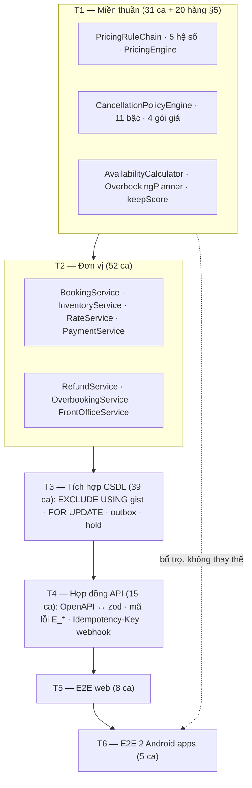
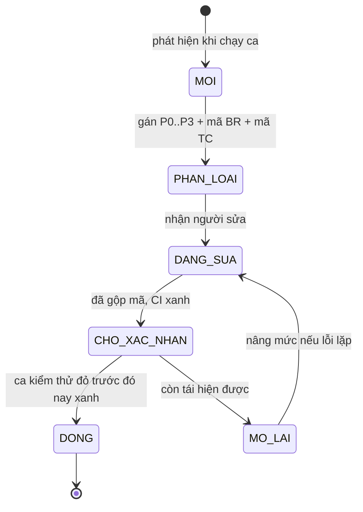

# 05 — Kế hoạch kiểm thử

> Tài liệu này trả lời một câu hỏi duy nhất: **làm sao chứng minh được ba bài toán trọng tâm BT-1/2/3 hoạt động đúng trên mã chạy thật**, chứ không chỉ đúng trên giấy.
> Nguồn chân lý nghiệp vụ: [02/quy-tac-nghiep-vu](../02-nghiep-vu/quy-tac-nghiep-vu.md). Mọi ca kiểm thử ở đây **tham chiếu mã BR**, không định nghĩa lại giá trị.
> **Trạng thái: đặc tả kiểm thử, chưa có báo cáo thực thi đính kèm.** Mọi kết quả mong đợi là oracle cần kiểm chứng; không phải tuyên bố test đã pass. Ca chưa chạy ghi `NOT_RUN`, ca thiếu quyết định/hợp đồng ghi `BLOCKED`, theo evidence ở [quy tắc kỹ thuật §9.3](quy-tac-ky-thuat.md).
> Mã ca kiểm thử dùng quy ước `TC-<MOD>-<nn>` ([00 §6](../00-tong-quan.md#6-quy-ước-định-danh)): các dải `TC-AUTH/PROP/INV/RATE/BOOK/PAY/CHAN/OVER/FO/CRM/NOTI/REP/SYS-*` được **định nghĩa trong tài liệu này**, còn dải `TC-CANCEL-01…55` do chuyên đề [02/chính sách huỷ & hoàn cọc](../02-nghiep-vu/chinh-sach-huy-hoan-coc.md) cấp và tài liệu này chỉ tham chiếu.

---

## 1. Mục tiêu, phạm vi & nguyên tắc

### 1.1. Mục tiêu đo được

Kế hoạch kiểm thử tồn tại để chứng minh 7 tiêu chí thành công ở [00 §12](../00-tong-quan.md#12-tiêu-chí-thành-công-của-dự-án). Bảng dưới nối mỗi tiêu chí với cách kiểm chứng cụ thể trong tài liệu này.

| # | Tiêu chí thành công ([00 §12](../00-tong-quan.md#12-tiêu-chí-thành-công-của-dự-án)) | Cách kiểm chứng trong tài liệu này | Tầng chủ trì |
|---|------------------------------------------------|------------------------------------|--------------|
| 1 | Không bán trùng phòng cùng đêm | §4.3 `TC-INV-01…04`, §6 bất biến **BB-01**, §7 kịch bản giành phòng cuối | T3 + T1 |
| 2 | 100% ca bảng quyết định huỷ/hoàn đạt | §5 — 20 hàng trích từ bảng quyết định của [02/chính sách huỷ](../02-nghiep-vu/chinh-sach-huy-hoan-coc.md), chạy tham số hoá | T1 |
| 3 | Giá khớp trên 4 frontend, API và quầy | `TC-RATE-21` (đối chiếu 5 nguồn), `TC-BOOK-16` | T5 + T6 |
| 4 | Quá tải phát hiện trước T−24h | `TC-OVER-01…03` trên đồng hồ giả lập | T2 + T3 |
| 5 | Lễ tân xử lý khách vãng lai < 3 phút | `TC-FO-06` + [NFR-USE-05](../01-yeu-cau/yeu-cau-phi-chuc-nang.md) đo trên bản dựng thử | T5 + T6 |
| 6 | Ban giám đốc tự xem báo cáo doanh thu kênh | `TC-REP-02`, `TC-REP-03`, kịch bản **C** của UAT (§9) | T5 |
| 7 | Truy vết đầy đủ BR → UC → TC | §12 (bảng tổng hợp độ phủ theo module) + [06/ma trận truy vết](../06-truy-vet/ma-tran-truy-vet.md) | T1…T6 |

Ngoài ra kế hoạch phải thỏa các ngưỡng phi chức năng đã chốt: [NFR-PERF-01…05](../01-yeu-cau/yeu-cau-phi-chuc-nang.md), [NFR-REL-01/02/06](../01-yeu-cau/yeu-cau-phi-chuc-nang.md), [NFR-MAIN-01/03/04](../01-yeu-cau/yeu-cau-phi-chuc-nang.md), [NFR-SEC-01…06](../01-yeu-cau/yeu-cau-phi-chuc-nang.md).

### 1.2. Trong phạm vi

| # | Hạng mục | Ghi chú |
|---|----------|---------|
| 1 | `packages/domain` — 5 lớp lõi (`PricingEngine`, `CancellationPolicyEngine`, `AvailabilityCalculator`, `OverbookingPlanner`, value object) | Hàm thuần, kiểm thử được không cần CSDL |
| 2 | 12 dịch vụ ứng dụng + 8 lớp ca sử dụng | Xem [04/kiến trúc](../04-thiet-ke/kien-truc.md) |
| 3 | Ràng buộc dữ liệu chống trùng **theo đơn vị bán** (phòng hoặc giường), transaction, khoá bi quan, outbox | Tầng CSDL, không thể bù bằng tầng trên |
| 4 | Hợp đồng REST `/api/v1`, mã lỗi `E_<MOD>_<TÊN>`, idempotency, webhook OTA/PSP | [04/api](../04-thiet-ke/api.md) |
| 5 | Customer/operations web (Next.js), customer/operations Android (Expo) | Chỉ trên các luồng nghiệp vụ trọng yếu, không kiểm thử diện rộng |
| 6 | Bộ mô phỏng OTA và cổng thanh toán sandbox | Thay cho tích hợp thật ([00 §3.2](../00-tong-quan.md#3-phạm-vi)) |
| 8 | Tải 200 người dùng đồng thời (3 kịch bản), bảo mật 10 ca, UAT 3 kịch bản | §7, §8, §9 |

### 1.3. Ngoài phạm vi (và lý do)

| # | Không kiểm thử | Lý do |
|---|----------------|-------|
| 1 | Tích hợp thật Booking.com / Agoda / Airbnb | Không có quyền truy cập đối tác; chỉ kiểm chứng hành vi qua adapter + bộ mô phỏng |
| 2 | Cổng thanh toán thật (tiền thật) | Chỉ dùng sandbox VNPay/MoMo ([ADR-009](../04-thiet-ke/kien-truc.md)) |
| 3 | Ứng dụng iOS | Ngoài phạm vi ([00 §3.2](../00-tong-quan.md#3-phạm-vi)) |
| 4 | Pen-test chuyên sâu, quét lỗ hổng hạ tầng, DDoS | Ngoài ngân sách môn học; chỉ giữ 10 ca bảo mật ứng dụng (§8) |
| 5 | Tải > 200 người dùng đồng thời, kiểm thử ngâm (soak) > 2 giờ | Quy mô thật của chuỗi 55 phòng không cần |
| 6 | Ma trận thiết bị Android rộng | Chỉ 3 cấu hình đại diện ở §10.4 |
| 7 | Chuyển đổi dữ liệu từ sổ/Excel hiện tại | Hệ thống khởi tạo dữ liệu mới |
| 8 | Kế toán tổng hợp, hoá đơn điện tử, F&B | Ngoài biên hệ thống ([00 §3.2](../00-tong-quan.md#3-phạm-vi)) |

### 1.4. Nguyên tắc chỉ đạo

| # | Nguyên tắc | Hệ quả thực tế |
|---|-----------|----------------|
| 1 | **Kiểm thử giá và chính sách huỷ ở tầng miền thuần trước.** | `PricingEngine`/`CancellationPolicyEngine` phải xanh trước khi có API; đây là điều kiện của [NFR-MAIN-01](../01-yeu-cau/yeu-cau-phi-chuc-nang.md) |
| 2 | **Bất biến quan trọng kiểm bằng sinh dữ liệu ngẫu nhiên, không chỉ bằng ví dụ.** | 8 bất biến ở §6 chạy ≥ 10.000 lượt mỗi lần trong CI |
| 3 | **Bất biến chống bán trùng phải kiểm ở tầng CSDL, không chỉ ở API.** | `TC-INV-01…03` chạy trên PostgreSQL thật qua Testcontainers, có ca bắn song song |
| 4 | **Không tầng nào được bù cho tầng khác.** | Ca E2E không thay ca miền; ca miền không thay ca ràng buộc CSDL |
| 5 | **Mỗi ca kiểm thử phải trỏ tới BR hoặc NFR có thật.** | Ca chức năng cần BR; ca accessibility, hợp đồng, quan sát hoặc truy vết có thể trỏ NFR. Thiếu nguồn phải review trước khi loại bỏ, không xoá ca NFR chỉ vì thiếu BR |
| 6 | **Kiểm thử là điều kiện của Definition of Done, không phải việc làm sau sprint.** | Xem [05/quy-tac-ky-thuat](quy-tac-ky-thuat.md) §6 |
| 7 | **Dữ liệu kiểm thử là dữ liệu giả hoàn toàn.** | Không dùng dữ liệu khách thật, không sao chép production (§10.3) |
| 8 | **Kết quả kiểm thử gắn với mốc bàn giao.** | Cổng QG-3 ở [lo-trinh §6](lo-trinh.md#6-cổng-chất-lượng-quality-gate) không xanh thì không sang sprint sau |

---

## 2. Chiến lược kiểm thử — tháp 6 tầng

### 2.1. Sáu tầng và tỷ lệ ca mục tiêu

Tháp dưới đây **đảo chiều so với kích thước mã nguồn**: nhiều ca nhất nằm ở tầng miền thuần vì đó là nơi tập trung rủi ro nghiệp vụ (BT-1, BT-2), còn tầng E2E chỉ giữ số ca đủ để chứng minh luồng xuyên hệ thống.

| Tầng | Tên tầng | Phạm vi kiểm thử | Công cụ | Tỷ lệ ca mục tiêu | Số ca | Chủ trì | Chạy khi nào |
|------|----------|------------------|---------|-------------------|-------|---------|--------------|
| **T1** | Miền thuần (pure domain) | `PricingEngine`, `CancellationPolicyEngine`, `AvailabilityCalculator`, `OverbookingPlanner`, `Money`/`StayPeriod`/`DateRange`, `keepScore` | Vitest + **fast-check** | **≈ 30 %** | 31 (+20 hàng §5) | Kiến trúc sư | Mỗi commit (CI, < 60 giây) |
| **T2** | Đơn vị (unit) | 12 dịch vụ ứng dụng + 8 lớp ca sử dụng, cổng ra thay bằng test double | Vitest + `@nestjs/testing` | ≈ 30 % | 52 | Backend | Mỗi commit (CI) |
| **T3** | Tích hợp CSDL & hạ tầng | Ràng buộc loại trừ `EXCLUDE USING gist`, khoá bi quan `FOR UPDATE`, transaction đa bảng, outbox, hàng đợi hold, Redis, sao lưu | Vitest + **Testcontainers** (Postgres 16 + Redis 7) + Supertest + **k6** (ca tải) | ≈ 23 % | 39 | QA/DevOps + Kiến trúc sư | Mỗi PR + nightly |
| **T4** | Hợp đồng API | OpenAPI 3.1 ↔ zod, mã lỗi `E_<MOD>_<TÊN>`, `Idempotency-Key`, webhook, phân trang | Supertest + zod + kiểm tra OpenAPI | ≈ 9 % | 15 | Backend | Mỗi PR |
| **T5** | Đầu-cuối web | Customer web (tìm phòng → đặt → thanh toán → tra cứu) và operations web (giá, huỷ, duyệt hoàn, báo cáo) | **Playwright** (Chromium + WebKit) | ≈ 5 % | 8 | Web frontend + QA | Nightly + trước mốc |
| **T6** | Đầu-cuối Android | Customer Android (tìm/đặt/thanh toán/tra cứu) và operations Android (check-in/out, PIN, đổi phòng, no-show, buồng phòng, offline) | **Maestro** trên Expo/Android | ≈ 3 % | 5 | Mobile + QA | Nightly + trước mốc |
| | **Tổng** | | | **100 %** | **170** | | |

> Cột "Số ca" đếm **đúng** các ca liệt kê trong tài liệu này: 150 ca do tài liệu này cấp mã (bảng ở §4, §6, §7, §8) **cộng** 20 hàng bảng quyết định ở §5 do [02/chính sách huỷ](../02-nghiep-vu/chinh-sach-huy-hoan-coc.md) cấp mã. Ca đơn vị viết thêm trong lúc lập trình chỉ được tính là đóng góp khi truy được về một mã BR hoặc một bất biến ở §6. Ngoài ra tài liệu này tự đặt ngân sách riêng cho tầng đầu-cuối — Playwright ≤ 15 phút, Maestro ≤ 10 phút, chạy nightly — chặt hơn ngưỡng chung ở [NFR-MAIN-03](../01-yeu-cau/yeu-cau-phi-chuc-nang.md); đây là **chỉ tiêu nội bộ của kế hoạch kiểm thử**, không phải mã NFR mới.

### 2.2. Vì sao phân bổ như vậy



| Quyết định phân bổ | Lý do |
|--------------------|-------|
| T1 và T2 chiếm ≈ 60 % số ca | BT-1 và BT-2 là **hàm thuần theo đầu vào**: mọi tổ hợp mùa × kênh × LOS × mốc huỷ kiểm được trong mili-giây, không cần CSDL. T2 lớn vì 12 dịch vụ + 8 lớp ca sử dụng đều có ca điều phối riêng |
| T3 cao hơn tháp cổ điển (≈ 23 %) | Hệ thống có **hai bất biến chỉ ép được ở tầng CSDL** (BB-01, BB-07), cộng transaction đa bảng, outbox và job nền — giảm ca ở đây là tự bỏ khả năng chứng minh BT-3 |
| T3 nhỏ về số ca nhưng là **cổng chặn cứng** | Ràng buộc `EXCLUDE` và khoá bi quan không thể chứng minh bằng hàm thuần; [NFR-REL-01](../01-yeu-cau/yeu-cau-phi-chuc-nang.md) yêu cầu 0 vụ bán trùng dưới 200 yêu cầu đồng thời |
| T4 giữ 10 ca | Hợp đồng API là nơi chốt `E_*`, idempotency và webhook — thứ mà web/mobile đều phụ thuộc ([NFR-MAIN-04](../01-yeu-cau/yeu-cau-phi-chuc-nang.md)) |
| T5/T6 giữ 12 ca | E2E chậm và giòn; chỉ giữ các luồng là **đường găng của 3 bài toán**, phần còn lại đã phủ ở T1–T4 |

### 2.3. Quy tắc chuyển dịch trái và quy tắc không lặp

| # | Quy tắc | Cách thực thi |
|---|---------|---------------|
| 1 | Một hành vi chỉ có **một** nơi khẳng định chặt nhất | Ví dụ: làm tròn tiền khẳng định ở T1 (`TC-RATE-12`), T4 chỉ khẳng định hợp đồng trả về đúng kiểu số nguyên |
| 2 | Lỗi tìm thấy ở tầng trên **phải** hạ xuống ca tầng dưới | Sửa E2E xong phải bổ sung ca T1/T2 tương ứng, nếu không lỗi sẽ tái phát |
| 3 | Ca mới chỉ được thêm khi truy được về BR hoặc bất biến | Xem §12 |
| 4 | Không dùng E2E để kiểm tra số học | Mọi phép tính giá/hoàn cọc khẳng định ở T1 |
| 5 | Không dùng mock cho thứ có thể chạy thật trong CI; ca lặp thời gian dùng **đồng hồ tiêm được** | PostgreSQL/Redis chạy thật qua Testcontainers ở T3; `packages/domain` không gọi I/O ([ADR-007](../04-thiet-ke/kien-truc.md)) |

### 2.4. Ai chịu trách nhiệm việc gì

| Vai ([lo-trinh §2](lo-trinh.md#2-nguồn-lực--phân-vai)) | Trách nhiệm kiểm thử |
|-------|----------------------|
| PO/BA | Viết tiêu chí chấp nhận UAT, chủ trì §9, ký biên bản nghiệm thu, giữ 20 hàng bảng quyết định §5 khớp với [02/chính sách huỷ](../02-nghiep-vu/chinh-sach-huy-hoan-coc.md) |
| Kiến trúc sư kiêm Backend | Sở hữu T1 và các ca bất biến §6; chịu trách nhiệm ca ràng buộc CSDL ở T3 |
| Backend/Frontend web | Sở hữu T2, T4; bổ sung ca T5 cho luồng back-office |
| Frontend web + Mobile | Sở hữu T5 và T6; giữ bộ chọn ổn định (test-id) cho Playwright/Maestro |
| QA/DevOps | Sở hữu T3, §7 tải, §8 bảo mật, §10 môi trường & dữ liệu, §11 báo cáo lỗi, điều phối CI |

### 2.5. Cổng chất lượng kiểm thử theo mốc

| Mốc | Cổng kiểm thử bắt buộc | Ca kiểm thử liên quan |
|-----|------------------------|------------------------|
| M3 (cuối W5) | Mọi BR rủi ro cao có ca kiểm thử; OpenAPI sinh thành công | Tất cả `TC-*` ở §4 phải tồn tại dưới dạng khung ca (chạy được, có thể đang đỏ) |
| M4 (cuối W7) | 200 yêu cầu đồng thời cùng một phòng/đêm: **đúng 1 thành công** | `TC-INV-01…04`, §7 kịch bản B |
| M5 (cuối W9) | Giá web và quầy khớp nhau và khớp bảng tính tay | `TC-RATE-21`, `TC-BOOK-16`, `TC-BOOK-17` |
| M6 (cuối W11) | 20/20 hàng ở §5 đạt; duyệt trùng người tạo bị chặn | §5, `TC-CANCEL-45`, `TC-CANCEL-46`, `TC-PAY-15`, `TC-PAY-16` |
| M7 (cuối W13) | Quá tải phát hiện trước T−24h; thang 4 bậc đúng thứ tự | `TC-OVER-01…07` |
| M8 (cuối W15) | Ma trận truy vết không ô trống; 0 lỗi P0/P1; tải đạt ngưỡng | §11.2 + §12 |

---

## 3. Ma trận "rủi ro → cách kiểm chứng"

Mười lăm rủi ro dưới đây lấy mã từ sổ rủi ro [05/quản lý rủi ro](quan-ly-rui-ro.md) — **chỉ những rủi ro có thể kiểm chứng được bằng kiểm thử** mới vào bảng này; rủi ro thuần tiến độ/nhân sự (RSK-10/11/14/18/22/23) được theo dõi ở sổ rủi ro, không lặp lại ở đây.

| RSK | Rủi ro | Tầng kiểm thử | Loại kiểm thử | Ca kiểm thử trọng yếu | Điều kiện coi là đã kiểm chứng |
|-----|--------|---------------|---------------|------------------------|-------------------------------|
| RSK-01 | Hiểu sai mốc thời gian huỷ & cơ sở tính hoàn (`paidAmount` vs `totalAmount`) | T1 → T5 | Bảng quyết định + ca biên + thuộc tính | `TC-CANCEL-01…34` (§6 của [02/chính sách huỷ](../02-nghiep-vu/chinh-sach-huy-hoan-coc.md)), `TC-CANCEL-45`, TC-BOOK-23 | 20/20 hàng ở §5 đạt, kể cả biên 168h00/167h59; 0 ca tính hoàn trên `totalAmount` |
| RSK-02 | Sai thứ tự áp hệ số giá, kẹp sàn–trần, hoặc làm tròn sai chỗ | T1 | Ví dụ vàng + thuộc tính | `TC-RATE-01…03`, `TC-RATE-11`, `TC-RATE-12`, `TC-RATE-22` | Ví dụ vàng khớp bảng tính tay; ca thuộc tính chứng minh mọi kết quả nằm trong sàn/trần và là bội 1.000 |
| RSK-03 | Không có API OTA thật để kiểm chứng, chỉ có bộ mô phỏng | T3 + T4 | Hợp đồng + mô phỏng chống lỗi | `TC-CHAN-02`, `TC-CHAN-03`, `TC-CHAN-05`, `TC-CHAN-08`, `TC-CHAN-09` | Adapter vượt qua bộ hợp đồng `ChannelAdapter` với dữ liệu mô phỏng; hành vi lỗi/timeout/trùng bản tin đều xử lý được |
| RSK-04 | Prisma 6 không hỗ trợ ràng buộc loại trừ → drift, CI thiếu ràng buộc | T3 | Ràng buộc CSDL + hồi quy migration | `TC-INV-01`, `TC-INV-02`, `TC-SYS-01` | Migration từ CSDL trống tạo được `EXCLUDE USING gist`; chèn trùng bằng SQL thô bị CSDL từ chối |
| RSK-05 | Ghép phòng `MERGE_SHARE` gây khiếu nại giới tính/quyền riêng tư | T2 + T5 | Luật nghiệp vụ + E2E | `TC-OVER-11`, `TC-OVER-13` | Không có bản ghi `RoomMerge` nào hiệu lực khi thiếu `consentPrimary`/`consentSecondary`; ca khác giới tính bị chặn |
| RSK-06 | Chọn/sắp xếp sai khách để điều chuyển (`keepScore` không tất định) | T1 | Thuộc tính + sắp xếp tất định | `TC-OVER-10`, `TC-OVER-05` | 10.000 lượt sinh ngẫu nhiên cho ra cùng thứ tự khi cùng đầu vào; nhóm yếu được điều chuyển trước; trong mỗi nhóm thứ tự keepScore ↑ → createdAt ↓ → Booking.seq ↑, không UUID |
| RSK-07 | Đội thiếu kinh nghiệm VNPay/MoMo (chữ ký, IPN, idempotency) | T3 + T4 | Hợp đồng + mô phỏng callback | `TC-PAY-04`, `TC-PAY-05`, `TC-PAY-13` | 10 lần callback lặp cho ra 1 `Payment`; chữ ký sai bị từ chối; giao dịch treo quá 15 phút tự `FAILED` |
| RSK-08 | Lệch giá giữa 4 frontend, quầy và API (`BR-RATE-17`) | T5 + T6 | Đối chiếu 5 nguồn | `TC-RATE-21`, `TC-BOOK-16` | Cùng đầu vào, bốn frontend + API trả đúng một con số, khớp `PriceSnapshot` |
| RSK-09 | Sai giờ khi tính `hoursBeforeCheckIn` (UTC vs giờ VN) | T1 + T2 | Ca biên múi giờ | `TC-CANCEL-35…43` (§8 của [02/chính sách huỷ](../02-nghiep-vu/chinh-sach-huy-hoan-coc.md)), `TC-BOOK-21` | Huỷ lúc 14:00 giờ VN đúng ngày biên cho kết quả của bậc tương ứng; không dùng giờ máy chủ |
| RSK-12 | Chồng lấn mùa & cấu hình `SE-TET` thủ công theo năm | T1 + T2 | Ưu tiên + nhập liệu | `TC-RATE-03`, `TC-RATE-04` | Ba mùa chồng nhau chọn đúng theo priority → khoảng hẹp hơn → `createdAt` nhỏ hơn; năm không cấu hình `SE-TET` vẫn báo giá được |
| RSK-13 | Ranh giới no-show / trả phòng sớm / đổi ngày | T1 + T2 | Ca biên + máy trạng thái | `TC-CANCEL-15`, `TC-CANCEL-52`, `TC-CANCEL-53`, `TC-BOOK-21`, `TC-BOOK-22`, `TC-BOOK-10` | 23:59 ngày nhận phòng chuyển `NO_SHOW`; trả phòng sớm không tạo `RefundRequest` sai loại; đổi ngày lần hai bị chặn |
| RSK-15 | Dùng số thực hoặc làm tròn muộn gây sai tiền tích luỹ | T1 | Thuộc tính + kiểm kiểu | `TC-RATE-12`, `TC-RATE-22`, `TC-PAY-01` | 10.000 lượt sinh ngẫu nhiên: giá đêm, subtotal, total và cọc đã chốt là số nguyên VND bội 1.000; giá trung gian và mức giảm là phân số chính xác; tiền hoàn theo policy làm tròn xuống 1.000, hoàn trước xác nhận trả đúng số đã thu (QĐ-05) |
| RSK-16 | Khoá bi quan `(roomTypeId, date)` gây nghẽn/deadlock ở 200 yêu cầu đồng thời | T3 + tải | Đồng thời + hiệu năng | `TC-INV-03`, `TC-INV-10`, `TC-REP-04` | 200 yêu cầu đồng thời: đúng 1 thành công, 0 deadlock, p95 đạt ngưỡng [NFR-PERF-01](../01-yeu-cau/yeu-cau-phi-chuc-nang.md) |
| RSK-17 | Outbox/webhook đồng bộ trùng hoặc mất sự kiện, không idempotent | T3 + T4 | Giao dịch + phát lại | `TC-CHAN-02`, `TC-CHAN-09`, `TC-PAY-04`, `TC-PAY-13` | Không `OutboxEvent` nào mồ côi; phát lại cùng bản tin không sinh bản ghi thứ hai |
| RSK-19 | Tài liệu lệch mã, ma trận truy vết còn ô trống ở M8 | T1…T6 | Truy vết + kiểm tra tự động | `TC-SYS-06` + §12 | Script đối chiếu BR ↔ TC chạy trong CI: 0 BR không có ca, 0 mã `TC-` trùng, 0 ca không truy được về BR |

### 3.1. Rủi ro không kiểm chứng được bằng kiểm thử

| RSK | Vì sao không vào ma trận | Cách theo dõi thay thế |
|-----|--------------------------|------------------------|
| RSK-10 (trễ mốc M3), RSK-11 (vắng người), RSK-14 (ước lượng lệch), RSK-18 (bus factor) | Là rủi ro tiến độ/nhân sự | Sổ rủi ro + retrospective sprint |
| RSK-20 (sandbox trễ), RSK-21 (quota thông báo), RSK-24 (hạ tầng CI không ổn định) | Là rủi ro bên ngoài | `TC-PAY-11` và `TC-NOTI-02` là **dấu hiệu cảnh báo sớm** nếu chúng đỏ vì môi trường |
| RSK-22 (Q-01…Q-12 trả lời muộn), RSK-23 (số liệu hiện trạng là ước lượng) | Là rủi ro dữ liệu đầu vào | Mặc định tạm ở [00 §11](../00-tong-quan.md#11-câu-hỏi-mở-cần-chủ-đầu-tư-xác-nhận) được dùng làm giá trị kiểm thử, ghi rõ trong biên bản UAT |

---

## 4. Ca kiểm thử trọng yếu

### 4.0. Cách đọc bảng ca

Mỗi bảng dưới đây có 7 cột: **Mã · Tên ca · Điều kiện đầu · Bước · Kết quả mong đợi · Mã BR · Tầng**.

- Cột **Tầng** dùng ký hiệu T1…T6 ở §2.1; một ca chỉ thuộc **một** tầng để không đếm trùng.
- Cột **Mã BR** chỉ chứa mã có thật ở [02/quy tắc nghiệp vụ](../02-nghiep-vu/quy-tac-nghiep-vu.md) hoặc mã NFR ở [01/phi chức năng](../01-yeu-cau/yeu-cau-phi-chuc-nang.md). Ngoặc đơn như `(02 §4.3)` là trỏ tới **mục văn bản** khi quy tắc đó chưa có mã BR riêng.
- Giá trị số cụ thể trong ví dụ là **đầu vào kiểm thử** lấy từ bảng giá và hệ số ở [02 §4](../02-nghiep-vu/quy-tac-nghiep-vu.md); khi BR đổi số thì ca đổi theo, không sửa tài liệu này trước.

| Bài toán | Module chủ trì | Số ca trọng yếu | Nhóm ca |
|----------|----------------|-----------------|---------|
| **BT-1** huỷ & hoàn cọc | `CANCEL`, `PAY`, `BOOK`, `FO` | 20 (bảng quyết định §5) + 31 | §4.1, §5 |
| **BT-2** động giá theo mùa & kênh | `RATE` | 26 | §4.2, §6 |
| **BT-3** ghép & đổi phòng khi quá tải | `INV`, `OVER`, `CHAN`, `PROP` | 42 | §4.3, §6, §7 |
| Nền tảng vận hành | `AUTH`, `BOOK`, `FO`, `CRM`, `NOTI`, `REP`, `SYS` | 51 | §4.4, §4.5 |
| *Ca xuyên ba bài toán* | *Đã nằm trong các dòng trên — không cộng thêm vào tổng 170* | 8 + 3 + 10 + 3 kịch bản | §6, §7, §8, §9 |


### 4.1. BT-1 — Chính sách huỷ và hoàn cọc

Ca kiểm thử **động cơ** của BT-1 do chuyên đề [02/chính sách huỷ & hoàn cọc](../02-nghiep-vu/chinh-sach-huy-hoan-coc.md) cấp mã `TC-CANCEL-01…55` (01…34 = bảng quyết định, 35…43 = cơ sở tính giờ, 44…49 = bất biến, 50…55 = ngoại lệ và quy trình). Tài liệu này **không định nghĩa lại** dải mã đó; §5 trích 20 hàng tiêu biểu để chạy tham số hoá, còn mục này bổ sung các ca ở **tầng ứng dụng, API, CSDL và đầu-cuối** — nơi rủi ro không nằm ở công thức mà ở giao dịch, quyền, idempotency và đường đi của dữ liệu.

| Mã | Tên ca | Điều kiện đầu | Bước | Kết quả mong đợi | Mã BR | Tầng |
|----|--------|---------------|------|------------------|-------|------|
| TC-BOOK-18 | Huỷ giải phóng mọi phòng trong **cùng** transaction | Booking 2 phòng × 3 đêm (6 `RoomAssignment` đang hoạt động) | Huỷ booking; đọc tồn khả dụng ngay sau commit | 6 bản ghi có `releasedAt`, `Hold.releasedAt` được đặt, `balanceDue = penaltyAmount` (booking `CANCELLED` không tạo công nợ cho phần `totalAmount − paidAmount`); tồn khả dụng tăng 2 phòng mỗi đêm; không quan sát được trạng thái trung gian nào | BR-BOOK-11, BR-INV-03 | T3 |
| TC-BOOK-19 | Không xoá cứng booking đã xác nhận hoặc đã phát sinh thanh toán | Ba booking: `DRAFT` chưa trả tiền, `HELD` chưa trả tiền, `CONFIRMED` đã thu cọc | Gọi `DELETE` trên cả ba | Hai booking đầu xoá cứng được; booking đã có thanh toán bị từ chối xoá, chỉ chuyển `CANCELLED` kèm `BookingStatusHistory` và `RefundRequest` theo BR-CANCEL-01 | BR-BOOK-14 | T3 |
| TC-BOOK-20 | Huỷ lặp cùng `Idempotency-Key` không sinh yêu cầu hoàn thứ hai | Booking `CONFIRMED`; gọi API huỷ 3 lần với cùng khoá trong 24 giờ | Đếm `RefundRequest`, `BookingStatusHistory`, `Payment` loại `PENALTY` | Đúng 1 `RefundRequest` và 1 lần chuyển trạng thái; hai lần sau trả nguyên kết quả cũ | BR-GEN-08, BR-CANCEL-16 | T4 |
| TC-BOOK-21 | Biên no-show và múi giờ không phụ thuộc máy chạy | Booking `CONFIRMED`, SAVER3, chưa check-in; ngày nhận 12/11/2026; clock tiêm được | Chạy tại 23:58:59 rồi 23:59:00 giờ VN (= 16:59:00Z); lặp với TZ máy UTC và Asia/Ho_Chi_Minh; đọc lại API/DB/UI, chạy job lần hai | Trước biên giữ CONFIRMED; đúng biên NO_SHOW theo catch-all, chỉ một history/audit; timestamp lưu UTC và hiển thị 23:59 giờ VN; không tạo phụ thu/hoàn lần hai; khi check-in đã commit trước job thì không no-show | BR-CANCEL-10, BR-BOOK-06, BR-BOOK-18, BR-GEN-02, BR-GEN-05 | T2 + T3 + T4 |
| TC-BOOK-22 | Đổi ngày không sinh chuyển trạng thái và giữ nguyên ảnh giá cũ | Booking `FLEX7` còn 200 giờ, đang `CONFIRMED` | Gọi `POST /bookings/{id}/reschedule` sang kỳ mới đắt hơn | Trạng thái **không đổi**; `Booking.rescheduleCount` tăng 1; sinh **thêm** `PriceSnapshot` có `kind = RESCHEDULE` với `seq` lớn hơn và giữ nguyên bản cũ để đối chiếu; phần chênh lệch vào `balanceDue`; có `AuditLog`; **không** sinh `RefundRequest` | BR-BOOK-12, BR-CANCEL-08 | T2 |
| TC-BOOK-23 | E2E web: khách tự huỷ và thấy đúng số tiền hoàn | Khách có booking `FLEX7` đã cọc, huỷ trước 5 ngày | Playwright: đăng nhập → chi tiết booking → huỷ → xác nhận | Số hoàn hiển thị bằng số động cơ tính (`TC-CANCEL-01…34`); hồ sơ khách không bị xoá; email xác nhận huỷ có trong `Notification` | BR-CANCEL-01…05, BR-SYS-06 | T5 |
| TC-BOOK-24 | Xoá cứng booking vẫn phải để lại vết | Booking `DRAFT` chưa phát sinh thanh toán | Xoá cứng booking; đọc `AuditLog` sau khi xoá | `AuditLog` được ghi **trước** khi xoá với `beforeJson` đầy đủ của bản ghi; xoá cứng không được miễn trừ nghĩa vụ ghi vết; nếu bước ghi nhật ký lỗi thì giao dịch rollback và bản ghi còn nguyên | BR-BOOK-17, BR-GEN-07 | T3 |
| TC-BOOK-25 | Ngưỡng trả phòng sớm là dữ liệu có snapshot | Bốn chính sách và booking đã chốt trước thay đổi | Đổi ngưỡng SAVER3 từ 72 thành 96, tạo booking mới rồi tính trả sớm cho booking cũ/mới | Booking cũ đọc snapshot 72, booking mới đọc 96; không đổi hợp đồng đã chốt; engine không if theo tên gói | BR-CANCEL-09, BR-CANCEL-01, BR-RATE-20, BR-SYS-02 | T2 + T3 |
| TC-BOOK-26 | Huỷ **một phần** booking nhiều phòng | Booking 3 phòng, `totalAmount` 9.000.000, `paidAmount` 3.000.000; huỷ 1 phòng có giá 2.000.000 | Huỷ một phần rồi đọc booking, các `RoomAssignment`, `PriceSnapshot` và số hoàn | `refundBase` = `3.000.000 × 2.000.000 / 9.000.000` rồi mới áp BR-CANCEL-05; hai phòng còn lại giữ nguyên giá và `RoomAssignment`; `totalAmount` giảm còn 7.000.000; sinh thêm `PriceSnapshot` có `kind = PARTIAL_CANCEL` và **giữ** bản gốc `ORIGINAL` để đối chiếu; huỷ nốt hai phòng → `CANCELLED` toàn phần | BR-CANCEL-19, BR-CANCEL-04, BR-BOOK-11 | T3 |
| TC-FO-07 | E2E Android: ghi no-show có cảnh báo số tiền | Booking chưa check-in, ngày nhận phòng là hôm nay | Maestro: mở danh sách đến → ghi no-show | Hộp thoại hiện số tiền bị tính trước khi xác nhận; sau xác nhận trạng thái `NO_SHOW`, không thu thêm tiền mặt | BR-CANCEL-10 | T6 |
| TC-PAY-14 | Rút yêu cầu hoàn khi còn `PENDING` | Hai yêu cầu hoàn: một `PENDING`, một `APPROVED` | Người tạo rút yêu cầu thứ nhất kèm lý do; thử rút yêu cầu thứ hai; thử để `FRONT_DESK` (không phải người tạo) rút | Yêu cầu `PENDING` → `CANCELLED` kèm `AuditLog`; yêu cầu đã `APPROVED`/`PAID` **không** huỷ được; người ngoài bị từ chối | BR-CANCEL-18 | T2 |
| TC-PAY-15 | Người tạo không tự duyệt được yêu cầu của mình | `MANAGER` A tạo yêu cầu hoàn 200.000 (dưới ngưỡng 5 triệu) | A gọi API duyệt chính yêu cầu đó | Bị từ chối ở **mọi** mức tiền, không chỉ mức > 5.000.000 | BR-CANCEL-15 | T2 |
| TC-PAY-16 | Hoàn trên ngưỡng `deal.threshold.minor` cần người duyệt khác và từ `MANAGER` trở lên | `RefundRequest.approvedAmount = 6.500.000` do `MANAGER` A tạo | Lần lượt: A tự duyệt; `FRONT_DESK` B duyệt; `MANAGER` B duyệt | Hai lần đầu bị từ chối (người tạo tự duyệt, vai trò dưới `MANAGER`); lần thứ ba thành công với `approvedBy = B`; ngưỡng so trên **`netRefund` = `refundAmount − refundFee`** và không vượt `paidAmount − refundedAmount` | BR-CANCEL-15, BR-RBAC-03, BR-CANCEL-17, BR-SYS-02 | T2 |
| TC-PAY-17 | Không chi tiền khi yêu cầu chưa `APPROVED` | `RefundRequest` ở trạng thái `PENDING` | Gọi `POST /refunds/{id}/payout` | Từ chối; không sinh `Payment` loại `REFUND`; trạng thái không đổi | BR-CANCEL-16 | T3 |
| TC-PAY-18 | Mọi thay đổi trạng thái hoàn tiền đều có nhật ký kiểm toán | Yêu cầu hoàn đi qua `PENDING → APPROVED → PAID` | Đọc `AuditLog` | 3 bản ghi, mỗi bản có ai/làm gì/đối tượng/giá trị trước–sau/lý do/IP/thời điểm | BR-CANCEL-16, BR-GEN-07, BR-SYS-05 | T3 |
| TC-PAY-19 | Phí xử lý hoàn tiền lấy từ `SystemSetting` | Đặt `refund.feeAmount = 50.000` | Tính hoàn 1.000.000 rồi chi | Khách nhận `netRefund = payoutAmount = 950.000`; phí **trừ vào** tiền hoàn, không tạo khoản thu thêm; báo cáo hoàn cọc hiển thị `netRefund`; đổi tham số có hiệu lực ngay | BR-CANCEL-11, BR-SYS-02 | T2 |
| TC-PAY-20 | Bất khả kháng qua API: thiếu điều kiện thì bị chặn | Lý do 12 ký tự, người tạo là `FRONT_DESK`; sau đó lặp lại với lý do 25 ký tự và `MANAGER` | Gọi API tạo yêu cầu bất khả kháng 3 lần | Hai lượt thiếu điều kiện bị từ chối; lượt hợp lệ tạo `RefundRequest` có `isForceMajeure = true`, `refundPercent = 100`, `refundFee = 0`, `evidenceRefs[]` lưu được đường dẫn minh chứng | BR-CANCEL-13, BR-RBAC-03 | T4 |
| TC-PAY-21 | Trần hoàn luỹ kế được ép ở **tầng CSDL** | Booking đã `paidAmount = 1.000.000`, đã hoàn 900.000 | Chèn thẳng bằng SQL thô một `Payment` loại `REFUND` 200.000 | CSDL từ chối; tổng `Payment` loại `REFUND` của booking không bao giờ vượt `paid_amount` | BR-CANCEL-17, BR-PAY-07 | T3 |

Thanh toán là tầng dữ liệu của BT-1: nếu `Payment`/`RefundRequest` sai thì mọi con số hoàn cọc đúng cũng vô nghĩa.

| Mã | Tên ca | Điều kiện đầu | Bước | Kết quả mong đợi | Mã BR | Tầng |
|----|--------|---------------|------|------------------|-------|------|
| TC-PAY-01 | Tiền cọc làm tròn **lên** bội 1.000 | `totalAmount = 3.021.000`, gói `FLEX7` | Tính `depositAmount` | 907.000 (906.300 làm tròn lên); không dùng số thực ở bất kỳ bước nào | BR-PAY-01, BR-CANCEL-02, BR-GEN-03 | T1 |
| TC-PAY-02 | Booking chỉ `CONFIRMED` khi đã trả đủ cọc | `depositAmount = 907.000`, `paidAmount = 800.000` | Gọi `BookingService.confirm()` | Bị từ chối; sau khi ghi thêm 107.000 → chuyển `CONFIRMED` | BR-BOOK-09 | T2 |
| TC-PAY-03 | Ngoại lệ cọc cho OTA thu hộ và WALKIN được duyệt nợ | (a) OTA xác nhận thu hộ; (b) WALKIN chưa tiền, không duyệt; (c) WALKIN được MANAGER duyệt nợ hợp lệ BR-FO-01; (d) WEB chưa đủ cọc dù có ghi chú cho nợ | Gọi xác nhận từng lượt | (a),(c) CONFIRMED; (b),(d) bị chặn; hold/hạn và quyền phải hợp lệ, không mở ngoại lệ ghi nợ cho mọi kênh | BR-BOOK-09, BR-CHAN-03, BR-FO-01 | T2 |
| TC-PAY-04 | Callback trùng khoá không cộng tiền hai lần | `idempotencyKey = K`, callback thành công gửi 10 lần | Giả lập cổng gọi lặp; đọc `Payment` và `paidAmount` | Đúng **1** `Payment`; `paidAmount` cộng một lần; 9 lần sau trả `E_PAY_CALLBACK_DUPLICATE` kèm nguyên kết quả cũ, không tạo bản ghi | BR-PAY-03, BR-GEN-08, [NFR-REL-06](../01-yeu-cau/yeu-cau-phi-chuc-nang.md) | T3 |
| TC-PAY-05 | Giao dịch treo quá 15 phút tự `FAILED` và giải phóng hold | Booking `PENDING_PAYMENT` có hold; không có callback | Đẩy đồng hồ qua 15 phút, chạy job | `Payment` → `FAILED`; hold được giải phóng; `RoomAssignment` trả về tồn khả dụng | BR-PAY-05 | T3 |
| TC-PAY-06 | Hệ thống không lưu dữ liệu thẻ | Bất kỳ giao dịch thẻ nào | Quét lược đồ CSDL, payload API và log | Không tồn tại cột/trường số thẻ, ngày hết hạn, CVV; chỉ có mã giao dịch, số tiền, trạng thái | BR-PAY-04, [NFR-SEC-02](../01-yeu-cau/yeu-cau-phi-chuc-nang.md) | T3 |
| TC-PAY-07 | Hoàn về phương thức gốc; tiền mặt thì chuyển khoản | Hai booking: một trả VNPay, một trả tiền mặt | Chi hoàn cho cả hai | VNPay → hoàn về đúng giao dịch gốc; tiền mặt → chuyển khoản kèm ghi chú số tài khoản | BR-PAY-08 | T2 |
| TC-PAY-08 | Hoàn tiền là bút toán đảo, không sửa bản ghi gốc | Booking có 1 `Payment` cọc 907.000 | Hoàn 453.000 | Sinh `Payment` loại `REFUND`; bản ghi gốc giữ nguyên `amount`, `status`, `paidAt` | BR-PAY-09 | T3 |
| TC-PAY-09 | Công thức số dư phải thu khi check-in | `totalAmount = 3.021.000`, `paidAmount = 907.000`, `penaltyAmount = 159.000` | Tính `balanceDue` | 2.273.000; thu xong mới cho giao phòng | BR-PAY-02, BR-FO-01 | T2 |
| TC-PAY-10 | Đối soát tiền mặt theo cặp (người thu, ngày VN) | Một người thu có 5 phiếu tiền mặt trong ngày VN tổng 7.400.000; két đếm 7.300.000; một người thu khác lệch 30.000 | Chạy đối soát | Cả hai khoản thu ghi `createdBy` + `paidAt`; lệch 100.000 > 50.000 → cảnh báo `MANAGER` kèm danh sách giao dịch; lệch 30.000 → không cảnh báo; hệ thống không có khái niệm ca làm việc | BR-PAY-06, BR-PAY-10 | T2 |
| TC-PAY-11 | E2E web: trả cọc trực tuyến qua sandbox | Booking `WEB` `FLEX7` tại CS-01 | Playwright: chọn gói → thanh toán VNPay sandbox → quay lại web | Booking `CONFIRMED`, `paidAmount = depositAmount`, email xác nhận được tạo | BR-PAY-02, BR-PAY-03, BR-SYS-06 | T5 |
| TC-PAY-12 | **[Bảo mật]** Giả mạo khoá idempotency | Kẻ tấn công dùng lại khoá đã dùng của người khác kèm payload khác | Gửi 2 yêu cầu cùng khoá, khác nội dung và khác người gọi | Yêu cầu thứ hai bị từ chối với `409 E_GEN_IDEMPOTENCY_CONFLICT`; không tạo bản ghi, không lộ kết quả của người khác | BR-GEN-08, BR-PAY-03, [NFR-SEC-05](../01-yeu-cau/yeu-cau-phi-chuc-nang.md) | T4 |
| TC-PAY-13 | **[Bảo mật]** Phát lại callback cổng thanh toán đã xử lý | Callback hợp lệ đã được xử lý vài giờ trước | Gửi lại nguyên bản tin 5 lần | Trả `E_PAY_CALLBACK_DUPLICATE`; không sinh `Payment` mới, không đổi trạng thái, trả lại kết quả cũ; lần phát lại được ghi log | BR-PAY-03, [NFR-SEC-05](../01-yeu-cau/yeu-cau-phi-chuc-nang.md) | T4 |

### 4.2. BT-2 — Động cơ giá theo mùa và theo kênh

Nguồn dữ liệu vàng và bốn ca biên `E1–E4` do chuyên đề [02/động giá](../02-nghiep-vu/dong-gia.md) cấp (§5 sáu ca tính tay, §7.2 bảng bảy kênh, §7.3 ngoại lệ chạm trần, §8 bốn ca biên + ba ca phụ, §9.3 tám bất biến `I1–I8`); mã `TC-` cho các ca đó do tài liệu này cấp ở bảng dưới.

| Mã | Tên ca | Điều kiện đầu | Bước | Kết quả mong đợi | Mã BR | Tầng |
|----|--------|---------------|------|------------------|-------|------|
| TC-RATE-01 | Thứ tự pipeline và các phép toán không giao hoán | Ví dụ vàng [02/động giá §5](../02-nghiep-vu/dong-gia.md), gồm kẹp sàn ở ca 5 và AMOUNT/PERCENT ở ca 6 | Kiểm dấu vết đủ 11 bước; đối chiếu phản ví dụ đảo kẹp/kênh và AMOUNT/PERCENT; không đọc đồng hồ trong miền | Khớp bảng tính tay; đảo kẹp/kênh hoặc AMOUNT/PERCENT cho kết quả sai đã nêu ở §5; không đòi đảo hai phép nhân thuần làm đổi kết quả (QĐ-05) | BR-RATE-01, BR-RATE-13 | T1 |
| TC-RATE-02 | Ví dụ vàng 3 đêm vắt mùa lễ | Đúng [02/động giá §5 ca 2](../02-nghiep-vu/dong-gia.md): 3 đêm 30/04–03/05/2026 đều thuộc `SE-REUN` (1,80, tắt phụ thu cuối tuần), kênh `OTA_BOOKING`, tổng 8.112.000 (QĐ-05) | Tính từng đêm rồi cộng | Bảng giá từng đêm khớp bảng tính tay của PO; tổng = Σ giá đêm đã làm tròn lên | BR-RATE-01, BR-RATE-03 | T1 |
| TC-RATE-03 | Chọn mùa khi ba mùa chồng nhau | Đêm 30/4 nằm trong `SE-REUN` (priority 80); thêm một mùa nội bộ cùng priority 80 nhưng khoảng hẹp hơn; thêm mùa thứ ba cùng priority và cùng độ dài nhưng `createdAt` lớn hơn | Tính hệ số mùa cho đêm đó | `priority` lớn nhất → khoảng ngày **hẹp hơn** → **`createdAt` nhỏ hơn thắng** (không dùng `id`); chọn đúng một mùa, không nhân hai mùa; khi hai mùa cùng `priority` hệ thống cảnh báo và ghi `AuditLog` | BR-RATE-05 | T1 |
| TC-RATE-04 | Không mùa nào khớp và `SE-TET` chưa cấu hình cho năm đó | Ngày 20/10, cấu hình thiếu `SE-TET` cho năm sau | Tính giá | Hệ số mùa = 1,00, không lỗi; hệ thống cảnh báo thiếu cấu hình Tết cho năm chưa khai báo | BR-RATE-05, BR-SYS-02 | T1 |
| TC-RATE-05 | Cuối tuần chỉ áp cho Thứ Sáu và Thứ Bảy | Kỳ 4 đêm gồm Thứ Năm, Thứ Sáu, Thứ Bảy, Chủ Nhật trong `SE-SUM`; kèm ca biên **E1** (01/01/2027 là Thứ Sáu nhưng thuộc `SE-NY`) | Tính hệ số từng đêm | Thứ Sáu và Thứ Bảy × 1,20; Thứ Năm và Chủ Nhật × 1,00 | BR-RATE-06 | T1 |
| TC-RATE-06 | Mùa lễ tắt phụ thu cuối tuần | Ca biên **E3** ([02/động giá §8](../02-nghiep-vu/dong-gia.md)): đêm Thứ Bảy 02/05/2026 thuộc `SE-REUN`, `weekendSurchargeEnabled = false` | Tính hệ số | Không áp × 1,20; kết quả chỉ còn hệ số mùa 1,80 (QĐ-05) | BR-RATE-06 | T1 |
| TC-RATE-07 | Hệ số công suất tại ba điểm biên và theo định nghĩa công suất | Công suất cơ sở lần lượt 79,99% · 80,00% · 95,00%; tử số và mẫu số theo **BR §4.3** (demand/supply tính theo đơn vị bán như BR-INV-01; nghĩa vụ trên phòng bị block vẫn được tính — QĐ-05) | Tính hệ số công suất cho 3 mức; lặp lại với snapshot cũ 6 phút (ca phụ "snapshot công suất trễ" của [02/động giá §8](../02-nghiep-vu/dong-gia.md)) | 1,00 · 1,15 · 1,25; snapshot cũ hơn 5 phút coi như không có → 1,00 | BR-RATE-01, BR-SYS-02 | T1 |
| TC-RATE-08 | Hệ số độ dài kỳ lưu trú áp cho **mọi** đêm | Năm kỳ: 2, 3, 6, 7, 13, 14 đêm, gói `LOS` bật; kèm ca biên **E2** (kỳ 29/09 → 02/10/2026 bắc qua `SE-SHO` và `SE-LOW`) | Tính | 2 đêm → 1,00; 3 và 6 → 0,95; 7 và 13 → 0,90; 14 → 0,85; áp đồng nhất cho tất cả các đêm | BR-RATE-01 (02 §4.4), BR-BOOK-03 | T1 |
| TC-RATE-09 | Cờ `losDiscountEnabled` theo từng gói giá | Bốn gói, kỳ 14 đêm (đúng minNights của `LONGSTAY14`): `FLEX7`, `SAVER3`, `LONGSTAY14` (cờ **bật**) và `NONREF` (cờ **tắt**) | Tính giá cho cả bốn gói | Ba gói bật áp 0,85; `NONREF` không áp LOS (giá cao hơn kỳ tương ứng); ca `LONGSTAY14` 14 đêm không được đắt hơn `FLEX7` cùng kỳ | BR-RATE-01 (§4.4), BR-SYS-02 | T2 |
| TC-RATE-10 | Bảy hệ số kênh và quan hệ giữa các kênh trực tiếp | Cùng một đêm, cùng loại phòng, lần lượt 7 `ChannelCode` | Tính giá cho từng kênh | Đúng hệ số từng kênh; `WALKIN` = `WEB` × 1,10; `AGENCY` = `WEB` × 0,95 (trước kẹp và làm tròn); mọi kênh có hoa hồng > 0 đạt **ngưỡng sàn hệ số** `1/(1−hoa hồng)` — Booking ≥ 1,2195 → 1,25 · Agoda ≥ 1,2048 → 1,22 · Airbnb ≥ 1,1765 → 1,19; `AGENCY` được miễn ngưỡng này | BR-RATE-07, BR-RATE-18 | T1 |
| TC-RATE-11 | Kẹp sàn và trần cho cả 5 loại phòng | Cấu hình một mùa hệ số rất cao và một khuyến mãi rất sâu để vượt biên | Tính giá 5 loại phòng | Mọi giá đêm sau kẹp nằm trong `[minPrice, maxPrice]`; giá bằng đúng sàn khi dưới sàn, bằng đúng trần khi trên trần | BR-RATE-04 | T1 |
| TC-RATE-12 | Làm tròn lên theo đêm, làm tròn xuống cho tổng sau giảm | Kỳ 3 đêm cho ra 3 số lẻ (…,5), khuyến mãi `PERCENT` 7% | Tính | Từng đêm làm tròn **lên** bội 1.000 rồi mới cộng; tổng sau giảm làm tròn **xuống** bội 1.000; không có số thực ở bất kỳ bước nào | BR-GEN-03, BR-RATE-01 | T1 |
| TC-RATE-13 | Tra giá cơ bản theo `RateCalendar.priority`, không cộng dồn | Cùng `(roomTypeId, date)` có đủ bốn dòng: `OVERRIDE` (100) · `RATE_PLAN` (90) · `SEASON` (50) · `BASE` (10); thêm biến thể có một dòng khai `channelCode` cụ thể | Lần lượt bỏ dòng có priority cao nhất và tính lại; so nhánh có/không có dòng theo kênh | Dòng có `priority` lớn nhất thắng; dòng khai `channelCode` khớp kênh được ưu tiên; khi hai dòng cùng `priority` thì phá hoà theo thứ tự **có `channelCode` cụ thể > để trống → `createdAt` nhỏ hơn → `id` tăng dần**; không bao giờ lấy trung bình hay cộng dồn; `RatePlan.fixedNightlyPrice` vào ở mức `RATE_PLAN` | BR-RATE-02 | T1 |
| TC-RATE-14 | Khuyến mãi áp một lần trên tổng tạm tính | Kỳ 3 đêm, khuyến mãi `AMOUNT = 300.000` | Tính | Giảm đúng 300.000 một lần trên `subtotal`; không áp 100.000 mỗi đêm | BR-RATE-10 | T1 |
| TC-RATE-15 | Trần giảm giá 30% và cảnh báo | Hai khuyến mãi `stackable` tổng 45% trên `subtotal` | Áp cả hai | Tổng giảm bị cắt còn 30%; hệ thống ghi cảnh báo vào nhật ký | BR-RATE-11 | T1 |
| TC-RATE-16 | Chạm sàn thì **bỏ mã**, giữ giá gốc và vẫn cho xác nhận (ca biên **E4**) | `subtotal` có một đêm ở sát `minPrice`; áp mã giảm 25% | Áp mã rồi xác nhận booking | Hệ thống không áp mã, giữ nguyên giá chưa giảm, ghi cảnh báo `E_RATE_BELOW_FLOOR` vào `PriceQuote.warnings[]`; thao tác xác nhận **vẫn tiếp tục** với giá gốc, không bị chặn (đường màn hình cấu hình thì chặn 422 — xem `TC-RATE-26`) | BR-RATE-12 | T4 |
| TC-RATE-17 | Xếp chồng tối đa 2 mã và **thứ tự áp tất định** | Bốn mã: `AMOUNT` mã `PROMO-B`, `PERCENT` mã `PROMO-A`, một mã `stackable = false`, một mã thứ ba cùng loại | Áp các tổ hợp; chạy lặp 5 lần cùng đầu vào | `AMOUNT` áp trước, `PERCENT` áp sau; hai mã cùng loại áp theo `code` tăng dần; tổ hợp có mã `stackable = false` hoặc 3 mã → từ chối; 5 lần chạy cho cùng kết quả | BR-RATE-13, BR-RATE-17 | T2 |
| TC-RATE-18 | Khuyến mãi hết hạn/hết lượt bị chặn tại thời điểm xác nhận | Báo giá đã áp mã còn 3 phút hiệu lực; trước khi xác nhận, mã hết hạn | Báo giá → chờ hết hạn mã → xác nhận | Từ chối áp mã; hệ thống tính lại giá không mã (hoặc báo lỗi), tuyệt đối không xác nhận giá cũ | BR-RATE-14 | T2 |
| TC-RATE-19 | Báo giá quá 15 phút phải tính lại | `PriceQuote` tạo lúc T; xác nhận lúc T + 16 phút | Xác nhận booking | Hệ thống tính lại giá trước khi xác nhận; nếu giá đổi, khách phải xác nhận lại | BR-RATE-15 | T2 |
| TC-RATE-20 | `PriceSnapshot` bất biến khi cấu hình giá đổi sau đó | Booking ở `HELD`, `PENDING_PAYMENT` và `CONFIRMED`; Owner đổi hệ số kênh `WEB` và giá cơ bản `DLX` | Đọc `PriceSnapshot` của cả ba trạng thái; đổi ngày một booking rồi đọc lại | Snapshot được lưu **ngay khi booking rời `DRAFT`** (không đợi tới lúc `CONFIRMED`) nên `HELD` vẫn có `firstNightPrice` cho BR-CANCEL-06; bản ghi có `kind = ORIGINAL`, `seq` tăng dần, giữ nguyên bảng giá từng đêm, mọi hệ số đã áp, `settingId` và `engineVersion` | BR-RATE-16, BR-RATE-17 | T3 |
| TC-RATE-21 | 4 frontend + API trả cùng một con số | Cùng đầu vào `(roomTypeId, propertyId, channelCode, ratePlanId, checkIn, checkOut, adults, children, promo)`, thời điểm chốt bằng nhau | Lấy giá từ API, customer web/Android, operations web/Android; so với `PriceSnapshot` | Năm nguồn trả đúng một con số; sai lệch 1 VND cũng coi là lỗi | BR-RATE-17 | T5 + T6 |
| TC-RATE-23 | Doanh thu thuần theo kênh và hoa hồng mặc định | Bảng bảy kênh của [02/động giá §7.2](../02-nghiep-vu/dong-gia.md), đêm mẫu STD `WEB = 910.000` | Tính `doanh thu thuần = giá niêm yết × (1 − hoa hồng/100)` cho từng kênh | `OTA_BOOKING` 18% · `OTA_AGODA` 17% · `OTA_AIRBNB` 15% · `AGENCY` 10% · các kênh trực tiếp 0%; báo cáo kênh hiển thị cả gộp và thuần; thêm lượt cấu hình ghi đè theo cặp `(kênh, cơ sở)` bằng `ChannelPropertySetting` — mốc so sánh là `effectiveFrom` **của từng đêm** (không theo `quotedAt`), dòng có `effectiveFrom` lớn nhất ≤ ngày đêm đó thắng; `settingId` được ghi vào `PriceSnapshot`; mọi thay đổi ghi `AuditLog` | BR-RATE-08, BR-RATE-18 | T1 |
| TC-RATE-24 | Cảnh báo cân bằng giá so trên giá **sau kẹp**, `AGENCY` ngoài phạm vi | Ngoại lệ chạm trần của [02/động giá §7.3](../02-nghiep-vu/dong-gia.md): `OTA_BOOKING` bị kẹp trần 1.800.000 nên doanh thu thuần thấp hơn `WEB` | Mở màn cấu hình giá và báo cáo doanh thu kênh | Cảnh báo xuất hiện khi doanh thu thuần của kênh OTA thấp hơn `WEB` cùng ngày cùng loại phòng, tính trên giá **sau bước kẹp**; `AGENCY` không sinh cảnh báo; cảnh báo không chặn lưu nhưng ghi nhật ký | BR-RATE-09 | T2 |
| TC-RATE-25 | `LONGSTAY14` phải có giá riêng, không thì cảnh báo | Hai lượt cấu hình `LONGSTAY14`: (a) có `fixedNightlyPrice` hoặc dòng `RateCalendar` nguồn `RATE_PLAN`; (b) không có dòng riêng | Báo giá cùng kỳ 14 đêm cho `FLEX7` và `LONGSTAY14` ở cả hai lượt | (a) hai gói ra hai giá khác nhau, mức ưu đãi ≥ 5%; (b) hệ thống cảnh báo trên màn hình cấu hình giá vì gói dài ngày không có lợi ích giá nào | BR-RATE-19 | T2 |
| TC-RATE-26 | `E_RATE_BELOW_FLOOR` trên màn hình cấu hình là **chặn cứng** | `OWNER` áp mã giảm 30% làm tổng sau giảm xuống dưới tổng giá sàn, tại màn hình cấu hình giá | Lưu cấu hình khuyến mãi | Bị chặn với HTTP **422** kèm `E_RATE_BELOW_FLOOR`, cấu hình không được lưu — khác đường báo giá trực tuyến ở `TC-RATE-16` (chỉ cảnh báo, vẫn cho xác nhận) | BR-RATE-12, BR-SYS-02 | T4 |

### 4.3. BT-3 — Tồn phòng, quá tải, ghép và đổi phòng

| Mã | Tên ca | Điều kiện đầu | Bước | Kết quả mong đợi | Mã BR | Tầng |
|----|--------|---------------|------|------------------|-------|------|
| TC-INV-01 | Ràng buộc CSDL chặn hai lần gán cùng **đơn vị bán** cùng đêm | PostgreSQL 16 đã migrate; phòng `CS01-201` (`bedNo = 0`) có 1 `RoomAssignment` cho đêm 20/11; phòng DOR có 2 giường đã bán (bed 1, bed 2) | Chèn thẳng bằng SQL thô ba bản ghi: (a) cùng phòng `bedNo = 0` chồng đêm; (b) cùng phòng DOR trùng `bedNo = 1`; (c) cùng phòng DOR `bedNo = 3` còn trống | (a) và (b) bị CSDL từ chối bằng ràng buộc loại trừ `EXCLUDE USING gist (room_id WITH =, bed_no WITH =, valid_range WITH &&) WHERE (released_at IS NULL)` (`23P01`) và map thành `E_INV_ROOM_TAKEN` (409); (c) **được phép**; kiểm thêm rằng không tồn tại khoá kiểu `COALESCE(bed_no::text, room_id)` hay `sell_unit_id` trong DDL | BR-INV-03, BR-PROP-04 | T3 |
| TC-INV-02 | Kiểm tra tồn và giữ chỗ trong một transaction có khoá bi quan | Hai request đồng thời cho cùng `(roomTypeId, date)`; một request bị chèn độ trễ nhân tạo giữa kiểm tra và ghi | Chạy tuần tự có kiểm soát; đọc log truy vấn | Có `SELECT … FOR UPDATE` theo `(roomTypeId, date)`; không có cửa sổ nào cho phép hai lần giữ chỗ thành công | BR-INV-02 | T3 |
| TC-INV-03 | 200 yêu cầu đồng thời giành một phòng cuối | 1 phòng `ACTIVE` còn trống cho đêm mục tiêu; 200 tiến trình giữ chỗ | Bắn đồng thời (k6 hoặc script trong CI) | **Đúng 1** thành công; các yêu cầu còn lại nhận `E_INV_ROOM_TAKEN` hoặc `E_INV_NO_AVAILABILITY` (HTTP 409); 0 bản ghi trùng; 0 deadlock | BR-INV-02, BR-INV-03, [NFR-REL-01](../01-yeu-cau/yeu-cau-phi-chuc-nang.md) | T3 |
| TC-INV-04 | Hold hết hạn được giải phóng trong 60 giây | Booking `HELD` trên kênh `WEB` (hold 20 phút) | Đẩy đồng hồ qua `holdExpiresAt`; đo thời gian đến khi tồn khả dụng tăng | Booking → `EXPIRED`, `Hold.status = EXPIRED`; toàn bộ `RoomAssignment` được giải phóng **trong cùng transaction**; phòng về tồn khả dụng ≤ 60 giây (job giải phóng theo `job.hold.releaseIntervalSeconds = 30`; job đối chiếu `Hold` ↔ `Booking.holdExpiresAt` theo `job.holdReconcile.intervalSeconds = 900` không để lại hold mồ côi) | BR-BOOK-08, BR-INV-04 | T3 |
| TC-INV-05 | Tồn khả dụng **hai tầng**, không đếm trùng | Loại phòng có 20 phòng `ACTIVE`; 1 `RoomBlock`, 3 `RoomAssignment`, 2 hold **chưa** sinh assignment; một kênh OTA có `allotment` 15 và `used` 5 | Tính **tồn chung** rồi **tồn kênh** cho ngày đó | Tồn chung = 20 − 1 − 3 − 2 = 14 (allotment **không** trừ vào tồn chung); tồn kênh = `min(14, 15 − 5) = 10`; bỏ sót hoặc đếm trùng bất kỳ thành phần nào là lỗi | BR-INV-01 | T1 |
| TC-INV-06 | Một kỳ lưu trú chỉ khả dụng khi mọi đêm đều còn phòng | Kỳ 5 đêm, đêm thứ ba đã kín | Tìm phòng cho kỳ đó | Trả `E_INV_NO_AVAILABILITY` (HTTP 409) kèm danh sách đêm thiếu; **không** trả về phòng nào cho kỳ này | BR-INV-07 | T2 |
| TC-INV-07 | Allotment vượt tồn vật lý bị từ chối | Loại phòng có 13 phòng `ACTIVE`; đặt `allotment = 14` cho một ngày | Lưu cấu hình allotment | Bị từ chối; allotment **của từng kênh** trong ngày ≤ 13; không ràng buộc tổng các kênh — hạn mức hiệu lực là `min(allotment − used, tồn chung)` (QĐ-05) | BR-INV-05 | T3 |
| TC-INV-08 | Lịch tồn phòng khớp phép tính trên toàn bộ dữ liệu | 55 phòng × 30 ngày, có booking/hold/block rải rác | So từng ô của lưới `UC-INV-01` với truy vấn tính trực tiếp từ CSDL | 0 ô lệch trên 1.650 ô; đổi khoảng ngày không cần tải lại trang | BR-INV-01, BR-INV-07 | T3 |
| TC-INV-09 | **[Thuộc tính]** Không tồn tại hai `RoomAssignment` hoạt động trên cùng `(roomId, đêm)` | Sinh ngẫu nhiên 10.000 chuỗi thao tác (giữ chỗ, huỷ, hết hạn, đổi phòng) chạy song song có kiểm soát | Sau mỗi chuỗi, quét toàn bộ bảng gán phòng | Bất biến luôn đúng; mọi vi phạm bị CSDL chặn trước khi quan sát được | BR-INV-03 | T3 |
| TC-INV-10 | **[Tải]** 200 người dùng đồng thời tìm phòng & báo giá | Dữ liệu tải đã dựng (§7.5) | Chạy 10 phút hỗn hợp tìm phòng + báo giá + xem chi tiết | p95 tra cứu tồn phòng < 800 ms, p95 API khác < 400 ms, tỷ lệ lỗi < 0,1% | [NFR-PERF-01](../01-yeu-cau/yeu-cau-phi-chuc-nang.md), [NFR-PERF-02](../01-yeu-cau/yeu-cau-phi-chuc-nang.md), [NFR-PERF-03](../01-yeu-cau/yeu-cau-phi-chuc-nang.md) | T3 |
| TC-PROP-01 | Danh mục gốc đúng quy mô chuỗi | CSDL trống, chạy seed danh mục | Đếm cơ sở và phòng | 3 cơ sở, 55 phòng `ACTIVE`; phân bổ 24/18/13 và 20/13/12/6/4 theo loại; ma trận cơ sở × loại khớp CS-01 8/6/5/3/2 · CS-02 7/4/4/2/1 · CS-03 5/3/3/1/1; tổng **đơn vị bán** 34/23/18 = **75** | BR-PROP-01, BR-PROP-02, BR-PROP-03 | T3 |
| TC-PROP-02 | Sức chứa và quy ước mã phòng | Tạo phòng mới trong CS-01 | Nhập `CS01-201` và một mã trùng `CS01-201`; nhập sức chứa 7 cho loại STD | Mã đúng định dạng, trùng mã trong cùng cơ sở bị từ chối; sức chứa theo BR-PROP-04, không nhập tuỳ ý | BR-PROP-04, BR-PROP-05 | T2 |
| TC-PROP-03 | Phòng `MAINTENANCE`/`INACTIVE` biến mất khỏi tìm phòng và tồn | Khoá 1 phòng `DLX` vì bảo trì 3 ngày | Tìm phòng cho kỳ nằm trong khoảng khoá; đọc lịch tồn | Phòng không xuất hiện trong kết quả, không tính vào tồn khả dụng; khoá gỡ thì phòng trở lại | BR-PROP-06 | T2 |
| TC-PROP-04 | Khoá phòng đè lên booking đang hoạt động cần quyền và mở ca quá tải | Phòng đã có `RoomAssignment` cho 2 ngày tới | Lần lượt: `FRONT_DESK` khoá; `MANAGER` khoá kèm lý do | Lần đầu bị từ chối; lần sau thành công và hệ thống mở `OverbookingCase` cho các booking bị ảnh hưởng | BR-INV-06 | T3 |
| TC-CHAN-01 | Hạn mức mặc định 80% cho từng OTA, không khoá tồn chung | Loại `DLX` có 12 phòng tại CS-01 | Cấu hình allotment mặc định cho 3 kênh OTA | Mỗi kênh OTA có allotment=9 phòng; không ép tổng ba allotment ≤12 và không giữ riêng 20% cho trực tiếp. Tồn công bố từng OTA=max(0,min(tồn chung,allotment−used)); WEB/PHONE/WALKIN dùng tồn chung, không có quota riêng | BR-CHAN-01 | T2 |
| TC-CHAN-02 | Đẩy tồn/giá lên kênh ngay khi có thay đổi, chậm nhất 5 phút | Bộ mô phỏng OTA ghi lại mọi bản tin nhận được | Huỷ một booking để tồn tăng; đo thời gian tới bản tin đồng bộ | `OutboxEvent` ghi trong cùng transaction với thay đổi; kênh nhận bản tin ≤ 5 phút; không mất sự kiện khi tiến trình gửi chết giữa đường | BR-CHAN-02, BR-CHAN-06 | T3 |
| TC-CHAN-03 | Booking OTA vào thẳng `CONFIRMED` kể cả khi hết phòng | Tồn khả dụng của loại phòng = 0; `overbookLimitPct = 0`; OTA báo đã thu tiền | Bắn webhook đặt phòng từ bộ mô phỏng | Booking `CONFIRMED` với `oversold = true` và mở `OverbookingCase` — hạn mức bán vượt **không** áp cho booking do OTA đẩy vào, chỉ áp cho quyết định bán vượt do hệ thống chủ động | BR-CHAN-03, BR-OVER-03 | T3 |
| TC-CHAN-04 | Tồn chạm ngưỡng `channel.lowInventoryThreshold` thì tự đóng bán trên mọi kênh OTA | Loại `SUP` còn 2 phòng cho một ngày | Kiểm tra trạng thái mở bán của 3 kênh OTA; sau đó tăng tồn lên 3 | 3 kênh OTA đóng bán ngày đó; kênh trực tiếp vẫn bán; khi tồn > 2 hệ thống mở lại | BR-CHAN-05 | T2 |
| TC-CHAN-05 | Đồng bộ thất bại 3 lần thì cảnh báo và đánh dấu kênh suy giảm | Bộ mô phỏng trả lỗi 500 liên tục | Cho job đồng bộ chạy 3 vòng | Sau 3 lần liên tiếp: phát `E_CHAN_SYNC_FAILED`, `Channel.syncStatus = DEGRADED`, `consecutiveSyncFailures` = 3, `lastSyncError` có nội dung, cảnh báo tới `MANAGER`; các kênh khác giữ `OK` | BR-CHAN-07 | T2 |
| TC-CHAN-06 | **[Thuộc tính]** Allotment từng kênh và tồn công bố | Sinh 10.000 cấu hình theo loại phòng/cơ sở/ngày/kênh, gồm DOR theo giường | Lưu, thêm booking/RoomBlock, tính tồn công bố và thử cấu hình vượt tồn vật lý | Mỗi allotment ≤ số đơn vị bán ACTIVE; không ép tổng allotment mọi kênh ≤ tồn vì đây là hạn mức dùng chung; tồn công bố = max(0, min(tồn chung, allotment − used)); used có thể vượt allotment khi nhận cam kết OTA theo BR-CHAN-08 | BR-INV-05, BR-CHAN-01, BR-CHAN-08 | T1 + T3 |
| TC-CHAN-07 | Booking OTA huỷ theo chính sách của OTA, không áp BR-CANCEL | Bộ mô phỏng gửi huỷ cho booking `OTA_AGODA` ở mốc dưới 24h | Nhận webhook huỷ | `cancelReason = OTA_CANCELLATION`, `channelPolicyCode` lưu mã chính sách của kênh; **không** tạo `RefundRequest` (tiền do OTA hoàn theo hợp đồng, kế toán đối soát qua báo cáo kênh); không áp bậc phụ thu của BR-CANCEL | BR-CHAN-04 | T2 |
| TC-CHAN-08 | **[Bảo mật]** Giả mạo webhook OTA (chữ ký sai) | Bản tin đúng cấu trúc nhưng chữ ký HMAC sai | Gửi tới `/api/v1/integrations/ota/{channel}/bookings` | Từ chối 401 E_CHAN_SIGNATURE_INVALID, không tạo booking/claim dedup thành công; chỉ log metadata đã che, không raw payload/PII/bí mật | BR-CHAN-03, [NFR-SEC-05](../01-yeu-cau/yeu-cau-phi-chuc-nang.md) | T4 |
| TC-CHAN-09 | **[Bảo mật]** Phát lại webhook OTA đã xử lý | Bản tin hợp lệ đã xử lý 30 phút trước | Gửi lại cùng event ID và raw body 5 lần với chữ ký timestamp mới trong ±300 giây; thêm ca giữ chữ ký cũ 30 phút phải bị 401 | Đúng 1 booking; các lần sau trả kết quả cũ, không sinh `RoomAssignment`, không đổi `paidAmount` | BR-CHAN-03, BR-GEN-08 | T4 |
| TC-CHAN-10 | Bán chủ động giữ quota, vẫn nhận cam kết OTA đã xác nhận | Một kênh OTA còn allotment 2 phòng cho ngày X | Kiểm tồn công bố và bắn 5 webhook booking OTA đã thu tiền | Tồn công bố không vượt 2; cả 5 cam kết được ghi CONFIRMED, used thực tế có thể vượt allotment; cảnh báo/đóng tồn bán và chỉ mở case/oversold khi thiếu nguồn cung vật lý | BR-CHAN-08 | T3 |
| TC-CHAN-11 | Bộ mô phỏng bơm 20 booking trong 5 phút | Kịch bản Sprint 4: 20 booking đa kênh, có 1 booking vượt tồn | Chạy bộ mô phỏng; đọc trạng thái hệ thống | Tất cả 20 vào hệ thống ≤ 5 phút; đúng booking vượt tồn có `oversold = true` và mở `OverbookingCase` | BR-CHAN-02, BR-CHAN-03, BR-OVER-03 | T3 |
| TC-OVER-01 | Phát hiện quá tải gộp theo (cơ sở, ngày, loại phòng) | 6 booking vượt tồn rải trên 2 ngày, 1 loại phòng tại CS-01 | Chạy job quét quá tải | Sinh **đúng 2** `OverbookingCase` (không phải 6) ở trạng thái `OPEN`, mỗi ca có `shortageCount` đúng | BR-OVER-05 | T2 |
| TC-OVER-02 | Quá T−24h chưa xử lý thì leo thang | Ca quá tải có ngày thiếu phòng cách hiện tại 20 giờ | Đẩy đồng hồ qua T−24h, chạy job | Ca được đánh dấu quá hạn, leo thang cho `OWNER`, hiện trên bảng điều khiển | BR-OVER-04 | T2 |
| TC-OVER-03 | Bốn điều kiện bán vượt và **trần theo cơ sở** | `overbookLimitPct` lần lượt 0%, 3%, 5%; kênh `WEB` (không cho oversell) và `OTA_BOOKING` (cho) | Tính hạn mức cho CS-01 (24 phòng), CS-02 (18), CS-03 (13) và cho cả chuỗi; thử tạo booking vượt ở các tổ hợp | Trần theo cơ sở = `ceil(ACTIVE × pct/100)` và **tối thiểu 1** nếu `pct > 0`; trần chuỗi = **tổng** trần các cơ sở (ở 5% là 2 + 1 + 1 = 4, **không** `ceil` trên 55); `pct = 0` hoặc kênh `WEB` → chặn hoàn toàn; vượt trần trả `E_OVER_LIMIT_EXCEEDED` (409), không tạo booking | BR-OVER-01, BR-OVER-02 | T1 |
| TC-OVER-04 | Booking tạo khi hết phòng có cờ và mở ca tự động | Loại `FAM` tại CS-03 hết phòng ngày 20/12; kênh OTA cho oversell trong hạn mức | Tạo booking vượt hạn mức cho phép | `oversold = true`; `OverbookingCase` mở ngay trong cùng transaction | BR-OVER-03 | T3 |
| TC-OVER-05 | Chọn đúng bậc đầu tiên thực hiện được trên dữ liệu thật | Ba bối cảnh: (a) còn phòng cùng loại cùng cơ sở; (b) chỉ còn hạng cao hơn đủ sức chứa; (c) không còn gì; thêm biến thể (d) có cấu hình một cơ sở cách 12 km | Gọi `OverbookingPlanner.suggest()` cho từng bối cảnh | (a) `SAME_TYPE_SAME_PROPERTY`; (b) `UPGRADE_SAME_PROPERTY` không thu chênh lệch; (c) `WALK_OUT` thẳng, **không** dừng ở bậc 3 vì ba cơ sở thật cách nhau 160–300 km; (d) chỉ khi bán kính ≤ 15 km mới sinh `*_CROSS_PROPERTY`; thứ tự không bao giờ nhảy bậc | BR-OVER-01 (02 §9.2) | T1 |
| TC-OVER-06 | Bậc 3 **không khả dụng** với dữ liệu hiện tại; nếu được bật cấu hình thì phải có đồng ý và hạn mức | Hai lượt: (a) cấu hình thật — cơ sở gần nhất cách 160 km; (b) cấu hình giả lập một cơ sở cách 12 km, hỗ trợ đưa đón 400.000 | Gọi `OverbookingPlanner.suggest()` rồi thực hiện `RoomMove` | (a) hệ thống **không** đề xuất `*_CROSS_PROPERTY`, đi thẳng từ bậc 2 sang `WALK_OUT`; (b) chỉ khi bán kính ≤ 15 km mới đề xuất bậc 3, và khi đó bắt buộc có xác nhận đồng ý của khách + `MANAGER`+ duyệt, `transportCost` ≤ `overbooking.transportSupportCap` | BR-OVER-07, BR-OVER-06, BR-SYS-02 | T2 |
| TC-OVER-07 | Walk-out hoàn 100% và bồi thường một đêm đầu | Không còn phương án; `paidAmount = 2.000.000`, giá đêm đầu 1.100.000 | Thực hiện walk-out | Hoàn 2.000.000 + bồi thường 1.100.000 (`PaymentType = COMPENSATION`) ghi vào `RoomMove.compensationAmount`; `walkOutDocNo`, `guestSignatureRef`, `staffSignatureRef` được lưu; `MANAGER`+ duyệt trước khi chi; sinh thông báo cho khách | BR-CANCEL-14, BR-OVER-06 | T1 |
| TC-OVER-08 | Mọi `RoomMove` giữ giá gốc và để lại vết | Khách `FLEX7` được nâng hạng `STD → DLX` | Thực hiện `RoomMove`; đọc bản ghi và hộp thư khách | `priceLocked = true`, `RoomMove.status` đi `PROPOSED → APPROVED → EXECUTED`, giá toàn kỳ không đổi; có `AuditLog`; khách nhận thông báo ≤ 15 phút | BR-OVER-08, BR-OVER-10 | T3 |
| TC-OVER-09 | Khách đang ở không bị điều chuyển tuỳ tiện | Booking `CHECKED_IN`; hai lượt: lý do vận hành thường và lý do hỏng phòng | Thử điều chuyển ở cả hai lượt | Lượt đầu bị từ chối; lượt sau chỉ thành công khi `MANAGER`+ duyệt và ghi lý do | BR-OVER-09 | T2 |
| TC-OVER-10 | **[Thuộc tính]** `keepScore` và thứ tự điều chuyển tất định | Sinh ngẫu nhiên 10.000 tập booking với hạng, số đêm, mức thanh toán, thời điểm tạo ngẫu nhiên | Tính `keepScore` và sắp thứ tự điều chuyển 2 lần trên cùng tập | Hai lần cho ra **cùng** thứ tự; thứ tự đúng keepScore ↑ → createdAt ↓ → `Booking.seq` ↑ (số thứ tự tăng đơn điệu, **không** dùng UUID `bookingId`); trong danh sách điều chuyển, nhóm HELD/WALKIN chưa trả tiền đứng trước nhóm mạnh bất kể điểm; bên trong mỗi nhóm sắp keepScore ↑ → createdAt ↓ → Booking.seq ↑ | BR-OVER-11, BR-OVER-12 | T1 |
| TC-OVER-11 | Ghép phòng chia sẻ cần đồng thuận cả hai bên | Hai booking `DOR` cùng ngày, tổng khách 4 ≤ 6 giường | Lượt 1: chỉ một bên đồng ý. Lượt 2: cả hai đồng ý | Lượt 1 → `E_OVER_NO_CONSENT`; lượt 2 → `RoomMerge` đi `PENDING_CONSENT → APPROVED → ACTIVE`, mỗi bên giảm 20% | BR-OVER-13, BR-OVER-01 (02 §9.4) | T2 |
| TC-OVER-12 | Ghép hai phòng thông nhau giảm 10% | Hai phòng `FAM` có `connectingRoomId` trỏ vào nhau | Tạo `MERGE_CONNECTING` | Giá = tổng giá hai phòng − 10%; nếu một phòng chưa trỏ đúng cặp thì từ chối | BR-OVER-01 (02 §9.4) | T2 |
| TC-OVER-13 | Ghép khác giới phải hội đủ **hai** điều kiện | Ba lượt: hai khách `FEMALE`+`MALE` đều đồng ý nhưng chỉ `FRONT_DESK` ghép; hai khách đồng ý và `MANAGER` duyệt kèm lý do; một khách có `gender = UNSPECIFIED` | Thực hiện ghép `MERGE_SHARE` ở cả ba lượt | Lượt 1 bị từ chối `E_OVER_MERGE_GENDER` (đã đủ consent nhưng thiếu duyệt của MANAGER); bổ sung ca thiếu một consent phải trả `E_OVER_NO_CONSENT`; lượt 3 đủ đồng thuận nhưng khác giới nên bị từ chối `E_OVER_MERGE_GENDER` — `UNSPECIFIED` cũng coi là khác giới; chỉ lượt 2 thành công và có nhật ký lý do | BR-OVER-14, BR-OVER-13 | T2 |
| TC-OVER-14 | Ghép phòng không làm đổi doanh thu phần phòng đã bán | Hai booking đã ghi nhận doanh thu 900.000 và 900.000 | Ghép `MERGE_SHARE` giảm 20% mỗi bên | Doanh thu phần phòng giữ nguyên 1.800.000; chiết khấu 360.000 ghi vào `RoomMerge.discountAmount`; báo cáo quá tải cộng được **tổng chi phí xử lý** = Σ chiết khấu ghép + Σ bồi thường walk-out + Σ chi phí đưa đón | BR-OVER-15 | T2 |
| TC-OVER-15 | E2E Android: đổi phòng bậc 1–2 trong ≤ 30 giây | Lễ tân đang ở màn danh sách đến | Maestro: mở booking → đổi phòng → chọn phòng gợi ý → xác nhận | Thao tác hoàn tất ≤ 30 giây; giá không đổi; khách nhận thông báo | BR-OVER-08, BR-OVER-10 | T6 |
| TC-OVER-16 | E2E back-office: xử lý ca quá tải theo đề xuất | Ca quá tải thiếu 2 phòng tại CS-01 | Playwright: mở bảng điều khiển → xem đề xuất → thực hiện 1 nâng hạng + 1 walk-out | Hệ thống đề xuất đúng 2 khách `keepScore` thấp nhất theo thứ tự; hai `RoomMove` được ghi; ca chuyển `RESOLVED` trước T−24h | BR-OVER-04, BR-OVER-11, BR-OVER-05 | T5 |
| TC-OVER-17 | Ca quá tải chưa xử lý khi ngày thiếu phòng đã trôi qua | `OverbookingCase` ở `PROPOSED`, ngày thiếu phòng là hôm qua chưa được xử lý | Đẩy đồng hồ qua ngày thiếu phòng; chạy job quét quá tải | Ca chuyển `ESCALATED`, được xử lý như sự cố tại chỗ (điều chuyển theo thang 4 bậc hoặc walk-out); `detectedAt`/`resolvedAt`/người xử lý/`delayReason` được giữ lại cho báo cáo quá tải; ca quá hạn **không** bị tự động đóng | BR-OVER-16, BR-OVER-04 | T2 |


### 4.4. Đặt phòng và tiền sảnh

| Mã | Tên ca | Điều kiện đầu | Bước | Kết quả mong đợi | Mã BR | Tầng |
|----|--------|---------------|------|------------------|-------|------|
| TC-BOOK-01 | Thiếu trường bắt buộc bị từ chối | Payload thiếu lần lượt từng trường trong 7 trường bắt buộc | Gọi API tạo booking 7 lần | Cả 7 lần từ chối với `E_BOOK_MISSING_FIELD`, nêu rõ trường thiếu; không bản ghi nào được tạo | BR-BOOK-01 | T4 |
| TC-BOOK-02 | Biên `checkIn`: quá khứ và 365 ngày | Bốn lượt: hôm qua, hôm nay, hôm nay + 365, hôm nay + 366 (theo ngày VN) | Tạo booking cho từng `checkIn` | Hôm qua bị từ chối; ba lượt còn lại được chấp nhận/ từ chối đúng ngưỡng 365; tính theo **ngày VN**, không theo UTC | BR-BOOK-02, BR-GEN-04 | T2 |
| TC-BOOK-03 | Số đêm theo `minNights`/`maxNights` của gói giá | `LONGSTAY14` (min 14), `NONREF` (min 1), gói có `maxNights = 21` | Thử 13, 14, 15 đêm cho `LONGSTAY14`; 0, 1 đêm cho `NONREF`; 22 đêm cho gói có trần | Đúng ngưỡng được nhận, lệch ngưỡng bị từ chối | BR-BOOK-03 | T1 |
| TC-BOOK-04 | Vượt sức chứa loại phòng bị từ chối | `STD` (2 khách) × `roomCount = 2` → tối đa 4 | Thử 3, 4, 5 người lớn | 5 người → `E_BOOK_OVER_CAPACITY`; 4 người → nhận | BR-BOOK-04 | T2 |
| TC-BOOK-05 | Phụ thu trẻ em theo ba mức tuổi | Ba booking: 1 trẻ 5 tuổi; 1 trẻ 8 tuổi; 1 trẻ 13 tuổi (cùng loại phòng, cùng giá người lớn 1.000.000/đêm) | Tính tổng giá | 5 tuổi → 0 đồng; 8 tuổi → +500.000/đêm; 13 tuổi → tính như người lớn; trẻ thứ ba dưới 6 tuổi trong cùng phòng bắt đầu tính phí | BR-BOOK-05 | T1 |
| TC-BOOK-06 | Máy trạng thái chỉ cho các chuyển tiếp hợp lệ | Danh sách cặp `(fromStatus, toStatus)` gồm cả cặp hợp lệ và cặp cấm (ví dụ `CHECKED_OUT → HELD`) | Thử chuyển từng cặp qua `BookingService` | Chỉ cặp hợp lệ thành công; mọi lần chuyển ghi một `BookingStatusHistory`; cặp cấm bị chặn kèm mã lỗi | BR-BOOK-06 | T2 |
| TC-BOOK-07 | `held` theo `channel.holdMinutes`, kênh 0 phút bỏ qua `HELD` | Kênh `WEB` (20 phút), `PHONE` (1.440), `OTA_BOOKING` (0), `WALKIN` (0) | Tạo booking ở 4 kênh; đọc `holdExpiresAt` và trạng thái | `WEB`/`PHONE` vào `HELD` với hạn = tạo + holdMinutes và đã có `PriceSnapshot`; `OTA`/`WALKIN` không đi qua `HELD` | BR-BOOK-07, BR-RATE-16 | T2 |
| TC-BOOK-08 | Booking nhiều phòng sinh đúng số bản ghi con | Booking 3 phòng × 4 đêm | Tạo booking và đọc các bảng con | 3 `BookingRoom`, mỗi `BookingRoom` có 4 `RoomAssignment` = 12 bản ghi; không bản ghi nào thừa | BR-BOOK-10 | T3 |
| TC-BOOK-09 | Đổi ngày: miễn phí một lần, lần hai bị chặn | Booking `FLEX7` còn 200h tới giờ nhận phòng | Lần 1: đổi sang kỳ mới giá cao hơn. Lần 2: đổi tiếp | Lần 1 miễn phí, thu thêm phần chênh lệch; khách đổi sang kỳ rẻ hơn thì **không** hoàn; lần 2 bị chặn và hệ thống gợi ý huỷ + đặt mới; `NONREF` đổi ngày thu phí 10%; đổi ngày **không** sinh chuyển trạng thái, `PriceSnapshot` cũ giữ nguyên, có `AuditLog` | BR-BOOK-12 | T1 |
| TC-BOOK-10 | Booking đang ở không đổi được ngày | Booking `CHECKED_IN` | Gọi API đổi ngày | Bị từ chối; hệ thống yêu cầu check-out rồi tạo booking mới | BR-BOOK-13 | T2 |
| TC-BOOK-11 | Chống đặt trùng trong 24 giờ | Cùng kênh, cùng số điện thoại, cùng loại phòng, cùng ngày nhận phòng; lần hai cách lần đầu 3 giờ | Tạo booking lần hai | Trả về **booking đã có** kèm cờ `duplicateSuspected`; không tạo bản ghi mới | BR-BOOK-16 | T2 |
| TC-BOOK-12 | Danh sách đen chặn tạo booking | Khách có `blacklisted = true` | Lượt 1: `RESERVATION_AGENT` tạo booking. Lượt 2: `MANAGER` override kèm lý do | Lượt 1 bị chặn; lượt 2 thành công, có `AuditLog` ghi lý do override | BR-BOOK-15, BR-CRM-04 | T2 |
| TC-BOOK-13 | Mã booking vẫn duy nhất khi sinh cùng mili-giây | Bắn 500 yêu cầu tạo booking song song | Kiểm tra định dạng và tính duy nhất | Mọi mã khớp `PH-<YYMMDD>-<5 ký tự A-Z0-9>`; 0 mã trùng | BR-GEN-06 | T3 |
| TC-BOOK-14 | **[Thuộc tính]** Tổng đêm giao phòng khớp kỳ lưu trú | Sinh ngẫu nhiên 10.000 booking (1–3 phòng, 1–21 đêm, có huỷ/đổi phòng xen kẽ) | Đếm `RoomAssignment` và số đêm theo từng `RoomAssignment` | Mỗi phòng đã gán có đúng `nights` đêm, mọi đêm nằm trong `[checkIn, checkOut)`, không đêm nào ngoài kỳ lưu trú | BR-BOOK-10, BR-INV-03 | T1 |
| TC-BOOK-15 | **[Thuộc tính]** Chuỗi trạng thái luôn hợp lệ | Sinh ngẫu nhiên 10.000 chuỗi thao tác trên booking | So từng bước với máy trạng thái ở [03/mô hình động](../03-phan-tich/mo-hinh-dong.md) §2 | Không chuỗi nào sinh ra chuyển tiếp cấm; mỗi bước có đúng một `BookingStatusHistory` | BR-BOOK-06 | T1 |
| TC-BOOK-16 | E2E web: khách tìm phòng và đặt thành công | Khách chưa đăng nhập, tìm CS-01 cuối tuần | Playwright: chọn ngày → xem giá từng đêm → đặt → nhập thông tin → nhận mã | Giá hiển thị khớp `PriceQuote`; đặt xong có mã, email xác nhận, booking ở `PENDING_PAYMENT`/`HELD` đúng kênh | BR-BOOK-01, BR-RATE-16, BR-SYS-06 | T5 |
| TC-BOOK-17 | E2E Android: khách vãng lai hoàn tất ≤ 5 bước | Lễ tân tại quầy, kênh `WALKIN` | Maestro đếm số bước thao tác tới khi có booking | ≤ 5 bước, mã đúng định dạng, `PriceSnapshot` được lưu; thời gian thao tác < 3 phút | BR-BOOK-01, BR-RATE-16, [NFR-USE-05](../01-yeu-cau/yeu-cau-phi-chuc-nang.md) | T6 |
| TC-FO-01 | Điều kiện check-in và ngưỡng nợ | Bốn booking: đủ tiền; nợ 200.000 (< 5.000.000 và < 50% `totalAmount`) có `MANAGER` cho ghi nợ kèm lý do; nợ 6.000.000 vượt **cả hai** ngưỡng `deal.threshold.checkInDebt` và `checkInDebtPct`; check-in sai ngày VN | Thực hiện check-in từng lượt | Lượt 1 thành công; lượt 2 thành công và có `AuditLog` kèm lý do + hạn thu; lượt 3 chỉ `OWNER` duyệt được; lượt 4 bị chặn vì sai ngày | BR-FO-01, BR-SYS-02 | T2 |
| TC-FO-02 | Check-in sau 23:59 ngày nhận phòng | Booking vẫn `CONFIRMED`, đồng hồ ở 00:30 ngày hôm sau | Thử check-in | Bị từ chối; hệ thống yêu cầu xử lý no-show trước | BR-FO-02 | T2 |
| TC-FO-03 | Phí check-out muộn theo ba mốc | Cùng một booking, giá đêm cuối 1.100.000; ba lượt: 11:30, 15:00, 19:00 | Tính phụ thu từng lượt | 0 đồng · 550.000 · 1.100.000 | BR-FO-03 | T1 |
| TC-FO-04 | Phí check-in sớm theo ba mốc | Ba lượt: 09:00 (phòng sẵn sàng), 13:00, 06:30 | Tính phụ thu từng lượt | 0 đồng · 30% giá đêm đầu · bắt buộc đặt thêm 1 đêm | BR-FO-04 | T1 |
| TC-FO-05 | Check-out chốt số dư, tạo việc buồng phòng và chặn gán phòng chưa dọn | Booking còn `balanceDue = 200.000` | Check-out khi còn nợ; sau khi thu đủ, đọc `HousekeepingTask` và thử gán phòng cho khách khác cùng ngày | Còn nợ → từ chối in hoá đơn; thu đủ → phòng giải phóng, sinh `HousekeepingTask`; phòng chưa `DONE`/`INSPECTED` không gán được | BR-FO-05, BR-FO-06, BR-FO-07 | T3 |
| TC-FO-06 | E2E Android: check-in kèm thu số dư và PIN | Booking `CONFIRMED` của CS-02, còn nợ 1.200.000 | Maestro: mở danh sách đến → check-in → thu tiền → nhập PIN 6 số → giao phòng | Thao tác tài chính bắt buộc PIN; thu xong `balanceDue = 0`; trạng thái `CHECKED_IN` | BR-FO-01, BR-RBAC-05 | T6 |

### 4.5. Các module còn lại

| Mã | Tên ca | Điều kiện đầu | Bước | Kết quả mong đợi | Mã BR | Tầng |
|----|--------|---------------|------|------------------|-------|------|
| TC-AUTH-01 | Khoá tài khoản sau 5 lần đăng nhập sai | Tài khoản `frontdesk01` | Nhập sai mật khẩu 5 lần liên tiếp; thử lại lần thứ 6 bằng mật khẩu đúng | `User.failedLoginCount` = 5 và `lockedUntil` = thời điểm khoá + 15 phút; lần 6 bị từ chối dù mật khẩu đúng; hết 15 phút mở khoá và bộ đếm về 0 | BR-RBAC-06 | T2 |
| TC-AUTH-02 | Phiên back-office hết hạn sau 15 phút không hoạt động | Đã đăng nhập web quản trị | Không thao tác 16 phút rồi gọi một API nghiệp vụ | Bị đẩy về trang đăng nhập; không thao tác nào được thực hiện bằng phiên cũ | BR-RBAC-05 | T5 |
| TC-AUTH-03 | Phiên Android dài nhưng thao tác tài chính đòi PIN | Lễ tân đăng nhập app, đóng app 3 ngày | Mở lại app; thực hiện thu tiền | Phiên còn hiệu lực (refresh 7 ngày); thu tiền yêu cầu nhập PIN 6 số, sai PIN 3 lần thì chặn thao tác | BR-RBAC-05 | T6 |
| TC-AUTH-04 | **[Bảo mật]** Vượt quyền theo cơ sở | `FRONT_DESK` có `propertyScope = [CS-02]` | Gọi các API đọc/ghi dữ liệu của CS-01 bằng token hợp lệ | Mọi lượt bị từ chối 403; không trả về dù chỉ một trường của CS-01 | BR-RBAC-02 | T4 |
| TC-AUTH-05 | **[Bảo mật]** IDOR — đổi định danh trong URL | Token hợp lệ của `FRONT_DESK` CS-02 | Đổi `bookingId`/`paymentId` sang UUID của CS-01 ở 5 endpoint khác nhau | Cả 5 lượt trả 403/404, không lộ dữ liệu, có ghi log truy cập bị từ chối | BR-RBAC-02, [NFR-SEC-01](../01-yeu-cau/yeu-cau-phi-chuc-nang.md) | T4 |
| TC-AUTH-06 | **[Bảo mật]** Leo thang đặc quyền bằng tham số | Tài khoản `RESERVATION_AGENT` | Gửi thêm trường `role`/`propertyScope` trong payload; tự gán mình vào CS-01 | Hệ thống bỏ qua mọi trường quyền từ client; vai trò chỉ đọc từ token; thao tác ngoài quyền bị chặn | BR-RBAC-03, [NFR-SEC-01](../01-yeu-cau/yeu-cau-phi-chuc-nang.md) | T4 |
| TC-AUTH-07 | Ma trận quyền phủ toàn bộ endpoint | Tệp OpenAPI 3.1 sinh từ `packages/contracts` | Script đối chiếu từng endpoint với bảng quyền tối thiểu theo BR-RBAC-03 | 0 endpoint thiếu khai báo quyền; endpoint mới không khai báo làm CI đỏ | BR-RBAC-03, [NFR-MAIN-04](../01-yeu-cau/yeu-cau-phi-chuc-nang.md) | T4 |
| TC-AUTH-08 | Ma trận quyền tường minh, không suy vai trò thành thang tuyến tính | Bảy vai trò × 8 thao tác theo bảng quyền nguồn; fixture có hai cơ sở | Chạy từng cặp được phép/bị cấm trực tiếp qua API, kể cả thao tác bị ẩn trên UI; thử vai trò không hợp lệ | Đủ 56 tổ hợp có oracle từ RBAC; HOUSEKEEPING không thu tiền, FRONT_DESK không duyệt hoàn; OWNER cấu hình gói/policy; vai trò lạ bị từ chối; ca bị cấm không đổi dữ liệu; quyền ngoài cơ sở được kiểm riêng theo TC-AUTH-06/07 | BR-RBAC-01, BR-RBAC-03, BR-RATE-20 | T2 + T4 |
| TC-AUTH-09 | Thay đổi giá vượt ±20% cần `OWNER` xác nhận | Lịch giá `DLX` đêm 30/4 đang là 2.000.000 | Owner sửa thành 2.500.000 (+25%) | Hệ thống bắt buộc hộp thoại xác nhận lại; từ chối lưu nếu chưa xác nhận; thay đổi trong ±20% lưu bình thường | BR-RBAC-04 | T5 |
| TC-CRM-01 | Nhận diện khách theo số điện thoại chuẩn hoá | Ba định dạng cùng một số: `0901234567`, `+84901234567`, `84901234567` | Tạo booking với từng định dạng | Cả ba trỏ về **một** hồ sơ khách; `PhoneNumber.normalized` giống nhau | BR-CRM-01 | T2 |
| TC-CRM-02 | Phân hạng theo số đêm tích luỹ 12 tháng | Khách có 0, 1, 5, 19, 20, 49, 50 đêm trong 12 tháng | Tính hạng | `GUEST` 0 đêm; `MEMBER` ≥ 1 lượt; `SILVER` ≥ 5 đêm; `GOLD` ≥ 20 đêm; `PLATINUM` ≥ 50 đêm; đêm ngoài cửa sổ 12 tháng không tính | BR-CRM-02 | T1 |
| TC-CRM-03 | Tích điểm sau check-out, không tích khi huỷ/no-show | Booking 2.000.000 hoàn tất; booking 2.000.000 bị huỷ; booking no-show | Sau khi các job tích điểm chạy | Booking hoàn tất nhận 100 điểm (5%, 1 điểm = 1.000 VND); hai booking còn lại 0 điểm; số đêm đã ở thực tế vẫn tính vào hạng | BR-CRM-03, BR-CRM-06 | T2 |
| TC-CRM-04 | **[Bảo mật]** Không rò rỉ dữ liệu khách giữa cơ sở và trong log | Token của CS-03; thực hiện các tra cứu có chứa PII | Gọi tra cứu khách/booking có chứa số điện thoại của CS-01; đọc log ứng dụng | Không trả PII ngoài phạm vi; log không chứa họ tên đầy đủ, số điện thoại, số giấy tờ (đã che) | BR-CRM-05, [NFR-SEC-03](../01-yeu-cau/yeu-cau-phi-chuc-nang.md), [NFR-OBS-01](../01-yeu-cau/yeu-cau-phi-chuc-nang.md) | T4 |
| TC-CRM-05 | Ẩn danh hoá hồ sơ khách nhưng giữ bản ghi đặt phòng | Khách yêu cầu xoá dữ liệu cá nhân; khách có 4 booking quá khứ | Thực hiện ẩn danh hoá | Hồ sơ không bị xoá cứng; trường định danh cá nhân được thay bằng giá trị ẩn danh; `consentAt`/`consentVersion` được lưu theo phiên bản đồng ý hiện hành; 4 booking và các bản ghi thanh toán còn nguyên để đối soát | BR-CRM-05, [NFR-COMP-01](../01-yeu-cau/yeu-cau-phi-chuc-nang.md), [NFR-COMP-02](../01-yeu-cau/yeu-cau-phi-chuc-nang.md) | T3 |
| TC-NOTI-01 | Mọi thông báo đều được ghi nhận kèm trạng thái | Ba biến cố: xác nhận booking, huỷ, đổi phòng | Đọc bảng `Notification` | Đúng 3 bản ghi, mỗi bản có `recipient`, `channel`, `template`, `status`, `sentAt`; không có thông báo nào gửi mà không ghi | BR-SYS-06 | T2 |
| TC-NOTI-02 | Gửi lại tối đa 3 lần cách 5 phút | Dịch vụ email trả lỗi liên tục cho một thông báo | Chạy job gửi lại | Đúng 3 lần thử, cách nhau 5 phút; sau đó `status = FAILED` kèm `errorMessage`, sinh cảnh báo vận hành | BR-SYS-06 | T3 |
| TC-REP-01 | Công suất, ADR, RevPAR theo định nghĩa duy nhất của `BR-REP-01` | 30 ngày dữ liệu ở CS-01 (24 phòng), có phòng DOR bán theo giường | So báo cáo với bảng tính tay của PO | Công suất, ADR, RevPAR khớp từng ngày và khớp tổng kỳ, tính đúng theo `BR-REP-01` (doanh thu **thuần**, phòng-đêm quy về **đơn vị bán** nên DOR đếm theo giường); không báo cáo nào tự định nghĩa lại chỉ số | BR-REP-01, BR-RATE-08 | T2 |
| TC-REP-02 | Doanh thu theo kênh: gộp, thuần, hoa hồng cho 7 kênh | Dữ liệu có booking ở cả 7 kênh | Mở báo cáo, xuất CSV | Bảng 7 kênh có đủ ba cột; `thuần = gộp × (1 − hoa hồng%)`; CSV mở được và số khớp trên màn hình | BR-RATE-08 | T5 |
| TC-REP-03 | Báo cáo huỷ/hoàn cọc và quá tải có chi phí xử lý | 20 booking huỷ (5 bất khả kháng) + 3 ca quá tải đã xử lý | Mở báo cáo | Có tỷ lệ huỷ theo gói giá và **tỷ lệ huỷ toàn kỳ** (`CANCELLED` ÷ tổng booking tạo trong kỳ); tổng tiền hoàn; nhóm bất khả kháng tách riêng; số ca quá tải và **tổng chi phí xử lý quá tải** = Σ `RoomMerge.discountAmount` + Σ `RoomMove.compensationAmount` + Σ `transportCost` — cả hai chỉ số đúng theo `BR-REP-01` | BR-REP-01, BR-CANCEL-13, BR-OVER-06, BR-OVER-15 | T2 |
| TC-REP-04 | **[Tải]** 200 người dùng nội bộ đối soát báo cáo | Dữ liệu tải 12 tháng (§7.5) | 200 VU mở báo cáo công suất/doanh thu kênh/đối soát trong 10 phút | p95 xuất báo cáo 90 ngày < 3 giây; số liệu trả về đúng như truy vấn kiểm chứng; không lỗi máy chủ | [NFR-PERF-04](../01-yeu-cau/yeu-cau-phi-chuc-nang.md) | T3 |
| TC-SYS-01 | Nhật ký kiểm toán là append-only ở tầng CSDL | 1.000 bản ghi `AuditLog` | Chạy `UPDATE` và `DELETE` bằng tài khoản ứng dụng | Cả hai lệnh bị CSDL từ chối (thu hồi quyền); chỉ `INSERT` chạy được | BR-SYS-01, [NFR-SEC-04](../01-yeu-cau/yeu-cau-phi-chuc-nang.md) | T3 |
| TC-SYS-02 | Mọi ghi trên 5 loại thực thể đều kèm nhật ký trong cùng transaction | Thực hiện ghi trên `Booking`, `Payment`, `RefundRequest`, `RoomMove`, `SystemSetting` | Ép lỗi ở bước ghi nhật ký | Cả 5 giao dịch bị rollback trọn vẹn; 0 bản ghi nghiệp vụ nào tồn tại mà thiếu `AuditLog` | BR-GEN-07, BR-SYS-05 | T3 |
| TC-SYS-03 | Tham số nghiệp vụ đọc từ `SystemSetting`, đổi không cần triển khai lại | Đổi `refundFee` và hệ số cuối tuần | Đổi giá trị trong CSDL rồi tính lại một báo giá và một khoản hoàn | Kết quả dùng giá trị mới ngay, không cần build lại; mọi thay đổi tham số có `AuditLog` | BR-SYS-02, BR-GEN-07 | T2 |
| TC-SYS-04 | **[Bảo mật]** SQL injection trên tham số tra cứu | Chuỗi tấn công kinh điển ở `q`, `sort`, `filter`, `promotionCode` | Gửi 30 payload qua 6 endpoint tra cứu | Không payload nào thay đổi câu lệnh; không lộ dữ liệu ngoài phạm vi; truy vấn tham số hoá, lỗi trả về dạng `E_*` không chứa chi tiết CSDL | [NFR-SEC-06](../01-yeu-cau/yeu-cau-phi-chuc-nang.md), BR-SYS-05 | T4 |
| TC-SYS-05 | **[Bảo mật]** Không lộ bí mật hoặc PII trong log | Bật log mức `debug`, thực hiện đăng nhập + thanh toán + tra cứu khách | Quét toàn bộ log của lượt chạy | 0 khoá bí mật, 0 token, 0 mật khẩu, 0 số thẻ, 0 PII thô; log có mã tương quan để truy vết | BR-SYS-05, [NFR-SEC-03](../01-yeu-cau/yeu-cau-phi-chuc-nang.md), [NFR-OBS-01](../01-yeu-cau/yeu-cau-phi-chuc-nang.md) | T3 |
| TC-SYS-06 | Script truy vết BR ↔ TC chạy trong CI | Danh mục 139 BR và toàn bộ mã `TC-*` trong tài liệu | Chạy script đối chiếu | 0 BR không có ca kiểm thử; 0 mã `TC-` trùng; 0 ca không truy được về BR; script đỏ làm CI đỏ | [NFR-MAIN-03](../01-yeu-cau/yeu-cau-phi-chuc-nang.md) | T2 |
| TC-SYS-07 | Sao lưu PITR đạt RPO/RTO và có biên bản diễn tập | Bản sao lưu PITR của môi trường staging | Xoá dữ liệu một bảng nghiệp vụ lúc T; phục hồi về thời điểm T−10 phút | Mất tối đa 15 phút dữ liệu; phục hồi xong trong ≤ 4 giờ; biên bản diễn tập có người ký | BR-SYS-03, [NFR-REL-04](../01-yeu-cau/yeu-cau-phi-chuc-nang.md) | T3 |
| TC-SYS-08 | Thời hạn lưu trữ theo loại dữ liệu | Cấu hình vòng đời dữ liệu | Kiểm tra chính sách lưu trữ trên CSDL | Booking/thanh toán lưu 10 năm, nhật ký kiểm toán 5 năm; không có tác vụ nào xoá cứng trước hạn | BR-SYS-04, [NFR-COMP-02](../01-yeu-cau/yeu-cau-phi-chuc-nang.md) | T3 |

---

### 4.6. Journey và tình huống tranh chấp bắt buộc trước nghiệm thu

Các ca dưới đây **được đặc tả, chưa chạy**; các test con có thể phân tầng nhưng chỉ một mã chủ. Lưu fixture/seed, lịch xen kẽ tiến trình, request/response đã che PII, SQL trước/sau, audit/outbox và ảnh/trace UI theo từng ca. Số liệu tài chính mong đợi lấy từ snapshot hoặc bảng tính độc lập, không gọi lại chính hàm đang kiểm làm oracle. `BR-RATE-20`, `BR-BOOK-18`, `BR-PAY-11` là nguồn mới phải đồng bộ API/DB trước khi mở DoR.

| Mã | Given (fixture) | When (journey / lỗi tiêm) | Then (oracle nghiệm thu) | Mã BR / NFR | Tầng |
|---|---|---|---|---|---|
| TC-BOOK-28 | Hai khách tranh đơn vị bán cuối, quote còn hạn; hold có mốc hết hạn xác định | Tìm → báo giá → hold → cọc → xác nhận; dùng barrier cho callback/job ở trước, đúng và sau holdExpiresAt; cắt mạng sau commit rồi replay | Mỗi đơn vị/đêm ≤ 1 assignment; đúng hạn trở đi hold không dùng được dù job chưa chạy; xác nhận thắng trước hạn không bị job xoá; nhả tồn/used đúng một lần; snapshot, history, audit/outbox nguyên tử; UI không tự suy thành công từ redirect PSP | BR-INV-02, BR-INV-03, BR-INV-04, BR-BOOK-09, BR-BOOK-18, BR-GEN-07, BR-GEN-08 | T3 + T4 + T5 |
| TC-BOOK-27 | Booking CONFIRMED hai phòng giá khác nhau, snapshot phân bổ cọc và ưu đãi từng phòng/đêm | Huỷ một phòng; replay; thử huỷ lại phần đó; đổi ngày phần còn lại đồng thời với giao dịch khác; ép thiếu tồn ở ngày mới | Hoàn chỉ trên phần đủ điều kiện chưa hoàn/giữ cho hoàn; phòng còn lại giữ giá/assignment; snapshot gốc bất biến, snapshot điều chỉnh có nguồn; thiếu tồn hoặc version cũ rollback toàn bộ, không nhả phòng cũ trước khi chuyển thành công | BR-CANCEL-19, BR-CANCEL-17, BR-BOOK-12, BR-RATE-16, BR-BOOK-18 | T1 + T3 + T5 |
| TC-PAY-22 | Giao dịch timeout; hold hết hạn và phòng đã bán cho booking khác; thêm biến thể đã huỷ/no-show và đã xác nhận | Gửi callback SUCCEEDED có chữ ký hợp lệ, lặp cùng providerTxnId với khoá vận chuyển khác; thử sai merchant/amount/currency; gửi success sau failed | Theo BR-PAY-11: chỉ ghi tiền một lần; không hồi sinh booking kết thúc/tái chiếm phòng; lập hoàn 100% riêng tiền muộn, miễn phí/phạt; booking đang hiệu lực đối soát tiền dư riêng; sai xác thực không đổi số dư; callback ACK theo hợp đồng PSP, không áp máy móc lỗi 409 của API người dùng | BR-PAY-03, BR-PAY-05, BR-PAY-11, BR-BOOK-18, BR-INV-03 | T3 + T4 |
| TC-PAY-23 | Booking có hai phương thức thu, hai yêu cầu hoàn cạnh tranh tổng vượt tiền còn được hoàn | Duyệt/chi song song; PSP nhận chi nhưng phản hồi bị mất; worker chết rồi chạy lại; tra kết quả PSP trước retry | Người tạo không tự duyệt; kiểm tổng sự kiện theo netRefund; giữ hạn mức tiền cho hoàn để chặn vượt; hoàn về từng khoản thu gốc; APPROVED + lần chi PENDING khi chưa rõ; một khoá chi ổn định, chỉ PAID khi có SUCCEEDED; không sửa Payment gốc | BR-CANCEL-15, BR-CANCEL-17, BR-PAY-07, BR-PAY-08, BR-PAY-09, BR-PAY-11 | T3 + T4 |
| TC-INV-11 | Hai phòng DOR có cùng số giường; giường trống/đã bán/bảo trì, kỳ lưu trú sát nhau | Đặt cùng bedNo ở hai phòng; tranh cùng giường; thử bedNo ngoài miền và bán cả phòng DOR; hết hạn hold xen kẽ booking | Giường khác phòng không va chạm; cùng đơn vị/đêm chỉ một assignment; đầu vào trái chế độ bán bị từ chối; [checkIn, checkOut) cho phép kỳ sát nhau; tồn công bố `max(0, pool)` và `used` không âm, không đếm đôi — `pool` nội bộ được âm để phát hiện thiếu (BR-INV-01, QĐ-05); kiểm SQL trực tiếp ngoài API | BR-INV-01, BR-INV-03, BR-INV-05, BR-CHAN-01, BR-CHAN-08 | T3 |
| TC-OVER-18 | Ca quá tải, khách CHECKED_IN và chưa check-in; DOR có hai bên đồng thuận; phòng đích còn trống lúc xem đề xuất | Rút/thiếu một đồng thuận, đổi giới tính thành UNSPECIFIED; người khác lấy phòng đích trước execute; thử điều chuyển khách đang ở không có duyệt | Thiếu đồng thuận hoặc ngoại lệ hợp lệ bị chặn; kiểm lại tại execute; thất bại giữ phòng nguồn và case chưa RESOLVED; thành công không đổi giá, có audit/outbox; cấu hình địa lý mẫu chỉ dùng bậc 1→2→4 | BR-OVER-08, BR-OVER-09, BR-OVER-10, BR-OVER-13, BR-OVER-14, BR-INV-03 | T3 + T5 + T6 |
| TC-AUTH-10 | Người dùng đang xem cơ sở A; đã gửi lệnh nhưng mất phản hồi, sau đó bị thu hồi scope/quyền | Replay cùng key, đổi ID trong URL, gọi trực tiếp API; đăng nhập tài khoản khác trên cùng máy | Kiểm quyền hiện tại trước replay; không lộ body cũ/PII cho người khác; không ghi bằng quyền cache; cache nhạy cảm không hiển thị sau logout/chuyển tài khoản; 401/403 dẫn UI về hành động phù hợp | BR-RBAC-02, BR-RBAC-03, BR-RBAC-05, BR-SYS-05 | T4 + T5 + T6 |
| TC-FO-08 | Android đã tải booking; mất mạng, còn lệnh trong queue; quyền/version/PIN có thể hết hiệu lực | Restart app, có mạng lại; phát lại sau 24 giờ hoặc sau người khác sửa booking; thử check-in/thu tiền offline | UI ghi bản nháp/chờ đồng bộ, không báo giao phòng/thu tiền thành công; thao tác được phép queue phải theo OPEN-02; giữ key/payload cho cùng ý định; quá TTL đối soát trước tạo lệnh mới; cần PIN lại không lưu PIN; conflict chuyển cần xử lý, không auto ghi đè | BR-GEN-08, BR-RBAC-05, BR-BOOK-18, NFR-USE-03 | T4 + T6 |
| TC-RATE-27 | OWNER, gói/policy có booking đã chốt; MANAGER đối chứng; fixture tier hợp lệ và các giá trị biên sai | UC-RATE-06: tạo/sửa/ngừng bán gói; gửi policy thiếu/trùng catch-all, trùng offset, phần trăm vượt miền hoặc không đơn điệu; ép lỗi ghi tier/audit; sửa policy rồi huỷ booking cũ | Chỉ OWNER ghi; validate đầy đủ BR-RATE-20; gói+tier+audit+outbox cùng commit hoặc rollback; booking cũ dùng snapshot policy/giờ check-in/phân bổ đã chốt, báo giá mới dùng cấu hình hiệu lực; ngừng bán không xoá tham chiếu; RATE_PLAN không áp nhầm gói | BR-RATE-20, BR-RATE-16, BR-RATE-19, BR-CANCEL-01, BR-CANCEL-02, BR-GEN-07 | T1 + T3 + T4 + T5 |
| TC-SYS-09 | Fixture đã thu/hoàn/đổi phòng và có outbox chưa gửi | Ép lỗi ghi audit/outbox; crash sau commit trước publish; phục hồi DB trên môi trường diễn tập tách biệt rồi replay worker | Giao dịch lỗi rollback cả nghiệp vụ/audit/outbox; replay không thu/hoàn/gán phòng lần hai; đối soát ledger, tồn, history trước/sau; RPO/RTO có số đo; không dùng dữ liệu thật hoặc phá môi trường dùng chung | BR-GEN-07, BR-GEN-08, BR-CHAN-06, BR-SYS-01, BR-SYS-03, NFR-REL-05 | T3 |
| TC-SYS-10 | SCR-02/06/24/36/38/43/57/70 có fixture rỗng, đang tải, lỗi, conflict và mất mạng | Chạy bàn phím, screen reader/TalkBack, zoom 200%, viewport 360px, chữ Android 200%; axe bổ trợ | Nhãn/lỗi đọc được, focus không mất/trap sai; không báo đếm ngược mỗi giây; trạng thái không chỉ bằng màu; form lỗi giữ nhập, thông điệp có phục hồi; không có lỗi axe serious/critical, kèm kiểm thủ công UI §9 | NFR-USE-03, NFR-USE-04, NFR-USE-05 | T5 + T6 |
| TC-SYS-11 | Hai OWNER cùng đọc version cấu hình; một lệnh ghi đang xử lý | Người A lưu; B lưu version cũ; thử thiếu If-Match, replay cùng key cùng/khác payload; timeout sau commit | Thiếu precondition 428, version cũ 412 theo API; không ghi đè; cùng key/payload phát lại kết quả, khác payload 409; UI giữ bản nhập và so khác biệt, tải version mới trước xác nhận lại; không tự đổi key khi chưa biết kết quả | BR-GEN-08, BR-RATE-20, BR-RBAC-04, NFR-REL-06 | T3 + T4 + T5 |

## 5. Bảng quyết định huỷ/hoàn cọc — 20 hàng chạy tự động

Bảng quyết định đầy đủ **34 hàng** nằm ở [02/chính sách huỷ §6](../02-nghiep-vu/chinh-sach-huy-hoan-coc.md) (hàng `DT-01…DT-34`, mã ca `TC-CANCEL-01…34`). Mục này trích **đúng 20 hàng đầu** (`DT-01…DT-20`) — bộ **tối thiểu phải xanh ở cổng M6** — gồm toàn bộ các mốc biên (`168h00/167h59`, `72h00/71h59`, `24h00/23h59`), hai hàng `paidAmount = 0`, hàng no-show và ba hàng có phụ thu đêm đầu dương, ở hai gói `FLEX7` và `SAVER3`. Mười bốn hàng còn lại (`DT-21…DT-34`: `SAVER3` mức đã trả lệch, ba hàng `NONREF`, bảy hàng `LONGSTAY14`) chạy trong **cùng** bộ tham số hoá ở CI nhưng không chép lại ở đây, để bảng số chỉ có một nguồn.

Bốn cột số của mỗi hàng lấy nguyên từ bảng gốc; tài liệu này không định nghĩa lại giá trị.

| # | Hàng gốc | Ca kiểm thử | Gói giá | Booking mẫu | `hoursBeforeCheckIn` | `paidAmount` | Bậc | Hoàn | Phụ thu đêm đầu | `refundAmount` | `penaltyAmount` | Tầng |
|---|----------|-------------|---------|-------------|----------------------|--------------|-----|------|-----------------|----------------|-----------------|------|
| 1 | DT-01 | TC-CANCEL-01 | `FLEX7` | BK-A | 200 | 907.000 | 168 | 100% | Không | **907.000** | 0 | T1 |
| 2 | DT-02 | TC-CANCEL-02 | `FLEX7` | BK-A | **168h00** | 907.000 | 168 | 100% | Không | **907.000** | 0 | T1 |
| 3 | DT-03 | TC-CANCEL-03 | `FLEX7` | BK-A | **167h59** | 907.000 | 72 | 50% | Không | **453.000** | 0 | T1 |
| 4 | DT-04 | TC-CANCEL-04 | `FLEX7` | BK-A | 100 | 907.000 | 72 | 50% | Không | **453.000** | 0 | T1 |
| 5 | DT-05 | TC-CANCEL-05 | `FLEX7` | BK-A | 100 | **0** | 72 | 50% | Không | **0** | 0 | T1 |
| 6 | DT-06 | TC-CANCEL-06 | `FLEX7` | BK-A | 100 | 500.000 | 72 | 50% | Không | **250.000** | 0 | T1 |
| 7 | DT-07 | TC-CANCEL-07 | `FLEX7` | BK-A | **72h00** | 907.000 | 72 | 50% | Không | **453.000** | 0 | T1 |
| 8 | DT-08 | TC-CANCEL-08 | `FLEX7` | BK-A | **71h59** | 907.000 | 24 | 0% | Không | **0** | 0 | T1 |
| 9 | DT-09 | TC-CANCEL-09 | `FLEX7` | BK-A | 48 | 907.000 | 24 | 0% | Không | **0** | 0 | T1 |
| 10 | DT-10 | TC-CANCEL-10 | `FLEX7` | BK-A | **24h00** | 907.000 | 24 | 0% | Không | **0** | 0 | T1 |
| 11 | DT-11 | TC-CANCEL-11 | `FLEX7` | BK-A | **23h59** | 907.000 | −1 | 0% | **Có** | **0** | **159.000** | T1 |
| 12 | DT-12 | TC-CANCEL-12 | `FLEX7` | BK-A | 10 | 907.000 | −1 | 0% | **Có** | **0** | **159.000** | T1 |
| 13 | DT-13 | TC-CANCEL-13 | `FLEX7` | BK-A | 10 | 3.021.000 | −1 | 0% | **Có** | **0** | **0** | T1 |
| 14 | DT-14 | TC-CANCEL-14 | `FLEX7` | BK-A | 10 | **0** | −1 | 0% | **Có** | **0** | **1.066.000** | T1 |
| 15 | DT-15 | TC-CANCEL-15 | `FLEX7` | BK-A | **−9,9833** (no-show) | 907.000 | −1 | 0% | **Có** | **0** | **159.000** | T1 |
| 16 | DT-16 | TC-CANCEL-16 | `SAVER3` | BK-A | 200 | 1.511.000 | 72 | 100% | Không | **1.511.000** | 0 | T1 |
| 17 | DT-17 | TC-CANCEL-17 | `SAVER3` | BK-A | **72h00** | 1.511.000 | 72 | 100% | Không | **1.511.000** | 0 | T1 |
| 18 | DT-18 | TC-CANCEL-18 | `SAVER3` | BK-A | **71h59** | 1.511.000 | 24 | 50% | Không | **755.000** | 0 | T1 |
| 19 | DT-19 | TC-CANCEL-19 | `SAVER3` | BK-A | **24h00** | 1.511.000 | 24 | 50% | Không | **755.000** | 0 | T1 |
| 20 | DT-20 | TC-CANCEL-20 | `SAVER3` | BK-A | **23h59** | 1.511.000 | −1 | 0% | **Có** | **0** | **0** | T1 |

### 5.1. Booking mẫu dùng cho cả 20 hàng

| Booking | Cấu thành | `totalAmount` | `firstNightPrice` | Cọc theo gói |
|---------|-----------|---------------|-------------------|--------------|
| **BK-A** | DLX · 3 đêm (T6 11/12/2026 → T2 14/12/2026) · kênh `WEB` · mùa `SE-LOW` · công suất < 80% · LOS 3 đêm | 3.021.000 | 1.066.000 | `FLEX7` 907.000 · `SAVER3` 1.511.000 · `NONREF` 3.021.000 |
| **BK-B** | DLX · 14 đêm (01/06/2027 → 15/06/2027) · kênh `WEB` · mùa `SE-SUM` · LOS ≥ 14 đêm | 19.374.000 | 1.309.000 | `LONGSTAY14` 5.813.000 |

Dẫn xuất từng đêm, `hoursBeforeCheckIn` và các con số trên là của [02/chính sách huỷ §3.3 và §6](../02-nghiep-vu/chinh-sach-huy-hoan-coc.md); nếu BR đổi số thì bảng gốc đổi trước, bảng này theo sau. Mười bốn hàng còn lại dùng thêm hai booking mẫu của tài liệu đó: **BK-N** (`NONREF`, DLX 3 đêm, LOS tắt, `totalAmount` 3.179.000, cọc 100%) cho `DT-23…DT-26`, và **BK-B** cho `DT-27…DT-34`.

### 5.2. Cách chạy và cách khẳng định

| Hạng mục | Quy định |
|----------|----------|
| Nơi chạy | `packages/domain` — `CancellationPolicyEngine`, hàm thuần, không I/O ([NFR-MAIN-01](../01-yeu-cau/yeu-cau-phi-chuc-nang.md)) |
| Hình thức | Một bảng dữ liệu `it.each` 34 hàng; 20 hàng ở trên là bộ tối thiểu của cổng M6, 14 hàng `DT-21…DT-34` chạy cùng lượt |
| Khẳng định mỗi hàng | (a) đúng `refundAmount`; (b) đúng `penaltyAmount`; (c) đúng `offsetHours` của bậc được chọn; (d) `refundAmount ≤ paidAmount`; (e) `refundAmount mod 1.000 = 0` |
| Ca phủ thêm | Cùng bảng chạy lại với `refundFee = 50.000` (`TC-PAY-19`) và với chính sách sai (I1–I5 ở [02 §2](../02-nghiep-vu/chinh-sach-huy-hoan-coc.md)) để chứng minh hệ thống **từ chối lưu** |
| Ba tầng của cùng một sự thật | Hàm thuần (bảng này) · API (TC-BOOK-20, TC-PAY-21) · CSDL (TC-PAY-21) — theo yêu cầu ở [02/chính sách huỷ §11](../02-nghiep-vu/chinh-sach-huy-hoan-coc.md) |
| Thời gian chạy mục tiêu | Toàn bộ 34 hàng < 1 giây, nằm trong ngân sách < 60 giây của tầng T1 |

---

## 6. Kiểm thử thuộc tính — bất biến bắt buộc

Tám bất biến dưới đây là **điều kiện không được vi phạm** của hệ thống; mỗi bất biến chạy bằng **fast-check** với ≥ 10.000 lượt sinh dữ liệu mỗi lần trong CI, ghi lại seed để tái hiện khi đỏ. Bất biến nào cũng phải khẳng định ở **tầng thấp nhất** có thể khẳng định được (miền thuần, hoặc CSDL khi bất biến thuộc về ràng buộc dữ liệu).

| Mã | Bất biến | Phát biểu kiểm thử được | Nơi khẳng định | Cách sinh dữ liệu | Ca kiểm thử | BR |
|----|----------|--------------------------|----------------|-------------------|-------------|-----|
| BB-01 | **Không bán trùng đơn vị bán** | Với mọi bộ ba `(roomId, bedNo, đêm)`: số `RoomAssignment` đang hoạt động ≤ 1; `bedNo = 0` nghĩa là bán cả phòng, `1..bedCount` là giường cụ thể (chỉ DOR) | CSDL (Postgres thật) | Sinh 10.000 chuỗi thao tác giữ chỗ/huỷ/hết hạn/đổi phòng (gồm DOR bán theo từng giường), chèn song song có kiểm soát; sau mỗi chuỗi quét toàn bảng theo bộ ba `(roomId, bedNo, đêm)` | `TC-INV-09` (khẳng định ở CSDL), `TC-INV-01` | BR-INV-03 |
| BB-02 | **Tổng hoàn ≤ số đã trả** | `Σ Payment(REFUND) ≤ Booking.paidAmount` ở mọi thời điểm | Miền thuần + API + CSDL | Sinh chuỗi 1–6 yêu cầu hoàn trên cùng booking với `paidAmount` ngẫu nhiên bội 1.000 | `TC-CANCEL-44` (§11 của [02/chính sách huỷ](../02-nghiep-vu/chinh-sach-huy-hoan-coc.md)) + `TC-PAY-21` (tầng CSDL) | BR-CANCEL-17, BR-PAY-07 |
| BB-03 | **Hoàn đơn điệu theo thời gian** | `h1 ≤ h2` ⟹ `refundAmount(h1) ≤ refundAmount(h2)` trên cùng gói và cùng `paidAmount` | Miền thuần | Sinh cặp giờ trong `[-2000, 2000]`, gồm cả giá trị sát mốc ±1 phút; sinh thêm chính sách ngẫu nhiên thoả I1–I2 | `TC-CANCEL-45` (§11 của [02/chính sách huỷ](../02-nghiep-vu/chinh-sach-huy-hoan-coc.md)) | BR-CANCEL-01 |
| BB-04 | **Giá không âm và nằm trong sàn/trần** | Mọi `nightlyPrice ≥ 0`, là bội của 1.000, và `minPrice ≤ nightlyPrice ≤ maxPrice` | Miền thuần | Sinh `(loại phòng, ngày trong 24 tháng, kênh, gói giá, LOS 1–30, công suất 0–100%, khuyến mãi hợp lệ)`; 10.000 lượt | `TC-RATE-22` | BR-RATE-01, BR-RATE-04, BR-GEN-01 |
| BB-05 | **Tổng đêm giao phòng khớp kỳ lưu trú** | Với booking đang hiệu lực: mỗi `BookingRoom` có đúng `nights` `RoomAssignment`, mọi đêm nằm trong `[checkIn, checkOut)` | Miền thuần + CSDL | Sinh 10.000 booking (1–3 phòng, 1–21 đêm) xen kẽ huỷ, đổi ngày, điều chuyển; đếm lại sau mỗi bước | `TC-BOOK-14` | BR-BOOK-10, BR-INV-07 |
| BB-06 | **`keepScore` tất định** | Cùng tập booking cho ra cùng thứ tự điều chuyển, ở mọi lần chạy và mọi tiến trình | Miền thuần | Sinh 10.000 tập booking với hạng, số đêm, mức thanh toán, `createdAt` ngẫu nhiên; tính và sắp hai lần | `TC-OVER-10` | BR-OVER-11, BR-OVER-12 |
| BB-07 | **Hạn mức từng kênh và tồn công bố** | Mỗi allotment ≤ đơn vị bán ACTIVE tương ứng; tồn công bố = max(0, min(tồn chung, allotment − used)); không ràng buộc tổng hạn mức kênh | Miền thuần + CSDL | Sinh 10.000 cấu hình có DOR, block, booking và OTA đến khi hết tồn; used thực tế có thể vượt hạn mức do ngoại lệ tiếp nhận | `TC-CHAN-06`, `TC-INV-11` | BR-INV-05, BR-CHAN-01, BR-CHAN-08 |
| BB-08 | **Chuyển trạng thái hợp lệ** | Mọi chuỗi trạng thái quan sát được đều là đường đi hợp lệ của máy trạng thái; mỗi bước có đúng một `BookingStatusHistory` | Miền thuần | Sinh 10.000 chuỗi thao tác ngẫu nhiên (tạo, cọc, hold hết hạn, huỷ, check-in, no-show, check-out) | `TC-BOOK-15` | BR-BOOK-06 |

| Mã | Tên ca | Điều kiện đầu | Bước | Kết quả mong đợi | Mã BR | Tầng |
|----|--------|---------------|------|------------------|-------|------|
| TC-RATE-22 | **[Thuộc tính]** Giá mỗi đêm không âm, bội 1.000 và nằm trong sàn/trần | `PricingEngine` thuần + bộ sinh dữ liệu ở cột "Cách sinh dữ liệu" của BB-04 | Sinh 10.000 lượt; mỗi lượt kiểm 3 mệnh đề trên **toàn bộ** các đêm của kỳ lưu trú | 0 lượt vi phạm; khi vi phạm, fast-check in bộ đối số nhỏ nhất để tái hiện | BR-RATE-01, BR-RATE-04, BR-GEN-01 | T1 |

Ca `TC-RATE-22` (bất biến BB-04) khẳng định ba mệnh đề trên **toàn bộ các đêm** của mỗi kỳ lưu trú sinh ngẫu nhiên; khi đỏ, fast-check in ra bộ đối số nhỏ nhất để tái hiện. Bộ sinh dữ liệu: `(loại phòng, ngày trong 24 tháng, kênh, gói giá, LOS 1–30, công suất 0–100%, khuyến mãi hợp lệ)`, 10.000 lượt mỗi lần chạy trong CI.

### 6.1. Quy tắc vận hành bộ thuộc tính

Ngoài BB-01…08, bốn bất biến xuyên giao dịch dưới đây phải kiểm sau mỗi bước, cả khi rollback/retry/crash. Không thể chứng minh các bất biến này chỉ bằng T1; cần T3 trên DB thật và lịch xen kẽ tái lập được.

| Mã | Bất biến | Ca kiểm / nguồn |
|---|---|---|
| BB-09 | Snapshot giá, điều kiện gói/policy và phân bổ đã chốt không đổi do sửa cấu hình; booking cũ tính huỷ từ snapshot tương ứng | TC-RATE-27, TC-BOOK-27; BR-RATE-16, BR-RATE-20 |
| BB-10 | Một giao dịch PSP chỉ tăng tiền một lần; tổng hoàn đã chi và tiền còn giữ cho các yêu cầu hoàn không vượt tiền thu đủ điều kiện; timeout không tạo lần chi mới | TC-PAY-22/23; BR-PAY-03, BR-PAY-07, BR-PAY-11, BR-CANCEL-17 |
| BB-11 | Mọi ghi được bảo vệ đều có audit và outbox khi quy tắc yêu cầu trong cùng transaction; crash/replay không tạo tác dụng nghiệp vụ lần hai | TC-SYS-02/09; BR-GEN-07/08, BR-CHAN-06 |
| BB-12 | Booking kết thúc không hồi sinh do callback/job/replay; đổi ngày/đổi phòng thất bại không làm mất quyền chiếm chỗ nguồn; giờ DB quyết định hết hạn | TC-BOOK-28/27, TC-PAY-22, TC-OVER-18; BR-BOOK-06/18, BR-INV-03 |

Bốn bất biến **dữ liệu** (BB-01, BB-02, BB-05, BB-07) phải chạy trên PostgreSQL thật — mock sẽ che mất lỗi thật; các bất biến **hàm** (BB-03, BB-04, BB-06, BB-08) chạy trong miền thuần. Mọi lượt chạy ghi lại **seed** để tái hiện ca đỏ, và vi phạm bất biến luôn được xếp mức **P0**. Lỗi phát hiện lần thứ hai ở cùng khu vực bắt buộc trở thành một bất biến mới ở bảng trên.

---

## 7. Kiểm thử tải

### 7.1. Ngưỡng phải đạt

Ngưỡng lấy nguyên từ [01/phi chức năng](../01-yeu-cau/yeu-cau-phi-chuc-nang.md); tài liệu này chỉ định **cách đo**.

| NFR | Chỉ tiêu | Cách đo trong kịch bản tải |
|-----|----------|-----------------------------|
| [NFR-PERF-01](../01-yeu-cau/yeu-cau-phi-chuc-nang.md) | p95 tra cứu tồn phòng < 800 ms ở 200 người dùng đồng thời | Đo ở `GET /api/v1/availability` và lưới tồn phòng |
| [NFR-PERF-02](../01-yeu-cau/yeu-cau-phi-chuc-nang.md) | p95 các API còn lại < 400 ms ở 200 VU | Đo ở toàn bộ endpoint còn lại của hỗn hợp |
| [NFR-PERF-03](../01-yeu-cau/yeu-cau-phi-chuc-nang.md) | Hồ sơ tải 200 VU trong 10 phút, tỷ lệ lỗi < 0,1% | Cùng lượt chạy, đếm theo mã HTTP |
| [NFR-PERF-04](../01-yeu-cau/yeu-cau-phi-chuc-nang.md) | Động cơ giá thuần ≤ 20 ms cho kỳ 14 đêm; báo cáo 90 ngày p95 < 3 giây | Đo riêng trong T1 và trong kịch bản C |
| [NFR-PERF-05](../01-yeu-cau/yeu-cau-phi-chuc-nang.md) | Webhook OTA p95 ≤ 300 ms; payload lưới tồn ≤ 200 KB | Đo ở kịch bản B (bản tin OTA) và khi trả lưới tồn phòng |
| [NFR-REL-01](../01-yeu-cau/yeu-cau-phi-chuc-nang.md) | 0 vụ bán trùng dưới 200 yêu cầu đồng thời | Kịch bản B, kiểm bằng truy vấn bất biến BB-01 sau lượt chạy |
| [NFR-REL-02](../01-yeu-cau/yeu-cau-phi-chuc-nang.md) | Hold hết hạn giải phóng ≤ 60 giây | Kịch bản A có nhánh bỏ dở thanh toán |

### 7.2. Ba kịch bản chính

| Kịch bản | Mục tiêu | Hỗn hợp hành vi | Tải | Thời lượng | Ca kiểm thử |
|----------|----------|------------------|-----|-----------|-------------|
| **KB-A — Tìm phòng** | Chứng minh luồng đọc phổ biến nhất chịu được tải và không rò rỉ tồn | 70% tìm phòng + xem lưới tồn · 20% báo giá · 10% xem chi tiết booking; 1% luồng bỏ dở thanh toán để sinh hold rồi hết hạn | 200 VU | 10 phút | `TC-INV-10` |
| **KB-B — Giành một phòng cuối** | Chứng minh chống bán trùng ở đúng điểm nóng nhất: một phòng, một đêm, 200 người | 200 VU cùng nhắm 1 loại phòng còn đúng 1 chỗ cho một đêm cao điểm; kiểm tra tồn → giữ chỗ → tạo booking; xen 20 webhook OTA | 200 VU, bùng nổ ở giây thứ 5 | 3 phút, lặp 5 lần | `TC-INV-03` |
| **KB-C — Đối soát báo cáo** | Chứng minh ban giám đốc/kế toán dùng được báo cáo nặng trong lúc hệ thống vẫn phục vụ | 150 VU mở báo cáo công suất/doanh thu kênh/đối soát (khoảng 90 ngày) + 50 VU thao tác nghiệp vụ thường | 200 VU | 10 phút | `TC-REP-04` |

### 7.3. Chỉ số đạt / không đạt

| # | Chỉ số | Ngưỡng ĐẠT | Ngưỡng KHÔNG ĐẠT | Đo bằng | Hành động khi không đạt |
|---|--------|------------|--------------------|---------|--------------------------|
| 1 | p95 tra cứu tồn phòng | < 800 ms | ≥ 800 ms | k6 `http_req_duration{scenario:kb-a}` | Bổ sung chỉ mục `(room_type_id, date)`; kiểm lại truy vấn tồn |
| 2 | p95 API còn lại | < 400 ms | ≥ 400 ms | k6 theo nhóm endpoint | Tách truy vấn nặng, thêm phân trang phía máy chủ |
| 3 | p99 tra cứu tồn phòng | < 1.500 ms | ≥ 1.500 ms | k6 | Rà lại khoá bi quan và thời gian giữ transaction |
| 4 | Tỷ lệ lỗi HTTP 5xx | < 0,1% | ≥ 0,1% | k6 `http_req_failed` | Xem log mã tương quan, mở lỗi P1 |
| 5 | Số vụ bán trùng | **0** | ≥ 1 | Truy vấn BB-01 sau lượt chạy | **P0**: dừng sprint, sửa ràng buộc trước mọi việc khác |
| 6 | Số deadlock CSDL | **0** | ≥ 1 | Log Postgres | Đổi thứ tự khoá hoặc gộp khoá theo `(roomTypeId, date)` |
| 7 | Thời gian giải phóng hold | ≤ 60 giây | > 60 giây | Mốc thời gian trong nhánh bỏ dở ở KB-A | Rà job hết hạn hold và chu kỳ quét |
| 8 | p95 webhook OTA | ≤ 300 ms | > 300 ms | k6 nhánh webhook ở KB-B | Đưa xử lý webhook về hàng đợi, trả 202 sớm |
| 9 | Kích thước payload lưới tồn | ≤ 200 KB | > 200 KB | Kích thước phản hồi | Giảm trường trả về, nén phản hồi |
| 10 | p95 báo cáo 90 ngày | < 3 giây | ≥ 3 giây | k6 `{scenario:kb-c}` | Vật chất hoá bảng tổng hợp theo ngày |
| 11 | Động cơ giá thuần (14 đêm) | ≤ 20 ms | > 20 ms | Benchmark trong T1 | Rà lại vòng lặp theo đêm, bỏ cấp phát thừa |
| 12 | Tài nguyên máy chủ | CPU < 70%, RAM < 80% | vượt ngưỡng | `docker stats` / Prometheus | Tăng replica API, rà truy vấn N+1 |

### 7.4. Cách dựng dữ liệu tải

| Bước | Việc | Khối lượng sinh | Ghi chú |
|------|------|------------------|---------|
| 1 | Danh mục gốc (mọi bước dùng script **idempotent**, seed cố định) | 3 cơ sở · 55 phòng `ACTIVE` · 5 loại phòng | Đúng BR-PROP-01/02/03, không nhân bản để "cho nặng"; chạy lại cho ra đúng cùng dữ liệu |
| 2 | Mùa & lịch giá | 7 mùa · lịch giá 24 tháng cho 5 loại phòng | Sinh theo BR-RATE-01 để giá hợp lệ và trong sàn/trần |
| 3 | Allotment kênh | 7 kênh × 5 loại phòng × 730 ngày | Tôn trọng BR-CHAN-01 (OTA 80%) và BB-07 |
| 4 | Khách giả | 8.000 hồ sơ | Sinh bằng thư viện giả dữ liệu với locale `vi`, **không** lấy dữ liệu thật (§10.3) |
| 5 | Booking lịch sử | 20.000 booking trong 12 tháng, có 12% huỷ, 3% no-show | Để báo cáo KB-C có số liệu thật để tính |
| 6 | Thanh toán & hoàn | ~25.000 `Payment`, ~6.000 `RefundRequest` | Đủ để bảng đối soát nặng |
| 7 | Cấu hình đêm cao điểm | Một ngày lễ đóng 95% công suất ở CS-01 | Điều kiện bắt buộc của KB-B |

Tên script và cách chạy:

```bash
pnpm seed:base && pnpm seed:perf      # danh mục gốc rồi dữ liệu tải (seed cố định)
pnpm test:load kb-a|kb-b|kb-c         # k6, ba kịch bản ở §7.2
```

### 7.5. Môi trường chạy tải

| Thành phần | Cấu hình | Ghi chú |
|-----------|----------|---------|
| CSDL | PostgreSQL 16, container riêng, đĩa SSD | Cùng phiên bản và cùng migration với staging |
| Cache/khoá | Redis 7, không bật persistence | Giống staging |
| API | 2 replica sau bộ cân bằng tải, Node 22 LTS | Đo được hành vi nhiều tiến trình |
| Web/mobile · máy bắn tải | Không tham gia vào số đo; k6 chạy **tách khỏi** máy CI | Ba kịch bản tải đều bắn vào API; tách máy để tránh nhiễu số đo |
| Dữ liệu | `seed:perf` ở §7.4, reset trước mỗi lượt đo | Không dùng môi trường chia sẻ với người khác |
| Quan sát | OpenTelemetry + Prometheus + Grafana (bảng điều khiển chuẩn của dự án) | Đọc p95/p99, CPU, deadlock và nhiệt độ tải trong lúc đo |
| Tần suất | Nightly nếu hạ tầng cho phép; **bắt buộc** trước M4, M7 và M8 | M4 cần KB-B để chứng minh chống trùng |

---

## 8. Kiểm thử bảo mật

Mười ca dưới đây phủ các nhóm rủi ro bảo mật của hệ thống theo [NFR-SEC-01…06](../01-yeu-cau/yeu-cau-phi-chuc-nang.md). Đây là kiểm thử **ứng dụng**, không phải kiểm thử xuyên hạ tầng (§1.3). Ba ca 1, 3, 6 còn phải chứng minh **có hiệu lực**: tạm phá lớp kiểm tra tương ứng (bỏ kiểm tra phạm vi cơ sở, bỏ kiểm chữ ký, cho phép nâng vai trò từ payload) thì ca phải **đỏ**; nếu vẫn xanh thì ca không kiểm chứng được gì.

| # | Nhóm tấn công | Ca kiểm thử | Cách thực hiện | Kết quả mong đợi | BR / NFR | Tầng |
|---|---------------|-------------|----------------|------------------|----------|------|
| 1 | Vượt quyền theo cơ sở | `TC-AUTH-04` | Token hợp lệ của `FRONT_DESK` CS-02 gọi 8 endpoint đọc/ghi dữ liệu CS-01 | Mọi lượt bị từ chối 403; không trả về dù chỉ một trường của cơ sở ngoài phạm vi | BR-RBAC-02, [NFR-SEC-01](../01-yeu-cau/yeu-cau-phi-chuc-nang.md) | T4 |
| 2 | IDOR — đổi định danh trong URL | `TC-AUTH-05` | Đổi `bookingId`/`paymentId`/`refundId` sang UUID của cơ sở khác ở 5 endpoint | 403/404, không lộ sự tồn tại của bản ghi, có log truy cập bị từ chối | BR-RBAC-02, [NFR-SEC-01](../01-yeu-cau/yeu-cau-phi-chuc-nang.md) | T4 |
| 3 | Giả mạo webhook OTA | `TC-CHAN-08` | Gửi bản tin đúng cấu trúc nhưng sai chữ ký HMAC; thử cả chữ ký của kênh khác | Từ chối, không tạo booking, không ghi `RoomAssignment`, log bản tin bị từ chối | BR-CHAN-03, [NFR-SEC-05](../01-yeu-cau/yeu-cau-phi-chuc-nang.md) | T4 |
| 4 | Phát lại webhook đã xử lý | `TC-CHAN-09` + `TC-PAY-13` | Gửi lại nguyên bản tin OTA và callback cổng thanh toán đã xử lý, mỗi loại 5 lần | Đúng 1 bản ghi nghiệp vụ; không cộng tiền hai lần; lần phát lại được ghi log | BR-CHAN-03, BR-PAY-03, BR-GEN-08 | T4 |
| 5 | SQL injection | `TC-SYS-04` | 30 payload kinh điển vào `q`, `sort`, `filter`, `promotionCode`, `channelCode` ở 6 endpoint tra cứu | Không payload nào thay đổi câu lệnh; lỗi trả về dạng `E_*` không chứa chi tiết CSDL | [NFR-SEC-06](../01-yeu-cau/yeu-cau-phi-chuc-nang.md), BR-SYS-05 | T4 |
| 6 | Leo thang đặc quyền | `TC-AUTH-06` | Gửi kèm trường `role`/`propertyScope` trong payload; `RESERVATION_AGENT` gọi endpoint duyệt hoàn tiền và cấu hình giá | Quyền chỉ đọc từ token; mọi trường quyền từ client bị bỏ qua; thao tác ngoài quyền bị chặn | BR-RBAC-03, [NFR-SEC-01](../01-yeu-cau/yeu-cau-phi-chuc-nang.md) | T4 |
| 7 | Rò rỉ dữ liệu khách | `TC-CRM-04` | Tra cứu khách/booking chứa PII của cơ sở khác; đọc log ở mức `debug` | Không trả PII ngoài phạm vi; log đã che họ tên, số điện thoại, số giấy tờ | BR-CRM-05, [NFR-SEC-03](../01-yeu-cau/yeu-cau-phi-chuc-nang.md) | T4 |
| 8 | Brute force đăng nhập | `TC-AUTH-01` | Bắn 50 lần thử mật khẩu sai cho một tài khoản, xen kẽ nhiều địa chỉ IP | Khoá tài khoản 15 phút sau 5 lần sai liên tiếp; cảnh báo được ghi nhận; không lộ tài khoản có tồn tại hay không | BR-RBAC-06, [NFR-SEC-05](../01-yeu-cau/yeu-cau-phi-chuc-nang.md) | T2 |
| 9 | Lộ bí mật/PII trong log | `TC-SYS-05` | Quét toàn bộ log của một lượt chạy đầy đủ (đăng nhập, thanh toán, tra cứu khách) | 0 khoá bí mật, 0 token, 0 mật khẩu, 0 số thẻ, 0 PII thô; vẫn đủ mã tương quan để truy vết | BR-SYS-05, [NFR-SEC-03](../01-yeu-cau/yeu-cau-phi-chuc-nang.md), [NFR-OBS-01](../01-yeu-cau/yeu-cau-phi-chuc-nang.md) | T3 |
| 10 | Giả mạo khoá idempotency | `TC-PAY-12` | Dùng lại khoá đã dùng của người khác kèm payload khác; sửa payload nhưng giữ nguyên khoá | Yêu cầu thứ hai bị từ chối vì xung đột khoá; không lộ kết quả của người khác; không tạo bản ghi | BR-GEN-08, BR-PAY-03 | T4 |

## 9. Kiểm thử chấp nhận (UAT)

### 9.1. Điều kiện vào UAT và người tham gia

Điều kiện vào UAT: cổng M6/M7 đã xanh (20/20 hàng §5 đạt, quá tải phát hiện trước T−24h), 0 lỗi P0/P1 đang mở (§11.3), môi trường UAT là bản dựng sạch từ CI có dữ liệu `seed:perf` (§7.4) và không chứa dữ liệu thật, kịch bản cùng phiếu ký đã gửi trước 2 ngày.

| Vai | Ai tham gia | Trách nhiệm trong UAT |
|-----|-------------|------------------------|
| Chủ chuỗi | ACT-05 | Ký nghiệm thu, quyết định đạt/không đạt, xác nhận các mặc định ở [00 §11](../00-tong-quan.md#11-câu-hỏi-mở-cần-chủ-đầu-tư-xác-nhận) |
| Quản lý cơ sở | ACT-04 | Chạy kịch bản C, xác nhận bảng đề xuất điều chuyển dùng được thật |
| Lễ tân | ACT-02 | Chạy nhánh check-in/check-out và ghi no-show trên Android |
| Kế toán | ACT-06 | Đối chiếu báo cáo doanh thu kênh với sổ tay |
| PO/BA | — | Điều phối, ghi biên bản, giữ phiếu ký |
| QA/DevOps | — | Chuẩn bị môi trường, ghi nhận lỗi, không hướng dẫn cách bấm |

### 9.2. Ba kịch bản nghiệm thu

| Kịch bản | Bài toán | Người chạy | Các bước | Tiêu chí đạt (quan sát được) | Ca kiểm thử tham chiếu |
|----------|----------|-----------|----------|------------------------------|-------------------------|
| **A — Huỷ và hoàn cọc** | BT-1 | Chủ chuỗi + Kế toán | 1. Tạo 4 booking `FLEX7` cọc 30% qua web. 2. Huỷ lần lượt tại 200h, 100h, 48h, 10h. 3. Mở từng yêu cầu hoàn và thử tự duyệt. 4. Tạo một yêu cầu > 5 triệu và để người khác duyệt | Bốn số tiền hoàn đúng như §5; nút duyệt yêu cầu của chính mình bị chặn; yêu cầu > 5 triệu yêu cầu người duyệt khác và từ `MANAGER` trở lên; mọi bước có trong nhật ký | `TC-CANCEL-01…34`, `TC-PAY-15`, `TC-PAY-16`, `TC-BOOK-23` |
| **B — Giá theo mùa và kênh** | BT-2 | Chủ chuỗi | 1. Chọn CS-01, DLX, kỳ 3 đêm vắt qua 30/4. 2. Xem giá từng đêm trên web ở kênh `WEB`. 3. Lấy cùng đầu vào ở kênh `WALKIN`, `AGENCY`, `OTA_BOOKING`. 4. Đối chiếu bảng giá trên màn hình với bảng tính tay in sẵn | Bảng giá từng đêm và 4 con số theo kênh khớp bảng tính tay; cảnh báo cân bằng giá xuất hiện khi giá thuần OTA thấp hơn `WEB`; chênh `WALKIN` so với `WEB` đúng 10% | `TC-RATE-01…21` |
| **C — Quá tải và điều chuyển** | BT-3 | Quản lý cơ sở + Lễ tân | 1. Bơm 60 booking vào CS-01 cho một đêm cao điểm qua bộ mô phỏng OTA. 2. Mở bảng điều khiển, xem đề xuất điều chuyển. 3. Thực hiện 1 nâng hạng và 2 walk-out (bậc 3 không dùng được vì ba cơ sở cách nhau 160–300 km). 4. Trên Android: tra cứu khách bị đổi phòng, check-in. 5. Mở báo cáo doanh thu theo kênh và báo cáo quá tải | Ca quá tải được mở và xử lý **trước T−24h**; hai khách bị chọn đúng theo thứ tự `keepScore` tăng dần; khách được nâng hạng giữ nguyên giá; walk-out hoàn 100% + bồi thường 1 đêm đầu; báo cáo khớp số liệu | `TC-OVER-01…16`, `TC-CHAN-11`, `TC-REP-02`, `TC-REP-03` |

### 9.3. Phiếu ký xác nhận

| Vai | Họ tên | Kịch bản đã chạy | Kết quả (Đạt / Không đạt / Đạt có điều kiện) | Ghi chú / điều kiện kèm theo | Ngày | Chữ ký |
|-----|--------|------------------|---------------------------------------------|------------------------------|------|--------|
| Chủ chuỗi (ACT-05) | | A, B, C | | | | |
| Quản lý cơ sở (ACT-04) | | C | | | | |
| Lễ tân (ACT-02) | | C (nhánh Android) | | | | |
| Kế toán (ACT-06) | | A (nhánh đối soát) | | | | |
| PO/BA | | Giám sát cả ba | | | | |

Quy định ký: chỉ ký **Đạt** khi cả ba kịch bản không còn lỗi P0/P1; "Đạt có điều kiện" bắt buộc ghi rõ lỗi nào được chấp nhận tạm, ai theo dõi và hạn khắc phục. Phiếu ký lưu cùng biên bản UAT và là một phần điều kiện của mốc M8 ([lo-trinh §4](lo-trinh.md#4-mốc-bàn-giao)).

### 9.4. Xử lý lỗi phát hiện trong UAT

Lỗi phát hiện trong UAT được ghi theo mẫu §11.4 **ngay tại buổi**, không sửa tại chỗ; PO/BA + QA phân mức P0…P3 và chốt ảnh hưởng tới kịch bản. Lỗi P0/P1 **chặn ký nghiệm thu** kịch bản đó. Sau khi sửa phải chạy lại đúng kịch bản và đúng ca kiểm thử đã đỏ; lỗi lặp lần thứ hai ở cùng khu vực phải sinh bất biến mới (§6.1).

## 10. Dữ liệu kiểm thử và môi trường

### 10.1. Nguyên tắc dữ liệu

| # | Nguyên tắc | Hệ quả |
|---|-----------|--------|
| 1 | **Không dùng dữ liệu khách thật, ở bất kỳ môi trường nào** | Mọi hồ sơ trong bộ kiểm thử là dữ liệu giả sinh tự động; không sao chép, không ẩn danh hoá dữ liệu vận hành |
| 2 | Dữ liệu kiểm thử **sinh lại được** | Script seed idempotent + seed ngẫu nhiên cố định; chạy lại cho cùng kết quả |
| 3 | Dữ liệu **khớp nguồn chân lý** | Sinh theo đúng BR-PROP-01/02/03, BR-RATE-01/03, BR-CHAN-01 để ca kiểm thử không đỏ vì dữ liệu sai |
| 4 | Mỗi bộ dữ liệu phục vụ một nhóm ca xác định | Xem §10.5; bộ dùng chung phải khai báo rõ |
| 5 | Tuân thủ [Nghị định 13/2023/NĐ-CP](../01-yeu-cau/yeu-cau-phi-chuc-nang.md) | Có đồng ý khi thu thập, hỗ trợ yêu cầu xoá/ẩn danh (BR-SYS-04, BR-CRM-05, [NFR-COMP-01](../01-yeu-cau/yeu-cau-phi-chuc-nang.md)) |

### 10.2. Cách sinh từng loại dữ liệu

| Loại | Cách sinh | Khối lượng | Ca dùng |
|------|-----------|-----------|---------|
| Cơ sở, loại phòng, phòng vật lý | `seed:base` theo đúng phân bổ và quy ước mã phòng | 3 · 5 · 55 | `TC-PROP-01…04`, `TC-INV-*` |
| Mùa, lịch giá, khuyến mãi | Sinh theo tháng/ngày với hệ số hợp lệ, có mùa chồng lấn cố ý | 7 mùa · 24 tháng × 5 loại phòng | `TC-RATE-01…26` |
| Allotment kênh | Sinh theo tỷ lệ OTA 80% và kênh trực tiếp | 7 kênh × 5 loại × 730 ngày | `TC-CHAN-01…11`, BB-07 |
| Hồ sơ khách | Thư viện sinh dữ liệu giả, locale `vi`; số điện thoại dải giả `+8490xxxxxxx`; email tên miền `example.com` | 8.000 | `TC-CRM-01…05`, `TC-BOOK-11/12` |
| Booking & giao phòng | Sinh ngẫu nhiên có kiểm soát để không vi phạm BB-01 | 20.000 booking / 12 tháng | KB-C, `TC-REP-01…03` |
| Thanh toán, hoàn tiền | Sinh từ booking, tỷ lệ khớp `paidAmount` | ~25.000 `Payment` · ~6.000 `RefundRequest` | `TC-PAY-*`, `TC-REP-03` |
| Sự kiện OTA & bản tin cổng thanh toán | Bộ mô phỏng đọc kịch bản JSON có tham số thời gian; callback đúng/sai chữ ký, gửi lặp, gửi trễ | 20–60 bản tin OTA/lượt | `TC-CHAN-02…11`, `TC-PAY-04/05/13` |
| Ca đồng thời | Script bắn song song (k6 hoặc tiến trình Node) | 200 yêu cầu đồng thời | `TC-INV-03`, KB-B |

### 10.3. Cấm tuyệt đối

| # | Cấm | Lý do |
|---|-----|-------|
| 1 | Dùng hồ sơ khách thật, kể cả đã "che một phần" | Nghị định 13/2023/NĐ-CP; ranh giới che/không che rất dễ vi phạm |
| 2 | Sao lưu CSDL vận hành rồi phục hồi vào môi trường kiểm thử | Kéo theo toàn bộ PII và dữ liệu thanh toán |
| 3 | Ghi số điện thoại, email, số giấy tờ thật vào fixture hoặc tệp kịch bản | Fixture được commit vào kho mã, tồn tại vĩnh viễn |
| 4 | Dùng dữ liệu môi trường thật để chạy kiểm thử tải | Vừa sai số đo, vừa ảnh hưởng khách đang ở |
| 5 | Để PII trong log, ảnh chụp màn hình hoặc video buổi UAT | Rò rỉ ngoài phạm vi kiểm soát ([NFR-SEC-03](../01-yeu-cau/yeu-cau-phi-chuc-nang.md), [NFR-OBS-01](../01-yeu-cau/yeu-cau-phi-chuc-nang.md)) |
| 6 | Chia sẻ khoá bí mật, token hoặc tài khoản sandbox trong tệp kiểm thử | [NFR-SEC-06](../01-yeu-cau/yeu-cau-phi-chuc-nang.md); bí mật chỉ nằm trong kho bí mật của CI |

### 10.4. Môi trường

| Môi trường | Mục đích | Ai dùng | Dữ liệu | Vòng đời |
|-----------|---------|---------|---------|----------|
| **DEV** / **CI** | Phát triển hằng ngày và chạy tự động: T1–T4 mỗi commit, T5–T6 nightly | Cả nhóm / CI tự động | `seed:base` (+ `seed:test` ở CI) | Docker Compose xoá tự do / máy tạm mỗi lượt chạy |
| **STAGING/UAT** | Diễn tập sprint, UAT, demo cho PO | Cả nhóm + chủ đầu tư | `seed:perf` giả hoàn toàn | Reset trước mỗi buổi demo |
| **PERF** | Ba kịch bản tải ở §7 | QA/DevOps | `seed:perf` | Dựng lại cho từng lượt đo |
| **PROD** (nếu triển khai thật) | Vận hành | Không dùng cho kiểm thử | Dữ liệu thật | Ngoài phạm vi môn học |

Quy tắc: kiểm thử **không bao giờ** chạy trên `PROD`; mọi ca T5/T6 phải chỉ tới môi trường `STAGING/UAT` hoặc `DEV`.

### 10.5. Bộ dữ liệu chuẩn

| Bộ | Nội dung | Dùng cho |
|----|----------|----------|
| **Bộ A — Danh mục gốc + hai booking mẫu** | 3 cơ sở · 55 phòng · 5 loại phòng · 7 kênh · 4 gói giá · 7 mùa; kèm BK-A (DLX 3 đêm) và BK-B (DLX 14 đêm) ở §5.1 | Mọi ca T1–T6 và toàn bộ §5 |
| **Bộ C — Lịch giá 24 tháng** | Lịch giá đủ 4 mùa chồng lấn và một ngày lễ đóng 95% công suất | `TC-RATE-01…22`, `TC-INV-10` |
| **Bộ D — Kịch bản quá tải** | Một ngày cao điểm thiếu 2 phòng ở CS-01 + 60 booking từ bộ mô phỏng OTA | `TC-OVER-01…16`, KB-B |
| **Bộ E — Hoàn cọc** | 4 booking `FLEX7` cọc 30% ở 4 mốc huỷ, 1 yêu cầu > 5 triệu | Kịch bản A của UAT, `TC-PAY-15/16` |
| **Bộ F — Tải** | Toàn bộ §7.4, seed cố định | KB-A/B/C |
| **Bộ G — Bảo mật** | Hai tài khoản khác cơ sở, một vai trò thấp, payload tấn công ở §8 | 10 ca bảo mật |

### 10.6. Cấu hình thiết bị kiểm thử

Web chạy trên Chromium và WebKit ở bề rộng ≥ 360 px ([NFR-USE-04](../01-yeu-cau/yeu-cau-phi-chuc-nang.md)). Android chạy trên **ba cấu hình**: Android 9 (API 28) 2 GB RAM là mức tối thiểu, Android 13 và Android 14 trên máy thật (một chiếc) cộng trình giả lập — ca hàng đợi ngoại tuyến bắt buộc chạy trên máy thật ([NFR-USE-03](../01-yeu-cau/yeu-cau-phi-chuc-nang.md)).

## 11. Tiêu chí tạm dừng/kết thúc và mẫu báo cáo lỗi

### 11.1. Tiêu chí tạm dừng kiểm thử

Tạm dừng nghĩa là **dừng chạy ca mới** và chuyển người sang gỡ vật cản; không có nghĩa là bỏ qua.

| # | Tình huống | Phạm vi tạm dừng | Ai quyết định gỡ |
|---|-----------|------------------|------------------|
| 1 | Môi trường CI/Testcontainers không dựng được CSDL hoặc Redis | Toàn bộ T3–T6 | QA/DevOps |
| 2 | Migration không tạo được ràng buộc loại trừ trên CSDL trống (RSK-04) | Toàn bộ T3 và mọi ca BT-3 | Kiến trúc sư |
| 3 | Có từ 5 lỗi P0/P1 trở lên đang mở | Mọi ca mới ở tầng trên T2 | PO/BA + QA |
| 4 | Bộ dữ liệu chuẩn không sinh được hoặc sinh ra dữ liệu vi phạm BB-01 | T3, T5, T6 và tải | QA |
| 5 | Hợp đồng API chưa đóng băng ở mốc M3 | T4–T6 | Kiến trúc sư + Backend |
| 6 | Hạ tầng ngoài (GitHub Actions/Vercel/EAS, cổng sandbox) chết (RSK-24) | Tầng phụ thuộc hạ tầng đó | QA/DevOps |
| 7 | Phát hiện vi phạm bất biến ở §6 | Mọi việc khác, kể cả sprint đang chạy | Kiến trúc sư |

### 11.2. Tiêu chí kết thúc kiểm thử

| # | Tiêu chí | Ngưỡng | Cách chứng minh |
|---|----------|--------|-----------------|
| 1 | Ca trọng yếu đã chạy | 100% mã `TC-*` trong tài liệu này và 100% `TC-CANCEL-01…55` | Báo cáo CI + bảng kết quả |
| 2 | Ca trọng yếu đạt | 100% đạt, 0 ca bỏ qua không có lý do | Báo cáo CI |
| 3 | Bảng quyết định huỷ/hoàn | 20/20 hàng ở §5 đạt, 34/34 hàng gốc đạt | Bộ tham số hoá ở T1 |
| 4 | Bất biến §6 | ≥ 10.000 lượt/bất biến, 0 phản ví dụ | Log fast-check + seed |
| 5 | Chống bán trùng | 0 vụ trùng qua 200 yêu cầu đồng thời | KB-B + truy vấn BB-01 |
| 6 | Tải | 12/12 chỉ số ở §7.3 đạt | Báo cáo k6 |
| 7 | Bảo mật | 10/10 ca §8 đạt; ca âm bản (tạm phá lớp kiểm tra) phải đỏ | Biên bản kiểm thử bảo mật |
| 8 | Độ phủ | Độ phủ nhánh `packages/domain` ≥ 90% ([NFR-MAIN-01](../01-yeu-cau/yeu-cau-phi-chuc-nang.md)) | Báo cáo độ phủ trong CI |
| 9 | Truy vết | 139/139 BR có ≥ 1 ca; 0 mã `TC-` trùng; 0 ca không truy được về BR | `TC-SYS-06` |
| 10 | Lỗi đang mở | 0 lỗi P0/P1; lỗi P2 còn lại đã có kế hoạch và người chịu trách nhiệm | Sổ lỗi |
| 11 | UAT | 3/3 kịch bản ở §9.2 đạt và phiếu ký §9.3 đã ký | Biên bản UAT |
| 12 | Thời gian chạy | T1 + T2 + T3 + T4 < 10 phút ([NFR-MAIN-03](../01-yeu-cau/yeu-cau-phi-chuc-nang.md)) | Thời lượng job CI |

### 11.3. Mức độ lỗi

| Mức | Định nghĩa | Ví dụ trong hệ thống này | Xử lý | SLA gỡ |
|-----|-----------|---------------------------|-------|--------|
| **P0** | Sai hoặc mất **tiền** của khách/chuỗi; vi phạm bất biến §6; lộ dữ liệu khách; bán trùng phòng | Hoàn cọc sai số tiền; hai khách cùng một phòng một đêm; `Σ REFUND > paidAmount`; PII lộ ra ngoài phạm vi | Dừng mọi việc khác; sửa trong ngày; bổ sung ca hồi quy hoặc bất biến | ≤ 1 ngày làm việc |
| **P1** | Chặn một luồng nghiệp vụ chính, không có đường vòng | Không tạo được booking; huỷ không giải phóng phòng; check-in luôn bị từ chối; webhook OTA không vào được | Sửa trước khi mở cổng sprint | ≤ 2 ngày làm việc |
| **P2** | Sai lệch có đường vòng chấp nhận được hoặc ảnh hưởng một phần người dùng | Sai định dạng ngày hiển thị; bộ lọc báo cáo sai một trường phụ; cảnh báo cân bằng giá không hiện nhưng số vẫn đúng | Vào sprint hiện tại hoặc sprint kế tiếp theo thứ tự ưu tiên | ≤ 1 sprint |
| **P3** | Nhỏ, không ảnh hưởng số liệu hay luồng chính | Nhãn nút sai chính tả; khoảng cách giao diện lệch; log thiếu trường không bắt buộc | Gộp vào lần sửa gần nhất | Không cam kết |

Quy tắc phân mức: **khi còn do dự giữa hai mức, chọn mức cao hơn** đối với mọi lỗi liên quan tới tiền, tồn phòng hoặc dữ liệu cá nhân.

### 11.4. Mẫu báo cáo lỗi

| Trường | Bắt buộc | Mô tả |
|--------|----------|-------|
| `id` | ✔ | Mã lỗi dạng `BUG-<nn>` do hệ thống quản lý lỗi cấp |
| `title` | ✔ | Một câu nêu hiện tượng quan sát được |
| `severity` | ✔ | P0 · P1 · P2 · P3 theo §11.3 |
| `ca kiểm thử` | ✔ | Mã `TC-*` đang chạy khi phát hiện, hoặc "khám phá tự do" |
| `mã BR` | ✔ | Mã BR/NFR bị vi phạm |
| `môi trường` | ✔ | DEV · CI · STAGING · PERF, kèm phiên bản bản dựng |
| `dữ liệu đầu vào` | ✔ | Bộ dữ liệu (§10.5) + tham số cụ thể, không dán PII |
| `bước tái hiện` | ✔ | Đánh số, người khác lặp lại được |
| `kết quả mong đợi` | ✔ | Trích đúng câu chữ của BR |
| `kết quả thực tế` | ✔ | Kèm log (đã che PII) hoặc ảnh chụp đã che PII |
| `tần suất` | ✔ | Luôn luôn · thỉnh thoảng (kèm số lần/kèm điều kiện) · một lần |
| `seed` | Nếu là ca thuộc tính/đồng thời | Seed fast-check hoặc seed dữ liệu tải |
| `hồi quy` | Đề xuất | Ca kiểm thử mới cần thêm để lỗi không tái phát |

### 11.5. Vòng đời một lỗi



Ba quy tắc kèm theo: lỗi P0/P1 không được đóng nếu chưa có ca kiểm thử chặn tái phát (kể cả khi bản sửa chỉ một dòng); lỗi P0/P1 đang mở **chặn mốc bàn giao** theo [lo-trinh §6](lo-trinh.md#6-cổng-chất-lượng-quality-gate); lỗi lặp lần thứ hai ở cùng khu vực bắt buộc sinh bất biến mới ở §6.1.

---

## 12. Truy vết và tổng hợp độ phủ

### 12.1. Bản đồ module → ca kiểm thử

| Module | Nhóm BR liên quan | Dải ca trong tài liệu này | Ca do tài liệu khác cấp |
|--------|-------------------|----------------------------|--------------------------|
| AUTH | BR-RBAC-01…06 | `TC-AUTH-01…09` | — |
| PROP | BR-PROP-01…06, BR-INV-06 | `TC-PROP-01…04` | — |
| INV | BR-INV-01…07 | `TC-INV-01…10` | — |
| RATE | BR-RATE-01…19 | `TC-RATE-01…26` | — |
| BOOK | BR-BOOK-01…17, BR-GEN-06 | `TC-BOOK-01…25` | `TC-CANCEL-53` (đổi ngày) |
| CANCEL | BR-CANCEL-01…18 | `TC-BOOK-18…23`, `TC-PAY-14…21` | `TC-CANCEL-01…55` |
| PAY | BR-PAY-01…10, BR-CANCEL-11/15/17 | `TC-PAY-01…21` | — |
| CHAN | BR-CHAN-01…08 | `TC-CHAN-01…11` | `TC-CANCEL-55` (huỷ theo OTA) |
| OVER | BR-OVER-01…16 | `TC-OVER-01…17` | — |
| FO | BR-FO-01…07 | `TC-FO-01…07` | `TC-CANCEL-52` (trả phòng sớm) |
| CRM | BR-CRM-01…06 | `TC-CRM-01…05` | — |
| NOTI · REP | NOTI không có nhóm BR riêng, dùng BR-SYS-06 · REP dùng BR-REP-01 · BR-RATE-08 · BR-OVER-06/15 · BR-CANCEL-13 | `TC-NOTI-01…02` · `TC-REP-01…04` | — |
| SYS | BR-SYS-01…06, BR-GEN-07/08 | `TC-SYS-01…08` | — |
| Nền tảng chung | BR-GEN-01…08 | Nằm rải trong `TC-RATE-12`, `TC-PAY-01`, `TC-SYS-02`, `TC-BOOK-20` | — |

### 12.2. Quy tắc giữ truy vết đúng

| # | Quy tắc | Cơ chế |
|---|---------|--------|
| 1 | Mỗi BR mới phải kèm ít nhất một ca ngay trong sprint thêm BR đó | DoR/DoD của [05/quy-tac-ky-thuat](quy-tac-ky-thuat.md) §6 |
| 2 | Script `TC-SYS-06` chạy trong CI, đối chiếu 139 BR với danh mục mã `TC-` | Đỏ khi thiếu ca hoặc trùng mã |
| 3 | Mã `TC-` do **một** tài liệu cấp | `TC-CANCEL-01…55` do [02/chính sách huỷ](../02-nghiep-vu/chinh-sach-huy-hoan-coc.md); các dải còn lại do tài liệu này (xem Đề xuất bổ sung #1) |
| 4 | Ca bị xoá thì mã **không** được tái sử dụng | Giữ lịch sử trong ma trận truy vết [06](../06-truy-vet/ma-tran-truy-vet.md) |
| 5 | Đổi BR thì rà lại ca tham chiếu trong cùng PR | Không sửa thiết kế/kiểm thử khi BR chưa đổi ([README §4](../README.md)) |

### 12.3. Báo cáo tiến độ kiểm thử theo sprint

| Sprint | Ca phải xanh trước khi đóng sprint |
|--------|-------------------------------------|
| Sprint 1 (W6–W7) | `TC-PROP-01…04`, `TC-INV-01…09`, `TC-AUTH-01…08`, `TC-SYS-01/02` |
| Sprint 2 (W8–W9) | `TC-RATE-01…26`, `TC-BOOK-01…17`, `TC-CHAN-01`, KB-A |
| Sprint 3 (W10–W11) | 20/20 hàng §5, `TC-PAY-01…21`, `TC-BOOK-18…25`, `TC-FO-07`, `TC-CRM-01…05`, `TC-NOTI-01/02` |
| Sprint 4 (W12–W13) | `TC-CHAN-02…11`, `TC-OVER-01…17`, KB-B |
| Sprint 5 (W14–W15) | `TC-FO-01…06`, `TC-REP-01…04`, KB-C, 10 ca §8, UAT §9 |

---

## Đề xuất bổ sung

Các định danh dưới đây **chưa tồn tại** trong [00](../00-tong-quan.md) hoặc [02/quy tắc nghiệp vụ](../02-nghiep-vu/quy-tac-nghiep-vu.md); tài liệu này nêu ở mức đề xuất, chờ chốt.

| # | Loại | Đề xuất | Vì sao cần | Liên quan |
|---|------|---------|------------|-----------|
| 1 | Quy ước | Ghi rõ **chủ sở hữu dải mã `TC-`** trong [00 §6](../00-tong-quan.md#6-quy-ước-định-danh): `TC-CANCEL-01…55` thuộc [02/chính sách huỷ](../02-nghiep-vu/chinh-sach-huy-hoan-coc.md); các dải `TC-AUTH/PROP/INV/RATE/BOOK/PAY/CHAN/OVER/FO/CRM/NOTI/REP/SYS-*` thuộc tài liệu này | Hai tài liệu cùng cấp mã trong không gian `TC-CANCEL-*`; không chốt chủ sở hữu thì mã sẽ trùng khi bổ sung ca | §4.1, §5, §12.2 |

Các mục **không** còn nằm ở đây vì đã được xương sống xử lý: chọn mùa chồng lấn nay thuộc `BR-RATE-05`; ưu đãi dài ngày thuộc `BR-RATE-19`; huỷ một phần thuộc `BR-CANCEL-19`; chỉ số báo cáo thuộc `BR-REP-01`; `EARLY_CHECKOUT` đã vào `CancelReason`; hồ sơ bàn giao (biên bản UAT, biên bản diễn tập phục hồi, biên bản nghiệm thu 3 bài toán, danh mục nợ kỹ thuật) đã nằm ở mốc **M8** của [05/lộ trình](lo-trinh.md#4-mốc-bàn-giao).

---

## Tham chiếu

- Nguồn chân lý nghiệp vụ: [02/quy tắc nghiệp vụ](../02-nghiep-vu/quy-tac-nghiep-vu.md) — 139 BR.
- Chuyên đề nghiệp vụ: [02/chính sách huỷ & hoàn cọc](../02-nghiep-vu/chinh-sach-huy-hoan-coc.md) (cấp `TC-CANCEL-01…55`, 34 hàng bảng quyết định, 6 bất biến) · [02/động giá](../02-nghiep-vu/dong-gia.md) · [02/quá tải – ghép & đổi phòng](../02-nghiep-vu/qua-tai-ghep-doi-phong.md).
- Yêu cầu: [Yêu cầu chức năng](../01-yeu-cau/yeu-cau-chuc-nang.md) · [Yêu cầu phi chức năng](../01-yeu-cau/yeu-cau-phi-chuc-nang.md) · [Mô hình Use Case](../01-yeu-cau/mo-hinh-use-case.md).
- Phân tích & thiết kế: [03/mô hình động](../03-phan-tich/mo-hinh-dong.md) · [04/kiến trúc](../04-thiet-ke/kien-truc.md) · [04/thiết kế lớp](../04-thiet-ke/thiet-ke-lop.md) · [04/CSDL](../04-thiet-ke/csdl.md) · [04/API](../04-thiet-ke/api.md) · [04/thiết kế màn hình](../04-thiet-ke/thiet-ke-man-hinh.md).
- Kế hoạch: [05/lộ trình](lo-trinh.md) · [05/kế hoạch sprint](ke-hoach-sprint.md) · [05/quy tắc kỹ thuật](quy-tac-ky-thuat.md) · [05/quy tắc nhóm](quy-tac-nhom.md) · [05/quản lý rủi ro](quan-ly-rui-ro.md).
- Truy vết: [06/ma trận truy vết](../06-truy-vet/ma-tran-truy-vet.md) — BR → UC → API → Entity → Test.
