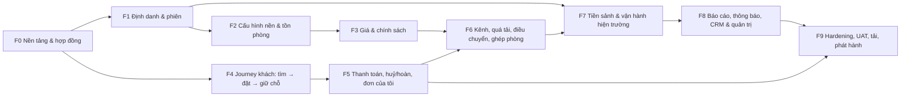

# 05 — Lộ trình thi công 4 frontend (Web & Android)

> Tài liệu này **chia nhỏ khối lượng thi công giao diện** thành các pha bàn giao được, dùng đúng định danh đã có (`SCR-`, `FR-`, `UC-`, `BR-`, `NFR-`, `E_*`) và không định nghĩa lại bất kỳ giá trị nghiệp vụ nào.
>
> Nguồn nền tảng: [thiết kế màn hình](../04-thiet-ke/thiet-ke-man-hinh.md) (83 màn hình, sitemap, 8 luồng Android, `UI-01…UI-18`, token, trạng thái, WCAG), [API](../04-thiet-ke/api.md) (hợp đồng REST + `E_*`), [kiến trúc](../04-thiet-ke/kien-truc.md) §5–§10 (seam dùng chung, cây thư mục đích), [ADR-018](../04-thiet-ke/adr/ADR-018-backend-chung-bon-frontend.md), [lộ trình 15 tuần](lo-trinh.md), [kế hoạch sprint](ke-hoach-sprint.md), [quy tắc kỹ thuật](quy-tac-ky-thuat.md), [kế hoạch kiểm thử](ke-hoach-kiem-thu.md).
>
> **Giới hạn bằng chứng:** repository hiện chỉ có tài liệu và công cụ kiểm tài liệu ([kết quả kiểm chứng](../07-ban-giao/ket-qua-kiem-chung.md)). Không pha nào dưới đây được coi là đã đạt; mọi cổng có trạng thái `NOT_RUN` cho tới khi có log chạy theo [quy tắc kỹ thuật](quy-tac-ky-thuat.md) §9.3.

---

## 1. Phạm vi và quan hệ với các kế hoạch đã có

**Trong phạm vi:** `apps/customer-web`, `apps/customer-android`, `apps/operations-web`, `apps/operations-android` và các gói phục vụ chúng (`packages/contracts`, `packages/api-client`, `packages/ui-web`, `packages/ui-native`, `packages/config`).

**Ngoài phạm vi:** `apps/api`, `apps/worker`, `packages/domain`, `infra/sql`. Các phần này chỉ xuất hiện dưới dạng **hợp đồng bắt buộc phải có trước** khi một pha giao diện bắt đầu, đúng nguyên tắc "không hoàn thành riêng toàn bộ UI rồi mới thử nghiệp vụ xuyên tầng" ở [hướng dẫn thi công](../07-ban-giao/huong-dan-thi-cong.md) §3.

| Kế hoạch đã có | Đơn vị chia việc | Quan hệ với tài liệu này |
|---|---|---|
| [Lộ trình](lo-trinh.md) | 8 giai đoạn (GĐ-0…GĐ-7), mốc M1–M8, WBS | Tài liệu này **không thay** lộ trình; nó tách phần frontend của GĐ-3…GĐ-7 thành các pha F0–F9 bàn giao được |
| [Kế hoạch sprint](ke-hoach-sprint.md) | 5 sprint, 47 hạng mục `US-*` | Mỗi pha F dưới đây ánh xạ tới các `US-*` có bề mặt frontend (cột "Bề mặt" của kế hoạch sprint) |
| [Hướng dẫn thi công](../07-ban-giao/huong-dan-thi-cong.md) §3 | 6 lát cắt dọc (backend-first) | Pha F0–F9 là mặt cắt ngang của 4 giao diện trên cùng 6 lát cắt đó |
| [Thiết kế màn hình](../04-thiet-ke/thiet-ke-man-hinh.md) | 83 màn hình `SCR-01…SCR-83` | Là **đơn vị công việc** của từng pha; mỗi pha khai báo đúng danh sách `SCR-` của mình |
| [Kế hoạch kiểm thử](ke-hoach-kiem-thu.md) | T1–T6 + k6 + UAT | T5 (Playwright ×2 web) và T6 (Maestro ×2 Android) là cổng nghiệm thu của mọi pha có giao diện |

---

## 2. Xuất phát điểm thực tế (baseline phải sửa ở F0)

| Sự thật kiểm được trong repo | Nguồn | Hệ quả cho thi công frontend |
|---|---|---|
| Repo tự mô tả là "Executable checks for the OOAD documentation; no production application" | [package.json](../../package.json) | Chưa có `apps/`, `packages/`, `infra/`; toàn bộ khung phải dựng ở F0 |
| Lockfile hiện tại là npm (`package-lock.json`), nhưng quy tắc thi công yêu cầu pnpm + `pnpm-lock.yaml` | [package.json](../../package.json) vs [quy tắc kỹ thuật](quy-tac-ky-thuat.md) §12.1.1 | **Mâu thuẫn phải chốt trước F0** (§4 bảng "việc phải chốt") |
| CI duy nhất là `docs-quality.yml` (kiểm link/Mermaid/ID + PGlite + PostgreSQL 16) | [.github/workflows/docs-quality.yml](../../.github/workflows/docs-quality.yml) | `ci.yml`, `e2e-nightly.yml`, `eas-build.yml` đều **chưa tồn tại**; F0 dựng `ci.yml`, F9 dựng `e2e-nightly.yml` |
| Chưa có OpenAPI sinh tự động; `api.md` là catalogue Markdown | [api.md](../04-thiet-ke/api.md) §7 | F0 phải sinh OpenAPI 3.1 từ `packages/contracts`; catalogue Markdown **không** thay hợp đồng sinh tự động ([hướng dẫn thi công](../07-ban-giao/huong-dan-thi-cong.md) §5) |
| Chưa có `packages/ui-web`/`ui-native`; token mới ở mức đặc tả | [thiết kế màn hình](../04-thiet-ke/thiet-ke-man-hinh.md) §7 | Token phải được mã hoá ở F0 trước khi làm bất kỳ màn hình nào |
| Mọi cổng ứng dụng/tải/UAT đang `NOT_RUN` | [kết quả kiểm chứng](../07-ban-giao/ket-qua-kiem-chung.md) | Không pha nào được báo `PASS` bằng tiến độ viết tài liệu |

---

## 3. Khối lượng phải thi công (định lượng)

| Hạng mục | Số lượng | Nguồn |
|---|---|---|
| Ứng dụng giao diện | 4 (2 web Next.js 15 App Router + 2 Android Expo/Expo Router) | [ADR-018](../04-thiet-ke/adr/ADR-018-backend-chung-bon-frontend.md) |
| Màn hình | **83** — customer web 13 (`SCR-01…13`), operations web 44 (`SCR-14…55`, `SCR-69`, `SCR-70`), customer Android 13 (`SCR-71…83`), operations Android 13 (`SCR-56…68`) | [thiết kế màn hình](../04-thiet-ke/thiet-ke-man-hinh.md) §3 |
| Use case phủ bởi giao diện | 53 (toàn bộ; một số chỉ có bề mặt operations) | [00 §8](../00-tong-quan.md) |
| Yêu cầu chức năng | 135 FR trong đó **101 Must** | [yêu cầu chức năng](../01-yeu-cau/yeu-cau-chuc-nang.md) §15 |
| Endpoint hợp đồng | 91 endpoint trong §2 + 3 webhook + 1 endpoint trạng thái tác vụ bất đồng bộ | [api.md](../04-thiet-ke/api.md) §2, §5, §6 |
| Mã lỗi nghiệp vụ phải render | 54 dòng trong bảng `E_*` — chênh lệch 45/54 đã đóng theo [QĐ-02](nhat-ky/QD-02-nen-tang-backend.md) | [api.md](../04-thiet-ke/api.md) §4.2 |
| Trạng thái UI bắt buộc cho **mọi** màn hình có tải dữ liệu | 9 hàng hợp đồng trạng thái (loading, refresh/stale, empty, 400/422, 401/403, 409/412/428, quote/hold hết hạn, timeout, success) + trạng thái offline Android | [thiết kế màn hình](../04-thiet-ke/thiet-ke-man-hinh.md) §8.1, §8.3 |
| Luồng Android có chỉ tiêu chạm/thời gian | 4 (check-in 3 chạm ≤60 s; check-out 4 chạm ≤90 s; đổi phòng 5 chạm ≤30 s; no-show 4 chạm ≤45 s) | [thiết kế màn hình](../04-thiet-ke/thiet-ke-man-hinh.md) §5 |
| Màn hình rủi ro cao có hợp đồng trạng thái riêng | 5 nhóm (`SCR-06`; `SCR-11/36/69`; `SCR-38`; `SCR-35/44/45/63`; `SCR-70`) | [thiết kế màn hình](../04-thiet-ke/thiet-ke-man-hinh.md) §8.2 |

**Đối chiếu nhân lực (rủi ro lớn nhất của kế hoạch):** [lộ trình](lo-trinh.md) §2 định biên frontend là **1 người**, và §8 cấp **100 h cho toàn bộ GĐ-7** — trong đó phần giao diện (`8.1` operations web 18 h + `8.2` operations Android 22 h + `8.3` customer Android 12 h) là **52 h cho 83 màn hình × 4 app**, tương đương ~37 phút/màn hình trước khi tính test, accessibility, i18n và offline. Ngân sách này không khớp khối lượng ở bảng trên và [lo-trinh](lo-trinh.md) §7 chỉ có thang **cắt giảm**, không có phương án tăng người. Xem §10.

---

## 4. Việc phải chốt trước khi viết dòng giao diện đầu tiên

| # | Việc | Vì sao chặn | Trạng thái |
|---|---|---|---|
| 1 | Sinh **OpenAPI 3.1 từ zod** trong `packages/contracts`, đóng băng theo mốc M3 | Mọi màn hình đọc DTO từ đây; chưa có hợp đồng sinh tự động thì F1 trở đi đều `BLOCKED` | `NOT_RUN` — [lo-trinh](lo-trinh.md) QG-2 |
| 2 | Chốt **cơ chế pnpm workspace** thay `package-lock.json` | Quyết định cấu trúc build/CI của cả 4 app | Mâu thuẫn tài liệu vs repo; cần ARCH quyết định + ghi ADR/`QĐ-nn` |
| 3 | Chốt **cơ chế gate phiên bản hợp đồng** cho từng frontend | [ADR-018](../04-thiet-ke/adr/ADR-018-backend-chung-bon-frontend.md) cổng 4 yêu cầu release gate chặn khi contract version/cửa sổ tương thích không đạt | `NOT_RUN` |
| 4 | Đối chiếu **số mã lỗi**: bảng §4.2 có 54 dòng, ba tài liệu khác ghi 45 | Bộ chuyển `E_*` → thông điệp + hành động UI phải đủ; thiếu mã là lỗi hiển thị | Chênh lệch 45/54 **đã đóng theo [QĐ-02](nhat-ky/QD-02-nen-tang-backend.md)** |
| 5 | Chốt **`OPEN-02`**: thao tác nào được xếp hàng offline, dữ liệu nào lưu trên máy, TTL, quy trình mất máy/thu hồi quyền | Chặn DoR của mọi màn hình ghi trên Android ([sổ rủi ro](quan-ly-rui-ro.md) §OPEN-02). Mặc định an toàn khi chưa chốt: **không** coi thu/hoàn tiền, xác nhận booking, giao/đổi phòng là đã thực hiện khi offline | `OPEN` |
| 6 | Chốt **`Q-01…Q-16`** (đặc biệt Q-01 cọc, Q-04 bán vượt, Q-05 ghép khác giới, Q-08 giờ nhận phòng, Q-14 maker–checker) | Đổi số tiền/mốc hiển thị trên `SCR-04/05/06/11/36/38/45/47/70/77/81` | `OPEN` — im lặng không là chấp thuận |
| 7 | Chốt **`Q-10`** địa điểm 3 cơ sở | Chọn cơ sở trên `SCR-01/72`, bậc 3 của thang điều chuyển trên `SCR-44` | `OPEN` |

---

## 5. Nguyên tắc bất di bất dịch khi thi công frontend

1. **Không có luật nghiệp vụ trong client.** Giá, chính sách huỷ, phân quyền, trạng thái booking chỉ được **hiển thị** theo thứ backend trả về; bảng bậc huỷ hard-code là vi phạm ([ADR-018](../04-thiet-ke/adr/ADR-018-backend-chung-bon-frontend.md); [kiến trúc](../04-thiet-ke/kien-truc.md) §6; BR-CANCEL-01).
2. **Một cửa vào duy nhất:** mọi lời gọi đi qua `packages/api-client`, mọi DTO từ `packages/contracts`. Không frontend nào chạm CSDL/Redis/adapter PSP/OTA ([ADR-018](../04-thiet-ke/adr/ADR-018-backend-chung-bon-frontend.md) cổng 1–2).
3. **Một giá trên mọi client.** Cùng đầu vào, `PriceQuote` phải khớp giữa API và 4 giao diện, sai 1 VND cũng là lỗi (BR-RATE-17; NFR-MAIN-04; `TC-RATE-21`).
4. **`packages/ui-web` và `packages/ui-native` chỉ chứa token/primitive.** Không chia sẻ component giữa web và Android; không import `packages/domain` để tự tính ([kiến trúc](../04-thiet-ke/kien-truc.md) §6; [thiết kế lớp](../04-thiet-ke/thiet-ke-lop.md)).
5. **Secret không nằm ở client.** Cấu hình đọc ở `apps/*/src/config`, validate bằng zod lúc khởi động; `NEXT_PUBLIC_API_BASE_URL` (web) và `EXPO_PUBLIC_API_BASE_URL`/`EXPO_PUBLIC_APP_VARIANT` (mobile) ([kiến trúc](../04-thiet-ke/kien-truc.md) §7.5; NFR-SEC-06).
6. **Chín trạng thái UI là phần của "xong", không phải việc phụ.** Mỗi màn hình có tải dữ liệu phải xử lý đủ 9 hàng ở §8.1 và — riêng Android — trạng thái offline ở §8.3 ([thiết kế màn hình](../04-thiet-ke/thiet-ke-man-hinh.md) §8; DoD X3).
7. **Accessibility là điều kiện chặn:** WCAG 2.1 AA, 0 lỗi axe mức serious/critical, tương phản ≥ 4,5:1, thao tác được bằng bàn phím, vùng chạm 44 pt web / 48 dp Android (NFR-USE-05).
8. **Nội địa hoá:** 0 chuỗi tiếng Việt viết cứng trong component — 100% qua danh mục i18n (`vi-VN` mặc định); hiển thị `dd/MM/yyyy HH:mm` kèm nhãn giờ VN; tiền là số nguyên VND hiển thị `1.100.000 ₫` (NFR-LOC-01…NFR-LOC-03).
9. **Idempotency và version hoá thuộc về api-client:** mọi lệnh ghi mang `Idempotency-Key`; sửa đối tượng có version mang `If-Match`, `428`/`412` phải giữ bản nhập và so khác biệt, cấm last-write-wins ([api.md](../04-thiet-ke/api.md) §1.6; NFR-REL-06).
10. **Không tin client:** giá/hệ số/actor/quyền do client gửi vô thẩm quyền; `409 E_RATE_QUOTE_MISMATCH` khi fingerprint lệch ([api.md](../04-thiet-ke/api.md) §3.1, §6).
11. **Client không tự đánh dấu đã trả.** Sau redirect PSP phải đọc lại `GET /api/v1/payments/{paymentId}/status`; callback trùng khoá không tạo `Payment` thứ hai ([api.md](../04-thiet-ke/api.md) §3.5).
12. **Mã lỗi là hợp đồng duy nhất để suy hành vi UI.** Không suy từ `message`; UI không tự cấp mã lỗi riêng ([api.md](../04-thiet-ke/api.md) §4.1; [thiết kế màn hình](../04-thiet-ke/thiet-ke-man-hinh.md) §8.1).
13. **Bộ chọn test ổn định** cho Playwright/Maestro là yêu cầu của kế hoạch kiểm thử, không phải chi tiết tuỳ nghi ([kế hoạch kiểm thử](ke-hoach-kiem-thu.md)).
14. **Không có kênh realtime.** Nhân viên dựa vào thông báo/polling; UI phải có điểm dừng polling và mốc "Cập nhật lúc … giờ VN" ([ADR-008](../04-thiet-ke/adr/README.md); [thiết kế màn hình](../04-thiet-ke/thiet-ke-man-hinh.md) §8.1).

---

## 6. Cấu trúc thi công (cây đích)

```
apps/
  customer-web/src/{app/(guest),components,lib,hooks,api}
  operations-web/src/{app/(ops),components,lib,hooks,api}
  customer-android/src/{app,components,screens,hooks,api,storage}
  operations-android/src/{app,components,screens,hooks,api,storage}
packages/
  contracts/     # zod DTO + mã E_* + OpenAPI sinh tự động
  api-client/    # REST client: correlation, retry an toàn, Idempotency-Key, If-Match
  ui-web/        # token + primitive web (không luật nghiệp vụ)
  ui-native/     # token + primitive Android (không luật nghiệp vụ)
  config/        # tsconfig.base.json, eslint preset, prettier
```

Quy ước đặt tuyến: một tệp route theo mã `SCR-` tương ứng ([thiết kế màn hình](../04-thiet-ke/thiet-ke-man-hinh.md) §10).

---

## 7. Chia pha: F0 → F9

Mỗi pha là một **lát cắt ngang của giao diện** chạy được trên hợp đồng đã có, kết thúc bằng demo chạy thật + bằng chứng `PASS/NOT_RUN` theo [quy tắc kỹ thuật](quy-tac-ky-thuat.md) §9.3.



### 7.1. Bảng tổng hợp pha ↔ bề mặt ↔ mốc

| Pha | Giai đoạn/mốc tương ứng | Bề mặt | Màn hình (`SCR-`) | Khối lượng FE tối thiểu (người–tuần) |
|---|---|---|---|---|
| F0 | GĐ-2 (W4–W5) → đầu GĐ-3, mốc M3 | cả 4 app (khung) | — (chỉ shell) | 2,0 |
| F1 | GĐ-3 Sprint 1 (W6–W7), M4 | cả 4 app | 08, 14, 15, 56, 71 | 1,5 |
| F2 | GĐ-3 Sprint 1 (W6–W7), M4 | operations web | 16–25 | 2,5 |
| F3 | GĐ-4 Sprint 2 (W8–W9), M5 | operations web | 26–30, 70 | 2,0 |
| F4 | GĐ-4 Sprint 2 (W8–W9), M5 | customer web + customer Android | 01–05, 07 · 72–76, 78 | 3,0 |
| F5 | GĐ-5 Sprint 3 (W10–W11), M6 | cả 4 app | 06, 09–13 · 31–39, 69 · 77, 79–83 | 4,0 |
| F6 | GĐ-6 Sprint 4 (W12–W13), M7 | operations web + operations Android | 40–47 · 63, 67 | 3,0 |
| F7 | GĐ-6→GĐ-7 (W12–W15), M7–M8 | operations web + operations Android | 48 · 57–62, 64, 65, 66, 68 | 3,5 |
| F8 | GĐ-7 Sprint 5 (W14–W15), M8 | operations web | 49–55 | 2,0 |
| F9 | GĐ-7 Sprint 5 (W14–W15), M8 | cả 4 app | toàn bộ 83 | 2,5 |
| | | | **Tổng** | **26,0 người–tuần ≈ 260 h** |

> Con số "khối lượng FE tối thiểu" ở cột cuối là **ước lượng lập kế hoạch** của tài liệu này (đơn vị 1 người × 10 h/tuần như [lộ trình](lo-trinh.md) §2), đối chiếu với định biên 52 h ở §3. Chênh lệch là rủi ro nhân lực, không phải sai số ước lượng.

---

### 7.2. F0 — Nền tảng thi công & hợp đồng

**Mục tiêu:** mọi thứ dùng chung tồn tại và được kiểm bằng CI trước khi có màn hình nghiệp vụ đầu tiên.

| Hạng mục | Nội dung |
|---|---|
| Workspace | Dựng workspace pnpm + `packages/config` (`tsconfig.base.json` strict, eslint preset kể cả `packages/config/eslint/domain.mjs`, prettier); giữ script kiểm tài liệu hiện có chạy được |
| Hợp đồng | `packages/contracts`: zod schema cho DTO + enum canonical + bảng `E_*`; sinh OpenAPI 3.1; bước `openapi-diff` trong CI |
| Client | `packages/api-client`: base URL theo app, `X-Correlation-Id`, `Idempotency-Key`, `If-Match`, chuẩn hoá lỗi `E_*` → kiểu lỗi có thể phân nhánh trong UI, retry an toàn |
| UI | Token hoá §7 thiết kế màn hình vào `packages/ui-web`/`packages/ui-native`; bộ primitive + khung 9 trạng thái; danh mục i18n `vi-VN` rỗng nhưng có sẵn cơ chế |
| App shell | 4 app dựng được, có tuyến rỗng, layout, error boundary, trang "không đủ quyền" |
| CI | `ci.yml`: install → typecheck → lint → unit → contract smoke; bật `axe` khung; khung Playwright (2 web) và Maestro (2 Android) chạy được với 1 ca smoke |

**Điều kiện hoàn tất**
- `pnpm -r typecheck` và lint xanh trên cả 6 gói/4 app; **0** import Prisma/Redis/adapter từ frontend (cổng 1 của ADR-018).
- OpenAPI sinh thành công và CI đỏ khi hợp đồng lệch mã (NFR-MAIN-04).
- Contract test chứng minh cùng request/response/error qua `packages/api-client` (cổng 2 của ADR-018).
- Một màn hình shell mỗi app render đủ 9 trạng thái với fixture; axe 0 serious/critical (NFR-USE-05).
- `X-Correlation-Id` xuất hiện trên mọi request do client gửi (NFR-OBS-01).

> **Trạng thái (27/09/2026):** F0 đã thi công trong working tree — 8/8 gói và app xanh kiểu/lint, 104 test gói, 26 ca Playwright + axe trên 2 web app, 2 bundle Hermes Android dựng được, cổng hợp đồng và ranh giới frontend xanh. Danh mục đầy đủ, phần `NOT_RUN`/`BLOCKED` và các quyết định nằm ở [bằng chứng F0](../07-ban-giao/bang-chung-f0.md) và [QĐ-01](nhat-ky/QD-01-nen-tang-f0.md). F1 chỉ bắt đầu sau khi QC nghiệm thu F0.

**Cắt giảm được:** số primitive/token chưa cần dùng ngay; **không** cắt: hợp đồng sinh tự động, api-client, khung 9 trạng thái, CI typecheck.

---

### 7.3. F1 — Định danh, phiên và phân quyền

**Màn hình:** `SCR-14` (đăng nhập nội bộ + chọn cơ sở, phiên 15 phút), `SCR-15` (người dùng/vai trò/phạm vi), `SCR-56` (đăng nhập Android + PIN 6 số, refresh 7 ngày), `SCR-08` (đăng ký/đăng nhập khách web), `SCR-71` (đăng ký/đăng nhập khách Android).

**Hợp đồng bắt buộc:** `/api/v1/auth/login`, `/auth/refresh`, `/auth/pin/verify`, `/auth/logout`, `/users/{userId}/access`, `/guest-auth/register`, `/guest-auth/login`, `/guest-auth/refresh`; các mã `E_AUTH_INVALID_CREDENTIALS`, `E_AUTH_PIN_REQUIRED`, `E_RBAC_FORBIDDEN`, `E_AUTH_OUT_OF_SCOPE`.

**FR/UC:** FR-AUTH-01…FR-AUTH-07; UC-AUTH-01, UC-AUTH-02, UC-AUTH-03.

**Điều kiện hoàn tất**
- 7 vai trò đăng nhập được; tài khoản `FRONT_DESK` của CS-02 không thấy dữ liệu CS-01 (BR-RBAC-02); `HOUSEKEEPING` không có tuyến tài chính/hồ sơ khách (BR-RBAC-03).
- Phiên operations web hết hạn sau 15 phút nhàn rỗi → ca `TC-AUTH-02`.
- Android: phiên sống ≥ 3 ngày; thao tác tài chính đòi PIN 6 số, sai 3 lần khoá thao tác → ca `TC-AUTH-03`.
- Khoá tài khoản sau 5 lần sai trong 15 phút → ca `TC-AUTH-01`.
- Cache phiên/scope không rò PII sau khi thu hồi quyền → ca `TC-AUTH-10`.

---

### 7.4. F2 — Cấu hình nền và tồn phòng (operations web)

**Màn hình:** `SCR-19` (cơ sở), `SCR-20` (loại phòng/sức chứa/sàn–trần), `SCR-21` (sơ đồ buồng, phòng thông nhau), `SCR-22` (khoá phòng bảo trì), `SCR-23` (bảng điều khiển ngày), `SCR-24` (lưới tồn phòng theo ngày), `SCR-25` (allotment theo kênh), `SCR-16` (nhật ký kiểm toán), `SCR-17` (tham số hệ thống), `SCR-18` (sao lưu & phục hồi).

**Hợp đồng bắt buộc:** PROP 8 endpoint (thêm `GET /api/v1/room-types` cho SCR-20 — HB-037); `/api/v1/inventory/grid`, `/api/v1/channel-allotments`; `/api/v1/audit-logs`, `/api/v1/system-settings/{key}`, `/api/v1/system/backups`, `/api/v1/system/health`; mã `E_INV_NO_AVAILABILITY`, `E_INV_LOCK_TIMEOUT`, `E_GEN_PRECONDITION_REQUIRED`, `E_GEN_VERSION_CONFLICT`.

**FR/UC:** FR-PROP-01…FR-PROP-07, FR-INV-01, FR-INV-06, FR-INV-07, FR-SYS-01…FR-SYS-03; UC-PROP-01…UC-PROP-04, UC-INV-01, UC-INV-03, UC-SYS-01, UC-SYS-02.

**Điều kiện hoàn tất**
- Lưới hiển thị **55 phòng × 30 ngày**, đổi khoảng ngày không tải lại trang; tổng payload ≤ 200 KB sau gzip (NFR-PERF-05).
- Cột tồn khả dụng khớp phép tính hai tầng BR-INV-01; kỳ 5 đêm mà đêm thứ 3 hết phòng phải hiện "hết phòng", không trả về phòng (BR-INV-07).
- Lưới dùng `role="grid"` với nhãn ô đầy đủ, điều hướng mũi tên/`Home`/`End`/`Enter`; ký hiệu chữ đi kèm màu cho 9 trạng thái ô.
- Khoá phòng làm tồn giảm ngay; khoá đè lên booking đang hoạt động bị chặn theo vai trò và mở `OverbookingCase` khi là ngoại lệ → ca `TC-PROP-04`.
- Tác vụ bất đồng bộ (`system/backups`, `system/backups/{id}/restore`) có màn hình theo dõi `GET /api/v1/operations/{operationId}` với trạng thái `PENDING/RUNNING/SUCCEEDED/FAILED`.
- `TC-SYS-10` chạy trên `SCR-24` (fixture rỗng/đang tải/lỗi/conflict/mất mạng, 360 px, zoom 200%).

---

### 7.5. F3 — Giá, mùa, kênh, gói giá & chính sách huỷ (operations web)

**Màn hình:** `SCR-26` (lịch giá & giá cơ bản), `SCR-27` (mùa & hệ số), `SCR-28` (kênh: hệ số & hoa hồng), `SCR-29` (khuyến mãi), `SCR-30` (xem trước báo giá đa kênh), `SCR-70` (gói giá & chính sách huỷ — màn hình rủi ro cao).

**Hợp đồng bắt buộc:** RATE 11 endpoint, gồm `POST /api/v1/quotes/multi-channel`, `PUT /api/v1/rate-plans/{ratePlanId}`, `GET/PUT /api/v1/cancellation-policies/{policyId}`; mã `E_RATE_CONFIGURATION_INVALID`, `E_RATE_BELOW_FLOOR`, `E_RATE_PROMO_INVALID`, `E_RATE_QUOTE_MISMATCH`, `E_GEN_VERSION_CONFLICT`, `E_GEN_PRECONDITION_REQUIRED`.

**FR/UC:** FR-RATE-01…FR-RATE-13, FR-RATE-17, FR-RATE-19; UC-RATE-01…UC-RATE-06.

**Điều kiện hoàn tất**
- Xem trước đa kênh hiển thị đủ **7 kênh** cùng một đầu vào, có bảng hệ số và ghi rõ doanh thu gộp/thuần; cảnh báo khi giá niêm yết OTA thấp hơn kênh `WEB` (BR-RATE-09).
- Cấu hình mùa/lịch giá: khi hai mùa chồng nhau hiển thị mùa thắng theo priority và lý do; cảnh báo `LONGSTAY14` thiếu giá riêng (BR-RATE-19).
- `SCR-70`: validate theo hàng (mốc trùng, thiếu catch-all) chặn lưu; xác nhận khi lệch giá ± 20% (BR-RBAC-04) → ca `TC-AUTH-09`.
- Sửa cấu hình đang được tham chiếu: `412`/`428` giữ nguyên bản nhập và hiển thị khác biệt → ca `TC-SYS-11`.
- Chỉ `OWNER` thấy nút lưu; mọi lưu sinh `AuditLog` trong cùng transaction → ca `TC-RATE-27`.
- Không có tuyến nào cho phép PUT/PATCH/DELETE lên snapshot giá (ràng buộc §2.14 của [api.md](../04-thiet-ke/api.md)).

---

### 7.6. F4 — Journey khách: tìm → báo giá → chọn gói → đặt → giữ chỗ

**Màn hình:** customer web `SCR-01`, `SCR-02`, `SCR-03`, `SCR-04`, `SCR-05`, `SCR-07`; customer Android `SCR-72`, `SCR-73`, `SCR-74`, `SCR-75`, `SCR-76`, `SCR-78`.

**Hợp đồng bắt buộc:** `GET /api/v1/inventory/availability`, `POST /api/v1/quotes`, `GET /api/v1/rate-plans`, `POST /api/v1/bookings`, `POST /api/v1/bookings/{bookingId}/confirm`, `POST /api/v1/holds`, `DELETE /api/v1/holds/{holdId}`; mã `E_RATE_QUOTE_EXPIRED`, `E_BOOK_MISSING_FIELD`, `E_BOOK_INVALID_DATES`, `E_BOOK_MIN_NIGHTS`, `E_BOOK_OVER_CAPACITY`, `E_BOOK_INVALID_STATE`, `E_BOOK_SOLD_OUT`, `E_BOOK_BLACKLISTED`, `E_INV_NO_AVAILABILITY`, `E_INV_ROOM_TAKEN`.

**FR/UC:** FR-INV-02, FR-BOOK-01, FR-BOOK-04, FR-BOOK-05, FR-BOOK-08, FR-BOOK-11, FR-BOOK-16, FR-BOOK-17, FR-RATE-14, FR-RATE-16; UC-INV-02, UC-BOOK-01, UC-BOOK-04.

**Điều kiện hoàn tất**
- Đặt phòng trên customer web **≤ 4 bước bắt buộc** (NFR-USE-05); trên Android dùng deep link/điều hướng riêng, không chia sẻ component với web.
- Bảng giá từng đêm hiển thị đủ 5 hệ số + dấu `clamped`, khớp `PriceQuote`; `TC-RATE-21` chạy trên API + 4 giao diện, **sai 1 VND là lỗi** (BR-RATE-17).
- Đồng hồ đếm ngược giữ chỗ dùng `expiresAt` của server, không gia hạn bằng giờ máy; hết hạn thì khoá nút xác nhận và nói rõ đã hết hạn (BR-RATE-15).
- Cờ `duplicateSuspected` hiển thị được cho khách khi trùng trong 24 giờ (BR-BOOK-16).
- Android: 3G (1 Mbps, RTT 400 ms) màn hình chính tải ≤ 5 s (NFR-USE-03).
- `TC-BOOK-16` (T5) và `TC-BOOK-17` (T6) khung ca đã chạy được; `TC-BOOK-28` (đua giữ chỗ cuối qua hạn) có kịch bản UI không suy ra thành công từ redirect PSP.

---

### 7.7. F5 — Thanh toán, huỷ/hoàn, đổi ngày, đơn của tôi (cả 4 bề mặt)

**Màn hình:** customer web `SCR-06`, `SCR-09`, `SCR-10`, `SCR-11`, `SCR-12`, `SCR-13`; operations web `SCR-31`, `SCR-32`, `SCR-33`, `SCR-34`, `SCR-35`, `SCR-36`, `SCR-37`, `SCR-38`, `SCR-39`, `SCR-69`; customer Android `SCR-77`, `SCR-79`, `SCR-80`, `SCR-81`, `SCR-82`, `SCR-83`.

**Hợp đồng bắt buộc:** PAY 11 endpoint (gồm `POST /api/v1/payments/online`, `GET /api/v1/payments/{paymentId}/status`, `/refund-requests` và 4 hành động approve/reject/cancel/pay), `POST /bookings/{id}/cancel-preview`, `POST /bookings/{id}/cancel`, `POST /bookings/{id}/reschedule`, `DELETE /bookings/{id}`; mã `E_PAY_AMOUNT_MISMATCH`, `E_PAY_SELF_APPROVAL`, `E_PAY_REFUND_EXCEEDS_PAID`, `E_PAY_REFUND_NOT_APPROVED`, `E_PAY_REFUND_NOT_PENDING`, `E_PAY_GATEWAY_ERROR`, `E_PAY_GATEWAY_TIMEOUT`, `E_PAY_REASON_TOO_SHORT`, `E_PAY_REFUND_FORCE_MAJEURE_FORBIDDEN`, `E_CANCEL_NOT_ALLOWED`, `E_BOOK_HARD_DELETE_FORBIDDEN`, `E_BOOK_CHECKED_IN_IMMUTABLE`.

**FR/UC:** FR-BOOK-02, FR-BOOK-03 (tạo booking tại quầy `SCR-33` và qua điện thoại `SCR-34`), FR-BOOK-12, FR-BOOK-13, FR-BOOK-15, FR-BOOK-19, FR-BOOK-21, FR-PAY-01…FR-PAY-16, FR-CRM-02, FR-CRM-03, FR-CRM-05; UC-BOOK-02, UC-BOOK-03, UC-BOOK-05, UC-BOOK-06, UC-BOOK-07, UC-BOOK-08, UC-PAY-01…UC-PAY-05, UC-CRM-01, UC-CRM-02.

**Điều kiện hoàn tất**
- Screens huỷ/huỷ một phần/trả sớm (`SCR-11`, `SCR-36`, `SCR-69`): đang tính thì **khoá xác nhận**; qua mốc/version phải tính lại; nút huỷ không có bước xem trước là vi phạm `UI-01`.
- `SCR-38` duyệt/chi hoàn: người tạo không tự duyệt ở mọi mức tiền (BR-CANCEL-15); **không** có nút "Chi lại"; trạng thái `PAID` chỉ sau bằng chứng thành công; hiển thị `gross`, `refundFee`, `netRefund` và hạn mức đã giữ → ca `TC-PAY-23`.
- Thanh toán online: sau redirect PSP, UI đọc lại trạng thái giao dịch, có điểm dừng polling; callback đến muộn hiển thị "đã nhận tiền" nhưng **không** tự chuyển booking sang xác nhận → ca `TC-BOOK-28`, `TC-PAY-22`.
- Không màn hình nào hiển thị số thẻ/ngày hết hạn/CVV (`UI-13`); PII chỉ hiện theo vai trò và có `AuditLog` (`UI-14`).
- Huỷ một phần: phân bổ tiền theo tỷ lệ dòng bị huỷ, phòng còn lại giữ giá và assignment → ca `TC-BOOK-27`.
- Đổi ngày: giữ nguyên trạng thái, snapshot cũ bất biến, hiển thị chênh lệch và phí theo gói (BR-BOOK-12).
- `TC-SYS-10` chạy trên `SCR-06`, `SCR-36`, `SCR-38`.

---

### 7.8. F6 — Kênh, quá tải, điều chuyển, ghép phòng, walk-out

**Màn hình:** operations web `SCR-40`, `SCR-41`, `SCR-42`, `SCR-43`, `SCR-44`, `SCR-45`, `SCR-46`, `SCR-47`; operations Android `SCR-63`, `SCR-67`.

**Hợp đồng bắt buộc:** CHAN 4 endpoint (`sync` trả `202`, `mappings`, `sales-closure`, `ota-bookings`), OVER 11 endpoint (`relocation-plan`, `room-moves` + approve/execute, `room-merges` + consent/approve/execute, `resolve`); mã `E_CHAN_SYNC_FAILED`, `E_CHAN_SIGNATURE_INVALID`, `E_CHAN_REPLAY_DETECTED`, `E_OVER_LIMIT_EXCEEDED`, `E_OVER_NO_CONSENT`, `E_OVER_MERGE_GENDER`, `E_OVER_NO_PLAN_AVAILABLE`, `E_OVER_MOVE_NOT_ALLOWED`, `E_OVER_APPROVAL_REQUIRED`, `E_OVER_CROSS_CITY_NO_CONSENT`, `E_OVER_CASE_DEADLINE_PASSED`.

**FR/UC:** FR-CHAN-01…FR-CHAN-08, FR-OVER-01…FR-OVER-17; UC-CHAN-01, UC-CHAN-02, UC-CHAN-03, UC-OVER-01, UC-OVER-02, UC-OVER-03, UC-OVER-04, UC-OVER-05.

**Điều kiện hoàn tất**
- `SCR-43` xếp ca quá tải theo hạn xử lý, đánh dấu ca quá T−24h; ca trễ ngày phải chuyển `ESCALATED`, không tự đóng (BR-OVER-16).
- Trước khi xác nhận điều chuyển, giao diện **in bảng `keepScore`** cho quản lý — đây là biện pháp giảm thiểu `RSK-06` và không được lược bỏ.
- Thang điều chuyển hiển thị đúng thứ tự khả dụng **1 → 2 → 4**; bậc 3 hiển thị kèm lý do không khả dụng (khoảng cách 160–300 km), không giả vờ khả dụng.
- `SCR-45` thu đồng thuận **cả hai bên** trên hệ thống trước khi gửi duyệt; khác giới tính chặn trừ khi có duyệt của `MANAGER` trở lên (BR-OVER-13, BR-OVER-14) → ca `TC-OVER-18`, `TC-OVER-11`, `TC-OVER-13`.
- Thực thi điều chuyển/ghép phải kiểm lại đồng thuận, version và tồn; thất bại giữ nguyên phòng nguồn và ca vẫn mở → ca `TC-OVER-18`.
- `SCR-41` hiển thị `Channel.syncStatus` (`OK`/`DEGRADED`), `consecutiveSyncFailures`, thời điểm đồng bộ và cho phép đẩy lại; `SCR-42` hiển thị hàng đợi booking OTA nhận vào kèm đối chiếu tiền và cờ nghi trùng.
- Không đổi phòng cho khách `CHECKED_IN` ngoài nhánh bất khả kháng có duyệt (BR-OVER-09); nút tương ứng mờ kèm giải thích.
- Android: đổi phòng bậc 1–2 hoàn tất **≤ 30 giây, ≤ 6 chạm** → ca `TC-OVER-15`.

---

### 7.9. F7 — Tiền sảnh và vận hành hiện trường (operations web + operations Android)

**Màn hình:** operations web `SCR-48` (bàn tiền sảnh: đến – đi – ở trong ngày); operations Android `SCR-56`, `SCR-57`, `SCR-58`, `SCR-59`, `SCR-60`, `SCR-61`, `SCR-62`, `SCR-64`, `SCR-65`, `SCR-66`, `SCR-68`.

**Hợp đồng bắt buộc:** FO 5 endpoint (`check-in`, `check-out`, `no-show`, `housekeeping/tasks` + `PATCH`), `POST /api/v1/payments`, `GET /api/v1/bookings/{bookingId}/balance`, `POST /api/v1/reconciliation/daily/close`, `GET /api/v1/guests`, `POST /api/v1/bookings` (kênh `WALKIN`); mã `E_FO_CHECKIN_NOT_ALLOWED`, `E_PAY_AMOUNT_MISMATCH`, `E_AUTH_PIN_REQUIRED`, `E_BOOK_BLACKLISTED`, `E_CRM_PHONE_INVALID`.

**FR/UC:** FR-FO-01…FR-FO-08, FR-PAY-05, FR-PAY-06, FR-PAY-15, FR-CRM-01, FR-CRM-04, FR-BOOK-02 (**nhánh walk-in trên Android `SCR-65`**; nhánh quầy/điện thoại trên operations web đã làm ở F5); UC-FO-01…UC-FO-04, UC-PAY-03, UC-PAY-05, UC-CRM-01, UC-CRM-03, UC-BOOK-02.

**Điều kiện hoàn tất**
- Chỉ tiêu chạm/thời gian của 4 luồng Android đạt: check-in 3 chạm ≤ 60 s; check-out 4 chạm ≤ 90 s; đổi phòng 5 chạm ≤ 30 s; no-show 4 chạm ≤ 45 s, không bước nào vượt trần chạm.
- Nút **XÁC NHẬN CHECK-IN mờ khi còn nợ**, trừ khi nợ ≤ 5.000.000 ₫ **và** ≤ 50% tổng tiền; không in hoá đơn khi còn nợ; ghi nợ cần `MANAGER` trở lên kèm lý do (BR-FO-01) → ca `TC-FO-01`, `TC-FO-02`.
- Thu tiền/hoàn tiền tại quầy đòi PIN 6 số; sau khi thu `balanceDue = 0`, trạng thái sang `CHECKED_IN` → ca `TC-FO-06`.
- Ghi no-show hiện số tiền bị tính trong hộp thoại xác nhận và đếm ngược tới 23:59 → ca `TC-FO-07`.
- Buồng phòng: phòng chưa dọn không gán được cho khách khác; nhân viên buồng phòng chỉ nhận dữ liệu nhiệm vụ tối thiểu, **không** nhận DTO booking/tài chính (BR-RBAC-03, BR-FO-06, BR-FO-07) → ca `TC-FO-05`.
- Walk-in trên Android/web ≤ 5 bước và ≤ 3 phút trên 20 lượt đo (NFR-USE-05) → ca `TC-BOOK-17`.
- Đối soát nhanh theo ngày: dùng cặp (người thu, ngày VN), cảnh báo khi lệch ngưỡng; **không** có khái niệm ca làm việc (ngoài phạm vi đề tài).
- Android: ảnh/QR cần quyền camera phải xin quyền trong ngữ cảnh, không chặn luồng nếu từ chối.

**Offline (bắt buộc theo mặc định an toàn của `OPEN-02`):** hàng đợi hiển thị trạng thái cục bộ `Bản nháp → Chờ đồng bộ → Đang gửi → Đã xác nhận` | `Cần xử lý`; **không** báo thành công giao phòng/thu tiền/hoàn tiền/đồng thuận khi offline; giữ key/payload/version, không lưu PIN để phát lại; quá cửa sổ idempotency 24 giờ phải tra kết quả trước khi gửi lệnh mới → ca `TC-FO-08`.

---

### 7.10. F8 — Báo cáo, thông báo, CRM và quản trị (operations web)

**Màn hình:** `SCR-49`, `SCR-50`, `SCR-51`, `SCR-52`, `SCR-53`, `SCR-54`, `SCR-55`.

**Hợp đồng bắt buộc:** REP 7 endpoint (5 báo cáo đọc + `GET /reports/adr-revpar` + `POST /reports/export` trả `202`), NOTI 2 endpoint, CRM 6 endpoint, SYS 5 endpoint; mã `E_GEN_NOT_FOUND`, `E_RBAC_FORBIDDEN`, `E_AUTH_OUT_OF_SCOPE`, `E_GEN_VALIDATION_FAILED`.

**FR/UC:** FR-REP-01…FR-REP-07, FR-NOTI-01…FR-NOTI-04, FR-CRM-01…FR-CRM-06, FR-SYS-01…FR-SYS-08; UC-REP-01…UC-REP-04, UC-NOTI-01, UC-NOTI-02, UC-CRM-01…UC-CRM-03, UC-SYS-01…UC-SYS-03.

**Điều kiện hoàn tất**
- Báo cáo doanh thu theo kênh hiển thị **7 kênh × gộp/thuần/hoa hồng**, số trên màn hình khớp tệp CSV xuất ra → ca `TC-REP-02`.
- Mỗi chỉ số hiển thị công thức và tử số/mẫu số dùng đúng định nghĩa `BR-REP-01` (công suất, ADR, RevPAR, tỷ lệ huỷ, chi phí xử lý quá tải); UI **không** tự định nghĩa lại chỉ số.
- Xuất CSV/XLSX ≥ 100.000 dòng trong ≤ 60 s qua cơ chế tác vụ bất đồng bộ + theo dõi `operationId`; mọi lần xuất có `AuditLog` (NFR-COMP-04).
- Báo cáo tài chính giới hạn cho `ACCOUNTANT`/`OWNER`; `MANAGER` chỉ thấy báo cáo vận hành trong cơ sở mình.
- `SCR-51`: gửi lại thông báo tối đa 3 lần, hiển thị lỗi và số lần thử (BR-SYS-06).
- `SCR-16`: nhật ký kiểm toán chỉ đọc, lọc theo đối tượng/thời gian, xuất CSV; UI không có bất kỳ affordance sửa/xoá (BR-SYS-05).

---

### 7.11. F9 — Hardening, UAT, tải và phát hành

**Phạm vi:** cả 83 màn hình, cả 4 app.

**Việc phải làm**
- Rà accessibility toàn bộ: axe 0 serious/critical trên 6 cấu hình trình duyệt (Chrome/Safari 2 bản gần nhất + Edge 2 bản gần nhất), 360 px không cuộn ngang, zoom 200%, TalkBack; `TC-SYS-10` trên 8 màn hình đại diện.
- Rà i18n: 0 chuỗi tiếng Việt viết cứng ngoài danh mục; 0 số tiền dạng số thực; 100% mốc thời gian có nhãn giờ VN (NFR-LOC-01…NFR-LOC-03).
- Đo lại NFR áp dụng cho giao diện: thời gian walk-in trên 20 lượt, thời gian tải màn hình Android trên 3G, kích thước lưới tồn phòng sau gzip.
- Chạy `e2e-nightly.yml` (Playwright ×2 web ≤ 15 phút, Maestro ×2 Android ≤ 10 phút); tải **200 VU** theo kịch bản KB-A/KB-B/KB-C.
- UAT 3 kịch bản trên 4 frontend với từng actor; biên bản có chữ ký; P0/P1 mở thì không ký.
- Checklist phát hành từng app: app nào đã build, **contract version** nào, **cửa sổ tương thích** nào đang hỗ trợ (cổng 4 của [ADR-018](../04-thiet-ke/adr/ADR-018-backend-chung-bon-frontend.md)).
- EAS: hai application ID; EAS Update chỉ cho bản vá JS; build APK cục bộ làm phương án dự phòng khi hết quota (`RSK-24`).

**Điều kiện hoàn tất**
- 0 lỗi P0/P1 mở; 0 lỗi axe serious/critical; 0 test bị bỏ qua không giải thích.
- `TC-RATE-21` xanh trên API + 4 giao diện; số báo cáo đối soát được với SQL.
- Offline **không** xác nhận tài chính/tồn (điều kiện lát 6 của [hướng dẫn thi công](../07-ban-giao/huong-dan-thi-cong.md) §3).
- Ma trận truy vết không còn ô bắt buộc trống không giải thích; README tái lập được trên máy sạch.

---

## 8. Ma trận pha × bề mặt

| Pha | customer web | customer Android | operations web | operations Android |
|---|---|---|---|---|
| F0 | shell | shell | shell | shell |
| F1 | `SCR-08` | `SCR-71` | `SCR-14`, `SCR-15` | `SCR-56` |
| F2 | — | — | `SCR-16…25` | — (đọc trạng thái phòng) |
| F3 | — (chỉ đọc gói giá) | — | `SCR-26…30`, `SCR-70` | — |
| F4 | `SCR-01…05`, `SCR-07` | `SCR-72…76`, `SCR-78` | — | — |
| F5 | `SCR-06`, `SCR-09…13` | `SCR-77`, `SCR-79…83` | `SCR-31…39`, `SCR-69` | — |
| F6 | — | — | `SCR-40…47` | `SCR-63`, `SCR-67` |
| F7 | — | — | `SCR-48` | `SCR-57…62`, `SCR-64…66`, `SCR-68` |
| F8 | — | — | `SCR-49…55` | — |
| F9 | cả 13 | cả 13 | cả 44 | cả 13 |

---

## 9. Cổng chất lượng và DoD cho công việc giao diện

**DoR (một story giao diện chỉ vào sprint khi):**
- Có AC dạng Given/When/Then cho cả nhánh thành công, lỗi, xung đột và gửi lại; có fixture/oracle và mã ca kiểm thử.
- Endpoint, mã `E_*` và ngữ nghĩa `If-Match`/`Idempotency-Key` đã có trong `packages/contracts`.
- **Trạng thái UI** của màn hình đã được xác định (9 hàng §8.1, cộng trạng thái offline nếu là Android).
- Không phụ thuộc câu hỏi mở chưa có chấp thuận; nếu có thì ghi `BLOCKED`, không đoán.

**DoD (story giao diện chỉ "xong" khi):**
- Đã gộp vào `main` với ≥ 1 người duyệt khác tác giả, PR ≤ 400 dòng thay đổi.
- AC được chứng minh bằng **demo chạy thật** cho PO; UI có đủ trạng thái rỗng/đang tải/lỗi/xung đột/offline và accessibility theo phạm vi story.
- Test: unit cho logic hiển thị thuần; E2E trên đúng bề mặt (Playwright hoặc Maestro); accessibility có `axe` xanh; i18n 0 chuỗi cứng.
- Tài liệu + ma trận truy vết cập nhật trong cùng PR; thay đổi hợp đồng có `openapi-diff`.
- 0 lỗi P0/P1 mới; bộ chọn test ổn định cho mọi luồng chính.

**Cổng cuối mỗi pha (tương đương QG-3 của [lộ trình](lo-trinh.md)):** CI xanh; tài liệu cập nhật; demo trên môi trường sạch; bằng chứng ghi `commit SHA, ngày chạy, môi trường, lệnh, kết quả, giới hạn`.

---

## 10. Rủi ro riêng của frontend và phương án cắt giảm

| Rủi ro | Đã đăng ký | Ảnh hưởng tới pha | Biện pháp trong lộ trình này |
|---|---|---|---|
| Nhân lực: 4 app × 83 màn hình với 1 kỹ sư frontend, ngân sách GĐ-7 chỉ 100 h | Chưa có mã `RSK-` tương ứng; là phát hiện của tài liệu này (§3) | Toàn bộ F1–F9 | Bắt buộc chốt trước F1: tăng người, hoặc áp thang cắt giảm, hoặc giảm số bề mặt phát hành. Không thể giữ cả 83 màn hình với định biên hiện tại |
| Hợp đồng API chưa đóng băng ở M3 | `RSK-10` | F1 trở đi | F0 sinh OpenAPI + contract test; phá hợp đồng phải bump version và báo trước 24 h |
| Lệch giá giữa các bề mặt | `RSK-08` | F3, F4, F5 | `TC-RATE-21` bắt buộc chạy ở M5 và F9; cấm import `packages/domain` vào client ở tầng lint |
| Sandbox VNPay/MoMo chưa có trước W9 | `RSK-20` | F5 | Adapter giả lập cùng hợp đồng; deep link Android xây trên hợp đồng, chỉ đổi base URL khi có sandbox |
| Hạ tầng ngoài (GitHub Actions, Vercel, EAS Build) không ổn định | `RSK-24` | F0, F9 | CI hai tầng (nhanh mỗi PR, đêm cho E2E); demo bằng `docker compose` cục bộ; xuất APK cục bộ khi hết quota EAS |
| Phạm vi offline chưa chốt | `OPEN-02` | F7 | Mặc định an toàn: offline không xác nhận tài chính/tồn; các thao tác chưa chốt bị `BLOCKED` ở mức phát hành |
| Chưa có `RSK-` cho quyền thiết bị (camera QR, ảnh buồng phòng) | Không có mã | F7 | Đưa vào DoR của `SCR-57`/`SCR-66`; xin quyền trong ngữ cảnh, có đường thoát khi từ chối |
| Quyết định nghiệp vụ mở Q-01…Q-16 | `RSK-22` (nhóm) | F3, F4, F5, F6, F7 | Mỗi pha có bảng "câu hỏi chặn"; giá trị mặc định chỉ dùng để demo và phải ghi rõ là giả định |

**Thang cắt giảm áp cho frontend (theo thứ tự, không cắt bất biến):** (1) `MERGE_CONNECTING` trên `SCR-45`; (2) kênh `OTA_AIRBNB` và `AGENCY` khỏi `SCR-28`, `SCR-30`, `SCR-53`, `SCR-42`; (3) Zalo OA khỏi `SCR-51`; (4) khuyến mãi trên `SCR-29`; (5) báo cáo ADR/RevPAR nâng cao trên `SCR-52`; (6) tích điểm/phân hạng trên `SCR-13`, `SCR-50`, `SCR-83`; (7) tìm–đặt trên web khách (`SCR-01…07`) — **cắt cuối cùng**.

**Không bao giờ cắt:** chống trùng phòng, động cơ giá, chính sách huỷ, kiểm thử miền, nhật ký kiểm toán, 9 trạng thái UI, accessibility, i18n, kiểm tra quyền ở backend.

---

## 11. Truy vết lộ trình

| Pha | FR chính | UC chính | SCR | Ca kiểm thử cổng |
|---|---|---|---|---|
| F0 | FR-SYS-06…FR-SYS-08 | — | shell | contract test (T4) |
| F1 | FR-AUTH-01…FR-AUTH-07 | UC-AUTH-01…UC-AUTH-03 | 08, 14, 15, 56, 71 | `TC-AUTH-01…TC-AUTH-10` |
| F2 | FR-PROP-01…FR-PROP-07, FR-INV-01, FR-INV-06, FR-INV-07, FR-SYS-01…FR-SYS-03 | UC-PROP-01…UC-PROP-04, UC-INV-01, UC-INV-03, UC-SYS-01, UC-SYS-02 | 16…25 | `TC-PROP-01…TC-PROP-04`, `TC-INV-01…TC-INV-11` |
| F3 | FR-RATE-01…FR-RATE-13, FR-RATE-17, FR-RATE-19 | UC-RATE-01…UC-RATE-06 | 26…30, 70 | `TC-RATE-01…TC-RATE-08`, `TC-RATE-10…TC-RATE-27`, `TC-SYS-11` |
| F4 | FR-INV-02, FR-BOOK-01, FR-BOOK-04, FR-BOOK-05, FR-BOOK-08, FR-BOOK-11, FR-BOOK-16, FR-BOOK-17, FR-RATE-14, FR-RATE-16 | UC-INV-02, UC-BOOK-01, UC-BOOK-04 | 01…05, 07, 72…76, 78 | `TC-BOOK-16`, `TC-BOOK-17`, `TC-RATE-21`, `TC-BOOK-28` |
| F5 | FR-BOOK-02, FR-BOOK-03, FR-BOOK-12, FR-BOOK-13, FR-BOOK-15, FR-BOOK-19, FR-BOOK-21, FR-PAY-01…FR-PAY-16, FR-CRM-02, FR-CRM-03, FR-CRM-05 | UC-BOOK-02, UC-BOOK-03, UC-BOOK-05…UC-BOOK-08, UC-PAY-01…UC-PAY-05, UC-CRM-01, UC-CRM-02 | 06, 09…13, 31…39, 69, 77, 79…83 | `TC-BOOK-23`, `TC-PAY-11`, `TC-BOOK-27`, `TC-PAY-22`, `TC-PAY-23`, `TC-CANCEL-01…TC-CANCEL-55` |
| F6 | FR-CHAN-01…FR-CHAN-08, FR-OVER-01…FR-OVER-17 | UC-CHAN-01…UC-CHAN-03, UC-OVER-01…UC-OVER-05 | 40…47, 63, 67 | `TC-CHAN-01…TC-CHAN-11`, `TC-OVER-15`, `TC-OVER-18` |
| F7 | FR-FO-01…FR-FO-08, FR-PAY-05, FR-PAY-06, FR-PAY-15, FR-CRM-01, FR-CRM-04, FR-BOOK-02 (Android) | UC-FO-01…UC-FO-04, UC-PAY-03, UC-PAY-05, UC-CRM-01, UC-CRM-03, UC-BOOK-02 | 48, 57…62, 64…66, 68 | `TC-FO-01…TC-FO-08` |
| F8 | FR-REP-01…FR-REP-07, FR-NOTI-01…FR-NOTI-04, FR-CRM-01…FR-CRM-06, FR-SYS-01…FR-SYS-08 | UC-REP-01…UC-REP-04, UC-NOTI-01, UC-NOTI-02, UC-CRM-01…UC-CRM-03, UC-SYS-01…UC-SYS-03 | 49…55 | `TC-REP-01…TC-REP-04`, `TC-NOTI-01`, `TC-NOTI-02`, `TC-SYS-01…TC-SYS-11` |
| F9 | toàn bộ | toàn bộ | 01…83 | `TC-SYS-10`, `TC-RATE-21`, UAT 3 kịch bản, tải KB-A/KB-B/KB-C |

---

## 12. Việc kế tiếp ngay sau khi tài liệu này được chấp thuận

1. Ghi quyết định cho 7 việc ở §4 (kể cả chênh lệch số mã `E_*` và cơ chế lockfile) vào ADR/`QĐ-nn` trong `docs/05-ke-hoach/nhat-ky/`.
2. Mở thư mục `nhat-ky/` cho `BB-`/`CRF-`/`TD-`/`QĐ-` như [bản đồ tài liệu](../README.md) đã dự kiến.
3. Chốt phương án nhân lực cho khối lượng ở §3 trước khi bắt đầu F1; nếu không, áp thang cắt giảm ở §10 và ghi rõ bề mặt bị hoãn.
4. Không bắt đầu màn hình nào khi OpenAPI chưa sinh được từ `packages/contracts`.
