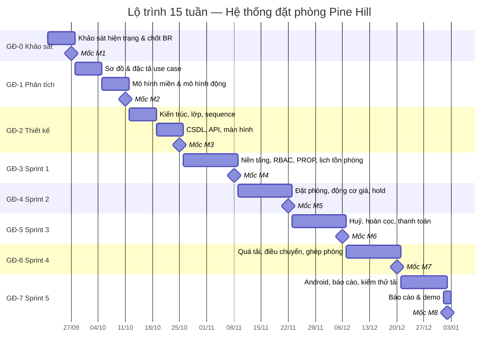

# 05 — Lộ trình triển khai (15 tuần)

> Lộ trình cho **nhóm 5 người**, học kỳ 15 tuần, bắt đầu **21/09/2026** (Tuần 1) — kết thúc **03/01/2027** (hết Tuần 15).
> Đơn vị công sức: 1 người × 1 tuần ≈ **10 giờ** → tổng ngân sách ≈ **750 giờ**.

---

## 1. Nguyên tắc dẫn đường

| # | Nguyên tắc | Hệ quả thực tế |
|---|-----------|----------------|
| 1 | **Nghiệp vụ trước, mã nguồn sau.** Không viết dòng mã nghiệp vụ nào trước khi BR của module đó được chốt. | 5 tuần đầu chỉ có tài liệu; đây là chủ đích của môn OOAD, không phải chậm tiến độ |
| 2 | **Ba bài toán trọng tâm đi trước.** BT-1/2/3 là phần được đánh giá cao nhất, phải có mã chạy được và ca kiểm thử, không chỉ nằm trên giấy. | Sprint 2–4 dồn vào BT-1/2/3 |
| 3 | **Bất biến chống trùng phòng ép ở tầng CSDL** ngay từ Sprint 1, không để "làm sau". | Ràng buộc loại trừ phải có trước khi có API đặt phòng |
| 4 | **Miền nghiệp vụ là hàm thuần, kiểm thử được.** Động cơ giá và chính sách huỷ không được chạm vào CSDL. | `packages/domain` không import I/O |
| 5 | **Mỗi tuần đều có thứ chạy được.** Không có tuần nào kết thúc mà không có bản dựng demo. | Demo thứ Sáu hằng tuần |
| 6 | **Cắt theo chiều ngang, không cắt theo chiều dọc.** Khi trễ, bỏ tính năng, không bỏ tầng kiểm thử. | Xem §7 |

---

## 2. Nguồn lực & phân vai

| Vai | Số người | Trách nhiệm chính |
|-----|----------|-------------------|
| PO/BA (kiêm thư ký dự án) | 1 | Khảo sát, chốt BR, viết UC, điều phối chủ đầu tư, kiểm thử chấp nhận |
| Kiến trúc sư kiêm Backend | 1 | Kiến trúc, mô hình miền, CSDL, API, `packages/domain` |
| Backend/Frontend web | 1 | NestJS module, Next.js back-office |
| Frontend web + Mobile | 1 | Website khách, ứng dụng Android |
| QA/DevOps | 1 | Kế hoạch kiểm thử, CI, kiểm thử tải, sao lưu |

Phân vai chi tiết theo giai đoạn: [05/quy-tac-nhom](quy-tac-nhom.md) §4.

---

## 3. Tổng quan 8 giai đoạn

| GĐ | Tuần | Tên | Sản phẩm giao | Định mức |
|----|------|-----|----------------|----------|
| GĐ-0 | W1 | Khảo sát & chốt nghiệp vụ | Báo cáo khảo sát, sơ đồ quy trình hiện tại, 3 bài toán có số liệu, Q-01…Q-12 được trả lời | 50 h |
| GĐ-1 | W2–W3 | Phân tích hướng đối tượng | Mô hình use case + đặc tả UC, mô hình miền, mô hình động | 100 h |
| GĐ-2 | W4–W5 | Thiết kế hướng đối tượng | Kiến trúc, class diagram, sequence, ERD/DDL, API, thiết kế màn hình | 100 h |
| GĐ-3 | W6–W7 | **Sprint 1** — Nền tảng & tồn phòng | Repo chạy được, đăng nhập + phân quyền, CRUD cơ sở/phòng, lịch tồn phòng, ràng buộc chống trùng | 100 h |
| GĐ-4 | W8–W9 | **Sprint 2** — Đặt phòng & động giá | Đặt phòng tại quầy + web khách, động cơ giá đầy đủ, giữ chỗ & hết hạn | 100 h |
| GĐ-5 | W10–W11 | **Sprint 3** — Huỷ, hoàn cọc & thanh toán | Động cơ chính sách huỷ, thanh toán sandbox, duyệt hoàn tiền hai cấp, đổi ngày | 100 h |
| GĐ-6 | W12–W13 | **Sprint 4** — Quá tải, ghép & đổi phòng | Phát hiện quá tải, thang điều chuyển (thứ tự khả dụng 1 → 2 → 4; bậc 3 chưa khả dụng), ghép phòng, walk-out, allotment kênh | 100 h |
| GĐ-7 | W14–W15 | **Sprint 5** — Android, báo cáo, hoàn thiện | App Android cho lễ tân, báo cáo, thông báo, kiểm thử tải, báo cáo & demo | 100 h |

**Cấu trúc một sprint (2 tuần):**

| Ngày | Hoạt động |
|------|-----------|
| Thứ Hai tuần chẵn | Sprint planning (60 phút), chốt phạm vi, tách việc |
| Thứ Ba–Thứ Năm | Phát triển; review mã trong ngày, không để tồn |
| Thứ Sáu tuần chẵn | Demo giữa sprint cho PO |
| Thứ Hai tuần lẻ | Đồng bộ giữa sprint, xử lý nợ kỹ thuật |
| Thứ Ba–Thứ Năm | Phát triển + kiểm thử tích hợp |
| Thứ Sáu tuần lẻ | **Demo nghiệm thu sprint** + cập nhật tài liệu + retrospective 30 phút |

---

## 4. Mốc bàn giao

| Mốc | Hết tuần | Điều kiện đạt (Definition of Milestone) |
|-----|----------|------------------------------------------|
| **M1** | W1 | Báo cáo khảo sát có số liệu overbooking/thất thoát doanh thu/tranh chấp; 136 BR đã soạn thảo; Q-01…Q-12 có câu trả lời hoặc mặc định được chủ đầu tư chấp thuận bằng văn bản |
| **M2** | W3 | 52 UC có sơ đồ + đặc tả cho 12 UC rủi ro cao; mô hình miền không còn lớp mơ hồ; máy trạng thái booking đã vẽ; 100% BR truy vết được tới ít nhất một UC |
| **M3** | W5 | **Đóng băng hợp đồng API** (OpenAPI sinh tự động); DDL migrate sạch từ CSDL trống; mọi ràng buộc chống trùng đã có; 100% BR rủi ro cao có ca kiểm thử tương ứng |
| **M4** | W7 | API chạy trong Docker; chứng minh bằng kịch bản 200 yêu cầu đồng thời chỉ 1 thành công trên cùng một phòng/đêm; lịch tồn phòng hiển thị 55 phòng |
| **M5** | W9 | Đặt được một booking từ web khách và một từ quầy, giá khớp nhau và khớp với bảng tính tay; hold hết hạn tự giải phóng |
| **M6** | W11 | 100% ca kiểm thử bảng quyết định huỷ/hoàn cọc đạt; thao tác **tự duyệt bị chặn ở mọi mức tiền**, và khoản hoàn > 5 triệu bị chặn thêm nếu người duyệt không từ `MANAGER` trở lên |
| **M7** | W13 | Quá tải phát hiện trước T−24h trên dữ liệu mô phỏng; thang điều chuyển chạy đúng thứ tự khả dụng **1 → 2 → 4** (bậc 3 chưa khả dụng vì ba cơ sở cách nhau 160–300 km); app Android cài được trên máy thật |
| **M8** | W15 | Báo cáo hoàn chỉnh, ma trận truy vết đầy đủ, demo end-to-end 3 bài toán, mã nguồn bàn giao kèm README chạy được. **Hồ sơ bàn giao kèm theo:** biên bản UAT có chữ ký chủ đầu tư, biên bản diễn tập phục hồi sao lưu (`TC-SYS-07`), biên bản nghiệm thu 3 bài toán, và danh mục mục nợ kỹ thuật còn lại |

---

## 5. Biểu đồ Gantt



> Tuần 15 (28/12/2026) vắt qua kỳ nghỉ Tết Dương lịch; tuần cuối chỉ bố trí viết báo cáo và tổng duyệt, không nhận việc phát triển mới.

---

## 6. Cổng chất lượng (Quality Gate)

Không được sang giai đoạn sau khi cổng hiện tại chưa xanh.

| Cổng | Thời điểm | Điều kiện bắt buộc |
|------|-----------|--------------------|
| QG-0 | Cuối W1 | Ba bài toán có số liệu; danh sách câu hỏi mở được trả lời hoặc có mặc định được duyệt |
| QG-1 | Cuối W3 | 100% BR ở dạng kiểm thử được; 0 UC mồ côi (không gắn actor); mô hình miền review chéo bởi 2 người |
| QG-2 | Cuối W5 | CSDL migrate sạch từ trống; OpenAPI sinh thành công; 100% BR rủi ro cao có ca kiểm thử; ADR-001…ADR-013 viết xong |
| QG-3 | Cuối mỗi sprint | Tất cả kiểm thử xanh; độ phủ nhánh của `packages/domain` ≥ **90%**; 0 lỗi P0/P1 đang mở; demo chạy trên môi trường sạch; tài liệu đã cập nhật theo mã |
| QG-4 | Cuối kỳ | Báo cáo khớp mã nguồn; ma trận truy vết không còn ô trống; kịch bản phục hồi sao lưu đã diễn tập |

---

## 7. Thang cắt giảm phạm vi khi trễ

Cắt từ trên xuống, dừng ngay khi kịp tiến độ. **Không bao giờ** cắt: ràng buộc chống trùng phòng, động cơ giá, chính sách huỷ, kiểm thử miền, nhật ký kiểm toán.

| Thứ tự | Cắt gì | Ảnh hưởng | Ghi chú |
|--------|--------|-----------|---------|
| 1 | `MERGE_CONNECTING` (ghép phòng thông nhau) | Mất một biến thể ghép phòng | Giữ `MERGE_SHARE` |
| 2 | Kênh `OTA_AIRBNB` và `AGENCY` | Còn 2 OTA + 3 kênh trực tiếp | Adapter vẫn chứng minh được nguyên lý |
| 3 | Thông báo Zalo OA | Chỉ còn email | |
| 4 | Khuyến mãi (`Promotion`) | Giá vẫn đủ 5 hệ số | BR-RATE-10…14 hoãn |
| 5 | Báo cáo ADR/RevPAR nâng cao | Giữ báo cáo công suất + doanh thu kênh | |
| 6 | Tích điểm & phân hạng khách | Giữ hồ sơ khách + danh sách đen | Giảm keepScore còn 3 thành phần |
| 7 | Tìm phòng & đặt phòng trên web khách | Chỉ còn quầy + điện thoại + OTA | **Cắt cuối cùng**, vì đây là mặt tiền của sản phẩm |

---

## 8. WBS — Danh mục công việc gốc

| WBS | Công việc | GĐ | Ước lượng (giờ) |
|-----|-----------|----|------------------|
| 1 | **Khảo sát & nghiệp vụ** | GĐ-0 | **50** |
| 1.1 | Phỏng vấn chủ đầu tư, quan sát 3 cơ sở | | 12 |
| 1.2 | Vẽ quy trình hiện tại & đối chiếu 7 kênh | | 10 |
| 1.3 | Lượng hoá 3 bài toán, xây bảng quy tắc BR | | 18 |
| 1.4 | Chốt Q-01…Q-12 bằng văn bản | | 10 |
| 2 | **Phân tích** | GĐ-1 | **100** |
| 2.1 | Sơ đồ use case + danh mục 52 UC | | 14 |
| 2.2 | Đặc tả 12 UC rủi ro cao | | 26 |
| 2.3 | Mô hình miền + class diagram mức phân tích | | 20 |
| 2.4 | Máy trạng thái + activity diagram | | 20 |
| 2.5 | Review chéo & sửa | | 20 |
| 3 | **Thiết kế** | GĐ-2 | **100** |
| 3.1 | Kiến trúc, ADR, cấu trúc repo | | 18 |
| 3.2 | Class diagram thiết kế + ánh xạ mẫu thiết kế | | 18 |
| 3.3 | Sequence diagram chi tiết (8 luồng) | | 20 |
| 3.4 | ERD, DDL, ràng buộc chống trùng | | 20 |
| 3.5 | Hợp đồng API + mã lỗi | | 14 |
| 3.6 | Thiết kế màn hình + luồng Android | | 10 |
| 4 | **Sprint 1 — Nền tảng & tồn phòng** | GĐ-3 | **100** |
| 4.1 | Dựng monorepo, CI, Docker, migrate | | 16 |
| 4.2 | AUTH + RBAC + phạm vi cơ sở | | 18 |
| 4.3 | PROP: cơ sở, loại phòng, phòng, khoá phòng | | 18 |
| 4.4 | INV: lịch tồn phòng + truy vấn khả dụng | | 26 |
| 4.5 | Ràng buộc chống trùng + kịch bản đồng thời | | 12 |
| 4.6 | Audit log nền | | 10 |
| 5 | **Sprint 2 — Đặt phòng & động giá** | GĐ-4 | **100** |
| 5.1 | `packages/domain`: value object + động cơ giá | | 26 |
| 5.2 | Lịch giá, mùa, cấu hình kênh | | 18 |
| 5.3 | BOOK: tạo/sửa booking, chống trùng, snapshot giá | | 22 |
| 5.4 | Hold & hết hạn tự động | | 12 |
| 5.5 | Web khách: tìm phòng + đặt phòng | | 22 |
| 6 | **Sprint 3 — Huỷ, hoàn cọc & thanh toán** | GĐ-5 | **100** |
| 6.1 | `packages/domain`: động cơ chính sách huỷ | | 24 |
| 6.2 | BOOK: huỷ, giải phóng phòng, đổi ngày | | 16 |
| 6.3 | PAY: cọc, VNPay/MoMo sandbox, callback idempotent | | 24 |
| 6.4 | PAY: yêu cầu & duyệt hoàn tiền hai cấp | | 18 |
| 6.5 | Bảng quyết định + ca kiểm thử huỷ/hoàn | | 18 |
| 7 | **Sprint 4 — Quá tải, ghép & đổi phòng** | GĐ-6 | **100** |
| 7.1 | CHAN: kênh, allotment, kênh OTA giả lập, outbox | | 26 |
| 7.2 | OVER: phát hiện quá tải + `OverbookingCase` | | 18 |
| 7.3 | OVER: thang điều chuyển (1 → 2 → 4) + `keepScore` | | 26 |
| 7.4 | OVER: ghép phòng (share & connecting) | | 18 |
| 7.5 | OVER: walk-out & bồi thường | | 12 |
| 8 | **Sprint 5 — Android, báo cáo, hoàn thiện** | GĐ-7 | **100** |
| 8.1 | App Android: check-in/out, tra cứu, đổi phòng | | 30 |
| 8.2 | App Android: buồng phòng | | 10 |
| 8.3 | REP: 4 báo cáo | | 18 |
| 8.4 | NOTI: email + hàng đợi | | 10 |
| 8.5 | Kiểm thử tải 200 đồng thời + diễn tập sao lưu | | 12 |
| 8.6 | Báo cáo, ma trận truy vết, demo | | 20 |
| | **Tổng** | | **750** |

---

## 9. Nhịp độ & nghi thức

| Nghi thức | Tần suất | Thời lượng | Kết quả bắt buộc |
|-----------|----------|-----------|-------------------|
| Daily stand-up | Mỗi ngày làm việc | 10 phút | Chắn ở đâu, cần ai gỡ |
| Demo giữa sprint cho PO | Thứ Sáu tuần chẵn | 20 phút | Chạy thật, không chụp màn hình; **không** nghiệm thu |
| Demo nghiệm thu sprint | Thứ Sáu tuần lẻ | 30 phút | Biên bản đạt/không đạt có chữ ký PO; chỉ sprint đạt mới sang giai đoạn sau |
| Review mã | Trong ngày, trước khi gộp | — | 1 người duyệt, phản hồi ≤ 4 giờ |
| Retrospective | Cuối mỗi sprint | 30 phút | Tối đa 1 hành động cải tiến |
| Đồng bộ với chủ đầu tư | Mỗi 2 tuần | 30 phút | Biên bản + quyết định ghi vào ADR/BR |
| Cập nhật tài liệu | Trước mỗi mốc | — | Tài liệu và mã không được lệch nhau |

---

## 10. Phụ thuộc & đường găng

**Đường găng (critical path):**

```
Q-01…Q-12 được trả lời (W1)
   → động cơ chính sách huỷ (W10)
      → bảng quyết định hoàn cọc (W11)
         → duyệt hoàn tiền hai cấp (W11)          ─┐
   → động cơ giá (W8) → báo giá đa kênh (W9)      ─┼→ demo BT-2 (W15)
   → ràng buộc chống trùng (W6) → tồn phòng (W7)  ─┤
      → phát hiện quá tải (W12) → thang điều chuyển (W13) → demo BT-3 (W15)
```

| Phụ thuộc | Bên cần | Bên cung cấp | Ngày cần | Nếu trễ |
|-----------|---------|--------------|----------|---------|
| `packages/domain` (giá & chính sách) | Web, Mobile, API | Kiến trúc sư | W9 | Web/mobile dùng bản mô phỏng, rủi ro lệch giá |
| Ràng buộc chống trùng ở CSDL | Mọi module đặt phòng | Kiến trúc sư + DevOps | W6 | Toàn bộ BT-3 không thể chứng minh |
| Kênh OTA giả lập | OVER, CHAN | Backend | W12 | Bỏ kịch bản OTA, chỉ demo quầy |
| Tài khoản sandbox VNPay/MoMo | PAY | Chủ đầu tư đăng ký | W9 | Chuyển sang mô phỏng cổng thanh toán nội bộ |
| App Android trên máy thật | FO, OVER | Cả nhóm | W12 | Demo bằng trình giả lập; chấp nhận được cho môn học |
