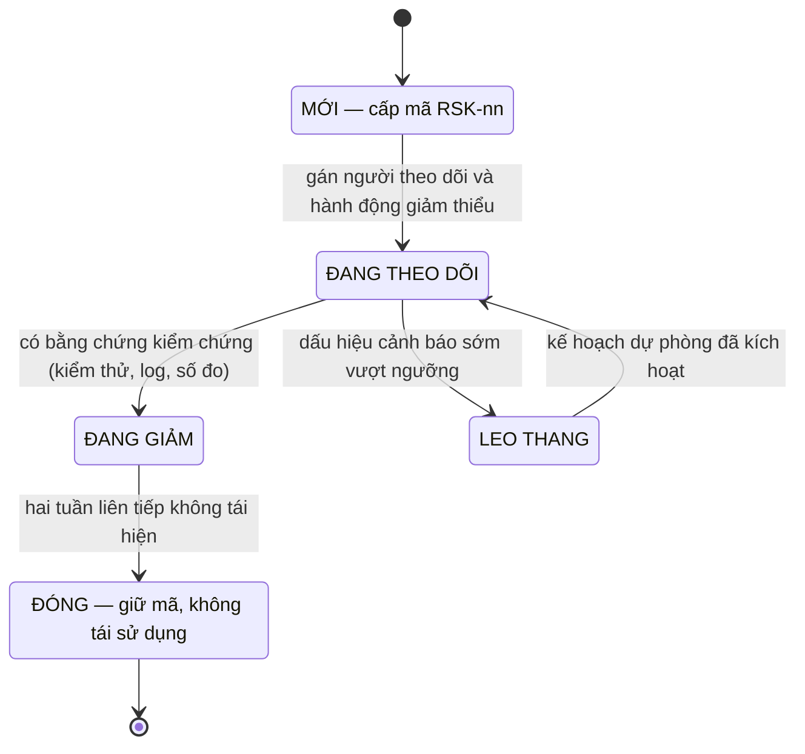

# 05 — Quản lý rủi ro

> Sổ rủi ro của dự án **Hệ thống đặt phòng khách sạn – homestay Pine Hill** (3 cơ sở · 55 phòng · 7 kênh bán · 13 module · 52 use case · 136 quy tắc BR) trong 15 tuần thực hiện.
> Mã rủi ro theo quy ước `RSK-nn` tại [00 §6](../00-tong-quan.md). Mọi giá trị nghiệp vụ trong tài liệu này **chỉ tham chiếu mã BR** tại [02/quy-tac-nghiep-vu](../02-nghiep-vu/quy-tac-nghiep-vu.md), không định nghĩa lại.

---

## 1. Mục đích, phạm vi, nguồn

| # | Hạng mục | Nội dung |
|---|----------|----------|
| 1 | Mục đích | Nhận diện – định lượng – theo dõi – ứng phó rủi ro cho toàn bộ vòng đời 15 tuần, gắn mỗi rủi ro với một hành động **kiểm chứng được** và một người chịu trách nhiệm |
| 2 | Phạm vi | Các hạng mục trong biên dự án [00 §3.1] |
| 3 | Ngoài phạm vi | Hạng mục ngoài biên [00 §3.2]; rủi ro kinh doanh sau bàn giao; rủi ro pháp lý ngoài Nghị định 13/2023/NĐ-CP (BR-SYS-04) |
| 4 | Nguồn chân lý | [02/quy-tac-nghiep-vu](../02-nghiep-vu/quy-tac-nghiep-vu.md) (136 BR) · [00 §6–§8](../00-tong-quan.md) (định danh · 13 module · 52 UC) · [lo-trinh](lo-trinh.md) (mốc M1–M8, cổng QG-0–QG-4, thang cắt giảm) |
| 5 | Chu kỳ rà soát | Hằng tuần vào thứ Sáu sau buổi demo; rà soát đầy đủ trước mỗi buổi **demo nghiệm thu sprint** ([lo-trinh §9](lo-trinh.md)); rà soát sâu tại mỗi cổng chất lượng QG-0…QG-4 |
| 6 | Người sở hữu sổ | PO/BA (kiêm thư ký dự án); mỗi rủi ro có **một** người theo dõi nêu ở cột cuối §4 |
| 7 | Công cụ | Bảng Markdown trong chính tài liệu này (diff được, không lệch khỏi mã — ADR-013); mọi cập nhật ghi vào §10 |

---

## 2. Thang điểm và quy ước

### 2.1. Thang xác suất (P) và mức ảnh hưởng (I)

| Mức | Xác suất xảy ra (P) | Mức ảnh hưởng (I) — lấy mức nặng nhất trong các trục tiến độ · chi phí · phạm vi · chất lượng |
|-----|---------------------|--------------------------------------------------------------------------------------------------|
| 1 | Không có tiền lệ và không có yếu tố thuận lợi nào trong 15 tuần | Chỉ ảnh hưởng mỹ quan tài liệu; không tốn giờ công |
| 2 | Có thể xảy ra nhưng cần đồng thời ≥ 2 điều kiện không chắc xảy ra | Tốn ≤ 2 giờ công; không ảnh hưởng mốc nào |
| 3 | Có yếu tố thuận lợi đã biết (thiếu kinh nghiệm, phụ thuộc bên ngoài) và **chưa** có biện pháp kín | Tốn ≤ 8 giờ công hoặc trượt một mốc con trong sprint |
| 4 | Đã từng xảy ra trong tài liệu/kế hoạch, hoặc là hệ quả gần như tất yếu của cách làm hiện tại nếu không can thiệp | Trượt một mốc M<sub>n</sub> hoặc làm sai một luồng nghiệp vụ có giao dịch với khách |
| 5 | Đang xảy ra hoặc chắc chắn xảy ra trong sprint hiện tại | Mất khả năng chứng minh BT-1/BT-2/BT-3, sai tiền của khách, mất dữ liệu, hoặc vi phạm bất biến cứng (BR-INV-03) |

### 2.2. Điểm rủi ro và dải ưu tiên

$$\text{Điểm rủi ro} = P \times I$$

| Dải điểm | Mức | Yêu cầu xử lý |
|----------|-----|---------------|
| **20 – 25** | Rất cao | Phân tích sâu bắt buộc; hành động giảm thiểu phải có **bằng chứng kiểm thử** trước mốc liền kề; báo cáo ở mọi buổi đồng bộ với chủ đầu tư |
| **15 – 19** | Cao | Phân tích sâu bắt buộc; theo dõi mỗi tuần; dấu hiệu cảnh báo sớm có **ngưỡng số** |
| **10 – 14** | Trung bình | Hành động giảm thiểu trong sprint tương ứng; theo dõi hai tuần một lần |
| **5 – 9** | Thấp | Chấp nhận có ý thức; chỉ theo dõi khi mốc liên quan tới gần |

### 2.3. Chiến lược ứng phó

| Chiến lược | Nghĩa trong dự án này | Điều kiện áp dụng |
|------------|----------------------|-------------------|
| **Né tránh** | Thiết kế/ràng buộc khiến rủi ro **không thể** biểu hiện (ví dụ ràng buộc CSDL, chuỗi quy tắc cố định) | Khi cách làm đúng có thể ép bằng cấu trúc thay vì bằng kỷ luật con người |
| **Giảm thiểu** | Giảm P và/hoặc I bằng hành động có bằng chứng | Mặc định cho phần lớn rủi ro nghiệp vụ |
| **Chuyển giao** | Đẩy trách nhiệm/đầu việc cho bên ngoài nhóm (chủ đầu tư, PSP, OTA) | Khi nguồn gốc rủi ro nằm ngoài quyền kiểm soát của nhóm |
| **Chấp nhận** | Không đầu tư thêm; ghi nhận, theo dõi và có dự phòng | Khi chi phí giảm thiểu > tổn thất kỳ vọng, hoặc hạng mục đã ngoài phạm vi |

### 2.4. Vòng đời một rủi ro

Năm trạng thái dưới đây là giá trị hợp lệ của cột "Trạng thái" trong nhật ký rủi ro (§10).



---

## 3. Tổng hợp sổ rủi ro

| Nhóm | Mã | Số rủi ro | Điểm cao nhất | Điểm trung bình | Số rủi ro điểm ≥ 15 | Người theo dõi chính |
|------|----|-----------|---------------|-----------------|---------------------|----------------------|
| Nghiệp vụ | RSK-01, 02, 05, 06, 12, 13 | 6 | 20 | 16,0 | 4 | PO/BA |
| Kỹ thuật | RSK-04, 08, 09, 15, 16, 17 | 6 | 20 | 13,7 | 2 | Kiến trúc sư kiêm Backend |
| Tiến độ & nhóm | RSK-07, 10, 11, 14, 18, 19 | 6 | 15 | 12,0 | 1 | PO/BA |
| Bên ngoài | RSK-03, 20, 21, 22, 23, 24 | 6 | 20 | 11,8 | 1 | PO/BA |
| **Tổng** | **RSK-01 … RSK-24** | **24** | **20** | **13,4** | **8** | — |

| Dải điểm | Số rủi ro | Danh sách |
|----------|-----------|-----------|
| 20 – 25 (rất cao) | 4 | RSK-01, RSK-02, RSK-03, RSK-04 |
| 15 – 19 (cao) | 4 | RSK-05, RSK-06, RSK-07, RSK-08 |
| 10 – 14 (trung bình) | 12 | RSK-09, RSK-10, RSK-11, RSK-12, RSK-13, RSK-14, RSK-15, RSK-16, RSK-17, RSK-18, RSK-20, RSK-22 |
| 5 – 9 (thấp) | 4 | RSK-19, RSK-21, RSK-23, RSK-24 |

> **Top 8 phân tích sâu (§6) = toàn bộ rủi ro có điểm ≥ 15**, tức RSK-01 … RSK-08. Quy tắc này tất định: bảng điểm ở §4 không có rủi ro nào khác đạt 15.

---

## 4. Sổ rủi ro chi tiết

Quy ước: mỗi nhóm có **bảng A** (nhận diện – định lượng – chiến lược) và **bảng B** (hành động giảm thiểu · dấu hiệu cảnh báo sớm · kế hoạch dự phòng) khoá theo mã. Hành động ở bảng B phải kiểm chứng được bằng một trong: ca kiểm thử tự động, truy vấn CSDL, số đo ở cổng chất lượng, hoặc điều kiện đạt của mốc.

### 4.1. Nhóm nghiệp vụ (NV)

| Mã | Mô tả rủi ro | Nguyên nhân gốc | P | I | Điểm | Chiến lược | Người theo dõi |
|----|--------------|-----------------|---|---|-------|------------|----------------|
| RSK-01 | Hiểu sai mốc thời gian huỷ và cơ sở tính tiền hoàn → hoàn thừa/hoàn thiếu, tranh chấp với khách | Mốc tính bằng **giờ** trước thời điểm nhận phòng (BR-CANCEL-03, BR-GEN-04) nhưng hiện trường quen đếm theo "ngày"; cơ sở hoàn là `paidAmount` chứ không phải `totalAmount` (BR-CANCEL-04); thang 11 bậc của 4 gói giá là dữ liệu, không phải `if/else` (BR-CANCEL-01) | 4 | 5 | **20** | Giảm thiểu | PO/BA |
| RSK-02 | Sai thứ tự áp hệ số giá, sai vị trí làm tròn hoặc sai vị trí kẹp sàn/trần → giá bán lệch, có đêm vượt trần | Thứ tự 6 bước là cố định (BR-RATE-01); làm tròn **từng đêm** theo BR-GEN-03; kẹp `minPrice`/`maxPrice` ở bước 7 trước khi làm tròn; khuyến mãi chỉ áp trên `subtotal` đã làm tròn (BR-RATE-10) | 4 | 5 | **20** | Né tránh | Kiến trúc sư kiêm Backend |
| RSK-05 | Ghép phòng `MERGE_SHARE` vi phạm điều kiện cùng giới tính/đồng thuận → khiếu nại quyền riêng tư, đánh giá OTA giảm | BR-OVER-14 yêu cầu hội đủ **cả hai** điều kiện — hai khách đồng ý trên hệ thống **và** `MANAGER`+ duyệt kèm lý do — đồng thời mặc định chặn khác giới theo `Guest.gender`, với `UNSPECIFIED` bị coi là khác giới; điều kiện kép dễ bị cài thiếu một vế; áp lực thiếu phòng cao điểm đẩy lễ tân ghép ẩu | 4 | 4 | **16** | Né tránh | PO/BA |
| RSK-06 | Chọn sai khách để điều chuyển → khách hạng cao hoặc khách đã check-in bị đổi phòng, khiếu nại nặng | 5 thành phần `keepScore` + 3 khoá sắp xếp (BR-OVER-11) dễ cài thiếu/thừa thành phần, đặc biệt "đã tới nơi" và khoá phá hoà cuối `Booking.seq` (số thứ tự tăng đơn điệu, không dùng `bookingId` UUID); không loại booking `CHECKED_IN` theo BR-OVER-09 | 4 | 4 | **16** | Giảm thiểu | Kiến trúc sư kiêm Backend |
| RSK-12 | Chồng lấn mùa hoặc quên cấu hình `SE-TET` theo âm lịch → giá cao điểm sai toàn bộ | Quy tắc chọn mùa khi chồng lấn (priority → khoảng hẹp hơn → `createdAt` nhỏ hơn) chỉ nằm ở dạng văn bản tại [02 §4.2], chưa có mã BR; BR-RATE-05 cho phép mùa chồng lấn nên kết quả phụ thuộc hoàn toàn vào `priority` được cấu hình đúng; `SE-TET` phải nhập tay 7 ngày mỗi năm | 3 | 4 | **12** | Giảm thiểu | PO/BA |
| RSK-13 | Lẫn ranh giới giữa no-show, trả phòng sớm và đổi ngày → sai trạng thái và sai tiền | Ba luồng dùng chung mốc thời gian nhưng khác hành vi (BR-CANCEL-09/10, BR-BOOK-12/13); BR-CANCEL-09 buộc công thức `min(paidAmount, tổng giá các đêm chưa ở theo PriceSnapshot)` cùng lý do `EARLY_CHECKOUT`, dễ bị cài thành nhánh riêng thay vì dùng chung động cơ chính sách | 3 | 4 | **12** | Giảm thiểu | PO/BA |

| Mã | Hành động giảm thiểu (kiểm chứng được) | Dấu hiệu cảnh báo sớm (ngưỡng) | Kế hoạch dự phòng |
|----|----------------------------------------|--------------------------------|-------------------|
| RSK-01 | Dữ liệu hoá 11 bậc vào `CancellationPolicy`/`CancellationTier` (BR-CANCEL-01); ca biên bảng quyết định tại 168h00 · 167h59 · 72h00 · 72h01 · 24h00 · −1h (US-CANCEL-01/02); kiểm thử thuộc tính `refundAmount ≤ paidAmount` và `refundAmount` không tăng khi huỷ muộn hơn (BR-CANCEL-17, BR-PAY-07); ca bất khả kháng lưu `RefundRequest.evidenceRefs` và lý do ≥ 20 ký tự; `RefundRequest.reason` chỉ nhận giá trị của enum `CancelReason`, không phải chuỗi tự do (BR-CANCEL-13, BR-SYS-05); ca vòng đời `RefundRequest` `PENDING → CANCELLED` — chỉ người tạo hoặc MANAGER+, bắt buộc lý do, không huỷ được khi đã `APPROVED`/`PAID` (BR-CANCEL-18); ca huỷ một phần khi `roomCount > 1`: `refundBase` phân bổ theo tỷ lệ giá các phòng bị huỷ trên `totalAmount` rồi mới áp BR-CANCEL-05, phần phòng còn lại giữ nguyên giá và `RoomAssignment`, lưu thêm `PriceSnapshot` điều chỉnh và giữ bản gốc, huỷ hết phòng mới sang `CANCELLED` toàn phần (BR-CANCEL-19); mọi ngưỡng phê duyệt/báo cáo so trên `netRefund = refundAmount − refundFee`, `BR-CANCEL-15` so `netRefund > 5.000.000` (BR-CANCEL-05); ca `PriceSnapshot` được lưu ngay khi booking rời `DRAFT` (`HELD`/`PENDING_PAYMENT`/`CONFIRMED`) để BR-CANCEL-06 luôn có `firstNightPrice`, có `seq` và `kind` (`ORIGINAL`/`RESCHEDULE`/`PARTIAL_CANCEL`) phân biệt bản gốc với bản điều chỉnh (BR-RATE-16, BR-CANCEL-19); đối chiếu bảng [02 §6.1] với chủ đầu tư tại M1 | Ca biên đỏ trong CI; tồn tại `RefundRequest.approvedAmount > Payment.paidAmount`; ≥ 1 khiếu nại về số tiền hoàn trong 2 tuần; `hoursBeforeCheckIn` tính ra số nguyên ngày | Chặn huỷ tự động trên web (chỉ lễ tân/CSKH thao tác), rà `RefundRequest` 30 ngày, lấy bảng tính tay của PO làm nguồn đối chiếu cho tới khi động cơ xanh |
| RSK-02 | `PricingRuleChain` với thứ tự cố định + ca kiểm thử khẳng định dãy hệ số đã áp; ca vàng FAM 1 đêm Thứ Sáu trong `SE-NY` kênh `OTA_BOOKING` cho ra 4.200.000 (bị kẹp trần) chứ không phải 4.224.000; ca `E_RATE_BELOW_FLOOR` (BR-RATE-12); kiểm thử thuộc tính bội 1.000 và nằm trong `[minPrice, maxPrice]`; đối chiếu 24 tổ hợp với bảng tính tay ở M5 (US-RATE-01); hệ số và ngưỡng đọc từ `SystemSetting` (`pricing.weekendMultiplier` = 1,20 · `pricing.maxDiscountPct` = 30 · `pricing.occupancyMidPct` = 80 · `pricing.occupancyHighPct` = 95) theo BR-SYS-02 | ≥ 1 báo giá khác bảng tính tay; `nightlyPrice > maxPrice`; xuất hiện `Math.round`/số thực trong `packages/domain`; cảnh báo cân bằng giá (BR-RATE-09) bắn sai | Khoá báo giá ở server; in bảng hệ số từng đêm từ `PriceSnapshot` (BR-RATE-16) cho PO duyệt tay ở M5; giá đã chốt giữ nguyên, chênh lệch xử lý bằng khuyến mãi bù có duyệt |
| RSK-05 | Ràng buộc CSDL `CHECK (consent_primary AND consent_secondary)` cho `room_merges` khi `status` chuyển sang `ACTIVE` (vòng đời `PENDING_CONSENT → APPROVED → ACTIVE`); ca kiểm thử âm khẳng định **hai mã lỗi khác nhau**: thiếu đồng thuận → `E_OVER_NO_CONSENT` (BR-OVER-13), đủ đồng thuận nhưng khác giới chưa được duyệt → `E_OVER_MERGE_GENDER` (BR-OVER-14); luồng xin đồng thuận lưu bằng chứng có thời điểm cho cả hai bên; ca kiểm thử ghép khác giới khẳng định phải đủ **cả hai** vế của BR-OVER-14 (`consentPrimary` + `consentSecondary` **và** `MANAGER`+ duyệt có lý do), trong đó `Guest.gender = UNSPECIFIED` bị coi là khác giới; chiết khấu ghi vào `RoomMerge.discountAmount` — nguồn chi phí xử lý quá tải cho UC-REP-04 (BR-OVER-15); chỉ số báo cáo dùng đúng định nghĩa BR-REP-01, không khai báo lại (DOR đếm theo đơn vị bán là giường) | `RoomMerge` thiếu một trường `consent*`; khiếu nại quyền riêng tư xuất hiện trong `GuestNote`; tỷ lệ ghép thành công > 80% ở một đêm cao điểm (dấu hiệu ghép ẩu) | Tắt `MERGE_SHARE` trong cao điểm, chuyển sang bậc 2 rồi bậc 4 của thang điều chuyển (bậc 3 không khả dụng: ba cơ sở cách nhau 160–300 km), báo ACT-04/ACT-05 |
| RSK-06 | `OverbookingPlanner` là hàm thuần và tất định: cùng đầu vào → cùng kết quả (kiểm thử chạy lại 2 lần trên 1.000 bộ dữ liệu giả lập); ca vàng PLATINUM đủ tiền 7 đêm, quay lại, đã tới nơi (keepScore 159) không xuất hiện trong đề xuất khi còn khách điểm thấp hơn; in bảng `keepScore` cho quản lý trước khi xác nhận (BR-OVER-11); ca kiểm thử `HELD`/`WALKIN` chưa trả không vượt booking đã cọc (BR-OVER-12); ca `OverbookingCase` quá hạn chuyển `ESCALATED`, xử lý như sự cố tại chỗ, giữ `detectedAt`/`resolvedAt`/người xử lý/`delayReason` cho UC-REP-04 theo định nghĩa chi phí xử lý quá tải và tỷ lệ huỷ của BR-REP-01 và **không** tự động đóng (BR-OVER-16); ca walk-out lưu chứng từ `RoomMove.walkOutDocNo`/`guestSignatureRef`/`staffSignatureRef` và bút toán `Payment` loại `COMPENSATION` (BR-OVER-06) | Hai lần chạy "đề xuất phương án" trên cùng ca cho kết quả khác nhau; booking `CHECKED_IN` nằm trong danh sách; bảng điểm không hiển thị được cho quản lý | Duyệt tay toàn bộ danh sách điều chuyển bởi ACT-04 dựa trên bảng điểm in ra; tạm chỉ tự động hoá bậc 1–2 |
| RSK-12 | Nạp lịch mùa năm kế tiếp vào `Season` trước W5 (UC-RATE-02); ca kiểm thử chồng lấn `SE-NAT` (31/08–03/09, priority 80) vs `SE-SHO` (16/08–30/09, priority 30) → chọn `SE-NAT` (`SE-LOW` nay kéo dài tới 29/12 nên không còn chồng `SE-NY`); ca hai mùa cùng `priority` phải sinh cảnh báo trên màn hình cấu hình (BR-RATE-05); xác nhận lịch Tết âm lịch với ACT-05 trước M3 | Có ngày khớp ≥ 2 mùa cùng `priority`; ngày lễ lớn không khớp mùa nào; hệ số mùa = 1,00 rơi vào cao điểm | Nạp lịch mùa bằng migration dữ liệu kèm `AuditLog`, báo ACT-05; tạm dùng ghi đè giá cho các đêm lễ |
| RSK-13 | Bảng quyết định riêng cho 3 luồng (US-CANCEL-03/04, US-BOOK-06); ca kiểm thử đúng 23:59 ngày nhận phòng (BR-CANCEL-10); ca dựa trên `Booking.rescheduleCount`: lần đổi ngày thứ hai bị chặn và gợi ý huỷ + đặt mới (BR-BOOK-12); đổi ngày lưu thêm `PriceSnapshot` mới và giữ bản cũ (BR-RATE-16); ca booking ở `CANCELLED`/`NO_SHOW`/`EXPIRED` có `balanceDue = penaltyAmount`, **không** sinh công nợ cho phần `totalAmount − paidAmount` (BR-PAY-02); ca `NONREF` đổi ngày thu 10%; ca booking `CHECKED_IN` không sửa được ngày (BR-BOOK-13); ca đổi ngày **không** sinh chuyển trạng thái, giữ `PriceSnapshot` cũ và ghi `AuditLog` (BR-BOOK-12); ca xoá cứng chỉ cho `DRAFT`/`HELD` chưa phát sinh thanh toán, đã có thanh toán thì chuyển `CANCELLED` + `RefundRequest` (BR-BOOK-14); ca trả phòng sớm trả đúng `min(paidAmount, tổng giá các đêm chưa ở)` và ghi lý do `EARLY_CHECKOUT` (BR-CANCEL-09); ngưỡng đọc từ dữ liệu `CancellationPolicy.earlyCheckoutFreeHours`/`earlyCheckoutRefundPct` (FLEX7 72/50 · SAVER3 72/50 · LONGSTAY14 168/50 · NONREF null/0), cấm hard-code (BR-CANCEL-01, BR-SYS-02); ca xoá cứng `DRAFT`/`HELD` phải ghi `AuditLog` với `beforeJson` đầy đủ **trước khi** xoá (BR-BOOK-17, BR-GEN-07) | Booking `CONFIRMED` còn nguyên sau 00:00 ngày kế tiếp mà chưa `NO_SHOW`; đổi ngày sinh `RefundRequest` (bị cấm bởi BR-CANCEL-08); trả phòng sớm không sinh bút toán nào | Xử lý thủ công có duyệt ACT-04 và ghi lý do; tạm chỉ cho phép một lần đổi ngày cho tới khi bảng quyết định xanh |

### 4.2. Nhóm kỹ thuật (KT)

| Mã | Mô tả rủi ro | Nguyên nhân gốc | P | I | Điểm | Chiến lược | Người theo dõi |
|----|--------------|-----------------|---|---|-------|------------|----------------|
| RSK-04 | Ràng buộc loại trừ chống trùng **đơn vị bán** không tồn tại trên môi trường thật → hai `RoomAssignment` cho cùng `(roomId, bedNo, đêm)`, phá bất biến cứng BR-INV-03 | Prisma 6 không sinh được `EXCLUDE USING gist` (ADR-003) nên phải viết migration SQL thủ công; dễ bị `prisma migrate` ghi đè/đánh dấu drift, hoặc thiếu ở CI và môi trường chấm; phụ thuộc extension `btree_gist` | 4 | 5 | **20** | Né tránh | Kiến trúc sư kiêm Backend |
| RSK-08 | Giá hiển thị lệch giữa web khách, app Android và API → vi phạm BR-RATE-17, mất niềm tin và phát sinh tranh chấp giá | Xu hướng tính giá ở client cho nhanh (bản sao logic); phiên bản `packages/domain` ghim khác nhau giữa các app; đơn vị tiền hiển thị khác nhau (đồng vs nghìn đồng) | 4 | 4 | **16** | Né tránh | Frontend web + Mobile |
| RSK-09 | Lỗi cài đặt mốc thời gian (múi giờ, biên so sánh `≥`/`>`) làm chọn sai bậc huỷ và sai mốc no-show | Lưu UTC nhưng so mốc theo giờ VN (BR-GEN-02/05); dễ dùng `>` thay vì `≥` tại đúng 168h00; `Property.checkInTime` bị hard-code thay vì đọc theo cơ sở (BR-GEN-04) | 3 | 4 | **12** | Giảm thiểu | Kiến trúc sư kiêm Backend |
| RSK-15 | Dùng số thực hoặc làm tròn muộn → sai tiền tích luỹ và sai chiều làm tròn (lên với giá/cọc, xuống với hoàn) | `number` của TypeScript là dấu phẩy động; BR-GEN-01/03 quy định hai chiều làm tròn khác nhau; JSON/CSDL dễ trôi sang kiểu thập phân | 2 | 5 | **10** | Né tránh | QA/DevOps |
| RSK-16 | Khoá bi quan theo `(roomTypeId, date)` gây nghẽn hoặc deadlock ở 200 yêu cầu đồng thời và ở job giải phóng hold | BR-INV-02 buộc kiểm tra tồn và giữ chỗ trong **một** transaction có `SELECT … FOR UPDATE`; job hold (BR-INV-04) chạy song song dễ chồng khoá; truy vấn theo từng đêm làm tăng số khoá | 3 | 4 | **12** | Giảm thiểu | QA/DevOps |
| RSK-17 | Outbox/webhook đồng bộ trùng hoặc mất sự kiện → tồn kho trên OTA lệch, tạo booking trùng | BR-CHAN-02/06 yêu cầu gửi qua outbox trong ≤ 5 phút; OTA và PSP đều có thể gửi lại; retry 3 lần (BR-CHAN-07) dễ nhân bản nếu consumer không idempotent (BR-GEN-08) | 3 | 4 | **12** | Giảm thiểu | Backend/Frontend web |

| Mã | Hành động giảm thiểu (kiểm chứng được) | Dấu hiệu cảnh báo sớm (ngưỡng) | Kế hoạch dự phòng |
|----|----------------------------------------|--------------------------------|-------------------|
| RSK-04 | SQL thủ công trong `infra/sql` gồm `CREATE EXTENSION btree_gist` và `EXCLUDE USING gist (room_id WITH =, bed_no WITH =, valid_range WITH &&) WHERE (released_at IS NULL)` — `bed_no` NOT NULL mặc định `0` = "cả phòng", `1..bedCount` = giường DOR (BR-PROP-04), tuyệt đối không dùng khoá đơn kiểu `COALESCE(bed_no::text, room_id)` hay `sell_unit_id` vì sẽ va chạm giữa các phòng khác nhau; bước CI khẳng định `SELECT count(*) FROM pg_constraint WHERE contype='x'` = 1 trên Postgres 16 (Testcontainers); kịch bản 200 yêu cầu đồng thời (US-INF-02, NFR-REL-01) chạy trong CI: đúng 1 thành công, 199 nhận lỗi `E_INV_ROOM_TAKEN` (ánh xạ mã `23P01` của PostgreSQL) hoặc `E_INV_NO_AVAILABILITY` — cả hai HTTP 409, cấm nuốt lỗi rồi báo thành công; ca kiểm thử âm chèn trực tiếp 2 assignment chồng lấn: CSDL từ chối (`23P01`) và tầng ứng dụng chuyển thành `E_INV_ROOM_TAKEN` (BR-INV-03); ghi thứ tự migrate vào README | Bất kỳ môi trường nào có `count(*) … contype='x'` = 0; `prisma migrate diff` báo drift; kịch bản 200 đồng thời trả 2 thành công; ca chống trùng bị skip khỏi CI | Không cho M4 xanh; thêm khoá Redis theo `(roomTypeId, date)` như lớp tạm (BR-INV-02) nhưng vẫn phải có ràng buộc CSDL trước M8; nếu đã sinh dữ liệu trùng: khoanh vùng, làm sạch và backfill |
| RSK-08 | Cấm tính giá ở client: luật lint cấm `apps/*` import động cơ giá (chỉ được import kiểu) + ca kiểm thử cấu trúc; mọi màn hình lấy giá từ `PriceQuote` của API; ca kiểm thử hợp đồng 3 nền tảng cùng đầu vào (Playwright + Maestro + Supertest) chạy ở M5; trả `engineVersion` trong `PriceQuote` ([00 §7.2–§7.3]) và hiển thị bảng giá từng đêm kèm hệ số | Ca đối chiếu 3 nền tảng đỏ; tìm thấy công thức giá trong `apps/mobile` hoặc `apps/web`; `engineVersion` khác nhau giữa các client; chênh giá ≥ 1.000 đ | Khoá phát hành app, buộc nâng cấp gói; nếu đã bán sai: hoàn/bù chênh lệch có duyệt ACT-04 và ghi `AuditLog` |
| RSK-09 | `CancellationPolicyEngine` thuần, nhận thời điểm hiện tại qua tham số (cổng `Clock`, không `Date.now()`); ca biên 168h00 · 167h59 · 72h00 · 72h01 · 24h00 · 23h59; ca bậc bắt tất `offsetHours = −1` phải áp cho **mọi** giá trị `hoursBeforeCheckIn < 24` kể cả số âm (no-show lúc 23:59 ≈ −9,98h) và hàm chọn bậc không bao giờ trả về rỗng (BR-CANCEL-01); ca no-show đúng 23:59 giờ VN (BR-CANCEL-10); ca cơ sở có `checkInTime` khác 14:00; kiểm thử thuộc tính khẳng định không có giờ mùa (BR-GEN-05) | Ca biên lệch đúng 1 giờ; kết quả khác nhau giữa máy dev và CI; số bậc chọn được khác bảng [02 §6.1] | Tra bậc thủ công bằng bảng tính tay và chặn chi hoàn trong thời gian sửa; bổ sung ca biên vào CI hồi quy trước khi mở lại luồng tự động |
| RSK-15 | `Money` VO với `amount` là số nguyên VND, không có phép toán thập phân; ràng buộc CSDL cho các cột tiền đã chốt (`total_amount`, `deposit_amount`, `refunded_amount`) là bội 1.000; kiểm thử thuộc tính bội 1.000 và đúng chiều làm tròn; luật lint cấm `parseFloat`/`toFixed` trong `packages/domain` | DDL hoặc mã miền xuất hiện kiểu thập phân; lệch 1–999 đ khi đối chiếu tổng; payload JSON có phần thập phân | Đổi kiểu cột bằng migration và tính lại dữ liệu thử; bật kiểm tra tự động trong CI trước khi đóng băng API |
| RSK-16 | Khoá các đêm theo thứ tự ngày tăng dần để tránh deadlock; chỉ mục GIST cho `room_assignments (room_id, bed_no, valid_range)`; ca hai tầng tồn khả dụng: tồn chung = `ACTIVE` − `RoomBlock` − `RoomAssignment` − hold chưa sinh assignment; tồn kênh = `min(tồn chung, allotment − used)` và allotment KHÔNG trừ vào tồn chung (BR-INV-01, BR-CHAN-01); đối chiếu tổng đơn vị bán 75 theo ma trận cơ sở × loại phòng (BR-PROP-03); ca kiểm thử tải bằng k6 với 200 VU (NFR-PERF-01, NFR-REL-01/02) đo p95 và tỷ lệ deadlock ở M4; kiểm tra hold được giải phóng ≤ 60 giây; khẳng định khoá `job.hold.releaseIntervalSeconds` = 30 trong `SystemSetting` (BR-SYS-02) và báo lỗi nếu bị cấu hình > 55 giây; job đối chiếu `Hold` ↔ `Booking.holdExpiresAt` mỗi 900 giây (`job.holdReconcile.intervalSeconds`) để không tồn tại hold mồ côi (NFR-REL-02) | p95 > 800 ms; tỷ lệ lỗi deadlock > 0,1%; hold còn hiệu lực sau 60 giây; hàng đợi khoá tăng liên tục | Thu hẹp phạm vi khoá, đưa bước kiểm tra nhanh sang Redis trước khi vào transaction; giảm tải kịch bản và ghi rõ giới hạn đo |
| RSK-17 | `OutboxEvent` ghi trong cùng transaction với dữ liệu nghiệp vụ (BR-CHAN-06); consumer idempotent theo `(eventType, aggregateId)` và lưu khoá ở `IdempotencyKey` (BR-GEN-08); callback lặp trả `E_PAY_CALLBACK_DUPLICATE`, không tạo `Payment` mới; ca gửi lặp 10 lần → 1 bản ghi (NFR-REL-06); ca booking OTA đẩy vào luôn nhận `CONFIRMED` + `oversold = true` + mở `OverbookingCase` (miễn trừ của BR-CHAN-03); đếm số lần gửi thất bại liên tiếp: từ lần thứ 3 trở đi trả `E_CHAN_SYNC_FAILED` và đánh dấu kênh `DEGRADED` qua `Channel.syncStatus`/`consecutiveSyncFailures`/`lastSyncError` (enum `ChannelSyncStatus`, BR-CHAN-07) | Số booking nhận từ webhook > số booking duy nhất; kênh `DEGRADED`; > 100 bản ghi outbox chưa xử lý; đồng bộ trễ > 5 phút | Tạm đóng bán trên kênh OTA lỗi (BR-CHAN-05) và đối soát thủ công qua báo cáo của ACT-06; replay outbox theo đúng thứ tự |

### 4.3. Nhóm tiến độ & nhóm (TD)

| Mã | Mô tả rủi ro | Nguyên nhân gốc | P | I | Điểm | Chiến lược | Người theo dõi |
|----|--------------|-----------------|---|---|-------|------------|----------------|
| RSK-07 | Đội chưa từng tích hợp cổng thanh toán → callback sai chữ ký, xử lý không idempotent, hoặc vô tình lưu dữ liệu thẻ; trượt M6 | Không thành viên nào có kinh nghiệm VNPay/MoMo (ADR-009, sandbox); luồng IPN và return khác nhau; tài liệu PSP thay đổi theo phiên bản | 3 | 5 | **15** | Giảm thiểu | Backend/Frontend web |
| RSK-10 | Trễ mốc M3 (đóng băng hợp đồng API) → web và mobile làm trên hợp đồng cũ, phát sinh việc sửa lại hai lần | GĐ-2 chỉ có 2 tuần cho 6 hạng mục WBS 3.1–3.6; thiết kế phụ thuộc BR còn mơ hồ; khối lượng 136 BR và 52 UC là lớn | 3 | 4 | **12** | Giảm thiểu | PO/BA |
| RSK-11 | Một thành viên vắng dài (ốm/lịch thi) làm nghẽn đường găng | Nhóm 5 người, mỗi người giữ một mảng sâu ([lo-trinh §2]); đường găng đi qua các hạng mục chỉ một người làm (WBS 4.5, 5.1, 6.1) | 3 | 4 | **12** | Giảm thiểu | PO/BA |
| RSK-14 | Ước lượng lệch làm nợ kỹ thuật dồn sang sprint sau | Sprint 1 là 31 SP và Sprint 3 là 36 SP so với định mức 25 SP/sprint; dự phòng hiện có 12 điểm (≈ 6% ngân sách điểm) | 4 | 3 | **12** | Chấp nhận | PO/BA |
| RSK-18 | Bus factor = 1 cho `packages/domain` → mất một người là mất năng lực sửa lõi nghiệp vụ | Chỉ kiến trúc sư làm miền thuần (WBS 5.1, 6.1); miền đòi hỏi hiểu BR sâu và không có I/O để "đọc hành vi từ mã hạ tầng" | 3 | 4 | **12** | Giảm thiểu | Kiến trúc sư kiêm Backend |
| RSK-19 | Tài liệu lệch mã, ma trận truy vết còn ô trống ở M8 → mất điểm phần truy vết đầy đủ | Ma trận BR × UC × API × thực thể × ca kiểm thử rất lớn; việc cập nhật tài liệu dễ bị dồn tới cuối kỳ (QG-4) | 3 | 3 | **9** | Giảm thiểu | PO/BA |

| Mã | Hành động giảm thiểu (kiểm chứng được) | Dấu hiệu cảnh báo sớm (ngưỡng) | Kế hoạch dự phòng |
|----|----------------------------------------|--------------------------------|-------------------|
| RSK-07 | Spike 1 ngày ở W6 chứng minh vòng "tạo giao dịch → callback → ghi `Payment`" trên sandbox; ca kiểm thử idempotent gửi cùng `Idempotency-Key` 2 lần → 1 `Payment`, lần gửi lại nhận `E_PAY_CALLBACK_DUPLICATE` và trả kết quả cũ (BR-PAY-03, BR-GEN-08); job 15 phút chuyển giao dịch treo sang `FAILED` và giải phóng hold (BR-PAY-05, NFR-REL-02); ca kiểm thử cấu trúc khẳng định schema không có trường số thẻ/CVV (BR-PAY-04, NFR-SEC-02) | > 2 ngày liền không có giao dịch sandbox thành công; callback trùng khoá tạo `Payment` thứ hai; xuất hiện trường `cardNumber`/`cvv` trong DDL hoặc mã; giao dịch treo > 15 phút chưa `FAILED` | Dùng `PaymentGatewayAdapter` mô phỏng nội bộ (cùng hợp đồng cổng, đổi không đổi miền) và ghi rõ giới hạn trong báo cáo; nếu có sandbox muộn: dành 8 giờ ở W11 đấu nối một phương thức |
| RSK-10 | Đóng băng `packages/contracts` (zod) trước, sinh OpenAPI tự động; quy tắc "phá vỡ hợp đồng phải tăng phiên bản và thông báo trước 24 giờ"; danh sách kiểm WBS 3.1–3.6 làm tiêu chí QG-2 | Hết ngày thứ Tư W5 còn > 1 hạng mục WBS 3.x chưa xong; OpenAPI sinh lỗi; web/mobile phải hỏi lại định dạng API ≥ 2 lần mỗi tuần | Đóng băng "v1 tối thiểu" cho INV/RATE/BOOK, hoãn hợp đồng của OVER/REP sang sprint 4; áp thang cắt giảm [lo-trinh §7] mục 2 và 5 |
| RSK-11 | Cặp đôi lập trình cho 3 hạng mục đường găng (WBS 4.5, 5.1, 6.1); review mã chéo trong ngày ([lo-trinh §9]) để mỗi module có ≥ 2 người hiểu; nhật ký quyết định kỹ thuật ngắn trong mô tả PR | Vắng ≥ 2 ngày liên tiếp không báo trước; ≥ 2 hạng mục ưu tiên M bị chặn > 3 ngày; PR không có người duyệt trong 24 giờ | Dồn người từ hạng mục ưu tiên S/C (US-CTRL-01, US-NOTI-01); kích hoạt thang cắt giảm [lo-trinh §7] từ mục 1 |
| RSK-14 | Burndown cập nhật hằng ngày ở stand-up; bắt buộc cắt theo [lo-trinh §7] khi trễ > 2 ngày thay vì dồn việc sang sprint sau; retrospective cuối sprint ghi một hành động cải tiến; hiệu chỉnh tốc độ sau sprint 1 | Tốc độ thực tế < 20 SP trong 2 sprint liên tiếp; ≥ 3 việc trôi sang sprint sau; nợ kỹ thuật > 5 điểm | Cắt các hạng mục ưu tiên C/S; tuyệt đối không cắt ràng buộc chống trùng, động cơ giá, chính sách huỷ, kiểm thử miền, nhật ký kiểm toán |
| RSK-18 | Bắt buộc cặp đôi ở WBS 5.1/6.1; 100% hàm miền có kiểm thử đọc được (độ phủ nhánh ≥ 90% — NFR-MAIN-01) nên hành vi được ghi lại bằng mã; tài liệu hoá hợp đồng hàm miền bằng JSDoc + kiểu chặt | ≥ 1 tuần không ai khác ngoài kiến trúc sư sửa được file miền; độ phủ nhánh < 90%; lỗi miền không có ca tái hiện | Chuyển cặp đôi toàn thời gian cho động cơ chính sách huỷ (đường găng) và lấy bảng quyết định làm đặc tả thi hành |
| RSK-19 | CI sinh ma trận truy vết và chặn gộp nếu BR mới không có ca kiểm thử (NFR-MAIN-03); mỗi PR phải cập nhật ô truy vết liên quan; rà soát ma trận ở mỗi cổng QG | > 5 BR không có ca kiểm thử; ma trận sinh ra khác bản trong repo; tài liệu không được cập nhật trước mốc ([lo-trinh §9]) | Khoá tính năng mới, dành W15 chỉ để đồng bộ tài liệu ↔ mã; ô chưa kiểm chứng ghi rõ "chưa kiểm chứng" thay vì bịa |

### 4.4. Nhóm bên ngoài (BN)

| Mã | Mô tả rủi ro | Nguyên nhân gốc | P | I | Điểm | Chiến lược | Người theo dõi |
|----|--------------|-----------------|---|---|-------|------------|----------------|
| RSK-03 | Không có API OTA thật để kiểm chứng → bộ mô phỏng có thể không đại diện, phần chứng minh BT-3 yếu | [00 §3.2] tuyên bố tích hợp thật ngoài phạm vi; payload và chính sách huỷ khác nhau theo kênh (BR-CHAN-04); nhóm không có quyền truy cập đối tác | 4 | 5 | **20** | Chấp nhận | PO/BA |
| RSK-20 | Không có tài khoản sandbox VNPay/MoMo trước W9 → trượt phần thanh toán trực tuyến | Việc đăng ký thuộc chủ đầu tư ([lo-trinh §10]) và phụ thuộc hồ sơ doanh nghiệp của đối tác | 3 | 4 | **12** | Chuyển giao | PO/BA |
| RSK-22 | Chủ đầu tư trả lời Q-01…Q-12 muộn hoặc rải rác → mặc định tạm bị bác bỏ sau khi đã lập trình, phải sửa BR và kiểm thử | 12 câu hỏi phụ thuộc người ngoài nhóm ([00 §11]); mốc chặn là hết W2 nhưng chưa có cơ chế chốt khi không có phản hồi | 3 | 4 | **12** | Giảm thiểu | PO/BA |
| RSK-21 | Dịch vụ thông báo (Resend/SMS/Zalo OA) lỗi hoặc hết hạn mức → khách không nhận xác nhận, nhắc hẹn | Dịch vụ ngoài (ACT-10); hạn mức miễn phí; Zalo OA cần xác thực doanh nghiệp; định dạng số điện thoại/template dễ sai | 3 | 3 | **9** | Chấp nhận | Backend/Frontend web |
| RSK-23 | Số liệu hiện trạng (2–4 vụ quá tải/tháng, chênh 15–25% giá) là ước lượng khảo sát → tiêu chí thành công không đo được khách quan | Chủ chuỗi không có dữ liệu tập trung (ba sổ/Excel riêng theo cơ sở); mẫu khảo sát nhỏ | 3 | 3 | **9** | Chấp nhận | PO/BA |
| RSK-24 | Hạ tầng ngoài (GitHub Actions, Vercel, EAS Build, Testcontainers) không ổn định → CI đỏ giả, chậm phát hành | Hạn mức miễn phí về số phút CI và số lượt build; CI cần Docker để chạy Postgres 16; mạng dùng chung chập chờn | 3 | 3 | **9** | Chấp nhận | QA/DevOps |

| Mã | Hành động giảm thiểu (kiểm chứng được) | Dấu hiệu cảnh báo sớm (ngưỡng) | Kế hoạch dự phòng |
|----|----------------------------------------|--------------------------------|-------------------|
| RSK-03 | Hợp đồng adapter bằng zod cho cả 3 kênh trong `packages/contracts` (`ChannelAdapter` + lớp chống tham nhũng) và ca kiểm thử hợp đồng riêng cho `BookingComAdapter`, `AgodaAdapter`, `AirbnbAdapter`; bộ mô phỏng nằm sau adapter nên đổi lớp mô phỏng không đổi lớp miền; ánh xạ loại phòng ↔ mã phòng OTA qua `ChannelMapping` (BR-CHAN-08); lưu fixture payload mẫu kèm nguồn và phiên bản; ca webhook lặp → 1 booking (NFR-REL-06); ca booking vượt tồn tạo `oversold = true` và mở `OverbookingCase` (BR-OVER-03) — **kể cả khi `overbookLimitPct = 0`**, theo miễn trừ tường minh của BR-CHAN-03; ca mỗi `OverbookingCase` chuyển `RESOLVED` trước T−24h hoặc bị đánh dấu `ESCALATED` (enum `OverbookingCaseStatus`, BR-OVER-04); ca case quá hạn ngày thiếu phòng không được tự đóng mà phải chuyển `ESCALATED` kèm lý do trễ (BR-OVER-16); ca vượt trần bán vượt trả `E_OVER_LIMIT_EXCEEDED` (BR-OVER-02); ca huỷ đến từ OTA lưu `Booking.channelPolicyCode` khi `cancelReason = OTA_CANCELLATION` để đối soát (BR-CHAN-04, UC-PAY-05); kịch bản bơm 60 booking ở M7 | < 3 payload mẫu khác nhau; phải sửa lớp miền khi đổi kênh (dấu hiệu ACL bị thủng); webhook lặp tạo 2 booking; không mô phỏng được trạng thái huỷ theo chính sách kênh | Giữ 2 OTA (cắt `OTA_AIRBNB` theo [lo-trinh §7] mục 2); trình bày mục "hợp đồng dự kiến vs thực tế" trong báo cáo; nếu chủ đầu tư cấp quyền truy cập: +16 giờ mỗi kênh |
| RSK-20 | Đưa yêu cầu cấp sandbox vào biên bản họp với ACT-05 ngay W1 và nhắc lại mỗi 2 tuần; thiết kế sẵn `PaymentGatewayAdapter` với `VnpayAdapter`, `MomoAdapter` và một adapter mô phỏng cùng hợp đồng; chứng minh idempotency và trạng thái giao dịch trên adapter mô phỏng (BR-PAY-03/05) | Hết W4 chưa gửi hồ sơ; hết W6 chưa có sandbox; không có đầu mối kỹ thuật phía PSP | Dùng adapter mô phỏng nội bộ và ghi rõ giới hạn; nếu sandbox về muộn: dành 8 giờ ở W11 đấu nối một phương thức, phần còn lại đưa vào backlog |
| RSK-22 | Gửi bảng câu hỏi kèm giá trị mặc định ngay W1, hạn trả lời ghi theo từng mã (§8); ghi cơ chế "im lặng sau hạn = chấp thuận mặc định" vào biên bản; đưa các giá trị trả lời vào `SystemSetting` khi có thể cấu hình (BR-SYS-02) để đổi mà không phải sửa mã | Hết W2 còn > 3 câu chưa trả lời; câu trả lời khác mặc định đang dùng; một câu trả lời thay đổi ≥ 2 lần | Nếu khác mặc định: đổi tham số/BR, chạy lại ca kiểm thử liên quan, ghi `AuditLog` lý do và báo ảnh hưởng phạm vi (dùng 12 điểm dự phòng) |
| RSK-21 | `Notification` ghi trạng thái và gửi lại tối đa 3 lần cách nhau 5 phút (BR-SYS-06); hàng đợi bền, lỗi thông báo không chặn luồng đặt phòng; ca kiểm thử khẳng định booking vẫn `CONFIRMED` khi dịch vụ email lỗi (NFR-USE-02); email là kênh bắt buộc, SMS/Zalo OA là kênh phụ có thể cắt ([lo-trinh §7] mục 3) | Tỷ lệ gửi lỗi > 10%; số lần gửi lại trung bình > 1,5; hạn mức còn < 20% | Chỉ giữ email và chuyển sang gọi khách thủ công do ACT-02; ghi rõ hạn chế trong báo cáo |
| RSK-23 | Ghi nhãn "giả định khảo sát" ở mọi trích dẫn số liệu ([00 §1]); lấy mốc so sánh trước/sau bằng chính hệ thống (số `OverbookingCase`, tỷ lệ huỷ, chênh giá) từ sprint 4; không dùng số khảo sát làm tiêu chí chấp nhận | Chủ đầu tư không xác nhận được số liệu ở M1; cùng một số liệu bị trích dẫn khác nhau giữa các tài liệu | Chuyển tiêu chí sang đo nội bộ (0 vụ trùng phòng, 0 ca quá tải xử lý sau T−24h) và ghi rõ giới hạn dữ liệu |
| RSK-24 | CI tách hai tầng (nhanh: typecheck + unit; đêm: integration + E2E) theo ADR-012; cache pnpm và lớp Docker; kịch bản demo chạy cục bộ bằng `docker compose` để không phụ thuộc mạng; theo dõi số phút CI mỗi tuần | > 20% lượt chạy CI đỏ vì hạ tầng (không do mã); thời gian CI > 10 phút (NFR-MAIN-03); vượt hạn mức build EAS | Chuyển E2E sang chạy đêm và trước mốc; nếu hết hạn mức EAS: xuất APK cục bộ và cài trực tiếp lên máy thật |

---

## 5. Ma trận rủi ro 5×5

| Ảnh hưởng ↓ · Xác suất → | 1 | 2 | 3 | 4 | 5 |
|---|---|---|---|---|---|
| **5 — Rất nặng** | — | RSK-15 · 10 | RSK-07 · 15 | RSK-01 · RSK-02 · RSK-03 · RSK-04 · 20 | — |
| **4 — Nặng** | — | — | RSK-09 · RSK-10 · RSK-11 · RSK-12 · RSK-13 · RSK-16 · RSK-17 · RSK-18 · RSK-20 · RSK-22 · 12 | RSK-05 · RSK-06 · RSK-08 · 16 | — |
| **3 — Trung bình** | — | — | RSK-19 · RSK-21 · RSK-23 · RSK-24 · 9 | RSK-14 · 12 | — |
| **1–2 — Nhẹ / không đáng kể** | — | — | — | — | — |

> Đọc ma trận theo §2.2: ô điểm ≥ 20 là vùng đỏ, 15–19 là vùng cam, 10–14 là vùng vàng, ≤ 9 là vùng xanh.
> Ma trận dạng đồ thị có thể được vẽ lại từ bảng trên theo toạ độ `x = (P − 0,5) / 5` và `y = (I − 0,5) / 5` bằng `quadrantChart` của Mermaid khi cần trình bày.

---

## 6. Phân tích sâu 8 rủi ro trọng yếu (RSK-01 … RSK-08)

### 6.1. RSK-01 — Hiểu sai mốc thời gian huỷ và cơ sở tính hoàn cọc

**Kịch bản xấu nhất.** Khách huỷ một booking `FLEX7` cho 4 đêm Family trong `SE-TET` (giá cơ bản 1.600.000/đêm, hệ số mùa 2,00 → 3.200.000/đêm; tổng 12.800.000; cọc 30% = 3.840.000 đã thu). Yêu cầu huỷ đến lúc 167h50 — **dưới** ngưỡng 168h. Hai lỗi cùng lúc: (a) làm tròn "168 giờ = 7 ngày" nên chọn bậc 1 hoàn 100%; (b) tính hoàn trên `totalAmount` thay vì `paidAmount`. Kết quả: hệ thống chi 12.800.000 thay vì 0, sai **12.800.000 đ cho một booking**; khách đã được xác nhận bằng email nên không thể thu hồi; kèm khiếu nại vì khách khác cùng mốc lại bị tính 0.

**Điểm kích hoạt.**

| # | Điểm kích hoạt | Ngưỡng |
|---|----------------|--------|
| 1 | Ca kiểm thử biên 168h00/167h59 chọn sai bậc | Bất kỳ lần đỏ nào trong CI |
| 2 | Truy vấn rà soát: `RefundRequest.approvedAmount > Payment.paidAmount` của cùng booking | ≥ 1 dòng |
| 3 | Bảng quyết định [02 §6.1] chưa đạt 100% ở cổng M6 | 1 ca trượt |
| 4 | Khiếu nại của khách về số tiền hoàn | ≥ 1 ca trong 2 tuần |

**Hành động ứng phó theo bước.**

| Bước | Hành động | Người thực hiện | Thời hạn | Bằng chứng |
|------|-----------|-----------------|----------|-----------|
| 1 | Chặn luồng huỷ tự động trên web; chỉ lễ tân/CSKH huỷ qua màn hình có hiển thị số tiền hoàn và bậc đã chọn (UC-BOOK-08) | Backend/Frontend web | ≤ 2 giờ | Cờ cấu hình trong `SystemSetting`, ảnh màn hình |
| 2 | Đối chiếu 11 bậc trong `CancellationTier` với bảng [02 §6.1]; sửa bằng dữ liệu, không sửa bằng `if/else` (BR-CANCEL-01) | Kiến trúc sư + PO/BA | ≤ 4 giờ | Script đối chiếu in ra bảng so sánh, kết quả 0 lệch |
| 3 | Bổ sung ca biên 168h00 · 167h59 · 72h00 · 72h01 · 24h00 · −1h vào bộ kiểm thử miền | QA/DevOps | ≤ 6 giờ | CI xanh, danh sách ca trong `packages/domain` |
| 4 | Thêm kiểm thử thuộc tính: `refundAmount ≤ paidAmount`, `refundAmount` không tăng khi huỷ muộn hơn, `refundAmount` là bội 1.000 | Kiến trúc sư | ≤ 4 giờ | Báo cáo fast-check 1.000 lượt, 0 phản ví dụ |
| 5 | Rà toàn bộ `RefundRequest` 30 ngày gần nhất, lập bảng đối soát cho ACT-06 | PO/BA + ACT-06 | ≤ 4 giờ | Bảng đối soát có chữ ký ACT-06 |
| 6 | Với ca đã chi sai: dừng chi, báo ACT-04/ACT-05, thu hồi hoặc bù, ghi `AuditLog` lý do | PO/BA | ≤ 2 giờ/ca | Bản ghi `AuditLog` + biên bản xử lý |
| 7 | Chạy lại toàn bộ bảng quyết định trước demo M6 | QA/DevOps | Trước M6 | Báo cáo kiểm thử 100% đạt |

**Chi phí ước tính.**

| Khoản mục | Giờ công | Tiền | Ghi chú |
|-----------|----------|------|---------|
| Sửa trong sprint (phát hiện trước M6) | 18 – 24 | 0 | Nằm trong WBS 6.1 (24 h) + 6.5 (18 h); phần phát sinh ≈ 14 h |
| Phát hiện sau khi đã chi (mỗi booking sai) | 2 – 3 | tới 12.800.000 | Đối soát 2 h + xử lý khiếu nại 1 h; tiền mất tối đa theo ví dụ trên |
| Tổn thất danh nghĩa nếu không phát hiện 3 tháng | 0 | ~90.000.000 | 3–5 ca/tháng × 3 tháng, giả định mức lệch trung bình 1/3 ví dụ trên; chưa tính uy tín |

### 6.2. RSK-02 — Sai thứ tự áp hệ số giá hoặc sai vị trí làm tròn/kẹp sàn–trần

**Kịch bản xấu nhất.** Đội "tối ưu" chuỗi giá bằng cách làm tròn lên 1.000 đ sau **mỗi** hệ số và kẹp sàn/trần trước bước cuối kênh. Với Family 1 đêm Thứ Sáu trong `SE-NY` bán qua `OTA_BOOKING`: giá đúng là 1.600.000 × 2,20 × 1,25 = 4.400.000 → kẹp trần FAM 4.200.000 → 4.200.000; bản sai cho ra 4.400.000, **vượt trần 200.000 đ**. Cùng lúc, một kỳ 10 đêm ở `SE-LOW` kênh `WEB` lệch 1.000 đ/đêm do làm tròn từng bước → 10.000 đ. Hệ quả: giá không khớp bảng tính tay của PO tại M5, hai nhân viên báo hai giá, tiêu chí thành công số 3 ([00 §12]) không đạt, và niềm tin vào động cơ giá mất trước khi bàn giao.

**Điểm kích hoạt.**

| # | Điểm kích hoạt | Ngưỡng |
|---|----------------|--------|
| 1 | Đối chiếu 24 tổ hợp (3 loại phòng × 4 mùa × 2 kênh) với bảng tính tay | ≥ 1 tổ hợp lệch |
| 2 | `nightlyPrice > RoomType.maxPrice` hoặc `< minPrice` | ≥ 1 đêm |
| 3 | `nightlyPrice` không phải bội 1.000 | ≥ 1 đêm |
| 4 | Tìm thấy `Math.round`/`toFixed`/số thực trong `packages/domain` | ≥ 1 lần khớp mẫu |

**Hành động ứng phó theo bước.**

| Bước | Hành động | Người thực hiện | Thời hạn | Bằng chứng |
|------|-----------|-----------------|----------|-----------|
| 1 | Cố định thứ tự 6 bước trong `PricingRuleChain`; ca kiểm thử khẳng định dãy hệ số đã áp theo đúng thứ tự BR-RATE-01 | Kiến trúc sư | ≤ 8 giờ | Danh sách hệ số in ra từ `PriceSnapshot` khớp thứ tự |
| 2 | Dựng ca vàng FAM/Thứ Sáu/`SE-NY`/`OTA_BOOKING` = 4.200.000 (kẹp trần) và ca thứ tự khuyến mãi tất định `AMOUNT` → `PERCENT` → `code` tăng dần (BR-RATE-13); ca chạm sàn ở **cả hai ngữ cảnh** của BR-RATE-12: chặn HTTP 422 khi áp khuyến mãi trên màn hình cấu hình, và cảnh báo không chặn trong `PriceQuote.warnings[]` khi báo giá trực tuyến (bỏ mã, giữ giá gốc, vẫn cho xác nhận); ca `LONGSTAY14` phải có giá riêng (`RatePlan.fixedNightlyPrice` hoặc dòng `RateCalendar` nguồn `RATE_PLAN`) và cảnh báo cấu hình nếu trùng giá `FLEX7` (BR-RATE-19); khoá tra cứu `PriceQuote.id` để tính lại sau 15 phút (BR-RATE-15); hoa hồng/hệ số cấu hình theo cặp (kênh, cơ sở) qua `ChannelPropertySetting`, `Channel.commissionPct` chỉ là mặc định toàn chuỗi; mốc so sánh `effectiveFrom` là **ngày của từng đêm** (không theo `quotedAt`), dòng có `effectiveFrom` lớn nhất ≤ ngày đêm đó thắng và `settingId` được ghi vào `PriceSnapshot` (BR-RATE-18) | QA/DevOps | ≤ 4 giờ | Ca kiểm thử xanh trong CI |
| 3 | Kiểm thử thuộc tính: giá trong `[minPrice, maxPrice]`, bội 1.000, `total ≤ subtotal` | QA/DevOps | ≤ 4 giờ | Báo cáo fast-check 0 phản ví dụ |
| 4 | Khoá báo giá ở server; in bảng từng đêm + hệ số từ `PriceSnapshot` (BR-RATE-16) cho PO duyệt tại M5 | Kiến trúc sư + PO/BA | Trước M5 | Biên bản duyệt bảng giá 24 tổ hợp |
| 5 | Với booking đã chốt sai: giữ nguyên giá đã chốt (BR-RATE-16), xử lý bằng khuyến mãi bù có duyệt hoặc ghi nhận chênh lệch | PO/BA + ACT-04 | ≤ 2 giờ/booking | Bản ghi `Promotion`/`AuditLog` |

**Chi phí ước tính.**

| Khoản mục | Giờ công | Tiền | Ghi chú |
|-----------|----------|------|---------|
| Sửa trong sprint 2 (trước M5) | 24 – 30 | 0 | WBS 5.1 (26 h) + kiểm thử đối chiếu (≈ 10 h) |
| Rà soát lại booking đã chốt (nếu bán sai) | 1 – 2 mỗi booking | 1.000 – 200.000 đ/đêm | Kỳ 14 đêm Family cao điểm: tối đa ~2.800.000 đ/booking |
| Chạy lại toàn bộ ca giá + báo cáo bằng chứng | 8 | 0 | Chặn M5 xanh cho tới khi 24/24 tổ hợp khớp |

### 6.3. RSK-03 — Kênh OTA không có API thật để kiểm chứng

**Kịch bản xấu nhất.** Bộ mô phỏng chỉ nhận một payload tối giản kiểu `{code, roomType, checkIn, checkOut, amount}`. Khi bảo vệ, hội đồng hỏi: payload thật của Booking.com có trường chính sách huỷ và trạng thái thanh toán không, adapter chống tham nhũng ở đâu, huỷ theo chính sách kênh (BR-CHAN-04) được lưu thế nào. Nhóm không chứng minh được vì lớp mô phỏng **là** miền, không phải lớp chuyển đổi. Kéo theo: không chứng minh được `oversold = true` sinh từ nguồn OTA (BR-OVER-03), tức BT-3 chỉ còn nửa giá trị; phải viết lại adapter nếu triển khai thật (+16 giờ/kênh).

**Điểm kích hoạt.**

| # | Điểm kích hoạt | Ngưỡng |
|---|----------------|--------|
| 1 | Số payload mẫu khác nhau của một kênh | < 3 |
| 2 | Phải sửa lớp miền khi đổi kênh | ≥ 1 lần (ACL thủng) |
| 3 | Webhook gửi lặp tạo 2 booking | ≥ 1 ca |
| 4 | Không mô phỏng được trạng thái huỷ theo chính sách kênh | Không có trường lưu mã chính sách |

**Hành động ứng phó theo bước.**

| Bước | Hành động | Người thực hiện | Thời hạn | Bằng chứng |
|------|-----------|-----------------|----------|-----------|
| 1 | Chốt hợp đồng `ChannelAdapter` bằng zod trong `packages/contracts`, gồm trường chính sách huỷ và trạng thái thanh toán | Kiến trúc sư | Trước W12 | File schema + OpenAPI sinh thành công |
| 2 | Viết 3 ca kiểm thử hợp đồng cho `BookingComAdapter`, `AgodaAdapter`, `AirbnbAdapter` | Backend/Frontend web | Trong sprint 4 | 3 ca xanh, mỗi ca dùng ≥ 3 fixture |
| 3 | Lưu fixture payload kèm nguồn và phiên bản tài liệu đối tác; ghi rõ trường nào là giả định | Backend/Frontend web | Trong sprint 4 | Thư mục fixture + bảng "trường giả định" |
| 4 | Ca webhook lặp 10 lần → 1 booking (NFR-REL-06); ca booking vượt tồn → `oversold = true` + `OverbookingCase` (BR-OVER-03) | QA/DevOps | Trước M7 | CI xanh + bản ghi `OverbookingCase` |
| 5 | Kịch bản bơm 60 booking qua mô phỏng, in biên bản điều chuyển | QA/DevOps | M7 | Biên bản demo có ảnh chụp |
| 6 | Viết mục "hợp đồng dự kiến vs thực tế" trong báo cáo, nêu rõ giới hạn phạm vi | PO/BA | Trước M8 | Mục trong báo cáo cuối kỳ |

**Chi phí ước tính.**

| Khoản mục | Giờ công | Tiền | Ghi chú |
|-----------|----------|------|---------|
| Xây adapter + mô phỏng + fixture (trong phạm vi) | 26 – 34 | 0 | WBS 7.1 (26 h) + tài liệu hợp đồng (≈ 8 h) |
| Đấu nối API thật (ngoài phạm vi, nếu được cấp quyền) | 16/kênh | 0 | 3 kênh ≈ 48 giờ, không có trong lộ trình 750 giờ |
| Cắt `OTA_AIRBNB` (phương án B) | −8 | 0 | Giảm bằng chứng còn 2 OTA, theo [lo-trinh §7] mục 2 |

### 6.4. RSK-04 — ORM không hỗ trợ ràng buộc loại trừ chống trùng phòng

**Kịch bản xấu nhất.** Migration thủ công chạy tốt trên máy dev, nhưng CI và máy chấm chỉ chạy `prisma migrate deploy` từ thư mục migration của Prisma → thiếu `EXCLUDE USING gist`. Kịch bản 200 yêu cầu đồng thời đúng vào một đêm cao điểm cho ra **2** `RoomAssignment` trên cùng một đơn vị bán (`room_id` + `bed_no`), khách thứ hai đến nhận phòng đã có người. Bất biến cứng BR-INV-03 bị phá tại đúng luận điểm mạnh nhất của đồ án; BT-3 mất khả năng chứng minh; M4 và M8 không thể xanh.

**Điểm kích hoạt.**

| # | Điểm kích hoạt | Ngưỡng |
|---|----------------|--------|
| 1 | Truy vấn `SELECT count(*) FROM pg_constraint WHERE contype = 'x' AND conname = 'room_assignments_no_overlap'` trên mỗi môi trường | ≠ 1 |
| 2 | `prisma migrate diff` báo drift | ≥ 1 cảnh báo |
| 3 | Kịch bản 200 yêu cầu đồng thời trả > 1 thành công (US-INF-02) | ≥ 2 thành công |
| 4 | Chèn trực tiếp 2 assignment chồng lấn mà CSDL chấp nhận | CSDL không báo lỗi |

**Hành động ứng phó theo bước.**

| Bước | Hành động | Người thực hiện | Thời hạn | Bằng chứng |
|------|-----------|-----------------|----------|-----------|
| 1 | Đặt migration thủ công trong `infra/sql` (ngày đầu sprint 1, không để cuối sprint) theo ADR-003 | Kiến trúc sư | Ngày 1 của W6 | File SQL trong repo |
| 2 | Thêm bước CI khẳng định `pg_constraint` có đúng 1 ràng buộc loại trừ **3 cột** (`room_id`, `bed_no`, `valid_range`) trên Postgres 16 (Testcontainers) | QA/DevOps | W6 | Job CI xanh + log truy vấn |
| 3 | Ca kiểm thử âm: chèn 2 assignment chồng lấn, khẳng định CSDL từ chối (BR-INV-03) | QA/DevOps | W6 | Ca xanh trong CI |
| 4 | Chạy kịch bản 200 yêu cầu đồng thời trong CI, đúng 1 thành công | QA/DevOps | Trước M4 | Báo cáo 1/200 + mã lỗi xung đột |
| 5 | Ghi thứ tự migrate (`infra/sql` trước `prisma migrate deploy`) vào README và môi trường chấm | Kiến trúc sư | Trước M4 | Mục README + biên bản dựng môi trường sạch |
| 6 | Nếu đã sinh dữ liệu trùng: khoanh vùng theo `(room_id, bed_no, đêm)`, làm sạch, backfill (nhớ `bed_no` NOT NULL mặc định `0` = cả phòng), ghi `AuditLog` | Kiến trúc sư + QA/DevOps | ≤ 16 giờ | Báo cáo dữ liệu sạch sau khi chạy lại ca âm |

Đoạn SQL bắt buộc (đối chiếu BR-INV-03 và ADR-003) — bất biến tính theo **đơn vị bán** để bán theo giường của DOR và ghép `MERGE_SHARE` cùng tồn tại được:

```sql
CREATE EXTENSION IF NOT EXISTS btree_gist;
ALTER TABLE room_assignments
  ADD CONSTRAINT room_assignments_no_overlap
  EXCLUDE USING gist (room_id WITH =, bed_no WITH =, valid_range WITH &&)
  WHERE (released_at IS NULL);
```

**Chi phí ước tính.**

| Khoản mục | Giờ công | Tiền | Ghi chú |
|-----------|----------|------|---------|
| Làm đúng ngay từ sprint 1 | 12 – 16 | 0 | WBS 4.5 (12 h) + bước CI (≈ 4 h) |
| Phát hiện muộn (sau khi có dữ liệu thử) | 16 – 24 | 0 | Làm sạch dữ liệu trùng + backfill + chạy lại kiểm thử tải |
| Nếu để tới M8 mới phát hiện | 40+ | 0 | Mất khả năng chứng minh BT-3; phải làm lại phần demo điều chuyển |

### 6.5. RSK-05 — Ghép phòng gây khiếu nại về giới tính/quyền riêng tư

**Kịch bản xấu nhất.** Đêm cao điểm, CS-01 thiếu 2 giường Dorm; lễ tân ghép một khách nữ đã nhận phòng với một khách nam đặt qua OTA để "cứu" ca quá tải, không có đồng thuận nào được ghi. Khách nữ phản ánh lên OTA và trong `GuestNote`; hệ thống không có bằng chứng đồng thuận nên không thể chứng minh đã tuân thủ BR-OVER-13/14. Kéo theo: đánh giá kênh giảm (ảnh hưởng trực tiếp doanh thu kênh), khiếu nại về quyền riêng tư liên quan Nghị định 13/2023/NĐ-CP (BR-SYS-04), và quản lý phải walk-out một khách khác để xử lý.

**Điểm kích hoạt.**

| # | Điểm kích hoạt | Ngưỡng |
|---|----------------|--------|
| 1 | `RoomMerge` ở trạng thái `ACTIVE` thiếu `consentPrimary` hoặc `consentSecondary` | ≥ 1 bản ghi (ràng buộc CSDL phải chặn) |
| 2 | Không sinh `E_OVER_NO_CONSENT` khi thiếu đồng thuận | Ca kiểm thử âm đỏ |
| 3 | Khiếu nại về ghép phòng trong `GuestNote` | ≥ 1 ca |
| 4 | Tỷ lệ ghép thành công ở một đêm cao điểm | > 80% (dấu hiệu ghép ẩu) |

**Hành động ứng phó theo bước.**

| Bước | Hành động | Người thực hiện | Thời hạn | Bằng chứng |
|------|-----------|-----------------|----------|-----------|
| 1 | Ràng buộc CSDL `CHECK (consent_primary AND consent_secondary)` cho `room_merges` khi `status` chuyển sang `ACTIVE` (vòng đời `PENDING_CONSENT → APPROVED → ACTIVE`) | Kiến trúc sư | Trong sprint 4 | DDL + ca chèn trực tiếp bị từ chối |
| 2 | Ca kiểm thử âm: thiếu đồng thuận → `E_OVER_NO_CONSENT`; đủ đồng thuận nhưng khác giới chưa duyệt → `E_OVER_MERGE_GENDER` (BR-OVER-13/14) | QA/DevOps | Trong sprint 4 | Ca xanh, hai mã lỗi tách biệt |
| 3 | Luồng xin đồng thuận ở quầy: xác nhận của cả hai bên, có thời điểm và người ghi; lưu vào `RoomMerge` | Frontend web + Mobile | Trong sprint 4 | Ảnh màn hình + bản ghi |
| 4 | Điều kiện giới tính dùng `Guest.gender`; `UNSPECIFIED` coi như khác giới và bắt buộc đủ **cả hai** vế của BR-OVER-14 (đồng thuận hai bên **và** `MANAGER`+ duyệt có lý do) | Kiến trúc sư | Trước M7 | Ca kiểm thử khẳng định bị chặn khi thiếu một vế |
| 5 | Kịch bản demo M7 có một ca khách **từ chối** ghép và hệ thống xử lý tiếp bằng bậc 2 (nâng hạng miễn phí) rồi bậc 4 (walk-out) — bậc 3 không khả dụng vì ba cơ sở cách nhau 160–300 km | PO/BA | M7 | Biên bản demo |

**Chi phí ước tính.**

| Khoản mục | Giờ công | Tiền | Ghi chú |
|-----------|----------|------|---------|
| Làm đúng (trong phạm vi) | 18 – 24 | 0 | WBS 7.4 (18 h) + luồng đồng thuận (≈ 6 h) |
| Ca kiểm tra giới tính (kể cả `Guest.gender = UNSPECIFIED`) và điều kiện kép BR-OVER-14 | 4 | 0 | Trường `gender` ([00 §7.6]) và `RoomMerge.discountAmount` ([00 §7.4]) đã có trong từ điển |
| Xử lý một ca khiếu nại thật | 4 – 6 | tới 1 đêm đầu + 100% hoàn | Theo BR-CANCEL-14 và BR-OVER-06; cộng tổn thất đánh giá kênh |

### 6.6. RSK-06 — Chọn sai khách để điều chuyển

**Kịch bản xấu nhất.** Ca quá tải 2 phòng ở CS-02. `OverbookingPlanner` được cài thiếu thành phần "đã tới nơi" và sắp xếp theo `createdAt` **tăng dần** thay vì giảm dần, lại không có khoá phá hoà `Booking.seq`. Kết quả: danh sách đề xuất đẩy ra một khách `PLATINUM` đã check-in (keepScore đúng = 159) thay vì hai khách `GUEST` chưa trả tiền (keepScore = 4). Khách bị đổi phòng ngay trước mặt người khác, khiếu nại công khai; lần chạy lại cho ra danh sách khác (không tất định) nên quản lý không giải thích được với khách; BR-OVER-11 không được thoả mãn (thứ tự phải tất định và hiển thị được).

**Điểm kích hoạt.**

| # | Điểm kích hoạt | Ngưỡng |
|---|----------------|--------|
| 1 | Hai lần chạy đề xuất trên cùng một ca cho danh sách khác nhau | ≥ 1 khác biệt |
| 2 | Booking `CHECKED_IN` nằm trong đề xuất khi còn khách khác điểm thấp hơn | ≥ 1 ca |
| 3 | Bảng `keepScore` không hiển thị được cho quản lý | BR-OVER-11 không thoả |
| 4 | `OverbookingCase` chuyển `ESCALATED` do quá hạn (BR-OVER-16, enum `OverbookingCaseStatus`) hoặc khiếu nại về thứ tự/đối tượng bị điều chuyển | ≥ 1 ca |

**Hành động ứng phó theo bước.**

| Bước | Hành động | Người thực hiện | Thời hạn | Bằng chứng |
|------|-----------|-----------------|----------|-----------|
| 1 | Chuyển `OverbookingPlanner` thành hàm thuần nhận `asOf` và danh sách booking qua tham số; chạy lại 2 lần trên 1.000 bộ giả lập, khẳng định kết quả giống nhau | Kiến trúc sư | ≤ 8 giờ | Báo cáo so khớp 0 khác biệt |
| 2 | Ca vàng: khách `PLATINUM` đủ tiền, 7 đêm, quay lại, đã tới nơi không bao giờ nằm trong đề xuất khi còn khách điểm thấp hơn | QA/DevOps | ≤ 4 giờ | Ca xanh |
| 3 | Ca kiểm thử thứ tự đầy đủ: `keepScore` tăng → `createdAt` giảm → `Booking.seq` tăng; loại `CHECKED_IN` trừ bất khả kháng (BR-OVER-09) | QA/DevOps | ≤ 4 giờ | Ca xanh, có bảng in thứ tự |
| 4 | Bắt buộc duyệt tay bởi ACT-04 với bảng điểm hiển thị trước khi thực hiện điều chuyển; theo dõi vòng đời `RoomMove.status` `PROPOSED → APPROVED → EXECUTED` | Frontend web | Trước M7 | Màn hình + bản ghi `RoomMove.approvedBy`, `status` |
| 5 | Với ca đã điều chuyển sai: bù bằng nâng hạng miễn phí hoặc bồi thường theo BR-OVER-06, ghi `AuditLog` | PO/BA + ACT-04 | ≤ 2 giờ/ca | Bản ghi `RoomMove` + `AuditLog` |

**Chi phí ước tính.**

| Khoản mục | Giờ công | Tiền | Ghi chú |
|-----------|----------|------|---------|
| Làm đúng (trong phạm vi) | 26 – 34 | 0 | WBS 7.3 (26 h) + kiểm thử tất định (≈ 8 h) |
| Một ca điều chuyển sai phải hoàn tác | 2 | 500.000 – 3.200.000 | Bồi thường 1 đêm đầu (giá cao điểm) hoặc chi phí đưa đón theo BR-OVER-06 |
| Mất điểm phần "thứ tự tất định hiển thị được" | — | — | Ảnh hưởng trực tiếp điểm BT-3 |

### 6.7. RSK-07 — Đội thiếu kinh nghiệm cổng thanh toán

**Kịch bản xấu nhất.** Đội đọc tài liệu VNPay sandbox vào W10, hiểu `return URL` là nguồn tin cậy và cập nhật `Payment` ngay trong `return`, không kiểm tra chữ ký ở `IPN`. Khách thanh toán thành công nhưng booking giữ `PENDING_PAYMENT`, hold hết hạn và bị `EXPIRED`; đồng thời giữa sprint 3 không có giao dịch sandbox thành công nào trong 4 ngày, `US-PAY-02` (5 SP) và `US-PAY-03` (5 SP) bị chặn, M6 trượt. Biến thể nặng hơn: xử lý không idempotent làm `Payment` xuất hiện 2 lần cho cùng giao dịch → `paidAmount` gấp đôi, hoàn tiền về sau tính sai (BR-CANCEL-04).

**Điểm kích hoạt.**

| # | Điểm kích hoạt | Ngưỡng |
|---|----------------|--------|
| 1 | Không có giao dịch sandbox thành công | > 2 ngày liên tiếp |
| 2 | Callback gửi lặp tạo `Payment` thứ hai cùng `providerTxnId` | ≥ 1 ca |
| 3 | Giao dịch treo không chuyển `FAILED` | > 15 phút (BR-PAY-05) |
| 4 | Xuất hiện trường thẻ/CVV trong DDL hoặc mã (BR-PAY-04, NFR-SEC-02) | ≥ 1 lần khớp mẫu |

**Hành động ứng phó theo bước.**

| Bước | Hành động | Người thực hiện | Thời hạn | Bằng chứng |
|------|-----------|-----------------|----------|-----------|
| 1 | Spike 1 ngày ở W6: tạo giao dịch → callback → ghi `Payment`, chứng minh trước khi vào sprint 3 | Backend/Frontend web | W6 | Ghi chú spike + bản ghi `Payment` sandbox |
| 2 | Ca kiểm thử idempotent: cùng `Idempotency-Key` gửi 2 lần → 1 `Payment`, `paidAmount` không đổi (BR-PAY-03, NFR-REL-06) | QA/DevOps | Sprint 3 | Ca xanh |
| 3 | Job 15 phút chuyển giao dịch treo sang `FAILED` và giải phóng hold (BR-PAY-05) | Backend/Frontend web | Sprint 3 | Log job + ca kiểm thử |
| 4 | Ca kiểm thử cấu trúc khẳng định không tồn tại trường số thẻ/CVV trong schema và payload | QA/DevOps | Sprint 3 | Ca xanh (NFR-SEC-02) |
| 5 | Rà soát lại tài liệu PSP một lần mỗi tuần và ghi thay đổi vào nhật ký quyết định | Backend/Frontend web | Sprint 3 | Ghi chú trong PR |
| 6 | Chuẩn bị sẵn `PaymentGatewayAdapter` mô phỏng cùng hợp đồng để đổi nhanh | Kiến trúc sư | Trước M6 | Adapter mô phỏng chạy được trong demo |

**Chi phí ước tính.**

| Khoản mục | Giờ công | Tiền | Ghi chú |
|-----------|----------|------|---------|
| Spike + tích hợp sandbox | 30 – 34 | 0 | WBS 6.3 (24 h) + spike 6 h + kiểm thử 4 h |
| Chuyển sang adapter mô phỏng (phương án B) | −8 | 0 | Mất bằng chứng tích hợp thật; giữ nguyên thiết kế adapter |
| Hậu quả nếu lọt lỗi thanh toán | 4 – 8 | tới 2 × số tiền cọc | Đối soát + hoàn tiền + xử lý khiếu nại; rủi ro uy tín cao hơn tiền |

### 6.8. RSK-08 — Lệch giá giữa web khách, app Android và API

**Kịch bản xấu nhất.** Vì muốn màn hình đặt phòng phản hồi tức thì, một thành viên chép lại công thức giá vào app Android (bản rút gọn, thiếu `OccupancyModifier`). Cùng một truy vấn: web báo 2.904.000 (đúng), Android báo 2.498.000 (thiếu hệ số công suất 1,15). Khách đặt qua app và mang theo ảnh chụp giá; quầy buộc phải bán theo giá app hoặc huỷ booking — cả hai đều gây tranh chấp. BR-RATE-17 bị vi phạm, tiêu chí thành công số 3 ([00 §12]) không đạt ở đúng mốc M5, và bản sửa phải phát hành lại app (chậm hơn web nhiều vì phải build APK).

**Điểm kích hoạt.**

| # | Điểm kích hoạt | Ngưỡng |
|---|----------------|--------|
| 1 | Ca đối chiếu 3 nền tảng đỏ | ≥ 1 tổ hợp lệch |
| 2 | Tìm thấy công thức/hệ số giá trong `apps/mobile` hoặc `apps/web` | ≥ 1 lần khớp mẫu lint |
| 3 | `engineVersion` ([00 §7.2–§7.3]) khác nhau giữa API và app | ≥ 1 khác biệt |
| 4 | Chênh giá giữa hai nền tảng cho cùng đầu vào | ≥ 1.000 đ |

**Hành động ứng phó theo bước.**

| Bước | Hành động | Người thực hiện | Thời hạn | Bằng chứng |
|------|-----------|-----------------|----------|-----------|
| 1 | Thêm luật lint cấm `apps/*` import động cơ giá (chỉ được import kiểu) và ca kiểm thử cấu trúc tương ứng | Frontend web + Mobile | Trước M5 | CI xanh + ca cấu trúc |
| 2 | Mọi màn hình lấy giá từ `PriceQuote` của API; cấm tính lại ở địa phương | Frontend web + Mobile | Trước M5 | Danh sách màn hình + kiểm tra mã |
| 3 | Ca kiểm thử hợp đồng 3 nền tảng cùng đầu vào (Playwright + Maestro + Supertest) trong job đêm | QA/DevOps | Từ M5 | Báo cáo 3/3 khớp trong CI |
| 4 | Trả `engineVersion` trong `PriceQuote` và hiển thị bảng giá từng đêm kèm hệ số cho khách kiểm tra | Kiến trúc sư + Frontend | Trước M5 | Payload mẫu + ảnh màn hình |
| 5 | Nếu đã bán lệch: hoàn/bù chênh lệch có duyệt ACT-04, ghi `AuditLog`; nếu app sai: khoá phát hành và buộc cập nhật | PO/BA | ≤ 2 giờ/booking | Bản ghi xử lý + `AuditLog` |

**Chi phí ước tính.**

| Khoản mục | Giờ công | Tiền | Ghi chú |
|-----------|----------|------|---------|
| Phòng ngừa (lint + kiểm thử hợp đồng + version) | 10 – 14 | 0 | Trong WBS 5.5 và 8.1; phần phát sinh ≈ 8 h |
| Xử lý một booking đã bán lệch | 2 | chênh lệch giá × số đêm | Ví dụ lệch 406.000 đ/đêm × 3 đêm ≈ 1.218.000 đ |
| Phát hành lại app ngoài kế hoạch | 4 – 6 | 0 | Tốn lượt build EAS (liên quan RSK-24) |

---

## 7. Giả định đã dùng (assumptions)

| # | Giả định | Nơi dùng | Cách xác nhận | Hậu quả nếu sai |
|---|----------|----------|---------------|-----------------|
| A-01 | Số liệu hiện trạng (2–4 vụ quá tải/tháng, chênh giá 15–25%, 3–5 tranh chấp/tháng) là ước lượng khảo sát | [00 §1], tiêu chí thành công [00 §12], RSK-23 | Phỏng vấn ACT-05 + đối chiếu sổ/Excel 3 tháng (WBS 1.1) | Tiêu chí thành công không đo được khách quan; phải chuyển sang mốc đo nội bộ |
| A-02 | Q-01…Q-12 sẽ được chủ đầu tư trả lời hoặc chấp thuận giá trị mặc định bằng văn bản trước hết W2 | Toàn bộ 136 BR, M1, RSK-22 | Biên bản họp 2 tuần/lần ([lo-trinh §9]) | Phải sửa BR + ca kiểm thử + luồng nghiệp vụ đã lập trình; dùng 12 điểm dự phòng |
| A-04 | PostgreSQL 16 và quyền `CREATE EXTENSION btree_gist` khả dụng ở dev, CI (Testcontainers) và máy chấm | BR-INV-03, ADR-003, RSK-04 | Bước CI khẳng định `pg_constraint` (W6) | Mất bất biến cứng ở tầng dữ liệu; phải dùng khoá phân tán Redis và ghi rõ giới hạn |
| A-05 | Mỗi thành viên đầu tư ≈ 10 giờ/tuần → 750 giờ cho 15 tuần | Toàn bộ lộ trình, định mức 25 SP/sprint | Burndown + điểm danh stand-up hằng ngày | Kích hoạt thang cắt giảm [lo-trinh §7] sớm hơn dự kiến |
| A-06 | Không có tích hợp OTA thật trong phạm vi môn học; chỉ dựng adapter + mô phỏng | CHAN, OVER, RSK-03 | Xác nhận với giảng viên/chủ đầu tư ở W1 | +16 giờ/kênh nếu được cấp quyền; lộ trình 750 giờ không còn đủ |
| A-07 | Tài khoản sandbox VNPay/MoMo được cấp trước W9 | PAY, RSK-07, RSK-20 | Yêu cầu bằng văn bản ở W1, nhắc mỗi 2 tuần | Chuyển sang adapter mô phỏng; mất bằng chứng tích hợp thật |
| A-08 | Ứng dụng Android cài được trên máy thật của nhóm | FO, OVER, US-MOB-01…04 | Thử cài APK ở M4 | Demo bằng trình giả lập; sức thuyết phục của phần mobile giảm |
| A-09 | Trong nhóm có 1 người vững NestJS/TypeScript; các thành viên còn lại học trong dự án | Ước lượng SP, RSK-18 | Retrospective sprint 1 hiệu chỉnh tốc độ | Tốc độ thực tế thấp hơn kế hoạch; phải cắt theo [lo-trinh §7] |
| A-10 | Không làm iOS, không phát hành hoá đơn điện tử, không có doanh thu F&B | Phạm vi, [00 §3.2], Q-07 | Xác nhận tại họp chủ đầu tư | Phát sinh 2 sprint không có trong lộ trình |
| A-11 | Múi giờ nghiệp vụ duy nhất là `Asia/Ho_Chi_Minh`, không có giờ mùa | RATE, CANCEL, FO, BR-GEN-05 | Ca kiểm thử biên ở 23:59 giờ VN | Sai hệ số cuối tuần và sai bậc huỷ quanh biên giờ |
| A-12 | `SE-TET` (7 ngày theo âm lịch) được chủ đầu tư cấp trước W5 | RATE, RSK-12 | Yêu cầu bằng văn bản ở W1, xác nhận ở M3 | Giá Tết sai toàn bộ; ảnh hưởng doanh thu cao điểm |
| A-13 | Ngân sách bồi thường walk-out (1 đêm đầu + đưa đón ≤ 500.000 VND) được duyệt theo quy trình, không cần xin thêm | OVER, BR-OVER-06 | Xác nhận quy trình chi với ACT-06 ở W12 | Chậm chi cho khách; thêm thủ tục hành chính |
| A-14 | Dữ liệu cá nhân xử lý theo Nghị định 13/2023/NĐ-CP: khách đồng ý khi đặt phòng | CRM, SYS, BR-SYS-04 | Rà soát mẫu đồng thuận với ACT-05/mentor | Phải ẩn danh hoá dữ liệu đã thu thập; rủi ro pháp lý |
| A-15 | Hạ tầng ngoài (GitHub Actions, Vercel, EAS Build) đủ hạn mức miễn phí trong học kỳ | ADR-012, RSK-24 | Theo dõi số phút CI và lượt build hằng tuần | CI phải chạy cục bộ; giảm tần suất E2E |
| A-16 | Ngày mốc M8 và lịch bảo vệ không thay đổi | Toàn bộ lộ trình | Xác nhận lịch môn học ở W1 | Phải nén sprint 5 hoặc cắt sâu hơn thang cắt giảm |

---

## 8. Câu hỏi mở Q-01 … Q-12 và chủ sở hữu trả lời

Danh sách câu hỏi giữ nguyên theo [00 §11]; ba cột cuối là yêu cầu quản lý rủi ro của tài liệu này. Thời hạn mặc định: **hết W2 (trước M1)**, trừ các câu ghi rõ mốc sớm hơn.

| Mã | Câu hỏi | Chủ sở hữu | Hạn trả lời | Giá trị mặc định đang dùng | Mức ảnh hưởng nếu mặc định sai |
|----|---------|-----------|-------------|----------------------------|-------------------------------|
| Q-01 | Mức cọc mặc định cho từng gói giá? | ACT-05 (Chủ chuỗi) | W2 | FLEX7 30% · SAVER3 50% · NONREF 100% · LONGSTAY14 30% (BR-CANCEL-02) | **Cao** — đổi toàn bộ bảng quyết định hoàn cọc, `depositAmount`, luồng xác nhận booking (BR-BOOK-09) |
| Q-02 | Có thu phí xử lý khi hoàn tiền không? | ACT-06 (Kế toán) | W2 | Không thu (`refundFee = 0`) nhưng cấu hình được (BR-CANCEL-11) | Trung bình — đổi công thức hoàn, cần thêm ca kiểm thử và màn hình cấu hình |
| Q-03 | Tỷ lệ hoa hồng thực tế của từng OTA? | ACT-05 | W2 | Booking 18% · Agoda 17% · Airbnb 15% ([02 §4.5]) | Trung bình — báo cáo doanh thu thuần và cảnh báo cân bằng giá (BR-RATE-08/09) lệch |
| Q-04 | Cho phép bán vượt bao nhiêu phần trăm? | ACT-05 | W2 | 0% mặc định; có thể bật tối đa 5% cho kênh OTA (BR-OVER-02): trần theo cơ sở = `ceil(ACTIVE × pct/100)` tối thiểu 1, trần chuỗi = tổng trần theo cơ sở (5% → CS-01 2 · CS-02 1 · CS-03 1 · chuỗi 4) | **Cao** — thay đổi toàn bộ luồng `OverbookingCase`; nếu chủ đầu tư muốn > 5% thì vi phạm trần tuyệt đối, phải sửa BR |
| Q-05 | Quy tắc ghép phòng: có cho ghép khác giới tính không? | ACT-05 + ACT-04 | W2 | Không, trừ khi hội đủ hai điều kiện: hai khách đồng ý trên hệ thống **và** `MANAGER`+ duyệt kèm lý do; `Guest.gender = UNSPECIFIED` coi như khác giới (BR-OVER-14) | **Cao** — ảnh hưởng quyền riêng tư (RSK-05); câu trả lời phải nêu đủ hai điều kiện như BR-OVER-14 (§11 mục 2) |
| Q-06 | Có phụ thu trẻ em / thêm giường không? | ACT-05 | W2 | Dưới 6 tuổi miễn phí (tối đa 2 trẻ/phòng) · 6–11 tuổi 50% giá người lớn · từ 12 tuổi tính như người lớn (BR-BOOK-05) | **Cao** — đổi công thức giá và sức chứa dùng cho kiểm tra `E_BOOK_OVER_CAPACITY` |
| Q-07 | Có xuất hoá đơn VAT cho khách doanh nghiệp không? | ACT-06 | W1 | Có ghi nhận yêu cầu, không phát hành trong hệ thống | Thấp cho học kỳ — nếu đổi thành bắt buộc thì nằm ngoài phạm vi, phát sinh tích hợp mới |
| Q-08 | Giờ nhận/trả phòng chuẩn? | ACT-04 | W2 | Nhận 14:00, trả 12:00 (BR-GEN-04) | **Cao** — mọi mốc huỷ, no-show, check-in sớm/check-out muộn đều lệch theo |
| Q-09 | Thời hạn hoàn tiền cam kết với khách? | ACT-06 | W2 | Xử lý trong 3 ngày làm việc, tối đa 7 ngày (BR-CANCEL-12) | Trung bình — ảnh hưởng nội dung thông báo và báo cáo huỷ/hoàn |
| Q-10 | Ba cơ sở đặt tại địa điểm nào? | ACT-05 | W1 | CS-01 Đà Lạt (24 phòng) · CS-02 Vũng Tàu (18) · CS-03 Phan Thiết (13) (BR-PROP-02) | **Cao** — ảnh hưởng bán kính điều chuyển ≤ 15 km (bậc 3 của thang điều chuyển, BR-OVER-07) |
| Q-11 | Quy trình xử lý khi khách trả phòng sớm? | ACT-04 + ACT-06 | W2 | `min(paidAmount, tổng giá các đêm chưa ở theo PriceSnapshot)` — FLEX7 và SAVER3 ≥ 72 giờ → 50%; LONGSTAY14 ≥ 168 giờ → 50%; NONREF → 0% (BR-CANCEL-09) | Thấp — xung đột cơ sở hoàn đã được xử lý; rủi ro còn lại là cài sai hàm `min` hoặc quên ghi lý do `EARLY_CHECKOUT` (RSK-13) |
| Q-12 | Có cho phép đổi ngày miễn phí không? | ACT-05 | W2 | Một lần miễn phí khi ≥ 168 giờ với FLEX7/SAVER3/LONGSTAY14 (BR-BOOK-12) | Trung bình — đổi luồng `UC-BOOK-06`, quy tắc chặn lần hai và phí 10% của `NONREF` |

---

## 9. Kế hoạch dự phòng theo mốc (phương án B)

| Mốc | Điều kiện đạt (tóm tắt) | Dấu hiệu trượt | Phương án B | Công sức phát sinh | Ảnh hưởng phạm vi | Người quyết định |
|-----|------------------------|----------------|-------------|--------------------|-------------------|------------------|
| **M1** (W1) | Báo cáo khảo sát có số liệu; 136 BR soạn thảo; Q-01…Q-12 trả lời hoặc chấp thuận mặc định | Hết W1 còn > 3 câu chưa trả lời; không có biên bản chấp thuận mặc định | Gửi công văn chốt: "sau hạn 3 ngày không phản hồi = chấp thuận mặc định đã ghi"; tiếp tục thiết kế với cờ giả định, rà lại ở M3 | 4 giờ | Không đổi phạm vi; tăng rủi ro RSK-22 | PO/BA + ACT-05 |
| **M2** (W3) | 52 UC có sơ đồ; đặc tả 12 UC rủi ro cao; mô hình miền không mơ hồ; 100% BR truy vết tới ≥ 1 UC | Hết W3 còn > 4 UC chưa có đặc tả; mô hình miền còn lớp chưa thống nhất | Giữ đủ 52 UC ở mức danh mục, đặc tả đầy đủ cho 8 UC gắn BT-1/BT-2/BT-3; phần còn lại ghi nợ tài liệu và hoàn thành trong W4–W5 | 12 giờ | Không cắt hạng mục nào; mốc M3 gánh thêm nợ tài liệu | PO/BA |
| **M3** (W5) | Đóng băng hợp đồng API; DDL migrate sạch; 100% ràng buộc chống trùng có mặt; BR rủi ro cao có ca kiểm thử | Hết ngày thứ Tư W5 còn > 1 hạng mục WBS 3.x chưa xong | Đóng băng "v1 tối thiểu" cho INV/RATE/BOOK và hoãn hợp đồng của OVER/REP sang sprint 4; **không** hoãn ràng buộc chống trùng | 16 giờ | Cắt `OTA_AIRBNB` và `AGENCY` nếu vẫn chậm ([lo-trinh §7] mục 2) | Kiến trúc sư + PO/BA |
| **M4** (W7) | API chạy trong Docker; 200 yêu cầu đồng thời chỉ 1 thành công; lịch tồn phòng hiển thị 55 phòng | Kịch bản đồng thời trả ≥ 2 thành công; `pg_constraint` không có ràng buộc loại trừ | Hạ `US-INV-01` xuống bản tối giản (đã nêu trong kế hoạch sprint), chuyển điểm sang `US-INF-02`; bổ sung khoá Redis như lớp tạm nhưng **không** được coi là đạt mốc | 12 giờ | Không cắt ràng buộc chống trùng (bất di bất dịch) | Kiến trúc sư + QA/DevOps |
| **M5** (W9) | Đặt được booking từ web và từ quầy, giá khớp nhau và khớp bảng tính tay; hold hết hạn tự giải phóng | ≥ 1/24 tổ hợp giá lệch bảng tính tay; hold chưa giải phóng sau 60 giây | Chuyển `US-BOOK-03` (web khách) sang sprint 3; lấy bảng tính tay của PO làm nguồn chân lý và chỉ mở lại khi 24/24 tổ hợp khớp | 16 giờ | Cắt khuyến mãi nếu vẫn chậm ([lo-trinh §7] mục 4) | PO/BA |
| **M6** (W11) | 100% ca bảng quyết định huỷ/hoàn đạt; hoàn > 5 triệu bị chặn nếu người duyệt trùng người tạo | 1 ca bảng quyết định trượt; tồn tại `RefundRequest` do chính người tạo duyệt | Cắt `US-CANCEL-04` rồi `US-CANCEL-03`; chặn tạm luồng huỷ tự động trên web, chỉ lễ tân huỷ có hiển thị số tiền hoàn | 12 giờ | Giữ nguyên phần BT-1 bắt buộc (huỷ thường, hai cấp duyệt) | PO/BA |
| **M7** (W13) | Quá tải phát hiện trước T−24h trên dữ liệu mô phỏng; thang 4 bậc đúng thứ tự; app Android cài được trên máy thật | `OverbookingCase` được xử lý sau T−24h; thứ tự điều chuyển không tất định; không cài được APK | App Android: demo bằng trình giả lập + video. Thang điều chuyển: tự động chỉ bậc 1–2, bậc 3–4 cần ACT-04 duyệt tay (đã có BR-OVER-07) | 10 giờ | Cắt `US-CTRL-01` rồi `MERGE_CONNECTING` ([lo-trinh §7] mục 1) | Kiến trúc sư + PO/BA |
| **M8** (W15) | Báo cáo hoàn chỉnh, ma trận truy vết đầy đủ, demo end-to-end 3 bài toán | Ma trận còn ô trống ở W15; tài liệu lệch mã; demo 3 bài toán chưa chạy được | Khoá tính năng mới, dành cả tuần cho tài liệu ↔ mã; ô chưa kiểm chứng **ghi rõ** "chưa kiểm chứng"; bảo vệ bằng demo 3 bài toán + mục "hạn chế & hướng phát triển" | 16 giờ | Không nhận việc phát triển mới trong W15 (đã nêu ở lo-trinh) | PO/BA + Kiến trúc sư |

> Nguyên tắc bất di bất dịch khi áp phương án B: **không bao giờ cắt** ràng buộc chống trùng phòng, động cơ giá, chính sách huỷ, kiểm thử miền và nhật ký kiểm toán ([lo-trinh §7]).

---

## 10. Nhật ký rủi ro (mẫu theo dõi hằng tuần)

**Nhịp:** cập nhật vào thứ Sáu hằng tuần sau buổi demo; rà soát đầy đủ trước mỗi buổi demo nghiệm thu sprint, mỗi mốc M<sub>n</sub> và mỗi cổng QG (nghi thức tách giữa sprint và nghiệm thu sprint — [lo-trinh §9]).

| Cột | Ý nghĩa | Bắt buộc |
|-----|---------|----------|
| Tuần / Ngày | Tuần thứ mấy của học kỳ và ngày họp | Có |
| Mã RSK | Mã rủi ro (RSK-nn); rủi ro mới cấp mã tiếp theo (**RSK-25** trở đi) | Có |
| Trạng thái | MỚI · ĐANG THEO DÕI · ĐANG GIẢM · LEO THANG · ĐÓNG (theo §2.4) | Có |
| P / I / Điểm | Giá trị **sau khi đánh giá lại**, điểm = P × I | Có |
| Xu hướng | Giảm · Không đổi · Tăng (so với tuần trước) | Có |
| Bằng chứng | Ca kiểm thử, truy vấn, số đo hoặc biên bản chứng minh thay đổi trạng thái | Có |
| Hành động kế tiếp | Việc cụ thể + người thực hiện + hạn | Có |
| Người cập nhật | Thành viên ghi bản ghi này | Có |

### 10.1. Mẫu bảng (điền hằng tuần)

| Tuần | Ngày | Mã RSK | Trạng thái | P | I | Điểm | Xu hướng | Bằng chứng | Hành động kế tiếp (ai · khi nào) | Người cập nhật |
|------|------|--------|-----------|---|---|-------|----------|------------|----------------------------------|----------------|
| W6 | 30/10/2026 | RSK-04 | ĐANG GIẢM | 3 | 5 | 15 | Giảm | Job CI khẳng định `pg_constraint` có 1 ràng buộc loại trừ 3 cột; kịch bản 200 đồng thời trả 1/200 | Giữ bước CI khi thêm bảng mới (Kiến trúc sư · W7) | PO/BA |
| W6 | 30/10/2026 | RSK-11 | LEO THANG | 4 | 4 | 16 | Tăng | Một thành viên vắng 2 ngày không báo trước; `US-AUTH-01` chậm 1 ngày | Ghép cặp cho WBS 4.5 (PO/BA · trước 02/11) | PO/BA |

> Ba dòng trên là **ví dụ minh hoạ** cách ghi, không phải sự kiện đã xảy ra.

### 10.2. Quy tắc vận hành nhật ký

| # | Quy tắc |
|---|---------|
| 1 | Rủi ro có điểm ≥ 15 được đọc tên ở mỗi buổi đồng bộ với chủ đầu tư (2 tuần/lần) cùng hành động đang chạy |
| 2 | Rủi ro chuyển sang **LEO THANG** phải kích hoạt kế hoạch dự phòng tương ứng ở §4 và ghi lại quyết định trong nhật ký |
| 3 | Rủi ro chỉ được **ĐÓNG** khi có bằng chứng kiểm chứng và hai tuần liên tiếp không tái hiện; mã đã đóng **không** được cấp lại cho rủi ro khác |
| 4 | Rủi ro mới phát hiện được cấp mã tiếp theo (RSK-25 trở đi), bổ sung một dòng vào §4 và một điểm vào §5 ngay trong tuần phát hiện |
| 5 | Mọi thay đổi điểm rủi ro ≥ 5 phải kèm bằng chứng; không chấp nhận "cảm nhận tốt hơn" |
| 6 | Hết mỗi sprint, PO/BA lưu ảnh chụp nhật ký vào báo cáo tuần để làm bằng chứng truy vết quản lý rủi ro (phục vụ QG-3, QG-4) |

---

## 11. Đề xuất bổ sung

Các mục dưới đây là điểm **chưa tồn tại hoặc chưa thống nhất** giữa tài liệu này với xương sống đã đóng băng (136 BR · 52 UC · 13 module · 40 NFR/8 nhóm). Đây là đề xuất, không phải định nghĩa đã chốt.

| # | Đề xuất | Lý do phát hiện | Nơi cần sửa | Rủi ro liên quan |
|---|---------|-----------------|-------------|------------------|
| 1 | Cấp mã BR cho quy tắc chọn mùa khi chồng lấn tại [02 §4.2] (priority → khoảng ngày hẹp hơn → `createdAt` nhỏ hơn) | Quy tắc quyết định giá nhưng chỉ nằm ở dạng văn bản nên không truy vết được tới ca kiểm thử (QG-2 yêu cầu 100% BR rủi ro cao có ca kiểm thử). Bậc phá hoà tương tự của `RateCalendar` đã nằm trong BR-RATE-02, ngưỡng hệ số công suất đã nằm trong BR-RATE-01, còn BR-RATE-05 mới chỉ quy định cảnh báo khi hai mùa cùng `priority` | [02 §4.2] | RSK-02, RSK-12 |
| 2 | Sửa giá trị mặc định của Q-05 tại [00 §11] cho khớp BR-OVER-14: ngoại lệ ghép khác giới cần **cả hai** điều kiện (hai khách đồng ý trên hệ thống **và** `MANAGER`+ duyệt kèm lý do), đồng thời nêu quy ước `Guest.gender = UNSPECIFIED` bị coi là khác giới | Mặc định hiện ghi "trừ khi khách đồng ý bằng văn bản trên hệ thống": thiếu vế duyệt của `MANAGER`+ và thiếu cách xử lý `UNSPECIFIED`, dễ khiến cấu hình cho phép những ca ghép mà nghiệp vụ không cho phép | [00 §11] | RSK-05, RSK-22 |
| 3 | Thống nhất quy ước mã RSK giữa các tài liệu kế hoạch: [ke-hoach-sprint](ke-hoach-sprint.md) dẫn RSK-02 cho "hiểu sai mốc thời gian" ở Sprint 3 trong khi RSK-02 đã dùng cho thứ tự áp hệ số ở Sprint 2. Tài liệu này gán RSK-01 = mốc huỷ/hoàn cọc và RSK-09 = lỗi cài đặt múi giờ/biên so sánh | Tránh một mã mang hai nội dung hoặc hai mã cùng nội dung (vi phạm quy tắc vàng [00 §6]) | [ke-hoach-sprint](ke-hoach-sprint.md) | RSK-09 |

> Các mục từng nêu ở bản trước và **nay đã được xương sống xử lý**, không còn nêu lại: `RateOverride` (thay bằng `RateCalendar.source` + `priority`), `OccupancySnapshot`, `Guest.gender`, `RoomMerge.discountAmount` cùng định nghĩa tổng chi phí xử lý quá tải cho UC-REP-04, trùng lặp `CancellationTier` (VO nay là `CancellationTierRule`), cơ sở hoàn của BR-CANCEL-09, mã BR cho ngưỡng hệ số công suất, tỷ lệ hoa hồng mặc định (BR-RATE-18), khoá `SystemSetting` bắt buộc (BR-SYS-02), `PriceQuote.engineVersion`/`PriceSnapshot.engineVersion`, và các trường `RefundRequest.evidenceRefs`, `Booking.channelPolicyCode`, `Channel.syncStatus`.

---

## Tham chiếu

- [00 — Tổng quan dự án](../00-tong-quan.md) — bối cảnh, actor, 13 module, 52 use case, quy ước định danh, từ điển thực thể, Q-01…Q-12
- [01 — Mô hình use case](../01-yeu-cau/mo-hinh-use-case.md) — mã UC dùng trong sổ rủi ro
- [01 — Yêu cầu phi chức năng](../01-yeu-cau/yeu-cau-phi-chuc-nang.md) — mã NFR dùng cho ngưỡng cảnh báo
- [02 — Quy tắc nghiệp vụ](../02-nghiep-vu/quy-tac-nghiep-vu.md) — 136 quy tắc BR (nguồn chân lý)
- [02 — Chính sách huỷ & hoàn cọc](../02-nghiep-vu/chinh-sach-huy-hoan-coc.md) — bảng quyết định huỷ/hoàn
- [04 — Thiết kế API](../04-thiet-ke/api.md) — nguồn chân lý 45 mã lỗi `E_*` (§4.2), dùng cho mọi hành động kiểm chứng ở §4 và §6
- [03 — Mô hình động](../03-phan-tich/mo-hinh-dong.md) — máy trạng thái booking
- [05 — Lộ trình triển khai](lo-trinh.md) — mốc M1…M8, cổng chất lượng QG-0…QG-4, thang cắt giảm phạm vi
- [05 — Kế hoạch sprint](ke-hoach-sprint.md) — user story, điểm, rủi ro trọng yếu từng sprint
- [05 — Kế hoạch kiểm thử](ke-hoach-kiem-thu.md) — ánh xạ rủi ro sang cách kiểm chứng
- [06 — Ma trận truy vết](../06-truy-vet/ma-tran-truy-vet.md) — BR → UC → API → thực thể → ca kiểm thử
- [README tài liệu](../README.md)
