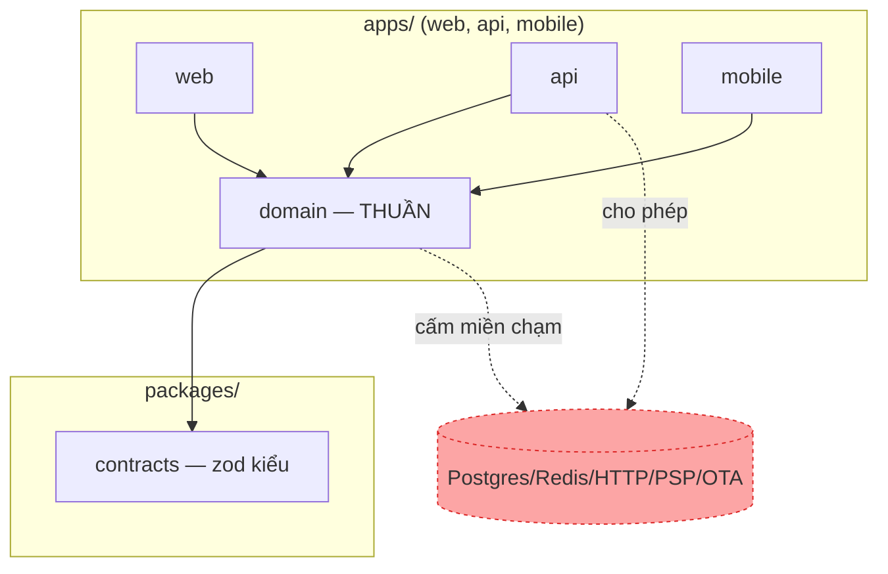
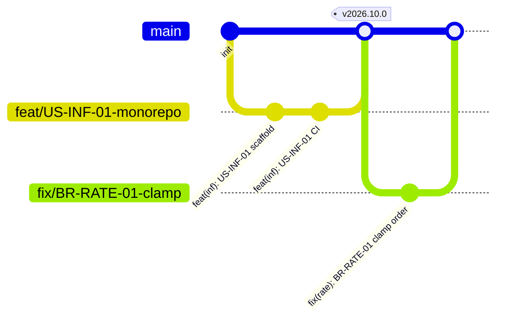
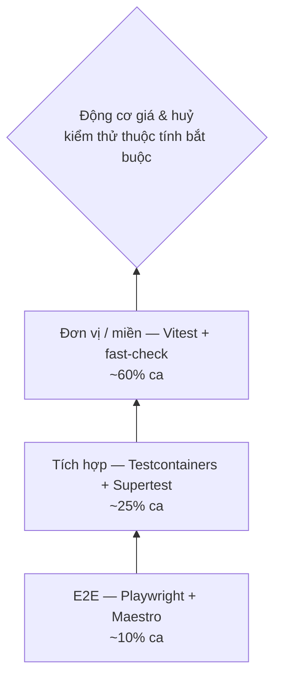
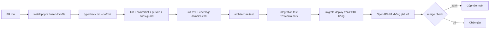

# 05 — Quy tắc kỹ thuật

> Quy tắc kỹ thuật bắt buộc cho toàn nhóm trong toàn bộ vòng đời triển khai (W6–W15).
> Tài liệu này **chỉ quy định "làm như thế nào"**; "làm cái gì" nằm ở [02/quy-tac-nghiep-vu](../02-nghiep-vu/quy-tac-nghiep-vu.md), định danh nằm ở [00 §6–§7](../00-tong-quan.md#6-quy-ước-định-danh).
> Cấu trúc repo, stack, ADR: [00 §9–§10](../00-tong-quan.md#9-quyết-định-công-nghệ-đã-chốt).

## 1. Cách đọc & nguyên tắc cưỡng chế

Mọi quy tắc ở đây đều **kèm cách cưỡng chế cụ thể** — không có quy tắc nào chỉ là lời khuyên. Bốn cơ chế cưỡng chế dùng xuyên suốt:

| Cơ chế | Viết tắt | Áp dụng | Công cụ |
|--------|----------|---------|---------|
| Lint tĩnh | `LINT` | Kiểu, cấm `any`, phạm vi phụ thuộc, tiền, tên | ESLint 9 flat config dùng chung ở `packages/config/eslint/` |
| Hook Git | `HOOK` | Tên nhánh, thông điệp commit, khoá nhánh chính | `husky` + `commitlint` + `lint-staged` |
| Kiểm thử kiến trúc | `ARCH` | Transaction, bắt lỗi CSDL, miền thuần | Vitest quét AST trong `apps/api/test/architecture/` |
| CI & review | `CI/REV` | PR size, coverage, docs, ADR, checklist | GitHub Actions + nhánh bảo vệ + `CODEOWNERS` |

Một quy tắc có thể dùng nhiều cơ chế; ghi rõ ở cột "Cưỡng chế" từng bảng.

---

## 2. Quy tắc ngôn ngữ & kiểu

| # | Quy tắc | Cưỡng chế |
|---|---------|-----------|
| 2.1 | TypeScript **`strict: true`** ở mọi package/app. Thêm `noUncheckedIndexedAccess: true`, `exactOptionalPropertyTypes: true` để bắt lỗi undefined/thiếu trường ngay khi biên dịch. | `LINT`/`CI` — `tsconfig.base.json` ở `packages/config`; CI chạy `tsc --noEmit` từng package. |
| 2.2 | **Cấm `any`** tuyệt đối. Giá trị ngoài `unknown` phải được hẹp kiểu (`typeof`/`instanceof`/zod/type guard) trước khi dùng. | `LINT` — `@typescript-eslint/no-explicit-any: "error"` + các quy tắc typed-lint `no-unsafe-assignment/argument/member-access/call/return: "error"`. |
| 2.3 | Cấm ép kiểu bằng `as` không kèm kiểm tra. Ép kiểu hợp lệ duy nhất là **type guard** hoặc `as const`. | `LINT` — `@typescript-eslint/consistent-type-assertions: ["error", { assertionStyle: "never", objectLiteralTypeAssertions: "never" }]` (cho phép `as const`). |
| 2.4 | Mọi dữ liệu vào từ bên ngoài (HTTP body/query/param, webhook OTA/PSP, env, file) PHẢI đi qua lược đồ **zod** ở biên. Lược đồ tập trung tại `packages/contracts`; adapter chỉ được `schema.parse`, không được thao tác dữ liệu thô. | `LINT` — cấm truy cập `req.body`/`process.env` ngoài biên bằng `no-restricted-syntax`; `no-restricted-imports` cấm import `zod` ra ngoài `packages/contracts` + adapter. |
| 2.5 | Không dùng `any`/`unknown` làm "cửa hậu" qua `JSON.parse`; kết quả `JSON.parse` phải được `zod`/type guard kiểm trước khi đọc thuộc tính. | `LINT` — `no-unsafe-member-access` kèm quy tắc 2.4; `REV`. |
| 2.6 | File mã nguồn tối đa **400 dòng**, độ phức tạp hàm ≤ **10** (theo [NFR-MAIN-02](../01-yeu-cau/yeu-cau-phi-chuc-nang.md)). | `LINT` — `max-lines: ["error", 400]`, `complexity: ["error", 10]`; `REV`. |

```js
// packages/config/eslint/base.cjs — cốt lõi, áp toàn repo
module.exports = {
  rules: {
    '@typescript-eslint/no-explicit-any': 'error',
    '@typescript-eslint/consistent-type-assertions':
      ['error', { assertionStyle: 'never', objectLiteralTypeAssertions: 'never' }],
    '@typescript-eslint/no-unsafe-assignment': 'error',
    '@typescript-eslint/no-unsafe-argument': 'error',
    '@typescript-eslint/no-unsafe-member-access': 'error',
    '@typescript-eslint/no-unsafe-call': 'error',
    '@typescript-eslint/no-unsafe-return': 'error',
    'no-restricted-globals': ['error', 'parseFloat'],
  },
};
```

---

## 3. Quy tắc miền nghiệp vụ thuần (`packages/domain`)

`packages/domain` chứa các lớp thuần trong contract dùng chung: `PricingEngine`, `CancellationPolicyEngine`, `AvailabilityCalculator`, `OverbookingPlanner`, `Money`, `StayPeriod`, `DateRange` cùng các Strategy/Chain. Điều kiện thuần khiết là điều kiện để chạy kiểm thử thuộc tính (xem §8).



### 3.1. Bảng cấm cụ thể

| # | Cấm | Lý do | Cưỡng chế |
|---|------|-------|-----------|
| 3.1.1 | Import `@prisma/client`, `@nestjs/*`, `node:*`, `axios`, `undici`, `ioredis`, `redis`, `zod`, `date-fns-tz` | Miền không I/O, không khung, không lược đồ | `LINT` — `no-restricted-imports` (patterns) trong override `packages/domain/**` |
| 3.1.2 | `Date.now()`, `new Date()`, `performance.now()` | Thời gian không tất định → không kiểm thử được | `LINT` — `no-restricted-syntax` |
| 3.1.3 | `Math.random()`, `crypto.randomUUID()`, `crypto.getRandomValues()` | Sinh mã ngẫu nhiên → vi phạm BR-GEN-06 (duy nhất toàn hệ thống) | `LINT` — `no-restricted-syntax` |
| 3.1.4 | `process.env`, `import.meta.env`, `window` | Đọc biến môi trường = phụ thuộc ngoài | `LINT` — `no-restricted-syntax` |
| 3.1.5 | `parseFloat`, số thực (`float`/`number` thập phân) cho tiền | Vi phạm BR-GEN-01 | `LINT` — `no-restricted-globals` + `no-restricted-syntax` cấm `MemberExpression[property.name='toFixed']` |

```js
// packages/config/eslint/domain.cjs — override riêng cho packages/domain/**
module.exports = {
  files: ['packages/domain/**'],
  rules: {
    'no-restricted-imports': ['error', {
      patterns: [
        { group: ['@prisma/client', '@nestjs/*', 'node:*', 'axios', 'undici',
                  'ioredis', 'redis', 'zod', 'date-fns-tz'],
          message: 'packages/domain thuần: cấm I/O, khung và lược đồ' },
      ],
    }],
    'no-restricted-syntax': ['error',
      { selector: "CallExpression[callee.object.name='Date'][callee.property.name='now']",
        message: 'Thời gian PHẢI truyền qua tham số (BR-GEN-02)' },
      { selector: "NewExpression[callee.name='Date']",
        message: 'Thời gian PHẢI truyền qua tham số' },
      { selector: "CallExpression[callee.object.name='Math'][callee.property.name='random']",
        message: 'Mã định danh PHẢI truyền qua tham số (BR-GEN-06)' },
      { selector: "CallExpression[callee.object.name='crypto']",
        message: 'Mã định danh PHẢI truyền qua tham số' },
      { selector: "MemberExpression[object.name='process'][property.name='env']",
        message: 'Cấm đọc biến môi trường trong miền' },
      { selector: "MemberExpression[property.name='toFixed']",
        message: 'Cấm số thực cho tiền; dùng Money (BR-GEN-01)' },
    ],
  },
};
```

### 3.2. Thời gian & mã định danh qua tham số

- `PricingEngine.quote(...)` và `CancellationPolicyEngine.compute(...)` nhận `now: Date`, `checkInDateTime: Date` làm **tham số tường minh** (BR-GEN-02, BR-GEN-04, BR-CANCEL-03).
- Mã booking `PH-<YYMMDD>-<5 ký tự>` (BR-GEN-06) được sinh ở lớp ứng dụng bởi cổng `IdGenerator` đã chốt ở [04/kien-truc](../04-thiet-ke/kien-truc.md) và truyền vào miền; miền không bao giờ tự sinh.
- Cưỡng chế: `LINT` (bảng 3.1) + `ARCH` — một ca kiểm thử quét AST xác nhận mọi ký hiệu công khai của `packages/domain` chỉ nhập từ `packages/domain` và các kiểu thuần (không `contracts`).

---

## 4. Quy tắc tiền & thời gian

| # | Quy tắc | Cưỡng chế |
|---|---------|-----------|
| 4.1 | Tiền là **số nguyên VND** (BR-GEN-01). Mọi phép tính tiền đi qua value object `Money`; không dùng số thực, không dùng `parseFloat`, không dùng `toFixed`. | `LINT` (§3.1.5) + `ARCH` — cấm `number` thập phân trong chữ ký liên quan tới `Money`. |
| 4.2 | Làm tròn **tường minh, một chỗ duy nhất** trong `Money`: `roundUp1000 = ceil(x/1000)*1000` cho giá bán/cọc (BR-GEN-03), `roundDown1000 = floor(x/1000)*1000` cho tiền hoàn (BR-GEN-03, BR-CANCEL-05). Cấm `Math.round` "tiện tay" ở chỗ khác. | `LINT` — `no-restricted-syntax` cấm `Math.round` ngoài `Money`; `REV`. |
| 4.3 | Lưu **UTC** trong CSDL; chuyển sang giờ VN (`Asia/Ho_Chi_Minh`) **chỉ ở biên** hiển thị và khi so mốc nghiệp vụ (BR-GEN-02/04/05). | `LINT` — import `date-fns-tz`/`@js-temporal` chỉ cho phép trong đúng một module `apps/api/src/sys/timezone.ts`. |
| 4.4 | Cấm cộng/trừ mili-giây bằng hằng số thủ công (`86400000`, `3600000`…). Dùng hằng số `DAY_MS`/`HOUR_MS` từ một module duy nhất hoặc API lịch của `date-fns`. | `LINT` — `no-magic-numbers: ["error", { ignore: [-1, 0, 1, 2, 100, 1000] }]` trong `packages/domain`. |
| 4.5 | So sánh mốc thời gian (giờ nhận phòng 14:00, hết hạn hold, `T−24h`) dùng `Date`/`epochMillis` UTC rồi quy đổi qua `timezone.ts`, không so chuỗi ngày. | `REV` + `ARCH` — kiểm thử biên 168h00/167h59 (theo RSK-09). |

---

## 5. Quy tắc giao dịch & đồng thời

| # | Quy tắc | Cưỡng chế |
|---|---------|-----------|
| 5.1 | Mọi thay đổi **tồn phòng / booking / thanh toán / hoàn tiền** PHẢI nằm trong **một giao dịch** Prisma (`$transaction`), kể cả kiểm tra tồn + giữ chỗ (BR-INV-02), huỷ + giải phóng phòng (BR-BOOK-08/11), và xoá cứng `DRAFT`/`HELD` phải ghi `AuditLog` đầy đủ `beforeJson` **trước khi** xoá (BR-BOOK-17 — nghĩa vụ ghi vết của BR-GEN-07 không được miễn trừ bởi xoá cứng). | `ARCH` — `apps/api/test/architecture/transaction-guard.spec.ts` quét AST: mọi method ghi công khai của `InventoryService`, `BookingService`, `PaymentService`, `RefundService`, `OverbookingService` phải bọc trong `$transaction` thông qua cổng `UnitOfWork` đã chốt ở [04/kien-truc](../04-thiet-ke/kien-truc.md). |
| 5.2 | **Thứ tự khoá cố định** để tránh bế tắc: khoá hàng tồn theo `(room_type_id, date)` **trước**, rồi mới khoá `booking` theo `id`. Khoá nhiều dòng bằng một câu `SELECT … FOR UPDATE … ORDER BY room_type_id, date` — thứ tự `ORDER BY` khiến mọi giao dịch khoá cùng thứ tự, triệt tiêu deadlock. | `ARCH` — mọi `SELECT … FOR UPDATE` phải đi qua helper `LockOrder.acquire(...)` duy nhất (xem `## Đề xuất bổ sung`); kiểm thử tích hợp hai giao dịch đan chéo để xác nhận không deadlock. |
| 5.3 | **Bắt buộc bắt mã lỗi `23P01`** (`exclusion_violation` — vi phạm ràng buộc loại trừ BR-INV-03) tại tầng dịch vụ và trả HTTP 409 với mã `E_INV_ROOM_TAKEN` (quy định tại BR-INV-03). Phân biệt với `E_INV_NO_AVAILABILITY` (BR-INV-07) — hết phòng ở tầng kiểm tra tồn, cũng HTTP 409. Đồng thời xử lý `40001` (serialization_failure → thử lại 3 lần) và `23505` (unique_violation → replay idempotency BR-PAY-03); callback cổng thanh toán gửi lại cùng khoá idempotency đã xử lý trả về kết quả cũ với mã `E_PAY_CALLBACK_DUPLICATE` (BR-PAY-03), không tạo `Payment` mới. | `ARCH` — mọi nhánh `catch` của driver DB phải đọc `error.code` và route qua đúng một `PgErrorMapper`; kiểm thử tích hợp bắn 2 yêu cầu giữ cùng một **đơn vị bán** `(roomId, bedNo, đêm)` xác nhận đúng 1 thành công (US-INF-02; bất biến ba cột `room_id` + `bed_no` + `valid_range` theo BR-INV-03). |
| 5.4 | **Cấm bắt lỗi rồi bỏ qua** (swallow): không `catch {}` rỗng, không `.catch(() => {})`, không biến lỗi thành `null`/`false` im lặng. | `LINT` — `no-empty: ["error", { allowEmptyCatch: false }]`, `@typescript-eslint/no-floating-promises: "error"`, `no-useless-catch: "error"`; `REV`. |
| 5.5 | Mọi `// eslint-disable`/`// @ts-ignore` PHẢI kèm lý do dạng `-- <mã BR/US>`, nếu không CI từ chối. | `CI` — script `scripts/check-disable-reasons.mjs` duyệt mọi dòng disable; thiếu lý do → fail. |

---

## 6. Quy tắc Git

### 6.1. Mô hình phân nhánh — trunk-based

- Nhánh chính **duy nhất** là `main`; mọi thay đổi vào `main` qua **PR nhỏ, ngắn hạn** (vòng đời ≤ 2 ngày). Không nhánh tích hợp dài hạn.
- Tag phát hành `v<YYYY>.<MM>.<patch>` gắn vào mốc bàn giao (M4–M8 trong [lo-trinh §4](lo-trinh.md#4-mốc-bàn-giao)).



| # | Quy tắc | Cưỡng chế |
|---|---------|-----------|
| 6.1.1 | Đặt tên nhánh `feat/<mã US>-<mô tả>` (hoặc `fix`/`chore`/`docs`/`refactor`/`test` + mã `BR`/`NFR`/`ADR`). Ví dụ `feat/US-RATE-01-pricing-engine`. | `HOOK` — pre-push kiểm regex `^(feat|fix|chore|docs|refactor|test|perf)\/(US|BR|NFR|ADR|CHORE)-[A-Z0-9-]+-[a-z0-9-]+$`. |
| 6.1.2 | Thông điệp commit theo **Conventional Commits** và **bắt buộc kèm mã truy vết** `US-*`/`BR-*`/`NFR-*`/`ADR-*` ở subject hoặc body. | `HOOK` — `commitlint` với scope theo 13 module + inf/ci/docs; body phải khớp `/(US|BR|NFR)-[A-Z]+-\d+|ADR-\d+/`. |
| 6.1.3 | PR **tối đa 400 dòng thay đổi** (không tính lockfile, fixture, file sinh). Vượt ngưỡng → tách PR; ngoại lệ phải gắn nhãn `size-exception` + **2 người** duyệt. | `CI` — `scripts/pr-size.mjs` chạy trong pipeline, fail nếu > 400 mà không có nhãn. |
| 6.1.4 | **1 người duyệt** là đủ để gộp; người duyệt phải khác người viết. | `CI` — branch protection `required_pull_request_reviews = 1`. |
| 6.1.5 | **Cấm tự gộp PR của mình** (self-merge). | `CI` — workflow `prevent-self-merge.yml` so `actor == pr.user.login` khi sự kiện merge → huỷ. |
| 6.1.6 | **Cấm force-push** lên `main`; nhánh nhánh feature cho phép rebase trước khi mở PR nhưng không sau khi có người duyệt. | `CI` — `allow_force_pushes: false` trên `main`; `REV`. |

```js
// commitlint.config.cjs — scope theo 13 module + hạ tầng
module.exports = {
  extends: ['@commitlint/config-conventional'],
  rules: {
    'scope-enum': [2, 'always', ['auth','prop','inv','rate','book','pay','chan','over',
      'fo','crm','noti','rep','sys','inf','ci','docs','deps','release']],
    'header-max-length': [2, 'always', 100],
    'trace-ref': [2, 'always'], // quy tắc tự viết: subject+body chứa US|BR|NFR-* hoặc ADR-*
  },
};
```

---

## 7. Quy tắc review mã

### 7.1. Danh sách kiểm 12 điểm

Người duyệt PHẢI tick đủ 12 điểm trước khi approve. Mỗi điểm map tới một phần trên.

| # | Điểm kiểm | Đối chiếu |
|---|-----------|-----------|
| 1 | Đúng hướng nghiệp vụ: hành vi khớp BR được ghi trong mô tả, không "tiện tay" thêm phạm vi | BR tương ứng |
| 2 | Không `any`, không ép kiểu `as`, dữ liệu ngoài qua zod | §2.2–2.4 |
| 3 | `packages/domain` thuần: không I/O, không `Date.now()`, không sinh mã, không `process.env` | §3.1 |
| 4 | Tiền là số nguyên VND, làm tròn qua `Money`, lưu UTC, chuyển VN ở biên | §4 |
| 5 | Thay đổi tồn/booking trong một giao dịch; khoá đúng thứ tự; bắt `23P01` | §5 |
| 6 | Không bắt lỗi rồi bỏ qua; không `eslint-disable` thiếu lý do | §5.4–5.5 |
| 7 | Kiểm thử khẳng định **hành vi quan sát được**, không khẳng định chi tiết triển khai | §8.4 |
| 8 | Kiểm thử thuộc tính cho động cơ giá/chính sách huỷ khi sửa miền | §8.3 |
| 9 | DoR/DoD đầy đủ, PR trong ngưỡng 400 dòng, commit có mã truy vết | §6, §9 |
| 10 | Tài liệu & ADR cập nhật cùng PR nếu đổi hành vi/kiến trúc | §10 |
| 11 | Đặt tên đúng quy ước (lớp/hàm/bảng/endpoint) | §11 |
| 12 | Không nợ kỹ thuật mới: cảnh báo P0/P1, `TODO` phải gắn mã US hoặc bị xoá | §13 |

### 7.2. Thời hạn & phân công duyệt

| Quy tắc | Nội dung | Cưỡng chế |
|---------|----------|-----------|
| 7.2.1 | Phản hồi review **≤ 4 giờ** trong giờ làm việc (theo [lo-trinh §9](lo-trinh.md#9-nhịp-độ--nghi-thức)). | `REV` — nhắc tự động qua Slack/webhook; thống kê thời gian phản hồi ở retrospective. |
| 7.2.2 | Phân công duyệt theo sở hữu: Kiến trúc sư duyệt `packages/domain`, migration SQL, `packages/contracts`; Backend/Frontend web duyệt `apps/api`, `apps/web`; QA/DevOps duyệt CI, kiểm thử, hạ tầng; PO/BA duyệt AC & tài liệu. | `CI` — file `CODEOWNERS` bắt buộc owner review khi chạm thư mục tương ứng. |

```text
# .github/CODEOWNERS
packages/domain/        @kientrucsu
infra/sql/              @kientrucsu
packages/contracts/     @kientrucsu
apps/api/               @backend
apps/web/               @backend-web
apps/mobile/            @mobile
.github/                @devops
docs/                   @po-ba
```

---

## 8. Chính sách kiểm thử

### 8.1. Tháp kiểm thử & tỷ lệ mục tiêu



| Tầng | Công cụ | Tỷ lệ mục tiêu (số ca) | Chạy khi |
|------|---------|------------------------|----------|
| Đơn vị / miền (thuần) | Vitest + fast-check | ~60% | Mỗi PR |
| Tích hợp (CSDL thật, giao dịch, webhook) | Testcontainers + Supertest | ~25% | Mỗi PR |
| E2E (web khách, back-office, Android) | Playwright + Maestro | ~10% | Nightly |
| Tải / đồng thời | k6 hoặc script 200 yêu cầu (US-INF-02/03) | ~5% | Nightly + trước mốc |

Cưỡng chế: `CI` — báo cáo phân bố tầng kiểm thử xuất ra ở mỗi pipeline; lệch > 10 điểm phần trăm so với mục tiêu → cảnh báo; QG-3 (xem [lo-trinh §6](lo-trinh.md#6-cổng-chất-lượng-quality-gate)) chặn nếu miền < 90%. Trùng khớp với [NFR-MAIN-01](../01-yeu-cau/yeu-cau-phi-chuc-nang.md) (miền thuần, 4 lớp lõi phủ nhánh ≥ 90%) và [NFR-MAIN-03](../01-yeu-cau/yeu-cau-phi-chuc-nang.md) (100% BR có ≥ 1 ca kiểm thử).

### 8.2. Ngưỡng độ phủ

| Phạm vi | Chỉ số | Ngưỡng | Cưỡng chế |
|---------|--------|--------|-----------|
| `packages/domain` | Độ phủ **nhánh** | **≥ 90%** | `CI` — vitest `coverage.thresholds.branches = 90` cho package domain |
| Toàn hệ thống | Độ phủ **nhánh** | **≥ 70%** | `CI` — threshold toàn cục; dưới ngưỡng → chặn gộp |
| Dòng mới trong PR | Độ phủ diff | ≥ 80% | `CI` — công cụ diff-coverage (covdiff) chặn nếu thấp hơn |

```js
// packages/domain/vitest.config.ts — ngưỡng độ phủ nhánh miền
export default defineConfig({
  test: { coverage: {
    provider: 'v8',
    include: ['src/**'],
    thresholds: { branches: 90, functions: 90, lines: 90 },
  }},
});
```

### 8.3. Kiểm thử thuộc tính bắt buộc

Hai động cơ trọng yếu PHẢI có kiểm thử thuộc tính (fast-check) — không chỉ ca ví dụ:

| Động cơ | Thuộc tính bắt buộc | BR nền |
|---------|---------------------|--------|
| `PricingEngine` | P1: cùng đầu vào → cùng kết quả (tất định, cả trên web/API/mobile) | BR-RATE-17 |
| `PricingEngine` | P2: giá từng đêm nằm trong `[minPrice, maxPrice]` sau khi kẹp | BR-RATE-04 |
| `PricingEngine` | P3: `total = roundDown1000(Σ nightly − discount)`; từng đêm làm tròn LÊN trước khi cộng | BR-RATE-01, BR-GEN-03 |
| `PricingEngine` | P4: tổng giảm ≤ 30% tạm tính; tổng sau giảm ≥ tổng sàn | BR-RATE-11/12 |
| `CancellationPolicyEngine` | C1: `refundAmount ≤ paidAmount` và chia hết 1.000 VND | BR-CANCEL-17, BR-GEN-03 |
| `CancellationPolicyEngine` | C2: `hoursBeforeCheckIn` giảm ⇒ `refundPercent` **không tăng** (đơn điệu) | BR-CANCEL-01 |
| `CancellationPolicyEngine` | C3: `NONREF` luôn hoàn 0 ở mọi mốc | BR-CANCEL-07 |
| `CancellationPolicyEngine` | C4: **dữ liệu hoá** — thêm một bậc mới vào `CancellationTier` mà không sửa mã vẫn được engine tôn trọng | BR-CANCEL-01 |

Cưỡng chế: `CI` — ca `*.property.spec.ts` phải tồn tại cho hai engine; `ARCH` kiểm tra không có nhánh `if/else` theo `RatePlanCode` cứng trong engine (cấm vi phạm BR-CANCEL-01/BR-RATE-01).

### 8.4. Cấm khẳng định chi tiết triển khai

| Cấm | Được dùng thay thế |
|-----|---------------------|
| `toMatchSnapshot` trên đối tượng nội bộ engine/service | Khẳng định giá trị quan sát được (số tiền, trạng thái, mã lỗi) |
| `toHaveBeenCalledTimes`/`toHaveBeenCalledWith` trên method nội bộ | Spy chỉ cho phép ở biên adapter (gọi PSP/OTA) |
| Khẳng định trường/`wiring`/`defaults`/`source text` | Khẳng định hành vi, bất biến, biên, chuyển trạng thái |
| Test chỉ để "có test" (bare not-throw, length-grew) | Xoá; chỉ giữ ca phòng được bug thật |

Cưỡng chế: `LINT` — trong `packages/domain/**/*.spec.ts`, `no-restricted-syntax` cấm `toMatchSnapshot` và `toHaveBeenCalled`; `REV` (§7.1 điểm 7).

---

## 9. Định nghĩa Sẵn sàng (DoR) & Hoàn thành (DoD)

### 9.1. DoR — story vào sprint khi và chỉ khi

| # | Điều kiện | Kiểm bởi |
|---|-----------|----------|
| D1 | Có mã `US-<MOD>-<nn>` duy nhất | PO/BA |
| D2 | AC viết xong, dạng quan sát được (không phải "làm màn hình X") | PO/BA |
| D3 | Mọi BR tham chiếu tồn tại và đã chốt trong [02](../02-nghiep-vu/quy-tac-nghiep-vu.md) | PO/BA |
| D4 | Phụ thuộc đã gỡ hoặc có thỏa thuận thay thế | Cả nhóm |
| D5 | Ước lượng SP đã chốt, ≤ 25 điểm/sprint | PO/BA |

Cưỡng chế: `CI` — template story trong backlog; sprint planning không nhận story thiếu bất kỳ mục D1–D5.

### 9.2. DoD — story "xong" khi và chỉ khi

| # | Điều kiện | Cưỡng chế |
|---|-----------|-----------|
| X1 | Mã đã review (≥ 1 người duyệt khác người viết, đủ 12 điểm §7.1) và đã gộp `main` | `CI` — branch protection |
| X2 | Kiểm thử tự động xanh: unit + tích hợp + diff-coverage ≥ 80% | `CI` — pipeline |
| X3 | AC được chứng minh bằng **demo chạy thật** (không chụp màn hình) cho PO | Demo thứ Sáu |
| X4 | Tài liệu, ma trận truy vết [06](../06-truy-vet/ma-tran-truy-vet.md) cập nhật cùng PR | `CI` — docs-guard (§10.3) |
| X5 | Không có lỗi P0/P1 mới mở | `REV` — bảng lỗi |

Cưỡng chế: `CI` — `.github/pull_request_template.md` chứa đúng checklist X1–X5; script `pr-template-check` fail nếu mục nào chưa tick. Tóm tắt DoD phải khớp mô tả ở [ke-hoach-sprint §1](ke-hoach-sprint.md#1-quy-ước).

---

## 10. Quy tắc tài liệu

| # | Quy tắc | Cưỡng chế |
|---|---------|-----------|
| 10.1 | Mọi sơ đồ (use case, class, sequence, state, ERD, Gantt) vẽ bằng **Mermaid trong chính file Markdown** trong repo — không ảnh, không công cụ ngoài (ADR-013). | `CI` — script `check-mermaid.mjs` báo lỗi nếu phát hiện `` hoặc file ảnh sơ đồ trong `docs/`. |
| 10.2 | Mọi quyết định kiến trúc PHẢI có **ADR** (định dạng `ADR-nnn`), lưu ở `docs/04-thiet-ke/`. Đổi kiến trúc mà không có ADR mới → PR bị từ chối. | `CI` — PR đổi `packages/` hoặc `infra/` không kèm ADR mới hoặc cập nhật ADR → fail. |
| 10.3 | Tài liệu cập nhật **trong cùng PR** với mã: đổi hành vi BR → kèm diff `docs/02-nghiep-vu/**`; đổi hợp đồng API → kèm diff OpenAPI + `docs/04-thiet-ke/api.md`. | `CI` — `docs-guard.mjs` đọc nhãn `br-change`/`api-change`: có nhãn mà thiếu diff docs tương ứng → chặn. |
| 10.4 | Con số nghiệp vụ chỉ tham chiếu mã BR, không chép lại giá trị (nguồn chân lý duy nhất ở `02`). | `REV` (§7.1 điểm 1) — cấm định nghĩa lại số ở tài liệu khác. |

---

## 11. Quy tắc đặt tên

| Loại | Quy ước | Ví dụ | Cưỡng chế |
|------|---------|-------|-----------|
| Lớp / interface | `PascalCase`; lớp miền dùng đúng tên trong contract dùng chung | `PricingEngine`, `CancellationPolicyEngine`, `BookingState` | `LINT` — `@typescript-eslint/naming-convention` |
| Hàm / method | `camelCase`, động từ; truy vấn đọc bắt đầu `get/`; hàm hỏi boolean bắt đầu `is/has/can/should` | `quotePrice()`, `isOverSellable()` | `LINT` |
| Biến / thuộc tính | `camelCase`; hằng số `UPPER_SNAKE_CASE` | `depositAmount`, `DAY_MS` | `LINT` |
| Enum & thành viên | `PascalCase` tên, `UPPER_SNAKE_CASE` giá trị | `BookingStatus.CHECKED_IN`, `ChannelCode.OTA_BOOKING` | `LINT` |
| Bảng CSDL | `snake_case` **số nhiều** | `bookings`, `room_assignments`, `cancellation_tiers` | `CI` — migration review + `sqlfluff` |
| Cột CSDL | `snake_case`; khoá ngoại `<bảng_số_ít>_id`; thời gian `created_at`/`updated_at` | `booking_id`, `refunded_amount` | `CI` — `sqlfluff` |
| Chỉ mục / ràng buộc | `idx_<bảng>_<cột>`, `uq_<bảng>_<cột>`, ràng buộc loại trừ `excl_room_assignment_no_overlap` | `idx_room_assignments_valid_range` | `CI` — migration review |
| Endpoint REST | `/api/v1/<tài-nguyên-số-nhiều>/<id>/<sub>`; kebab-case; webhook `/api/v1/integrations/ota/{channel}/bookings` | `/api/v1/bookings/{id}/cancel` | `CI` — OpenAPI diff, `REV` |
| Mã lỗi | `E_<MOD>_<TÊN>` UPPER_SNAKE | `E_BOOK_MISSING_FIELD`, `E_OVER_NO_CONSENT`, `E_RATE_BELOW_FLOOR` | `CI` — đối chiếu registry mã lỗi; nguồn chân lý đầy đủ 45 mã `E_*` tại [04/api §4.2](../04-thiet-ke/api.md) |
| File | `kebab-case`; use case hậu tố `.use-case.ts`; strategy `.strategy.ts`; test `.spec.ts`/`.e2e-spec.ts`/`.property.spec.ts` | `create-booking.use-case.ts`, `season-modifier.strategy.ts` | `LINT` — `unicorn/filename-case`, `REV` |
| Nhánh | `feat|fix|chore|docs|refactor|test/<mã US|BR|NFR|ADR>-<mô tả>` | `feat/US-RATE-01-pricing-engine` | `HOOK` (§6.1.1) |
| Commit | `type(scope): subject` + mã `US/BR/NFR/ADR` | `feat(rate): US-RATE-01 engine giá (BR-RATE-01, BR-RATE-06)` | `HOOK` (§6.1.2) |
| Biến môi trường | `UPPER_SNAKE_CASE`, tiền tố theo app `WEB_`/`API_`/`MOBILE_` | `API_DATABASE_URL`, `WEB_NEXT_PUBLIC_API_BASE` | `REV` |

Cưỡng chế `LINT` cụ thể: `@typescript-eslint/naming-convention` với 4 khối (typeLike, function, variable, enumMember) đặt trong `packages/config/eslint/base.cjs`; tên CSDL do `sqlfluff` + migration review (owner: Kiến trúc sư).

---

## 12. Quy tắc CI

### 12.1. Pipeline bắt buộc



| Bước | Cưỡng chế | Ghi chú |
|------|-----------|---------|
| 12.1.1 `install` | `pnpm install --frozen-lockfile`; khoá `pnpm-lock.yaml` | `CI` |
| 12.1.2 `typecheck` | `tsc --noEmit` từng package/app, `strict: true` | `CI` |
| 12.1.3 `lint` | ESLint flat config + `commitlint` (commit) + `pr-size` + `docs-guard` + `check-disable-reasons` | `CI` |
| 12.1.4 `unit` | Vitest + fast-check; coverage miền ≥ 90%, toàn cục ≥ 70%, diff ≥ 80% | `CI` |
| 12.1.5 `architecture` | `transaction-guard`, `error-mapper-guard`, `domain-pure-guard` | `CI` |
| 12.1.6 `integration` | Testcontainers (Postgres 16 + Redis 7); bắn 200 yêu cầu đồng thời (US-INF-02) — xác nhận [NFR-REL-01](../01-yeu-cau/yeu-cau-phi-chuc-nang.md) (0 bán trùng) | `CI` |
| 12.1.7 `migrate-from-empty` | `prisma migrate deploy` trên CSDL trống phải chạy sạch (mốc M3) | `CI` |
| 12.1.8 `openapi-diff` | Đóng băng hợp đồng API từ M3; thay đổi phá vỡ → fail trừ khi có nhãn `api-change` + diff docs | `CI` |
| 12.1.9 `e2e` (nightly) | Playwright (web) + Maestro (Android) chạy lịch đêm | `CI` |

### 12.2. Thời gian tối đa & điều kiện chặn gộp

| Hạng mục | Giá trị |
|----------|---------|
| Pipeline mỗi PR | ≤ **10 phút** (mục tiêu 8 phút); vượt → tối ưu/ghép bước. Khớp [NFR-MAIN-03](../01-yeu-cau/yeu-cau-phi-chuc-nang.md) (unit + integration < 10 phút) |
| e2e-nightly | ≤ **30 phút** |
| Job kiểm thử tải 200 đồng thời | ≤ **5 phút** |

Điều kiện **chặn gộp** (merge gate): một trong các điều kiện sau đỏ → không gộp được.

| # | Điều kiện chặn |
|---|----------------|
| G1 | Bất kỳ job nào ở 12.1.1–12.1.8 đỏ |
| G2 | Coverage dưới ngưỡng §8.2 (miền < 90% / toàn cục < 70% / diff < 80%) |
| G3 | PR > 400 dòng không có nhãn `size-exception` |
| G4 | Thiếu review hoặc người duyệt = người viết / self-merge |
| G5 | Có nhãn `br-change`/`api-change` mà thiếu diff tài liệu tương ứng |
| G6 | Vòng review còn thread chưa giải quyết |
| G7 | Force-push lên `main` |

Cưỡng chế: branch protection + workflow `.github/workflows/ci.yml`, `e2e-nightly.yml`, `eas-build.yml` (theo cấu trúc [00 §10](../00-tong-quan.md#10-cấu-trúc-repository-đích)).

---

## 13. Bảng vi phạm & cách xử lý

| Vi phạm thường gặp | Công cụ phát hiện | Cách sửa |
|--------------------|-------------------|----------|
| Dùng `any` trong service | `@typescript-eslint/no-explicit-any` | Đổi sang `unknown` + type guard/zod; hoặc khai báo kiểu cụ thể |
| `as` ép kiểu không kiểm tra | `consistent-type-assertions` | Viết type guard, hoặc `as const` |
| Đọc `req.body` thô ở controller | `no-restricted-syntax` | `ZodBody(schema)` (xem `## Đề xuất bổ sung`) + `schema.parse` |
| `Date.now()` trong `packages/domain` | `no-restricted-syntax` | Truyền `now: Date` qua tham số |
| `parseFloat`/`toFixed` cho tiền | `no-restricted-globals` + member expression | Dùng `Money` + `roundUp1000/roundDown1000` |
| Cộng `86400000` thủ công | `no-magic-numbers` | Dùng `DAY_MS`/`date-fns` |
| Ghi tồn phòng ngoài transaction | `transaction-guard.spec.ts` | Bọc `$transaction`/`@Transactional()` |
| Không bắt `23P01` → lỗi 500 | `error-mapper-guard` | Route qua `PgErrorMapper` → HTTP 409 `E_INV_ROOM_TAKEN` |
| `catch (e) {}` bỏ qua lỗi | `no-empty` (allowEmptyCatch:false) | Log + xử lý, hoặc rethrow có ngữ cảnh |
| Commit thiếu mã `US`/`BR` | `commitlint` + `trace-ref` | Thêm `US-*/BR-*` vào subject/body |
| Tên nhánh sai mẫu | pre-push regex | Đổi tên nhánh `feat/<mã>-<mô tả>` |
| PR 800 dòng | `pr-size.mjs` | Tách PR nhỏ hơn hoặc nhãn `size-exception` + 2 duyệt |
| Tự gộp PR của mình | `prevent-self-merge.yml` | Nhờ người khác duyệt + gộp |
| Force-push lên `main` | branch protection | Làm lại bằng commit mới (revert), không viết lại lịch sử |
| Test dùng `toMatchSnapshot` nội bộ | `no-restricted-syntax` trong `*.spec.ts` | Khẳng định giá trị quan sát được |
| Sửa BR nhưng không đổi docs | `docs-guard.mjs` | Kèm diff `docs/02-nghiep-vu/**` cùng PR |
| Đổi kiến trúc không ADR | CI rule §10.2 | Thêm `ADR-nnn` vào `docs/04-thiet-ke/` |
| `TODO:` không gắn mã US | review (§7.1 điểm 12) | Gắn mã hoặc xoá; chuyển thành issue |

Mức xử lý: hàng trên thuộc `LINT`/`ARCH` → chặn ngay ở máy phát triển hoặc CI; hàng `HOOK` → chặn commit/push; hàng `REV` → chặn gộp. Lỗi tái diễn ≥ 3 lần cùng một người được đưa vào retrospective như một hành động cải tiến.

---

## 14. Đề xuất bổ sung

Các cổng ra (`Clock`, `IdGenerator`, `OutboxPort`, `NotificationPort`, `UnitOfWork`) đã được **chốt** trong [04/kien-truc](../04-thiet-ke/kien-truc.md); tài liệu này chỉ tham chiếu, không đề xuất lại. Các định danh kỹ thuật dưới đây **chưa có** trong [00 §7](../00-tong-quan.md#7-từ-điển-thực-thể-nguồn-chân-lý-về-định-danh) và chưa được chốt ở [04/kien-truc](../04-thiet-ke/kien-truc.md); đề xuất bổ sung để mọi tài liệu dùng thống nhất (chỉ là tên nội bộ kỹ thuật, không phải định nghĩa nghiệp vụ):

| Định danh đề xuất | Loại | Mô tả |
|-------------------|------|-------|
| `LockOrder` | Lớp tiện ích | Helper khoá `SELECT … FOR UPDATE … ORDER BY` đúng thứ tự (BR-INV-02, §5.2) |
| `PgErrorMapper` | Lớp tiện ích | Ánh xạ `23P01/40001/23505` → mã lỗi HTTP/`E_*` (§5.3) |
| `ZodBody(schema)` | Decorator | Parse + hẹp kiểu body qua zod ở biên (§2.4) |
| `trace-ref` | Quy tắc commitlint | Bắt buộc mã truy vết trong commit (§6.1.2) |

---

## Tham chiếu

- [00 — Tổng quan dự án](../00-tong-quan.md) — định danh, từ điển thực thể, stack, cấu trúc repo, 52 UC, 13 module
- [02 — Quy tắc nghiệp vụ](../02-nghiep-vu/quy-tac-nghiep-vu.md) — 136 BR (nguồn chân lý về giá trị)
- [04 — Kiến trúc](../04-thiet-ke/kien-truc.md) — ADR-001…ADR-013, phân tầng hexagonal
- [04 — API](../04-thiet-ke/api.md) — hợp đồng REST, mã lỗi `E_*`, idempotency, webhook
- [05 — Lộ trình](lo-trinh.md) — cổng chất lượng QG-0…QG-4, mốc M4–M8, thang cắt giảm
- [05 — Kế hoạch Sprint](ke-hoach-sprint.md) — mã `US-*`, DoR/DoD tóm tắt, AC từng sprint
- [05 — Quy tắc nhóm](quy-tac-nhom.md) — RACI, sở hữu tài liệu, quy trình đổi yêu cầu
- [05 — Kế hoạch kiểm thử](ke-hoach-kiem-thu.md) — chiến lược test, ca trọng yếu, kiểm thử tải
- [README](../README.md) — bản đồ tài liệu & thứ tự đọc
