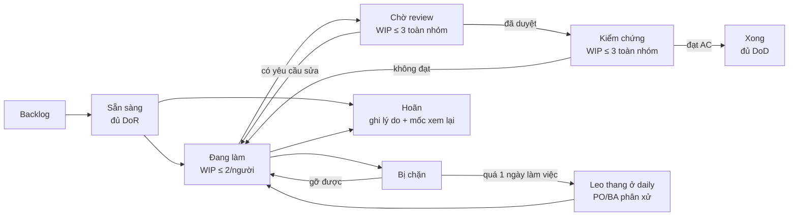
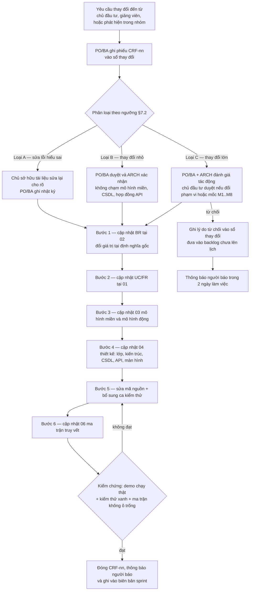
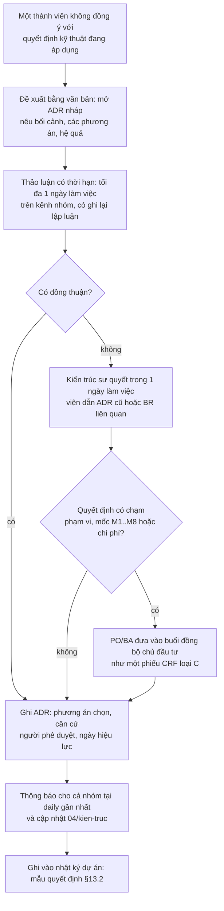

# 05 — Quy tắc nhóm làm việc

> Tài liệu quy định cách **5 thành viên** phối hợp trong **15 tuần** (W1 = 21/09/2026, W15 = 28/12/2026–03/01/2027): ai chịu trách nhiệm module nào, một việc đi qua những trạng thái nào, họp hành ra sao, đổi yêu cầu theo trình tự nào, chất lượng được bảo đảm bằng gì, và đóng góp cá nhân được đo bằng gì.
> Nguồn chân lý nghiệp vụ: [02/quy-tac-nghiep-vu](../02-nghiep-vu/quy-tac-nghiep-vu.md) — tài liệu này **chỉ tham chiếu mã BR**, không định nghĩa lại giá trị.
> Nhịp độ, mốc **M1…M8**, cổng chất lượng: [05/lo-trinh](lo-trinh.md). Backlog và điểm sprint: [05/ke-hoach-sprint](ke-hoach-sprint.md). Chuẩn mã, git, review, DoR/DoD kỹ thuật: [05/quy-tac-ky-thuat](quy-tac-ky-thuat.md).

## 1. Nguyên tắc vận hành nhóm

Sáu nguyên tắc dẫn đường của [lo-trinh §1](lo-trinh.md) được chuyển thành nghĩa vụ có người gác cổng: (1) **nghiệp vụ trước mã nguồn** — không mở PR mã nghiệp vụ khi BR của module chưa chốt, `PO/BA` gác; (2) **ba bài toán trọng tâm đi trước** — BT-1 (BR-CANCEL-01…19), BT-2 (BR-RATE-01…19), BT-3 (BR-INV-01…07, BR-OVER-01…16) luôn là ưu tiên **M** và xếp trước mọi việc khác khi sprint đã đầy, `PO/BA` gác; (3) **bất biến chống trùng ép ở tầng CSDL** — BR-INV-03 phải có migration SQL thủ công trước API đặt phòng, không nhận PR "làm sau", `ARCH` gác; (4) **miền nghiệp vụ là hàm thuần** — `packages/domain` không import I/O (không Prisma, Nest, HTTP, `Date.now()`), `ARCH` gác; (5) **mỗi tuần có thứ chạy được** — thứ Sáu nào cũng có bản dựng demo chạy thật, không chụp màn hình, `QA` gác; (6) **cắt ngang, không cắt dọc** — khi trễ thì cắt theo [lo-trinh §7](lo-trinh.md), không bao giờ cắt kiểm thử miền, ràng buộc chống trùng hay nhật ký kiểm toán, `PO/BA` gác.

**Nhịp 15 tuần gắn với mốc bàn giao** (khớp [lo-trinh §2–§4](lo-trinh.md)):

| Mốc | Hết tuần | Ngày nghiệm thu | Cổng chất lượng | Người chủ trì | Hồ sơ bắt buộc khi đạt mốc |
|-----|----------|-----------------|-----------------|----------------|-----------------------------|
| **M1** | W1 | 27/09/2026 | QG-0 | PO/BA | Báo cáo khảo sát có số liệu **đo thật** ở GĐ-0, thay cho số liệu giả định khảo sát ở [00 §1](../00-tong-quan.md) trước khi dùng làm mốc so sánh; 136 BR soạn thảo; Q-01…Q-12 có câu trả lời hoặc mặc định được chủ đầu tư chấp thuận bằng văn bản |
| **M2** | W3 | 11/10/2026 | QG-1 | PO/BA + kiến trúc sư | 52 UC + đặc tả 12 UC rủi ro cao; mô hình miền; máy trạng thái booking; 100% BR truy vết tới ≥ 1 UC |
| **M3** | W5 | 25/10/2026 | QG-2 | Kiến trúc sư | OpenAPI đóng băng; DDL migrate sạch; ADR-001…ADR-013 xong; ca kiểm thử cho BR rủi ro cao |
| **M4** | W7 | 08/11/2026 | QG-3 (sprint 1) | QA/DevOps + kiến trúc sư | API trong Docker; chứng minh bằng kịch bản 200 yêu cầu đồng thời chỉ 1 thành công trên cùng một phòng/đêm, 199 yêu cầu còn lại nhận `E_INV_ROOM_TAKEN` (HTTP 409, từ `23P01` của BR-INV-03); lịch tồn phòng hiển thị 55 phòng |
| **M5** | W9 | 22/11/2026 | QG-3 (sprint 2) | PO/BA | Booking từ web khách và từ quầy khớp giá nhau và khớp bảng tính tay; hold hết hạn tự giải phóng |
| **M6** | W11 | 06/12/2026 | QG-3 (sprint 3) | PO/BA | 100% ca bảng quyết định huỷ/hoàn cọc đạt; người tạo không tự duyệt được yêu cầu hoàn của chính mình ở **mọi** mức tiền, và yêu cầu > 5.000.000 VND phải do người khác từ `MANAGER` trở lên duyệt (BR-CANCEL-15) |
| **M7** | W13 | 20/12/2026 | QG-3 (sprint 4) | Kiến trúc sư + QA/DevOps | Quá tải phát hiện trước T−24h trên dữ liệu mô phỏng; thang điều chuyển chạy đúng thứ tự khả dụng **1 → 2 → 4** (bậc 3 `*_CROSS_PROPERTY` chưa khả dụng vì ba cơ sở cách nhau 160–300 km, xa bán kính ≤ 15 km); app Android cài được trên máy thật |
| **M8** | W15 | 02/01/2027 | QG-4 | PO/BA | Báo cáo cuối kỳ; ma trận truy vết không ô trống; demo end-to-end 3 bài toán; README chạy được |

## 2. Cơ cấu nhóm & vai trò

Nhóm 5 người, không có vai nào trùng vai nào; mỗi người có **đúng một** vai trò chính (vai theo [lo-trinh §2](lo-trinh.md)). Vai là **danh nghĩa phân công**, không phải chức danh cứng: một người có thể nhận việc của vai khác khi rảnh, nhưng người chịu trách nhiệm chính không đổi.

| Mã vai | Tên vai (theo [lo-trinh §2](lo-trinh.md)) | Trách nhiệm chính | Quyền quyết định | Sản phẩm đặc trưng |
|--------|-------------------------------------------|-------------------|------------------|--------------------|
| `PO/BA` | PO/BA (kiêm thư ký dự án) | Khảo sát, chốt BR, viết UC/FR, điều phối chủ đầu tư, kiểm thử chấp nhận, giữ nhật ký dự án | Chốt nội dung nghiệp vụ; phê duyệt phiếu đổi yêu cầu loại B/C | [00](../00-tong-quan.md), [01](../01-yeu-cau/yeu-cau-chuc-nang.md), [02](../02-nghiep-vu/quy-tac-nghiep-vu.md), nhật ký |
| `ARCH` | Kiến trúc sư kiêm Backend | Kiến trúc, mô hình miền, CSDL, hợp đồng API, `packages/domain`, ADR | Quyết định kỹ thuật cuối cùng khi bất đồng (xem §11); chốt ADR | [03](../03-phan-tich/mo-hinh-mien.md), [04/kiến trúc](../04-thiet-ke/kien-truc.md), [04/csdl](../04-thiet-ke/csdl.md), [04/api](../04-thiet-ke/api.md) |
| `BE` | Backend/Frontend web | Module NestJS, công việc nền, outbox, tích hợp PSP/OTA mô phỏng, back-office Next.js | Trong phạm vi module được giao; không tự đổi hợp đồng API | `apps/api`, lớp back-office của `apps/web` |
| `FE` | Frontend web + Mobile | Website khách, hợp phần giao diện còn lại, ứng dụng Android cho lễ tân/quản lý/buồng phòng | Trong phạm vi màn hình được giao | `apps/web`, `apps/mobile` |
| `QA` | QA/DevOps | Kế hoạch kiểm thử, ca kiểm thử trọng yếu, CI, Docker, kiểm thử tải, sao lưu & phục hồi | Chặn phát hành khi cổng chất lượng chưa xanh (§9) | [05/ke-hoach-kiem-thu](ke-hoach-kiem-thu.md), `.github/workflows/`, `infra/` |

**Quy tắc cơ cấu:** (2.1) mỗi module có **đúng một** người chịu trách nhiệm (A) và **ít nhất một** người thực hiện (R) khác A khi có thể — tránh "ai cũng chịu trách nhiệm" thành không ai chịu; (2.2) người chịu trách nhiệm một tài liệu không đồng thời là người review duy nhất tài liệu đó, vì review chéo phải độc lập (§9); (2.3) `ARCH` không tự review mã do mình viết ở phần chạm BR-INV-03, BR-RATE-01, BR-CANCEL-01 — ba vùng rủi ro cao nhất của BT-1/2/3; (2.4) `QA` không là người duy nhất kiểm chứng việc do `QA` viết (CI, script tải) — cần người khác chạy lại để kết quả tái lập được; (2.5) không ai tự phê duyệt phiếu đổi yêu cầu do chính mình báo (đối chiếu tinh thần BR-CANCEL-15) — nguyên tắc "hai cặp mắt" áp cho cả quy trình tài liệu.

## 3. RACI — 5 vai × 13 module

**Ký hiệu:** **A** = Chịu trách nhiệm cuối cùng (Accountable) · **R** = Thực hiện (Responsible) · **C** = Được tư vấn trước khi quyết (Consulted) · **I** = Được thông báo sau khi quyết (Informed). `A/R` = vừa chịu trách nhiệm vừa trực tiếp làm.

Mã module theo [00 §5](../00-tong-quan.md).

Cột `UC` là số use case của module theo danh mục **52 UC** tại [00 §8](../00-tong-quan.md); tổng cột này bằng 52.

| Module | UC | PO/BA | ARCH | BE | FE | QA | Ghi chú rủi ro |
|--------|----|-------|------|----|----|----|----------------|
| AUTH — Định danh & phân quyền | 3 | C | **A** | R | C | C | BR-RBAC-01…06; phạm vi cơ sở (`propertyScope`) dễ sai |
| PROP — Cơ sở & buồng phòng | 4 | C | C | **A/R** | R | C | BR-PROP-01…06; 3 cơ sở / 55 phòng phải nhập đúng |
| INV — Tồn phòng | 3 | C | **A** | R | C | C | BR-INV-01…07; bất biến BR-INV-03 là điều kiện của BT-3 — ràng buộc loại trừ trả `23P01`, tầng ứng dụng phải đổi thành `E_INV_ROOM_TAKEN` (409), phân biệt với `E_INV_NO_AVAILABILITY` của BR-INV-07 |
| RATE — Giá & mùa | 5 | **A** | C | R | R | C | BR-RATE-01…19; thứ tự hệ số là nguồn tranh chấp; BR-RATE-19: `LONGSTAY14` phải có giá riêng (`fixedNightlyPrice` hoặc dòng `RateCalendar` nguồn `RATE_PLAN`), nếu không thì phải cảnh báo trên màn hình cấu hình vì sẽ ra cùng giá với `FLEX7` |
| BOOK — Đặt phòng | 8 | C | **A** | R | R | C | BR-BOOK-01…17; máy trạng thái booking (module nhiều UC nhất); BR-BOOK-17: xoá cứng `DRAFT`/`HELD` vẫn phải ghi `AuditLog` đầy đủ **trước khi** xoá; BR-CANCEL-19: booking `roomCount > 1` được huỷ một phần — `refundBase` phân bổ theo tỷ lệ giá phòng bị huỷ trên `totalAmount`, phòng còn lại giữ nguyên giá và `RoomAssignment`, lưu thêm `PriceSnapshot` điều chỉnh và giữ bản gốc |
| PAY — Thanh toán & hoàn tiền | 5 | **A** | C | R | R | C | BR-PAY-01…10; BR-CANCEL-15 hai cấp duyệt, BR-CANCEL-18 huỷ yêu cầu hoàn khi khách rút; callback lặp khoá idempotency trả kết quả cũ kèm `E_PAY_CALLBACK_DUPLICATE`, không tạo `Payment` mới (BR-PAY-03) |
| CHAN — Kênh bán | 3 | C | **A** | R | I | C | BR-CHAN-01…08; đồng bộ ≤ 5 phút; thất bại 3 lần liên tiếp → `E_CHAN_SYNC_FAILED` và `Channel.syncStatus = DEGRADED` (BR-CHAN-07) |
| OVER — Quá tải & điều chuyển | 5 | **A** | C | R | R | C | BR-OVER-01…16; thang điều chuyển vận hành **1 → 2 → 4** (bậc 3 `*_CROSS_PROPERTY` chưa khả dụng: ba cơ sở cách nhau 160–300 km > bán kính 15 km), vượt trần bán vượt → `E_OVER_LIMIT_EXCEEDED` (BR-OVER-02); xếp điều chuyển tất định theo `keepScore` → `createdAt` → `Booking.seq` (BR-OVER-11); BR-OVER-16: case còn `OPEN`/`PROPOSED`/`ESCALATED` khi ngày thiếu phòng đã trôi qua phải chuyển `ESCALATED`, xử lý tại chỗ, **không** tự động đóng, ghi `delayReason`; ghép phòng thiếu đồng thuận → `E_OVER_NO_CONSENT`, khác giới chưa duyệt → `E_OVER_MERGE_GENDER` (BR-OVER-13/14) |
| FO — Tiền sảnh | 4 | C | I | **A/R** | R | C | BR-FO-01…07; check-out muộn, buồng phòng |
| CRM — Khách hàng | 3 | **A** | I | R | R | C | BR-CRM-01…06; danh sách đen, hạng khách |
| NOTI — Thông báo | 2 | C | I | **A/R** | I | C | Không có nhóm BR riêng — nghĩa vụ đến từ BR-SYS-06 và các BR nghiệp vụ yêu cầu thông báo; gửi lại tối đa 3 lần |
| REP — Báo cáo | 4 | **A** | C | R | R | C | BR-REP-01 là nguồn chân lý duy nhất của các chỉ số (ADR, RevPAR, công suất, tỷ lệ huỷ, chi phí xử lý quá tải) — cấm mỗi báo cáo tự định nghĩa lại; phòng DOR đếm theo đơn vị bán (giường); BR-RATE-08 (doanh thu gộp vs thuần); QG-4 không ô trống |
| SYS — Nền tảng | 3 | I | C | R | I | **A/R** | BR-SYS-01…06; audit append-only, RPO ≤ 15 phút, RTO ≤ 4 giờ |
| **Tổng** | **52** | | | | | | 13 module, 52 UC, 136 BR |

**Phân vai cho các quy trình xuyên module** (cùng ký hiệu A/R/C/I): chốt quy tắc nghiệp vụ (BR) — `PO/BA` **A/R**, `ARCH`+`QA`+`BE` C; quyết định kiến trúc (ADR) — `ARCH` **A/R**, `PO/BA`+`BE`+`FE` C, `QA` I; phiếu đổi yêu cầu (CRF) — `PO/BA` **A/R**, bốn vai còn lại C; review mã (pull request) — mọi vai R cho PR của vai khác, `ARCH`+`QA` C; thiết kế và chạy ca kiểm thử — `QA` **A/R**, `BE`+`FE` R; phát hành bản dựng demo — `QA` **A/R**, `BE`+`FE` R; sao lưu và diễn tập phục hồi — `QA` **A/R**, `ARCH` C, biên bản theo BR-SYS-03; báo cáo cuối kỳ và [ma trận truy vết](../06-truy-vet/ma-tran-truy-vet.md) — `PO/BA` **A/R**, bốn vai còn lại R.

## 4. Phân vai chi tiết theo giai đoạn

Bảng dưới đây là bản mở rộng của [lo-trinh §2](lo-trinh.md) — mỗi giai đoạn có **một vai chủ trì** và các vai còn lại ở mức hỗ trợ.

| GĐ | Tuần | Vai chủ trì (A) | Việc chính theo vai | Sản phẩm chốt ở mốc |
|----|------|-----------------|---------------------|----------------------|
| GĐ-0 | W1 | `PO/BA` | PO: phỏng vấn, quan sát 3 cơ sở, **đo lại số liệu hiện trạng** (số vụ bán quá phòng, thất thoát doanh thu, tranh chấp hoàn cọc) để thay giả định khảo sát ở [00 §1](../00-tong-quan.md), soạn 136 BR, chốt Q-01…Q-12. ARCH/BE/FE/QA: dựng khung repo, khảo sát công nghệ theo ADR-001…ADR-013 | M1 (QG-0) |
| GĐ-1 | W2–W3 | `PO/BA` | PO: 52 UC + đặc tả 12 UC rủi ro cao. ARCH: mô hình miền, máy trạng thái booking. QA: bảng truy vết BR → UC đầu tiên. BE/FE: hỗ trợ đặc tả luồng | M2 (QG-1) |
| GĐ-2 | W4–W5 | `ARCH` | ARCH: kiến trúc, class diagram thiết kế, 6 sequence, ERD/DDL, hợp đồng API. BE: DDL + migration ràng buộc loại trừ. FE: thiết kế màn hình. QA: ca kiểm thử cho BR rủi ro cao, dựng CI. PO: review truy vết | M3 (QG-2) |
| GĐ-3 | W6–W7 | `BE` | BE: AUTH/RBAC, PROP, INV. ARCH: ràng buộc chống trùng + kịch bản đồng thời. FE: back-office khung + lưới tồn phòng. QA: audit nền, kịch bản 200 yêu cầu. PO: kiểm thử chấp nhận US-AUTH-01, US-PROP-01 | M4 |
| GĐ-4 | W8–W9 | `ARCH` + `BE` | ARCH: `PricingEngine` trong `packages/domain`. BE: lịch giá, BOOK, hold & hết hạn. FE: web khách tìm phòng + đặt phòng. QA: ca đối chiếu giá 3 nền tảng (BR-RATE-17). PO: kiểm thử chấp nhận giá khớp bảng tính tay | M5 |
| GĐ-5 | W10–W11 | `ARCH` + `BE` | ARCH: `CancellationPolicyEngine`. BE: huỷ, đổi ngày, PAY sandbox, duyệt hoàn hai cấp. QA: bảng quyết định + kiểm thử thuộc tính hoàn cọc. PO: chủ trì kiểm chứng BR-CANCEL-15. FE: màn huỷ/hoàn tiền | M6 |
| GĐ-6 | W12–W13 | `BE` + `FE` | BE: CHAN, OTA mô phỏng, OVER, thang điều chuyển theo thứ tự khả dụng 1 → 2 → 4, ghép phòng, walk-out. FE: bảng điều khiển quá tải. QA: dữ liệu mô phỏng quá tải, ca `keepScore`. PO: quy trình xử lý ca quá tải | M7 |
| GĐ-7 | W14–W15 | `FE` + `QA` | FE: app Android (check-in/out, tra cứu, đổi phòng, buồng phòng). QA: kiểm thử tải 200 đồng thời, diễn tập sao lưu. BE: 4 báo cáo REP, NOTI. PO: báo cáo cuối kỳ, ma trận truy vết, kịch bản demo | M8 (QG-4) |

**Phân bổ công sức (giờ) theo vai và giai đoạn** — tổng khớp **750 giờ** của [lo-trinh §3, §8](lo-trinh.md):

| Vai | GĐ-0 | GĐ-1 | GĐ-2 | GĐ-3 | GĐ-4 | GĐ-5 | GĐ-6 | GĐ-7 | **Tổng** |
|-----|------|------|------|------|------|------|------|------|----------|
| `PO/BA` | 34 | 30 | 14 | 10 | 12 | 16 | 12 | 14 | **142** |
| `ARCH` | 6 | 26 | 32 | 24 | 22 | 20 | 18 | 8 | **156** |
| `BE` | 4 | 12 | 22 | 30 | 26 | 30 | 28 | 16 | **168** |
| `FE` | 3 | 8 | 18 | 22 | 26 | 18 | 22 | 42 | **159** |
| `QA` | 3 | 24 | 14 | 14 | 14 | 16 | 20 | 20 | **125** |
| **Tổng** | **50** | **100** | **100** | **100** | **100** | **100** | **100** | **100** | **750** |

Ràng buộc cân bằng tải: mỗi vai nằm trong khoảng **120–170 giờ** (trung bình 150 giờ/vai × 15 tuần × 10 giờ/tuần). Vượt khoảng → `PO/BA` điều chuyển việc theo thang cắt giảm [lo-trinh §7](lo-trinh.md); `QA` thấp nhất nên nhận thêm việc kiểm chứng tài liệu ở §9 và ca kiểm thử hồi quy.

## 5. Quy trình làm việc

### 5.1. Bảng công việc dùng chung

Toàn nhóm dùng **một** bảng công việc duy nhất (GitHub Projects gắn với repo, theo ADR-012); không ai giữ danh sách riêng. Một thẻ = một đơn vị công việc có thể hoàn tất trong ≤ 2 ngày làm việc.

| Trường trên thẻ | Bắt buộc | Nguồn / quy ước |
|-----------------|----------|-----------------|
| Mã | ✓ | `US-*` theo [05/ke-hoach-sprint §1](ke-hoach-sprint.md); `TC-<MOD>-<nn>` cho ca kiểm thử; mã nợ kỹ thuật và mã phiếu đổi yêu cầu theo §10, §7 |
| Tiêu đề | ✓ | Động từ + kết quả quan sát được |
| Module | ✓ | Một trong 13 mã tại [00 §5](../00-tong-quan.md) |
| Tham chiếu | ✓ | Tối thiểu một mã BR/UC; nếu không có → thẻ không hợp lệ |
| Ưu tiên | ✓ | **M** / **S** / **C** theo [05/ke-hoach-sprint §1](ke-hoach-sprint.md) |
| Story point | ✓ | 1 SP ≈ 4 giờ; thẻ > 8 SP phải tách |
| Người thực hiện (R) | ✓ | Đúng một người; đổi người phải ghi lý do |
| Người review | ✓ | Khác người thực hiện (quy tắc 2.2) |
| Sprint / mốc | ✓ | Một trong W1…W15 và M1…M8 |
| Trạng thái | ✓ | Một trong các trạng thái ở §5.2 |
| Cờ chặn | khi bị chặn | Lý do + người cần gỡ + giờ bắt đầu chặn |

Quy tắc dùng bảng: (a) không có việc nào ngoài bảng — việc phát sinh trong chat phải được tạo thẻ trong **cùng ngày làm việc**; (b) thẻ không có mã BR/UC bị `PO/BA` trả lại; (c) mọi thay đổi trạng thái do người đang giữ thẻ thực hiện, không nhờ người khác kéo hộ trừ khi bị chặn.

### 5.2. Trạng thái thẻ và giới hạn việc đang làm

| Trạng thái | Điều kiện vào | Điều kiện ra | WIP tối đa | Ai đổi trạng thái |
|------------|---------------|--------------|------------|-------------------|
| Backlog | Có mã, module, tham chiếu BR/UC | Đủ DoR → Sẵn sàng | không giới hạn | `PO/BA` |
| Sẵn sàng | Đủ **DoR**: mã, tiêu chí chấp nhận, BR tồn tại, phụ thuộc đã gỡ, ước lượng chốt | Có người nhận → Đang làm | không giới hạn | người nhận việc |
| Đang làm | Đã nhận thẻ, đã tạo nhánh theo [05/quy-tac-ky-thuat](quy-tac-ky-thuat.md) | Có PR mở → Chờ review | **2/người**, 6 toàn nhóm | người thực hiện |
| Chờ review | PR mở, mô tả nêu rõ BR/UC liên quan | Có ≥ 1 phê duyệt → Kiểm chứng | 3 toàn nhóm | người review |
| Kiểm chứng | Đã duyệt mã; chạy trên môi trường sạch | Đạt mọi AC → Xong | 3 toàn nhóm | `QA` hoặc người review |
| Xong | Đủ **DoD** (mã + kiểm thử + tài liệu + truy vết) | — | — | người thực hiện |
| Bị chặn | Không tiến được vì phụ thuộc ngoài tầm kiểm soát | Gỡ xong → Đang làm | không tính vào WIP | người thực hiện |
| Hoãn | Bị cắt theo [lo-trinh §7](lo-trinh.md) hoặc chờ quyết định | Đưa lại Backlog khi có mốc xem lại | — | `PO/BA` |

**Luật giới hạn việc đang làm (WIP):**

| # | Luật | Xử lý khi vi phạm |
|---|------|-------------------|
| W1 | Mỗi người tối đa **2 thẻ** ở trạng thái *Đang làm*; khuyến nghị 1 | Không được nhận thẻ mới cho tới khi đóng bớt |
| W2 | Toàn nhóm tối đa **6 thẻ** *Đang làm* tại một thời điểm | Ở daily, thẻ mới nhất phải quay lại *Sẵn sàng* |
| W3 | *Chờ review* + *Kiểm chứng* ≤ 6 thẻ cộng lại | Dừng nhận việc mới, cả nhóm ưu tiên dọn hàng đợi review |
| W4 | Thẻ nằm *Chờ review* hoặc *Kiểm chứng* quá **2 ngày làm việc** được nêu đích danh ở daily | `PO/BA` gán người review thay thế trong ngày |
| W5 | Thẻ *Bị chặn* quá **1 ngày làm việc** phải leo thang (không tự treo) | `PO/BA` chọn: gỡ, cắt, hoặc chuyển sang *Hoãn* |
| W6 | Mỗi sprint chỉ nhận việc mới nếu tổng SP đã nhận ≤ 25 SP theo [05/ke-hoach-sprint §1](ke-hoach-sprint.md) | Việc vượt phải chờ sprint sau hoặc theo thang cắt giảm |

### 5.3. Cam kết thời gian phản hồi (SLA nội bộ)

Áp dụng trong giờ làm việc của nhóm (08:00–18:00 giờ VN, Thứ Hai–Thứ Sáu):

| Loại yêu cầu | Kênh | Thời hạn phản hồi | Người chịu SLA |
|--------------|------|-------------------|----------------|
| Review mã (PR đã mở) | PR trên repo | **≤ 4 giờ** (khớp [lo-trinh §9](lo-trinh.md)); PR chạm BR-INV-03, BR-RATE-01, BR-CANCEL-01: ≤ 2 giờ | mọi vai |
| Gỡ thẻ *Bị chặn* | bảng công việc + chat nhóm | ≤ 4 giờ | người được nêu tên trong cờ chặn |
| Trả lời câu hỏi kỹ thuật cho người khác | kênh nhóm (§12) | ≤ 4 giờ | `ARCH`, `BE`, `FE` |
| Xác nhận một BR/UC có bị ảnh hưởng không | phiếu CRF | ≤ 1 ngày làm việc | `PO/BA` |
| Ý kiến về ADR nháp | tệp ADR + chat nhóm | ≤ 1 ngày làm việc | `ARCH` (thu), cả nhóm (góp) |
| Trả lời chủ đầu tư | kênh đã thoả thuận (§12) | ≤ 2 ngày làm việc, hoặc hẹn lịch họp ngay | `PO/BA` |
| Chạy lại ca kiểm thử bị đỏ | CI | trong ngày làm việc phát hiện | `QA` |

Vượt SLA hai lần trở lên trong một sprint là **dữ kiện** cho điểm "kỷ luật nghi thức & SLA" ở §14.

## 6. Nghi thức dự án

Chu kỳ **2 tuần** bám đúng cấu trúc sprint của [lo-trinh §3](lo-trinh.md):

| Thời điểm | Mục đích & hoạt động | Thời lượng | Chủ trì | Đầu ra bắt buộc |
|-----------|----------------------|------------|---------|-----------------|
| Thứ Hai tuần chẵn | *Chốt phạm vi sprint* — sprint planning, tách việc, kiểm DoR | 60 phút | `PO/BA` | Bảng công việc đã gán người; nhật ký 3 dòng (mục tiêu, phạm vi, việc bị cắt) |
| Mỗi ngày làm việc | *Gỡ chắn trong ngày* — daily stand-up: ai làm gì, chắn ở đâu, cần ai gỡ | 10 phút | luân phiên | Danh sách thẻ *Bị chặn* + người gỡ |
| Thứ Ba–Thứ Năm | *Giữ hàng đợi review rỗng* — phát triển, review mã trong ngày, không để tồn | — | người review | PR có ≥ 1 phê duyệt trong vòng ≤ 4 giờ |
| Thứ Sáu tuần chẵn | *Phát hiện sớm lệch hướng* — demo giữa sprint | 20 phút | người làm tính năng | Chạy thật trên môi trường sạch |
| Thứ Hai tuần lẻ | *Không để nợ tích tụ* — đồng bộ giữa sprint, xử lý nợ kỹ thuật | 30 phút | `ARCH` | Sổ nợ kỹ thuật cập nhật (§10) |
| Thứ Ba–Thứ Năm | *Nối các mảnh đã xong* — phát triển + kiểm thử tích hợp | — | `QA` | Báo cáo đỏ/xanh của CI |
| Thứ Sáu tuần lẻ | *Chốt sprint có đạt AC không* — demo nghiệm thu sprint | 30 phút | `PO/BA` | Biên bản nghiệm thu: đạt/không đạt từng AC, có chữ ký PO |
| Thứ Sáu tuần lẻ | *Giữ tài liệu khớp mã* — rà và cập nhật tài liệu | 30 phút | chủ sở hữu tài liệu (§8) | Diff tài liệu đã gộp |
| Thứ Sáu tuần lẻ | *Cải tiến cách làm* — retrospective | 30 phút | luân phiên | **Tối đa 1 hành động cải tiến**, có người và hạn |
| Mỗi 2 tuần | *Chốt câu hỏi mở và thay đổi loại C* — đồng bộ với chủ đầu tư | 30 phút | `PO/BA` | Biên bản + quyết định ghi vào BR hoặc ADR |
| Trước mỗi mốc M1…M8 | *Xác nhận điều kiện đạt mốc* — nghiệm thu mốc theo [lo-trinh §4](lo-trinh.md) | 30 phút | `PO/BA` (mốc nghiệp vụ) / `ARCH` (mốc kỹ thuật) | Danh mục hồ sơ ở §1; mốc chỉ đạt khi mọi dòng "hồ sơ bắt buộc" có mặt |
| Cuối mỗi sprint | *Kiểm tra cổng chất lượng* — rà QG-3 | 20 phút | `QA` | Bảng xanh/đỏ của 6 điều kiện QG-3 |

**Quy tắc nghi thức:** không họp nào kéo dài quá thời lượng ghi trong bảng — vấn đề chưa ngã ngũ được đẩy sang quy trình xử lý xung đột (§11) hoặc thành phiếu đổi yêu cầu (§7). Mọi nghi thức đều phải sinh **đầu ra bắt buộc**; nghi thức không có đầu ra coi như chưa diễn ra và phải ghi lý do vào nhật ký dự án.

## 7. Quy trình quản lý thay đổi yêu cầu

### 7.1. Luồng xử lý

**Thứ tự cập nhật là bắt buộc và một chiều:** BR **trước** → UC/FR → thiết kế → mã → ma trận truy vết. Cấm sửa thiết kế hoặc mã khi BR chưa được cập nhật (khớp [README §4](../README.md) và nguyên tắc 1 của [lo-trinh §1](lo-trinh.md)). Mỗi bước chỉ hoàn tất khi bước trước đã được review theo §9.

### 7.2. Phân loại thay đổi và ngưỡng ảnh hưởng

| Tiêu chí ngưỡng | Loại A — sửa lỗi hiểu sai | Loại B — thay đổi nhỏ | Loại C — thay đổi lớn |
|-----------------|---------------------------|------------------------|------------------------|
| Bản chất | Câu chữ tài liệu mơ hồ, không đổi hành vi hệ thống | Đổi hành vi trong phạm vi đã có | Đổi hành vi, mô hình hoặc hợp đồng |
| Công sức ước lượng | ≤ 2 giờ | ≤ 8 giờ (≤ 2 SP) | > 8 giờ |
| Số module bị chạm | 0 | 1 | ≥ 2 |
| Giá trị BR đã được tham chiếu | Không đổi số, chỉ làm rõ | Không đổi số | Đổi hoặc thêm/bớt quy tắc |
| Mô hình miền / DDL / hợp đồng API | Không | Không | **Có** → luôn là C |
| Bất biến cứng BR-INV-03 hoặc thứ tự thang BR-OVER | Không | Không | **Có** → luôn là C |
| Ảnh hưởng mốc M1…M8 hoặc lịch sprint | Không | Không | **Có** → luôn là C, cần chủ đầu tư |
| Người phê duyệt | Chủ sở hữu tài liệu, báo `PO/BA` sau | `PO/BA` | `PO/BA` + `ARCH`; chủ đầu tư nếu đổi phạm vi/mốc |
| Thời hạn xử lý | Trong ngày làm việc | ≤ 3 ngày làm việc | ≤ 1 sprint; nếu vượt, áp thang cắt giảm [lo-trinh §7](lo-trinh.md) |
| Hồ sơ ghi lại | Mục "sửa lỗi hiểu sai" trong nhật ký tài liệu | Phiếu CRF + biên bản sprint | Phiếu CRF + ADR (nếu chạm kiến trúc) + biên bản họp + ma trận truy vết |

**Miễn trừ duy nhất:** khi chủ đầu tư trả lời câu hỏi mở Q-01…Q-12 tại [00 §11](../00-tong-quan.md) **khác** mặc định tạm dùng, thay đổi đó là loại C và đi thẳng vào bước 1 — vì Q-01…Q-12 chặn tiến độ, mọi phương án thiết kế dựa trên mặc định phải rà lại.

### 7.3. Bảng mẫu phiếu yêu cầu thay đổi

Mỗi phiếu là một khối trong sổ thay đổi (tệp Markdown trong `docs/05-ke-hoach/nhat-ky/`), điền đủ các trường sau:

| Trường | Bắt buộc | Nội dung / ví dụ |
|--------|----------|------------------|
| Mã phiếu | ✓ | `CRF-07` |
| Người báo & ngày | ✓ | Chủ đầu tư — 12/10/2026 (ghi nhận qua họp đồng bộ 2 tuần) |
| Nguồn phát hiện | ✓ | Demo mốc M3 / kiểm thử / vận hành thử / chủ đầu tư |
| Hiện trạng | ✓ | Điều đang làm sai hoặc còn thiếu, kèm màn hình hoặc đoạn tài liệu |
| Mong muốn | ✓ | Kết quả quan sát được sau khi thay đổi |
| BR/UC bị ảnh hưởng | ✓ | Ví dụ: BR-CANCEL-15, UC-PAY-04 |
| Loại & căn cứ | ✓ | C — chạm hợp đồng API và > 8 giờ |
| Ước lượng công sức | ✓ | 12 giờ ≈ 3 SP |
| Ảnh hưởng mốc/tuần | ✓ | Làm M6 lùi 2 ngày; bù bằng cách cắt `US-CANCEL-04` |
| Phương án đề xuất & phương án thay thế | ✓ | Hai phương án, nêu hệ quả từng phương án |
| Người phê duyệt & ngày | ✓ | `PO/BA` + chủ đầu tư — 14/10/2026 |
| Việc phải cập nhật (6 bước) | ✓ | BR ☑ · UC/FR ☑ · 03 ☑ · 04 ☑ · mã ☑ · 06 ☑ |
| Trạng thái | ✓ | Mới / Đang đánh giá / Đã duyệt / Từ chối / Đã đóng |
| Kết quả kiểm chứng | khi đóng | Demo ngày …, ca kiểm thử `TC-*` tương ứng, PR đã gộp |

**Quy tắc:** mỗi sprint tối đa **3 phiếu loại C** được nhận; phiếu thứ tư tự động rơi sang sprint sau hoặc phải cắt một hạng mục tương đương số SP theo [lo-trinh §7](lo-trinh.md). Phiếu loại C bị từ chối không bị xoá — chuyển sang backlog chưa lên lịch kèm lý do.

## 8. Sở hữu tài liệu

| # | Tài liệu | Người chịu trách nhiệm chính | Người review | Tần suất cập nhật |
|---|----------|------------------------------|--------------|-------------------|
| 00 | [Tổng quan](../00-tong-quan.md) | `PO/BA` | `ARCH` + `QA` | Khi có định danh/enum/actor/module mới; rà soát bắt buộc trước M2 và M8 |
| — | [README bản đồ tài liệu](../README.md) | `PO/BA` | `QA` | Mỗi khi thêm, đổi tên hoặc đổi trạng thái tài liệu |
| 01 | [Yêu cầu chức năng](../01-yeu-cau/yeu-cau-chuc-nang.md) | `PO/BA` | `ARCH` | Mỗi khi BR đổi (bước 2 của §7); rà soát trước M2, M3, M8 |
| 01 | [Yêu cầu phi chức năng](../01-yeu-cau/yeu-cau-phi-chuc-nang.md) | `QA` | `ARCH` + `PO/BA` | Trước M3; sau kiểm thử tải ở sprint 5 |
| 01 | [Mô hình Use Case](../01-yeu-cau/mo-hinh-use-case.md) | `PO/BA` | `ARCH` + người ngoài vai tác giả | Trước M2; mỗi khi thêm/bớt UC trong danh mục 52 |
| 02 | [Quy tắc nghiệp vụ](../02-nghiep-vu/quy-tac-nghiep-vu.md) | `PO/BA` | `ARCH` + `QA` (bắt buộc cả hai với BR-CANCEL, BR-RATE, BR-OVER, BR-INV) | Mỗi phiếu CRF được duyệt; rà soát toàn bộ trước M2, M6, M7, M8 |
| 02 | [Chính sách huỷ & hoàn cọc](../02-nghiep-vu/chinh-sach-huy-hoan-coc.md) | `PO/BA` | `ARCH` + `QA` | Cùng nhịp BR-CANCEL; **đóng băng** sau M6, sửa phải là loại C |
| 02 | [Động giá](../02-nghiep-vu/dong-gia.md) | `PO/BA` | `ARCH` + `QA` | Cùng nhịp BR-RATE; đóng băng sau M5 |
| 02 | [Quá tải – ghép & đổi phòng](../02-nghiep-vu/qua-tai-ghep-doi-phong.md) | `PO/BA` | `ARCH` | Cùng nhịp BR-OVER, BR-CHAN; đóng băng sau M7 |
| 03 | [Mô hình miền](../03-phan-tich/mo-hinh-mien.md) | `ARCH` | `PO/BA` + một người khác vai (QG-1 yêu cầu review chéo 2 người) | Trước M2; mỗi khi BR đổi chạm thực thể |
| 03 | [Mô hình động](../03-phan-tich/mo-hinh-dong.md) | `ARCH` | `PO/BA` + `QA` | Trước M2; mỗi khi máy trạng thái booking đổi |
| 04 | [Kiến trúc + ADR](../04-thiet-ke/kien-truc.md) | `ARCH` | `BE` + `QA` | Mỗi ADR mới (từ ADR-014 trở đi); chốt ở M3 |
| 04 | [Thiết kế lớp](../04-thiet-ke/thiet-ke-lop.md) | `ARCH` | `BE` + `FE` | Trước M3; khi ánh xạ mẫu thiết kế đổi |
| 04 | [Sequence Diagram](../04-thiet-ke/sequence-diagram.md) | `ARCH` | `BE` + `FE` | Trước M3; khi luồng đổi do CRF loại C |
| 04 | [Cơ sở dữ liệu](../04-thiet-ke/csdl.md) | `ARCH` | `BE` + `QA` | Mỗi migration; xác nhận ràng buộc loại trừ BR-INV-03 trước M4 |
| 04 | [API](../04-thiet-ke/api.md) | `ARCH` | `BE` + `FE` | Đóng băng tại M3; đổi sau M3 là loại C |
| 04 | [Thiết kế màn hình](../04-thiet-ke/thiet-ke-man-hinh.md) | `FE` | `PO/BA` | Trước M3; trước mỗi demo lớn |
| 05 | [Lộ trình](lo-trinh.md) | `PO/BA` | `ARCH` + `QA` | Trước M3; sau mỗi phiếu loại C đổi mốc |
| 05 | [Kế hoạch Sprint](ke-hoach-sprint.md) | `PO/BA` | cả nhóm | Đầu mỗi sprint; cuối sprint ghi kết quả thực tế |
| 05 | [Quy tắc kỹ thuật](quy-tac-ky-thuat.md) | `ARCH` | `QA` + `BE` | Đầu mỗi sprint; rà soát khi có hành động cải tiến từ retrospective |
| 05 | [Quy tắc nhóm](quy-tac-nhom.md) (tài liệu này) | `PO/BA` | cả nhóm | Cuối mỗi sprint; bắt buộc sau khi đóng một nợ kỹ thuật quy trình hoặc một xung đột kỹ thuật (§11) |
| 05 | [Kế hoạch kiểm thử](ke-hoach-kiem-thu.md) | `QA` | `PO/BA` + `ARCH` | Đầu mỗi sprint; bổ sung ca kiểm thử khi BR đổi |
| 05 | [Quản lý rủi ro](quan-ly-rui-ro.md) | `PO/BA` | cả nhóm | Mỗi 2 tuần cùng buổi đồng bộ chủ đầu tư; cập nhật ngay khi rủi ro mới phát sinh |
| 06 | [Ma trận truy vết](../06-truy-vet/ma-tran-truy-vet.md) | `QA` | `PO/BA` | Mỗi phiếu CRF được duyệt (bước 6 của §7); rà soát bắt buộc trước M4, M6, M8 |
| — | Nhật ký dự án (`docs/05-ke-hoach/nhat-ky/`) | `PO/BA` | không áp dụng (nguồn sự kiện) | Trong 1 ngày làm việc sau mỗi họp hoặc quyết định (§13) |

Quy tắc sở hữu: người chịu trách nhiệm chính là người **duyệt** thay đổi nội dung tài liệu; người khác muốn sửa thì mở PR, gán cho chủ sở hữu. Chủ sở hữu vắng quá 2 ngày làm việc → `PO/BA` tạm quyền, ghi rõ trong nhật ký.

## 9. Kiểm soát chất lượng tài liệu

### 9.1. Định nghĩa hoàn thành của một tài liệu (DoD-Doc)

Một tài liệu chỉ được đánh dấu ✅ trong [README](../README.md) khi **cả 9 điều kiện** sau đạt:

| # | Điều kiện | Cách kiểm chứng |
|---|-----------|-----------------|
| D1 | Mở đầu đúng `# <số> — <tên tài liệu>` theo quy ước bản đồ tài liệu | Đọc 1 dòng đầu; lệch → trả lại |
| D2 | Kết thúc bằng mục `## Tham chiếu` có liên kết tương đối tới các tài liệu liên quan | Kiểm liên kết không hỏng |
| D3 | Mọi con số nghiệp vụ **tham chiếu mã BR**, không chép lại giá trị | Đối chiếu [02](../02-nghiep-vu/quy-tac-nghiep-vu.md) với [00 §6, §7](../00-tong-quan.md) |
| D4 | Mọi định danh dùng trong tài liệu có mặt trong [00 §6, §7, §8](../00-tong-quan.md); định danh mới chỉ được bổ sung ở mục `## Đề xuất bổ sung` | Quét định danh, đối chiếu nguồn chân lý |
| D5 | Mọi sơ đồ Mermaid render được (không lỗi cú pháp) trên trình xem Markdown chuẩn | Mở tệp, xác nhận sơ đồ hiển thị |
| D6 | Không còn chỗ trống dạng `TBD`, `?`, ô bảng rỗng; câu hỏi mở phải có mã Q-nn | Quét chuỗi |
| D7 | Mỗi quy trình có bảng hoặc sơ đồ, không chỉ văn xuôi | Kiểm bằng mắt theo mục lục |
| D8 | Đã được review chéo bởi ≥ 2 người, trong đó ≥ 1 người khác vai tác giả | Ghi tên người review vào PR |
| D9 | Nếu tài liệu chạm BR/UC: ma trận truy vết đã cập nhật tương ứng | Đối chiếu [06](../06-truy-vet/ma-tran-truy-vet.md) |

### 9.2. Quy tắc review chéo

| Loại tài liệu | Số người review | Người review bắt buộc | Điều kiện tiên quyết của người review | Thời hạn |
|---------------|-----------------|------------------------|----------------------------------------|----------|
| Nghiệp vụ (00, 01, 02) | ≥ 2 | một người khác vai tác giả; `ARCH` cho phần chạm BT-1/2/3 | Đã đọc tài liệu nguồn [02](../02-nghiep-vu/quy-tac-nghiep-vu.md) tương ứng | ≤ 1 ngày làm việc |
| Phân tích (03) | ≥ 2 (QG-1 bắt buộc) | `PO/BA` + một người không phải tác giả | Đối chiếu máy trạng thái với BR-BOOK-06 | ≤ 1 ngày làm việc |
| Thiết kế (04) | ≥ 1 | `BE` hoặc `FE` tùy phần; `QA` cho CSDL/API | Đối chiếu với [00 §9](../00-tong-quan.md) (ADR đã chốt) | ≤ 1 ngày làm việc |
| Kế hoạch (05) | ≥ 1 | người trực tiếp bị ảnh hưởng (ví dụ kế hoạch test → `BE`,`FE`) | Đối chiếu mốc M1…M8 | ≤ 1 ngày làm việc |
| Truy vết (06) | ≥ 2 | `PO/BA` + `QA` | Mọi ô trống phải có lý do | ≤ 1 ngày làm việc |

**Bốn luật review chéo:** (a) người viết không tự duyệt tài liệu của mình; (b) review phải nêu **vị trí cụ thể** (mục, bảng, mã BR) — nhận xét chung chung bị trả lại; (c) mọi nhận xét phải phân loại *Chặn* hoặc *Đề xuất*, chỉ *Chặn* mới giữ tài liệu ở trạng thái chưa xong; (d) quá thời hạn mà không phản hồi thì `PO/BA` gán người review thay thế và ghi vào nhật ký.

### 9.3. Lịch đồng bộ tài liệu với mã nguồn

| Thời điểm | Đối tượng đối chiếu | Người thực hiện | Cách kiểm |
|-----------|---------------------|-----------------|-----------|
| Mỗi PR chạm CSDL hoặc API | [04/csdl](../04-thiet-ke/csdl.md) ↔ migration; [04/api](../04-thiet-ke/api.md) ↔ OpenAPI sinh tự động | người mở PR | Đọc diff OpenAPI; migration chạy sạch từ CSDL trống; hợp đồng API phải khớp 100% (NFR-MAIN-04 — [01/yeu-cau-phi-chuc-nang](../01-yeu-cau/yeu-cau-phi-chuc-nang.md)) |
| Mỗi PR chạm BR-RATE / BR-CANCEL / BR-INV / BR-OVER | Hằng số và bảng tra trong `packages/domain` ↔ [02](../02-nghiep-vu/quy-tac-nghiep-vu.md) | `ARCH` + người review | Không có giá trị nghiệp vụ nào viết cứng trong mã ngoài dữ liệu cấu hình (BR-CANCEL-01) |
| Cuối mỗi sprint (QG-3) | Tài liệu ↔ mã nguồn 4 nhóm: BR/UC, miền, CSDL/API, màn hình | `PO/BA` + `ARCH` + `QA` | Bảng đối chiếu 4 dòng, ghi vào nhật ký sprint |
| Trước mỗi mốc M2…M8 | Toàn bộ tài liệu liên quan mốc | chủ sở hữu tài liệu (§8) | Danh mục "hồ sơ bắt buộc" ở §1 |
| Cuối kỳ (QG-4) | [06/ma trận truy vết](../06-truy-vet/ma-tran-truy-vet.md) ↔ repo | `QA` + `PO/BA` | Không còn ô trống; mọi BR có ≥ 1 UC và ≥ 1 ca kiểm thử |

Nguyên tắc: **tài liệu sai còn nguy hiểm hơn không có tài liệu.** Khi không kịp đồng bộ, chủ sở hữu phải ghi cảnh báo ở đầu tài liệu trong ngày, nêu rõ phần nào đã lệch — không được im lặng để lệch.

## 10. Quản lý nợ kỹ thuật

### 10.1. Ghi nhận

Mọi nợ phát hiện ở review mã, retro, kiểm thử hoặc demo đều tạo một thẻ nợ trên bảng công việc (mã đề xuất `TD-nn`), gán cho `ARCH` làm người điều phối.

| Trường thẻ nợ | Bắt buộc | Nội dung |
|---------------|----------|----------|
| Mã | ✓ | `TD-nn` |
| Mô tả | ✓ | Cái gì bị làm tắt, ở đâu (module / tệp / màn hình) |
| Nguồn gốc | ✓ | Giải pháp tạm, cắt phạm vi theo [lo-trinh §7](lo-trinh.md), hay phát sinh mới |
| BR/UC liên quan | ✓ | Mã BR/UC bị ảnh hưởng |
| Rủi ro nếu không trả | ✓ | Xếp **Cao / Vừa / Thấp** kèm lý do |
| Chi phí trả nợ | ✓ | Giờ ước lượng (quy đổi SP) |
| Hạn trả | ✓ | Sprint dự kiến, hoặc mốc Mx phải xong trước |
| Người đề xuất & người xác nhận | ✓ | Người thấy vấn đề + `ARCH` |

### 10.2. Ngưỡng chấp nhận

| Luật | Ngưỡng | Căn cứ |
|------|--------|--------|
| Tổng nợ đang mở | ≤ **12 điểm** (~6% ngân sách) | Dự phòng đã chốt ở [05/ke-hoach-sprint §7](ke-hoach-sprint.md) |
| Nợ mới mỗi sprint | ≤ 3 mục, tổng ≤ 6 điểm | Giữ chỗ dự phòng cho phát sinh |
| Nợ mức rủi ro Cao đang mở | 0 mục khi vào sprint cuối | Hoặc phải trả trước M8 |
| Nợ chạm vùng cấm | 0 mục — **không được ghi nhận nợ** | Vùng cấm theo [lo-trinh §7](lo-trinh.md): ràng buộc chống trùng phòng (BR-INV-03), động cơ giá (BR-RATE-01…08), chính sách huỷ (BR-CANCEL-01…07), kiểm thử miền, nhật ký kiểm toán (BR-SYS-01, BR-GEN-07, BR-BOOK-17), định nghĩa chỉ số báo cáo (BR-REP-01) |
| Nợ kiểm thử miền | 0 mục — **không được ghi nhận nợ** | Độ phủ nhánh `packages/domain` ≥ **90%** và 100% BR có ≥ 1 ca kiểm thử là điều kiện của QG-3 (NFR-MAIN-01, NFR-MAIN-03), không phải thứ để trả sau |
| Nợ chạm BR-CANCEL-13/15/18/19, BR-OVER-07 | 0 mục — vùng tuân thủ | Sai ở đây là sai pháp lý hoặc tranh chấp với khách |

Vượt ngưỡng → `ARCH` báo ở daily, và nhóm phải **cắt một hạng mục tương đương số điểm** theo [lo-trinh §7](lo-trinh.md) trước khi nhận việc mới.

### 10.3. Thời điểm trả nợ

| Cửa sổ | Việc được trả | Giới hạn |
|--------|----------------|----------|
| Thứ Hai tuần lẻ (đồng bộ giữa sprint) | Nợ nhỏ, ≤ 1 SP; dọn hàng đợi review | Không quá 4 giờ/người |
| Đầu mỗi sprint, trong 25 SP kế hoạch | Tối đa **4 SP/sprint** dành cho nợ cũ | Không lấy chỗ của hạng mục **M** |
| Trước mỗi mốc M4, M6, M7 | Nợ chạm vùng của mốc đó | Bắt buộc, không hoãn |
| Sprint 5 (GĐ-7) | Nợ tài liệu, nợ kiểm thử, nợ màn hình | Ưu tiên tuyệt đối theo [05/ke-hoach-sprint §6](ke-hoach-sprint.md) |
| Sprint cuối của một vùng đóng băng (sau M5 với RATE, sau M6 với CANCEL, sau M7 với OVER) | Nợ còn lại của vùng đó | Sau mốc, sửa vùng đóng băng phải là phiếu loại C (§7) |

Sổ nợ kỹ thuật họp rà **mỗi 2 tuần** tại buổi đồng bộ giữa sprint; mục nào quá 2 sprint không được trả thì phải hoặc nâng thành phiếu loại C, hoặc chuyển vào backlog chưa lên lịch với lý do rõ.

## 11. Xử lý xung đột kỹ thuật

**Năm bước có thời hạn:** (1) *đề xuất* — bên không đồng ý mở ADR nháp ngay khi bất đồng xuất hiện, gồm bối cảnh, ≥ 2 phương án và hệ quả từng phương án; (2) *thảo luận có thời hạn* — tối đa 1 ngày làm việc trên kênh nhóm (§12), lập luận ghi lại trong ADR nháp; (3) *quyết định* — trong 1 ngày làm việc sau khi hết thảo luận, `ARCH` quyết với bất đồng kỹ thuật, `PO/BA` quyết với bất đồng nghiệp vụ/giá trị BR; ADR được đánh số từ **ADR-014** trở đi (ADR-001…ADR-013 đã dùng hết tại [00 §9](../00-tong-quan.md)); (4) *leo thang* — chỉ khi quyết định chạm phạm vi, mốc hoặc chi phí thì `PO/BA` đưa lên chủ đầu tư như phiếu CRF loại C (§7); (5) *ghi nhận* — cùng ngày với bước 3, `PO/BA` ghi mục quyết định vào nhật ký dự án (§13.2) và thông báo tại daily gần nhất.

**Ba luật bất di bất dịch:** (a) bất đồng kỹ thuật **không** giải quyết bằng số đông — người có căn cứ từ BR hoặc ADR đã chốt thắng; (b) không có quyết định kỹ thuật nào chỉ tồn tại trong tin nhắn riêng — không ghi vào ADR thì coi như **chưa tồn tại**; (c) đã chốt ADR thì cả nhóm thực hiện, ai còn bất đồng thì mở ADR mới thay thế, không làm ngầm theo ý mình.

## 12. Quy tắc giao tiếp

| Kênh | Dùng cho việc gì | **Không** dùng cho | Thời hạn phản hồi |
|------|------------------|--------------------|-------------------|
| Chat nhóm (kênh chung của nhóm) | Daily bất đồng bộ, báo thẻ *Bị chặn*, hỏi nhanh ≤ 5 phút, dán liên kết PR/bản dựng | Chốt BR, chốt ADR, trao đổi dữ liệu khách | ≤ 4 giờ trong giờ làm việc |
| Bảng công việc + PR trên repo | Mọi công việc, mọi quyết định kỹ thuật, mọi thay đổi mã | Thảo luận dài (đưa vào ADR) | Theo SLA §5.3 |
| Tin nhắn riêng (1–1) | Việc cá nhân: nghỉ, đổi ca, nhờ giúp đỡ riêng tư | **Cấm** mọi quyết định kỹ thuật, mọi thay đổi BR/UC, mọi phê duyệt | ≤ 4 giờ |
| Nhật ký dự án (`docs/05-ke-hoach/nhat-ky/`) | Biên bản họp, quyết định, phiếu CRF, sổ nợ kỹ thuật | Thảo luận, trao đổi qua lại | Trong 1 ngày làm việc sau họp |
| Kênh với chủ đầu tư (email + họp trực tuyến mỗi 2 tuần) | Xác nhận câu hỏi mở Q-01…Q-12, duyệt thay đổi loại C, nghiệm thu mốc | Câu hỏi kỹ thuật nội bộ, đổi hợp đồng API | ≤ 2 ngày làm việc |

**Danh sách cấm:**

| # | Cấm | Vì sao | Cách xử lý khi phát hiện |
|---|-----|--------|--------------------------|
| C1 | Ra **quyết định kỹ thuật** trong tin nhắn riêng mà không ghi lại thành ADR hoặc mục quyết định | Người không tham gia cuộc trò chuyện không biết; quyết định biến mất khỏi lịch sử | Trong 24 giờ phải chép vào ADR; quá hạn thì quyết định mất hiệu lực, `ARCH` ra lại |
| C2 | Sửa hoặc diễn giải lại nội dung một mã BR trong chat | Vi phạm quy tắc vàng "một mã một định nghĩa" của [00 §6](../00-tong-quan.md) | Chuyển thành phiếu CRF; mã BR chỉ đổi tại [02](../02-nghiep-vu/quy-tac-nghiep-vu.md) |
| C3 | Đổi hợp đồng API hoặc schema CSDL ngoài PR | [04/api](../04-thiet-ke/api.md) đã đóng băng từ M3 | Hoàn tác; mở phiếu loại C |
| C4 | Hứa hẹn mốc, phạm vi hoặc deadline với chủ đầu tư ngoài buổi đồng bộ có `PO/BA` | Cam kết cá nhân không thay được cam kết nhóm | `PO/BA` đính chính bằng văn bản trong buổi đồng bộ gần nhất |
| C5 | Tự đánh dấu việc mình làm là *Xong* khi chưa qua *Kiểm chứng* | DoD yêu cầu kiểm chứng độc lập | Chuyển thẻ về *Đang làm*; ghi nhận ở bảng đóng góp §14 |
| C6 | Đưa dữ liệu cá nhân của khách thật vào chat, ảnh chụp màn hình, hoặc tệp demo | BR-SYS-04 và Nghị định 13/2023/NĐ-CP | Xoá khỏi kênh, dùng dữ liệu mô phỏng cho mọi bản demo |
| C7 | Trao đổi kỹ thuật chỉ trong bình luận PR rồi đóng PR mà không chép kết luận ra ADR | Lịch sử quyết định bị chôn trong PR đã đóng | Chép kết luận vào ADR; PR mô tả phải liên kết ADR đó |

Quy tắc chung: **mọi kết luận phải để lại dấu vết ngoài kênh chat.** Chat là kênh để tiến tới kết luận, không phải nơi lưu kết luận.

## 13. Nhật ký dự án

**Nơi lưu:** `docs/05-ke-hoach/nhat-ky/` trong cùng repo với mã nguồn (theo ADR-013: tài liệu diff được, lưu cùng mã). Thư mục gồm 4 loại tệp: biên bản họp, quyết định, sổ thay đổi (phiếu CRF), sổ nợ kỹ thuật.

| Loại | Mã đề xuất | Tên tệp | Ai ghi | Thời hạn ghi |
|------|------------|---------|--------|--------------|
| Biên bản họp | `BB-YYMMDD` | `BB-260921-dong-bo-chu-dau-tu.md` | `PO/BA` (hoặc thư ký phiên họp) | 1 ngày làm việc sau họp |
| Quyết định | `QĐ-nn` (kỹ thuật thì dùng ADR) | `QD-03-chot-nguong-oversell.md` | người chủ trì | Cùng ngày ra quyết định |
| Phiếu đổi yêu cầu | `CRF-nn` | `CRF-07-them-nguong-hoan-tien.md` | `PO/BA` | Ngay khi nhận được yêu cầu |
| Sổ nợ kỹ thuật | `TD-nn` | một tệp sổ chung `so-no-ky-thuat.md` | `ARCH` | Cuối mỗi buổi đồng bộ giữa sprint |

### 13.1. Mẫu biên bản họp

| Mục | Bắt buộc | Ghi gì |
|-----|----------|--------|
| Mã, tên phiên, thời gian & thời lượng thực tế | ✓ | `BB-YYMMDD` + loại (daily, planning, demo, retro, đồng bộ chủ đầu tư, nghiệm thu mốc); ngày, giờ bắt đầu, giờ kết thúc |
| Chủ trì & thành phần | ✓ | Người chủ trì, người có mặt, người vắng có lý do |
| Mục tiêu phiên | ✓ | Một câu, lấy từ §6 |
| Diễn biến | ✓ | Gạch đầu dòng, mỗi dòng một dữ kiện (không ghi cảm nhận) |
| Số liệu trình bày | khi có | Ví dụ: 176/176 SP kế hoạch, độ phủ nhánh `packages/domain` đạt bao nhiêu |
| Quyết định đã ra | khi có | Mỗi quyết định kèm mã `QĐ-nn` hoặc `ADR-<nnn>`; ghi rõ người quyết |
| Thay đổi yêu cầu | khi có | Mã `CRF-nn` và loại A/B/C |
| Việc tiếp theo | ✓ | Việc · người · hạn chót · thẻ tương ứng trên bảng công việc |
| Vấn đề leo thang & xác nhận | ✓ | Vấn đề, người cần quyết, hạn; người ghi, ngày ghi |

### 13.2. Mẫu quyết định

| Mục | Bắt buộc | Ghi gì |
|-----|----------|--------|
| Mã | ✓ | `QĐ-nn` (kỹ thuật: `ADR-<nnn>`, đánh số tiếp từ ADR-014) |
| Ngày & người quyết | ✓ | Ngày hiệu lực, vai người quyết (`ARCH`, `PO/BA`, chủ đầu tư) |
| Bối cảnh | ✓ | Vấn đề cần quyết, phát sinh ở đâu (BR/UC/mốc nào) |
| Phương án đã cân nhắc | ✓ | ≥ 2 phương án, mỗi phương án kèm hệ quả |
| Phương án chọn & căn cứ | ✓ | Căn cứ phải viện dẫn mã BR, ADR cũ, hoặc ràng buộc kỹ thuật — không dùng "thấy hợp lý hơn" |
| Hệ quả | ✓ | Việc phải làm theo, tài liệu phải cập nhật (theo 6 bước §7.1), rủi ro còn lại |
| Điều kiện xem lại | khi có | Sự kiện hoặc mốc khiến quyết định cần rà lại |
| Liên kết | ✓ | PR, tài liệu, phiếu CRF liên quan |

### 13.3. Quy tắc nhật ký

N1 — nhật ký là **nguồn sự kiện**: chỉ ghi, không sửa đè; muốn sửa thì thêm dòng đính chính kèm ngày. N2 — mọi quyết định và mọi phiếu CRF có mã duy nhất, không tái sử dụng mã. N3 — biên bản phải nêu việc tiếp theo kèm **người và hạn**; việc không có người là việc không tồn tại. N4 — ghi bằng ngôn ngữ trung tính, hướng dữ kiện, không ghi đánh giá cá nhân. N5 — điểm đánh giá cá nhân ở §14 **chỉ** dựa trên dấu vết trong nhật ký, bảng công việc và PR, không dựa trên trí nhớ.

## 14. Đánh giá đóng góp cá nhân

### 14.1. Tiêu chí và trọng số

Thang điểm mỗi tiêu chí: **1–5** (1 = không đạt, 3 = đạt kỳ vọng, 5 = vượt rõ rệt). Điểm tổng = Σ (trọng số × điểm tiêu chí), cho ra một số trong khoảng 1–5.

| # | Tiêu chí | Trọng số | Nguồn dữ kiện (không dùng trí nhớ) |
|---|----------|----------|-------------------------------------|
| 1 | Chất lượng sản phẩm bàn giao (đúng AC, ít lỗi hồi quy) | 25% | Thẻ *Xong* đủ DoD; số lỗi phát hiện sau *Kiểm chứng* |
| 2 | Hoàn thành cam kết sprint (tỷ lệ SP nhận được đóng đúng sprint) | 15% | Bảng công việc so với [05/ke-hoach-sprint](ke-hoach-sprint.md) |
| 3 | Chất lượng tài liệu và truy vết (DoD-Doc §9.1) | 10% | Số tài liệu đạt đủ 9 điều kiện; số ô trống trong [06](../06-truy-vet/ma-tran-truy-vet.md) |
| 4 | Kiểm thử: ca kiểm thử viết, phòng ngừa lỗi | 10% | Số ca kiểm thử hữu hiệu; lỗi bắt được trước khi tới demo |
| 5 | Review chéo cho người khác (số PR/tài liệu đã review, chất lượng nhận xét) | 10% | Lịch sử PR; nhận xét có vị trí cụ thể theo §9.2 |
| 6 | Kỷ luật nghi thức và SLA phản hồi (§5.3, §6) | 10% | Số lần vượt SLA; số buổi vắng không lý do |
| 7 | Xử lý nợ kỹ thuật (§10) | 5% | Thẻ `TD-*` đã trả so với đã ghi nhận |
| 8 | Chia sẻ kiến thức (hướng dẫn, viết ADR, gỡ chặn cho người khác) | 5% | ADR có tên tác giả; số lần gỡ thẻ *Bị chặn* cho người khác |
| 9 | Tuân thủ quy tắc giao tiếp và quy trình tài liệu (§7, §12) | 5% | Vi phạm danh sách cấm C1…C7 |
| 10 | Đóng góp cải tiến sau retrospective (hành động được thực hiện thật) | 5% | Biên bản retro + thay đổi quan sát được |

### 14.2. Cách chấm và dùng cho điểm nhóm

**Ba nguồn điểm:** (1) **tự đánh giá** — mỗi người điền bảng 10 tiêu chí kèm dẫn chứng, chiếm 20% điểm cuối; (2) **đồng nghiệp đánh giá** — mỗi người chấm 4 người còn lại, ẩn danh với người được chấm, chiếm 40%; (3) **PO/BA và kiến trúc sư chấm** — theo dõi chéo, tập trung vào tiêu chí 3, 5, 9, chiếm 40%.

Ba kỳ đánh giá khớp mốc để còn thời gian điều chỉnh: kỳ 1 hết **W7 (M4)** để phân bổ lại việc và xử lý lệch kỹ năng; kỳ 2 hết **W13 (M7)** để chốt phần đóng góp của 4 sprint đã xong; kỳ 3 hết **W15 (M8)** để chốt điểm cuối kỳ và phần báo cáo.

**Quy đổi điểm tổng sang hệ số đóng góp:**

| Điểm tổng | Hệ số | Diễn giải |
|-----------|-------|-----------|
| ≥ 4,50 | 1,10 | Vượt rõ rệt, gánh thêm việc |
| 4,00 – 4,49 | 1,05 | Vượt kỳ vọng ở vài tiêu chí |
| 3,00 – 3,99 | 1,00 | Đạt kỳ vọng |
| 2,00 – 2,99 | 0,90 | Dưới kỳ vọng, có kế hoạch khắc phục |
| < 2,00 | 0,80 | Không đạt; `PO/BA` làm việc riêng và ghi biên bản |

**Áp vào điểm nhóm:** nếu nhóm đạt **G** điểm, điểm cá nhân `i` là `Đᵢ = G × hệ sốᵢ × k`, trong đó `k` là hệ số chuẩn hoá để `Σ Đᵢ = 5 × G` (bảo toàn tổng điểm nhóm). Hệ số trung bình của nhóm luôn bằng 1,00 sau chuẩn hoá; vì vậy không ai được lợi bằng cách kéo điểm người khác xuống.

**Ba luật công bằng:** (a) mọi điểm số phải kèm dẫn chứng tra được (thẻ, PR, biên bản, mã CRF/`TD`) — chấm không dẫn chứng bị trả lại; (b) người vắng mặt có lý do được chấm theo kết quả bàn giao, không theo số giờ hiện diện; (c) mọi khiếu nại về điểm được nêu trong 3 ngày làm việc sau khi công bố, giải quyết theo §11 với kết quả ghi vào nhật ký.

## Đề xuất bổ sung

Các định danh sau **đã được xương sống tiếp nhận** trong đợt cập nhật gần nhất — tài liệu này dùng đúng định dạng chính thức, không còn là đề xuất: `CRF-nn` (phiếu yêu cầu thay đổi), `TD-nn` (mục nợ kỹ thuật), `BB-YYMMDD` (biên bản họp), `QĐ-nn` (quyết định không thuộc phạm vi ADR) tại [00 §6](../00-tong-quan.md), cùng thư mục `docs/05-ke-hoach/nhat-ky/` tại [00 §10](../00-tong-quan.md).

Các mục dưới đây **vẫn chưa có** trong [00 §6, §7](../00-tong-quan.md) — tài liệu này dùng tạm để diễn đạt quy trình, đề nghị bổ sung chính thức khi chốt [00](../00-tong-quan.md):

| # | Định danh đề xuất | Dùng cho | Nơi nên bổ sung |
|---|-------------------|----------|-----------------|
| 1 | `PO/BA`, `ARCH`, `BE`, `FE`, `QA` | Mã 5 vai trò nhóm, dùng trong bảng RACI §3 và phân bổ công sức §4 | [00 §6](../00-tong-quan.md) — bảng quy ước định danh |
| 2 | `ADR-014` trở đi | Số hiệu ADR mới sau khi ADR-001…ADR-013 đã dùng hết tại [00 §9](../00-tong-quan.md) | [04/kiến trúc](../04-thiet-ke/kien-truc.md) |
| 3 | Thang điểm và hệ số tại §14.1, §14.2 | Tiêu chí đánh giá đóng góp cá nhân | Không thuộc [00](../00-tong-quan.md); chốt ở tài liệu này |

## Tham chiếu

- [00 — Tổng quan dự án](../00-tong-quan.md)
- [01 — Yêu cầu chức năng](../01-yeu-cau/yeu-cau-chuc-nang.md)
- [01 — Yêu cầu phi chức năng](../01-yeu-cau/yeu-cau-phi-chuc-nang.md)
- [01 — Mô hình Use Case](../01-yeu-cau/mo-hinh-use-case.md)
- [02 — Quy tắc nghiệp vụ (nguồn chân lý)](../02-nghiep-vu/quy-tac-nghiep-vu.md)
- [02 — Chính sách huỷ & hoàn cọc](../02-nghiep-vu/chinh-sach-huy-hoan-coc.md)
- [02 — Động giá](../02-nghiep-vu/dong-gia.md)
- [02 — Quá tải, ghép & đổi phòng](../02-nghiep-vu/qua-tai-ghep-doi-phong.md)
- [03 — Mô hình miền](../03-phan-tich/mo-hinh-mien.md)
- [03 — Mô hình động](../03-phan-tich/mo-hinh-dong.md)
- [04 — Kiến trúc](../04-thiet-ke/kien-truc.md)
- [04 — Thiết kế lớp](../04-thiet-ke/thiet-ke-lop.md)
- [04 — Sequence Diagram](../04-thiet-ke/sequence-diagram.md)
- [04 — Cơ sở dữ liệu](../04-thiet-ke/csdl.md)
- [04 — API](../04-thiet-ke/api.md)
- [04 — Thiết kế màn hình](../04-thiet-ke/thiet-ke-man-hinh.md)
- [05 — Lộ trình triển khai](lo-trinh.md)
- [05 — Kế hoạch Sprint](ke-hoach-sprint.md)
- [05 — Quy tắc kỹ thuật](quy-tac-ky-thuat.md)
- [05 — Kế hoạch kiểm thử](ke-hoach-kiem-thu.md)
- [05 — Quản lý rủi ro](quan-ly-rui-ro.md)
- [06 — Ma trận truy vết](../06-truy-vet/ma-tran-truy-vet.md)
- [Bản đồ tài liệu](../README.md)
