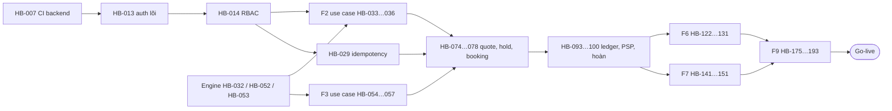

# Lộ trình thi công đến ngày deploy

**Lập:** 02/10/2026 (lead Opus) · **Đọc kèm:** [sổ tay lead](so-tay-lead.md) · [quy trình](README.md) · backlog [B0/F1](backlog.md) · [F2–F3](backlog-f2-f3.md) · [F4–F5](backlog-f4-f5.md) · [F6–F7](backlog-f6-f7.md) · [F8–F9](backlog-f8-f9.md)

Tài liệu này đủ để tiếp tục khi lead hiện tại không còn: mọi ticket tới go-live đã có dòng backlog với căn cứ, phụ thuộc, người làm; cách biến dòng thành đặc tả nằm trong sổ tay lead.

## 1. Hiện trạng (02/10/2026)

| Nhóm | Trạng thái |
|---|---|
| F0 — 4 shell frontend + gói chung | Xong; nợ duy nhất: smoke Android trên thiết bị thật |
| B0 — nền backend | Xong HB-001…HB-006; còn HB-007 (CI backend), HB-008 (chống trùng phòng), HB-009 (audit) |
| F1 — định danh/phiên | Đặc tả đủ (HB-010…HB-028); xong HB-011, HB-027; đang làm HB-022, HB-024 |
| F2–F9 | Có backlog dòng, chưa có đặc tả |

## 2. Mốc và ngày mục tiêu

Ngày theo [lộ trình gốc](../05-ke-hoach/lo-trinh.md) §4 (Sprint 1 bắt đầu 26/10/2026). Đội đang đi **trước** lịch ở F0/B0, nhưng Codex là nút thắt nên giữ mốc gốc làm mục tiêu.

| Mốc | Hết tuần (ngày) | Nội dung pha | Điều kiện đạt (rút gọn) |
|---|---|---|---|
| M4 | W7 (08/11/2026) | B0 + F1 + F2 | API chạy trong Docker; 200 yêu cầu đồng thời chỉ 1 thắng; lưới tồn 55 phòng |
| M5 | W9 (22/11/2026) | F3 + F4 | Đặt được từ customer web, customer Android, quầy; giá khớp nhau và khớp bảng tính tay; hold tự giải phóng |
| M6 | W11 (06/12/2026) | F5 | 100% bảng quyết định huỷ/hoàn; chặn tự duyệt mọi mức tiền |
| M7 | W13 (20/12/2026) | F6 + F7 phần lớn | Quá tải phát hiện trước T−24h; thang 1 → 2 → 4; operations Android cài được |
| M8 | W15 (03/01/2027) | F7 xong + F8 + F9 hardening | Báo cáo đủ, ma trận truy vết, demo đầu-cuối, UAT ký, diễn tập phục hồi |
| **Go-live** | Mục tiêu giữa 01/2027 | Triển khai production | Đủ cổng §4 **và** đã chốt các quyết định §5 (hosting, credential PSP, pháp lý dữ liệu) |

Trễ thì cắt phạm vi theo [lộ trình gốc §7](../05-ke-hoach/lo-trinh.md#7-thang-cắt-giảm-phạm-vi-khi-trễ) và [lộ trình frontend §10](../05-ke-hoach/lo-trinh-thi-cong-web-android.md#10-rủi-ro-riêng-của-frontend-và-phương-án-cắt-giảm), **không** cắt cổng §4.

## 3. Đường găng và việc chạy song song

Làm **ngay** để rút ngắn đường găng (không chờ F1 xong):

- **Codex:** ba engine thuần HB-032 (tồn), HB-052 (giá), HB-053 (huỷ) chỉ cần `packages/domain` (đã có). Đây là lõi tiền/tồn, càng sớm càng tốt.
- **DeepSeek:** hợp đồng HB-030 (F2) và HB-050 (F3) chỉ cần HB-011 (đã merge).
- **Gemini:** viết nháp đặc tả R0/R1 từ dòng backlog để lead duyệt (xem sổ tay §3).

## 4. Cổng go-live

Không mục nào được đánh dấu đạt bằng tài liệu; mỗi mục cần log hoặc biên bản trên đúng commit sẽ deploy.

| # | Cổng | Bằng chứng | Ticket |
|---|---|---|---|
| 1 | CI xanh mọi job, nightly xanh 3 đêm liền | Link run | HB-188 |
| 2 | Chống trùng phòng qua API: 200 song song → đúng 1 | Log job backend | HB-008, HB-076 |
| 3 | Giá khớp 5 nguồn (API + 4 frontend), sai 0 VND | Báo cáo đối chiếu | HB-187 |
| 4 | Bảng quyết định huỷ/hoàn 100%, chặn tự duyệt | Log test | HB-053, HB-099 |
| 5 | Callback PSP trùng/muộn không tạo tiền thứ hai | Log test + sandbox | HB-095 |
| 6 | Tải 200 VU đạt NFR-PERF | Báo cáo k6 | HB-184 |
| 7 | Backup + restore thật: RPO ≤ 15 phút, RTO ≤ 4 giờ | Biên bản diễn tập | HB-179 |
| 8 | Rollback diễn tập trên staging | Biên bản | HB-180 |
| 9 | Bảo mật: 0 CVSS ≥ 7 quá hạn, 0 bí mật, 0 dữ liệu thẻ trong log | Báo cáo job `security` | HB-183 |
| 10 | Quan sát: log có trace id, cảnh báo bắn đúng | Ảnh dashboard + log cảnh báo thử | HB-181, HB-182 |
| 11 | Accessibility: axe 0 serious/critical trên 83 màn | Báo cáo | HB-185 |
| 12 | UAT 3 kịch bản × 4 frontend có chữ ký, 0 P0/P1 | Biên bản | HB-191 |
| 13 | Android: 2 app build được, smoke trên thiết bị thật | APK + ảnh/dump | HB-189 |
| 14 | Quyết định §5 đã chốt bằng văn bản | QĐ-nn | HB-174 |

## 5. Quyết định còn mở

Mỗi dòng có **mặc định**: nếu người dùng chưa trả lời khi tới hạn, người thay vai lead áp dụng mặc định, ghi vào QĐ-nn và đánh dấu "giả định dùng tạm".

| # | Quyết định | Hạn | Mặc định |
|---|---|---|---|
| 1 | Hosting production cho api/worker/PostgreSQL/Redis (kiến trúc §7 chỉ chốt Vercel cho web, EAS cho Android) | Trước HB-175 | Một VPS Docker Engine (vd. Hetzner/DigitalOcean) + backup off-site; IaC trung lập nhà cung cấp |
| 2 | Credential sandbox VNPay/MoMo của dự án | Trước HB-094 nghiệm thu | Adapter giả lập cùng hợp đồng §5.2; không nhận tiền thật |
| 3 | Pháp lý dữ liệu: lịch lưu giữ, quyền riêng tư, xử lý yêu cầu khách | Trước HB-191 | BR-SYS-04: booking/thanh toán 10 năm, audit 5 năm — giả định demo |
| 4 | Bộ quan sát (Prometheus + Grafana tự host hay SaaS) | Trước HB-181 | OTel Collector → Prometheus + Grafana tự host |
| 5 | OPEN-02: phạm vi offline của operations Android | Trước HB-159 | Chỉ xếp hàng thao tác không xác nhận tiền/tồn; mọi thu/hoàn/giao phòng cần mạng |
| 6 | OPEN-03: phiên bản/hiệu lực policy và rate plan | Trước HB-057 | Có `version`; booking đọc snapshot bất biến; sửa chỉ áp báo giá mới |
| 7 | Q-01…Q-16 giá trị nghiệp vụ (cọc, giờ nhận phòng, phụ thu trẻ em…) | Trước UAT | Giá trị trong tổng quan §11 — giả định demo |
| 8 | Khách có phải đăng nhập lại trước thanh toán/huỷ không | Trước HB-101 | Có, trước `POST /payments/online` và huỷ |
| 9 | Giữ hay cắt MERGE_CONNECTING và kênh Airbnb | Trước HB-123 | Giữ, sau cờ cấu hình để cắt nhanh |
| 10 | Nhịp quét quá tải | Trước HB-127 | 300 giây, cấu hình được |

## 6. Ước lượng khối lượng

Khoảng 170 ticket còn lại (B0 3, F1 15, F2 18, F3 18, F4 17, F5 28, F6 22, F7 20, F8 12, F9 20). Codex nhận khoảng 60 việc R2 lõi hoặc test khoá; nếu Codex chỉ làm được 3–4 việc mỗi ngày làm việc, đường găng là Codex chứ không phải DeepSeek. Cách giảm: giao test khoá và review cấp 2 cho lead khi có, để Codex chỉ làm lõi.
